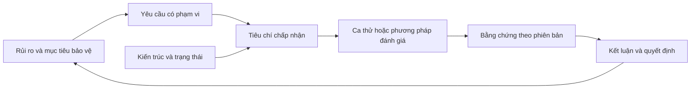

# Thực hành tổng hợp: viết security acceptance criteria

## 1. Mục tiêu và sản phẩm cần bàn giao

**Security acceptance criteria**, hay tiêu chí chấp nhận về bảo mật, mô tả những điều phải quan sát được để chấp nhận một hành vi hoặc thuộc tính bảo vệ trong phạm vi xác định. Chúng nối yêu cầu bảo mật với thiết kế kiểm thử, bằng chứng và quyết định bàn giao.

Một câu như “chức năng xuất báo cáo phải an toàn” chưa cho biết ai được xuất, dữ liệu nào được phép trả, quyền thay đổi thì sao hoặc khi kiểm soát lỗi hệ thống phải làm gì. Tiêu chí tốt cần đủ rõ để người phát triển và người xác minh cùng đi đến kết luận có căn cứ.

Bản nộp của bài thực hành gồm:

1. Phạm vi, nguồn quyết định, giả định và câu hỏi còn mở.
2. Yêu cầu bảo mật có định danh, phiên bản và rủi ro liên quan.
3. Tiêu chí cho đường hợp lệ, ngoài quyền, biên, lỗi và thay đổi trạng thái.
4. Dữ liệu thử, nguồn kết quả mong đợi và phương pháp xác minh.
5. Ma trận liên kết tới điểm thực thi, ca kiểm thử và bằng chứng.
6. Quy tắc kết luận đạt, chưa đủ bằng chứng hoặc không đạt trong phạm vi.
7. Người phụ trách, điều kiện phát hành và rủi ro còn lại.

Người học nên tự viết bản đầu trước khi xem các mẫu. Các giá trị thời gian, hạn mức, trường dữ liệu và mã phản hồi trong bài là quyết định minh họa, không phải ngưỡng hoặc hợp đồng chung cho mọi ứng dụng.

## 2. Đề bài và các quyết định nghiệp vụ

### 2.1. Hệ thống đang xét

Nền tảng học tập phục vụ nhiều tổ chức. Quản trị viên tổ chức và giảng viên được phân công có thể yêu cầu báo cáo tiến độ. API tiếp nhận, hàng đợi chuyển tác vụ, worker tạo tệp và cổng tải cấp nội dung.

Nhân viên hỗ trợ có thể nhận grant đọc dữ liệu của một lớp theo phê duyệt riêng; grant không cấp quyền xuất báo cáo. Mỗi người có thể có vai trò khác nhau ở nhiều tổ chức. Đăng nhập không tự tạo quyền truy cập mọi dữ liệu.

Phạm vi bài tập gồm tạo, xử lý, xem trạng thái, tải báo cáo, dùng grant hỗ trợ, ghi audit và phục hồi liên quan. Dữ liệu thử phải có ít nhất hai tổ chức và các tài nguyên tồn tại thật ngoài quyền của từng chủ thể.

### 2.2. Những quy tắc đã chốt để làm nguồn kết quả mong đợi

| Nội dung | Quyết định của bài tập |
| --- | --- |
| Quyền tạo báo cáo | Quản trị viên đúng tổ chức hoặc giảng viên trong phạm vi lớp được phân công |
| Quyền xem trạng thái và tải | Chỉ người yêu cầu ban đầu, khi còn đủ quyền xuất đối với phạm vi báo cáo |
| Nguồn tổ chức sở hữu | Quan hệ do hệ thống quản lý, không chỉ trường do người gọi gửi |
| Độ mới MFA khi tạo tác vụ | Tuổi bằng chứng đã xác minh từ 0 đến 5 phút, bao gồm đúng 5 phút |
| Grant hỗ trợ | Đúng người, lớp, hành động và phê duyệt; tối đa 30 phút; hiệu lực khi `startsAt <= now < expiresAt` |
| Thu hồi chủ động | Mọi yêu cầu tải mới phản ánh thay đổi trong tối đa 60 giây từ mốc nguồn quyền ghi nhận thành công |
| Tác vụ chưa kết thúc | Gồm queued và processing; tối đa 3 tác vụ cho một tổ chức |
| Tập trường báo cáo | Chỉ `learnerId`, `displayName`, `cohortId`, `progressPercent` |
| Kích thước kết quả | Nội dung báo cáo sau tuần tự hóa thành UTF-8, trước mã hóa lưu trữ, tối đa 1.048.576 byte |
| Audit trước cấp nội dung | Quyết định cho phép phải được ghi bền vững theo hợp đồng trước byte nội dung bảo vệ đầu tiên |
| Mục tiêu phục hồi minh họa | Nghiệp vụ thiết yếu trong 2 giờ từ lúc công bố bắt đầu phục hồi; điểm dữ liệu không cũ hơn 15 phút trước gián đoạn trong kịch bản đã chọn |

MFA được kiểm tra ở lúc tiếp nhận tạo tác vụ trong bài tập. Worker không được tự hiểu rằng tác vụ luôn hợp lệ về quyền; nó phải kiểm tra điều kiện nghiệp vụ theo yêu cầu riêng. Ngược lại, không tự bổ sung một yêu cầu tương tác MFA ở worker nếu chính sách không đặt ra điều đó.

Giới hạn 60 giây áp dụng cho thu hồi chủ động, không cộng thêm vào mốc hết hạn tự nhiên của grant. Phiên, quyền trên tài nguyên và bằng chứng MFA là các điều kiện khác nhau.

### 2.3. Hợp đồng phản hồi mẫu

| Trường hợp | Phản hồi đã chọn |
| --- | --- |
| Danh tính thiếu hoặc không hợp lệ | HTTP 401, không kèm metadata báo cáo |
| Đã xác thực nhưng không có quyền tạo báo cáo theo yêu cầu | HTTP 403, mã `ACTION_NOT_ALLOWED` |
| Thiếu mức hoặc độ mới MFA cho thao tác tạo | HTTP 403, mã `REAUTHENTICATION_REQUIRED` |
| Xem hoặc tải tài nguyên không tồn tại hay ngoài quyền | HTTP 404, cùng mã công khai `RESOURCE_UNAVAILABLE` |
| Vượt hạn mức tác vụ chưa kết thúc | HTTP 429, mã `EXPORT_LIMIT_REACHED` |
| Không xác minh được phụ thuộc bắt buộc hoặc điều kiện audit trước tải | HTTP 503, không trả nội dung bảo vệ |

Đây là hợp đồng của bài, không phải kết luận rằng mọi API phải dùng cùng mã. Mã phản hồi chỉ là một phần tiêu chí: vẫn cần kiểm tra nội dung, trạng thái, tác dụng phụ và sự kiện.

Nếu có nhiều lỗi cùng lúc, quy tắc thứ tự xử lý và dữ liệu được phép tiết lộ phải được quyết định. Bộ ca nên cô lập từng điều kiện trước khi kiểm tra tổ hợp để không kết luận sai từ một nhánh lỗi khác.

## 3. Phân biệt yêu cầu, tiêu chí, ca thử và điều kiện phát hành

| Đối tượng | Câu hỏi nó trả lời | Ví dụ |
| --- | --- | --- |
| Yêu cầu bảo mật | Thuộc tính bắt buộc nào cần đạt? | Chỉ chủ thể đủ quyền được tải đúng báo cáo |
| Tiêu chí chấp nhận | Điều kiện nào giúp kết luận yêu cầu được đáp ứng trong phạm vi? | Người A dùng định danh báo cáo thật của B bị từ chối và không nhận nội dung |
| Ca kiểm thử | Chuẩn bị, thao tác và quan sát cụ thể ra sao? | Tạo U_A, báo cáo R_B, gọi trực tiếp điểm tải và đối chiếu kho cùng audit |
| Assertion | Phép so sánh cụ thể trong một kiểm tra | Mã 404, không có byte nội dung báo cáo trong phản hồi |
| Điều kiện hoàn tất công việc | Cần bàn giao những đầu ra và bằng chứng nào? | Triển khai đúng phạm vi, tiêu chí được xác minh, phần thiếu có trách nhiệm |
| Điều kiện phát hành | Phần chưa đạt nào phải chặn hoặc cần quyết định theo thẩm quyền? | Không phát hành đường tải có vi phạm ranh giới tổ chức |

Một tiêu chí có thể cần nhiều ca thử. Một ca cũng có thể cung cấp bằng chứng cho nhiều tiêu chí nếu ghi rõ phần nào được kiểm tra. Không ép mọi quan hệ thành một với một.

“Đã dùng thư viện phân quyền” là thông tin thiết kế hoặc triển khai. Nó không thay tiêu chí về hành vi thực tế. “Đã tạo test” cũng chưa cho biết test có chạy, có bao phủ đúng đường và có kết quả phù hợp hay chưa.

## 4. Công thức viết tiêu chí có thể kết luận

### 4.1. Những thành phần cần đủ

Một tiêu chí nên xác định:

1. Yêu cầu và mục tiêu bảo vệ liên quan.
2. Chủ thể, tài nguyên và quan hệ quyền.
3. Trạng thái ban đầu, dữ liệu và điều kiện biên.
4. Hành động hoặc sự kiện kích hoạt.
5. Điểm thực thi và thời điểm áp dụng.
6. Kết quả phải có, dữ liệu không được tiết lộ và tác dụng phụ.
7. Mốc đo, đơn vị, giới hạn hoặc quy tắc so sánh.
8. Phương pháp và bằng chứng phù hợp.

Không cần nhồi mọi chi tiết của fixture vào một câu tiêu chí. Có thể dùng bảng quyết định, tài liệu chính sách và ca thử được liên kết, miễn là người xác minh tìm được nguồn kết quả mong đợi.

### 4.2. Dùng Given–When–Then khi phù hợp

```text
Cho trước:
  Chủ thể, quyền, dữ liệu và trạng thái đã xác định.

Khi:
  Có một hành động hoặc thay đổi trạng thái cụ thể.

Thì:
  Hệ thống cho kết quả quan sát được, trong phạm vi và giới hạn rõ;
  những tác dụng phụ hoặc tiết lộ bị cấm không xuất hiện.
```

Định dạng không tự làm nội dung tốt. “Cho trước hệ thống an toàn, khi sử dụng, thì không bị tấn công” vẫn không có điều kiện để kiểm chứng.

Với quyền có nhiều nhánh hoặc biên thời gian, bảng quyết định có thể rõ hơn nhiều đoạn văn lặp lại. Với phục hồi, cần mô tả diễn tập và điều kiện hoàn tất nghiệp vụ, không chỉ một phản hồi API.

### 4.3. Có nguồn độc lập cho kết quả mong đợi

Kết quả phải được suy từ quyết định nghiệp vụ, yêu cầu và chính sách đã xác nhận, không lấy từ chính hành vi hiện tại để làm chuẩn. Nếu hệ thống đang trả dữ liệu B cho A, không sửa kỳ vọng thành cho phép chỉ để test xanh.

Nếu chưa biết quyền lịch sử có còn hiệu lực sau ngừng phân công hay không, ghi câu hỏi và người quyết định. Không tự coi đó là lỗi triển khai hoặc tự mở quyền cho tiện kiểm thử.

### 4.4. Viết mệnh đề đủ hẹp để biết phần nào chưa đạt

Một câu gộp “xác thực tốt, log đủ và phục hồi nhanh” cần tách thành các cam kết khác nhau. Nếu chỉ một phần được xác minh, trạng thái toàn câu sẽ khó hiểu và dễ bị đóng sai.

Tuy nhiên, không tách đến mức mất mục tiêu đầu cuối. Một phép kiểm tra hàm so sánh thời gian không thay yêu cầu thu hồi trên toàn bộ điểm cấp nội dung.

## 5. Từ rủi ro tới bộ yêu cầu và tiêu chí

### 5.1. Ma trận khởi đầu

| Rủi ro | Yêu cầu minh họa | Nhóm tiêu chí cần có |
| --- | --- | --- |
| R-01: dùng danh tính hoặc bằng chứng xác thực không phù hợp | SR-AUTH-01 | Hợp lệ, thiếu, sai, quá hạn, mốc tương lai và lỗi xác minh |
| R-02: đọc hoặc xử lý dữ liệu ngoài quyền | SR-AZ-01 | Đúng quyền, khác tổ chức, cùng tổ chức nhưng thiếu quan hệ, giả thuộc tính |
| R-03: quyền cũ còn tác dụng | SR-REV-01 | Thu hồi, cache, tác vụ cũ, đường tải cũ và biên thời gian |
| R-04: lộ dữ liệu qua phản hồi, bản tạm hoặc lỗi | SR-DATA-01 | Trường cho phép, kích thước, dữ liệu lưu và không công bố khi lỗi |
| R-05: vượt hạn mức làm ảnh hưởng tổ chức khác | SR-QUOTA-01 | Chỗ cuối, đồng thời, thử lại, thất bại và giải phóng chỗ |
| R-06: audit sai nghĩa hoặc bị mất | SR-AUD-01 | Ghi bền vững, đủ ngữ nghĩa, lỗi, trùng và dữ liệu cấm |
| R-07: phục hồi mất dữ liệu hoặc tái mở quyền | SR-REC-01 | Đúng điểm phục hồi, thời gian, khóa, cấu hình và quyền hiện hành |

Các định danh là nội bộ của bài. Nếu có nguồn tiêu chuẩn hoặc hợp đồng thật, cần tham chiếu đúng phiên bản và điều kiện; không gán tùy ý mọi tiêu chí vào một ID bên ngoài.

### 5.2. Chuỗi thiết kế và xác minh



Tiêu chí cần theo nơi yêu cầu thực thi: API, worker, cổng tải, kho, dịch vụ khóa hoặc quy trình phục hồi. Giao diện từ chối một nút bấm không chứng minh API hoặc đường trực tiếp cũng từ chối.

### 5.3. Những lớp dữ liệu thử phải có

Chuẩn bị người khởi tạo báo cáo, người khác cùng tổ chức, người của tổ chức khác, giảng viên đúng và sai phân công, người hỗ trợ có grant và danh tính dịch vụ. Giữ các quyền độc lập rõ để không nhầm việc grant hết hạn với việc người đó còn một đường quyền khác.

Tạo tài nguyên thật ở cả hai tổ chức, báo cáo thuộc người khác cùng tổ chức và dữ liệu có trường ngoài phạm vi. Fixture phải cho phép phân biệt không tồn tại với tồn tại nhưng ngoài quyền.

Không cần dùng dữ liệu thật hoặc bí mật thật. Dữ liệu thử có thể được đánh dấu để nhận ra khi bị lộ, nhưng không đưa nó thành cơ chế bỏ qua quyền trong sản phẩm.

## 6. Viết tiêu chí cho xác thực và biên thời gian

### AC-AUTH-01 — Đường tạo hợp lệ

**Cho trước:** U có quyền xuất đúng phạm vi; bằng chứng danh tính hợp lệ, MFA đúng mức và hoàn thành 4 phút trước thời điểm API tiếp nhận.

**Khi:** U gọi trực tiếp API tạo tác vụ.

**Thì:** nếu các điều kiện khác đều hợp lệ, API tạo đúng tác vụ và ràng buộc U cùng tổ chức, phạm vi dữ liệu. Người kiểm thử đối chiếu trạng thái, thông điệp và audit tương ứng, không chỉ mã phản hồi.

Ca này không được thiết kế sao cho một điều kiện khác như hết hạn mức làm che đường thành công cần xác minh.

### AC-AUTH-02 — Thiếu hoặc sai bằng chứng

Với cùng yêu cầu nhưng danh tính không hợp lệ, API trả 401 theo hợp đồng, không tạo tác vụ hoặc đường tải ngoài ý muốn. Với danh tính hợp lệ nhưng thiếu mức hoặc độ mới MFA, trả 403 và `REAUTHENTICATION_REQUIRED`, không thực hiện tác vụ.

Bằng chứng cần phân biệt nhánh danh tính với nhánh mức xác thực. Không cho một thuộc tính do giao diện tự gửi thay kết quả đã được máy chủ xác minh.

### AC-AUTH-03 — Tuổi MFA tại biên

| Tuổi bằng chứng theo thời gian có thẩm quyền | Kết quả về điều kiện độ mới |
| --- | --- |
| Âm, ngoài chính sách sai lệch được cho phép | Không coi là hợp lệ vì “rất mới” |
| 0 | Đáp ứng điều kiện tuổi |
| 5 phút trừ một đơn vị độ phân giải | Đáp ứng |
| Đúng 5 phút | Đáp ứng |
| 5 phút cộng một đơn vị độ phân giải | Không đáp ứng |

Đáp ứng tuổi không đủ nếu danh tính, mức MFA hoặc quyền sai. Đơn vị liền kề phải theo độ phân giải của hợp đồng, không tự dùng một epsilon tùy ý.

Dùng đồng hồ điều khiển được ở lớp thích hợp để kiểm tra chính xác. Ở tích hợp, xác minh nguồn thời điểm, cách chuyển đổi và điểm kiểm tra thực tế.

### AC-AUTH-04 — Không xác minh được phụ thuộc bắt buộc

Nếu API không thể xác minh dữ liệu bắt buộc từ nguồn đã chốt, trả 503 theo hợp đồng và không tiếp tục chỉ bằng một dấu xác nhận phía client. Đường báo lỗi không chứa token, thông tin xác thực hoặc nội dung báo cáo.

Một lần timeout không tự chứng minh danh tính sai; trạng thái vận hành và kết quả bảo mật cần được phân biệt, dù cả hai đều không cho tạo tác vụ trong điều kiện này.

### AC-TIME-01 — Grant hỗ trợ ở biên hiệu lực

```text
Cho trước:
  - Grant G dành cho U, đúng lớp và hành động đọc.
  - G có hiệu lực khi startsAt <= now < expiresAt.
  - U không có một đường quyền độc lập khác cho hành động đang thử.

Khi:
  - U yêu cầu hành động trước, đúng và sau các mốc.

Thì:
  - Trước startsAt: không cho phép theo G.
  - Đúng startsAt: có thể cho phép nếu đủ các điều kiện khác.
  - Đúng expiresAt và sau đó: không cho phép theo G.
  - Không cộng thêm giới hạn lan truyền thu hồi vào thời hạn của G.
```

Kiểm tra cả sai lớp, sai hành động và grant không có phê duyệt hợp lệ. Một grant đọc không tạo quyền xuất chỉ vì người dùng vừa hoàn tất MFA.

## 7. Viết tiêu chí cho authorization và tác dụng phụ

### AC-AZ-01 — Giữ ranh giới tổ chức

**Cho trước:** U_A có quyền xuất ở A nhưng không có quyền ở B; R_B là báo cáo tồn tại thật thuộc B.

**Khi:** U_A dùng định danh R_B để xem trạng thái hoặc tải qua từng điểm thuộc phạm vi.

**Thì:** trả 404 và `RESOURCE_UNAVAILABLE`; không có nội dung báo cáo, tên học viên hoặc metadata ngoài hợp đồng trong phản hồi. Không tạo URL hoặc một bản sao có thể đọc ngoài quyền.

Kiểm tra cùng nội dung hợp đồng công khai với trường hợp tài nguyên không tồn tại. Điều này không tự cam kết thời gian phản hồi tuyệt đối giống nhau; nếu cần yêu cầu chống rò qua thời gian, phải có phạm vi và phương pháp riêng.

### AC-AZ-02 — Cùng tổ chức chưa đủ quyền

Với U khác người khởi tạo nhưng thuộc cùng A và có quyền tạo báo cáo riêng, yêu cầu xem hoặc tải R_A của người khác vẫn bị từ chối theo quy tắc đã chốt.

Với giảng viên, tạo báo cáo cho lớp được phân công có thể thành công; đổi sang lớp thật chưa được phân công phải bị từ chối với `ACTION_NOT_ALLOWED`. Vai trò có tên giống nhau không thay quan hệ với tài nguyên.

Đây là quy tắc của sản phẩm mẫu. Nếu nghiệp vụ quyết định chia sẻ báo cáo, phải sửa nguồn yêu cầu và tiêu chí có căn cứ, không tự sửa kỳ vọng theo triển khai.

### AC-AZ-03 — Không tin thuộc tính bảo mật do client khai

Khi người gọi thay `tenantId`, `requesterId`, chủ sở hữu hoặc phạm vi lớp trong dữ liệu gửi, máy chủ không được dùng các trường đó làm căn cứ quyền trái với quan hệ được quản lý.

Dữ liệu thử cần có tổ chức, lớp và chủ thể khác nhau để nhận ra việc kiểm tra chỉ so hai trường do client cùng kiểm soát. Kết quả từ chối phải quan sát cả trạng thái kho, tác vụ và tệp, không chỉ phản hồi phía trước.

Nếu API cho phép cập nhật một thuộc tính bảo mật, hành động đó phải có chính sách riêng. Không mặc định mọi trường trong đối tượng đều được gán lại bằng một API cập nhật chung.

### AC-AZ-04 — Danh sách, tìm kiếm và cache giữ cùng ranh giới

Kết quả danh sách, trang tiếp theo và tìm kiếm chỉ chứa bản ghi được phép. Số lượng hoặc thông tin tổng hợp cũng không được tiết lộ ngoài hợp đồng của chức năng.

Làm nóng cache bằng một người có quyền, rồi truy cập bằng người thiếu quyền hoặc tổ chức khác. Không được trả dữ liệu hoặc quyết định cho phép của chủ thể trước. Các thuộc tính ảnh hưởng quyền và thời điểm hết hiệu lực phải được xét theo thiết kế.

Một trang đầu đúng không chứng minh những trang sau hoặc đường xuất cũng đúng. Liệt kê các điểm áp dụng trong tiêu chí hoặc ma trận phạm vi.

### AC-AZ-05 — Yêu cầu bị từ chối không có hiệu ứng nghiệp vụ trái phép

Không có tác vụ mới, tệp tải được, thay đổi quyền hoặc thông báo chứa dữ liệu ngoài quyền do yêu cầu bị từ chối tạo ra. Sự kiện audit từ chối và các hiệu ứng bảo vệ đã được quy định vẫn được phép.

Không viết “không được thay đổi bất kỳ dữ liệu nào” nếu hệ thống phải ghi audit hoặc bộ đếm bảo vệ. Nêu đúng hiệu ứng bị cấm để tiêu chí không mâu thuẫn.

Nếu có thao tác hàng loạt, phải chọn ngữ nghĩa toàn bộ hoặc một phần trước khi viết ca. Bài làm không được coi một phản hồi lỗi tổng là đủ nếu vài mục ngoài quyền đã bị thay đổi.

## 8. Viết tiêu chí cho tác vụ nền và thu hồi

### AC-JOB-01 — Quyền tại thời điểm worker thực hiện

```text
Cho trước:
  - U tạo một tác vụ hợp lệ của A.
  - Tác vụ được giữ ở trạng thái queued.
  - Quyền xuất của U bị thu hồi tại nguồn có thẩm quyền.
  - Đã qua mốc hiệu lực thay đổi quyền mà yêu cầu thực thi quy định.

Khi:
  - Cho worker tiếp tục xử lý.

Thì:
  - Worker không dùng quyền kỹ thuật rộng để đọc hoặc công bố ngoài quyền.
  - Tác vụ có trạng thái được đặc tả, không bị báo hoàn tất giả.
  - Không có tệp được công bố có thể tải trái điều kiện.
  - Dấu vết vẫn liên hệ được U, A, tác vụ và danh tính worker.
```

Ca này cần một điểm đồng bộ hoặc cơ chế điều khiển hợp lệ trong môi trường thử. Chỉ chờ một khoảng ngẫu nhiên rồi hy vọng worker chưa chạy không tạo bằng chứng đáng tin cậy về chuyển trạng thái.

### AC-JOB-02 — Thông điệp không khớp tác vụ

Với thông điệp sai tổ chức, người khởi tạo hoặc phạm vi so với bản ghi tác vụ do hệ thống quản lý, worker không được thực hiện theo trường bị sửa. Tùy hợp đồng, nó từ chối, cách ly hoặc đánh dấu lỗi; không công bố báo cáo thành công.

Giữ quyền kỹ thuật và quyền nghiệp vụ riêng trong bằng chứng. Một tài khoản worker đọc được mọi hàng ở cơ sở dữ liệu không phải căn cứ cho phép xử lý mọi yêu cầu từ hàng đợi.

### AC-REV-01 — Hiệu lực thu hồi trên mọi yêu cầu tải mới

Gọi T0 là mốc nguồn quyền ghi nhận thu hồi thành công. Tập điểm kiểm tra phải gồm cổng tải, cache và bất kỳ đường cấp dữ liệu liên quan nào đã được xác nhận tồn tại.

| Thời điểm yêu cầu tải mới | Kết quả cần đánh giá |
| --- | --- |
| Trước T0 + 60 giây | Có thể đã từ chối sớm; không yêu cầu hệ thống phải tiếp tục cho phép |
| Đúng T0 + 60 giây | Phải từ chối khi quyền không còn hiệu lực |
| Sau T0 + 60 giây | Tiếp tục từ chối, không sống lại do cache hoặc thử lại |

Mốc bắt đầu không phải lúc giao diện đổi màu hoặc lúc người kiểm thử gửi lệnh mà chưa biết đã được ghi nhận. Mốc kết thúc không chỉ là cơ sở dữ liệu quyền đã cập nhật; phải đánh giá ở điểm cấp nội dung.

Nếu kiến trúc thêm URL trực tiếp, phải thêm vào phạm vi. Không được giữ tiêu chí chỉ gọi API chính để tránh thấy đường cũ còn hoạt động.

### AC-REV-02 — Phạm vi luồng đang mở và dữ liệu đã tải

Yêu cầu về tải mới không tự xác định có phải ngắt luồng đang truyền hay không. Nếu nghiệp vụ cần ngắt, phải viết tiêu chí riêng với thời điểm kiểm tra, phần dữ liệu có thể đã được gửi và giới hạn can thiệp.

Không đặt tiêu chí “thu hồi xong thì không ai còn dữ liệu đã tải”. Thay đổi quyền phía máy chủ không lấy lại được bản rõ đã rời hệ thống.

### AC-JOB-03 — Thử lại không làm sống lại quyền

Tác vụ hoặc thao tác thử lại phải được đánh giá theo điều kiện hiện hành của thời điểm yêu cầu quy định. Một trạng thái được ghi trước thu hồi không tự tạo quyền vĩnh viễn cho lần chạy sau.

Quan sát định danh thao tác, trạng thái, tệp và kết quả công bố. Kiểm tra không tạo báo cáo khác tổ chức hoặc đường tải ngoài quyền khi xử lý lại sau mất phản hồi.

## 9. Viết tiêu chí cho dữ liệu, kích thước và hạn mức

### AC-DATA-01 — Đúng tập trường, không chỉ đúng bản ghi

Với chủ thể hợp lệ, báo cáo chỉ chứa `learnerId`, `displayName`, `cohortId` và `progressPercent` theo định dạng đã chốt. Trường ghi chú nội bộ, thông tin xác thực và metadata hỗ trợ không xuất hiện qua lựa chọn trường, đối tượng lồng hoặc đường lỗi.

Chuẩn bị dữ liệu thử có các trường cấm dễ nhận ra. Kiểm tra bản nội dung thực sự tải được, không chỉ mô hình phản hồi trung gian. Nếu cùng dữ liệu có API khác, tiêu chí phải nêu rõ phạm vi nào được đánh giá.

### AC-DATA-02 — Kích thước tính ở đúng lớp

Gọi B là 1.048.576 byte của nội dung UTF-8 sau tuần tự hóa báo cáo, trước mã hóa lưu trữ. Phần bao gói giao thức và overhead mật mã không được tính nhầm vào B.

| Kích thước tại lớp đã định nghĩa | Kết quả |
| --- | --- |
| B - 1 | Có thể công bố nếu đủ các điều kiện khác |
| B | Có thể công bố |
| B + 1 | Tác vụ không công bố báo cáo; trạng thái lỗi `REPORT_TOO_LARGE` |

Dùng dữ liệu có ký tự nhiều byte để xác minh không nhầm số ký tự với số byte. Nếu nội dung được tạo theo luồng, đổi cách chia khối nhưng giữ cùng dữ liệu; tổng kích thước phải được áp dụng nhất quán.

Tại B + 1, kiểm tra tệp tạm, metadata, quyền tải và hạn mức. Mã lỗi đúng nhưng tệp vẫn đọc được là không đạt. Kết quả không được ghi toàn bộ nội dung vượt giới hạn vào log như một cách “debug”.

### AC-DATA-03 — Bảo vệ dữ liệu lưu và xử lý lỗi mật mã

Các tệp và bản sao trong phạm vi phải đáp ứng chính sách mật mã, quyền đọc và vòng đời đã được chỉ ra bằng phiên bản. Tiêu chí cụ thể cần gắn với nơi thực thi, không chỉ câu “đã mã hóa”.

Ví dụ, khi danh tính không được cấp quyền đọc hoặc dùng khóa, nó không lấy được nội dung rõ qua đường được kiểm tra. Khi xác minh toàn vẹn thất bại hoặc phụ thuộc khóa không dùng được, hệ thống không công bố nội dung không hợp lệ và không chuyển sang lưu rõ ngoài chính sách.

Phép thử mã hóa rồi giải mã thành công không chứng minh quyền đúng. Không tìm thấy một chuỗi rõ trong một mẫu cũng không chứng minh mọi bản sao đã được bảo vệ.

### AC-QUOTA-01 — Chỗ cuối cùng với một yêu cầu

Khi A có 2 tác vụ queued hoặc processing, một yêu cầu hợp lệ có thể được nhận và làm tổng thành 3. Khi đã có 3, yêu cầu mới bị từ chối với 429 và `EXPORT_LIMIT_REACHED`, không tạo tác vụ hoạt động thứ tư.

Định nghĩa trạng thái queued và processing phải nhất quán giữa bộ đếm và dữ liệu. Tệp đã sẵn sàng không tự thuộc tập tác vụ chưa kết thúc nếu chính sách đã loại nó, nhưng vẫn có vòng đời lưu riêng.

### AC-QUOTA-02 — Hai yêu cầu tranh vị trí thứ ba

Chuẩn bị A có 2 tác vụ, đồng bộ hai yêu cầu mới cùng tranh một chỗ. Theo quy tắc bài tập, chỉ một yêu cầu được nhận thêm; yêu cầu còn lại bị giới hạn. Tổng tác vụ chưa kết thúc không vượt 3 do việc kiểm tra và dành chỗ bị tách rời.

Giữ hai thao tác nghiệp vụ riêng. Nếu dùng cùng định danh thao tác có tính idempotent, kết quả có thể là hai phản hồi cho một tác vụ, nên đó là ca khác cần hợp đồng riêng.

Khi thất bại hoặc hủy theo trạng thái được phép, chỗ phải được giải phóng đúng một lần. Lỗi giữa tạo bản ghi, dành chỗ và chuyển thông điệp không được để lại tác vụ dùng được ngoài hạn hoặc chỗ chiếm không thể giải thích.

### AC-QUOTA-03 — Cô lập theo tổ chức

A chạm hạn mức không làm B mất hạn mức riêng khi B còn điều kiện được nhận. Nếu mục tiêu còn yêu cầu công bằng về tài nguyên vật lý, phải có tiêu chí tải, mức ảnh hưởng và cách đo riêng; giới hạn số tác vụ đơn thuần chưa chứng minh công bằng xử lý.

## 10. Viết tiêu chí cho audit có ngữ nghĩa đúng

### AC-AUD-01 — Liên hệ được chuỗi hành động

Tạo, xử lý, công bố, cấp nội dung và từ chối thuộc danh mục phải phát sự kiện theo schema đã chốt, liên hệ được người khởi tạo, danh tính thực thi, tổ chức, tài nguyên, hành động, kết quả, thời điểm và định danh tương quan.

Bằng chứng phải nối được chuỗi qua API, worker và cổng tải. Chỉ ghi tài khoản dịch vụ không tự xác định người đã yêu cầu nghiệp vụ.

Không có token, mã phiên có thể truy cập, khóa hoặc nội dung báo cáo trong audit và lỗi. Định danh dùng cho điều tra vẫn cần quyền đọc phù hợp, không tự trở thành dữ liệu công khai.

### AC-AUD-02 — Ghi bền vững trước byte bảo vệ đầu tiên

```text
Cho trước:
  - U đủ điều kiện tải báo cáo.
  - Cổng tải phải ghi bền vững quyết định cho phép trước khi cấp nội dung.

Khi:
  - Kênh audit từ chối, timeout hoặc không có xác nhận bền vững cần thiết.

Thì:
  - Không bắt đầu gửi nội dung bảo vệ.
  - Trả lỗi theo hợp đồng, không công bố thành công giả.
  - Có tín hiệu vận hành theo đường được thiết kế nếu thành phần còn khả năng báo.
  - Hồ sơ không tự diễn giải một timeout là chắc chắn sự kiện chưa được ghi.
```

Điểm xác nhận bền vững và mô hình lỗi cần được định nghĩa trong yêu cầu. Gọi hàm gửi hoặc ghi vào bộ nhớ không tự đáp ứng.

### AC-AUD-03 — Không báo hiệu ứng vượt điều đã xảy ra

Quyết định cho phép phát hành không được diễn giải thành người nhận đã tải xong. Quan sát truyền cần ghi đúng khả năng máy chủ biết; tiến trình có thể dừng sau một phần dữ liệu nhưng trước lúc ghi kết quả hoàn tất.

Với thay đổi grant trong cơ sở dữ liệu, nếu thiết kế dùng giao dịch cùng outbox, kiểm tra rollback không để sự kiện kết quả commit giả và commit thành công không thiếu bản ghi outbox tương ứng trong mô hình đã chốt.

Không dùng sự kiện ý định phát trước giao dịch để chứng minh hiệu ứng đã xảy ra. Nếu cùng sự kiện được chuyển lại sau mất phản hồi, cần giữ định danh và xử lý trùng theo hợp đồng; không tự đếm như hai lần hành động.

### AC-AUD-04 — Không mất quan sát âm thầm

Nếu nguồn, bộ chuyển hoặc kho tra cứu không đáp ứng cam kết, phải có tín hiệu về phần lỗi theo chính sách. Chỉ số tiến trình còn sống không chứng minh sự kiện đầu cuối còn đi được.

Một yêu cầu “cảnh báo nhanh” cần được hoàn thiện bằng điều kiện, mốc bắt đầu, thời hạn, nơi nhận và hành động. Nếu các tham số đó chưa được quyết định, ghi tiêu chí chưa sẵn sàng, không tự chọn trong mã kiểm thử.

## 11. Viết tiêu chí cho phục hồi và mở lại an toàn

### AC-REC-01 — Đo đúng chức năng và mốc thời gian

Trong kịch bản mất kho chính đã chọn, đặt T_start là lúc người có thẩm quyền công bố bắt đầu phục hồi. Kết thúc chỉ được ghi khi chức năng thiết yếu đã hoạt động và đáp ứng các kiểm tra dữ liệu, khóa, danh tính, cấu hình cùng phân quyền đã nêu.

Nếu kết thúc không muộn hơn T_start + 2 giờ, phần thời gian của tiêu chí đáp ứng. Nếu chỉ khởi động được tiến trình nhưng không giải mã hoặc không áp quyền đúng, chưa được coi hoàn tất.

Không báo 2 giờ như toàn bộ thời gian gián đoạn nếu còn khoảng phát hiện, đánh giá và ra quyết định trước T_start. Các khoảng đó cần mốc và yêu cầu riêng.

### AC-REC-02 — Điểm phục hồi không vượt giới hạn

Gọi T_incident là mốc gián đoạn được xác định cho kịch bản. Điểm dữ liệu phục hồi hợp lệ không được cũ hơn 15 phút so với mốc đó theo định nghĩa nghiệp vụ đã chốt.

Kiểm tra dữ liệu nhận biết được gần điểm phục hồi, không chỉ tên hoặc thời gian tạo file sao lưu. Nếu bản sao mới đã chứa thay đổi độc hại, không được chọn chỉ để con số đạt mục tiêu.

Một lần diễn tập đạt không chứng minh mọi kịch bản mất mát đều đạt. Lưu rõ loại sự cố, dữ liệu và phụ thuộc được bao phủ.

### AC-REC-03 — Quyền cũ không sống lại

**Cho trước:** bản sao được tạo trước khi quyền U bị thu hồi hoặc grant G hết hạn.

**Khi:** phục hồi và chuẩn bị mở lại chức năng cấp dữ liệu.

**Thì:** nguồn hiện hành và điều kiện thời gian được đối chiếu theo thiết kế; U hoặc G không được cấp dữ liệu trái với trạng thái hiện tại. Những đường không xác minh được phải được từ chối hoặc vô hiệu theo yêu cầu.

Không nới quyền dịch vụ hoặc quyền người dùng chỉ để kiểm tra đọc được dữ liệu. Phục hồi khả dụng và phục hồi an toàn cần được đánh giá cùng nhau.

### AC-REC-04 — Lưu lại phần chưa đạt

Nếu mất khóa, thiếu metadata hoặc thời gian vượt giới hạn, kết quả phải thể hiện phần không đạt hoặc bị chặn. Không đánh dấu đạt vì dữ liệu đã xuất hiện trong kho nhưng không thể sử dụng theo điều kiện đã chốt.

Quyết định mở lại có giới hạn hoặc chấp nhận rủi ro, nếu được phép, phải được ghi riêng theo thẩm quyền. Nó không biến kết quả diễn tập thất bại thành thành công.

## 12. Tổ chức ca kiểm chứng và bằng chứng

### 12.1. Chọn phương pháp theo cam kết

| Loại tiêu chí | Phương pháp phù hợp | Giới hạn cần nêu |
| --- | --- | --- |
| Logic tuổi hoặc deadline | Kiểm thử đơn vị với đồng hồ điều khiển được | Không tự chứng minh mọi điểm thực thi đều dùng logic đó |
| Quyền trên tài nguyên | Kiểm thử API và tích hợp với dữ liệu thật trong môi trường thử | Không chỉ kiểm tra một endpoint rồi suy ra toàn luồng |
| Tác vụ và trạng thái | Điều khiển thứ tự sự kiện, thử lại và lỗi giữa các bước | Kết quả phụ thuộc đúng mô hình dữ liệu và phiên bản |
| Hạn mức đồng thời | Ca có điểm đồng bộ cùng đánh giá cơ chế nhất quán | Một lần chạy ngẫu nhiên không thấy lỗi chưa đủ |
| Chính sách mật mã, quyền kho hoặc khóa | Kiểm tra cấu hình, thiết kế và tích hợp tương ứng | Mock không xác minh chính sách thật của dịch vụ |
| Audit và độ bền | Gây lỗi có kiểm soát, quan sát dữ liệu và pipeline | Không chỉ nhìn một sự kiện đẹp trên đường bình thường |
| Phục hồi | Diễn tập thực tế theo kịch bản và điều kiện mở lại | Không suy từ thông báo backup thành công |

Không cần viết lại mọi kiểm tra ở mọi tầng. Chọn lớp đủ khả năng phân biệt đúng sai và bổ sung lớp khác khi còn một cam kết chưa được chứng minh.

### 12.2. Bản ghi một lần xác minh

```yaml
criterionId: AC-REV-01
requirementId: SR-REV-01
requirementVersion: "2"
buildReference: "build-example-42"
configurationReference: "config-example-9"
environment: "isolated-test"
scope:
  - "report-gateway"
  - "confirmed-content-paths"
testCaseReference: "TC-REV-03"
method: "integration-and-design-review"
result: "PARTIAL"
evidenceReference: "evidence-example-117"
limitations:
  - "Một điểm thực thi thuộc phạm vi chưa được xác minh"
```

Đây là mẫu bản ghi học tập, không phải kết quả đã chạy trên hệ thống thật. Bản ghi thực cần thêm thời điểm, người xác minh và chi tiết dữ liệu hoặc mốc đo phù hợp. Không đưa bí mật vào trường bằng chứng chỉ để dễ tái hiện.

Nếu kết quả là một phần, không đổi thành đạt chỉ vì các phép kiểm tra đã chạy đều xanh. Phần chưa chạy thuộc phạm vi vẫn là phần chưa đủ bằng chứng.

### 12.3. Ma trận truy vết rút gọn

| Yêu cầu | Tiêu chí mẫu | Điểm thực thi | Bằng chứng cần có |
| --- | --- | --- | --- |
| SR-AUTH-01 | AC-AUTH-01–04 | API tiếp nhận và nguồn xác minh | Đúng danh tính, mức, tuổi và nhánh lỗi |
| SR-AZ-01 | AC-AZ-01–05 | API, truy vấn, danh sách, cổng tải | Bản ghi, trường, quan hệ và tác dụng phụ |
| SR-REV-01 | AC-JOB-01–03, AC-REV-01–02 | Worker, cache và điểm cấp nội dung | Thay đổi trạng thái, mốc hiệu lực và phạm vi đường tải |
| SR-DATA-01 | AC-DATA-01–03 | Tuần tự hóa, tệp tạm, kho và lớp mật mã | Nội dung, kích thước, quyền và xử lý lỗi |
| SR-QUOTA-01 | AC-QUOTA-01–03 | API, nguồn trạng thái và hàng đợi | Chỗ cuối, đồng thời, thử lại và cô lập tổ chức |
| SR-AUD-01 | AC-AUD-01–04 | Nguồn sự kiện, outbox, bộ nhận và kho | Ngữ nghĩa, độ bền, trùng, dữ liệu cấm và khoảng trống |
| SR-REC-01 | AC-REC-01–04 | Sao lưu, dịch vụ khóa, cấu hình và mở lại | Thời gian, điểm dữ liệu, quyền và giới hạn |

AC-TIME-01 liên hệ thêm với yêu cầu grant của sản phẩm, không được dùng để thay toàn bộ SR-AUTH-01 hoặc SR-REV-01. Những quan hệ bổ sung cần được ghi rõ thay vì ép một tiêu chí chỉ có một nguồn.

### 12.4. Kết luận theo phạm vi và phiên bản

Giữ trạng thái chưa đánh giá, bị chặn, không đạt, đạt một phần và đạt trong phạm vi. Ngoại lệ hoặc chấp nhận rủi ro là thuộc tính quyết định riêng, không thay bằng chứng đáp ứng.

Khi sửa yêu cầu, thêm đường tải, đổi schema audit hoặc cơ chế quyền, phải đánh giá tiêu chí và bằng chứng bị ảnh hưởng. Không giữ kết quả của bản cũ cho phần đã đổi chỉ vì tên tiêu chí giống nhau.

Số tiêu chí đạt không tự là tỷ lệ rủi ro đã loại bỏ. Một tiêu chí quan trọng về xuyên tổ chức chưa đạt có thể chặn phát hành dù nhiều tiêu chí khác đã hoàn tất.

## 13. Tự đánh giá và sửa tiêu chí yếu

### 13.1. Thang điểm minh họa

| Nhóm | Điểm tối đa | Dấu hiệu bài làm tốt |
| --- | --- | --- |
| Nguồn và phạm vi | 15 | Có quyết định, giả định, chủ thể, tài nguyên và điểm thực thi |
| Kết quả mong đợi | 25 | Quan sát được, đúng dấu bằng, trạng thái và tác dụng phụ |
| Độ bao phủ | 25 | Đường hợp lệ, ngoài quyền, lỗi, đồng thời và vòng đời |
| Phương pháp, dữ liệu | 20 | Fixture phân biệt được hành vi, chọn đúng lớp xác minh |
| Truy vết và kết luận | 15 | Đúng phiên bản, bằng chứng, phần thiếu và trách nhiệm |

Điểm tổng không thay các điều kiện bắt buộc. Một tiêu chí rộng nhưng không có cách đo, hoặc một ca chỉ kiểm tra giao diện trong khi API vẫn cấp dữ liệu, cần được sửa trước khi bàn giao.

### 13.2. Ví dụ sửa câu mơ hồ

| Câu yếu | Vấn đề | Hướng sửa |
| --- | --- | --- |
| Không ai được hack hệ thống | Không có phạm vi hay kết quả kiểm chứng | Chọn kịch bản, tài sản và hành vi phải ngăn |
| Chỉ user hợp lệ được tải | Hợp lệ về danh tính chưa đủ quyền | Nêu quan hệ người khởi tạo, tổ chức, phạm vi và trạng thái |
| Khóa quyền ngay | Không biết nguồn, mốc và mọi đường áp dụng | Định nghĩa T0, giới hạn, yêu cầu mới và các điểm thực thi |
| Log đầy đủ | Không biết sự kiện, trường và độ bền | Danh mục, schema, điều kiện ghi và hành vi lỗi |
| Dữ liệu phải mã hóa mạnh | Không biết chính sách, nơi thực thi và quyền đọc | Tham chiếu quyết định đã duyệt cùng tiêu chí cấu hình và hành vi |
| Backup phải hoạt động | Chưa chứng minh phục hồi nghiệp vụ | Kịch bản, dữ liệu, khóa, quyền, mốc thời gian và điểm phục hồi |
| Mọi test đều pass | Có thể bỏ phần chưa được kiểm tra | Đánh giá phạm vi tiêu chí và bằng chứng còn thiếu |
| Càng nhiều tiêu chí càng tốt | Dễ trùng, mâu thuẫn hoặc mất mục tiêu | Tách theo cam kết có ý nghĩa, giữ truy vết đầu cuối |

### 13.3. Những mâu thuẫn cần phát hiện

Không yêu cầu vừa “không có bất kỳ thay đổi nào khi từ chối” vừa bắt buộc ghi audit mà không giải thích ngoại lệ. Không yêu cầu grant hết hạn đúng mốc nhưng cộng thêm thời gian cache. Không yêu cầu sự kiện “đã hoàn tất” phải xuất trước hiệu ứng có thể thất bại.

Không chọn độ phân giải đo thô hơn khoảng cần phân biệt rồi vẫn khẳng định đã kiểm tra đúng biên. Nếu công cụ chưa đủ, đổi phương pháp hoặc báo giới hạn; không tự nới ngưỡng để che thiếu ổn định.

Khi phát hiện ca không ổn định, giữ bằng chứng và tìm nguyên nhân. Chạy lại đến khi có một lần xanh rồi bỏ kết quả đỏ có thể che chính lỗi đồng thời hoặc trạng thái đang cần kiểm tra.

## 14. Cách thực hành và điều kiện bàn giao

### 14.1. Các bước tự thực hiện

1. Tóm tắt phạm vi và các quyết định của đề bài.
2. Chọn các kịch bản gây hại và liên kết tới yêu cầu.
3. Viết tiêu chí đường hợp lệ trước để hiểu chức năng được phép.
4. Bổ sung đường ngoài quyền bằng tài nguyên tồn tại thật.
5. Viết bảng biên cho tuổi MFA, grant, thu hồi, kích thước và hạn mức.
6. Thêm thay đổi trạng thái, tác vụ nền, thử lại và đồng thời.
7. Mô tả tác dụng phụ bị cấm cùng audit hoặc hiệu ứng bảo vệ được phép.
8. Chọn phương pháp cho mật mã, dữ liệu lưu, audit và phục hồi.
9. Chuẩn bị dữ liệu thử, nguồn thời gian và cơ chế điều khiển.
10. Dựng ma trận, mẫu bằng chứng và cách kết luận phần chưa đủ.
11. Rà những quyết định còn mở, giao người xử lý và điều kiện hoàn thiện.
12. Giả lập một thay đổi kiến trúc rồi chỉ ra tiêu chí, ca và bằng chứng phải cập nhật.

Bài tập không yêu cầu thao tác trên dữ liệu khách hàng hoặc thử nghiệm một hệ thống đang vận hành. Nếu có triển khai thực hành riêng, dùng môi trường, danh tính và dữ liệu được phép.

### 14.2. Điểm kiểm tra khi bàn giao

- Có nguồn quyết định, phạm vi và phiên bản cho từng nhóm tiêu chí.
- Chủ thể, tài nguyên, tổ chức và quyền không bị gộp thành một nhãn hợp lệ.
- Kết quả mong đợi quan sát được, không lấy hành vi hiện tại làm chuẩn duy nhất.
- Biên có đơn vị, độ phân giải, dấu bằng và nguồn thời gian rõ.
- Thu hồi, hết hạn tự nhiên, phiên và độ mới xác thực được phân biệt.
- Các điểm API, worker, cache, kho và cổng tải được bao phủ khi liên quan.
- Từ chối không tạo dữ liệu hoặc hiệu ứng ngoài hợp đồng.
- Audit phản ánh đúng quyết định, commit hoặc quan sát hiệu ứng.
- Hạn mức có ca đồng thời, thất bại và giải phóng trạng thái.
- Phục hồi có dữ liệu, khóa, quyền và mốc đo nghiệp vụ.
- Phương pháp cùng fixture có khả năng phân biệt đúng sai.
- Bằng chứng, giới hạn, phần chưa biết và trách nhiệm được ghi rõ.
- Kết luận đạt không bị nhầm với ticket hoàn tất hoặc rủi ro đã được chấp nhận.

Security acceptance criteria hữu ích khi chúng giúp nhóm đưa ra cùng một kết luận từ điều kiện, hành vi và bằng chứng đã xác định. Bản nộp hoàn chỉnh cần cho thấy điều gì phải được bảo vệ, ở đâu, vào lúc nào và cách chứng minh, đồng thời giữ rõ những phần còn chưa đủ cơ sở để chấp nhận.
