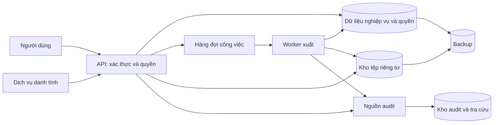

# Checklist production security readiness

## 1. Mục tiêu của bài thực hành

Production security readiness là việc đánh giá một phiên bản, cấu hình và môi trường cụ thể đã đủ điều kiện bảo mật để đưa vào vận hành hay chưa.

Checklist là công cụ hỗ trợ quyết định đó. Nó cần liên kết được với yêu cầu, rủi ro, kiến trúc và bằng chứng. Một dấu tích “đã bật xác thực” chưa cho biết mọi API có kiểm tra phiên hay không. Một báo cáo “backup thành công” chưa chứng minh có thể khôi phục dữ liệu và tiếp tục nghiệp vụ an toàn.

Bài thực hành yêu cầu tạo một bộ hồ sơ để người có thẩm quyền đánh giá:

- Phạm vi phát hành và các đường xử lý thực tế.
- Các yêu cầu bảo mật bắt buộc và điều kiện chặn phát hành.
- Bằng chứng, phiên bản, môi trường và giới hạn kiểm chứng.
- Khoảng trống, ngoại lệ, trách nhiệm và thời hạn.
- Khả năng quan sát, ngăn tác động và phục hồi sau triển khai.

Kết quả không phải lời khẳng định hệ thống “an toàn tuyệt đối”. Kết quả là một quyết định có phạm vi, dựa trên những điều đã được kiểm chứng và phần rủi ro còn lại đã được xử lý đúng thẩm quyền.

Các mốc thời gian, vai trò và ngưỡng trong bài là giả định minh họa, không phải chuẩn bắt buộc chung cho mọi sản phẩm.

## 2. Đề bài: phát hành tính năng xuất báo cáo nhiều tenant

### 2.1. Bối cảnh sản phẩm

Một nền tảng phục vụ nhiều doanh nghiệp, mỗi doanh nghiệp là một tenant:

1. Người dùng đăng nhập qua dịch vụ danh tính tập trung.
2. API kiểm tra quyền tạo báo cáo.
3. Yêu cầu hợp lệ tạo công việc trong hàng đợi.
4. Worker truy vấn dữ liệu, tạo và lưu tệp riêng tư.
5. API tải kiểm tra quyền trước khi cấp nội dung.
6. Người quản trị có thể thu hồi quyền và tạm dừng chức năng xuất.
7. Audit ghi hành động quan trọng; backup phục vụ phục hồi.

Bản phát hành RC-EXPORT-07 bổ sung đường tải và thay đổi cách worker xác định phạm vi tenant. Đây là thay đổi tác động trực tiếp đến ranh giới dữ liệu.

### 2.2. Phạm vi đánh giá

Checklist phải bao phủ:

- Artifact ứng dụng, worker và định nghĩa cấu hình liên quan.
- Tích hợp danh tính, nguồn quyền và vòng đời phiên.
- Các điểm tạo, xử lý và tải báo cáo đã liệt kê.
- Hàng đợi chính, xử lý thử lại và hàng đợi lỗi.
- Kho tệp, cache, chỉ mục và bản sao trong phạm vi.
- Danh tính kỹ thuật, bí mật và quyền triển khai.
- Audit, cảnh báo, phương án hạn chế tác động và phục hồi.
- Luồng vận hành sau khi triển khai.

Một môi trường thử tương tự production không tự chứng minh production có cấu hình đúng. Cần ghi những phần được kiểm chứng trước phát hành và những điều phải kiểm tra tại môi trường đích.

### 2.3. Kiến trúc và ranh giới tin cậy



Ngoài ranh giới trình duyệt–máy chủ, cần xét:

- Ranh giới tenant A và tenant B.
- Ranh giới giữa người khởi tạo và quyền của worker.
- Ranh giới giữa thông điệp nhận được và dữ liệu đã xác minh.
- Ranh giới giữa quyết định cho phép và việc trả nội dung.
- Ranh giới giữa dữ liệu phục hồi cũ và trạng thái quyền hiện hành.
- Ranh giới giữa ứng dụng và hệ thống quản trị triển khai.

Sơ đồ là đầu vào để hỏi và kiểm chứng, không phải bằng chứng các ranh giới đã được bảo vệ.

## 3. Các yêu cầu nguồn của bài tập

| ID | Cam kết cần kiểm chứng |
| --- | --- |
| SEC-ID-01 | Chỉ phiên ứng dụng hợp lệ từ tích hợp danh tính đã được xác minh mới đi vào API bảo vệ |
| SEC-AZ-01 | Mọi đường tạo và tải kiểm tra danh tính, tenant, đối tượng và quyền hành động ở phía máy chủ |
| SEC-JOB-01 | Worker xử lý đúng tenant của công việc đã được cấp quyền và kiểm tra lại quyền hiện hành trước khi tạo nội dung |
| SEC-VAL-01 | Đầu vào có schema, kiểu, miền giá trị, giới hạn tài nguyên và hành vi từ chối rõ |
| SEC-DATA-01 | Tệp không công khai; phản hồi, log và bản xuất chỉ có dữ liệu được phép |
| SEC-KEY-01 | Danh tính kỹ thuật và bí mật có phạm vi tối thiểu, được quản lý và có đường thu hồi/thay thế đã kiểm chứng |
| SEC-AUD-01 | Quyết định cấp nội dung và thay đổi quyền có dấu vết bền vững theo chính sách đã chốt |
| SEC-OPS-01 | Có người trực, cảnh báo có người nhận và phương án hạn chế tác động trên các đường thuộc phạm vi |
| SEC-REC-01 | Phục hồi đáp ứng mục tiêu thời gian/dữ liệu, áp lại quyền và xử lý công việc cũ trước khi mở lại |
| SEC-REL-01 | Artifact triển khai đúng artifact đã được kiểm chứng; thay đổi cấu hình được truy vết |

Mỗi hàng tóm tắt cần được dẫn tới đặc tả chi tiết có phiên bản. Không dùng chính bảng tóm tắt này thay mọi tiêu chí hành vi.

### 3.1. Các quyết định giả định đã được chốt

- Phiên hết hiệu lực khi chạm hạn nhàn rỗi 15 phút hoặc tuổi tuyệt đối 8 giờ, theo mốc máy chủ.
- Tài khoản bị vô hiệu hóa tại nguồn ứng dụng phải mất khả năng sử dụng phiên trong tối đa 60 giây từ mốc commit.
- Yêu cầu xuất có tối đa 10.000 bản ghi trong phạm vi được phép và khoảng ngày tối đa 31 ngày, tính cả hai đầu.
- Tệp được tải qua API kiểm tra quyền; không có đường tải công khai hoặc liên kết mang quyền độc lập ngoài danh mục.
- Worker phải kiểm tra lại quyền trước khi tạo nội dung xuất.
- Quyết định cho phép cấp nội dung phải được lưu audit bền vững trước byte nội dung được bảo vệ đầu tiên.
- Trong diễn tập mất kho nghiệp vụ thuộc phạm vi, mục tiêu phục hồi dịch vụ là 60 phút và mức mất dữ liệu nghiệp vụ tối đa là 15 phút.
- Tạm dừng xuất phải ngăn yêu cầu mới và job chưa bắt đầu cấp nội dung trong tối đa 5 phút từ khi lệnh được nguồn điều khiển xác nhận.

Chính sách phải đặc tả riêng thao tác đã qua điểm cấp nội dung hoặc luồng truyền đang chạy. Không hứa thu hồi được dữ liệu mà người dùng đã tải trước đó.

RPO 15 phút không cho phép khôi phục lại quyền đã bị thu hồi một cách tùy ý. Sau phục hồi, phải có nguồn đối soát và điều kiện mở lại theo SEC-REC-01.

## 4. Một checklist có thể dùng để quyết định

### 4.1. Mỗi dòng là một mệnh đề có thể đánh giá

Mẫu dòng:

| Trường | Nội dung cần có |
| --- | --- |
| Check ID | Định danh ổn định |
| Requirement/Risk ID | Yêu cầu và rủi ro nguồn |
| Phạm vi | Artifact, cấu hình, môi trường, đường truy cập |
| Tiêu chí đạt | Hành vi và ngưỡng cụ thể |
| Phương pháp | Test, rà soát, kiểm tra cấu hình hoặc diễn tập |
| Bằng chứng | Tham chiếu có phiên bản và kết quả |
| Người chịu trách nhiệm | Ai cung cấp và ai rà soát |
| Kết quả | PASS, FAIL, INCONCLUSIVE, NOT_RUN hoặc NOT_APPLICABLE |
| Khoảng trống | Điều chưa đáp ứng và tác động |
| Quyết định liên quan | Chặn, hành động khắc phục hoặc ngoại lệ hợp lệ |

“Có phân quyền” là một chủ đề. “Tài khoản tenant B không tải được báo cáo tenant A qua mọi đường đã liệt kê, đồng thời không nhận nội dung hoặc metadata bị cấm” mới là tiêu chí.

Không biến mọi tiêu chí thành tỷ lệ tùy ý. Một điều kiện nhị phân rõ có thể đủ đo được.

### 4.2. Giữ kết quả kiểm chứng riêng với quyết định phát hành

| Kết quả kiểm chứng | Ý nghĩa |
| --- | --- |
| PASS | Bằng chứng hỗ trợ tiêu chí trong phạm vi đã ghi |
| FAIL | Có quan sát trái tiêu chí |
| INCONCLUSIVE | Đã có hoạt động nhưng thiếu cơ sở đáng tin để kết luận |
| NOT_RUN | Chưa thực hiện |
| NOT_APPLICABLE | Không áp dụng và có cơ sở được người có trách nhiệm xác nhận |

Một yêu cầu FAIL vẫn là FAIL nếu có quyết định chấp nhận rủi ro. Ngoại lệ giải thích quyết định trong phạm vi cho phép; nó không sửa kết quả kiểm chứng.

Không áp dụng được phải có lý do. “Chưa làm” hoặc “không có thời gian” không phải NOT_APPLICABLE.

### 4.3. Điều kiện chặn của bài tập

Các điều kiện sau chặn phát hành theo chính sách bài tập và không được dùng ngoại lệ thông thường để bỏ qua:

- Có đường đã xác nhận đọc hoặc xuất chéo tenant.
- Có bí mật đang có hiệu lực bị lộ mà chưa được xử lý.
- Không chứng minh được artifact đích đúng artifact đã kiểm chứng.
- Không có cơ sở đáp ứng điều kiện audit bắt buộc trước khi cấp nội dung.
- Chưa diễn tập hoặc không đáp ứng điều kiện phục hồi bắt buộc của phạm vi.
- Không có người tiếp nhận cảnh báo và phương án hạn chế tác động đã kiểm chứng.

Nếu muốn đổi chính sách hoặc phạm vi sản phẩm, phải qua quy trình thay đổi có thẩm quyền và đánh giá lại. Không gắn nhãn “rủi ro được chấp nhận” vào một điều kiện hiện không được phép miễn trừ.

Đối với nghĩa vụ bên ngoài hoặc cam kết bắt buộc đã xác định, nhóm kỹ thuật không tự có quyền loại bỏ bằng quyết định nội bộ.

## 5. Checklist phạm vi, rủi ro và artifact

| Check ID | Tiêu chí | Bằng chứng cần có |
| --- | --- | --- |
| RD-SCP-01 | Danh mục điểm vào gồm API tạo, API tải, worker, retry và kênh quản trị; không còn đường chưa được quyết định | Sơ đồ và danh mục có phiên bản, kết quả đối chiếu với triển khai |
| RD-SCP-02 | Những thay đổi ở RC-EXPORT-07 đã được đánh giá tác động lên ranh giới tenant và danh tính worker | Mô hình đe dọa cập nhật, yêu cầu phát sinh và quyết định |
| RD-ART-01 | Artifact ứng viên có định danh bất biến và liên kết tới nguồn, cấu hình build và báo cáo kiểm chứng | Digest, hồ sơ build và bằng chứng bảo vệ nơi phát hành |
| RD-ART-02 | Kế hoạch triển khai tham chiếu chính artifact đã kiểm chứng; không dùng nhãn thay đổi như định danh duy nhất | Manifest triển khai và đối chiếu digest |
| RD-DEP-01 | Phụ thuộc trực tiếp/gián tiếp trong phạm vi đã được rà soát; phát hiện ảnh hưởng được xử lý theo rủi ro và chính sách | Danh mục phụ thuộc, kết quả phân tích, quyết định phát hiện |
| RD-CFG-01 | Cấu hình đích có phiên bản, nguồn thay đổi và người có quyền; debug hoặc tài khoản thử không mở ngoài phạm vi | Rà soát cấu hình hiệu lực và quyền triển khai |

Một chữ ký hoặc digest hỗ trợ xác minh nguồn và nội dung theo cơ chế được chọn. Nó không tự chứng minh artifact không có lỗi hoặc pipeline tạo artifact không bị lạm dụng.

Một kết quả quét không có phát hiện không thay thế test nghiệp vụ như phân quyền tenant hoặc thu hồi quyền.

Nếu phát hiện phụ thuộc có vẻ không tới được trong cấu hình thực tế, quyết định phải có cơ sở và giới hạn. Không chỉ ghi “không ảnh hưởng” mà thiếu phân tích.

## 6. Checklist xác thực và phân quyền

### 6.1. Xác thực và phiên

| Check ID | Tiêu chí | Cách kiểm chứng chính |
| --- | --- | --- |
| RD-ID-01 | Sai nguồn danh tính, sai mục đích nhận, quá hạn hoặc sai ràng buộc giao dịch không tạo phiên | Test tích hợp với kết quả tổng hợp hợp lệ và không hợp lệ |
| RD-ID-02 | Định danh và mức xác thực không lấy từ trường client tự khai | Thay trường actor, tenant, mức MFA và đối chiếu nguồn máy chủ |
| RD-SES-01 | Idle, tuổi tuyệt đối và logout đúng chính sách trên các instance | Test trước/đúng/sau ngưỡng, phát lại phiên cũ sau logout |
| RD-SES-02 | Vô hiệu hóa tài khoản thu hồi đúng các phiên trong 60 giây | Nhiều phiên, nhiều instance, mốc commit có kiểm soát |
| RD-MFA-01 | Thao tác yêu cầu xác thực bổ sung không chấp nhận cờ tự khai hoặc bằng chứng sai phiên | Test thiếu, cũ, sai subject và phiên đã thu hồi |
| RD-ID-FAIL-01 | Lỗi danh tính hoặc kho phiên không làm ứng dụng tự cho phép | Diễn tập lỗi và đối chiếu hành vi đã chốt |

Đăng nhập thành công chưa chứng minh đủ quyền cho mọi thao tác. MFA đúng cũng không thay thế ranh giới tenant.

Không ghi PASS cho tích hợp thực nếu chỉ dùng stub luôn trả “đã xác minh”. Stub hữu ích cho logic nhưng phải giữ rõ phạm vi bằng chứng.

### 6.2. Phân quyền xuyên suốt luồng xuất

| Check ID | Tiêu chí | Cách kiểm chứng chính |
| --- | --- | --- |
| RD-AZ-01 | Người đúng tenant và đủ quyền tạo được báo cáo đúng dữ liệu | Positive control với bộ dữ liệu có dấu nhận diện |
| RD-AZ-02 | Người tenant B không tạo hoặc tải được báo cáo tenant A | API trực tiếp, thay mã đối tượng, các đường tải liên quan |
| RD-AZ-03 | Người cùng tenant nhưng thiếu quyền xuất bị từ chối | Kiểm tra phản hồi, job, tệp và lời gọi ngoài |
| RD-AZ-04 | Worker không dùng tenant từ thông điệp chưa xác minh để chọn dữ liệu | Message tổng hợp có giá trị mâu thuẫn, kiểm tra dữ liệu đầu ra |
| RD-AZ-05 | Quyền bị thu hồi trước khi worker xử lý làm job bị hủy theo hợp đồng | Giữ worker tại điểm đồng bộ, thu hồi rồi cho tiếp tục |
| RD-AZ-06 | Tệp tạo trước phát hành không vượt chính sách tải hiện hành | Thử bản cũ, metadata, preview và cache trong phạm vi |

Tình huống bị từ chối phải kiểm tra cả không có nội dung và không có tác dụng phụ trái phép. Trả 403 nhưng vẫn tạo tệp không phải PASS.

Với race condition, dùng điểm đồng bộ của bộ thử. Một khoảng sleep cố định không chứng minh thay đổi quyền xảy ra trước điểm quyết định cần kiểm tra.

Checklist không tự chứng minh không có đường tải ngoài danh mục. RD-SCP-01 và việc đối chiếu kiến trúc có vai trò xác định độ bao phủ.

## 7. Checklist đầu vào, dữ liệu và bí mật

| Check ID | Tiêu chí | Bằng chứng |
| --- | --- | --- |
| RD-VAL-01 | Schema, kiểu, thiếu/null, trường lạ và miền giá trị được thực thi phía máy chủ | Test phân vùng, biên và request giữ đúng biểu diễn |
| RD-VAL-02 | Giới hạn body, độ sâu và số lượng được kiểm tra ở tầng thích hợp | Test parser và giới hạn tài nguyên theo hồ sơ |
| RD-VAL-03 | 10.000 bản ghi và khoảng 31 ngày được diễn giải nhất quán | Test biên, ngày hợp lệ và quan hệ liên trường |
| RD-DATA-01 | Kho tệp không cho người dùng hoặc danh tính ngoài phạm vi đọc trực tiếp | Cấu hình hiệu lực, test đọc bằng danh tính tổng hợp |
| RD-DATA-02 | Bản xuất có đúng tập trường và tenant; không thu thêm dữ liệu ngoài mục đích | So sánh nội dung với tập kỳ vọng, marker và schema |
| RD-DATA-03 | Phản hồi, lỗi và log không chứa token hoặc nội dung bị cấm | Luồng thành công, từ chối, lỗi, queue lỗi và bản xuất |
| RD-KEY-01 | Không có bí mật trong mã, artifact hoặc cấu hình chia sẻ; workload lấy bí mật từ cơ chế được phê duyệt | Rà soát có giới hạn, cấu hình và quyền nguồn bí mật |
| RD-KEY-02 | Thu hồi/thay thế bí mật làm quyền cũ hết hiệu lực đúng ngưỡng đã chốt | Diễn tập với bí mật thử, kiểm tra phiên bản cũ/mới |
| RD-PRIV-01 | Lưu giữ, xóa và bản sao của dữ liệu báo cáo có chính sách được xác nhận | Bản đồ dữ liệu, test vòng đời và kết quả từng kho |

Không dùng dữ liệu thật để dễ nhận ra rò rỉ. Tạo dữ liệu tổng hợp, tenant thử và marker riêng cho từng trường.

Mã hóa không thay thế phân quyền. Không tìm thấy marker cũng chưa chứng minh mọi nơi không chứa dữ liệu: cần biết nguồn, thời gian và phép biến đổi đã quan sát.

Input validation không thay truy vấn tham số hóa, mã hóa đầu ra hoặc kiểm soát nơi sử dụng dữ liệu. Nếu những cơ chế đó có liên quan, phải có yêu cầu và kiểm chứng riêng.

## 8. Checklist audit, giám sát và ứng cứu

### 8.1. Audit phải có ngữ nghĩa và độ bền

| Check ID | Tiêu chí | Cách kiểm chứng |
| --- | --- | --- |
| RD-AUD-01 | Tạo, hủy, hoàn tất job; quyết định tải và thay đổi quyền có đúng sự kiện trong danh mục | Chuỗi hợp lệ, bị từ chối và lỗi qua các thành phần |
| RD-AUD-02 | Actor, tenant, tài nguyên, outcome, policy version và correlation ID phản ánh ngữ cảnh đã xác minh | Trường giả từ client, message mâu thuẫn và đối chiếu dữ liệu |
| RD-AUD-03 | Thay đổi quyền đã commit không thiếu sự kiện bền vững tương ứng trong mô hình lỗi đã chốt | Fault injection quanh commit, outbox và khởi động lại |
| RD-AUD-04 | Nội dung bảo vệ không được gửi trước khi có xác nhận audit bền vững bắt buộc | Ngắt kênh ghi trước điểm cấp nội dung, quan sát byte đầu tiên |
| RD-AUD-05 | Chuyển lặp không làm đếm thêm hành động; cùng ID khác nội dung không bị ghi đè âm thầm | Retry, mất phản hồi và sự kiện xung đột |
| RD-AUD-06 | Quyền đọc, xuất và quản trị audit giữ đúng phạm vi; vòng đời và phục hồi được kiểm tra | Tenant, vai trò, hết hạn, giữ thêm và restore |

Cần định nghĩa bền vững trước loại lỗi nào. Một lệnh gửi không báo lỗi có thể chỉ đưa dữ liệu vào bộ nhớ; chưa chắc đáp ứng điều kiện.

Sự kiện “được phép cấp nội dung” không tự chứng minh người nhận đã tải xong. Giữ sự kiện quyết định và quan sát kết quả truyền riêng, với giới hạn rõ.

Khi chưa ghi được audit bắt buộc, hệ thống phải xử lý theo chính sách tác vụ đã chốt. Không chuyển một hành vi trái quyền thành được phép chỉ để tránh thiếu log.

### 8.2. Giám sát và đường phản ứng có người nhận

| Check ID | Tiêu chí | Cách kiểm chứng |
| --- | --- | --- |
| RD-MON-01 | Cảnh báo bao phủ dấu hiệu truy cập sai tenant, lỗi quyền worker và mất pipeline audit theo chính sách | Tín hiệu tổng hợp và quan sát quy tắc, tuyến nhận |
| RD-MON-02 | Có người phụ trách và tuyến dự phòng khi người đầu không xác nhận | Diễn tập người trực vắng, kênh lỗi và hết hạn |
| RD-MON-03 | Theo dõi được độ trễ, backlog, mất sự kiện hoặc khoảng chưa quan sát | Dừng producer/collector có kiểm soát, kiểm tra cảnh báo và dashboard |
| RD-IR-01 | Runbook nêu ai được tạm dừng xuất, phạm vi, tác động và cách xác nhận hiệu lực | Diễn tập bằng danh tính đúng/sai quyền |
| RD-IR-02 | Lệnh tạm dừng có hiệu lực trên request mới và job chưa bắt đầu cấp nội dung trong 5 phút | Nhiều instance, worker giữ chờ và đường tải liên quan |
| RD-IR-03 | Kênh tiếp nhận báo cáo lỗ hổng hoạt động và có chủ sở hữu | Báo cáo thử tới bên nhận mô phỏng hoặc phạm vi diễn tập |

Runbook là hướng dẫn thực hiện và xác minh hành động. Có tài liệu không đồng nghĩa hành động đã chạy được.

Tín hiệu được gửi không đồng nghĩa người trực đã nhận trách nhiệm. Tiêu chí phải nêu rõ điểm kết thúc: hệ thống nhận, kênh chuyển tiếp chấp nhận hay người trực xác nhận.

Tạm dừng chức năng phải giữ được thao tác quản trị cần thiết để điều tra hoặc phục hồi theo chính sách. Không tạo cơ chế tạm dừng mà không có đường kiểm soát việc mở lại.

### 8.3. Ngưỡng cảnh báo cần có cơ sở

Đặc tả quy tắc không chỉ ghi “cảnh báo nếu nhiều lỗi”:

- Nguồn sự kiện và điều kiện lọc.
- Cửa sổ thời gian và ngưỡng.
- Mức độ, vai trò nhận và đường dự phòng.
- Cách gộp lặp nhưng không làm mất thông tin quan trọng.
- Hành vi khi nguồn sự kiện không còn gửi.
- Phương pháp diễn tập và mốc đánh giá lại.

Các giá trị phải được chọn cho bối cảnh cụ thể. Một dashboard không có cảnh báo khi pipeline ngừng gửi có thể tạo cảm giác bình thường giả.

## 9. Checklist backup, phục hồi và rollback

### 9.1. Backup thành công chưa đủ để sẵn sàng

| Check ID | Tiêu chí | Bằng chứng |
| --- | --- | --- |
| RD-REC-01 | Có đủ dữ liệu, cấu hình, schema, khóa và quyền cần cho kịch bản phục hồi | Danh mục phụ thuộc và kết quả khôi phục |
| RD-REC-02 | Diễn tập mất kho nghiệp vụ trong phạm vi đáp ứng 60 phút và mất dữ liệu không quá 15 phút | Timeline có mốc rõ, dữ liệu thử và phép đối chiếu |
| RD-REC-03 | Quyền đã thu hồi không tự được chấp nhận sau restore dữ liệu cũ | Tài khoản/phiên cũ, nguồn đối soát và cổng mở lại |
| RD-REC-04 | Job cũ, retry và tệp đã tạo được đối soát trước khi nối lại xử lý | Job lặp, message cũ, trạng thái tệp và quyền hiện hành |
| RD-REC-05 | Quyết định xóa hoặc hết hạn dữ liệu được áp lại trước khi mở đường truy cập | Backup có dữ liệu cũ, chính sách hiện hành và kiểm tra các bản sao |
| RD-RBK-01 | Rollback có điều kiện kích hoạt, người có quyền và phương án dữ liệu tương thích | Diễn tập ứng viên, migration và cấu hình liên quan |
| RD-RBK-02 | Rollback không đưa lỗ hổng hoặc bí mật đã thu hồi trở lại | Đối chiếu phiên bản đích, quyền, cấu hình và kiểm thử bảo vệ |

Mốc RTO trong bài tập bắt đầu khi diễn tập xác nhận kịch bản mất kho nghiệp vụ và kích hoạt quy trình khôi phục, kết thúc khi các chức năng trong phạm vi hoạt động với dữ liệu, quyền và điều kiện an toàn đã kiểm tra.

Mốc đó không phải thời gian phát hiện một sự cố thật bất kỳ hoặc thời gian khôi phục toàn bộ hạ tầng trong mọi tình huống. Nếu cần mục tiêu rộng hơn, phải đặc tả thêm.

RPO được đánh giá bằng các cập nhật đã xác nhận trước sự cố diễn tập và trạng thái được khôi phục. Một timestamp backup chỉ là một đầu vào; cần biết dữ liệu thực sự phục hồi đến mốc nào.

### 9.2. Quyền hiện hành và trạng thái đã thu hồi

Để không tái mở quyền cũ, phải biết nguồn có thẩm quyền sau phục hồi.

Ví dụ:

1. Tạo backup có USER-A vẫn được quyền xuất.
2. Thu hồi quyền tại nguồn có thẩm quyền.
3. Phục hồi backup cũ trong môi trường diễn tập.
4. Giữ API và worker chưa được mở cho xử lý nghiệp vụ.
5. Đối soát quyền với nguồn hiện hành được thiết kế.
6. Thử phiên và job cũ của USER-A.
7. Chỉ mở lại khi điều kiện truy cập đúng.

Nếu dữ liệu quyền và nguồn đối soát đều bị khôi phục về cùng trạng thái cũ, việc “kiểm tra lại quyền” có thể vẫn trả kết quả sai. Đây là vấn đề thiết kế cần giải quyết, không phải một dòng checklist để đánh dấu dự kiến.

### 9.3. Rollback khác recovery

Rollback thường đưa phiên bản hoặc cấu hình về trạng thái trước. Recovery phục hồi khả năng hoạt động sau mất mát hoặc lỗi trong phạm vi đã xác định.

Không phải thay đổi nào cũng rollback an toàn:

- Schema cũ có thể không đọc được dữ liệu mới.
- Worker cũ có thể diễn giải message khác.
- Bản cũ có thể chứa lỗ hổng vừa được sửa.
- Bí mật cũ có thể đã bị thu hồi.
- Dữ liệu đã trả cho người dùng không thể được thu lại bằng rollback.

Kế hoạch có thể chọn roll-forward hoặc tạm dừng một chức năng thay vì quay về một phiên bản không còn đáp ứng điều kiện. Phương án phải được chọn và kiểm chứng theo tình huống, không mặc định nút “rollback” giải quyết mọi tác động.

## 10. Kế hoạch đánh giá trước, trong và sau triển khai

### 10.1. Trước khi quyết định phát hành

- Chốt artifact, cấu hình dự kiến và phạm vi.
- Rà soát yêu cầu, mô hình đe dọa và nghĩa vụ liên quan.
- Chạy các kiểm chứng cần thiết trên ứng viên.
- Đánh giá giới hạn và khác biệt môi trường.
- Giải quyết điều kiện chặn, phát hiện và ngoại lệ.
- Chốt người quyết định, kế hoạch triển khai, giám sát và hạn chế tác động.

Đây là thời điểm để nhận diện công việc chưa đủ, không phải đổi trạng thái test chưa chạy thành PASS vì lịch phát hành đã đến.

### 10.2. Trong triển khai có kiểm soát

Có thể sử dụng phạm vi nhỏ theo thiết kế triển khai của sản phẩm, nhưng phải có:

- Danh sách người hoặc traffic thuộc phạm vi.
- Điều kiện không cho tiếp tục mở rộng.
- Cách xác nhận artifact và cấu hình đích.
- Quan sát hành vi an toàn bằng dữ liệu tổng hợp.
- Người theo dõi và quyền tạm dừng.
- Cơ chế không làm lộ dữ liệu thật trong smoke test.

Canary hoặc mở theo tenant không tự tạo ranh giới bảo vệ. Nếu đường lỗi dùng chung cho toàn bộ kho dữ liệu, phạm vi tác động có thể rộng hơn phạm vi traffic được hướng vào ứng viên.

### 10.3. Kiểm tra tại môi trường đích

Những điểm chỉ biết chắc sau triển khai phải có kế hoạch xác nhận:

| Kiểm tra | Điều cần đối chiếu |
| --- | --- |
| Artifact thực tế | Digest tại workload khớp artifact đã phê duyệt |
| Cấu hình hiệu lực | Nguồn quyền, tenant routing, debug và chính sách kho tệp |
| Danh tính kỹ thuật | Đúng principal, đúng phạm vi, không dùng quyền thử rộng |
| Audit | Sự kiện thử đi qua đúng nguồn, schema và kho |
| Cảnh báo | Tín hiệu tổng hợp đến đúng vai trò hoặc bên nhận diễn tập |
| Đường dữ liệu | Tài khoản thử chỉ nhận dữ liệu tổng hợp của mình |
| Điều khiển tác động | Người có quyền gọi được điều khiển theo quy trình, người khác không gọi được |

Không chạy một test gây mất dịch vụ thật chỉ vì nó có trong danh mục diễn tập. Kế hoạch phải xác định môi trường, cửa sổ và phạm vi phù hợp; bằng chứng từ diễn tập trước vẫn cần được đánh giá quan hệ với môi trường đích.

### 10.4. Theo dõi sau phát hành

Ghi cửa sổ theo dõi và người phụ trách, các tín hiệu cần xem, điều kiện nâng mức incident và tiêu chí kết thúc theo dõi tăng cường.

Kết thúc cửa sổ này không làm mọi rủi ro biến mất. Các trách nhiệm vận hành, cập nhật phụ thuộc, vòng đời dữ liệu và theo dõi phát hiện vẫn tiếp tục.

Nếu một kiểm tra đích bắt buộc không đạt, hành động theo tiêu chí đã chốt. Không mở rộng triển khai chỉ vì các test trước phát hành đều xanh.

## 11. Ví dụ quyết định với bằng chứng chưa đủ

### 11.1. Kết quả lần đánh giá đầu

| Check ID | Kết quả | Quan sát |
| --- | --- | --- |
| RD-ID-01 | PASS | Tích hợp xác minh đúng các trường hợp đã liệt kê |
| RD-AZ-02 | FAIL | Đường preview trả metadata của báo cáo tenant A cho tài khoản tenant B |
| RD-AUD-04 | INCONCLUSIVE | Chỉ có log đã gọi hàm gửi; chưa biết sự kiện có bền vững trước nội dung không |
| RD-REC-03 | NOT_RUN | Chưa thử tài khoản bị thu hồi trên dữ liệu restore |
| RD-MON-02 | FAIL | Kênh báo nhận thành công nhưng không có người hoặc tuyến dự phòng |
| RD-CFG-01 | PASS một phần phạm vi | Cấu hình staging đã xem; cấu hình đích chờ kiểm tra trước mở traffic |

Không sử dụng nhãn “PASS một phần” như một kết quả chung để che phần thiếu. Với RD-CFG-01, nên tách thành dòng staging và dòng kiểm tra đích hoặc giữ kết quả tổng là INCONCLUSIVE cho phạm vi yêu cầu đầy đủ.

**Quyết định:** chưa đủ điều kiện phát hành theo chính sách bài tập.

Lý do là có đường chéo tenant, thiếu cơ sở audit bắt buộc, chưa kiểm tra phục hồi quyền và không có đường nhận cảnh báo đáp ứng yêu cầu.

Không tính trung bình số dòng PASS để bỏ qua các điều kiện chặn. Nhiều test tốt ở nơi khác không bù cho một đường vẫn trả dữ liệu sai phạm vi.

### 11.2. Hành động khắc phục

- Sửa quy tắc quyền chung và kiểm tra mọi đường preview, tải, worker liên quan.
- Định nghĩa điểm xác nhận audit bền vững, bổ sung thiết kế và diễn tập lỗi.
- Diễn tập restore với quyền đã thu hồi và job cũ.
- Thiết lập owner, tuyến dự phòng và diễn tập kênh nhận.
- Tách kiểm tra cấu hình đích thành điều kiện trước mở traffic.
- Thu bằng chứng mới gắn với artifact ứng viên mới.

Sau sửa, chỉ chạy lại phần cần thiết và phần bị tác động bởi thay đổi. Nếu artifact hoặc cấu hình đổi làm kết luận cũ không còn áp dụng, phải xem lại phạm vi tương ứng.

### 11.3. Một ngoại lệ có thể quản lý

Giả sử một cải tiến giao diện tra cứu audit theo tiện ích nội bộ chưa hoàn thành, trong khi chức năng tra cứu bắt buộc hiện tại và các mục tiêu thời gian vẫn đạt.

Nếu chính sách cho phép ngoại lệ cho cải tiến đó, hồ sơ cần:

- Yêu cầu hoặc mục backlog và phạm vi chính xác.
- Tác động, bằng chứng về biện pháp hiện có và giới hạn.
- Chủ sở hữu, người có thẩm quyền quyết định.
- Biện pháp tạm thời, thời hạn, điều kiện hết hiệu lực.
- Lịch kiểm tra lại và hành động khi quá hạn.

Không đổi kết quả chưa đạt thành PASS. Nếu đây chỉ là tính năng tiện ích chưa phải yêu cầu bắt buộc cho phạm vi phát hành, hồ sơ cũng cần thể hiện đúng điều đó thay vì tạo ngoại lệ giả.

Ngoại lệ hợp lệ cho mục này không cho phép bỏ qua các điều kiện chặn đã nêu tại phần 4.

## 12. Mẫu hồ sơ readiness và quyết định

### 12.1. Bản kê có phiên bản

```yaml
readinessId: READY-RC-EXPORT-07
policyVersion: PRODUCTION-GATE-1
candidate:
  applicationDigest: "<digest đã kiểm chứng>"
  workerDigest: "<digest đã kiểm chứng>"
  configurationVersion: "<phiên bản cấu hình dự kiến>"
scope:
  environments:
    - "<môi trường đích>"
  paths:
    - "API tạo báo cáo"
    - "Worker và retry"
    - "API preview và tải"
  excluded:
    - "<chỉ ghi loại trừ có cơ sở và thẩm quyền>"
checks:
  - id: RD-AZ-02
    requirementId: SEC-AZ-01
    result: "<PASS hoặc kết quả thực tế>"
    evidenceRef: "<bằng chứng theo phiên bản>"
    reviewedBy: "<vai trò rà soát>"
openFindings:
  - "<phát hiện và trạng thái, nếu có>"
exceptions:
  - "<quyết định ngoại lệ hợp lệ, nếu có>"
targetEnvironmentChecks:
  - "<điều kiện phải xác nhận trước mở traffic>"
decision:
  state: "<NOT_READY, READY hoặc quyết định theo chính sách>"
  authority: "<người/nhóm có thẩm quyền>"
  decidedAt: "<mốc có múi giờ>"
  basis: "<cơ sở và giới hạn>"
followUp:
  owner: "<vai trò theo dõi>"
  nextReviewAt: "<mốc theo chính sách>"
```

Các chỗ trong dấu `<...>` là chỗ điền, không phải bằng chứng đã có. Không dùng trạng thái READY khi những điều kiện bắt buộc còn mở mà chính sách chưa cho phép.

Nếu quyết định chỉ cho phép triển khai vào phạm vi hạn chế để kiểm tra đích, phải ghi rõ phạm vi được phép, chưa được phép và điều kiện mở tiếp. Không diễn giải thành phê duyệt production không giới hạn.

### 12.2. Bản ghi bằng chứng

Mỗi bằng chứng cần có:

- Check ID, Requirement ID và test hoặc hoạt động kiểm tra.
- Artifact, bộ thử, cấu hình, môi trường.
- Dữ liệu tổng hợp, danh tính và điều kiện trước.
- Hành động, kết quả mong đợi và thực tế.
- Mốc thời gian, nguồn quan sát, sai số khi liên quan.
- Kết quả từng assertion và giới hạn.
- Người thực hiện, người rà soát và tham chiếu phát hiện.

Một ảnh dashboard xanh hoặc một đường dẫn “latest” không đủ giữ cơ sở cho quyết định cũ. Cần định danh cố định và khả năng truy cập trong vòng đời đã chốt.

Nếu báo cáo bị che dữ liệu, giữ ngữ cảnh đủ để đánh giá; bản đã che có định danh hoặc hash riêng theo cơ chế quản lý bằng chứng của dự án.

## 13. Kiểm thử chính checklist và cơ chế gate

Checklist cũng có thể bị sử dụng sai. Có thể kiểm tra các quy tắc quyết định bằng tình huống tổng hợp:

| Tình huống | Kết quả mong đợi theo chính sách |
| --- | --- |
| Mọi dòng có bằng chứng PASS, không còn điều kiện bắt buộc mở | Có thể chuyển tới người có thẩm quyền ra quyết định |
| Một điều kiện chặn FAIL | Không cho đánh dấu đủ điều kiện bằng số điểm trung bình |
| Test chưa chạy nhưng pipeline tổng xanh | Không coi yêu cầu tương ứng đã kiểm chứng |
| Bằng chứng thuộc artifact cũ | Yêu cầu đánh giá tác động hoặc bằng chứng mới |
| Cùng digest nhưng cấu hình quyền đổi | Xem lại những kết luận phụ thuộc cấu hình |
| Ngoại lệ đã hết hạn | Không tiếp tục sử dụng như quyết định còn hiệu lực |
| NOT_APPLICABLE thiếu cơ sở | Không chấp nhận trạng thái như đã đóng |
| Một vùng đã triển khai, vùng khác chưa | Báo trạng thái theo phạm vi, không ghi đã hoàn tất mọi nơi |
| Người không có thẩm quyền đổi gate | Bị từ chối, có dấu vết phù hợp |
| Kho bằng chứng không truy cập được | Không suy ra PASS từ nhãn cũ nếu chưa thể đối chiếu theo chính sách |

Mã giả cho quyết định:

```text
assessment = loadVersionedReadinessRecord()
assert assessment.scopeIsDefined()
assert candidateAndConfigurationMatchAssessment()

for check in requiredChecksFor(assessment.scope):
    assert check.hasTraceableRequirement()
    assert check.hasResponsibleOwner()

    if check.isBlocking and check.result != PASS:
        return NOT_READY

    if check.result != PASS:
        if check.result == NOT_APPLICABLE:
            requireApprovedApplicabilityBasis(check)
        else:
            requirePermittedCurrentException(check)

requireCompletedPreReleaseConditions()
requireDefinedTargetEnvironmentVerificationPlan()
requireAuthorizedDecision()
return READY_FOR_DEFINED_SCOPE
```

Đây là mã giả, không phải công cụ kiểm chứng triển khai. Một chương trình kiểm tra hồ sơ có thể phát hiện thiếu trường hoặc sai trạng thái, nhưng không tự chứng minh bằng chứng thật sự hỗ trợ tiêu chí.

Nếu quy tắc cho phép NOT_APPLICABLE trên một dòng chặn, phải mô hình hóa phạm vi trước khi xác định dòng đó còn là kiểm tra bắt buộc hay không. Không dùng ngoại lệ rỗng để bỏ mệnh đề bắt buộc.

Một công cụ gate phải phân biệt được quyết định triển khai phạm vi hạn chế và quyết định mở rộng vận hành theo chính sách của sản phẩm.

## 14. Tự đánh giá bài thực hành

Có thể chấm năm nhóm, mỗi nhóm 0–4 điểm:

| Nhóm | Dấu hiệu đạt tối đa |
| --- | --- |
| Phạm vi và truy vết | Điểm vào, ranh giới, artifact và rủi ro liên kết rõ |
| Tiêu chí kiểm chứng | Có trường hợp hợp lệ, bị cấm, lỗi và biên theo kiến trúc |
| Vận hành và phục hồi | Có người nhận, điều khiển tác động, restore và dữ liệu quyền hiện hành |
| Bằng chứng và quyết định | Giữ kết quả thực, giới hạn, ngoại lệ và đúng thẩm quyền |
| Vòng đời phát hành | Tách trước/đích/sau triển khai, có điều kiện xem lại |

Quy ước điểm:

- 0: thiếu.
- 1: có tên chủ đề nhưng chưa có tiêu chí.
- 2: có tiêu chí nhưng thiếu phạm vi hoặc bằng chứng.
- 3: rõ và dùng được, còn khoảng trống nhỏ đã ghi.
- 4: nhất quán, truy vết và kiểm chứng đầy đủ trong phạm vi bài tập.

Điểm tổng không ghi đè điều kiện chặn. Một bài được nhiều điểm về trình bày nhưng cho phép phát hành khi đã biết lộ dữ liệu chéo tenant vẫn cần sửa.

## 15. Checklist bàn giao của người học

- [ ] Phạm vi phát hành có artifact, cấu hình, môi trường và đường xử lý.
- [ ] Rủi ro và yêu cầu có ID, phiên bản và chủ sở hữu.
- [ ] Mỗi dòng checklist có tiêu chí cụ thể, phương pháp và bằng chứng.
- [ ] Xác thực, MFA và phân quyền được đánh giá như các điều kiện liên quan nhưng độc lập.
- [ ] Ranh giới tenant được kiểm tra từ API đến worker và tải nội dung.
- [ ] Dữ liệu, bí mật, log và các bản sao có chính sách rõ.
- [ ] Audit bắt buộc có điểm bền vững và hành vi lỗi được kiểm chứng.
- [ ] Cảnh báo có người nhận, tuyến dự phòng và mốc xác nhận.
- [ ] Phương án hạn chế tác động có quyền, phạm vi và cách xác minh hiệu lực.
- [ ] Restore kiểm tra cả dữ liệu, quyền, job cũ và điều kiện mở lại.
- [ ] Rollback không đưa lỗ hổng hoặc bí mật cũ trở lại.
- [ ] Điều kiện chặn, ngoại lệ và nghĩa vụ áp dụng không bị gộp thành điểm số.
- [ ] Kiểm tra ở môi trường đích và theo dõi sau phát hành có người phụ trách.
- [ ] Quyết định có thẩm quyền, phạm vi, cơ sở và điều kiện xem lại.
- [ ] PASS chỉ phản ánh phần đã được kiểm chứng, không thay cho lời hứa an toàn tuyệt đối.
