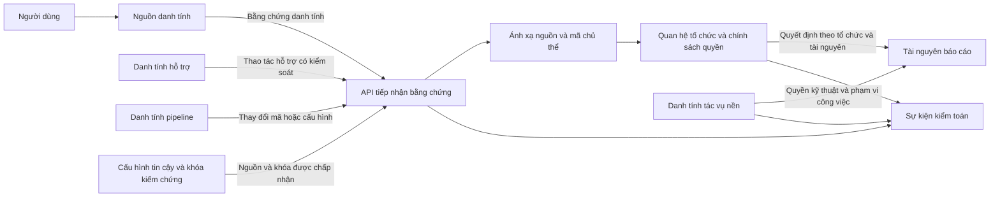

# Tài sản định danh

## 1. Vì sao cần phân loại tài sản định danh?

Một tài khoản bị chiếm quyền có thể mở đường tới nhiều tài sản khác: dữ liệu khách hàng, chức năng quản trị, kho bí mật hoặc quyền phát hành phần mềm. Nếu chỉ kiểm kê cơ sở dữ liệu và máy chủ, nhóm có thể bỏ sót những thành phần quyết định ai được sử dụng chúng.

**Tài sản định danh** trong bài này là các thực thể và bản ghi dùng để biểu diễn chủ thể, thiết lập danh tính và duy trì quan hệ danh tính trong hệ thống. Khi phân tích bảo mật, cần kiểm kê thêm thông tin xác thực, phiên, dữ liệu quyền và cấu hình tin cậy liên quan vì chúng quyết định cách danh tính được chứng minh và sử dụng.

Ví dụ:

- Tài khoản người dùng và tài khoản dịch vụ.
- Mã chủ thể, quan hệ giữa tài khoản với tổ chức và liên kết tài khoản.
- Mật khẩu, khóa xác thực, khóa API hoặc bộ kiểm chứng tương ứng.
- Phiên đăng nhập, token truy cập, token làm mới và mã khôi phục.
- Vai trò, quan hệ thành viên và chính sách ánh xạ danh tính sang quyền.
- Cấu hình chấp nhận nhà cung cấp danh tính và khóa kiểm chứng.

Các nhóm trên có tính chất khác nhau. Một mã tài khoản không tự là bí mật; một token mà ai sở hữu cũng có thể dùng để truy cập lại cần được bảo vệ như thông tin trao quyền. Một khóa công khai có thể không cần giữ kín nhưng vẫn cần được bảo vệ khỏi thay thế trái phép.

Mục đích phân loại là chuyển khác biệt đó thành yêu cầu cụ thể về xác thực, phân quyền, bảo vệ dữ liệu, logging và phục hồi.

Sau bài học này, người học có thể nhận diện tài sản định danh, phân tích tác động khi chúng bị lộ hoặc thay đổi, lập hồ sơ vòng đời và liên kết chúng với yêu cầu bảo mật có thể kiểm chứng.

## 2. Phân biệt các khái niệm nền tảng

### 2.1. Chủ thể, danh tính và mã định danh

**Chủ thể — subject** là người, dịch vụ hoặc thực thể có thể yêu cầu thực hiện hành động.

**Danh tính — identity** là sự biểu diễn chủ thể trong một bối cảnh. Cùng một người có thể có tài khoản làm việc, tài khoản quản trị và tài khoản tại một tổ chức khách hàng.

**Mã định danh — identifier** là giá trị dùng để tham chiếu danh tính trong phạm vi nhất định, như mã người dùng hoặc mã tài khoản dịch vụ.

Cần ghi rõ phạm vi duy nhất. Một mã người dùng chỉ duy nhất trong một nhà cung cấp danh tính không nên được dùng như giá trị duy nhất toàn hệ thống nếu không gắn với nguồn phát hành.

Ví dụ, hai nguồn có thể cùng phát hành mã chủ thể `user-42`. Hệ thống cần phân biệt bằng cặp nguồn danh tính và mã chủ thể, hoặc một ánh xạ nội bộ được quản lý tương đương.

Tên hiển thị và địa chỉ email có thể thay đổi hoặc được cấp lại. Việc chọn chúng làm khóa liên kết lâu dài cần đánh giá rủi ro, thay vì mặc nhiên coi đó là danh tính bất biến.

### 2.2. Thông tin xác thực và phiên

**Thông tin xác thực** hỗ trợ chứng minh danh tính hoặc quyền sử dụng một cơ chế. Ví dụ gồm bí mật đăng nhập, khóa riêng, khóa API và bằng chứng được phát hành bởi nguồn tin cậy.

**Phiên** duy trì ngữ cảnh sau khi đăng nhập. Cookie phiên hoặc token có thể cho phép thực hiện hành động mà không nhập lại mật khẩu trong mỗi yêu cầu.

Tùy cơ chế, hệ thống lưu bí mật, bộ kiểm chứng hoặc tham chiếu tới nơi bảo vệ bí mật. Không nên coi mọi bản ghi là cùng một loại dữ liệu hoặc áp dụng cùng cách lưu trữ.

Với mật khẩu, yêu cầu thường cần hướng tới bộ kiểm chứng một chiều phù hợp thay vì lưu dạng có thể đọc lại. Khóa dùng để ký hoặc xác thực dịch vụ lại cần cơ chế quản lý khóa theo chức năng thực tế của nó.

### 2.3. Danh tính và quyền truy cập

Danh tính trả lời “chủ thể nào đang hành động?”. Phân quyền trả lời “chủ thể đó được làm gì với tài nguyên nào trong điều kiện nào?”.

Quan hệ thành viên, vai trò và chính sách quyền là tài sản kiểm soát liên quan đến định danh. Chúng không phải bằng chứng đăng nhập, nhưng việc thay đổi chúng có thể tạo quyền truy cập mới mà không cần đánh cắp mật khẩu.

Ví dụ, sửa quan hệ thành viên từ tổ chức A sang B có thể làm lộ dữ liệu B. Bảo vệ mật khẩu mà bỏ qua quyền sửa quan hệ này sẽ để lại rủi ro lớn.

### 2.4. Xác minh kênh liên lạc và xác minh chủ thể

Xác nhận một người kiểm soát địa chỉ email chứng minh khả năng sử dụng kênh đó trong điều kiện của quy trình. Nó không tự chứng minh mọi thông tin mà người đó khai báo, cũng không tự cấp quyền vào một tổ chức.

Liên kết tài khoản, khôi phục truy cập và cấp quyền đặc biệt cần mức xác minh phù hợp với tác động. Cùng địa chỉ email không nên tự động trở thành căn cứ duy nhất để hợp nhất hai tài khoản có quyền nhạy cảm.

## 3. Các nhóm tài sản cần kiểm kê

| Nhóm | Ví dụ | Câu hỏi cần làm rõ |
|---|---|---|
| Danh tính con người | Người dùng, quản trị tổ chức, nhân viên hỗ trợ | Chủ thể thuộc ai, dùng trong bối cảnh nào và ai quản lý vòng đời? |
| Danh tính máy | Tài khoản dịch vụ, tác vụ nền, pipeline, tác vụ định kỳ | Dịch vụ nào sử dụng, có chủ sở hữu không và quyền ảnh hưởng tới đâu? |
| Mã và liên kết danh tính | Mã chủ thể, nguồn phát hành, ánh xạ tài khoản, quan hệ tổ chức | Tính duy nhất, ổn định và tính toàn vẹn của liên kết được bảo đảm thế nào? |
| Thông tin xác thực | Khóa API, khóa riêng, mật khẩu, bộ kiểm chứng | Ai có thể dùng, nơi lưu, hạn dùng và cách thu hồi? |
| Phiên và token | Cookie phiên, token truy cập, token làm mới | Có thể dùng lại không, đại diện cho ai và quyền còn hiệu lực đến đâu? |
| Dữ liệu quyền | Vai trò, quan hệ thành viên, phạm vi hành động | Ai được cấp, sửa, duyệt và thu hồi? |
| Cấu hình tin cậy | Nguồn danh tính được chấp nhận, khóa kiểm chứng, quy tắc ánh xạ | Ai được thay đổi và làm sao phát hiện cấu hình sai? |
| Tài sản khôi phục | Mã khôi phục, kênh liên lạc, quy trình hỗ trợ | Có thể dùng để thay thế đường đăng nhập chính tới mức nào? |
| Bằng chứng định danh | Sự kiện đăng nhập, thay đổi quyền, thu hồi và khôi phục | Cần giữ gì để truy vết mà không sao chép bí mật? |

Phân loại nên bao gồm cả tài sản trực tiếp và quan hệ phụ thuộc. Một tài khoản dịch vụ có thể không chứa dữ liệu nghiệp vụ nhưng có quyền đọc toàn bộ dữ liệu đó.

Đối với danh tính máy, “do hệ thống sử dụng” chưa phải thông tin chủ sở hữu. Cần xác định nhóm chịu trách nhiệm, mục đích, phạm vi quyền và cách xử lý khi dịch vụ ngừng hoạt động.

## 4. Đánh giá tác động theo bí mật, toàn vẹn và sẵn sàng

### 4.1. Ba câu hỏi cho mỗi tài sản

- **Bí mật:** điều gì xảy ra nếu người không được phép biết hoặc sở hữu giá trị này?
- **Toàn vẹn:** điều gì xảy ra nếu giá trị, liên kết hoặc chính sách bị thay đổi?
- **Sẵn sàng:** điều gì xảy ra nếu tài sản không dùng được khi cần?

Mức tác động phải gắn với hành vi và dữ liệu mà tài sản có thể ảnh hưởng. Không nên gán cùng mức cho mọi tài khoản chỉ vì chúng có cùng dạng lưu trữ.

### 4.2. Ma trận phân loại minh họa

| Tài sản | Bí mật | Toàn vẹn | Sẵn sàng | Lý do điển hình |
|---|---|---|---|---|
| Mã chủ thể và nguồn phát hành | Theo bối cảnh | Cao | Theo chức năng | Sửa ánh xạ có thể gắn phiên vào sai người; khả năng liên kết còn tạo tác động riêng tư |
| Quan hệ thành viên và quyền quản trị | Theo bối cảnh | Rất cao | Cao | Thay đổi trực tiếp phạm vi truy cập |
| Token truy cập dùng theo quyền sở hữu | Cao | Cao | Theo chức năng | Người sở hữu có thể dùng quyền trong phạm vi token |
| Bộ kiểm chứng mật khẩu | Cao | Cao | Cao | Bị lộ có thể hỗ trợ tấn công; bị sửa có thể ảnh hưởng xác thực |
| Khóa riêng ký bằng chứng danh tính | Rất cao | Rất cao | Cao | Có thể cho phép tạo bằng chứng được hệ thống chấp nhận |
| Khóa công khai dùng kiểm chứng | Thường thấp | Rất cao | Cao | Không cần giữ kín trong nhiều cơ chế nhưng không được thay bằng khóa tùy ý |
| Danh tính pipeline phát hành | Cao đối với bí mật liên quan | Rất cao | Cao | Có thể thay mã và cấu hình, ảnh hưởng nhiều tài sản khác |
| Kênh và mã khôi phục tài khoản | Cao tùy loại | Rất cao | Theo mục tiêu khôi phục | Có thể mở đường thay đổi thông tin xác thực |
| Sự kiện thay đổi quyền | Theo nội dung | Cao | Cao cho điều tra | Cần truy vết đúng người, đối tượng và kết quả |

Đây là ví dụ về cách lập luận, không phải bảng mức bắt buộc cho mọi tổ chức. Các mức cần được định nghĩa theo tác động nghiệp vụ và chính sách thực tế.

### 4.3. Tác động có thể lớn hơn giá trị dữ liệu lưu trong tài sản

Một token chỉ là chuỗi ngắn nhưng có thể cho quyền xuất dữ liệu của nhiều tổ chức. Một tệp cấu hình nguồn danh tính có thể không chứa bí mật nhưng việc sửa nó có thể làm hệ thống chấp nhận bằng chứng giả.

Vì vậy, phân loại cần xem cả **quyền có thể sử dụng**, **phạm vi ảnh hưởng** và **quan hệ tin cậy**, thay vì dựa riêng vào kích thước hoặc tên loại dữ liệu.

Tính sẵn sàng cũng có đánh đổi. Khi không xác minh được danh tính hoặc quyền, hệ thống phải áp dụng hành vi đã đặc tả cho từng chức năng; không tự mở quyền để duy trì truy cập.

## 5. Quy trình lập hồ sơ tài sản định danh

### Bước 1: Xác định các điểm tạo và sử dụng danh tính

Đi theo các luồng:

- Đăng ký, mời tham gia tổ chức và đăng nhập.
- Tích hợp nguồn danh tính bên ngoài.
- Cấp tài khoản dịch vụ và quyền pipeline.
- Cấp, thay đổi và thu hồi vai trò.
- Tạo, làm mới, kết thúc và thu hồi phiên.
- Liên kết tài khoản, thay kênh khôi phục và khôi phục truy cập.
- Ngừng tài khoản, dịch vụ hoặc tích hợp.

Ở mỗi điểm, ghi thành phần phát hành, thành phần tiếp nhận và nơi ra quyết định quyền.

### Bước 2: Ghi nguồn và phạm vi duy nhất

Mỗi danh tính cần có nguồn hoặc miền quản lý rõ ràng. Hồ sơ phải cho biết mã có duy nhất trong một tổ chức, một nguồn danh tính hay toàn hệ thống.

Nếu có ánh xạ giữa danh tính ngoài và tài khoản nội bộ, cần chỉ ra ai tạo ánh xạ, điều kiện xác minh, cách thay đổi và cách tránh gắn vào tài khoản khác khi mã được cấp lại.

### Bước 3: Phân biệt chủ thể, chủ sở hữu và người quản trị kỹ thuật

Ví dụ:

- Chủ thể của tài khoản máy là dịch vụ xuất báo cáo.
- Chủ sở hữu nghiệp vụ là nhóm chịu trách nhiệm chức năng xuất.
- Người quản trị kỹ thuật là nhóm vận hành cơ chế cấp và thu hồi thông tin xác thực.

Một người có thể kiêm nhiều vai trò, nhưng hồ sơ cần thể hiện trách nhiệm. Khi cá nhân phụ trách nghỉ việc, danh tính máy vẫn phải có chủ sở hữu đang hoạt động.

### Bước 4: Xác định quyền và phạm vi ảnh hưởng

Ghi tài nguyên, tổ chức, môi trường và hành động được phép. Đặc biệt chú ý quyền:

- Cấp hoặc thay đổi quyền cho người khác.
- Tạo thông tin xác thực hoặc token mới.
- Xuất dữ liệu hàng loạt.
- Thay mã, cấu hình hoặc bí mật.
- Đọc bản sao lưu, phục hồi hoặc sửa lịch sử kiểm toán.

Danh tính có quyền tạo danh tính khác có thể mang tác động lớn hơn quyền sử dụng trực tiếp đang thấy.

### Bước 5: Xác định bản sao và nơi lưu

Thông tin định danh có thể tồn tại ở ứng dụng, nguồn danh tính, bộ nhớ đệm, công cụ hỗ trợ, log, thiết bị người dùng và bản sao lưu.

Hồ sơ cần ghi nơi tồn tại và cách đồng bộ, hết hạn hoặc thu hồi. Không đưa giá trị bí mật thực vào tài liệu kiểm kê. Chỉ lưu tham chiếu, loại, chủ sở hữu và thông tin quản lý cần thiết.

### Bước 6: Phân loại và liên kết với rủi ro

Với từng tài sản, nêu tác động khi bị lộ, sửa, mất khả dụng hoặc sử dụng sau khi không còn quyền. Từ đó gắn yêu cầu, thành phần thực thi và bằng chứng.

### Bước 7: Đặt điều kiện xem xét lại

Rà soát khi thay đổi vai trò, nguồn danh tính, dịch vụ sử dụng, môi trường, chủ sở hữu hoặc phạm vi tổ chức. Thời điểm rà soát định kỳ có thể bổ sung cho các sự kiện này, theo mức rủi ro.

## 6. Mẫu hồ sơ và ví dụ danh tính máy

Một hồ sơ có thể chứa:

```text
Mã tài sản:
Loại tài sản:
Chủ thể và mục đích:
Nguồn danh tính hoặc miền quản lý:
Mã chủ thể và phạm vi duy nhất:
Tổ chức, môi trường và tài nguyên liên quan:
Chủ sở hữu nghiệp vụ:
Người quản trị kỹ thuật:
Quyền và khả năng tạo thêm quyền:
Loại thông tin xác thực; tham chiếu nơi quản lý:
Phiên, token và quan hệ phụ thuộc:
Mức tác động bí mật, toàn vẹn, sẵn sàng:
Tạo, kích hoạt, thay đổi, thu hồi và kết thúc:
Giám sát, phục hồi và bản sao:
Rủi ro, yêu cầu và bằng chứng:
Ngày xác nhận và điều kiện xem xét lại:
```

Ví dụ minh họa, không chứa bí mật:

| Trường | Nội dung |
|---|---|
| Mã tài sản | ID-SVC-EXPORT-01 |
| Loại | Danh tính tác vụ xuất báo cáo |
| Chủ thể | Tác vụ nền tạo tệp theo yêu cầu đã được phép |
| Miền quản lý | Môi trường ứng dụng sản xuất |
| Chủ sở hữu | Nhóm dịch vụ báo cáo |
| Quyền kỹ thuật | Đọc tập dữ liệu được cấp, ghi kho tệp kết quả và gửi sự kiện |
| Giới hạn nghiệp vụ | Mỗi công việc chỉ xử lý phạm vi tổ chức và dữ liệu đã được cho phép |
| Thông tin xác thực | Tham chiếu tới cơ chế cấp và quản lý được phê duyệt; không ghi giá trị khóa |
| Tác động | Lộ bí mật hoặc sửa quyền có thể ảnh hưởng dữ liệu nhiều tổ chức |
| Thu hồi | Dừng cấp thông tin xác thực mới, xử lý hiệu lực thông tin đã cấp và vô hiệu quyền theo chính sách |
| Bằng chứng | Quyền thực tế, kiểm thử phạm vi công việc, logging và diễn tập thu hồi |

Quyền kỹ thuật rộng của tác vụ không tự cho phép mọi công việc sử dụng toàn bộ dữ liệu. Cần phân biệt danh tính thực thi với chủ thể khởi tạo và ngữ cảnh quyền của từng công việc.

## 7. Ví dụ hệ sinh thái danh tính trong một dịch vụ nhiều tổ chức

### 7.1. Các tài sản và quan hệ chính

Xét một dịch vụ báo cáo cho tổ chức A và B:

- Người dùng đăng nhập qua nguồn danh tính được chấp nhận.
- Ứng dụng ánh xạ mã chủ thể từ nguồn đó sang tài khoản nội bộ.
- Một tài khoản có thể có quan hệ thành viên với nhiều tổ chức.
- Quyền đọc và xuất báo cáo được quyết định theo tổ chức và tài nguyên.
- Tác vụ nền sử dụng danh tính máy riêng.
- Nhân viên hỗ trợ và pipeline có các danh tính đặc quyền riêng.
- Sự kiện danh tính được ghi vào hệ thống kiểm toán.



Sơ đồ cho thấy rủi ro có thể xuất hiện ở nhiều nơi ngoài mật khẩu: ánh xạ danh tính, quan hệ tổ chức, khóa kiểm chứng, danh tính máy và đường thay đổi cấu hình.

### 7.2. Cần phân biệt các vòng đời

Người dùng rời tổ chức A nhưng còn làm việc với B có thể cần mất quyền tại A mà vẫn giữ tài khoản và quyền hợp lệ tại B.

Ngược lại, nếu chủ thể bị xác định là đã bị chiếm quyền, phạm vi xử lý có thể bao gồm phiên, thông tin xác thực và quyền ở nhiều tổ chức theo chính sách ứng phó.

Do đó, cần phân biệt:

- Vòng đời tài khoản.
- Vòng đời quan hệ thành viên.
- Vòng đời quyền.
- Vòng đời thông tin xác thực.
- Vòng đời phiên hoặc token.

Vô hiệu một quan hệ không tự chứng minh rằng mọi token hoặc bộ nhớ đệm liên quan đã cập nhật.

## 8. Rủi ro thường gặp đối với tài sản định danh

| Tình huống | Tài sản bị ảnh hưởng | Hậu quả |
|---|---|---|
| Hợp nhất tài khoản chỉ vì cùng email | Ánh xạ và liên kết danh tính | Gắn quyền của tài khoản này sang chủ thể khác |
| Dùng mã chủ thể mà bỏ qua nguồn phát hành | Mã và miền quản lý | Nhầm người dùng giữa các nguồn |
| Sửa quan hệ thành viên hoặc vai trò | Dữ liệu quyền | Truy cập vượt tổ chức hoặc tăng đặc quyền |
| Token xuất hiện trong log | Phiên và thông tin trao quyền | Người đọc log có thể sử dụng quyền ngoài dự kiến |
| Tài khoản dịch vụ không có chủ sở hữu | Danh tính máy | Quyền tồn tại lâu sau khi chức năng ngừng sử dụng |
| Một bí mật được dùng chung cho nhiều dịch vụ | Thông tin xác thực và khả năng quy trách nhiệm | Khó giới hạn tác động, thu hồi và xác định nguồn hành động |
| Khôi phục tài khoản yếu hơn đăng nhập chính | Tài sản khôi phục | Bỏ qua mức xác minh của tài khoản nhạy cảm |
| Khóa kiểm chứng bị thay thế trái phép | Cấu hình tin cậy | Hệ thống chấp nhận bằng chứng không đúng nguồn |
| Tài khoản bị khóa nhưng token còn hiệu lực | Quan hệ giữa tài khoản và phiên | Truy cập tiếp diễn ngoài chính sách |
| Phục hồi bản sao chứa quyền hoặc bí mật cũ | Dữ liệu định danh và bản sao lưu | Làm sống lại quyền đã thu hồi hoặc thông tin đã bị lộ |

Mô hình đe dọa cần xem xét cả người dùng ngoài, người có tài khoản hợp lệ, nhân viên nội bộ và danh tính máy bị lạm dụng. Ưu tiên xử lý phụ thuộc phạm vi quyền, dữ liệu và khả năng lan rộng.

## 9. Từ phân loại đến yêu cầu bảo mật cụ thể

### 9.1. Kiểm kê và trách nhiệm trước khi kích hoạt

**ID-INV-01:** Mọi danh tính có quyền quản trị, phát hành hoặc xuất dữ liệu trong phạm vi hệ thống phải có mục đích, chủ sở hữu, môi trường và phạm vi quyền được xác nhận trước khi kích hoạt.

**Tiêu chí chấp nhận:**

- Không kích hoạt danh tính thuộc nhóm trên khi thiếu chủ sở hữu hoặc phạm vi quyền.
- Danh tính máy có nhóm chịu trách nhiệm đang hoạt động.
- Danh sách được đối chiếu với các nguồn quản lý quyền và tài khoản đã xác định.
- Chênh lệch có người xử lý và trạng thái theo dõi.

**Bằng chứng:** hồ sơ kiểm kê, kết quả đối chiếu và quyết định cấp quyền.

**Chủ sở hữu:** nhóm quản lý danh tính phối hợp với chủ sở hữu dịch vụ.

### 9.2. Ánh xạ danh tính đúng nguồn

**ID-MAP-01:** Ứng dụng chỉ tạo ngữ cảnh người dùng sau khi xác minh bằng chứng theo cơ chế tích hợp đã chọn và ánh xạ nguồn cùng mã chủ thể tới tài khoản nội bộ phù hợp.

Tên hiển thị hoặc email không được dùng làm căn cứ duy nhất để tự động hợp nhất tài khoản có quyền nhạy cảm.

**Tiêu chí chấp nhận:**

- Cùng mã chủ thể từ hai nguồn khác nhau không bị coi là cùng tài khoản nếu chưa có liên kết hợp lệ.
- Đổi email không làm chuyển quyền sang chủ thể khác.
- Nguồn không được chấp nhận hoặc bằng chứng không xác minh được không tạo phiên hợp lệ.
- Liên kết tài khoản cần qua quy trình xác minh và kiểm toán đã đặc tả.

**Bằng chứng:** kiểm thử ánh xạ, đổi thuộc tính, nguồn trùng mã và quy trình liên kết.

**Chủ sở hữu:** nhóm tích hợp danh tính và ứng dụng.

### 9.3. Bảo vệ thông tin xác thực và token

**ID-CRED-01:** Thông tin xác thực phải được quản lý theo loại và mục đích. Không đưa bí mật thực vào hồ sơ kiểm kê, mã nguồn, thông báo lỗi hoặc log. Quyền đọc, sử dụng và thay đổi bí mật phải được giới hạn và có khả năng kiểm toán theo chính sách.

Đối với mật khẩu, lưu bộ kiểm chứng phù hợp thay vì mật khẩu dạng có thể đọc lại. Đối với khóa cần dùng để ký hoặc xác thực, chỉ thành phần được cấp quyền mới được sử dụng qua cơ chế quản lý đã chọn.

**Tiêu chí chấp nhận:**

- Thử các luồng thành công và lỗi bằng bí mật thử; bí mật không xuất hiện trong kênh bị cấm.
- Danh tính không được cấp quyền không đọc hoặc sử dụng được thông tin xác thực.
- Hồ sơ chỉ chứa tham chiếu và dữ liệu quản lý cần thiết.
- Có thể thay đổi hoặc thu hồi thông tin xác thực theo quy trình mà không phải tìm kiếm bí mật rải rác trong mã.

**Bằng chứng:** kiểm tra cấu hình quyền, dữ liệu mẫu của kênh và diễn tập vòng đời thông tin xác thực.

**Chủ sở hữu:** nhóm phát triển, vận hành và quản lý bí mật.

### 9.4. Thu hồi quyền theo thời gian có thể đo

**ID-REV-01:** Thay đổi quan hệ thành viên và quyền phải có giới hạn hiệu lực rõ ràng đối với phiên, token, bộ nhớ đệm và tác vụ nền liên quan.

Ví dụ, hệ thống chọn giới hạn tối đa 60 giây để yêu cầu mới không còn sử dụng quyền đã thu hồi trong tổ chức. Đây là giá trị minh họa, cần được nghiệp vụ và nhóm bảo mật xác nhận khi áp dụng.

**Tiêu chí chấp nhận:**

- Thu hồi quyền tại A làm yêu cầu mới sử dụng quyền đó bị từ chối trong giới hạn đã chọn.
- Quyền độc lập còn hợp lệ tại B được xử lý đúng chính sách.
- Tác vụ chờ, đường xuất và tải dữ liệu tuân theo các mốc kiểm tra đã quy định.
- Thử lại với token cũ không vượt qua chính sách hiệu lực.
- Các giới hạn đối với luồng đang chạy được nêu riêng nếu có.

**Bằng chứng:** dòng thời gian thu hồi, kiểm thử các đường truy cập và cấu hình hiệu lực quyền.

**Chủ sở hữu:** nhóm chính sách quyền và các dịch vụ thực thi.

Một token ngắn hạn không tự bảo đảm mọi giới hạn thu hồi. Thiết kế phải xét thời hạn còn lại, cơ chế kiểm tra lại và cách vô hiệu các bản sao quyền.

### 9.5. Khôi phục truy cập không tạo đường bỏ qua

**ID-RECOVERY-01:** Quy trình khôi phục truy cập phải có mức xác minh, thẩm quyền và kiểm toán phù hợp với quyền của tài khoản. Thay kênh khôi phục hoặc thông tin xác thực không được thực hiện chỉ dựa trên dữ liệu có thể thu thập dễ dàng về chủ thể.

Với tài khoản đặc quyền, một hệ thống có thể chọn quy trình khôi phục được kiểm soát bởi hai người phê duyệt độc lập, sau đó thu hồi hoặc đánh giá lại phiên và thông tin xác thực liên quan. Đây là lựa chọn thiết kế của ví dụ, không phải quy tắc chung cho mọi tài khoản.

**Tiêu chí chấp nhận:**

- Không thể dùng riêng tên, email hoặc thông tin hồ sơ công khai để hoàn tất khôi phục đặc quyền.
- Người hỗ trợ không tự có khả năng thay toàn bộ thông tin khôi phục ngoài thẩm quyền.
- Mã hoặc liên kết khôi phục tuân theo thời hạn, phạm vi và chính sách sử dụng đã đặc tả.
- Quy trình kết thúc bằng trạng thái phiên và thông tin xác thực phù hợp; có sự kiện kiểm toán.

**Bằng chứng:** kiểm thử quy trình hợp lệ, giả mạo và vượt thẩm quyền; hồ sơ phê duyệt và sự kiện.

**Chủ sở hữu:** nhóm quản lý danh tính, hỗ trợ và chủ sở hữu quyền đặc biệt.

### 9.6. Logging đủ truy vết và hạn chế dữ liệu

**ID-LOG-01:** Các sự kiện cấp tài khoản, liên kết danh tính, cấp hoặc thu hồi quyền, thay thông tin xác thực và khôi phục phải được ghi theo chính sách. Sự kiện xác định được chủ thể thực hiện, đối tượng, tổ chức, hành động, thời gian và kết quả trong phạm vi được phép.

Không ghi mật khẩu, token, mã khôi phục hoặc khóa riêng. Mã định danh trong log vẫn cần được đánh giá về khả năng liên kết tới con người.

**Tiêu chí chấp nhận:**

- Truy vết được một thay đổi quyền từ yêu cầu tới kết quả.
- Người không có quyền không đọc hoặc sửa lịch sử kiểm toán.
- Không xuất hiện dữ liệu bị cấm trong luồng lỗi hoặc chẩn đoán.
- Thời hạn giữ và quyền tra cứu được cấu hình theo mục đích đã phê duyệt.

**Bằng chứng:** sự kiện mẫu, kiểm thử quyền và kiểm tra các kênh ghi nhận.

**Chủ sở hữu:** nhóm ứng dụng và nhóm vận hành kiểm toán.

### 9.7. Phục hồi dữ liệu định danh có đối chiếu

**ID-RESTORE-01:** Khôi phục dữ liệu danh tính, quyền hoặc cấu hình tin cậy phải có bước kiểm tra trước khi phục vụ, bảo đảm không tự tái kích hoạt quyền đã thu hồi hoặc bí mật không còn được chấp nhận.

**Tiêu chí chấp nhận:**

- Bản sao chứa tài khoản đã vô hiệu hoặc quyền cũ được xử lý theo chính sách hiện hành.
- Cấu hình nguồn danh tính và khóa được đối chiếu với trạng thái có căn cứ tin cậy.
- Quyền của môi trường phục hồi được giới hạn.
- Các phụ thuộc cần để đăng nhập và quản trị an toàn được kiểm chứng.
- Có báo cáo sai lệch, đối soát và quyết định mở lại dịch vụ.

**Bằng chứng:** diễn tập phục hồi, kiểm thử quyền, kiểm tra thông tin xác thực và kết quả đối chiếu.

**Chủ sở hữu:** nhóm vận hành cùng nhóm quản lý danh tính.

## 10. Quản lý vòng đời của tài sản định danh

### 10.1. Tạo và kích hoạt

Đối với con người, cần xác định nguồn yêu cầu, cách xác minh, người cho phép tham gia tổ chức và quyền ban đầu.

Đối với máy, cần mục đích, môi trường, chủ sở hữu, thời gian sử dụng dự kiến và cơ chế cấp thông tin xác thực. Một tài khoản được tạo cho thử nghiệm không nên tự có quyền sản xuất.

### 10.2. Sử dụng và thay đổi

Thay đổi vai trò, nhiệm vụ hoặc tổ chức có thể làm quyền cũ không còn phù hợp. Cần đánh giá cả quyền trực tiếp, quyền qua nhóm và quyền có thể tạo thêm thông tin truy cập.

Đối với hành động nhạy cảm, yêu cầu có thể cần xác minh bổ sung hoặc phiên phù hợp. Điều kiện cụ thể phải gắn với mô hình đe dọa, tránh chỉ dùng nhãn “tài khoản đã đăng nhập”.

### 10.3. Thay đổi thông tin xác thực

Hồ sơ cần nêu thời hạn, sự kiện yêu cầu thay đổi, cách phân phối, kiểm chứng và thu hồi thông tin cũ.

Một số cơ chế có thể cần khoảng chuyển tiếp để thay khóa mà không gián đoạn. Nếu nghi ngờ khóa cũ đã bị lộ, việc giữ nó tiếp tục có hiệu lực là một quyết định rủi ro cần được xử lý riêng, không tự động áp dụng cùng quy trình thay định kỳ.

### 10.4. Tạm ngừng, thu hồi và kết thúc

Các trạng thái này cần có ý nghĩa rõ:

- Tạm ngừng tài khoản có ngăn đăng nhập mới không?
- Phiên hiện tại có tiếp tục sử dụng được không?
- Thông tin xác thực máy đã cấp còn hiệu lực đến đâu?
- Quyền qua nhóm hoặc tích hợp khác có được gỡ không?
- Dữ liệu lịch sử nào cần giữ để truy vết?
- Mã định danh có được tái sử dụng không?

Tái sử dụng một mã cho chủ thể khác có thể làm nhầm lịch sử, quyền hoặc liên kết cũ. Nếu hệ thống cần cơ chế cấp lại, phải thiết kế cách tách các thế hệ danh tính và dữ liệu phụ thuộc.

Xóa tài khoản khỏi một ứng dụng không tự xóa danh tính ở nguồn ngoài. Ngược lại, vô hiệu ở nguồn ngoài không bảo đảm mọi ứng dụng lập tức ngừng chấp nhận bằng chứng đã được cấp trước đó.

## 11. Các bản sao, dữ liệu riêng tư và phạm vi lưu giữ

### 11.1. Không chỉ có bảng người dùng

Tài sản và dữ liệu liên quan có thể xuất hiện trong:

- Bộ nhớ đệm quyền hoặc phiên.
- Công việc nền đang chờ.
- Log ứng dụng, kiểm toán và thông tin chẩn đoán.
- Công cụ hỗ trợ, tệp xuất và báo cáo quản trị.
- Bản sao lưu và môi trường phục hồi.

Cần theo dõi dữ liệu nào được sao chép, mục đích, người được tiếp cận và thời hạn giữ.

### 11.2. Mã thay thế vẫn có thể liên kết tới người

Thay email bằng một mã nội bộ có thể giảm lượng thông tin trực tiếp trong một kênh. Tuy nhiên, nếu mã đó liên kết được với tài khoản hoặc được dùng ổn định qua nhiều nguồn, dữ liệu vẫn có thể tạo tác động riêng tư.

Phân loại phải xem khả năng liên kết và ngữ cảnh tổng hợp. Không nên tự coi mọi mã thay thế là dữ liệu hoàn toàn vô danh.

### 11.3. Hồ sơ kiểm kê cũng cần được bảo vệ

Danh sách tài khoản đặc quyền, phạm vi quyền, nguồn tin cậy và vị trí quản lý bí mật có thể giúp kẻ tấn công hiểu cấu trúc hệ thống.

Hồ sơ kiểm kê cần phân quyền đọc, sửa và xuất. Thông tin đủ để quản lý tài sản không đồng nghĩa với việc phải tập trung bí mật có thể sử dụng trực tiếp vào cùng tài liệu.

## 12. Ma trận kiểm chứng và bằng chứng cần giữ

| Kịch bản | Điều cần quan sát |
|---|---|
| Hai nguồn phát hành cùng một mã chủ thể | Không tự gắn vào cùng tài khoản |
| Đổi email của người dùng | Không chuyển quyền sang chủ thể khác hoặc tạo liên kết ngoài quy trình |
| Gửi thuộc tính vai trò hoặc tổ chức tự khai | Không tự mở rộng quyền |
| Người dùng rời A nhưng còn thuộc B | Quyền A và B được xử lý đúng phạm vi |
| Dùng token cũ sau thu hồi | Hiệu lực tuân theo giới hạn đã đặc tả |
| Chạy công việc bằng danh tính máy nhiều quyền | Dữ liệu xử lý vẫn nằm trong ngữ cảnh được phép |
| Ngừng dịch vụ sử dụng tài khoản máy | Quyền, khả năng cấp thông tin xác thực và tài sản liên quan được xử lý |
| Thực hiện khôi phục tài khoản đặc quyền | Đúng thẩm quyền, mức xác minh và kiểm toán |
| Gây lỗi đăng nhập hoặc khôi phục bằng dữ liệu thử | Không lộ bí mật trong log và thông báo |
| Thay cấu hình nguồn hoặc khóa kiểm chứng trái phép | Thay đổi bị ngăn hoặc phát hiện theo yêu cầu |
| Phục hồi bản sao chứa quyền cũ | Không tự tái kích hoạt quyền ngoài chính sách |

Cần có trường hợp hợp lệ để xác nhận hệ thống vẫn đáp ứng nhu cầu. Các kịch bản phải gắn với phiên bản mã, cấu hình, chính sách quyền và môi trường đã kiểm tra.

Kiểm thử API không thay thế việc đối chiếu quyền thực tế của tài khoản dịch vụ. Kiểm tra cấu hình cũng không tự chứng minh ánh xạ danh tính trong ứng dụng đã đúng. Bằng chứng nên kết hợp theo bản chất yêu cầu.

## 13. Ưu tiên và duy trì phân loại trong vòng đời phát triển

### 13.1. Ưu tiên theo phạm vi ảnh hưởng

Có thể ưu tiên xem xét:

1. Danh tính có khả năng thay đổi nguồn tin cậy, cấp quyền hoặc phát hành.
2. Thông tin xác thực cho phép truy cập nhiều tổ chức hoặc nhiều môi trường.
3. Đường khôi phục có thể thay thế kiểm soát đăng nhập đặc quyền.
4. Danh tính máy không rõ chủ sở hữu hoặc không còn mục đích.
5. Phiên và bộ nhớ đệm không đáp ứng chính sách thu hồi.
6. Bản sao và log chứa dữ liệu định danh hoặc bí mật ngoài dự kiến.

Mức ưu tiên cần dựa trên tác động và khả năng xảy ra trong hệ thống cụ thể. Gán mọi tài sản mức cao nhất có thể làm mất thông tin cần để phân bổ công việc.

### 13.2. Liên kết với yêu cầu và kiến trúc

Mỗi tài sản quan trọng nên truy được theo chuỗi:

```text
Tài sản định danh
  -> chủ thể, quyền và phạm vi ảnh hưởng
  -> rủi ro
  -> yêu cầu bảo mật
  -> thành phần thực thi
  -> tiêu chí kiểm chứng
  -> bằng chứng và người chịu trách nhiệm
```

Ví dụ, tài sản “quan hệ thành viên” liên quan rủi ro truy cập chéo tổ chức, yêu cầu ID-REV-01, cơ chế thực thi tại API và tác vụ, cùng kiểm thử thu hồi có dòng thời gian.

### 13.3. Các thay đổi cần xem xét lại

- Thêm nguồn danh tính hoặc cơ chế liên kết tài khoản.
- Mở ứng dụng cho tổ chức mới hoặc thêm vai trò.
- Chuyển từ tài khoản người dùng sang danh tính máy cho tích hợp.
- Thêm pipeline, công cụ hỗ trợ hoặc đường khôi phục.
- Thay thời hạn phiên, cơ chế thu hồi hoặc bộ nhớ đệm.
- Di chuyển dữ liệu, log, bí mật hoặc môi trường phục hồi.
- Ngừng một dịch vụ hoặc thay chủ sở hữu.

Khi thay đổi, cập nhật cả hồ sơ, yêu cầu và bằng chứng bị ảnh hưởng. Phân loại là thông tin quản lý đang sống cùng hệ thống.

## 14. Những sai lệch thường gặp

| Sai lệch | Hậu quả | Cách điều chỉnh |
|---|---|---|
| Chỉ kiểm kê tài khoản con người | Bỏ sót danh tính máy và pipeline nhiều quyền | Đi theo mọi chủ thể có thể truy cập hoặc thay đổi hệ thống |
| Coi mọi mã định danh là bí mật | Không phân biệt tác động và cách bảo vệ | Đánh giá riêng bí mật, toàn vẹn, sẵn sàng và khả năng liên kết |
| Coi dữ liệu công khai không cần bảo vệ | Khóa kiểm chứng hoặc cấu hình bị thay thế | Bảo vệ tính toàn vẹn theo vai trò tin cậy |
| Dùng email làm căn cứ liên kết duy nhất | Nhầm chủ thể khi đổi hoặc cấp lại email | Quản lý mã ổn định, nguồn và quy trình liên kết |
| Chỉ bảo vệ mật khẩu | Bỏ qua token, quyền, khôi phục và cấu hình | Kiểm kê toàn bộ quan hệ định danh và phụ thuộc |
| Không có chủ sở hữu cho tài khoản dịch vụ | Quyền tồn tại sau khi nhu cầu kết thúc | Gắn mục đích, nhóm chịu trách nhiệm và điều kiện thu hồi |
| Cho rằng khóa tài khoản thu hồi mọi truy cập | Token và quyền lưu đệm còn hiệu lực | Đặc tả hiệu lực từng loại tài sản và kiểm chứng theo thời gian |
| Sao chép bí mật vào tài liệu kiểm kê | Tạo thêm kho truy cập nhạy cảm | Chỉ lưu tham chiếu và thông tin quản lý cần thiết |
| Khôi phục quyền từ bản sao cũ mà không đối chiếu | Làm sống lại truy cập đã bị thu hồi | Kiểm tra chính sách hiện hành trước khi phục vụ |

## 15. Bài tập áp dụng

Một nền tảng học tập có học viên, giảng viên, quản trị tổ chức, tác vụ chấm bài và pipeline phát hành. Người dùng đăng nhập từ hai nguồn danh tính, còn bộ phận hỗ trợ có quy trình khôi phục tài khoản.

Hãy thực hiện:

1. Lập danh sách ít nhất tám tài sản định danh hoặc tài sản kiểm soát liên quan.
2. Phân biệt chủ thể, mã định danh, thông tin xác thực, phiên và quyền trong từng trường hợp.
3. Chọn một tài sản công khai nhưng cần toàn vẹn cao và một bí mật có phạm vi ảnh hưởng lớn.
4. Viết hồ sơ cho danh tính tác vụ chấm bài, gồm chủ sở hữu, quyền, môi trường và vòng đời.
5. Mô tả rủi ro khi hai nguồn có cùng mã chủ thể hoặc khi người dùng đổi email.
6. Viết yêu cầu về ánh xạ, bảo vệ thông tin xác thực, thu hồi, logging và phục hồi.
7. Chọn tiêu chí chấp nhận có thể quan sát, gồm trường hợp người dùng rời một tổ chức nhưng còn quyền ở tổ chức khác.
8. Nêu bản sao hoặc công cụ hỗ trợ có thể giữ dữ liệu định danh và cách quản lý chúng.

Hồ sơ cần giúp người đọc trả lời được tài sản đại diện cho ai, có thể tạo ra quyền gì, ai chịu trách nhiệm, khi nào hết hiệu lực và bằng chứng nào xác nhận các giới hạn đó đang được thực thi.
