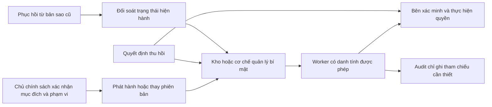

# Tài sản bí mật

## Mục tiêu bài học

Một bảng báo giá chưa công bố, một token tích hợp và một khóa ký đều có thể cần giữ bí mật, nhưng hậu quả khi bị lộ không giống nhau. Báo giá bị lộ làm mất lợi thế kinh doanh; token có thể cho phép truy cập dịch vụ; khóa ký có thể cho phép tạo ra thông điệp được hệ thống khác tin là hợp lệ.

Trong chương Phân loại tài sản, **tài sản bí mật** được hiểu là thông tin hoặc năng lực mà việc tiết lộ cho chủ thể không được phép có thể gây hại, nên cần giới hạn người biết, người sử dụng và cách chia sẻ theo chính sách của tổ chức. Tên các mức phân loại cụ thể phải được tổ chức định nghĩa; từ “bí mật” không tự xác định một bộ kiểm soát giống nhau cho mọi hệ thống.

Sau bài học, bạn có thể:

- Nhận diện tài sản cần giữ kín và phân biệt dữ liệu nghiệp vụ với bí mật dùng để xác thực, giải mã hoặc thực hiện quyền.
- Phân loại theo hậu quả tiết lộ, phạm vi tác động và thời gian có giá trị.
- Lập danh mục không chứa giá trị bí mật, nhưng đủ chủ sở hữu, nơi sử dụng và vòng đời.
- Chuyển kết quả phân loại thành yêu cầu xác thực, phân quyền, lưu trữ, logging, thu hồi và phục hồi.
- Xác định bằng chứng kiểm chứng và giới hạn của những biện pháp như mã hóa, che dữ liệu hoặc quét bí mật.

Ví dụ xuyên suốt là một cổng cung ứng B2B phục vụ nhiều doanh nghiệp khách hàng. Những chính sách và ngưỡng thời gian trong bài là giả định minh họa, cần được chủ dữ liệu và chủ dịch vụ xác nhận trước khi áp dụng thực tế.

## 1. Nhận diện đúng loại tài sản cần giữ kín

### 1.1. Dữ liệu bí mật và bí mật cấp quyền

Một cách phân nhóm hữu ích cho việc viết yêu cầu là:

| Nhóm | Ví dụ | Hậu quả điển hình khi lộ | Câu hỏi bảo vệ trọng tâm |
|---|---|---|---|
| Thông tin nghiệp vụ cần giữ kín | Báo giá riêng, điều khoản hợp tác, kế hoạch sản phẩm chưa công bố | Mất lợi thế, tranh chấp, ảnh hưởng quan hệ khách hàng | Ai có nhu cầu biết, trong phạm vi nào và được chia sẻ ra đâu? |
| Thông tin cá nhân hoặc liên hệ trong ngữ cảnh cần hạn chế | Thông tin người nhận, lịch sử trao đổi, hồ sơ gắn với khách hàng | Xâm phạm riêng tư hoặc hỗ trợ hành vi lạm dụng | Những trường nào thực sự cần, ai được xem và giữ bao lâu? |
| Bí mật xác thực hoặc trao quyền | Mật khẩu, token phiên, khóa API, bí mật tích hợp | Giả danh hoặc thực hiện thao tác trong phạm vi quyền của bí mật | Ai được lấy/sử dụng, quyền hiệu lực là gì và vô hiệu hóa thế nào? |
| Khóa mật mã cần giữ kín | Khóa riêng để ký, khóa giải mã | Giả mạo thông điệp, giải mã dữ liệu hoặc ảnh hưởng khả năng phục hồi | Ai được dùng khóa, cho mục đích nào và có cho phép lấy khóa ra không? |
| Bản sao hoặc dữ liệu dẫn xuất | Tệp xuất, log lỗi, dump bộ nhớ, bản sao lưu | Lộ tập dữ liệu hoặc nhiều bí mật cùng lúc | Bản sao chứa gì, ai được đọc và chính sách vòng đời có được giữ không? |

Các nhóm có thể chồng lấp. Một bản sao lưu có thể chứa cả báo giá và thông tin xác thực; một tệp cấu hình có thể chứa thông tin hệ thống không công khai cùng bí mật tích hợp. Cần chỉ ra thành phần và hậu quả, không chỉ gắn một nhãn chung rồi dừng lại.

Không phải mọi dữ liệu cá nhân đều có cùng mức nhạy cảm, cũng không phải mọi mã định danh đều là bí mật. Việc phân loại cần xét bối cảnh sử dụng, khả năng liên kết và hậu quả tiết lộ.

### 1.2. Những cặp dễ nhầm

| Cặp khái niệm | Điểm cần phân biệt |
|---|---|
| Mã khách hàng và token truy cập | Mã khách hàng dùng nhận diện đối tượng; bản thân mã không được thay thế kiểm tra quyền. Token có thể mang khả năng truy cập cần bảo vệ |
| Khóa công khai và khóa riêng | Khóa công khai có thể được phân phối theo thiết kế; khóa riêng cần được giữ kín và giới hạn sử dụng |
| Định danh ứng dụng và bí mật ứng dụng | Định danh cho biết ứng dụng nào; bí mật có thể là một phần bằng chứng xác thực của ứng dụng |
| Băm và mã hóa | Băm không phải cơ chế giải mã để lấy lại dữ liệu; mã hóa có thể khôi phục nội dung khi có quyền và khóa phù hợp |
| Che một phần và loại bỏ nguy cơ tiết lộ | Che vài ký tự hoặc thay định danh chưa chứng minh không thể liên kết lại hoặc suy luận nội dung |
| Liên kết khó đoán và quyền truy cập | Độ khó đoán không tự chứng minh người đang dùng liên kết có quyền; một liên kết mang quyền truy cập cũng cần được quản lý như khả năng cần bảo vệ |

Ví dụ, chữ ký trên một token bảo vệ điều kiện xác minh theo thiết kế của token; nó không tự làm nội dung token trở nên kín. Không đưa dữ liệu bí mật vào một cấu trúc chỉ được ký rồi mặc định người cầm nó không đọc được.

Với mật khẩu dùng để đăng nhập, hệ thống thường cần kiểm chứng chứ không cần lấy lại mật khẩu gốc. Yêu cầu lưu trữ phải phản ánh mục đích đó, thay vì mặc định mọi bí mật đều nên được lưu theo một cơ chế mã hóa có thể giải mã. Bản kiểm chứng mật khẩu vẫn là tài sản cần bảo vệ vì có thể bị lạm dụng để thử đoán ngoại tuyến nếu bị lộ.

## 2. Phân loại dựa trên hậu quả và ngữ cảnh

### 2.1. Các câu hỏi trước khi gán mức

Với mỗi tài sản, cần trả lời:

1. **Ai không được phép biết hoặc sử dụng?** Có thể là người ngoài, người cùng tổ chức nhưng khác nhiệm vụ, hoặc người thuộc tenant khác.
2. **Nếu lộ thì có thể làm gì?** Chỉ đọc thông tin, truy cập dịch vụ, sửa dữ liệu, ký thông điệp hay lấy thêm quyền?
3. **Phạm vi tác động tới đâu?** Một bản ghi, một khách hàng, toàn bộ tenant, một môi trường hay nhiều hệ thống?
4. **Trong bao lâu tài sản còn có giá trị?** Báo giá có thể thay đổi theo thời điểm; token có thể hết hạn; dữ liệu đã lộ có thể vẫn gây hại sau khi quyền truy cập bị thu hồi.
5. **Có thể thu hồi hay thay thế không?** Có thể đổi token nhưng không thể làm người khác quên một kế hoạch kinh doanh đã đọc.
6. **Có những bản sao nào?** Tệp tạm, cache, email, log, kho mã, ảnh hệ thống, sao lưu và dữ liệu ở nhà cung cấp.
7. **Ai có quyền quyết định phân loại hoặc chia sẻ?** Cần phân biệt chủ chính sách với người đang vận hành nơi lưu.

**Tenant** là phạm vi dữ liệu và quyền riêng của một doanh nghiệp trong nền tảng dùng chung. Hai tài khoản cùng vai trò nhưng thuộc tenant khác nhau không vì vậy mà được biết cùng dữ liệu.

### 2.2. Nhạy cảm không chỉ là tên trường

Một số điện thoại đã được công khai cho liên hệ chung có thể có bối cảnh khác với số điện thoại đi kèm địa chỉ nhận hàng và lịch sử trao đổi. Một mã giao dịch riêng lẻ có thể ít tiết lộ, nhưng khi ghép với thời điểm, khách hàng và mức giá lại có thể làm lộ hoạt động kinh doanh.

Tập hợp dữ liệu cũng có thể làm tăng hậu quả. Tệp xuất chứa toàn bộ báo giá của một khách hàng tạo khả năng sao chép và phân tích khác với việc đọc một báo giá trên giao diện. Vì vậy, dữ liệu dẫn xuất cần được đánh giá theo nội dung và cách dùng thực tế.

### 2.3. Quy tắc cho bản sao và biến đổi

Một chính sách thực hành có thể quy định:

- Bản sao giữ điều kiện bảo vệ của dữ liệu nguồn, trừ khi có quyết định thay đổi được chấp thuận và có căn cứ.
- Tập dữ liệu trộn nhiều mức phải được xử lý đủ bảo vệ các phần nhạy cảm có trong nó; có thể tách riêng nếu thiết kế cho phép thực thi các chính sách tương ứng.
- Mã hóa không tự làm dữ liệu trở thành công khai. Vẫn cần bảo vệ khóa, quyền giải mã và các bản nội dung đã được giải mã.
- Việc che dữ liệu, giảm trường hoặc tổng hợp chỉ cho phép thay đổi phân loại sau khi đã đánh giá phần thông tin và khả năng suy luận còn lại.
- Dữ liệu chưa xác định mức không được mặc định công khai hoặc đưa ra ngoài chỉ vì chưa có nhãn.

Trong ví dụ, một tệp báo giá đã mã hóa vẫn thuộc tài sản cần giữ kín. Một báo cáo tổng hợp có thể được phép chia sẻ rộng hơn nếu người có thẩm quyền xác nhận nội dung và nguy cơ suy luận; việc đổi tên tệp thành “summary” không đủ làm căn cứ.

### 2.4. Nhãn bí mật không thay cho mục tiêu toàn vẹn và sẵn sàng

Khóa ký bị sửa hoặc dùng sai có thể tạo thông điệp không đáng tin; khóa giải mã bị mất có thể làm dữ liệu không phục hồi được. Vì vậy, tài sản bí mật vẫn cần được đánh giá về toàn vẹn và sẵn sàng.

Đây là các chiều liên quan nhưng khác nhau. Mức hạn chế đọc không tự xác định thời gian phục hồi, và dữ liệu công khai vẫn có thể cần bảo vệ toàn vẹn rất cao. Hồ sơ phân loại nên giữ các nhu cầu này rõ ràng để yêu cầu không chỉ tập trung vào mã hóa.

## 3. Lập danh mục mà không tạo thêm bản sao bí mật

### 3.1. Ví dụ tài sản của cổng cung ứng

Cổng cung ứng cho phép doanh nghiệp xem báo giá riêng, trao đổi điều kiện giao hàng và đồng bộ một phần thông tin sang hệ thống ERP. ERP là hệ thống quản lý nghiệp vụ liên quan của doanh nghiệp; tích hợp dùng danh tính và quyền được cấp riêng.

| Mã | Tài sản | Căn cứ cần giữ kín | Chủ chính sách trong ví dụ | Chủ thể được dùng |
|---|---|---|---|---|
| SA-01 | Báo giá và điều khoản riêng | Tiết lộ làm ảnh hưởng lợi thế và quan hệ khách hàng | Chủ quy trình kinh doanh phối hợp chủ dữ liệu | Nhân viên phụ trách và người được chỉ định trong tenant |
| SA-02 | Thông tin liên hệ/điểm nhận theo giao dịch | Có thể tiết lộ thông tin riêng hoặc hỗ trợ lạm dụng | Chủ dữ liệu khách hàng | Nhân sự xử lý giao dịch theo phạm vi công việc |
| SA-03 | Token tích hợp ERP ở PROD | Có thể thực hiện thao tác bằng quyền của tích hợp | Chủ dịch vụ tích hợp | Worker tích hợp đúng môi trường và nhiệm vụ |
| SA-04 | Khóa riêng ký thông điệp tích hợp | Có thể tạo thông điệp được bên nhận tin là hợp lệ | Đầu mối quản lý khóa và chủ dịch vụ | Thành phần được phép yêu cầu ký theo chính sách |
| SA-05 | Bản sao lưu và tệp xuất | Có thể chứa nhiều SA-01, SA-02 hoặc bản thông tin xác thực | Chủ dữ liệu và chủ dịch vụ theo loại bản sao | Vai trò sao lưu/phục hồi hoặc người được phép xuất/tải |
| SA-06 | Dấu vết sử dụng bí mật | Có thể tiết lộ danh tính, tài nguyên và hành vi hệ thống | Chủ dịch vụ phối hợp đầu mối an toàn thông tin | Người điều tra và vận hành theo nhiệm vụ |

Vai trò trong bảng là giả định phân công của bài, không phải kết luận về quyền sở hữu pháp lý. Một nhà cung cấp vận hành kho bí mật không tự trở thành bên được quyền quyết định chia sẻ báo giá hoặc dùng token ngoài nhiệm vụ.

### 3.2. Chỉ lưu tham chiếu và thuộc tính cần quản lý

Danh mục không được trở thành một bảng tập hợp token, mật khẩu hay khóa riêng. Có thể ghi:

```text
Asset ID: SA-03
Tên: Thông tin xác thực tích hợp ERP cho môi trường PROD
Loại: Bí mật xác thực có khả năng thực hiện quyền
Chủ chính sách: Chủ dịch vụ tích hợp
Tham chiếu: Kho bí mật / định danh tài nguyên / phiên bản
Phạm vi quyền: Các hành động tích hợp đã được phê duyệt
Chủ thể sử dụng: Danh tính worker tích hợp PROD
Bên xác minh/chấp nhận: Dịch vụ ERP theo giao diện đã xác định
Nơi có thể xuất hiện: Bộ nhớ worker, đường truyền xác thực, hệ thống phát hành
Không được xuất hiện: Kho mã, tệp build, log, ticket hỗ trợ, dữ liệu TEST
Vòng đời: Phát hành, cấp dùng, thay phiên bản, thu hồi, xử lý bản sao
Bằng chứng cần thu: Ma trận quyền, kiểm thử rò rỉ, kiểm tra thu hồi và phục hồi
```

Ngay cả tham chiếu và tên tài nguyên cũng có thể tiết lộ cấu trúc hệ thống hoặc khách hàng. Cần cấp quyền đọc danh mục theo nhu cầu, không mặc định mọi metadata đều có thể công khai.

### 3.3. Ghi đủ nơi xuất hiện

Theo dấu cả đường xử lý bình thường và đường lỗi:

- Mã nguồn, cấu hình, lịch sử thay đổi và kho artifact phát hành.
- Biến môi trường, tham số khởi động, tệp gắn vào ứng dụng và bộ nhớ tiến trình.
- Header, URL, body yêu cầu, trace, log lỗi, bản dump và ảnh chụp màn hình hỗ trợ.
- Cache, tệp tạm, kết quả xuất, email và các công cụ chia sẻ nội bộ.
- Sao lưu, snapshot, môi trường phục hồi và bản dữ liệu dùng trong thử nghiệm.

Không phải mọi hệ thống đều có tất cả các bản này. Cần khảo sát luồng thực tế và ghi những bản có thể được tạo, thay vì đánh dấu theo danh sách rồi cho rằng đã bao phủ.

Biến môi trường hoặc tệp gắn vào tiến trình chỉ là cách cung cấp dữ liệu. Chúng không tự là nơi an toàn trước mọi quyền đọc tiến trình, công cụ chẩn đoán hoặc dump. Hồ sơ phải xác định ai có thể quan sát chúng trong môi trường đang xét.

## 4. Bảo vệ theo vòng đời tài sản

### 4.1. Tạo hoặc tiếp nhận

Xác định nguồn, mục đích, chủ sở hữu chính sách, người dùng và mức phân loại trước khi đưa tài sản vào sử dụng. Bí mật xác thực phải được tạo/phát hành theo cơ chế phù hợp với bên xác minh, không suy ra từ tên khách hàng hoặc các giá trị dễ đoán.

Một thành phần tải tệp từ người dùng không nên tin nhãn “công khai” do người gửi tự chọn nếu chính sách yêu cầu kiểm tra bổ sung. Ngược lại, không cần tự động coi mọi tệp đều có cùng mức tối đa nếu có quy trình phân loại và kiểm soát khác đã được chấp thuận.

### 4.2. Lưu giữ và cấp quyền

Giới hạn cả quyền lấy nội dung lẫn quyền sử dụng. Một người không xuất được khóa ký vẫn có thể gây hại nếu được yêu cầu ký tùy ý; một người không đọc được token trực tiếp vẫn có thể triển khai mã để lấy token đó.

Phân biệt danh tính đọc dữ liệu nghiệp vụ, danh tính dùng bí mật tích hợp, người quản trị kho và người phục hồi. Mỗi quyền phải gắn với nhiệm vụ và môi trường. Không dùng bí mật PROD cho DEV hoặc TEST chỉ vì thuận tiện cấu hình.

Đối với dữ liệu cần được lấy lại dưới dạng rõ, cần bảo vệ khi lưu và quản lý khóa phù hợp. Việc ai được gọi giải mã, đổi chính sách khóa hoặc đọc bản sao phải được phân tích cùng quyền đọc dữ liệu.

### 4.3. Sử dụng và truyền đi

Chỉ đưa tài sản đến thành phần cần thiết, qua kênh bảo vệ phù hợp và xác minh đúng bên nhận. Với token, cần xác định đúng dịch vụ đích và phạm vi quyền; không gửi token cho một đích do đầu vào không tin cậy tùy ý lựa chọn.

Ưu tiên không đưa bí mật vào URL vì URL có thể được ghi ở nhiều nơi trong đường xử lý. Nếu một cơ chế liên kết mang quyền truy cập được sử dụng, phải xác định nơi có thể lộ, thời hạn, phạm vi và khả năng vô hiệu hóa của chính cơ chế ấy.

### 4.4. Thay đổi, chia sẻ hoặc giảm mức phân loại

Một báo giá chỉ được chuyển sang tập được phép công bố theo quyết định có thẩm quyền. Việc đã gửi cho một người nhận không đồng nghĩa được phép công khai cho mọi người.

Với bí mật cấp quyền, thay phiên bản phải xác định cách phát hành mới, cập nhật bên dùng, xác minh chuyển đổi và ngừng chấp nhận phiên bản cũ. Chỉ sửa giá trị trong kho bí mật không tự làm bên nhận vô hiệu hóa giá trị cũ.

### 4.5. Hết hạn, thu hồi, xóa và phục hồi

Hết hạn quyền sử dụng, thu hồi khả năng truy cập và xóa bản sao là những việc khác nhau. Một token bị vô hiệu hóa có thể không còn dùng được để xác thực, nhưng bản sao vẫn chứa thông tin cần quản lý. Một dữ liệu nghiệp vụ đã tải ra ngoài không thể được bảo mật lại chỉ bằng đổi khóa truy cập hệ thống.

Khi phục hồi từ bản sao cũ, không được tự động đưa bí mật đã thu hồi trở lại trạng thái hoạt động. Cần đối soát trạng thái hiện hành và lấy phiên bản hợp lệ từ nguồn có thẩm quyền. Khóa cần đọc dữ liệu lưu trữ có vòng đời riêng, không được loại bỏ tùy tiện trước khi đã xác nhận nhu cầu phục hồi.

Xóa một khóa cũng chưa tự chứng minh mọi bản dữ liệu không thể đọc được: cần xét các bản khóa, bản rõ và quyền sử dụng còn lại. Mọi kết luận về loại bỏ tài sản phải có phạm vi và bằng chứng phù hợp với thiết kế thật.

## 5. Chuyển phân loại thành yêu cầu bảo mật

Phân loại chỉ có giá trị khi dẫn đến cách xử lý cụ thể. Một chuỗi truy vết hữu ích là:

> Tài sản → hậu quả tiết lộ hoặc lạm dụng → chủ thể được phép → yêu cầu xử lý → điểm thực thi → bằng chứng.

Ví dụ, SA-03 không chỉ cần nhãn “bí mật”. Vì token có quyền trên ERP, cần biết worker nào được dùng, dữ liệu nào được đồng bộ, bên nào chấp nhận token và cách ngừng chấp nhận khi bị lộ.

### SA-REQ-01 — Phân loại và ghi nhận trước khi sử dụng hoặc chia sẻ

Trước khi đưa tài sản thuộc phạm vi SA-01 đến SA-05 vào sử dụng sản xuất hoặc thêm đường chia sẻ mới, phải có bản ghi loại tài sản, căn cứ phân loại, chủ chính sách, bên được dùng, nơi xuất hiện và quy tắc vòng đời. Bản ghi chỉ chứa tham chiếu cần quản lý, không chứa token, mật khẩu hoặc khóa riêng.

Những tài sản chưa xác định phạm vi chia sẻ phải được giữ khỏi các đường công khai hoặc chuyển ra ngoài cho tới khi có quyết định. Người dùng không được tự giảm mức phân loại chỉ bằng sửa một trường đầu vào nếu không có thẩm quyền tương ứng.

**Rủi ro:** dữ liệu không được nhận diện bị xử lý như công khai hoặc danh mục trở thành nơi tập hợp bí mật.

**Chấp nhận:** đối chiếu các loại tài sản trong luồng được triển khai với danh mục; thử tài sản thiếu nhãn/căn cứ và thao tác hạ mức không đủ quyền; kiểm tra dữ liệu thực sự được chuyển ra ngoài. Có đủ bản ghi chưa chứng minh các kiểm soát khác đã hoạt động.

### SA-REQ-02 — Xác thực và phân quyền theo tài sản, tenant, hành động

Máy chủ phải xác thực chủ thể và kiểm tra quyền trên tài sản cụ thể trước khi đọc, sửa, xuất, tải xuống hoặc sử dụng bí mật. Với SA-01/SA-02, quyết định phải xét tenant và phạm vi nhiệm vụ. Vai trò quản trị giao diện không tự tạo quyền đọc toàn bộ nội dung.

Với SA-03, chỉ danh tính worker tích hợp đúng môi trường được cấp quyền lấy hoặc sử dụng token theo thiết kế đã chọn. Với SA-04, giao diện nghiệp vụ không được trả khóa riêng; quyền yêu cầu ký phải giới hạn vào loại thông điệp và nhiệm vụ được phép. Quyền quản lý chính sách hoặc triển khai mã cũng phải được xét vì có thể tạo đường truy cập gián tiếp.

Khi không xác minh được điều kiện bắt buộc, từ chối hành động liên quan; không lấy token từ đầu vào người dùng hay dùng tenant do client khai báo làm căn cứ duy nhất.

**Rủi ro:** người không có nhu cầu biết đọc dữ liệu, hoặc một danh tính dùng bí mật để vượt phạm vi công việc.

**Chấp nhận:** kiểm tra danh tính đúng/sai nhiệm vụ và môi trường, tenant A truy cập tài sản B, quyền đọc khác quyền dùng khóa, đường xuất/tải trực tiếp và khả năng cấp quyền gián tiếp. Kiểm tra cả hành động hợp lệ để chứng minh hệ thống vẫn phục vụ đúng nhiệm vụ.

### SA-REQ-03 — Kiểm soát lưu trữ và kênh cung cấp bí mật

Token, mật khẩu và khóa riêng của PROD không được nằm trong mã nguồn, lịch sử kho mã, artifact phát hành hoặc bộ dữ liệu ngoài sản xuất. Chúng phải được cấp cho thành phần cần dùng qua cơ chế đã đăng ký, với danh tính, quyền và vòng đời riêng cho từng môi trường.

Dữ liệu nghiệp vụ bí mật và bản sao cần bảo vệ phải được mã hóa khi lưu theo chính sách đã xác định. Quyền đọc bản mã, quyền giải mã, quyền đổi chính sách khóa và quyền quản lý bản sao phải được phân tích riêng; không coi việc bật mã hóa là đủ khi một danh tính không cần thiết vẫn lấy được cả dữ liệu và khả năng giải mã.

Đường truyền tài sản cần bảo vệ phải xác minh đúng bên nhận và bảo vệ nội dung theo thiết kế. Không gửi token cho đích không nằm trong phạm vi tích hợp đã được cho phép.

**Rủi ro:** bí mật lan sang nơi ít kiểm soát hơn, bị đọc qua bản sao hoặc bị gửi nhầm bên nhận.

**Chấp nhận:** kiểm tra cấu hình cấp bí mật, quyền theo môi trường, nội dung artifact và khả năng truy cập bản sao/khóa bằng các danh tính thử nghiệm. Với đường truyền, kiểm tra hành vi khi bên nhận không hợp lệ và khi đích bị thay ngoài danh sách được phép. Không đưa giá trị bí mật thật vào báo cáo kiểm chứng.

### SA-REQ-04 — Không phát tán bí mật qua logging và công cụ hỗ trợ

Đường log, trace, thông báo lỗi, cảnh báo và ticket hỗ trợ không được ghi token, mật khẩu, khóa riêng hoặc toàn bộ dữ liệu nghiệp vụ bí mật ngoài tập trường được phê duyệt. Việc loại bỏ/che thông tin phải diễn ra trước khi dữ liệu rời thành phần tới nơi thu thập không được phép nhận nó, không chỉ che khi hiển thị trên giao diện tra cứu.

Audit việc sử dụng bí mật phải ghi định danh tài sản/phiên bản, chủ thể, hành động, mục đích hoặc mã tác vụ, kết quả, thời điểm và mã liên kết. Không ghi giá trị bí mật để chứng minh đã sử dụng. Quyền xem và quản trị audit phải được giới hạn theo nhiệm vụ.

Nếu cho phép tạo dump hoặc thu thập chẩn đoán có thể chứa bí mật, phải có luồng riêng với phân loại, quyền truy cập, nơi lưu và thời hạn tương ứng. Không tự đưa nó vào luồng log thông thường.

**Rủi ro:** hệ thống bảo vệ kho chính nhưng làm lộ nội dung qua đường quan sát, lỗi hoặc hỗ trợ.

**Chấp nhận:** dùng dữ liệu giả lập dễ nhận diện qua luồng thành công, thất bại, timeout và retry; kiểm tra payload gửi sang nơi thu thập, log biên, trace và kết quả chẩn đoán được tạo. Đối chiếu audit vẫn đủ thông tin điều tra mà không có giá trị bí mật.

### SA-REQ-05 — Thay phiên bản và thu hồi có hiệu lực ở bên chấp nhận

Đối với token tích hợp trong hồ sơ ví dụ, khi quyết định thu hồi đã được cam kết tại nguồn có thẩm quyền, mọi yêu cầu xác thực mới dùng token đó phải bị từ chối trong tối đa **60 giây**. Đo từ mốc cam kết thu hồi tới thời điểm các bên xác minh trong phạm vi đã ngừng chấp nhận, không chỉ tới lúc worker xóa bản cache.

Cần liệt kê bên phát hành, bên dùng và bên chấp nhận token. Nếu tích hợp không hỗ trợ mức thu hồi này, nhóm phải thay đổi thiết kế hoặc trình giới hạn và phương án xử lý cho người có thẩm quyền; không ghi con số 60 giây như một khả năng đã có.

Thay token định kỳ cần có trình tự phát hành mới, cập nhật bên dùng, xác minh hoạt động và vô hiệu hóa bản cũ. Khoảng chấp nhận đồng thời nếu có phải được định nghĩa. Với token nghi bị lộ, không mặc nhiên dùng cùng khoảng chuyển đổi như thay định kỳ nếu điều đó tiếp tục cho phép lạm dụng.

**Rủi ro:** bí mật đã bị lộ hoặc hết nhu cầu vẫn thực hiện được quyền.

**Chấp nhận:** xác thực bằng token trước/sau thu hồi qua các đường trong phạm vi, với worker/cache đã giữ bản cũ. Đo trường hợp chậm đồng bộ và kiểm tra hành vi gọi lại. Token mới hoạt động chưa chứng minh token cũ đã bị vô hiệu hóa.

### SA-REQ-06 — Bản xuất và bản tạm có phạm vi, thời hạn riêng

Tệp xuất chứa SA-01/SA-02 phải được giới hạn theo tenant, tập dữ liệu và người tải được phép. Trong ví dụ, liên kết tải hết hiệu lực sau **10 phút** tính từ lúc phát hành, còn bản tạm và tệp kết quả phải được xóa trong **60 phút** tính từ khi tác vụ kết thúc. Thời hạn sử dụng liên kết và thời hạn tồn tại của tệp là hai điều kiện khác nhau.

Điểm tải phải thực thi chính sách quyền đã xác định. Một liên kết khó đoán không tự cho phép bỏ kiểm tra người nhận; nếu dùng liên kết mang quyền truy cập, cần nêu rõ người có liên kết được làm gì, nguy cơ chuyển tiếp và cách vô hiệu hóa theo chính sách được duyệt.

**Rủi ro:** bản dẫn xuất giữ dữ liệu lâu hơn cần thiết hoặc bị tải ngoài phạm vi đã cho phép.

**Chấp nhận:** thử sai tenant/người nhận, đúng thời điểm hết hạn, gọi tải lại và kiểm tra sự tồn tại của bản tạm/kết quả theo mốc xóa. Một phản hồi “không tải được” chưa chứng minh tệp đã được loại bỏ khỏi nơi lưu.

### SA-REQ-07 — Phục hồi giữ được bí mật và trạng thái thu hồi

Kho sao lưu chứa dữ liệu bí mật phải có quyền và bảo vệ phù hợp với nội dung. Vai trò phục hồi chỉ được truy cập bản sao, khóa và cấu hình cần cho nhiệm vụ đã được cho phép, có audit tương ứng.

Trước khi mở lại truy cập hoặc bật tích hợp sau phục hồi, phải kiểm tra phân loại/quyền dữ liệu và đối soát trạng thái bí mật với nguồn hiện hành. Token đã thu hồi không được tái đưa vào sử dụng vì có mặt trong bản sao cũ. Những khóa giải mã còn cần cho dữ liệu lưu trữ phải có khả năng sử dụng đúng quyền trong kịch bản phục hồi đã chọn.

**Rủi ro:** bản sao làm lộ dữ liệu, mất khóa khiến không phục hồi được, hoặc phục hồi tái mở khả năng truy cập đã bị chấm dứt.

**Chấp nhận:** phục hồi bản sao được tạo trước một lần thu hồi vào môi trường kiểm chứng, xác minh dữ liệu đọc được bằng vai trò hợp lệ, vai trò trái quyền bị chặn, token cũ vẫn bị từ chối và tích hợp chỉ dùng phiên bản được phép. Ghi rõ giả định về nguồn trạng thái hiện hành và nơi giữ khóa còn dùng được.

## 6. Liên kết yêu cầu với rủi ro và điểm thực thi

Không nhất thiết mỗi tài sản chỉ có một yêu cầu. Một bản xuất có thể cần đồng thời phân loại, quyền đọc, mã hóa, audit, hết hạn và xóa.

| Tài sản/luồng | Kịch bản rủi ro | Yêu cầu liên quan | Điểm thực thi dự kiến | Bằng chứng chính |
|---|---|---|---|---|
| Báo giá riêng giữa các tenant | Thay mã đối tượng hoặc dùng bản xuất của khách hàng khác | SA-REQ-01, 02, 06 | API, truy cập dữ liệu, tác vụ xuất, điểm tải | Kiểm thử chéo tenant và vòng đời tệp |
| Token từ kho tới worker và ERP | Bản cache hoặc token cũ tiếp tục có quyền | SA-REQ-02, 03, 05 | Kho bí mật, worker, bên xác minh ERP | Ma trận quyền và phép đo thu hồi |
| Yêu cầu sử dụng khóa ký | Người có quyền gọi ký tạo thông điệp ngoài nhiệm vụ | SA-REQ-02, 04 | Giao diện sử dụng khóa, dịch vụ nghiệp vụ, audit | Kiểm tra loại thông điệp/phạm vi và dấu vết sử dụng |
| Lỗi tích hợp và quan sát | Header xác thực hoặc dữ liệu khách hàng đi vào trace/log | SA-REQ-03, 04 | HTTP client, xử lý lỗi, bộ thu thập quan sát | Giá trị giả lập qua các đường lỗi và đối chiếu payload |
| Sao lưu và phục hồi | Bản sao chứa bí mật cũ hoặc thiếu khóa cần thiết | SA-REQ-03, 07 | Kho sao lưu, quản lý khóa, quy trình phục hồi | Diễn tập cùng kiểm tra quyền/trạng thái bí mật |

Điểm thực thi dự kiến phải được cập nhật theo kiến trúc thật. Ví dụ, nếu đường tải kết quả chuyển từ API sang truy cập trực tiếp kho tệp, phải xem lại cơ chế thực thi quyền và thời hạn, không giữ nguyên kết luận từ đường cũ.

Có thể hình dung luồng quản lý token bằng các trách nhiệm sau:



Đường thu hồi phải tới nơi quyết định chấp nhận bí mật. Chặn worker lấy token từ kho có thể ngăn lần dùng mới qua worker, nhưng một bản token đã bị sao chép vẫn có thể được gửi trực tiếp tới ERP nếu ERP còn chấp nhận.

## 7. Kiểm chứng mà không phát tán thêm tài sản bí mật

### 7.1. Dùng giá trị giả lập và kiểm tra đúng phạm vi

Trong môi trường được phép kiểm chứng, có thể dùng một chuỗi nhận diện rõ là dữ liệu thử:

```text
Giá trị thử không có hiệu lực xác thực:
SECRET_SENTINEL_FOR_TEST_ONLY_42

Nơi được phép có: Đầu vào thử và vùng giữ bí mật giả lập đã xác định
Nơi không được có: Log thường, trace xuất ra ngoài, artifact, ticket hỗ trợ
Kết quả mong đợi: Không có giá trị đầy đủ tại các đích không được phép
Bằng chứng thay thế: Mã tham chiếu giả lập và kết quả kiểm tra
```

Chuỗi nhận diện giúp tìm đường rò rỉ, nhưng phải thử đúng các dạng đầu vào và lỗi có thể xuất hiện. Một bộ lọc chỉ biết tên trường `password` có thể bỏ sót token trong một header khác, nội dung lỗi nhiều dòng hoặc dữ liệu đã đổi cách biểu diễn.

Nếu công cụ phát hiện tìm thấy bí mật, báo cáo nên chỉ rõ vị trí, loại và tham chiếu phục vụ xử lý, không in lại toàn bộ giá trị vào log kiểm tra hoặc tệp báo cáo được chia sẻ rộng. Phải quản lý cả đầu ra của công cụ phát hiện.

### 7.2. Ma trận bằng chứng tối thiểu

| Nhóm kiểm chứng | Tình huống | Điều cần quan sát |
|---|---|---|
| Phân loại | Tệp mới chưa có chủ chính sách, yêu cầu hạ mức từ người không có quyền | Không công khai/chia sẻ ngoài điều kiện được phép; có người xử lý phần chưa quyết định |
| Quyền dữ liệu | Đúng/sai tenant, nhiệm vụ, đối tượng, trường | Nội dung và bản sao không vượt phạm vi |
| Quyền bí mật | Worker đúng/sai môi trường; người quản trị thông thường | Phân biệt quyền lấy, dùng, cấp và thay chính sách |
| Lưu trữ/phát hành | Artifact, cấu hình, bản sao được tạo theo luồng thật | Không đưa bí mật PROD vào nơi không được phép |
| Log/trace | Thành công, lỗi, timeout, retry, chẩn đoán | Giá trị bí mật không ra đích cấm; audit vẫn đủ tham chiếu |
| Thu hồi | Bên dùng giữ token cũ, gọi trực tiếp bên xác minh | Đạt mốc ngừng chấp nhận trên phạm vi đã xác định |
| Xuất/xóa | Liên kết hết hạn, tệp còn ở kho, bản tạm sau lỗi | Đạt cả quyền tải, thời hạn và điều kiện xóa |
| Phục hồi | Bản sao cũ có token đã thu hồi và dữ liệu mã hóa | Không tái mở token cũ; người đúng quyền vẫn đọc được dữ liệu cần phục hồi |

Không có phát hiện từ một lần quét không chứng minh hệ thống không chứa bí mật. Công cụ có thể không nhận diện mọi định dạng, không thấy bộ nhớ, lịch sử hoặc các bản sao ngoài phạm vi quét. Ngược lại, một cảnh báo cần được xác minh theo loại tài sản và ngữ cảnh trước khi kết luận.

Bằng chứng phải gắn với phiên bản cấu hình, luồng và môi trường đã kiểm chứng. Việc đã kiểm tra log ứng dụng không tự bao phủ log cổng vào, công cụ giám sát, bên nhận tích hợp và dữ liệu chẩn đoán.

## 8. Xử lý khi nghi ngờ hoặc xác nhận tiết lộ

### 8.1. Xác định loại hậu quả trước hành động

Đầu tiên cần xác định tài sản nào, phiên bản nào, quyền hiệu lực hoặc nội dung nào bị lộ, từ thời điểm nào và có những bản sao nào. Không đưa giá trị thật vào cuộc trao đổi rộng để nhờ mọi người xác minh.

Với token hoặc khóa có thể thực hiện quyền, cần có hành động ngừng chấp nhận hoặc giới hạn sử dụng tại bên có thẩm quyền, đồng thời giữ bằng chứng theo quy trình sự cố. Việc xóa token khỏi kho mã hoặc log hiện tại không làm một bản đã sao chép trở nên vô dụng.

Với thông tin nghiệp vụ, đổi mật khẩu hoặc token chỉ ngăn một số đường truy cập tiếp theo; nó không thu hồi nội dung đã bị đọc. Cần giới hạn phát tán thêm, xác định bên chịu trách nhiệm xử lý tác động và thông báo đầu mối theo quy trình của tổ chức.

### 8.2. Thay bí mật không đồng nghĩa khắc phục toàn bộ hậu quả

Khi một token đã lộ, thay token phải đi cùng xác minh token cũ bị từ chối và đánh giá hành động đã xảy ra trong thời gian có thể bị lạm dụng. Nếu khóa giải mã đã lộ cùng bản mã, chỉ thay khóa cho dữ liệu mới không tự bảo vệ những bản cũ đã bị lấy đi.

Với khóa ký, cần xem xét bên nhận còn tin những phiên bản nào và các thông điệp trong thời gian ảnh hưởng. Không giả định mọi loại khóa có cùng quy trình thu hồi; hồ sơ phải nêu giao thức và bên chịu trách nhiệm quyết định tin cậy.

Nếu quá trình thay mới gặp lỗi, kế hoạch khôi phục không được mặc nhiên bật lại bí mật đã xác nhận bị lộ. Cần phương án được chấp thuận bảo vệ cả khả năng vận hành lẫn việc ngăn lạm dụng tiếp tục.

### 8.3. Quản lý các bản sao sau sự cố

Lập phạm vi nơi đã xuất hiện: lịch sử kho mã, artifact, log, công cụ hỗ trợ, máy người dùng, nhà cung cấp và bản sao lưu. Với mỗi nơi, xác định hành động có thể thực hiện, quyền xử lý, thời hạn và giới hạn kiểm soát.

Không hứa đã xóa mọi bản nếu chỉ xử lý bản hiện tại hoặc chỉ làm mất liên kết tải. Những phần không thể xác nhận phải được ghi thành giới hạn và rủi ro còn lại, có người chịu trách nhiệm quyết định xử lý.

Bản sao phục vụ điều tra hoặc phục hồi cũng là tài sản cần quản lý, với mục đích, phạm vi quyền và thời hạn riêng. Nhu cầu giữ bằng chứng không đồng nghĩa được để bí mật trong kho chia sẻ thông thường vô thời hạn.

## 9. Duy trì phân loại trong vòng đời phát triển

Khi thêm trường dữ liệu, tích hợp, báo cáo hoặc công cụ quan sát, phải xem lại tài sản và đường đi liên quan. Một thay đổi chỉ vài dòng cấu hình logging có thể tạo bản sao bí mật ở một bên nhận mới.

Phân công tối thiểu cần rõ:

- Chủ dữ liệu hoặc chủ chính sách xác nhận hậu quả và phạm vi được chia sẻ.
- Chủ dịch vụ xác định cách vận hành, tích hợp, thu hồi và phục hồi.
- Nhóm phát triển thực thi yêu cầu tại các đường xử lý và cung cấp điểm quan sát cần thiết.
- Nhóm kiểm chứng thu thập bằng chứng mà không nhân bản bí mật thật ngoài phạm vi.
- Người có thẩm quyền quyết định rủi ro còn lại, ngoại lệ và thời hạn xem xét lại.

Những ngoại lệ như dùng bản dữ liệu thật trong thử nghiệm hoặc cho hỗ trợ đọc nội dung phải có tài sản, người nhận, mục đích, kiểm soát, thời hạn và người phê duyệt cụ thể. Một nhãn “nội bộ” không tự làm mọi cách chia sẻ trở nên phù hợp.

Các lỗi thường gặp cần sửa:

| Cách làm | Khoảng trống | Cách cải thiện |
|---|---|---|
| Mọi thứ nhạy cảm đều chỉ gắn nhãn “secret” | Không rõ thông tin hay năng lực nào bị lộ và phải xử lý ra sao | Ghi loại, hậu quả, phạm vi quyền và vòng đời |
| Chỉ quản lý giá trị trong kho bí mật | Bỏ sót log, lịch sử, bộ nhớ, artifact và bản sao | Theo dấu luồng bình thường, lỗi và phục hồi |
| Mã hóa rồi hạ mức phân loại | Bỏ qua quyền giải mã và các bản nội dung rõ | Giữ chính sách nội dung, phân tích khóa và khả năng sử dụng |
| Xóa giá trị khỏi mã rồi kết luận đã an toàn | Bản cũ vẫn có thể xác thực hoặc còn trong lịch sử | Thu hồi tại bên chấp nhận, xử lý bản sao và kiểm tra tác động |
| Chỉ che khi hiển thị log | Giá trị đã đi vào nơi lưu hoặc bên thứ ba | Ngăn dữ liệu trái phép trước điểm chuyển |
| Cho quản trị viên đọc tất cả để tiện hỗ trợ | Quyền rộng hơn nhu cầu và khó hạn chế hậu quả | Tách đọc, sử dụng, quản lý chính sách và nhiệm vụ hỗ trợ |
| Phục hồi nguyên trạng mọi bí mật | Có thể tái mở bí mật đã thu hồi | Đối soát phiên bản và trạng thái hiện hành trước khi bật dịch vụ |

## 10. Bài tập vận dụng và checklist bàn giao

Một nhóm thêm chức năng gửi báo giá ra tệp để nhân viên kinh doanh tải về. Worker gọi ERP bằng token PROD, tạo tệp tạm, tải lên kho kết quả và gửi liên kết qua email. Khi lỗi, thư viện HTTP ghi toàn bộ yêu cầu vào log để hỗ trợ chẩn đoán.

Hãy thực hiện:

1. Liệt kê tài sản bí mật và các bản biểu diễn mới phát sinh.
2. Phân biệt hậu quả lộ báo giá với hậu quả lộ token ERP.
3. Viết yêu cầu cho quyền người tải, tenant, vùng lưu tạm và thời hạn liên kết/tệp.
4. Viết yêu cầu log lỗi vẫn đủ chẩn đoán nhưng không ghi token hoặc nội dung trái chính sách.
5. Mô tả cách chứng minh token cũ không còn được ERP chấp nhận sau thu hồi.
6. Nêu điều cần kiểm tra khi khôi phục bản sao có tệp hết hạn và token đã thu hồi.

**Gợi ý tự đối chiếu:** email, tệp tạm, kho kết quả và log đều là các điểm chuyển cần phân loại. Token có thể bị sao chép và dùng ngoài worker, nên chỉ xóa token khỏi cấu hình không đủ. Hết hạn liên kết, xóa tệp và vô hiệu hóa token phải có điều kiện và bằng chứng riêng.

Trước khi bàn giao yêu cầu, kiểm tra:

- [ ] Đã xác định thông tin cần giữ kín và bí mật có thể thực hiện quyền.
- [ ] Có căn cứ hậu quả, phạm vi tác động và thời gian còn giá trị.
- [ ] Nhãn và quy tắc bản sao được định nghĩa theo chính sách tổ chức.
- [ ] Danh mục có chủ chính sách, tham chiếu và vòng đời, không có giá trị bí mật.
- [ ] Đã theo dấu dữ liệu qua xử lý, lỗi, log, chia sẻ, sao lưu và phục hồi.
- [ ] Quyền đọc, dùng, giải mã, ký và quản lý chính sách được phân biệt.
- [ ] PROD và ngoài sản xuất có danh tính/bí mật/phạm vi dữ liệu phù hợp.
- [ ] Thu hồi được đo tại bên xác minh/chấp nhận, với giới hạn thực tế rõ ràng.
- [ ] Thời hạn liên kết, tồn tại tệp và xử lý bản sao là các yêu cầu riêng.
- [ ] Bằng chứng kiểm chứng dùng dữ liệu giả lập hoặc phạm vi được cho phép và không tạo rò rỉ mới.
- [ ] Phục hồi không tái mở bí mật cũ, đồng thời vẫn có khóa cần đọc dữ liệu được giữ lại.
- [ ] Ngoại lệ và phần chưa kiểm soát được có người chịu trách nhiệm cùng điều kiện xem xét lại.

Phân loại tài sản bí mật cần dẫn tới những quyết định có thể kiểm tra: ai được biết hoặc sử dụng, nội dung được đi đâu, bản sao tồn tại bao lâu và làm thế nào chấm dứt quyền khi không còn phù hợp. Các quyết định đó tạo cơ sở để nối mục tiêu giữ kín với rủi ro, kiến trúc và tiêu chí kiểm thử trong toàn bộ vòng đời phát triển.
