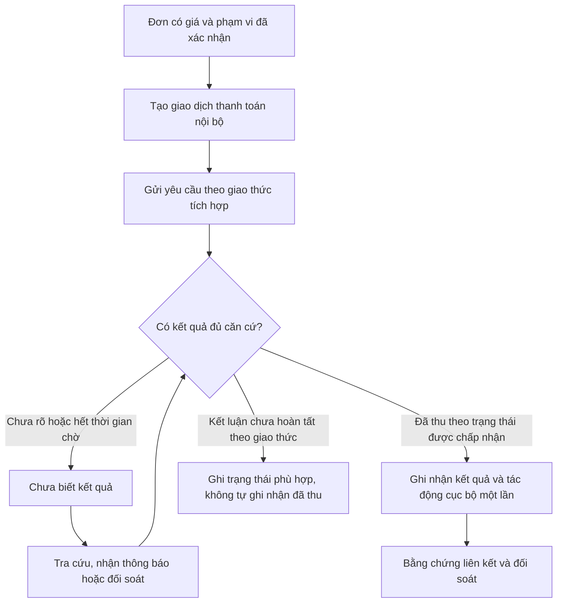

# Tài sản tiền và giao dịch

## 1. Vì sao tiền và giao dịch cần được nhận diện thành tài sản riêng?

Trong một ứng dụng thu học phí, một con số trong cơ sở dữ liệu có thể quyết định người học đã thanh toán hay chưa, được mở khóa học hay không và có thể nhận lại bao nhiêu tiền. Một thay đổi nhỏ về số tiền, đồng tiền, người nhận hoặc trạng thái có thể tạo hậu quả nghiệp vụ lớn dù hệ thống vẫn hoạt động bình thường về mặt kỹ thuật.

**Tài sản tiền và giao dịch** gồm giá trị có thể bị chiếm đoạt hoặc sử dụng sai, các bản ghi mô tả quyền và nghĩa vụ liên quan đến giá trị đó, chức năng có thể làm dịch chuyển giá trị và bằng chứng dùng để xác nhận, đối soát, điều tra, phục hồi.

Nhận diện đúng nhóm tài sản này giúp chuyển những mục tiêu như “không mất tiền”, “không hoàn tiền sai” hoặc “không thanh toán hai lần” thành yêu cầu cụ thể. Cần biết đối tượng nào là căn cứ ghi nhận, ai được tạo hoặc thay đổi giao dịch, điểm nào nhận kết quả từ bên ngoài và bằng chứng nào xác định giao dịch đã được xử lý.

Bài này dùng ví dụ một nền tảng bán khóa học: người học tạo đơn, thanh toán qua nhà cung cấp bên ngoài, hệ thống mở quyền học sau khi xác nhận và nhân viên được phép xử lý hoàn tiền. Các quy tắc và số liệu dưới đây là giả định minh họa cho thiết kế bảo mật, không phải quy trình mặc định của mọi nhà cung cấp thanh toán.

## 2. Tài sản không chỉ là số dư hoặc bảng giao dịch

### 2.1. Bốn nhóm cần nhìn cùng nhau

| Nhóm | Ví dụ | Vì sao có giá trị |
| --- | --- | --- |
| Giá trị và quyền hưởng giá trị | Số dư khả dụng, học phí đã thu, khoản có thể hoàn, tín dụng dùng mua khóa học | Có thể bị sử dụng, chiếm đoạt hoặc phân bổ sai. |
| Bản ghi nghiệp vụ | Đơn hàng, lệnh thanh toán, sổ giao dịch, bản ghi hoàn tiền, trạng thái xử lý | Quyết định hệ thống hiểu nghĩa vụ và kết quả tài chính như thế nào. |
| Khả năng gây dịch chuyển giá trị | API thanh toán, phê duyệt hoàn tiền, thay người nhận, cấu hình tài khoản nhận tiền | Người kiểm soát chức năng có thể gây tác động mà không trực tiếp sửa số dư. |
| Bằng chứng và công cụ kiểm soát | Kết quả từ nhà cung cấp, báo cáo đối soát, audit, khóa tích hợp, bản sao phục hồi | Cần để xác minh nguồn, phát hiện sai lệch và khôi phục trạng thái đáng tin. |

Một hệ thống không giữ tiền trực tiếp vẫn xử lý tài sản quan trọng. Ví dụ, trạng thái “đã thanh toán” có thể mở quyền học, còn lệnh hoàn tiền có thể khiến nhà cung cấp chuyển tiền ra ngoài. Việc tiền nằm ở tổ chức khác không loại bỏ trách nhiệm bảo vệ các quyết định và thông điệp của ứng dụng.

### 2.2. Nhận diện các biểu diễn khác nhau của cùng một giá trị

Một giao dịch có thể xuất hiện dưới nhiều dạng: yêu cầu của người dùng, đơn hàng trong ứng dụng, yêu cầu gửi nhà cung cấp, thông báo kết quả, bản ghi sổ, báo cáo đối soát và dữ liệu trong bản sao lưu.

Các biểu diễn này không nhất thiết có cùng thời điểm cập nhật hoặc cùng mức thẩm quyền. Phản hồi trên trình duyệt không tự chứng minh nhà cung cấp đã thu tiền. Trạng thái cục bộ cũng có thể tạm thời chưa phản ánh kết quả bên ngoài nếu thông báo đến chậm hoặc bị mất.

Vì vậy, kiểm kê tài sản phải ghi rõ **dữ liệu nào là căn cứ cho quyết định nào**, thay vì gán một nhãn “nguồn sự thật duy nhất” cho toàn bộ hệ thống mà không phân biệt phạm vi.

## 3. Danh mục tài sản minh họa

| Mã | Tài sản | Nội dung cần nhận diện | Hậu quả khi bị xâm hại |
| --- | --- | --- | --- |
| A-MONEY-01 | Giá trị đơn hàng phải thu | Mặt hàng, giá đã xác nhận, điều chỉnh hợp lệ, số tiền, đồng tiền, người mua | Trả thiếu nhưng được ghi nhận đủ; thu sai số tiền hoặc sai đơn. |
| A-MONEY-02 | Giao dịch thu và căn cứ đã thu | Mã giao dịch nội bộ, mã nhà cung cấp, kết quả, số tiền, đồng tiền, tài khoản nhận | Ghi nhận thu giả, ghi trùng hoặc gắn tiền vào sai đơn. |
| A-MONEY-03 | Khoản có thể hoàn và lệnh hoàn | Số đã thu đủ điều kiện, hoàn đã xác nhận, phần đang chờ, người nhận, người phê duyệt | Hoàn vượt mức, hoàn nhiều lần hoặc chuyển cho sai người. |
| A-MONEY-04 | Sổ ghi nhận biến động | Các bút toán hoặc sự kiện được thiết kế làm căn cứ, liên kết và điều chỉnh | Mất lịch sử, sai số dư, không giải thích được chênh lệch. |
| A-MONEY-05 | Quyền và cấu hình dòng tiền | Quyền tạo, phê duyệt, thực thi; tài khoản nhận; ánh xạ đơn vị kinh doanh | Chiếm quyền để đổi hướng tiền hoặc tự phê duyệt thao tác. |
| A-MONEY-06 | Thông tin tích hợp | Danh tính dịch vụ, khóa, token và cấu hình xác minh nguồn | Giả mạo yêu cầu, đọc dữ liệu hoặc gửi lệnh với quyền của nền tảng. |
| A-MONEY-07 | Bằng chứng đối soát và audit | Kết quả đã kiểm tra nguồn, báo cáo, dấu vết người thực hiện, mã liên kết | Không phát hiện sai lệch, không truy vết được thay đổi hoặc kết luận sai. |
| A-MONEY-08 | Dữ liệu phục hồi | Bản sao giao dịch, sổ, trạng thái xử lý, thông tin chống trùng và phụ thuộc | Phát lại giao dịch, mất trạng thái đã cam kết hoặc phục hồi sai quan hệ. |

Tín dụng nội bộ, phiếu có giá trị sử dụng hoặc quyền truy cập đã mua cũng có thể cần kiểm kê. Giá trị, khả năng chuyển đổi và hậu quả lạm dụng của chúng phải được xác định theo nghiệp vụ, không mặc định giống tiền thu qua nhà cung cấp bên ngoài.

Thông tin thanh toán có thể chứa dữ liệu cá nhân và bí mật kỹ thuật. Không cần đưa thông tin thanh toán thật, số tài khoản thật hay khóa tích hợp vào tài liệu phân loại để chứng minh đã nhận diện được tài sản. Hãy mô tả loại dữ liệu, quan hệ và phạm vi bằng dữ liệu minh họa.

## 4. Thuộc tính quan trọng khi phân loại

### 4.1. Toàn vẹn của giá trị và quan hệ

Với tiền và giao dịch, không chỉ giá trị số học cần đúng. Quan hệ giữa số tiền, đồng tiền, đơn hàng, chủ thể và người nhận cũng phải được bảo vệ.

Một thông điệp có số tiền đúng nhưng gắn với đơn khác vẫn có thể gây thiệt hại. Tương tự, tổng số tiền không đổi chưa chứng minh không có chuyển sai người hoặc ghi nhận sai thời điểm.

Các câu hỏi cần đặt là:

- Ai quyết định giá phải thu và điều chỉnh hợp lệ?
- Ai được thay đổi người nhận hoặc cấu hình tài khoản nhận?
- Trạng thái nào cho phép mở quyền học hoặc tạo lệnh hoàn?
- Quan hệ nào phải giữ đúng khi cập nhật, đối soát và phục hồi?
- Có đường quản trị nào sửa trực tiếp dữ liệu mà không qua quy tắc nghiệp vụ không?

### 4.2. Bí mật và tính xác thực

Dữ liệu giao dịch có thể tiết lộ người mua, khóa học, số tiền, lịch sử và thông tin liên hệ. Token hoặc khóa tích hợp có thể trao khả năng gửi lệnh, nên hậu quả lộ bí mật không chỉ là bị đọc dữ liệu.

**Tính xác thực** yêu cầu có căn cứ về danh tính hoặc nguồn. API nhận kết quả phải biết kết quả đến từ nguồn nào theo cơ chế tích hợp đã chấp nhận. Giá trị `status: success` do trình duyệt gửi lên hoặc một yêu cầu tự nhận tên nhà cung cấp không phải bằng chứng đủ để ghi nhận đã thu tiền.

Nguồn đúng vẫn chưa đủ. Cần đối chiếu kết quả với đúng tài khoản tích hợp, đơn hàng, giao dịch, số tiền và đồng tiền theo các bước được giao thức hỗ trợ và nghiệp vụ yêu cầu.

### 4.3. Sẵn sàng, truy vết và phục hồi

Nếu nhà cung cấp đã xử lý nhưng ứng dụng mất phản hồi, yêu cầu có thể ở trạng thái chưa biết kết quả. Hệ thống phải có cách tìm lại kết quả và xử lý chênh lệch, thay vì mặc định giao dịch thất bại rồi tạo một giao dịch mới.

Truy vết cần liên kết người yêu cầu, người phê duyệt, thành phần thực thi, mã giao dịch và kết quả. Bằng chứng phải đủ để giải thích dòng xử lý nhưng không tạo thêm nơi chứa khóa, token hoặc nội dung nhạy cảm không cần thiết.

Phục hồi không chỉ là đưa bảng dữ liệu lên lại. Cần kiểm tra sự nhất quán giữa dữ liệu cục bộ, nhà cung cấp và trạng thái chống xử lý trùng trước khi tiếp tục tạo tác động tiền mới.

## 5. Những trường cần bảo vệ trong một giao dịch

Một cấu trúc minh họa cho yêu cầu thanh toán do máy chủ đã tạo:

```json
{
  "paymentId": "payment-demo-001",
  "orderId": "order-demo-007",
  "customerId": "customer-demo-03",
  "businessUnitId": "unit-demo-a",
  "amountMinor": 150000,
  "currency": "VND",
  "payeeConfigId": "payee-demo-a",
  "status": "PENDING"
}
```

Ý nghĩa bảo mật của các trường:

| Trường | Điểm cần làm rõ |
| --- | --- |
| `paymentId`, `orderId` | Định danh phải liên kết đúng; không được dùng thay bằng chứng quyền. |
| `customerId`, `businessUnitId` | Xác định chủ thể và phạm vi dữ liệu; không tin chỉ vì xuất hiện trong đầu vào. |
| `amountMinor`, `currency` | Phải được tính và kiểm tra theo quy tắc đã xác nhận; không tách số tiền khỏi đồng tiền. |
| `payeeConfigId` | Tham chiếu cấu hình người nhận đã được cho phép, không để bên gọi tự chọn ngoài quyền. |
| `status` | Chỉ chuyển theo các điều kiện nghiệp vụ và bằng chứng phù hợp. |

Với tiền, cần một biểu diễn số chính xác theo mô hình đã chọn, chẳng hạn số nguyên ở đơn vị nhỏ nhất được định nghĩa cho đồng tiền hoặc kiểu thập phân có độ chính xác phù hợp. Không nên dùng số thực nhị phân rồi kỳ vọng mọi phép tính và làm tròn đều giữ đúng giá trị nghiệp vụ.

Đơn vị lưu trữ và quy tắc làm tròn phải được định nghĩa theo từng đồng tiền và giao thức; không mặc định tất cả đồng tiền có hai chữ số thập phân. Cũng cần kiểm tra giới hạn, tràn số, dấu âm và sự nhất quán giữa các bước tính. Ví dụ JSON chỉ minh họa trường cần phân tích, không cung cấp đầy đủ mô hình tiền hoặc giao thức thanh toán.

## 6. Xác định vòng đời và nguồn kết quả có thẩm quyền

### 6.1. Phân biệt yêu cầu, lần gửi và kết quả nghiệp vụ

Một yêu cầu thanh toán có thể được gửi lại do người dùng bấm nhiều lần, mạng lỗi hoặc tác vụ nền thử lại. Nhiều lần gửi không nhất thiết là nhiều giao dịch nghiệp vụ; ngược lại, hai giao dịch độc lập có thể có cùng số tiền.

Cần phân biệt:

- **Giao dịch nghiệp vụ:** hành động thu hoặc hoàn cụ thể mà hệ thống muốn thực hiện.
- **Lần thử xử lý:** một lần gọi hoặc nhận thông điệp trong quá trình thực hiện hành động đó.
- **Kết quả từ bên ngoài:** điều nhà cung cấp đã thực hiện, theo bằng chứng được kiểm tra.
- **Tác động cục bộ:** ghi sổ, cập nhật trạng thái, mở quyền học hoặc trừ phần có thể hoàn.

Nếu gộp các khái niệm này, mỗi lần thử lại có thể bị xem như một giao dịch mới, hoặc một phản hồi trùng có thể tạo thêm một lần ghi nhận.

### 6.2. Trạng thái chưa biết kết quả là một tình huống thực tế

Xét luồng khái niệm:



Sơ đồ không đại diện cho một nhà cung cấp cụ thể. Trong thiết kế thực tế, phải phân biệt các trạng thái như tiếp nhận, cho phép, đã thu hoặc các giai đoạn tương ứng mà nhà cung cấp cung cấp. Không được hiểu mọi phản hồi “thành công” ở mức giao thức là tiền đã được thu đủ điều kiện nghiệp vụ.

Hết thời gian chờ chỉ cho biết ứng dụng chưa nhận được kết quả trong thời hạn đó. Nó không tự chứng minh bên ngoài chưa thực hiện. Trước khi tạo một thao tác tiền mới, hệ thống cần quy tắc tra cứu, gửi lại và xác định giao dịch theo khả năng của tích hợp.

### 6.3. Nêu nguồn căn cứ cho từng thuộc tính

| Thuộc tính hoặc quyết định | Căn cứ trong ví dụ | Điều không được mặc định |
| --- | --- | --- |
| Giá phải thu | Đơn hàng và quy tắc giá đã được máy chủ xác nhận | Giá gửi từ trình duyệt là giá được chấp nhận. |
| Người gọi và quyền thao tác | Ngữ cảnh xác thực và quan hệ quyền phía máy chủ | Mã người dùng trong nội dung yêu cầu chứng minh danh tính. |
| Kết quả thực hiện bên ngoài | Kết quả nhận hoặc tra cứu theo giao thức, đã xác minh nguồn và đối chiếu | Người dùng quay lại trang thành công chứng minh đã thu tiền. |
| Tác động cục bộ | Bản ghi xử lý và sổ được thiết kế làm căn cứ | Chỉ cập nhật một cờ trạng thái là đủ giải thích toàn bộ biến động. |
| Sai lệch giữa hai bên | Đối soát dữ liệu có quan hệ giao dịch rõ ràng | Hai tổng số bằng nhau chứng minh từng giao dịch đều đúng. |

Nguồn dữ liệu có thẩm quyền cũng có thể cung cấp thông tin chậm, sai định dạng hoặc bị lỗi tích hợp. Vì thế, việc chấp nhận phải kiểm tra cả nguồn, quan hệ, giá trị và trạng thái; không chỉ kiểm tra tên bên gửi.

## 7. Những bất biến cần đưa vào phân tích tài sản

**Bất biến nghiệp vụ** là điều kiện phải luôn được giữ trong phạm vi các trạng thái và thao tác đã xác định. Chúng giúp chuyển giá trị cần bảo vệ thành yêu cầu kiểm tra được.

### 7.1. Không thay số tiền hoặc người nhận bằng dữ liệu ngoài quyền

Trong ví dụ, số tiền phải thu lấy từ đơn hàng đã xác nhận. Người dùng có thể chọn phương thức được cho phép nhưng không được tự sửa giá phải thu, đồng tiền hoặc tài khoản nhận tiền ngoài quy tắc nghiệp vụ.

Cấu hình tài khoản nhận là một tài sản đặc quyền. Nếu kẻ tấn công đổi được cấu hình này, giao dịch có thể vẫn hợp lệ về định dạng và vẫn có kết quả thật nhưng tiền đi sai nơi. Do đó, quyền thay đổi, phê duyệt, thời điểm hiệu lực và audit cấu hình phải được nhận diện riêng.

### 7.2. Một kết quả không tạo tác động nhiều lần

**Idempotency — tính lũy đẳng trong xử lý yêu cầu —** được dùng để giữ cùng một thao tác logic không tạo thêm tác động chỉ vì bị gửi lại, theo phạm vi và quy tắc đã xác định.

Có thể đặc tả:

> Trong cùng phạm vi chủ thể và loại thao tác, một khóa chống trùng với cùng nội dung nghiệp vụ phải tham chiếu cùng bản ghi thao tác. Nếu dùng lại khóa đó với số tiền, đồng tiền hoặc đối tượng khác, hệ thống phải từ chối thay vì diễn giải thành yêu cầu mới.

Khóa chống trùng không tự chứng minh người gọi có quyền. Phải kiểm tra quyền đối với thao tác và tài nguyên ngay cả khi tìm thấy bản ghi cũ. Phạm vi khóa cũng cần rõ để không trả thông tin giao dịch của người khác khi trùng giá trị khóa.

Đối với thông báo từ nhà cung cấp, cần liên kết định danh sự kiện và định danh giao dịch với tác động cục bộ. Kiểm tra trùng và ghi tác động phải được phối hợp để hai lần xử lý đồng thời không cùng tạo thêm ghi nhận.

Nếu nhà cung cấp có cơ chế chống trùng, ứng dụng cần dùng theo hợp đồng tích hợp và hiểu giới hạn của nó. Chống trùng cục bộ không tự bảo đảm một lệnh gửi ra ngoài chưa từng được thực hiện. Không thể suy ra bảo đảm “đúng một lần” cho toàn bộ hệ phân tán chỉ từ một khóa hoặc một giao dịch cơ sở dữ liệu cục bộ.

### 7.3. Tổng hoàn không vượt phần được phép

Giả sử nghiệp vụ xác định một khoản đã thu đủ điều kiện hoàn. Với cùng giao dịch gốc và đồng tiền, có thể dùng điều kiện minh họa:

```text
đã hoàn xác nhận + đang giữ chỗ cho hoàn chưa rõ kết quả + hoàn mới
    <= số tiền đủ điều kiện hoàn theo quy tắc nghiệp vụ
```

Phần đủ điều kiện hoàn phải được định nghĩa, gồm các điều chỉnh liên quan nếu nghiệp vụ có yêu cầu; không mặc định mọi số tiền đã ghi trên đơn đều hoàn được.

Nếu hai yêu cầu cùng kiểm tra số còn lại rồi cùng tạo lệnh, mỗi yêu cầu riêng lẻ có vẻ hợp lệ nhưng tổng có thể vượt giới hạn. Kiểm tra và giữ chỗ cho phần hoàn cần bảo toàn điều kiện khi xử lý đồng thời.

Một lần hoàn đang chưa biết kết quả không được tự giải phóng phần giữ chỗ chỉ vì ứng dụng hết thời gian chờ. Kết quả có thể đã xảy ra ở bên ngoài. Cần quy tắc tra cứu, đối soát và xác định khi nào được giải phóng theo bằng chứng chấp nhận được.

### 7.4. Lịch sử ghi nhận không bị sửa âm thầm

Nếu sổ hoặc sự kiện đã xác nhận được chọn làm căn cứ, phải quy định ai được tạo, ai được xem và cách sửa sai. Một thiết kế có thể yêu cầu điều chỉnh bằng bản ghi liên kết thay vì sửa hoặc xóa lịch sử đã xác nhận.

Điều này không có nghĩa mọi bảng trong hệ thống đều chỉ được thêm mới. Bản chiếu, cache hoặc trạng thái xử lý có thể được cập nhật theo thiết kế. Cần chỉ rõ bản ghi nào là căn cứ, bản ghi nào là dữ liệu dẫn xuất và cách tái tạo, đối chiếu khi có sai lệch.

## 8. Phân loại theo tác động, phạm vi và khả năng khắc phục

### 8.1. Không đánh giá chỉ bằng số tiền của một giao dịch

Một giao dịch nhỏ nhưng được tự động lặp hàng nghìn lần có thể tạo thiệt hại lớn. Một cấu hình người nhận không chứa số tiền nào nhưng có thể ảnh hưởng mọi giao dịch tiếp theo. Một khóa tích hợp có thể trao quyền trên nhiều đơn vị kinh doanh.

Khi phân loại, cần xét:

| Chiều đánh giá | Câu hỏi |
| --- | --- |
| Tác động trực tiếp | Có thể thu, hoàn, sử dụng hoặc phân bổ sai giá trị bao nhiêu trong phạm vi được xét? |
| Phạm vi ảnh hưởng | Một giao dịch, một người dùng, một đơn vị hay toàn nền tảng? |
| Khả năng lặp và tự động hóa | Có thể tạo tác động liên tiếp hoặc đồng thời không? |
| Độ trễ phát hiện | Sai lệch có được nhận biết trước khi tạo tác động tiếp theo không? |
| Khả năng khắc phục | Có thể đảo, bù, tra cứu hoặc phục hồi phần nào; phần nào cần xử lý bên ngoài? |
| Phụ thuộc | Khóa, quyền, cấu hình hoặc báo cáo nào có thể gây ảnh hưởng nhiều tài sản? |

Phân loại tài sản mô tả mức quan trọng và nhu cầu bảo vệ. Đánh giá rủi ro còn cần kịch bản đe dọa, điểm yếu và khả năng xảy ra. Không nên dùng nhãn “rất quan trọng” để thay thế phân tích rủi ro cụ thể.

### 8.2. Bản ghi kiểm kê cho lệnh hoàn tiền

```text
Tài sản: Lệnh hoàn tiền và phần tiền đang giữ chỗ

Mục đích:
Thực hiện khoản hoàn được phép cho giao dịch gốc đã xác định.

Bên chịu trách nhiệm nghiệp vụ:
Bộ phận được giao quyết định quy tắc hoàn và xử lý sai lệch.

Dữ liệu trọng yếu:
Giao dịch gốc, số tiền, đồng tiền, người nhận theo chính sách,
người yêu cầu, người phê duyệt nếu cần, khóa chống trùng,
trạng thái cục bộ và định danh giao dịch bên ngoài.

Nguồn và nơi xuất hiện:
API hoàn, dữ liệu giao dịch gốc, hàng đợi thực thi,
nhà cung cấp, sổ ghi nhận, audit và báo cáo đối soát.

Hành vi được phép:
Tạo trong giới hạn, phê duyệt theo quy tắc và theo dõi kết quả.

Hành vi phải ngăn:
Hoàn vượt mức; tự đổi người nhận ngoài quyền; xử lý trùng;
tự phê duyệt trong loại giao dịch yêu cầu tách trách nhiệm;
giải phóng giữ chỗ khi kết quả bên ngoài vẫn chưa rõ.

Phục hồi:
Giữ hoặc khôi phục được quan hệ giao dịch, phần giữ chỗ
và bằng chứng kết quả trước khi cho thực thi tiếp.
```

Bên quyết định nghiệp vụ không nhất thiết là người vận hành cơ sở dữ liệu. Quyền kỹ thuật sửa dữ liệu cũng không tự tạo thẩm quyền phê duyệt hoàn tiền. Sự phân biệt này cần được thể hiện trong phân quyền và quy trình quản trị.

## 9. Từ tài sản và rủi ro đến yêu cầu bảo mật

Một mẫu diễn đạt hữu ích là:

> Đối với **[tài sản và thao tác]**, hệ thống phải bảo đảm **[điều kiện về quyền, giá trị, quan hệ hoặc trạng thái]** trước khi **[tác động nghiệp vụ]**. Nếu không đủ căn cứ, hệ thống phải **[hành vi cụ thể]** và lưu **[bằng chứng cần thiết]**.

Bảng dưới minh họa cách liên kết phân loại tài sản với thiết kế và kiểm thử. Đây là một phần danh mục yêu cầu của ví dụ, không phải bộ đặc tả thanh toán hoàn chỉnh.

| Mã | Tài sản và yêu cầu minh họa | Điểm thực hiện | Bằng chứng xác minh |
| --- | --- | --- | --- |
| SR-PRICE-01 | Với A-MONEY-01, API tạo thanh toán phải sử dụng số tiền, đồng tiền và cấu hình người nhận từ đơn cùng quy tắc đã được máy chủ xác nhận; giá trị tự sửa trong yêu cầu không được thay căn cứ đó. | Xử lý đơn và tạo giao dịch. | Thay giá, đồng tiền hoặc mã người nhận ở yêu cầu; kiểm tra không tạo lệnh theo giá trị ngoài quyền. |
| SR-REFUND-AUTHZ-01 | Với A-MONEY-03 và A-MONEY-05, mỗi yêu cầu hoàn phải kiểm tra quyền đối với giao dịch gốc trong đúng đơn vị kinh doanh; thiếu quyền thì không tạo lệnh hoặc giữ chỗ tiền. | API và đường quản trị hoàn. | Người có quyền trong đơn vị A thử hoàn giao dịch đơn vị B; kiểm tra dữ liệu và lệnh gửi ra. |
| SR-APPROVAL-01 | Với loại hoàn yêu cầu tách trách nhiệm trong chính sách ví dụ, người tạo lệnh không được tự phê duyệt; lệnh chưa đủ phê duyệt không được thực thi. | Quy trình phê duyệt và thực thi. | Một principal thử tạo rồi phê duyệt; thử thực thi trước khi có phê duyệt hợp lệ. |
| SR-PAYMENT-RESULT-01 | Với A-MONEY-02, chỉ ghi nhận đã thu khi kết quả được kiểm tra nguồn, gắn với đúng tích hợp, giao dịch, đơn, số tiền, đồng tiền và trạng thái nghiệp vụ được chấp nhận. | Điểm nhận kết quả, tra cứu và xử lý trạng thái. | Giả thông báo; dùng kết quả thật nhưng sai đơn, sai số tiền hoặc sai đồng tiền; không được ghi nhận đã thu. |
| SR-IDEMPOTENCY-01 | Với A-MONEY-02 và A-MONEY-03, cùng khóa chống trùng trong phạm vi đã định với cùng nội dung chỉ tham chiếu một thao tác logic; dùng lại khóa với nội dung khác phải bị từ chối. | Tiếp nhận, lưu thao tác và phối hợp gửi yêu cầu. | Gửi lại, gửi đồng thời và đổi số tiền dưới cùng khóa; kiểm tra không tạo thêm thao tác logic. |
| SR-REFUND-LIMIT-01 | Với A-MONEY-03, việc nhận hoàn mới và giữ chỗ phải bảo đảm tổng đã hoàn xác nhận, phần đang giữ chỗ và hoàn mới không vượt phần đủ điều kiện, kể cả khi xử lý đồng thời. | Quy tắc hoàn, quản lý trạng thái và cập nhật có bảo đảm nhất quán. | Hai lệnh riêng lẻ hợp lệ nhưng tổng vượt mức; xác nhận chỉ phần được phép được giữ chỗ và thực thi. |
| SR-AUDIT-01 | Với A-MONEY-05 và A-MONEY-07, tạo, phê duyệt, thực thi và điều chỉnh phải có dấu vết liên kết chủ thể, thao tác, giao dịch, số tiền, đồng tiền, thời điểm và kết quả theo quyền đọc đã định; không ghi khóa hoặc token nguyên giá trị. | Thành phần nghiệp vụ và kho audit. | Đối chiếu chuỗi xử lý; kiểm tra quyền và đầu ra log ở nhánh thành công, lỗi, từ chối. |
| SR-RECONCILE-01 | Với A-MONEY-02 và A-MONEY-07, đối soát phải so sánh các giao dịch theo định danh, giá trị, đồng tiền và trạng thái đã ánh xạ; thiếu, thừa hoặc khác biệt phải được ghi nhận thành sai lệch có người xử lý. | Nhập báo cáo hoặc tra cứu, đối chiếu và quản lý sai lệch. | Tạo dữ liệu thử có thiếu giao dịch, trùng, sai số tiền và sai trạng thái dù tổng vẫn có thể bằng nhau. |
| SR-RESTORE-01 | Với A-MONEY-08, trước khi tiếp tục gửi lệnh tiền sau phục hồi, phải đối chiếu các thao tác chưa rõ kết quả và khôi phục căn cứ chống trùng, giữ chỗ cần thiết theo quy trình đã xác định. | Khôi phục dữ liệu và mở lại khả năng thực thi. | Diễn tập mất trạng thái sau khi bên ngoài đã xử lý; kiểm tra không tự phát sinh lệnh mới trùng tác động. |

### 9.1. Xác thực và phân quyền phải nối được với dòng tiền

Xác thực trả lời principal nào đang thao tác. Phân quyền trả lời principal đó có được tạo, phê duyệt, thực thi hoặc xem giao dịch cụ thể không. Cả hai phải áp dụng ở các đường có khả năng gây tác động, gồm API, tác vụ nền và giao diện vận hành.

Nếu một lệnh đã được phê duyệt với số tiền và người nhận cụ thể, thay đổi các dữ liệu trọng yếu sau phê duyệt không được mặc nhiên giữ nguyên hiệu lực phê duyệt. Thiết kế cần ràng buộc phê duyệt với nội dung được duyệt hoặc yêu cầu duyệt lại theo chính sách.

Tài khoản kỹ thuật thực thi cần quyền theo nhiệm vụ. Việc nó gửi lệnh thay người dùng không có nghĩa bỏ mất người khởi tạo hoặc có quyền vượt mọi đơn vị kinh doanh. Audit cần phân biệt người yêu cầu, người phê duyệt và thành phần thực thi khi các chủ thể này khác nhau.

### 9.2. Logging phải bảo vệ cả bằng chứng lẫn dữ liệu

Log không nên chứa nguyên thông tin xác thực tích hợp hoặc toàn bộ nội dung trao đổi chỉ để thuận tiện điều tra. Có thể giữ mã giao dịch, mã lần gửi, loại hành động và mã lỗi cần thiết, rồi liên kết đến bản ghi bằng chứng có quyền truy cập phù hợp.

Ngược lại, việc loại bỏ mọi định danh có thể làm mất khả năng đối soát. Phải xác định tập trường đủ cho mục đích, ai được đọc, ai được quản trị, lưu bao lâu và cách nhận biết bản ghi thiếu hoặc bị thay đổi.

Cần phân biệt giá trị tự khai với giá trị đã được xác minh. Một thông báo chưa kiểm tra nguồn không được ghi vào audit như thể nhà cung cấp đã xác nhận thu tiền. Dữ liệu đầu vào có thể được lưu ở vùng bằng chứng riêng nếu cần, với nhãn trạng thái kiểm chứng và giới hạn truy cập rõ ràng.

## 10. Kiểm chứng những tình huống dễ tạo thiệt hại

### 10.1. Kiểm tra các đường thành công, từ chối và chưa rõ kết quả

| Tình huống | Kết quả cần quan sát |
| --- | --- |
| Thanh toán hợp lệ, kết quả đủ căn cứ | Ghi nhận đúng đơn, số tiền và đồng tiền; tác động cục bộ theo thiết kế chỉ xảy ra một lần. |
| Người dùng gửi số tiền nhỏ hơn giá đã xác nhận | Không tạo hoặc chấp nhận thanh toán theo số tiền tự sửa ngoài quy tắc. |
| Trang trả về báo thành công nhưng chưa có bằng chứng được chấp nhận | Không tự coi cờ từ trình duyệt là căn cứ đã thu tiền. |
| Thông báo thật bị gửi lại nhiều lần | Không tạo thêm ghi nhận hoặc quyền hưởng giá trị ngoài quy tắc. |
| Nhà cung cấp đã xử lý nhưng phản hồi bị mất | Giữ trạng thái chưa rõ và tìm kết quả theo định danh, không mặc định tạo một thao tác tiền mới. |
| Hai lệnh hoàn cùng tranh phần còn lại | Điều kiện tổng hoàn và giữ chỗ vẫn được bảo toàn. |
| Số tiền hoặc người nhận đổi sau phê duyệt | Không thực thi dựa trên phê duyệt dành cho nội dung cũ ngoài chính sách. |
| Đối soát có hai sai lệch triệt tiêu nhau về tổng | Vẫn phát hiện được sai lệch ở từng giao dịch. |
| Khôi phục từ bản sao cũ hơn kết quả bên ngoài | Không phát lại lệnh chỉ vì bản ghi cục bộ chưa có; đối chiếu trước khi mở lại thực thi. |

Các tình huống trên cần dữ liệu thử và môi trường tích hợp phù hợp. Việc mô tả chúng trong yêu cầu không có nghĩa tự gửi lệnh tiền thật để kiểm tra.

### 10.2. Ví dụ về hai yêu cầu hoàn đồng thời

Giả sử giao dịch gốc có 1.000.000 đơn vị tiền đủ điều kiện hoàn, đã hoàn 600.000 và chưa có phần giữ chỗ. Hai yêu cầu cùng xin hoàn 300.000. Mỗi yêu cầu nhìn riêng đều nhỏ hơn 400.000 còn lại, nhưng không thể chấp nhận cả hai theo bất biến đã nêu.

```gherkin
Feature: Giữ giới hạn hoàn khi xử lý đồng thời

  Scenario: Hai lệnh tranh cùng phần tiền còn lại
    Given giao dịch gốc có 1000000 đơn vị tiền đủ điều kiện hoàn
    And đã hoàn xác nhận 600000 và chưa có phần đang giữ chỗ
    When hai yêu cầu hoàn 300000 được xử lý đồng thời
    Then tổng đã hoàn xác nhận và phần giữ chỗ không vượt 1000000
    And hệ thống không thực thi cả hai lệnh 300000 như hai khoản đều được phép
    And mỗi yêu cầu có kết quả và bằng chứng liên kết rõ ràng
```

Đây là mô tả hành vi, chưa phải bộ kiểm thử chạy được. Khi triển khai cần kiểm soát thời điểm xử lý, quan sát phần giữ chỗ, thao tác bên ngoài và trạng thái sau đối soát. Không đủ nếu chỉ kiểm tra hai phản hồi HTTP mà không xem tác động thực sự.

### 10.3. Kiểm tra gửi lại khác với kiểm tra quyền

Một phản hồi “đã xử lý trước đó” vẫn có thể làm lộ thông tin giao dịch nếu không kiểm tra người gọi. Tương tự, một khóa chống trùng đúng định dạng không được dùng để bỏ qua kiểm tra giá, đồng tiền hoặc quyền trên giao dịch.

Bằng chứng cần bao phủ cả phạm vi khóa, nội dung gắn với khóa, thời gian giữ căn cứ và hành vi khi nhận lại sau lỗi. Nếu một thao tác đã chuyển ra bên ngoài, việc kết luận có thể thử lại phải dựa trên giao thức và trạng thái liên quan, không chỉ trạng thái của kết nối mạng.

## 11. Phục hồi và đối soát là một phần của bảo vệ tài sản

Bản sao lưu hỗ trợ phục hồi dữ liệu, nhưng giao dịch bên ngoài có thể tiếp tục tồn tại dù ứng dụng quay về trạng thái cũ. Một bản sao “khôi phục thành công” về kỹ thuật chưa chứng minh số tiền, phần giữ chỗ và giao dịch đang chờ đã đúng.

Khi thiết kế phục hồi, cần xác định:

- Những bản ghi và quan hệ phải được khôi phục cùng nhau.
- Cách bảo vệ, phục hồi hoặc tái lập căn cứ chống xử lý trùng.
- Các thao tác đã gửi nhưng chưa có kết quả chắc chắn.
- Cách đối chiếu với nhà cung cấp và căn cứ sổ được chọn.
- Điều kiện cho phép tiếp tục gửi lệnh hoặc mở quyền sử dụng nghiệp vụ.
- Người có thẩm quyền kết luận và xử lý sai lệch còn lại.

**RPO — Recovery Point Objective —** là mục tiêu giới hạn mức mất dữ liệu xét theo thời gian. **RTO — Recovery Time Objective —** là mục tiêu thời gian khôi phục theo mốc đo đã thống nhất. Với giao dịch đã được xác nhận cho người dùng, còn cần làm rõ cam kết về khả năng khôi phục từng loại bản ghi và căn cứ bên ngoài, không chỉ một con số chung cho toàn cơ sở dữ liệu.

Không nên hứa khả năng không mất bản ghi chỉ vì có nhiều bản sao. Cần biết bản ghi đã được lưu ở đâu tại thời điểm xác nhận, bản sao có độ trễ nào và điều gì xảy ra khi phục hồi. Mục tiêu phải đi cùng kiến trúc và bằng chứng diễn tập tương ứng.

Đối soát không chỉ là công việc cuối kỳ. Nó còn là cơ chế phát hiện giao dịch thiếu thông báo, kết quả đến chậm, xử lý trùng và sai lệch do sự cố. Tần suất, thời hạn xử lý và mức ưu tiên cần được xác định theo tác động và năng lực vận hành của hệ thống.

## 12. Các nhầm lẫn thường gặp

| Nhầm lẫn | Rủi ro bị bỏ sót | Cách làm rõ |
| --- | --- | --- |
| “Tiền nằm ở nhà cung cấp nên ứng dụng không có tài sản tiền.” | Lệnh, trạng thái và cấu hình của ứng dụng vẫn có thể gây chuyển giá trị sai. | Kiểm kê cả quyền, quyết định và thông điệp gây tác động. |
| “Chỉ cần bảo vệ số dư.” | Có thể đổi người nhận, đồng tiền, quan hệ đơn hoặc lịch sử. | Bảo vệ giá trị cùng định danh, quan hệ và trạng thái. |
| “Có chữ ký thông báo là đủ.” | Nguồn đúng nhưng sai đơn, sai tài khoản tích hợp hoặc sai số tiền vẫn có thể bị chấp nhận. | Kiểm tra nguồn cùng ngữ cảnh và giá trị nghiệp vụ. |
| “Timeout nghĩa là chưa trừ hoặc chưa hoàn.” | Bên ngoài có thể đã thực hiện. | Giữ trạng thái chưa rõ và tra cứu, đối soát theo định danh. |
| “Có khóa chống trùng là bảo đảm đúng một lần ở mọi nơi.” | Phạm vi, thời gian hiệu lực và trạng thái bên ngoài có thể khác nhau. | Đặc tả riêng thao tác logic, lần gửi, tác động cục bộ và tích hợp. |
| “Mỗi lệnh riêng lẻ không vượt mức nên tổng cũng an toàn.” | Hai lệnh đồng thời có thể cùng sử dụng một phần tiền. | Bảo toàn giới hạn tổng và phần giữ chỗ khi cập nhật. |
| “Tổng báo cáo khớp là không có sai lệch.” | Các sai lệch ở từng giao dịch có thể triệt tiêu nhau. | Đối chiếu định danh, giá trị, đồng tiền và trạng thái từng giao dịch. |
| “Khôi phục database xong là được gửi lại mọi lệnh thiếu.” | Có thể tạo tác động trùng với giao dịch bên ngoài đã hoàn tất. | Đối chiếu và tái lập căn cứ trước khi tiếp tục thực thi. |

## 13. Kết quả cần đạt khi phân loại

Một bản phân loại có thể làm đầu vào cho yêu cầu bảo mật khi nhóm biết:

1. Giá trị nào có thể bị sử dụng hoặc dịch chuyển, qua chức năng nào.
2. Bản ghi nào là căn cứ cho giá, trạng thái, quyền và kết quả bên ngoài.
3. Những trường, quan hệ và bất biến nào phải được giữ đúng.
4. Ai được tạo, phê duyệt, thực thi, xem, điều chỉnh và phục hồi.
5. Dữ liệu và bí mật xuất hiện ở API, hàng đợi, log, nhà cung cấp và bản sao nào.
6. Hậu quả, phạm vi, khả năng lặp, độ trễ phát hiện và giới hạn khắc phục.
7. Yêu cầu nào xử lý rủi ro và bằng chứng nào xác minh được yêu cầu đó.

Tài sản tiền và giao dịch cần được nhìn như một chuỗi **giá trị → quyền quyết định → bản ghi → tác động bên ngoài → bằng chứng → đối soát và phục hồi**. Cách nhìn này giúp biến mục tiêu bảo vệ thành yêu cầu xác thực, phân quyền, toàn vẹn dữ liệu, logging và phục hồi có thể kiểm chứng trong vòng đời phát triển.
