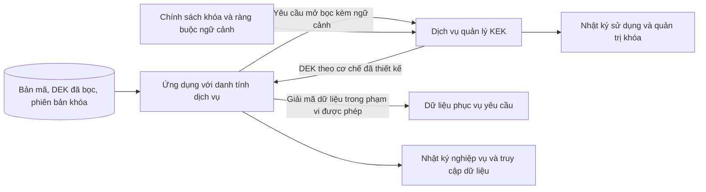

# Tài sản khóa mật mã

## 1. Vì sao cần phân loại khóa như một tài sản riêng?

Khóa mật mã là đầu vào quyết định quyền thực hiện các phép biến đổi mật mã như mã hóa, giải mã, tạo chữ ký, xác minh chữ ký hoặc xác thực thông điệp. Trong một hệ thống, giá trị của khóa thường nằm ở **quyền năng mà khóa trao cho người nắm giữ hoặc dịch vụ được phép sử dụng nó**. Một khóa nhỏ về dung lượng có thể quyết định khả năng đọc hàng triệu bản ghi hoặc phát hành một bản cập nhật phần mềm được toàn bộ khách hàng tin cậy.

Vì vậy, phân loại tài sản không chỉ ghi “đây là dữ liệu bí mật”. Người đặc tả yêu cầu bảo mật phải trả lời được:

- Khóa cho phép thực hiện hành động gì và trên phạm vi dữ liệu hay hệ thống nào?
- Ai được quản trị khóa, ai được gọi phép toán mật mã, ai có thể lấy vật liệu khóa?
- Nếu khóa bị lộ, bị thay thế, bị lạm dụng hoặc không còn sử dụng được thì điều gì xảy ra?
- Cơ chế nào ngăn chặn, phát hiện và phục hồi sau từng tình huống?
- Bằng chứng nào chứng minh các cơ chế đó hoạt động?

Trong chương **Phân loại tài sản**, bài học này đặt khóa mật mã vào quá trình xây dựng yêu cầu bảo mật: nhận diện tài sản, đánh giá tác động, liên kết với đe dọa và đưa ra tiêu chí kiểm thử. Mục tiêu cuối cùng là biến câu “quản lý khóa an toàn” thành những yêu cầu cụ thể, đo được và có thể kiểm chứng trong thiết kế, triển khai và vận hành.

## 2. Xác định đúng ranh giới của tài sản khóa

### 2.1. Vật liệu khóa và đối tượng quản lý khóa

**Vật liệu khóa** là giá trị mật mã thực sự được sử dụng trong phép toán. **Đối tượng quản lý khóa** còn bao gồm mã định danh, phiên bản, thuật toán, mục đích sử dụng, chính sách truy cập, trạng thái và thông tin vòng đời.

Ví dụ, tên logic `orders-data-prod` có thể trỏ tới một khóa đang hoạt động. Khóa đó có nhiều phiên bản, trong đó phiên bản mới dùng để mã hóa và phiên bản cũ còn cần để giải mã dữ liệu đã lưu. Tên logic, khóa và phiên bản khóa không phải cùng một khái niệm. Nếu chỉ ghi tên logic trong tài liệu mà không biết dữ liệu tham chiếu phiên bản nào, nhóm vận hành có thể không xác định được tác động khi hủy một phiên bản cũ.

Một bản kiểm kê hữu ích có hai mức:

- **Mức chính sách hoặc lớp khóa:** quy tắc chung cho khóa phiên, khóa mã hóa dữ liệu, khóa ký bản phát hành và các lớp khác.
- **Mức đối tượng cần theo dõi:** từng khóa hoặc phiên bản dài hạn có chủ sở hữu, phụ thuộc dữ liệu, lịch sử sử dụng và kế hoạch thu hồi riêng.

Không cần đưa từng khóa phiên tồn tại trong vài giây vào bảng kiểm kê thủ công. Tuy nhiên, vẫn phải đặc tả cách sinh, giới hạn thời gian tồn tại, phạm vi sử dụng và xử lý bộ nhớ của lớp khóa phiên đó.

### 2.2. Các thành phần cần được xem xét cùng khóa

| Thành phần | Vai trò trong phân loại tài sản | Thuộc tính cần chú ý |
|---|---|---|
| Khóa bí mật đối xứng | Dùng chung cho các phép toán theo thiết kế, chẳng hạn mã hóa dữ liệu hoặc tạo MAC | Bí mật, toàn vẹn, giới hạn mục đích và phạm vi sử dụng |
| Khóa riêng bất đối xứng | Giải mã hoặc ký, tùy lược đồ và mục đích được cấp | Bí mật, kiểm soát phép toán, khả năng thu hồi hoặc thay thế |
| Khóa công khai | Xác minh chữ ký, mã hóa hoặc tham gia thiết lập khóa theo giao thức | Toàn vẹn, tính xác thực và liên kết đúng với danh tính |
| Chứng thư và điểm neo tin cậy | Gắn danh tính với khóa công khai và quyết định đối tượng được tin cậy | Toàn vẹn, nguồn phân phối, thời hạn và cơ chế cập nhật niềm tin |
| Khóa gốc và dữ liệu gốc để dẫn xuất khóa | Có thể tạo hoặc bảo vệ nhiều khóa con | Phạm vi ảnh hưởng lớn, cô lập và kiểm soát truy cập chặt chẽ |
| Bản sao lưu, bản xuất và bản sao trong bộ nhớ | Là các đường khác để truy cập hoặc khôi phục vật liệu khóa | Cùng mức bảo vệ phù hợp với khóa gốc, thời hạn lưu và khả năng truy vết |
| Chính sách, bí danh và thông tin phiên bản | Xác định ai được dùng khóa nào, trong điều kiện nào | Toàn vẹn, quản lý thay đổi và ngăn chuyển hướng sang khóa trái phép |

Khóa công khai thường không cần giữ bí mật nhưng vẫn là tài sản quan trọng. Nếu kẻ tấn công thay khóa công khai xác minh bản cập nhật bằng khóa do họ kiểm soát, việc bí mật của khóa công khai không có ý nghĩa; vấn đề là hệ thống đã tin nhầm nguồn ký.

Mật khẩu, token truy cập và khóa API đều có thể là bí mật cần quản lý. Tuy nhiên, không phải mọi chuỗi được gọi là “key” đều là khóa mật mã. Một khóa API có thể chỉ là thông tin xác thực để tra cứu quyền. Bản kiểm kê phải phân biệt **bí mật xác thực**, **vật liệu mật mã** và **đối tượng tin cậy**, đồng thời ghi rõ quan hệ phụ thuộc giữa chúng.

## 3. Phân loại theo mục đích và quyền năng

Không có một nhãn “mật” duy nhất mô tả đầy đủ mọi khóa. Một khóa ký lệnh thanh toán và một khóa mã hóa bản sao lưu đều có thể cần giữ bí mật, nhưng nguy cơ, tiêu chí phục hồi và quyền sử dụng rất khác nhau.

| Nhóm khóa | Tài sản hoặc hành động được bảo vệ | Hậu quả điển hình khi bị lạm dụng | Điểm cần thể hiện trong yêu cầu |
|---|---|---|---|
| Khóa mã hóa dữ liệu — DEK | Nội dung bản ghi, tệp hoặc đối tượng lưu trữ | Đọc trái phép dữ liệu thuộc phạm vi khóa | Phạm vi dữ liệu, khả năng giải mã và phụ thuộc vào phiên bản |
| Khóa bọc khóa — KEK | Bảo vệ DEK hoặc khóa khác | Mở rộng khả năng truy cập nhiều khóa dữ liệu | Tách quyền bọc/mở bọc, phân tích cây phụ thuộc |
| Khóa ký token | Phát hành token mà dịch vụ khác chấp nhận | Giả mạo danh tính hoặc quyền trong phạm vi tin cậy | Quyền ký, nội dung được phép ký, phân phối khóa xác minh |
| Khóa ký phần mềm | Xác nhận nguồn và tính toàn vẹn của bản phát hành | Phân phối phần mềm trái phép dưới danh nghĩa hợp lệ | Phê duyệt bản phát hành, giới hạn dịch vụ ký và cập nhật niềm tin |
| Khóa riêng của chứng thư máy chủ | Xác thực máy chủ trong giao thức đã chọn | Giả mạo trong những điều kiện giao thức cho phép | Cấp phát, quyền sử dụng, thay thế chứng thư và khóa |
| Khóa MAC | Kiểm tra tính toàn vẹn và xác thực thông điệp giữa các bên giữ khóa | Tạo thông điệp mà bên nhận tưởng là hợp lệ | Xác định tập bên giữ khóa và khả năng tạo MAC của từng bên |
| Khóa mã hóa bản sao lưu | Giữ bí mật dữ liệu được lưu để phục hồi | Lộ dữ liệu lịch sử hoặc mất khả năng phục hồi | Tính độc lập của bản sao, nơi lưu khóa và kiểm thử phục hồi |
| Khóa phiên, khóa dẫn xuất ngắn hạn | Bảo vệ trao đổi hoặc hoạt động trong phạm vi hẹp | Lộ dữ liệu hay quyền trong phạm vi phiên tương ứng | Dẫn xuất đúng ngữ cảnh, thời gian tồn tại và xử lý sau sử dụng |

Đối với MAC dùng khóa chung, một bên có đủ khóa để xác minh thường cũng có khả năng tạo MAC. Không nên đặc tả tính “không thể chối bỏ” chỉ từ việc sử dụng MAC. Tương tự, chữ ký số chỉ hỗ trợ các kết luận về nguồn ký khi việc gắn danh tính, giữ khóa và quy trình xác minh đều đáng tin cậy.

Một nguyên tắc thiết kế hữu ích là **tách khóa theo mục đích và miền tin cậy**. Tách khóa mã hóa dữ liệu khỏi khóa ký token giúp tránh việc cấp quyền đọc dữ liệu kéo theo quyền phát hành danh tính. Việc tách theo môi trường, khách thuê hoặc miền dữ liệu cần được quyết định từ mức cô lập mong muốn và chi phí vận hành, thay vì mặc định rằng một khóa chung là đủ.

## 4. Đánh giá tác động trên nhiều chiều

### 4.1. Bí mật, toàn vẹn và sẵn sàng

Đối với mỗi khóa hoặc lớp khóa, đánh giá ít nhất ba chiều:

1. **Bí mật:** ai có thể đọc dữ liệu hoặc thực hiện hành động nếu lấy được vật liệu khóa? Bản mã đã bị lấy cắp trước đó có chịu ảnh hưởng không?
2. **Toàn vẹn và tính xác thực:** ai có thể thay khóa, thay chính sách, đổi bí danh, ký trái phép hoặc khiến hệ thống tin một danh tính sai?
3. **Sẵn sàng:** nếu khóa, dịch vụ khóa hoặc quyền truy cập biến mất, chức năng nào dừng và dữ liệu nào không thể phục hồi?

Không được suy rằng mất khóa chỉ ảnh hưởng tới tính bí mật. Với dữ liệu chỉ tồn tại dưới dạng mã hóa, mất vĩnh viễn mọi bản sao có thể sử dụng của khóa có thể đồng nghĩa với mất dữ liệu. Với hệ thống ký, mất khóa riêng có thể dừng phát hành mới, trong khi việc xác minh các chữ ký cũ vẫn có thể tiếp tục nếu còn khóa công khai và thông tin xác minh cần thiết.

### 4.2. Phạm vi ảnh hưởng và thời gian

Mức tác động còn phụ thuộc vào:

- Số khách thuê, môi trường, đối tượng và hệ thống phụ thuộc vào khóa.
- Vai trò của khóa trong chuỗi bảo vệ: khóa gốc, KEK hay DEK của một đối tượng.
- Thời gian thông tin cần giữ bí mật và thời gian chữ ký cần được xác minh.
- Khả năng xuất vật liệu khóa, gọi API sử dụng khóa hoặc thay đổi chính sách.
- Nơi có bản sao: dịch vụ quản lý khóa, thiết bị, bộ nhớ tiến trình, bản sao lưu, công cụ hỗ trợ.
- Khả năng thu hồi quyền sử dụng và tốc độ thay thế khóa ở các bên phụ thuộc.

Không thể kết luận mức phân loại chỉ từ độ dài khóa hoặc tên thuật toán. Một khóa dùng thuật toán phù hợp vẫn có thể bị lạm dụng do quyền gọi API quá rộng. Ngược lại, việc có thiết bị bảo vệ khóa không tự chứng minh rằng mọi yêu cầu về phân quyền, nội dung được ký và phục hồi đã được đáp ứng.

### 4.3. Ví dụ phân loại theo tác động kinh doanh

Giả sử một nền tảng lưu hồ sơ khách hàng, dùng DEK riêng cho từng khách thuê và một KEK chung để bọc các DEK của môi trường sản xuất.

| Tài sản | Tác động nổi bật | Kết luận để xây dựng yêu cầu |
|---|---|---|
| DEK của khách thuê A | Lộ hoặc mất khả năng đọc dữ liệu của A trong phạm vi phiên bản | Gắn phép mở bọc với danh tính và ngữ cảnh khách thuê A |
| KEK sản xuất | Có thể tác động đến nhiều DEK và nhiều khách thuê | Cần kiểm soát quản trị mạnh, quan sát sử dụng và kế hoạch thay thế có kiểm kê phụ thuộc |
| Khóa công khai xác minh token | Bị thay thế có thể khiến dịch vụ chấp nhận token giả | Kiểm soát nguồn phân phối và toàn vẹn tập khóa được tin cậy |
| Khóa ký bản phát hành | Có thể làm khách hàng tin phần mềm bị cài mã độc | Tách khỏi quyền triển khai thông thường và ràng buộc việc ký với quy trình phát hành được duyệt |

Đây là đánh giá theo kịch bản, không phải quy tắc rằng KEK luôn có cùng mức phân loại ở mọi tổ chức. Phạm vi bọc khóa và kiến trúc cô lập quyết định mức tác động thực tế.

## 5. Lập hồ sơ kiểm kê phục vụ đặc tả yêu cầu

Một bản kiểm kê khóa nên đủ để trả lời “khóa này dùng ở đâu, ai chịu trách nhiệm và điều gì phụ thuộc vào nó” mà không chứa chính vật liệu khóa.

| Trường | Câu hỏi cần trả lời |
|---|---|
| Mã tài sản và định danh phiên bản | Đối tượng nào được đề cập, có phân biệt khóa logic với phiên bản không? |
| Mục đích, loại khóa và phép toán | Khóa được phép mã hóa, giải mã, ký, xác minh hay bọc khóa? |
| Chủ sở hữu nghiệp vụ và đơn vị vận hành | Ai quyết định mức tác động, ai thực thi và ai xử lý sự cố? |
| Môi trường, khách thuê và miền tin cậy | Khóa được phép tác động ở ranh giới nào? |
| Dữ liệu và hệ thống phụ thuộc | Khóa bảo vệ gì, dữ liệu tham chiếu phiên bản bằng cách nào? |
| Mức tác động theo từng chiều | Lộ, thay thế, lạm dụng hoặc mất khóa gây hậu quả gì? |
| Nơi giữ khóa và khả năng xuất | Vật liệu nằm ở đâu, có đi vào bộ nhớ ứng dụng hoặc bản xuất không? |
| Danh tính và quyền | Ai quản trị, ai gọi phép toán, ai có thể thay đổi chính sách? |
| Vòng đời | Khi nào tạo, kích hoạt, ngừng dùng cho dữ liệu mới, lưu giữ và hủy? |
| Phục hồi và phụ thuộc vận hành | Có bản sao nào, ai mở được, cần dịch vụ hay danh tính nào để phục hồi? |
| Yêu cầu và bằng chứng | Những mã yêu cầu, kiểm thử, nhật ký hoặc biên bản nào liên quan? |

Ví dụ sau là **mẫu hồ sơ minh họa**, không phải cấu hình cho một sản phẩm cụ thể. Các giá trị chỉ diễn đạt các quyết định cần có trong đặc tả:

```yaml
asset_id: KEY-ORDERS-KEK-PROD
purpose: wrap_and_unwrap_order_data_keys
environment: production
scope:
  data_domain: customer_orders
  tenant_binding: required_per_request
owners:
  business: order_platform_owner
  operations: key_operations_team
impact:
  disclosure: high
  unauthorized_use: high
  loss_of_access: high
custody:
  service: managed_key_service
  raw_key_export: prohibited
permissions:
  unwrap: orders_runtime_identity
  policy_change: key_policy_operator
  deletion_approval: two_distinct_approved_people
dependencies:
  data_key_catalog: order_encryption_version_index
  recovery_runbook: order_key_recovery_procedure
requirements:
  - KR-02
  - KR-03
  - KR-04
  - KR-09
```

Không đưa giá trị khóa thật, bản xuất khóa hay bí mật phục hồi vào hồ sơ này. Định danh khóa và quan hệ phụ thuộc cũng có thể tiết lộ cấu trúc hệ thống, nên bản kiểm kê vẫn cần phân quyền đọc phù hợp.

## 6. Liên kết kiến trúc khóa với mô hình đe dọa

### 6.1. Ví dụ mã hóa phong bì

Trong mã hóa phong bì, dữ liệu được mã hóa bằng DEK; DEK được bảo vệ bởi KEK. Một cách triển khai là lưu bản mã cùng DEK đã bọc và thông tin xác định phiên bản KEK.



Sơ đồ này mô tả trường hợp ứng dụng nhận DEK để xử lý. Trong trường hợp đó, DEK có thể xuất hiện trong bộ nhớ ứng dụng, dù KEK không được xuất khỏi dịch vụ khóa. Phân loại phải theo đường đi thực tế của từng loại khóa; không thể nói chung rằng “mọi khóa đều không rời hệ thống quản lý khóa”.

Ngữ cảnh khách thuê chỉ có giá trị bảo vệ khi được ràng buộc đúng với phép toán và được kiểm tra bằng chính sách hoặc cơ chế xác thực phù hợp. Một trường văn bản mà bên gọi tự sửa tùy ý không tự tạo ra sự cô lập khách thuê.

### 6.2. Các đường tấn công cần đưa vào đặc tả

| Đe dọa | Điều kiện hoặc điểm yếu | Hệ quả | Yêu cầu cần phát sinh |
|---|---|---|---|
| Đánh cắp danh tính dịch vụ | Thông tin xác thực bị lộ hoặc quyền chạy workload bị chiếm | Gọi giải mã hợp lệ về mặt API nhưng trái mục đích | Giới hạn danh tính, tài sản, phép toán, ngữ cảnh và khả năng phát hiện lạm dụng |
| Đọc DEK trong bộ nhớ hoặc bản dump | Quyền chẩn đoán, báo lỗi hoặc truy cập máy quá rộng | Lộ dữ liệu mà DEK bảo vệ | Giới hạn dump, nội dung chẩn đoán và thời gian giữ DEK |
| Thay bí danh hoặc chính sách khóa | Một người có quyền quản trị quá rộng | Chuyển hướng mã hóa hoặc mở rộng quyền sử dụng | Phê duyệt thay đổi, phân tách nhiệm vụ và nhật ký quản trị |
| Xóa hoặc vô hiệu hóa khóa | Lỗi thao tác hoặc hành vi phá hoại | Dữ liệu không đọc được, dịch vụ dừng | Khoảng chờ, kiểm tra phụ thuộc và khả năng khôi phục khi còn được phép |
| Lạm dụng dịch vụ ký | Khóa không xuất được nhưng API ký quá rộng | Chữ ký hợp lệ cho nội dung trái phép | Kiểm soát cả người gọi lẫn nội dung hoặc quy trình được phép ký |
| Đánh cắp bản sao lưu khóa | Kho dự phòng ít được giám sát | Vượt qua cơ chế bảo vệ ở hệ thống chính | Bảo vệ bản sao, tách quyền và kiểm thử quy trình phục hồi |
| Thay tập khóa công khai tin cậy | Kênh cấu hình hoặc cập nhật bị sửa | Chấp nhận danh tính hay chữ ký giả | Xác thực nguồn, kiểm soát toàn vẹn và cập nhật niềm tin có kiểm soát |

Việc khóa riêng “không thể xuất” giảm một đường lấy cắp vật liệu khóa. Nó không ngăn được mọi hành vi gọi ký hoặc giải mã trái phép. Vì vậy, yêu cầu phải kiểm soát **quyền sử dụng khóa** song song với **quyền tiếp cận vật liệu khóa**.

## 7. Chuyển kết quả phân loại thành yêu cầu kiểm chứng được

### 7.1. Cấu trúc một yêu cầu

Một yêu cầu có thể kiểm chứng nên nêu rõ: **đối tượng + hành vi bắt buộc + điều kiện áp dụng + giới hạn + bằng chứng chấp nhận**. Mỗi yêu cầu cần liên kết về tài sản và rủi ro để người kiểm thử hiểu vì sao giới hạn đó tồn tại.

Ví dụ chưa đủ: “Khóa phải được bảo vệ tốt và luân chuyển thường xuyên”. Câu này không chỉ rõ khóa nào, ai có quyền, khi nào phải thay và dữ liệu cũ được xử lý ra sao.

Ví dụ cụ thể hơn: “Đối với KEK sản xuất của miền đơn hàng, hệ thống phải từ chối yêu cầu mở bọc từ danh tính ngoài danh sách cho phép hoặc có ngữ cảnh khách thuê không khớp với quyền của bên gọi; kiểm thử tích hợp phải chứng minh cả hai trường hợp bị từ chối trước khi dữ liệu được trả về”.

### 7.2. Bộ yêu cầu minh họa

Các thời hạn và ngưỡng dưới đây là **giá trị minh họa của một dự án giả định**, cần được chủ sở hữu rủi ro phê duyệt theo tác động nghiệp vụ. Chúng không phải giá trị mặc định cho mọi hệ thống.

| Mã | Yêu cầu | Bằng chứng chấp nhận |
|---|---|---|
| KR-01 | Trước khi kích hoạt khóa sản xuất dài hạn, phải có mã tài sản, chủ sở hữu, mục đích, phạm vi dữ liệu, nơi giữ và quy trình xử lý khi mất hoặc lộ khóa. | Hồ sơ triển khai bị chặn khi thiếu trường bắt buộc; hồ sơ của khóa đã kích hoạt đầy đủ. |
| KR-02 | KEK sản xuất không được xuất dưới dạng vật liệu thô; mọi đường xuất hoặc sao chép phục hồi được hỗ trợ phải được kiểm kê và phê duyệt riêng. | Kiểm tra cấu hình, quyền quản trị và kiểm thử yêu cầu xuất bằng các vai trò liên quan. |
| KR-03 | Chỉ danh tính workload đơn hàng được chỉ định mới được mở bọc DEK của miền đơn hàng; không dùng tài khoản người dùng dùng chung cho đường chạy ứng dụng. | Danh tính hợp lệ thành công; danh tính dịch vụ khác, danh tính cá nhân và yêu cầu chưa xác thực bị từ chối. |
| KR-04 | Yêu cầu giải mã phải ràng buộc với khách thuê lấy từ ngữ cảnh đã xác thực; thay trường khách thuê trong yêu cầu không được mở quyền đọc dữ liệu của khách thuê khác. | Kiểm thử tráo định danh khách thuê, DEK đã bọc và đối tượng dữ liệu; không trường hợp nào trả dữ liệu trái quyền. |
| KR-05 | Khóa ký token và khóa mã hóa dữ liệu phải có định danh, mục đích và tập quyền tách biệt; vai trò giải mã dữ liệu không được ký token. | Ma trận quyền và kiểm thử phủ định các phép toán ngoài mục đích. |
| KR-06 | Thay đổi chính sách KEK và yêu cầu hủy khóa phải có phê duyệt của hai người được ủy quyền khác nhau; người thực hiện không tự hoàn tất cả hai bước phê duyệt. | Thử tự phê duyệt và bỏ qua bước; mọi đường quản trị được hỗ trợ đều thực thi quy tắc. |
| KR-07 | Trong môi trường sản xuất, mỗi lần thử sử dụng khóa và mỗi thao tác quản trị phải có sự kiện kiểm toán chứa danh tính, mã khóa/phiên bản, phép toán, kết quả, thời gian và mã tương quan; sự kiện phải đến kho giám sát trong 5 phút. | Đối chiếu tập lời gọi thử có kết quả biết trước với sự kiện nhận được; đo độ trễ và kiểm tra đường cảnh báo khi mất thu thập. |
| KR-08 | Ứng dụng, nhật ký, trace, thông báo lỗi và bản dump được phép thu thập không được chứa vật liệu khóa thô hoặc bản rõ từ phép giải mã. | Dùng dữ liệu thử có dấu nhận diện để kiểm tra các đầu ra vận hành và đường lỗi, kèm kiểm tra cấu hình dump. |
| KR-09 | Phương án phục hồi khóa giải mã và dữ liệu đơn hàng phải đáp ứng RTO 60 phút, RPO 15 phút, kể cả quan hệ giữa dữ liệu, phiên bản khóa và quyền cần dùng. | Diễn tập với bản sao và danh tính phục hồi được phê duyệt; đo thời gian và xác nhận đọc được dữ liệu ở mốc khôi phục. |
| KR-10 | Sau khi tuyên bố nghi ngờ lộ khóa ký token, phải chặn phát hành bằng phiên bản đó trong 15 phút và thực thi phương án xử lý token còn hiệu lực đã được phê duyệt. | Diễn tập sự cố, kiểm tra bên phát hành lẫn bên xác minh và ghi nhận thời gian hiệu lực thực tế. |
| KR-11 | Khi dịch vụ khóa không sẵn sàng, yêu cầu cần giải mã phải thất bại theo hành vi đã đặc tả; không tự chuyển sang lưu bản rõ hoặc dùng khóa mặc định dùng chung. | Kiểm thử gián đoạn dịch vụ khóa và xác minh phản hồi, trạng thái giao dịch, dữ liệu lưu trữ và cảnh báo. |
| KR-12 | Chỉ được hủy vĩnh viễn phiên bản khóa sau khi đã kiểm tra mọi phụ thuộc còn phải lưu, bản sao phục hồi và nghĩa vụ xác minh tương ứng, rồi có bằng chứng phê duyệt. | Thử yêu cầu hủy khi còn phụ thuộc; hệ thống hoặc quy trình được kiểm soát phải chặn và ghi lý do. |

Đối với KR-07, cần chỉ rõ đơn vị đếm sự kiện khi triển khai: một yêu cầu API có thể có nhiều lần thử lại và một giao dịch nghiệp vụ có thể gọi nhiều phép toán. Mã tương quan và định danh lần thử giúp đối chiếu chính xác. Nếu nền tảng gộp hoặc chỉ cung cấp một phần sự kiện, thiết kế phải bổ sung bằng chứng ở lớp khác hoặc ghi nhận khoảng trống để xử lý rủi ro.

Một yêu cầu kiểm chứng được không nhất thiết chỉ là điều kiện do phần mềm tự động cưỡng chế. Có thể cần quy trình phê duyệt hoặc diễn tập. Tuy nhiên, bằng chứng phải cho thấy quy trình áp dụng được cho đường thao tác thực tế và không dễ bị bỏ qua.

## 8. Đặc tả vòng đời khóa

### 8.1. Trạng thái và phép toán được phép

Mỗi hệ thống cần định nghĩa trạng thái bằng hành vi, vì tên trạng thái giữa các sản phẩm có thể khác nhau.

| Giai đoạn | Quyết định cần đặc tả |
|---|---|
| Tạo hoặc tiếp nhận | Cơ chế sinh khóa có phù hợp mục đích không; nếu nhập khóa thì ai được nhập và nguồn gốc được xác minh thế nào? |
| Chờ kích hoạt | Kiểm tra hồ sơ, chính sách, miền tin cậy, khả năng phục hồi và quyền trước khi cho dùng. |
| Đang hoạt động | Cho phép chính xác những phép toán nào, bởi danh tính nào, với giới hạn và ghi nhận nào? |
| Ngừng dùng cho dữ liệu hoặc chữ ký mới | Chặn mã hóa/ký mới bằng phiên bản cũ; xác định có tiếp tục giải mã hoặc xác minh hay không. |
| Nghi ngờ hoặc xác nhận bị lộ | Khoanh vùng, chặn phép toán nguy hiểm, đánh giá dữ liệu và các bên tin cậy chịu ảnh hưởng. |
| Lưu giữ phục vụ nghĩa vụ còn lại | Giữ khả năng giải mã hay thông tin xác minh trong thời hạn cần thiết, hạn chế quyền và quan sát truy cập. |
| Hủy vĩnh viễn | Xử lý các bản sao và phụ thuộc theo phạm vi đã duyệt, lưu bằng chứng hủy không chứa bí mật. |

Không nên dùng một cờ “inactive” rồi mặc định mọi phép toán đều dừng. Với khóa mã hóa dữ liệu, ngừng mã hóa mới có thể vẫn cần cho phép giải mã lịch sử. Với khóa ký, ngừng dùng khóa riêng để ký mới không đồng nghĩa phải xóa khóa công khai khỏi mọi kho xác minh.

### 8.2. Luân chuyển và tái bảo vệ dữ liệu

“Luân chuyển khóa” có thể chỉ nhiều hành động khác nhau:

- Tạo phiên bản mới để các lần mã hóa hoặc ký mới sử dụng.
- Bọc lại DEK bằng KEK mới.
- Giải mã và mã hóa lại dữ liệu bằng DEK mới.
- Cập nhật tập khóa công khai và thời gian chồng lấn phục vụ xác minh.
- Cập nhật chứng thư, danh tính hoặc cấu hình tham chiếu khóa.

Các hành động này không tương đương. Tạo KEK mới không tự làm mọi DEK đang lưu được bọc lại. Bọc lại DEK không thay DEK đã dùng để mã hóa dữ liệu. Nếu DEK đã bị lộ, chỉ bọc nó bằng KEK mới không khôi phục bí mật của dữ liệu. Tương tự, việc thay khóa không lấy lại được bản rõ mà đối phương đã đọc trước đó.

Yêu cầu luân chuyển cần nêu tác nhân kích hoạt, thời hạn hoàn tất, tập đối tượng phải chuyển, cách theo dõi tiến độ, xử lý lỗi và điều kiện cho phép ngừng phiên bản cũ. Thời gian sử dụng khóa nên dựa trên loại khóa, lượng sử dụng, mức tác động, môi trường và yêu cầu áp dụng, thay vì gán một chu kỳ giống nhau cho mọi khóa.

Thời hạn chứng thư, thời gian dùng khóa để tạo đầu ra mới và thời gian giữ thông tin để xác minh hoặc giải mã là các mốc riêng. Đặc tả phải phân biệt chúng để tránh gián đoạn khi chứng thư hết hạn hoặc khóa đổi phiên bản.

## 9. Logging, giám sát và giới hạn của bằng chứng

Nhật ký sử dụng khóa giúp trả lời “danh tính nào yêu cầu phép toán gì trên khóa nào, lúc nào, với kết quả ra sao”. Nhật ký quản trị giúp truy vết việc tạo, đổi chính sách, thay bí danh, vô hiệu hóa và hủy khóa.

Một sự kiện minh họa có thể có dạng:

```json
{
  "event_type": "key_operation",
  "timestamp": "2026-01-12T08:30:00Z",
  "actor": "orders-runtime-prod",
  "key_id": "orders-kek",
  "key_version": "v7",
  "operation": "unwrap",
  "result": "denied",
  "reason_code": "scope_mismatch",
  "correlation_id": "req-example-001"
}
```

Sự kiện không chứa vật liệu khóa, bản rõ hay thông tin xác thực của bên gọi. Các trường định danh và ngữ cảnh cũng phải được tối thiểu hóa theo nhu cầu điều tra, có kiểm soát truy cập và thời hạn lưu đã phê duyệt.

Nhật ký cần được bảo vệ tính toàn vẹn và khỏi việc xóa trái phép. Những trường hợp đáng quan sát gồm: tăng đột biến lời gọi giải mã, sử dụng ngoài miền vận hành đã biết, yêu cầu bị từ chối lặp lại, thay đổi quyền và hủy hoặc vô hiệu hóa khóa.

Tuy nhiên, một sự kiện mở bọc DEK không chứng minh mỗi lần đọc bản ghi đều được kiểm toán. Nếu ứng dụng giữ DEK trong bộ nhớ rồi giải mã nhiều đối tượng, dịch vụ khóa chỉ nhìn thấy những lần ứng dụng gọi nó. Vì vậy, yêu cầu truy vết truy cập dữ liệu thường cần kết hợp nhật ký của ứng dụng, kho dữ liệu và dịch vụ khóa.

Tương tự, phép toán có kết quả “thành công” chỉ chứng minh hệ thống đã chấp nhận yêu cầu theo cơ chế hiện hành. Nó không tự chứng minh hành vi đó đúng mục đích nghiệp vụ nếu danh tính hợp lệ đã bị chiếm quyền.

## 10. Phục hồi, xử lý lộ khóa và hủy khóa

### 10.1. Phục hồi phải bao gồm cả quyền và phụ thuộc

Bản sao lưu dữ liệu không đủ nếu không có khóa và quyền giải mã tương ứng. Ngược lại, có khóa nhưng thiếu thông tin phiên bản, DEK đã bọc hoặc cấu hình cần thiết cũng có thể khiến dữ liệu không phục hồi được.

Một phương án phục hồi cần xác định:

1. Dữ liệu, vật liệu hoặc đối tượng khóa, thông tin phiên bản và chính sách nào phải phục hồi cùng nhau.
2. Danh tính phục hồi được cấp quyền bằng cơ chế nào khi hệ thống chính bị gián đoạn.
3. Phụ thuộc nào có thể tạo vòng bế tắc, chẳng hạn bí mật phục hồi lại được mã hóa bằng chính khóa đang mất quyền truy cập.
4. Bản sao có độc lập đủ với lỗi đang xét không, bao gồm lỗi vùng, lỗi quyền và thao tác quản trị sai.
5. RTO, RPO và tiêu chí kiểm tra dữ liệu sau phục hồi được đo như thế nào.

Không áp dụng cùng một chiến lược sao lưu cho mọi loại khóa. Khóa giải mã dữ liệu dài hạn có thể cần khả năng phục hồi; khóa phiên thường không cần lưu dài hạn; việc sao lưu khóa ký riêng phải cân nhắc rủi ro tăng số nơi có khả năng tạo chữ ký. Quyết định này cần bám vào mục đích và kịch bản tác động đã phân loại.

### 10.2. Khi nghi ngờ lộ hoặc lạm dụng khóa

Quy trình cần phân biệt **lộ vật liệu khóa** với **lạm dụng quyền gọi phép toán**. Trong trường hợp thứ hai, vật liệu khóa có thể vẫn nằm trong nơi lưu an toàn nhưng dữ liệu đã bị giải mã hoặc chữ ký trái phép đã được tạo.

Những quyết định cần có trong kịch bản sự cố gồm:

- Khóa, phiên bản, dữ liệu, chữ ký và bên tin cậy nào nằm trong phạm vi ảnh hưởng?
- Có cần chặn danh tính, thay chính sách, dừng ký hoặc vô hiệu hóa khóa ngay không?
- Cách khoanh vùng nào giữ được bằng chứng và hạn chế tác động sẵn sàng ngoài dự kiến?
- Có phải thay khóa, bọc lại DEK, mã hóa lại dữ liệu hoặc cập nhật tập khóa tin cậy không?
- Token, chữ ký hoặc bản mã đã phát hành sẽ được xử lý theo quy tắc nào?
- Ai quyết định chấp nhận rủi ro còn lại và ai xác nhận khôi phục hoạt động?

Thay khóa ký token không tự làm mọi token cũ mất hiệu lực. Kết quả còn phụ thuộc thời hạn token, tập khóa mà các bên xác minh đang tin và cơ chế thu hồi được thiết kế. Yêu cầu phải tính cả độ trễ cập nhật ở bộ nhớ đệm và các dịch vụ phụ thuộc.

Với chữ ký lịch sử, việc đánh giá chữ ký sau sự cố phụ thuộc chính sách xác minh, thông tin về thời điểm ký và bằng chứng còn giữ. Không nên quy định đơn giản rằng “xóa khóa công khai là giải quyết mọi chữ ký đã tạo”.

### 10.3. Hủy khóa và xóa dữ liệu bằng mật mã

Hủy khóa có thể hỗ trợ làm dữ liệu mã hóa không còn truy cập được, nhưng chỉ khi mọi đường giải mã trong phạm vi đều đã được xử lý. Cần xem xét khóa con, bản sao, bản xuất, bộ nhớ đệm, nơi phục hồi và các bản rõ đã tạo trước đó.

Nếu một DEK dùng chung cho nhiều đối tượng, hủy DEK để xóa một đối tượng sẽ ảnh hưởng đến những đối tượng còn lại. Vì vậy, mức chi tiết của khóa phải phù hợp với mức chi tiết cần xóa hoặc cô lập dữ liệu. Thiết kế phân loại tài sản và thiết kế yêu cầu xóa dữ liệu có quan hệ trực tiếp với nhau.

Không nên cam kết “dữ liệu đã bị xóa hoàn toàn” chỉ từ sự kiện xóa một bí danh khóa. Bí danh có thể chỉ là con trỏ; đối tượng hoặc phiên bản khóa thực tế vẫn còn. Bằng chứng hủy cần nêu phạm vi, thời điểm có hiệu lực, bản sao đã xử lý và giới hạn của kết luận.

## 11. Ví dụ truy vết từ tài sản đến tiêu chí kiểm thử

Xét chức năng đọc hồ sơ đơn hàng của khách thuê A. Ứng dụng dùng danh tính dịch vụ để lấy DEK thông qua KEK, rồi giải mã dữ liệu phục vụ yêu cầu đã được phân quyền.

| Thành phần truy vết | Nội dung |
|---|---|
| Tài sản | `KEY-ORDERS-KEK-PROD`, DEK của khách thuê A và dữ liệu đơn hàng liên quan |
| Mục tiêu an toàn | Chỉ đọc dữ liệu thuộc khách thuê và quyền nghiệp vụ đã xác thực |
| Đe dọa | Bên gọi tráo khách thuê trong yêu cầu hoặc dùng DEK đã bọc của B để lấy dữ liệu B |
| Rủi ro | Lộ đơn hàng giữa các khách thuê dù yêu cầu đi qua một dịch vụ hợp lệ |
| Yêu cầu | KR-03, KR-04, KR-07 và KR-08 |
| Quyết định kiến trúc | Lấy khách thuê từ danh tính đã xác thực; kiểm tra quyền ở ứng dụng; ràng buộc ngữ cảnh mật mã với đối tượng và chính sách tương ứng |
| Kiểm thử dương | Người dùng thuộc A, có quyền đọc đối tượng A, nhận đúng nội dung A |
| Kiểm thử âm | Thay khách thuê thành B, tráo DEK đã bọc hoặc thay đối tượng tham chiếu đều bị từ chối và không trả dữ liệu trái quyền |
| Bằng chứng vận hành | Có mã tương quan giữa truy cập ứng dụng và lời gọi khóa; sự kiện từ chối đủ điều tra, không chứa bí mật |

Kiểm thử cần thực hiện tại từng ranh giới liên quan. Nếu chỉ kiểm thử giao diện HTTP mà không xem quyền của dịch vụ khóa, có thể bỏ sót danh tính khác có quyền giải mã trực tiếp. Nếu chỉ kiểm thử chính sách khóa, có thể bỏ sót lỗi ứng dụng trả nhầm bản rõ sau khi giải mã hợp lệ.

Đối với yêu cầu sẵn sàng, một tình huống riêng là vô hiệu hóa tạm thời khóa trong môi trường kiểm thử được kiểm soát. Tiêu chí chấp nhận không chỉ là “xuất hiện lỗi”, mà còn phải xác minh không lưu bản rõ để né lỗi, không chuyển sang khóa ngoài chính sách, không báo giao dịch thành công sai và có khả năng phục hồi theo hành vi đã định.

## 12. Các sai lầm thường gặp khi đặc tả

| Sai lầm | Vì sao chưa đủ | Cách diễn đạt hoặc thiết kế cần bổ sung |
|---|---|---|
| “Tất cả khóa đều là dữ liệu tối mật” | Bỏ qua toàn vẹn của khóa công khai và sẵn sàng của khóa giải mã | Phân loại theo mục đích, tác động và miền tin cậy |
| “Đã dùng dịch vụ quản lý khóa nên an toàn” | Không mô tả quyền gọi API, đường xuất và quyền thay chính sách | Nêu danh tính, phép toán, phạm vi, điều kiện và bằng chứng |
| “Chỉ quản trị viên mới cần quan tâm” | Ứng dụng có thể có quyền giải mã hoặc ký gây tác động lớn | Kiểm kê cả quyền quản trị lẫn quyền sử dụng |
| “Đổi khóa định kỳ là đã xử lý dữ liệu cũ” | Phiên bản cũ, DEK cũ hoặc bản mã cũ có thể vẫn giữ nguyên | Nêu rõ tạo phiên bản mới, bọc lại hay mã hóa lại |
| “Sao lưu khóa vào cùng kho là đủ” | Cùng lỗi quyền, thao tác xóa hoặc vùng có thể làm mất cả hai | Xác định miền lỗi và diễn tập phục hồi thực tế |
| “Xóa khóa càng nhanh càng tốt khi có sự cố” | Có thể làm mất dữ liệu hoặc bằng chứng, chưa chắc ngăn mọi đường lạm dụng | Định trước hành động khoanh vùng, quyết định hủy và điều kiện phục hồi |
| “Có log giải mã là biết mọi lần đọc dữ liệu” | DEK có thể được dùng nhiều lần sau một lần mở bọc | Kết hợp bằng chứng từ ứng dụng, dữ liệu và dịch vụ khóa |
| “Khóa không xuất được thì không thể bị lạm dụng” | Người có quyền vẫn có thể gọi ký hoặc giải mã trái mục đích | Ràng buộc phép toán với danh tính, ngữ cảnh và quy trình nghiệp vụ |

## 13. Kết quả cần có sau khi phân loại tài sản khóa

Đầu ra của công việc không dừng ở danh sách tên khóa. Đối với mỗi lớp khóa và mỗi khóa dài hạn cần quản lý riêng, người học cần tạo được:

1. **Hồ sơ tài sản:** mục đích, chủ sở hữu, phạm vi, nơi giữ, bản sao và quan hệ phụ thuộc.
2. **Đánh giá tác động:** hậu quả khi lộ, bị thay thế, bị lạm dụng hoặc mất khả năng truy cập.
3. **Mô hình quyền:** tách khả năng quản trị, sử dụng phép toán và tiếp cận vật liệu khóa.
4. **Yêu cầu vòng đời:** tạo, kích hoạt, thay thế, giữ phục vụ lịch sử, xử lý sự cố và hủy.
5. **Tiêu chí chấp nhận:** kiểm thử dương, kiểm thử âm, kiểm thử gián đoạn và bằng chứng phục hồi phù hợp.
6. **Liên kết truy vết:** tài sản → đe dọa → rủi ro → yêu cầu → quyết định kiến trúc → kiểm thử và bằng chứng vận hành.

Khi các đầu ra này rõ ràng, nhóm phát triển có thể kiểm tra một thay đổi quyền, một lần đổi khóa hoặc một quyết định hủy khóa dựa trên tác động cụ thể. Đó là cách phân loại khóa mật mã hỗ trợ trực tiếp việc xây dựng yêu cầu bảo mật xuyên suốt vòng đời phát triển hệ thống.
# Tài sản khóa mật mã

## Mục tiêu bài học

Trong chương **Phân loại tài sản**, khóa mật mã cần được nhìn nhận như tài sản quyết định khả năng bảo vệ hoặc sử dụng nhiều tài sản khác. Một cơ sở dữ liệu được mã hóa tốt vẫn có thể bị đọc nếu kẻ tấn công chiếm được khóa giải mã. Ngược lại, mất khóa hợp lệ có thể làm dữ liệu không thể phục hồi dù các bản sao lưu dữ liệu vẫn còn nguyên.

Bài học thuộc phạm vi thiết kế yêu cầu bảo mật: từ mục tiêu an toàn thông tin và mô hình đe dọa, xác định những yêu cầu cụ thể về khóa, gắn với kiến trúc, người chịu trách nhiệm và bằng chứng kiểm thử. Sau bài học, người học có thể:

- Nhận diện vật liệu khóa và các thành phần quản lý khóa cần đưa vào danh mục tài sản.
- Phân loại khóa theo tính bí mật, toàn vẹn, sẵn sàng, phạm vi ảnh hưởng và khả năng phục hồi.
- Đặc tả yêu cầu cho xác thực, phân quyền, lưu trữ, sử dụng, logging, xoay vòng và ứng phó sự cố khóa.
- Viết tiêu chí chấp nhận có thể kiểm chứng thay cho những câu chung chung như “khóa phải được bảo vệ an toàn”.

## 1. Khóa mật mã là tài sản gì?

### 1.1. Vật liệu khóa và vai trò của nó

Khóa mật mã là giá trị đầu vào được một thuật toán sử dụng để thực hiện chức năng như mã hóa, giải mã, tạo chữ ký hoặc xác minh tính xác thực. Mức bảo vệ cần thiết phụ thuộc vào chức năng và loại khóa.

- **Khóa đối xứng:** dùng trong các cơ chế mà các bên được phép nắm giữ cùng bí mật, chẳng hạn mã hóa dữ liệu hoặc tạo mã xác thực thông điệp.
- **Khóa riêng:** phần bí mật của một cặp khóa bất đối xứng, được dùng theo mục đích của cơ chế như ký hoặc giải mã.
- **Khóa công khai:** phần được phép phân phối của cặp khóa. Giá trị của nó thường không cần giữ bí mật, nhưng việc gắn khóa với đúng danh tính và đúng mục đích phải được bảo vệ.
- **Bí mật gốc hoặc hạt giống dẫn xuất:** đầu vào để sinh ra các khóa khác. Nếu bị lộ, nhiều khóa con có thể cùng mất an toàn.
- **Khóa bảo vệ khóa:** khóa dùng để mã hóa hoặc bọc những khóa khác, thường được gọi là key encryption key, viết tắt là KEK.
- **Khóa mã hóa dữ liệu:** khóa trực tiếp bảo vệ dữ liệu, thường được gọi là data encryption key, viết tắt là DEK.

Chứng thư số chứa khóa công khai và thông tin ràng buộc danh tính; chứng thư không đồng nghĩa với khóa riêng. Mật khẩu, access token và API token cũng là tài sản nhạy cảm nhưng không mặc nhiên là khóa mật mã. Chúng có thể cho phép gọi dịch vụ sử dụng khóa, nên vẫn cần được liên kết trong mô hình đe dọa.

### 1.2. Tài sản khóa không chỉ là một chuỗi byte

Một bản phân loại hữu ích cần xem xét cả vật liệu khóa lẫn những thành phần quyết định ai được sử dụng nó:

| Thành phần | Ví dụ | Hậu quả khi mất kiểm soát |
| --- | --- | --- |
| Vật liệu khóa | DEK, khóa riêng ký, bí mật gốc | Đọc dữ liệu, giả mạo hoặc mất khả năng phục hồi |
| Định danh và phiên bản | Key ID, version, alias | Chọn nhầm khóa hoặc không giải mã được dữ liệu cũ |
| Chính sách sử dụng | Quyền giải mã, quyền ký, giới hạn môi trường | Danh tính không hợp lệ vẫn được thực hiện thao tác mật mã |
| Quan hệ tin cậy | Khóa công khai được tin cậy, chứng thư, trust store | Chấp nhận chữ ký hoặc máy chủ của kẻ tấn công |
| Bản sao và phương tiện phục hồi | Bản sao lưu khóa, bản sao trong thiết bị dự phòng | Lộ khóa qua đường phục hồi hoặc không phục hồi được |
| Hồ sơ vòng đời | Chủ sở hữu, trạng thái, thời hạn sử dụng | Khóa quá hạn, vô chủ hoặc đã bị nghi ngờ vẫn tiếp tục được dùng |
| Nhật ký và cảnh báo | Sự kiện giải mã, thay đổi quyền, vô hiệu hóa | Không phát hiện hoặc không điều tra được hành vi lạm dụng |

Không cần gộp mọi thành phần vào cùng một bản ghi, nhưng phải có quan hệ truy vết. Ví dụ, hồ sơ của một KEK cần chỉ ra chính sách quyền nào bảo vệ nó, những nhóm DEK nào phụ thuộc vào nó và ai có trách nhiệm khôi phục khi dịch vụ khóa gặp sự cố.

## 2. Nhận diện các nhóm khóa thường gặp

| Nhóm tài sản | Mục đích | Rủi ro chính | Yêu cầu cần làm rõ |
| --- | --- | --- | --- |
| DEK của dữ liệu khách hàng | Mã hóa cơ sở dữ liệu, tệp hoặc bản sao lưu | Lộ dữ liệu trong phạm vi khóa bảo vệ | Phạm vi dữ liệu, nơi xuất hiện bản rõ của khóa, cách phục hồi |
| KEK bảo vệ các DEK | Bọc và mở bọc DEK | Một khóa bị lộ có thể ảnh hưởng nhiều bộ dữ liệu | Giới hạn xuất khóa, quyền mở bọc, quan hệ phụ thuộc |
| Khóa riêng ký token | Ký token xác thực hoặc thông tin ủy quyền | Tạo token giả được hệ thống chấp nhận | Ai được ký, mục đích ký, cách phân phối khóa xác minh và xử lý sự cố |
| Khóa riêng của máy chủ TLS | Chứng minh danh tính máy chủ trong cấu hình TLS tương ứng | Mạo danh dịch vụ khi đáp ứng thêm các điều kiện tấn công cần thiết | Nơi lưu khóa, quyền sử dụng, cấp mới chứng thư và thu hồi |
| Khóa của cơ quan chứng thực | Ký chứng thư trong một miền tin cậy | Cấp chứng thư giả, mở rộng ảnh hưởng sang nhiều hệ thống | Phân tách vai trò, kiểm soát nghiêm ngặt và kế hoạch thay thế |
| Khóa HMAC của webhook | Kiểm tra tính xác thực và toàn vẹn thông điệp | Tạo thông điệp có mã xác thực hợp lệ | Bên nào cùng giữ bí mật, phạm vi đối tác, chuyển đổi khóa |
| Khóa ký phần mềm | Xác nhận nguồn phát hành gói phần mềm | Phân phối bản cập nhật độc hại dưới danh nghĩa nhà phát hành | Quyền ký, quy trình phát hành, bảo vệ chuỗi cung ứng |
| Khóa công khai và trust store | Xác minh chữ ký hoặc danh tính | Thay khóa tin cậy để hợp thức hóa đối tượng giả | Toàn vẹn, nguồn phân phối và kiểm soát cập nhật |

Khóa HMAC được nhiều bên chia sẻ không chứng minh được duy nhất bên nào trong số các bên giữ khóa đã tạo một thông điệp. Không nên mặc định mọi cơ chế xác thực thông điệp đều mang lại cùng mức bằng chứng về chủ thể tạo ra nó.

Một hệ thống cũng không nên dùng chung một khóa cho mọi mục đích chỉ vì thuật toán cho phép. Khóa mã hóa dữ liệu, khóa ký token và khóa dùng ở môi trường thử nghiệm cần có ranh giới mục đích, môi trường và quyền sử dụng rõ ràng.

## 3. Phân loại khóa theo tác động bảo mật

### 3.1. Đánh giá riêng bí mật, toàn vẹn và sẵn sàng

Ba thuộc tính này trả lời những câu hỏi khác nhau:

- **Bí mật:** nếu giá trị khóa bị người không có quyền biết được, những dữ liệu hoặc hành vi nào sẽ bị ảnh hưởng?
- **Toàn vẹn:** nếu khóa, phiên bản, chính sách hoặc quan hệ gắn khóa với danh tính bị thay đổi, hệ thống có thể tin sai hoặc xử lý sai điều gì?
- **Sẵn sàng:** nếu không thể sử dụng khóa trong một khoảng thời gian, dịch vụ nào ngừng hoạt động và dữ liệu nào không thể truy cập?

Ví dụ minh họa:

| Tài sản | Bí mật | Toàn vẹn | Sẵn sàng | Lý do |
| --- | --- | --- | --- | --- |
| DEK của hồ sơ nhạy cảm | Cao | Cao | Cao nếu cần đọc hồ sơ liên tục | Lộ khóa làm lộ hồ sơ; mất khóa có thể mất dữ liệu |
| Khóa riêng ký token truy cập | Cao | Cao | Phụ thuộc yêu cầu cấp token | Lộ hoặc dùng trái phép có thể tạo token giả |
| Khóa công khai xác minh token | Thường không yêu cầu giữ bí mật giá trị | Cao | Cao nếu hệ thống cần xác minh liên tục | Thay khóa có thể làm token giả được tin cậy |
| KEK dùng cho nhiều nhóm dữ liệu | Cao | Cao | Phụ thuộc toàn bộ nhóm dữ liệu liên quan | Tác động lan sang nhiều DEK và đường phục hồi |
| Khóa riêng ký gói phát hành | Cao | Cao | Gắn với lịch và khả năng phát hành khẩn cấp | Lạm dụng chữ ký có thể ảnh hưởng nhiều bên cài đặt |

Các mức trên là ví dụ. Nhãn chính thức phải dựa trên dữ liệu, nghiệp vụ và ngưỡng tác động của tổ chức. Không thể kết luận mọi khóa đều có cùng mức sẵn sàng chỉ vì chúng đều cần bảo mật cao.

### 3.2. Đánh giá phạm vi ảnh hưởng

Có thể bắt đầu bằng năm câu hỏi:

1. Một khóa bảo vệ một đối tượng, một khách hàng, một dịch vụ hay toàn bộ hệ thống?
2. Khóa có bảo vệ hoặc dẫn xuất các khóa khác không?
3. Khóa được chấp nhận ở những môi trường, khu vực và hệ thống nào?
4. Sau khi thay khóa, bao lâu các bên phụ thuộc mới ngừng tin hoặc ngừng dùng khóa cũ?
5. Nếu mất khóa, có bản sao hợp lệ và quy trình phục hồi đã được kiểm chứng không?

Một KEK bảo vệ hàng nghìn DEK thường có phạm vi ảnh hưởng lớn hơn một DEK cho một nhóm đối tượng nhỏ. Tuy vậy, một DEK đơn lẻ vẫn có thể cực kỳ quan trọng nếu nó là cách duy nhất để đọc dữ liệu nghiệp vụ không thể tái tạo.

Việc phân tách khóa theo khách hàng có thể giảm phạm vi ảnh hưởng của một khóa bị lộ, nhưng chỉ có ý nghĩa khi quyền sử dụng, đường dẫn dữ liệu và ngữ cảnh khách hàng cũng được cách ly. Tạo nhiều Key ID trong khi một danh tính ứng dụng có quyền giải mã mọi dữ liệu vẫn để lại một đường tấn công rộng.

### 3.3. Xem xét cả lạm dụng và thất lạc

Phân loại phải bao gồm ít nhất ba nhóm sự cố:

- **Lộ khóa:** đối tượng không có quyền lấy được vật liệu khóa.
- **Lạm dụng quyền dùng khóa:** đối tượng không lấy được vật liệu nhưng có thể yêu cầu dịch vụ khóa giải mã hoặc ký thay mình.
- **Mất quyền sử dụng hợp lệ:** khóa bị xóa, chính sách sai, nhà cung cấp gián đoạn hoặc bản sao phục hồi không dùng được.

Dùng kho khóa chuyên dụng giúp kiểm soát vật liệu khóa, nhưng không tự ngăn một ứng dụng đã bị chiếm quyền gọi thao tác giải mã mà danh tính của nó vốn được phép thực hiện.

## 4. Lập hồ sơ tài sản khóa có thể truy vết

Một hồ sơ nên trả lời được “khóa nào, bảo vệ gì, do ai quản lý, dùng ở đâu và phục hồi thế nào”. Các trường thường cần có:

| Thông tin | Nội dung cần ghi |
| --- | --- |
| Định danh | Key ID ổn định, phiên bản và cách alias ánh xạ tới phiên bản |
| Mục đích | Mã hóa dữ liệu, bọc khóa, ký token, xác minh chữ ký hoặc mục đích cụ thể khác |
| Loại khóa | Đối xứng, khóa riêng, khóa công khai hoặc bí mật dẫn xuất |
| Chủ sở hữu | Người hoặc nhóm chịu trách nhiệm nghiệp vụ và nhóm vận hành |
| Phạm vi | Dịch vụ, môi trường, khách hàng, tập dữ liệu và vùng triển khai |
| Phân loại tác động | Mức bí mật, toàn vẹn, sẵn sàng cùng lý do |
| Nơi quản lý | Dịch vụ quản lý khóa, mô-đun bảo mật phần cứng, trust store hoặc vị trí được phê duyệt |
| Quyền sử dụng | Danh tính được dùng, thao tác được phép và điều kiện đi kèm |
| Vòng đời | Trạng thái, ngày tạo, thời hạn dùng cho từng mục đích, lịch đánh giá |
| Quan hệ phụ thuộc | Dữ liệu, DEK, KEK, chứng thư, bên xác minh và bản sao lưu liên quan |
| Phục hồi | Phương án dự phòng, tham chiếu quy trình, mục tiêu phục hồi và lần diễn tập |
| Bằng chứng | Chính sách, log quản trị, kết quả kiểm thử và tham chiếu rủi ro |

Ví dụ hồ sơ rút gọn, chỉ chứa thông tin quản lý:

```yaml
assetId: key-customer-document-kek-prod
keyReference: kms-reference/customer-document-kek
keyVersion: v3
purpose: wrap-document-dek
keyType: symmetric-kek
environment: production
businessOwner: customer-data-owner
technicalOwner: security-platform-team
protectedAssets:
  - encrypted-customer-documents
  - wrapped-document-deks
impact:
  confidentiality: high
  integrity: high
  availability: high
allowedOperations:
  document-service: [wrap, unwrap]
lifecycleState: active
recoveryProcedure: KEY-RECOVERY-02
riskReferences:
  - R-KEY-01
  - R-KEY-03
```

Đây là mô hình mô tả, không phải cú pháp cấu hình của một sản phẩm. Tài liệu tài sản không được chứa vật liệu khóa thật. Dùng định danh và phiên bản để đối chiếu; với khóa công khai có thể bổ sung fingerprint phù hợp. Không đưa khóa bí mật hoặc giá trị suy ra từ khóa bí mật vào danh mục chỉ để thuận tiện tra cứu.

Ngay cả metadata cũng có thể nhạy cảm vì bộc lộ cấu trúc bảo vệ và phạm vi dữ liệu. Cần phân quyền đọc danh mục theo nhu cầu vận hành.

## 5. Phân biệt lưu khóa, dùng khóa và quản trị khóa

Một yêu cầu “chỉ quản trị viên được truy cập khóa” chưa đủ rõ. Cần tách tối thiểu các quyền sau:

| Nhóm quyền | Ví dụ thao tác | Câu hỏi cần đặc tả |
| --- | --- | --- |
| Sử dụng khóa | Mã hóa, giải mã, ký, xác minh, bọc, mở bọc | Danh tính nào được làm thao tác nào trên tập tài sản nào? |
| Đọc thông tin quản lý | Xem Key ID, phiên bản, trạng thái | Những thông tin nào cần cho vận hành và điều tra? |
| Thay đổi quản lý | Sửa chính sách, đổi alias, kích hoạt, vô hiệu hóa | Ai có thể thay đổi đường sử dụng và cần phê duyệt gì? |
| Xuất hoặc sao lưu | Xuất khóa theo cơ chế được phép, tạo bản sao phục hồi | Có cho phép xuất không, ở dạng nào, ai có thể phục hồi? |
| Hủy | Lên lịch xóa hoặc xóa vĩnh viễn | Có thể ảnh hưởng dữ liệu nào và làm sao ngăn thao tác nhầm? |

**Không xuất được khóa** không đồng nghĩa với **không thể lạm dụng khóa**. Một khóa riêng có thể nằm hoàn toàn trong thiết bị bảo vệ nhưng vẫn bị dùng ký nội dung độc hại nếu quyền gọi thao tác ký quá rộng.

Thiết kế thường cần:

- Danh tính dịch vụ riêng cho từng môi trường và chức năng.
- Quyền sử dụng giới hạn theo thao tác, tài sản và ngữ cảnh được xác minh.
- Phân tách người quản trị vòng đời với danh tính xử lý dữ liệu, theo mức rủi ro.
- Xác thực mạnh cho quản trị và kiểm soát bổ sung đối với thao tác có tác động lớn.
- Quy trình khẩn cấp có giới hạn thời gian, lý do, phê duyệt và nhật ký đầy đủ.

Không nên coi nhãn khách hàng do phía gọi tự gửi là bằng chứng phân quyền. Ràng buộc ngữ cảnh mật mã cần đi cùng việc xác thực danh tính, xác định khách hàng từ nguồn tin cậy và kiểm tra quyền ở ứng dụng.

## 6. Vòng đời khóa và các quyết định phải đặc tả

### 6.1. Tạo hoặc nhập khóa

Yêu cầu cần quy định nguồn sinh ngẫu nhiên phù hợp, thuật toán và tham số được phê duyệt, mục đích khóa, nơi sinh, cách nhập và người được thực hiện.

Nếu nhập khóa từ ngoài vào, phải bảo vệ cả khâu tạo, chuyển giao và xóa bản tạm. Việc đích đến là một kho khóa an toàn không làm cho một khóa đã bị lộ trước khi nhập trở lại an toàn.

Đối với khóa công khai, yêu cầu tập trung vào cách xác thực nguồn, gắn đúng danh tính và ngăn thay thế trái phép.

### 6.2. Kích hoạt và sử dụng

Trước khi kích hoạt, khóa phải có chủ sở hữu, phạm vi sử dụng, chính sách quyền và đường giám sát. Chỉ cho phép dùng đúng mục đích đã đăng ký. Hệ thống phải biết phiên bản nào tạo ra bản mã hoặc chữ ký để xử lý dữ liệu tồn tại qua nhiều lần thay khóa.

Không mặc định cùng một khóa được dùng cho cả mã hóa, ký và tạo mã xác thực. Nếu thiết kế dùng cơ chế dẫn xuất khóa, phải đặc tả cách phân tách mục đích và điều kiện bảo vệ bí mật gốc.

### 6.3. Xoay vòng và chuyển đổi

**Xoay vòng** tạo hoặc đưa vào sử dụng phiên bản khóa mới. Nó không tự động chuyển mọi dữ liệu cũ sang khóa mới và không tự động làm khóa cũ hết giá trị ở mọi bên phụ thuộc.

Cần phân biệt:

- Dữ liệu mới bắt đầu dùng phiên bản mới vào thời điểm nào.
- Dữ liệu cũ tiếp tục được giải mã bằng phiên bản cũ hay phải chuyển đổi.
- Khóa xác minh cũ còn được tin trong bao lâu để kiểm tra các đối tượng đã phát hành.
- Khi nào được ngừng sử dụng và hủy khóa cũ.
- Bản sao lưu chứa dữ liệu cũ có còn cần khóa cũ không.

Thời hạn sử dụng khóa phải được quyết định theo mục đích, mức rủi ro, khối lượng sử dụng, đặc tính thuật toán và khả năng vận hành. Một con số như “90 ngày” chỉ có nghĩa khi gắn với bối cảnh và tiêu chí chuyển đổi; nó không phải quy tắc áp dụng cho mọi khóa.

### 6.4. Ngừng sử dụng, thu hồi và xử lý nghi ngờ lộ khóa

Có thể ngừng một khóa cho hoạt động tạo bản mã mới nhưng vẫn cho phép giải mã dữ liệu lịch sử qua một đường được kiểm soát. Các trạng thái và thao tác được phép cần được định nghĩa rõ, tránh nhầm giữa “không dùng cho dữ liệu mới” và “cấm mọi thao tác”.

Khi nghi ngờ lộ hoặc lạm dụng khóa, cần phối hợp:

1. Hạn chế hoặc chặn đường sử dụng bị ảnh hưởng.
2. Xác định phiên bản, dữ liệu, chữ ký và danh tính liên quan.
3. Cấp khóa thay thế và cập nhật chính sách, ứng dụng, bên xác minh.
4. Chuyển đổi dữ liệu hoặc vô hiệu hóa đối tượng đã phát hành theo kịch bản.
5. Bảo toàn log và đánh giá thông tin có thể đã bị lộ hoặc giả mạo.
6. Chỉ hủy khóa khi đã xử lý các phụ thuộc cần thiết và quyết định lưu giữ.

Việc cấp khóa mới không lấy lại tính bí mật của thông tin đã bị đọc. Việc thay khóa ký cũng không đủ nếu các bên xác minh vẫn tin khóa bị lộ và vẫn chấp nhận đối tượng do khóa đó tạo.

### 6.5. Lưu giữ và hủy

Hủy khóa phải xét dữ liệu đang hoạt động, bản sao lưu, bản sao dự phòng, bản xuất và các bản sao tạm. Việc xóa một alias hoặc một bản ghi ứng dụng không chứng minh vật liệu khóa đã bị hủy.

Nếu dùng hủy khóa như một phần của xóa dữ liệu bằng mật mã, phải chứng minh rằng các khóa còn lại không cho phép khôi phục dữ liệu trong phạm vi cần xóa. Dữ liệu bản rõ đã được sao chép, khóa đã bị xuất hoặc DEK còn tồn tại ở nơi khác làm thay đổi kết luận này.

## 7. Ví dụ kiến trúc: mã hóa phong bì cho tài liệu khách hàng

Giả sử dịch vụ lưu tài liệu nhạy cảm cần mã hóa dữ liệu và phục hồi được từ bản sao lưu. Một thiết kế có thể dùng mã hóa phong bì:

```text
Danh tính dịch vụ + quyền trên tài liệu
                 |
                 v
        Dịch vụ xử lý tài liệu
           |              |
           |              +-- gọi dịch vụ khóa bằng danh tính được xác thực
           |                             |
           |                             v
           |                         KEK được bảo vệ
           |                             |
           +-- DEK trong bộ nhớ <--- mở bọc DEK khi được cấp quyền
                 |
                 v
       Mã hóa/giải mã nội dung tài liệu

Kho dữ liệu lưu:
- Bản mã và dữ liệu cần thiết của cơ chế mã hóa
- DEK đã được bọc
- Tham chiếu KEK và phiên bản
- Ngữ cảnh gắn với tài liệu theo thiết kế
```

Ở phía ghi, ứng dụng tạo hoặc nhận DEK qua cơ chế được thiết kế, dùng nó để mã hóa tài liệu và lưu DEK ở dạng đã bọc. Ở phía đọc, ứng dụng kiểm tra quyền trên tài liệu trước khi mở bọc DEK và giải mã. Đây là mô tả luồng, không phải hướng dẫn tự cài đặt thuật toán mật mã.

Các yêu cầu kiến trúc cần làm rõ:

- KEK có được xuất ở dạng bản rõ không; nếu không, giao diện và quyền nào bảo đảm điều đó?
- DEK bản rõ xuất hiện ở đâu, trong bao lâu và có thể lọt vào heap dump, core dump, swap hoặc log không?
- Metadata gắn dữ liệu với khách hàng và khóa được kiểm tra như thế nào?
- Bản mã bị sửa, DEK bị thay hoặc ngữ cảnh sai có bị phát hiện và từ chối không?
- Khi dịch vụ khóa gián đoạn, đường đọc và ghi nào bị ảnh hưởng, có cơ chế dự phòng nào đã được phê duyệt?
- Bản sao lưu có đủ bản mã, DEK đã bọc, tham chiếu khóa và khả năng dùng đúng khóa để phục hồi không?

Dữ liệu gắn kèm được xác thực trong cơ chế mã hóa có thể giúp phát hiện việc tráo ngữ cảnh nếu được thiết kế đúng. Nó không tự quyết định người gọi có được truy cập tài liệu hay không, và bản thân dữ liệu gắn kèm không mặc nhiên được giữ bí mật.

Khi thay KEK, có thể chỉ cần bọc lại DEK nếu thiết kế và cơ chế hỗ trợ; không mặc nhiên phải mã hóa lại toàn bộ nội dung. Khi DEK bị lộ, chỉ bọc lại chính DEK đó bằng KEK mới không loại bỏ khả năng giải mã của kẻ đã có DEK. Khi đó cần đánh giá thay DEK và mã hóa lại dữ liệu liên quan.

## 8. Chuyển rủi ro thành yêu cầu đo được

### 8.1. Công thức đặc tả

Một yêu cầu có thể kiểm chứng nên chứa:

> Đối tượng và điều kiện áp dụng + hành vi bắt buộc + giới hạn đo được + bằng chứng chấp nhận.

Ví dụ chưa đủ rõ:

> Khóa phải được lưu an toàn và xoay vòng định kỳ.

Ví dụ rõ hơn:

> Đối với KEK bảo vệ tài liệu production, hệ thống quản lý khóa phải từ chối mọi yêu cầu xuất vật liệu khóa bản rõ. Danh tính dịch vụ chỉ được bọc và mở bọc DEK trong phạm vi được cấp; mọi thay đổi quyền hoặc trạng thái khóa phải được ghi vào hệ thống nhật ký kiểm toán.

Yêu cầu này vẫn cần gắn với cấu hình triển khai, tập danh tính, kịch bản kiểm thử và mục tiêu thời gian khi có liên quan.

### 8.2. Bộ yêu cầu minh họa cho dịch vụ tài liệu

Các ngưỡng thời gian bên dưới là **giả định của tình huống học tập**, không phải mức bắt buộc cho mọi hệ thống. Chủ sở hữu nghiệp vụ và an toàn thông tin cần chấp thuận ngưỡng thực tế trước khi coi đó là cam kết.

| ID | Rủi ro liên quan | Yêu cầu bảo mật | Tiêu chí chấp nhận |
| --- | --- | --- | --- |
| KEY-REQ-01 | R-KEY-01: lộ vật liệu KEK | KEK production phải nằm trong cơ chế quản lý khóa được phê duyệt, không cung cấp chức năng xuất bản rõ cho danh tính ứng dụng hoặc vận hành thông thường | Kiểm tra cấu hình và thử bằng các danh tính thuộc phạm vi đều không lấy được KEK bản rõ; ghi nhận bằng chứng từ cơ chế quản lý khóa |
| KEY-REQ-02 | R-KEY-02: giải mã ngoài phạm vi | Mỗi môi trường dùng danh tính riêng; quyền mở bọc DEK production chỉ cấp cho dịch vụ và phạm vi đã khai báo | Danh tính thử nghiệm, danh tính không có quyền và yêu cầu sai phạm vi đều bị từ chối; trường hợp hợp lệ vẫn thành công |
| KEY-REQ-03 | R-KEY-02: truy cập chéo khách hàng | Đường đọc tài liệu phải xác định khách hàng từ phiên xác thực và kiểm tra quyền trước khi yêu cầu mở bọc DEK | Người dùng khách hàng A không đọc được tài liệu B khi thay ID, metadata hoặc tham số ngữ cảnh trong tập ca kiểm thử |
| KEY-REQ-04 | R-KEY-03: lộ DEK qua đường phụ | DEK bản rõ không được ghi vào log, trace, kho cấu hình hoặc tệp tạm; cấu hình chẩn đoán phải hạn chế khả năng thu thập bộ nhớ chứa DEK | Kiểm tra các đường ghi thành công, lỗi và chẩn đoán bằng dữ liệu kiểm thử; không phát hiện DEK đánh dấu trong đầu ra thuộc phạm vi |
| KEY-REQ-05 | R-KEY-04: thay đổi quyền trái phép | Thao tác thêm quyền mở bọc, xuất theo cơ chế được phép hoặc hủy khóa trọng yếu phải cần hai người phê duyệt độc lập; người thực hiện không tự phê duyệt toàn bộ | Một danh tính đơn lẻ không hoàn tất được thao tác nhạy cảm; thử đúng và sai quy trình có log liên kết |
| KEY-REQ-06 | R-KEY-05: thiếu dấu vết | Mọi thay đổi chính sách, trạng thái và thao tác sử dụng khóa thuộc phạm vi phải có sự kiện kiểm toán với chủ thể, Key ID hoặc phiên bản, thao tác, kết quả, thời gian và mã liên kết | Các ca kiểm thử được đối chiếu đủ với log; đường lỗi và từ chối cũng có sự kiện phù hợp, không chứa vật liệu khóa |
| KEY-REQ-07 | R-KEY-05: phát hiện chậm | Cảnh báo khi chính sách KEK production cấp quyền mở bọc cho danh tính ngoài danh sách được duyệt phải tới kênh trực trong 5 phút kể từ sự kiện thử nghiệm | Đo thời điểm sự kiện và thời điểm nhận cảnh báo; xác minh nội dung đủ để xác định khóa và thay đổi liên quan |
| KEY-REQ-08 | R-KEY-06: chuyển đổi khóa lỗi | Sau khi kích hoạt KEK v4, dữ liệu mới phải dùng v4 trong tối đa 15 phút; dữ liệu cũ và bản sao lưu trong thời hạn giữ phải tiếp tục phục hồi được theo chính sách | Kiểm tra dữ liệu tạo trước, trong và sau chuyển đổi; đọc tham chiếu phiên bản và thực hiện phục hồi dữ liệu cũ |
| KEY-REQ-09 | R-KEY-07: khóa hoặc dịch vụ khóa không sẵn sàng | Đường giải mã không được chuyển sang lưu hoặc trả dữ liệu nhạy cảm bản rõ trái chính sách khi không lấy được khóa; lỗi phải được kiểm soát | Mô phỏng mất kết nối và từ chối quyền: yêu cầu thất bại có kiểm soát, không ghi khóa hay bản rõ vào đường dự phòng |
| KEY-REQ-10 | R-KEY-07: không phục hồi được dữ liệu | Với kịch bản mất vùng được thiết kế chịu lỗi, bộ dữ liệu ưu tiên và khả năng dùng khóa phải phục hồi trong RTO 60 phút; mức mất dữ liệu chấp nhận được là RPO 15 phút | Diễn tập từ bản sao thực tế trong môi trường cách ly, tính cả danh tính, chính sách và khóa; đo thời gian và mốc dữ liệu được khôi phục |
| KEY-REQ-11 | R-KEY-08: chậm cô lập khóa bị nghi lộ | Đối với khóa ký token trong phạm vi hỗ trợ, sau lệnh ứng phó đã được phê duyệt, các bên xác minh phải ngừng chấp nhận token dùng khóa bị ảnh hưởng trong 10 phút | Thử token được tạo bằng khóa bị thu hồi trên mọi nhóm bên xác minh đã đăng ký, kể cả trường hợp đang cache khóa |
| KEY-REQ-12 | R-KEY-09: hủy nhầm hoặc còn bản sao | Trước khi hủy vĩnh viễn KEK, phải có kiểm kê phụ thuộc, phê duyệt theo KEY-REQ-05 và bằng chứng đã xử lý dữ liệu cùng bản sao lưu trong phạm vi | Quy trình chặn hủy khi còn phụ thuộc cần đọc; trường hợp hủy hợp lệ có biên bản và bằng chứng xử lý các bản sao được quản lý |

Không nên diễn giải kết quả quét không tìm thấy khóa là chứng minh tuyệt đối rằng không có bất kỳ bản sao nào trong bộ nhớ. Với yêu cầu hạn chế DEK bản rõ, cần kết hợp kiểm tra thiết kế, cấu hình chẩn đoán và các đường thực thi được xác định. Nếu nền tảng không bảo đảm xóa sạch bộ nhớ ngay lập tức, đặc tả phải ghi đúng khả năng thực tế.

Các yêu cầu áp dụng cho KEK, DEK và khóa ký không cần được triển khai bằng cùng một cơ chế. Chúng dùng chung cách truy vết từ rủi ro đến tiêu chí chấp nhận, nhưng có phương án vận hành khác nhau.

## 9. Đặc tả logging và quan sát an toàn

### 9.1. Ghi đủ thông tin để điều tra

Một sự kiện quản lý hoặc sử dụng khóa thường cần:

- Danh tính gọi và ngữ cảnh xác thực cần thiết.
- Key ID, phiên bản hoặc định danh tài sản liên quan.
- Thao tác được yêu cầu, kết quả và mã nguyên nhân phù hợp.
- Thời điểm theo nguồn thời gian được quản lý.
- Mã liên kết yêu cầu để đối chiếu log ứng dụng với log dịch vụ khóa.
- Thông tin phê duyệt đối với thao tác quản trị có kiểm soát bổ sung.

Không ghi vật liệu khóa, token còn hiệu lực, dữ liệu đã giải mã hoặc thông tin nhạy cảm trong thông báo lỗi. Một tên tài liệu hay tham số ngữ cảnh cũng có thể chứa dữ liệu nhạy cảm; chỉ ghi những trường cần thiết với mức bảo vệ phù hợp.

Đối với khóa công khai được cache ở các bên xác minh, không phải mỗi lần xác minh cục bộ đều tạo một lời gọi tới dịch vụ khóa. Yêu cầu logging phải chỉ rõ bằng chứng cần lấy từ lớp nào, tránh đặt kỳ vọng vào một nguồn log không quan sát được hành vi đó.

### 9.2. Bảo vệ chính nhật ký

Nhật ký là tài sản liên quan tới khóa, cần có:

- Quyền ghi và quyền đọc phù hợp; ứng dụng sử dụng khóa không được tự ý sửa hoặc xóa bằng chứng.
- Bảo vệ tính toàn vẹn, chính sách lưu giữ và cơ chế tra cứu.
- Giám sát gián đoạn thu thập log và độ trễ cảnh báo.
- Khả năng liên kết sự kiện khi điều tra mà không phải khôi phục khóa bí mật từ log.

Thời hạn lưu giữ log phải được xác định từ nhu cầu điều tra, chính sách dữ liệu và nghĩa vụ áp dụng. Không dùng một con số mặc định cho mọi loại sự kiện.

## 10. Phục hồi khóa gắn với phục hồi dữ liệu

### 10.1. Có bản sao dữ liệu chưa đủ

Một lần phục hồi thành công thường cần đồng thời:

1. Bản mã và thông tin của cơ chế mã hóa.
2. DEK đã bọc hoặc vật liệu tương đương theo kiến trúc.
3. Đúng KEK hoặc khả năng thực hiện thao tác mở bọc phù hợp.
4. Tham chiếu phiên bản và quan hệ giữa dữ liệu với khóa.
5. Danh tính, chính sách quyền, mạng và cấu hình cần cho quá trình phục hồi.
6. Người vận hành và quy trình được ủy quyền.

Thiếu bất kỳ yếu tố thiết yếu nào có thể khiến bản sao lưu không dùng được. Bản sao cấu hình khóa chưa chắc đã là bản sao vật liệu khóa; bản sao lưu dữ liệu chưa chắc bao gồm khả năng dùng khóa tại vùng dự phòng.

**RTO** là mục tiêu thời gian khôi phục dịch vụ; **RPO** là mục tiêu về mức mất dữ liệu có thể chấp nhận, thường thể hiện bằng khoảng thời gian. Cần định nghĩa mốc bắt đầu và kết thúc phép đo, tập dữ liệu và kịch bản áp dụng. Thời gian khôi phục khóa, quyền và danh tính phải được tính trong phép thử tương ứng.

### 10.2. Không sao lưu mọi loại khóa theo cùng cách

Với khóa giải mã dữ liệu cần giữ lâu dài, mất khóa có thể đồng nghĩa mất dữ liệu, nên đường phục hồi thường là yêu cầu trọng yếu.

Với khóa ký, quyết định sao lưu khóa riêng cần xem xét rủi ro giả mạo và yêu cầu vận hành. Trong một số thiết kế, cấp khóa ký mới và cập nhật bên xác minh là lựa chọn phù hợp hơn việc khôi phục khóa riêng cũ. Khóa công khai và bằng chứng liên quan vẫn có thể phải được giữ để xác minh dữ liệu lịch sử.

Mọi bản sao khóa phải có mức bảo vệ phù hợp với khóa gốc. Một KEK được bảo vệ nghiêm ngặt ở hệ thống chính nhưng có bản sao dạng tệp không kiểm soát sẽ tạo ra đường tấn công dễ hơn.

## 11. Kiểm chứng yêu cầu trong vòng đời phát triển

Các kiểm thử phải gắn với ID yêu cầu và rủi ro, thay vì chỉ kiểm tra “có mã hóa hay không”.

| Giai đoạn | Câu hỏi kiểm chứng | Bằng chứng |
| --- | --- | --- |
| Thiết kế | Đã nhận diện khóa, chủ sở hữu, quan hệ phụ thuộc và ranh giới tin cậy chưa? | Danh mục tài sản, sơ đồ luồng, mô hình đe dọa, quyết định kiến trúc |
| Xây dựng | Mã và cấu hình có vô tình chứa khóa hoặc cấp quyền quá rộng không? | Kết quả kiểm tra mã, cấu hình và chính sách quyền |
| Kiểm thử chức năng | Mã hóa, giải mã, ký hoặc xác minh hoạt động đúng theo mục đích không? | Ca hợp lệ với dữ liệu kiểm thử và phiên bản khóa đã biết |
| Kiểm thử từ chối | Danh tính sai, khách hàng sai, mục đích sai hoặc khóa không hợp lệ có bị chặn không? | Ca kiểm thử âm và log tương ứng |
| Chuyển đổi | Dữ liệu cũ, dữ liệu mới, cache và bên phụ thuộc có hoạt động đúng khi thay khóa không? | Kết quả chuyển đổi có kiểm tra các mốc thời gian |
| Khôi phục | Bản sao lưu có đọc được khi hệ thống chính và quyền thông thường không còn sẵn không? | Biên bản diễn tập và phép đo RTO, RPO |
| Ứng phó | Khóa bị nghi lộ có được cô lập và thay thế trong phạm vi cam kết không? | Kịch bản diễn tập, thời gian xử lý và kết quả kiểm tra bên phụ thuộc |

Nên thử cả các tình huống sau:

- Nhân viên vận hành có quyền xem metadata nhưng không có quyền giải mã.
- Danh tính thử nghiệm cố sử dụng KEK production.
- Người dùng hợp lệ thay mã tài liệu để truy cập dữ liệu khách hàng khác.
- Bản mã, DEK đã bọc hoặc ngữ cảnh bị sửa.
- Phiên bản cũ bị vô hiệu hóa trong khi vẫn còn dữ liệu lịch sử phụ thuộc.
- Nhà cung cấp khóa trả lỗi hoặc log kiểm toán ngừng được chuyển tiếp.
- Token giả được ký bằng khóa đã bị thu hồi vẫn xuất hiện ở bên xác minh đang cache.

Dùng khóa và dữ liệu dành riêng cho kiểm thử. Không cần sao chép khóa production vào môi trường thử nghiệm để chứng minh một yêu cầu thiết kế.

## 12. Tình huống thực hành: khóa ký token bị lộ

Một hệ thống dùng khóa riêng để ký token truy cập. Khóa công khai được nhiều dịch vụ cache. Đội vận hành thay khóa ký ngay khi phát hiện nghi ngờ lộ, nhưng không cập nhật quy tắc tin cậy ở các bên xác minh. Token do khóa cũ ký vẫn được chấp nhận trong nhiều giờ.

### Phân tích tài sản và rủi ro

- Tài sản bị ảnh hưởng trực tiếp là khóa riêng và quyền ký.
- Tài sản liên quan là tập khóa công khai tin cậy, cache ở bên xác minh, chính sách kiểm tra token và danh tính người dùng.
- Rủi ro nghiệp vụ là đối tượng tấn công tạo token có quyền giả mạo, rồi sử dụng trong thời gian khóa công khai cũ vẫn được tin.
- Giới hạn còn lại là các phiên hoặc token đã được đổi thành trạng thái xác thực khác; thay danh sách khóa không mặc nhiên kết thúc mọi phiên.

### Chuyển thành yêu cầu

Một đặc tả đầy đủ cần nêu:

1. Phạm vi bên xác minh phải đăng ký và có chủ sở hữu.
2. Khi thu hồi vì nghi lộ, tất cả bên xác minh phải áp dụng chính sách từ chối khóa bị ảnh hưởng trong thời gian đã cam kết.
3. Cơ chế làm mới cache hoặc phân phối trạng thái phải được kiểm thử cả khi một bên xác minh mất kết nối.
4. Chính sách về token đang tồn tại, phiên đã tạo và cấp lại thông tin xác thực phải được xác định.
5. Bằng chứng phải gồm kết quả thử token dùng khóa bị thu hồi, log cập nhật và thời điểm từng bên bắt đầu từ chối.

Kịch bản này cho thấy một tài sản công khai vẫn có thể quyết định kết quả bảo mật. Khóa công khai không cần được giấu, nhưng danh sách khóa được tin và thời điểm ngừng tin phải được kiểm soát chặt.

## 13. Những lỗi đặc tả thường gặp

| Cách viết hoặc quyết định | Vấn đề | Cách sửa |
| --- | --- | --- |
| “Mọi khóa đều là tối mật” | Bỏ qua khác biệt giữa bí mật của khóa riêng và toàn vẹn của khóa công khai | Phân loại riêng từng thuộc tính và ghi lý do |
| “Lưu trong dịch vụ khóa là đủ an toàn” | Không xử lý đường lạm dụng thao tác được cấp quyền | Đặc tả danh tính, thao tác, phạm vi và giám sát |
| “Xoay vòng khóa xong là xử lý xong lộ khóa” | Khóa cũ, dữ liệu cũ hoặc bên xác minh có thể vẫn bị ảnh hưởng | Có kế hoạch ứng phó và kiểm thử chuyển đổi từng loại tài sản |
| “Một khóa cho tất cả môi trường” | Một sự cố thử nghiệm có thể lan sang production | Phân tách khóa, danh tính và quyền theo môi trường |
| “Backup dữ liệu là đủ” | Có thể thiếu khóa, phiên bản hoặc quyền phục hồi | Diễn tập đọc dữ liệu từ bộ sao lưu và đường dùng khóa thực tế |
| “Ghi khóa ra log để dễ điều tra” | Nhật ký trở thành nguồn lộ bí mật | Chỉ ghi định danh và thông tin quản lý cần thiết |
| “Xóa alias nghĩa là đã hủy khóa” | Vật liệu hoặc phiên bản khóa có thể vẫn tồn tại | Kiểm chứng hủy và kiểm kê bản sao, phụ thuộc |
| “Đổi KEK sẽ chữa mọi trường hợp lộ DEK” | DEK đã lộ vẫn giải mã được dữ liệu tương ứng | Thay DEK, xử lý bản mã và đánh giá dữ liệu đã bị lộ |
| “Có Key ID riêng là đã cách ly khách hàng” | Quyền gọi và kiểm tra tài liệu có thể vẫn dùng chung quá rộng | Kiểm chứng cả phân quyền ứng dụng và phân quyền thao tác khóa |

## 14. Bài tập tự kiểm tra

### Bài tập 1: phân loại tài sản

Một ứng dụng có DEK cho bản sao lưu, KEK bảo vệ các DEK, khóa riêng ký token và khóa công khai được phân phối cho dịch vụ xác minh.

Với từng tài sản, hãy ghi:

- Mục đích và chủ sở hữu.
- Mức tác động đối với bí mật, toàn vẹn, sẵn sàng.
- Hậu quả của lộ, bị thay thế và mất quyền sử dụng.
- Những tài sản hoặc hệ thống phụ thuộc.

**Gợi ý:** khóa công khai có thể không cần giữ bí mật nhưng vẫn cần mức toàn vẹn cao. KEK cần được đánh giá cùng phạm vi DEK mà nó bảo vệ. Khóa giải mã phải được xem xét cùng thời hạn cần đọc bản sao lưu.

### Bài tập 2: viết yêu cầu đo được

Hãy viết lại câu:

> Hệ thống phải bảo vệ khóa và khôi phục nhanh khi có lỗi.

Một câu trả lời đạt yêu cầu cần chỉ rõ loại khóa, tập dữ liệu, danh tính được dùng, hành vi phải từ chối, kịch bản sự cố, mục tiêu thời gian và cách đo.

**Gợi ý:** có thể tách thành yêu cầu phân quyền sử dụng khóa và yêu cầu phục hồi. Mỗi yêu cầu cần một tiêu chí chấp nhận riêng, liên kết với rủi ro và chủ sở hữu.

### Bài tập 3: phân biệt thay khóa và khắc phục sự cố

DEK của một nhóm tài liệu đã bị lộ. Đội vận hành bọc lại DEK bằng KEK mới và tuyên bố tài liệu đã an toàn.

**Gợi ý trả lời:** bọc lại không thay đổi DEK đã bị lộ. Cần đánh giá thay DEK và mã hóa lại dữ liệu liên quan, xử lý các bản sao và quyền truy cập, đồng thời xác định liệu dữ liệu đã bị đọc. Mã hóa lại không thu hồi được thông tin mà kẻ tấn công đã có.

## 15. Mẫu đầu ra khi phân loại một tài sản khóa

Khi hoàn thành thiết kế, người học nên tạo được một hồ sơ ngắn có quan hệ truy vết:

```text
Tài sản:
  KEK bảo vệ tài liệu khách hàng trong production.

Mục tiêu:
  Chỉ dịch vụ được cấp quyền mới mở bọc DEK.
  Dữ liệu trong thời hạn lưu giữ phục hồi được khi mất vùng chính.

Phân loại:
  Bí mật: cao.
  Toàn vẹn: cao.
  Sẵn sàng: theo mục tiêu phục hồi của dịch vụ tài liệu.

Rủi ro:
  R-KEY-01: lộ hoặc xuất KEK trái phép.
  R-KEY-02: lạm dụng quyền mở bọc DEK.
  R-KEY-07: không thể phục hồi đường giải mã.

Quyết định kiến trúc:
  KEK trong cơ chế quản lý khóa được phê duyệt.
  Danh tính và quyền phân tách theo môi trường.
  DEK lưu dạng đã bọc, có tham chiếu phiên bản KEK.
  Đường phục hồi bao gồm khóa, danh tính và chính sách.

Yêu cầu:
  KEY-REQ-01, KEY-REQ-02, KEY-REQ-06, KEY-REQ-09, KEY-REQ-10.

Bằng chứng:
  Kiểm thử từ chối xuất và truy cập trái phép.
  Log sử dụng và thay đổi quản lý khóa.
  Diễn tập phục hồi bộ dữ liệu cùng khả năng mở bọc DEK.

Chủ sở hữu:
  Chủ sở hữu dữ liệu và nhóm quản lý nền tảng khóa.

Điều kiện chấp nhận:
  Các tiêu chí của từng yêu cầu được đáp ứng.
  Rủi ro còn lại có người chịu trách nhiệm xem xét.
```

Phân loại tài sản khóa hoàn thành khi những quyết định về mức bảo vệ đã dẫn tới yêu cầu cụ thể cho từng đường sử dụng, quản trị và phục hồi, đồng thời có bằng chứng phù hợp để kiểm chứng các yêu cầu đó.
