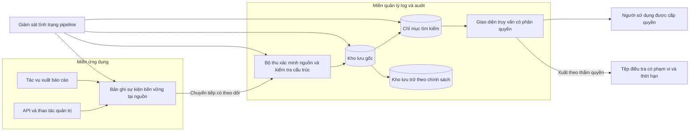

# Tài sản log và audit

## 1. Vì sao log và audit là tài sản cần bảo vệ?

Log giúp giải thích hệ thống đã quan sát hoặc thực hiện điều gì. Dấu vết kiểm toán giúp truy lại các hành động quan trọng: ai thay đổi quyền, ai xuất dữ liệu, quyết định nào được áp dụng và kết quả ra sao.

Những thông tin này hỗ trợ vận hành, phát hiện sự cố, điều tra và đối soát. Đồng thời, chúng có thể chứa mã người dùng, quan hệ tổ chức, tên tài nguyên, thông tin hạ tầng hoặc dữ liệu nhạy cảm bị ghi nhầm. Khi bị sửa, xóa hoặc ngừng thu thập, chúng có thể khiến nhóm hiểu sai sự cố hoặc mất căn cứ truy vết.

Vì vậy, **tài sản log và audit** bao gồm cả bản ghi sự kiện lẫn các thành phần và cấu hình quyết định cách sự kiện được tạo, truyền, lưu, truy vấn, giữ và phục hồi.

Ví dụ:

- Sự kiện đăng nhập, truy cập dữ liệu và thay đổi đặc quyền.
- Bản ghi chờ chuyển tiếp, hàng đợi và bộ thu sự kiện.
- Kho lưu gốc, chỉ mục tìm kiếm và kho lưu trữ dài hạn.
- Chính sách lọc dữ liệu, phân quyền, lưu giữ và xóa.
- Báo cáo, cảnh báo và tệp xuất phục vụ điều tra.

Phân loại đúng giúp chuyển nhu cầu “có log” thành yêu cầu bảo mật cụ thể, đo được và có thể kiểm chứng.

Sau bài học này, người học có thể kiểm kê tài sản log và audit, đánh giá tác động theo bí mật, toàn vẹn, sẵn sàng và liên kết chúng với yêu cầu về xác thực, phân quyền, dữ liệu, logging và phục hồi.

## 2. Phân biệt log, audit trail và hoạt động audit

### 2.1. Log là bản ghi về sự kiện hoặc hoạt động

Log có thể phục vụ nhiều mục đích:

- Chẩn đoán lỗi và hiệu năng.
- Theo dõi vận hành.
- Phát hiện hành vi bất thường.
- Truy vết thay đổi và truy cập.
- Đối soát trạng thái giữa các thành phần.

Một dòng thông báo “xử lý thành công” thiếu chủ thể, tài nguyên và mã liên kết có thể hữu ích ở mức chẩn đoán nhưng chưa đủ cho mục đích kiểm toán.

### 2.2. Audit trail là dấu vết phục vụ truy vết

**Audit trail**, hay **dấu vết kiểm toán**, là tập bản ghi được thiết kế để tái dựng các hành động hoặc thay đổi thuộc phạm vi đã xác định.

Một dấu vết có ích cần giải thích được những câu hỏi như:

- Chủ thể nào thực hiện hoặc yêu cầu hành động?
- Đối tượng và tổ chức nào bị tác động?
- Hành động là yêu cầu, quyết định cho phép, thay đổi đã commit hay kết quả xử lý?
- Khi nào và ở thành phần nào sự kiện được tạo?
- Kết quả có liên kết được với yêu cầu ban đầu không?

Audit trail có thể được xây dựng từ log có cấu trúc, bản ghi giao dịch và các nguồn khác. Tên tệp hoặc nơi lưu không tự làm một bản ghi trở thành bằng chứng đủ chất lượng.

### 2.3. Hoạt động audit sử dụng và đánh giá bằng chứng

Hoạt động audit, tức kiểm toán hoặc đánh giá theo một phạm vi, sử dụng bằng chứng để xem chính sách, quy trình hoặc kiểm soát có được thực hiện hay không.

Bản ghi audit là đầu vào cho hoạt động đó. Một tập log tự ghi “thành công” không tự chứng minh mọi kiểm soát đã đúng.

Ví dụ, sự kiện “cho phép xuất dữ liệu” xác nhận một quyết định được ghi lại. Nó chưa tự chứng minh rằng tệp đã tạo đúng dữ liệu hoặc người nhận thực sự đã đọc toàn bộ tệp.

### 2.4. Các nhóm có thể giao nhau

| Nhóm bản ghi | Mục đích chính | Ví dụ | Điểm cần chú ý |
|---|---|---|---|
| Log vận hành | Theo dõi tình trạng xử lý | Kết nối kho dữ liệu thất bại | Có thể lộ tên hệ thống hoặc chi tiết nội bộ |
| Log chẩn đoán | Tìm nguyên nhân lỗi | Mã lỗi, thời gian thực hiện, ngữ cảnh xử lý | Dễ ghi thừa dữ liệu đầu vào hoặc bí mật |
| Log bảo mật | Phát hiện và phân tích hành vi | Đăng nhập bị từ chối, truy cập bất thường | Cần nguồn, thời gian và bối cảnh đáng tin cậy |
| Dấu vết kiểm toán | Truy lại hành động quan trọng | Cấp quyền, xuất dữ liệu, thay cấu hình | Cần tính đầy đủ, liên kết và bảo vệ khỏi sửa trái phép |

Một sự kiện có thể phục vụ nhiều nhóm. Chính sách bảo vệ phải dựa trên nội dung, tác động và mục đích sử dụng thực tế.

## 3. Kiểm kê toàn bộ chuỗi tạo và sử dụng sự kiện

### 3.1. Những tài sản thường bị bỏ sót

| Tài sản | Nội dung hoặc chức năng | Rủi ro tiêu biểu |
|---|---|---|
| Bản ghi tại nguồn | Sự kiện do API, tác vụ hoặc công cụ quản trị tạo | Ghi thiếu, sai ngữ nghĩa hoặc chứa bí mật |
| Bộ đệm hoặc bản ghi chờ chuyển tiếp | Giữ sự kiện khi chưa gửi được | Hết dung lượng, mất khi tiến trình dừng hoặc bị đọc trái phép |
| Kênh truyền và bộ thu | Tiếp nhận, xác minh nguồn và chuẩn hóa | Giả nguồn, sửa nội dung, gửi trùng hoặc làm quá tải |
| Kho lưu gốc | Lưu bản ghi theo chính sách | Sửa, xóa hoặc cấp quyền quá rộng |
| Chỉ mục tìm kiếm | Cho phép tìm và phân tích | Tập trung dữ liệu nhiều tổ chức; khôi phục thiếu phân quyền |
| Kho lưu trữ dài hạn | Giữ dữ liệu ít truy cập | Khó phục hồi, không hết hạn hoặc thiếu khóa cần thiết |
| Cấu hình pipeline | Lọc trường, định tuyến, lưu giữ và quyền | Thay đổi cấu hình để ngừng ghi hoặc gửi dữ liệu ra ngoài |
| Báo cáo và cảnh báo | Dữ liệu tổng hợp hoặc kết quả phân tích | Lộ thông tin qua kênh thông báo và công cụ cộng tác |
| Tệp xuất điều tra | Bản sao sự kiện phục vụ một vụ việc | Mất kiểm soát quyền, thời hạn giữ và nơi chia sẻ |
| Bằng chứng kiểm chứng | Mốc đối chiếu, kết quả kiểm tra, cấu hình đã xác nhận | Bị thay cùng dữ liệu mà không phát hiện được |

Không nên chỉ kiểm kê thư mục chứa log. Nếu bản ghi được sao chép sang một kho phân tích hoặc tệp tải xuống, bản sao đó vẫn cần được phân loại và quản lý.

### 3.2. Phân chia trách nhiệm

Cần phân biệt:

- **Chủ sở hữu mục đích và dữ liệu:** xác định sự kiện nào cần giữ, nội dung nào được phép và tác động nghiệp vụ.
- **Nhóm tạo sự kiện:** bảo đảm ngữ nghĩa và trường dữ liệu tại nguồn.
- **Nhóm quản lý pipeline:** duy trì thu thập, quyền và cấu hình.
- **Nhóm sử dụng:** vận hành, điều tra hoặc đánh giá theo phạm vi được cấp.
- **Người quyết định lưu giữ đặc biệt:** phê duyệt việc giữ dữ liệu cho một mục đích hoặc vụ việc cụ thể theo chính sách.

Một nhóm có thể kiêm nhiều vai trò. Trách nhiệm vẫn cần rõ đối với từng tài sản và giao diện.

## 4. Phân loại theo bí mật, toàn vẹn và sẵn sàng

### 4.1. Bí mật: log có thể là kho dữ liệu nhạy cảm tập trung

Sự kiện có thể chứa danh tính, tổ chức, địa chỉ liên lạc, mã tài nguyên, lỗi nội bộ hoặc thông tin về hành vi người dùng. Tổng hợp nhiều bản ghi có thể làm tăng khả năng suy ra hoạt động của cá nhân hoặc tổ chức.

Token phiên, mật khẩu, mã khôi phục và khóa riêng không nên trở thành dữ liệu log thông thường. Việc chúng bị ghi nhầm tạo thêm một nơi có thể sử dụng quyền truy cập.

Mã nội bộ thay cho tên thật có thể giảm dữ liệu trực tiếp. Nếu mã vẫn liên kết được tới người dùng, không nên tự coi tập log là hoàn toàn vô danh.

### 4.2. Toàn vẹn: nội dung và ngữ nghĩa đều quan trọng

Tính toàn vẹn gồm:

- Không bị sửa hoặc xóa trái phép.
- Nguồn tạo và đối tượng được ghi đúng.
- Trạng thái “thành công” có nghĩa rõ ràng.
- Không mất trường cần thiết khi chuyển đổi.
- Không làm bản ghi trùng bị hiểu là nhiều hành động khác nhau.
- Có căn cứ nhận diện khoảng thiếu hoặc sai lệch.

Một sự kiện được truyền nguyên vẹn vẫn có thể sai ngay tại nguồn. Xác thực bên gửi không tự chứng minh mọi điều bên gửi khai báo đều đúng.

### 4.3. Sẵn sàng: cần dùng được khi điều tra và phục hồi

Một kho log có dữ liệu nhưng không thể tìm, đọc hoặc giải mã trong lúc sự cố có thể không đáp ứng mục đích.

Yêu cầu cần xét:

- Khả năng tiếp nhận khi tải tăng.
- Dung lượng lưu đệm và hành vi khi gần đầy.
- Độ trễ chuyển tiếp, tìm kiếm và cảnh báo.
- Khả năng phục hồi chỉ mục, dữ liệu gốc và cấu hình quyền.
- Phụ thuộc vào khóa, tài khoản và công cụ truy vấn.

### 4.4. Ma trận minh họa

| Tập tài sản | Bí mật | Toàn vẹn | Sẵn sàng | Căn cứ phân loại |
|---|---|---|---|---|
| Log kỹ thuật không chứa nội dung người dùng | Theo chi tiết thực tế | Theo mục đích vận hành | Theo mức phụ thuộc | Tên hệ thống và thông tin lỗi vẫn có thể nhạy cảm |
| Sự kiện xác thực và truy cập bị từ chối | Cao tùy nội dung | Cao | Cao cho phát hiện | Gắn với danh tính và điều tra truy cập |
| Lịch sử thay đổi đặc quyền | Cao tùy bối cảnh | Rất cao | Cao | Cần truy lại ai đã mở hoặc thu hồi quyền |
| Chỉ mục tổng hợp nhiều tổ chức | Cao | Cao | Cao | Tăng phạm vi dữ liệu trong một nơi truy vấn |
| Tệp xuất điều tra | Theo dữ liệu được xuất | Cao | Theo vụ việc | Dễ tạo bản sao ngoài quy trình thông thường |
| Cấu hình lọc và lưu giữ | Có thể không cần giữ kín toàn bộ | Rất cao | Cao | Sửa cấu hình có thể làm mất sự kiện hoặc mở rộng thu thập |

Các mức trên là ví dụ về cách lập luận. Mỗi tổ chức cần định nghĩa mức tác động và chính sách tương ứng.

## 5. Xác định chất lượng bằng chứng cần có

### 5.1. Tính đầy đủ phải có mẫu số

Yêu cầu “ghi mọi sự kiện quan trọng” cần được thay bằng danh sách có phạm vi, chẳng hạn:

- Tạo, sửa và thu hồi quyền quản trị.
- Khởi tạo và hoàn tất công việc xuất dữ liệu.
- Bắt đầu cung cấp tệp và truy cập bị từ chối.
- Thay đổi cấu hình nguồn danh tính hoặc logging.
- Thực hiện phục hồi dữ liệu.

Nếu báo cáo tỷ lệ bao phủ, mẫu số phải là các hành động và đường thực thi đã xác định. Chỉ đếm những sự kiện đang có sẽ không phát hiện được một đường quản trị bị bỏ sót.

Không có log về hành động không đủ để kết luận hành động chưa xảy ra. Cần xét khả năng nguồn không ghi, kênh bị gián đoạn hoặc dữ liệu đã hết thời hạn giữ.

### 5.2. Nguồn và định danh sự kiện

Mỗi sự kiện cần nguồn được xác định theo cơ chế phù hợp. Tên nguồn tự khai trong nội dung không nên là căn cứ duy nhất để tin rằng sự kiện đến từ thành phần đó.

Mã sự kiện cần có phạm vi duy nhất rõ ràng, ví dụ kết hợp nguồn và mã sự kiện. Đây là căn cứ nhận diện chuyển tiếp lặp, không tự chứng minh dữ liệu đúng.

Nếu sử dụng số thứ tự để tìm khoảng thiếu, cần xử lý các trường hợp khởi động lại, đổi nguồn và phân vùng. Một khoảng nhảy có thể cần điều tra; nó chưa tự giải thích nguyên nhân.

### 5.3. Thời gian và thứ tự

Nên phân biệt:

- Thời điểm nguồn ghi nhận sự kiện.
- Thời điểm bộ thu nhận sự kiện.
- Thời điểm dữ liệu có thể tìm kiếm hoặc tạo cảnh báo.

Độ lệch đồng hồ và thời gian truyền có thể khiến thứ tự hiển thị khác thứ tự nghiệp vụ. Mã liên kết, phiên bản dữ liệu và quan hệ giữa các bước có thể cần thiết để tái dựng chuỗi.

Sắp xếp toàn bộ sự kiện theo một dấu thời gian không tự tạo ra thứ tự tuyệt đối chính xác cho mọi thành phần phân tán.

### 5.4. Ngữ nghĩa kết quả

Cần phân biệt rõ:

```text
Yêu cầu đã nhận
    != đã được cấp quyền
    != công việc đã chạy
    != thay đổi đã commit
    != tệp đã được tạo
    != người nhận đã đọc toàn bộ nội dung
```

Ví dụ, sự kiện “bắt đầu tải” ghi nhận việc hệ thống bắt đầu cung cấp nội dung theo chính sách. Một sự kiện “gửi hoàn tất” theo góc nhìn máy chủ cũng không tự chứng minh người dùng đã đọc hoặc hiểu nội dung.

## 6. Quy trình phân loại tài sản log và audit

### Bước 1: Xác định mục đích và người sử dụng

Với mỗi tập dữ liệu, nêu mục đích vận hành, phát hiện, điều tra hoặc đối soát. Ghi ai cần sử dụng và mức chi tiết cần thiết.

Không thu thập thêm nội dung chỉ vì “có thể cần sau này” mà chưa xác định tác động và trách nhiệm.

### Bước 2: Liệt kê nguồn, đường truyền và bản sao

Đi theo luồng từ nguồn đến truy vấn, cảnh báo, lưu trữ và xuất dữ liệu. Đánh dấu nơi thay đổi chủ sở hữu, quyền truy cập, môi trường hoặc giả định tin cậy.

### Bước 3: Kiểm tra nội dung thực tế theo từng luồng

Xem các trường, thông báo lỗi và dữ liệu bổ sung trong trường hợp thành công lẫn thất bại. Một cấu hình bình thường có thể không ghi dữ liệu nhạy cảm nhưng chế độ chẩn đoán lại ghi toàn bộ yêu cầu.

Khi áp dụng quy trình này vào sản phẩm, nên dùng dữ liệu thử phù hợp để tránh đưa bí mật thật vào hoạt động kiểm chứng.

### Bước 4: Đánh giá tác động và chất lượng cần có

Xác định hậu quả khi dữ liệu bị lộ, sửa, mất, chậm hoặc không thể liên kết. Ghi các yêu cầu về nguồn, trường bắt buộc, độ trễ và phạm vi hành động.

### Bước 5: Giao trách nhiệm và xác định chính sách

Nêu chủ sở hữu, người quản lý kỹ thuật, quyền sử dụng, thời hạn giữ, cách xóa, điều kiện lưu giữ đặc biệt và mục tiêu phục hồi.

### Bước 6: Liên kết với rủi ro và yêu cầu

Mỗi rủi ro quan trọng cần yêu cầu, nơi thực thi và bằng chứng. Ví dụ, nguy cơ lộ token liên quan cả nguồn tạo log, bộ thu, quyền kho và quy trình xử lý khi phát hiện dữ liệu bị ghi nhầm.

### Bước 7: Đặt điều kiện xem xét lại

Rà soát khi thêm trường, nguồn, công cụ, tổ chức, bên nhận, chế độ chẩn đoán hoặc thời hạn giữ. Thay đổi cấu trúc sự kiện cũng có thể làm hỏng phát hiện và truy vết dù ứng dụng vẫn chạy bình thường.

## 7. Ví dụ: chuỗi audit của dịch vụ báo cáo nhiều tổ chức

### 7.1. Phạm vi

Một dịch vụ cho phép người dùng xem, xuất báo cáo và quản trị quyền trong tổ chức. API và tác vụ nền tạo sự kiện. Kho phân tích phục vụ vận hành, còn một số sự kiện được xuất để điều tra theo thẩm quyền.



Nguồn cần giảm dữ liệu nhạy cảm trước khi ghi hoặc truyền. Bộ thu có thể kiểm tra thêm để phòng sai sót, nhưng lọc ở trung tâm không loại bỏ được rủi ro dữ liệu đã xuất hiện trong bộ đệm hoặc kênh trước đó.

Các miền trong hình cần có quyền và trách nhiệm thực tế. Một ô riêng trên sơ đồ chưa tự tạo ra cách ly.

### 7.2. Danh mục tài sản rút gọn

| Mã tài sản | Nội dung | Chủ sở hữu điển hình | Điều cần bảo vệ |
|---|---|---|---|
| LOG-AUD-01 | Sự kiện cấp và thu hồi quyền | Chủ sở hữu chính sách quyền | Chủ thể, tổ chức, kết quả và lịch sử |
| LOG-PIPE-01 | Bản ghi chờ và kênh chuyển tiếp | Nhóm ứng dụng và vận hành | Độ bền, nguồn gửi, giới hạn và dữ liệu nhạy cảm |
| LOG-RAW-01 | Kho sự kiện gốc | Nhóm vận hành kiểm toán | Quyền ghi, sửa, xóa và khả năng phục hồi |
| LOG-IDX-01 | Chỉ mục tìm kiếm | Nhóm vận hành phân tích | Phân quyền truy vấn và tính nhất quán với dữ liệu gốc |
| LOG-ARCH-01 | Kho lưu trữ dài hạn | Chủ sở hữu dữ liệu và vận hành | Thời hạn, khả năng đọc và quyền khôi phục |
| LOG-XPT-01 | Tệp xuất cho vụ việc | Người chịu trách nhiệm điều tra | Phạm vi, người nhận và thời điểm hết hạn |
| LOG-POL-01 | Cấu hình lọc, quyền và lưu giữ | Nhóm quản lý pipeline | Thay đổi có thẩm quyền và dấu vết cấu hình |

## 8. Thiết kế bản ghi có cấu trúc và đúng ngữ nghĩa

Ví dụ dưới đây là một sự kiện thay đổi quyền sau khi giao dịch đã commit. Mọi giá trị là dữ liệu minh họa:

```json
{
  "schema_version": "1",
  "source_id": "access-service-demo",
  "event_id": "evt-demo-00017",
  "event_type": "permission.granted",
  "occurred_at": "2026-01-10T08:00:00Z",
  "received_at": "2026-01-10T08:00:02Z",
  "actor_type": "user",
  "actor_id": "usr-demo-17",
  "organization_id": "org-demo-a",
  "target_type": "membership",
  "target_id": "member-demo-31",
  "action": "grant_report_reader",
  "outcome": "committed",
  "policy_version": "policy-demo-7",
  "correlation_id": "corr-demo-89"
}
```

Các trường phải có nguồn và ý nghĩa rõ:

- Chủ thể và tổ chức được xác lập từ ngữ cảnh đáng tin cậy.
- `received_at` được bộ thu thiết lập theo chính sách, không chỉ chấp nhận giá trị tự khai.
- `outcome` mô tả đúng mốc nghiệp vụ.
- `correlation_id` giúp liên kết, không được dùng như bằng chứng xác thực.
- Phiên bản cấu trúc giúp quản lý thay đổi và kiểm tra khả năng đọc.
- Nội dung phải đủ cho mục đích điều tra nhưng không chứa token hoặc dữ liệu báo cáo.

Ghi JSON có cấu trúc giúp tách trường và nội dung. Vẫn cần kiểm tra kiểu, độ dài, ký tự và cách hiển thị. Một giá trị có xuống dòng hoặc ký tự điều khiển phải được xử lý như dữ liệu, không tạo ra sự kiện giả trong hệ thống xem log.

Giới hạn trường và kích thước sự kiện còn giúp giảm nguy cơ làm đầy kho hoặc tăng chi phí bất thường bằng đầu vào do người dùng kiểm soát.

## 9. Chuyển phân loại thành yêu cầu có thể kiểm chứng

### 9.1. Bao phủ hành động và liên kết giao dịch

**LOG-COVER-01:** Các hành động được liệt kê trong chính sách audit phải tạo sự kiện đúng ngữ nghĩa và trường bắt buộc. Đối với thay đổi quyền trong ví dụ, giao dịch thành công phải có bản ghi sự kiện bền vững liên kết với thay đổi đó.

Một lựa chọn là ghi sự kiện chờ chuyển tiếp trong cùng giao dịch dữ liệu. Chỉ áp dụng bảo đảm nguyên tử trong phạm vi mà thiết kế lưu trữ thực sự hỗ trợ.

**Tiêu chí chấp nhận:**

- Mỗi đường thay đổi quyền thuộc phạm vi có sự kiện tương ứng.
- Không ghi kết quả đã commit khi giao dịch bị hủy.
- Lỗi tiến trình sau commit không làm mất bản ghi chờ theo kịch bản chịu lỗi đã chọn.
- Chuyển tiếp lặp không bị hiểu thành nhiều thay đổi quyền khác nhau.

**Bằng chứng:** danh sách hành động, kiểm thử lỗi giao dịch và đối chiếu sự kiện.

### 9.2. Giảm dữ liệu và bảo vệ bí mật

**LOG-DATA-01:** Nguồn chỉ ghi các trường được phép cho từng loại sự kiện. Mật khẩu, token, mã khôi phục, khóa riêng và nội dung báo cáo không thuộc danh sách được ghi của ví dụ.

**Tiêu chí chấp nhận:**

- Dữ liệu thử chứa bí mật không xuất hiện trong log thành công, lỗi hoặc chế độ chẩn đoán thuộc phạm vi.
- Không gửi toàn bộ nội dung yêu cầu chỉ để phục vụ truy vết.
- Trường ngoài cấu trúc và giá trị quá giới hạn được xử lý theo chính sách.
- Các kênh cảnh báo và tệp xuất cũng tuân theo giới hạn dữ liệu.

**Bằng chứng:** cấu trúc sự kiện, kiểm tra dữ liệu đầu ra và cấu hình nguồn.

### 9.3. Xác thực nguồn và hạn chế sửa lịch sử

**LOG-INTEGRITY-01:** Bộ thu chỉ chấp nhận nguồn theo cơ chế xác minh đã chọn. Quyền ghi mới, sửa, xóa và quản trị lịch sử phải được phân chia theo chính sách.

**Tiêu chí chấp nhận:**

- Danh tính không được cấp quyền không gửi được sự kiện với vai trò nguồn hợp lệ.
- Tài khoản chỉ có quyền ghi mới không tự có quyền sửa hoặc xóa lịch sử.
- Thay đổi chính sách hoặc quyền kho tạo dấu vết và được giám sát theo yêu cầu.
- Nếu thiết kế có cơ chế phát hiện sửa đổi, kiểm thử phải xác nhận cả dữ liệu và căn cứ kiểm chứng được bảo vệ.

**Bằng chứng:** quyền thực tế, kiểm thử nguồn giả, thao tác sửa trái phép và cơ chế phát hiện.

Một giá trị băm lưu cùng dữ liệu không đủ bảo đảm độc lập nếu cùng người sửa được cả hai. Chuỗi băm hoặc chữ ký cũng cần căn cứ tin cậy, quản lý khóa và phạm vi bao phủ rõ ràng. Chúng không tự chứng minh nguồn đã mô tả sự thật nghiệp vụ.

### 9.4. Phân quyền truy vấn và xuất dữ liệu

**LOG-ACCESS-01:** Quyền đọc log phải được giới hạn theo vai trò, tổ chức, loại dữ liệu và mục đích được phê duyệt. Quyền vận hành ứng dụng không tự đồng nghĩa quyền đọc mọi sự kiện.

**Tiêu chí chấp nhận:**

- Người chỉ được xem dữ liệu A không truy vấn hoặc xuất được dữ liệu B.
- Kiểm soát được thực thi ở phía phục vụ truy vấn và đường xuất.
- Người điều tra có quyền liên tổ chức chỉ sử dụng trong phạm vi được cấp.
- Tệp xuất có người chịu trách nhiệm, người nhận, nơi lưu và thời hạn.
- Thao tác truy vấn hoặc xuất nhạy cảm được ghi theo chính sách kiểm toán.

**Bằng chứng:** ma trận quyền và kiểm thử cả giao diện lẫn API truy vấn, xuất.

Dấu vết truy cập log cần được thiết kế để không tạo vòng ghi vô hạn hoặc sao chép toàn bộ nội dung truy vấn nhạy cảm vào một kho khác.

### 9.5. Độ trễ và hành vi khi pipeline lỗi

**LOG-DELIVERY-01:** Với tải và điều kiện đã xác định, các sự kiện audit của ví dụ phải có thể tìm kiếm trong vòng 60 giây từ lúc nguồn ghi nhận. Pipeline gián đoạn phải được phát hiện trong vòng 2 phút theo tín hiệu kiểm tra đã thiết kế.

Dung lượng lưu đệm, số lần thử lại, xử lý trùng và hành vi khi không thể lưu phải được đặc tả.

**Tiêu chí chấp nhận:**

- Đo được thời gian tại nguồn, bộ thu và khi tìm kiếm.
- Kết quả báo cáo cả sự kiện chậm, thiếu hoặc bị từ chối, không chỉ các sự kiện thành công.
- Khi kênh gián đoạn trong phạm vi thiết kế, bản ghi bền vững được chuyển tiếp sau phục hồi.
- Khi không thể lưu sự kiện bắt buộc cho thay đổi quyền, thao tác đó không commit theo chính sách của ví dụ.
- Log chẩn đoán có chính sách riêng về giảm mức thu thập hoặc lấy mẫu; không âm thầm áp dụng cho audit bắt buộc.

**Bằng chứng:** đo độ trễ, diễn tập gián đoạn, dung lượng và các bộ đếm sai lệch.

Các con số là lựa chọn minh họa. Kịch bản thực tế cần chốt tải, kích thước sự kiện, dung lượng và cách tạo tín hiệu phát hiện.

### 9.6. Lưu giữ và xóa theo mục đích

**LOG-RETENTION-01:** Mỗi tập log, kho lưu và bản xuất phải có thời hạn cùng cách thực thi. Chính sách của ví dụ cho phép tìm kiếm trong 30 ngày và giữ bản lưu tối đa 180 ngày, đều tính từ mốc tiếp nhận đầu tiên do hệ thống tin cậy ghi nhận.

Hai khoảng trên không cộng thành 210 ngày. Việc lập lại chỉ mục hoặc sao chép không tự gia hạn vòng đời.

**Tiêu chí chấp nhận:**

- Bản ghi hết hạn không còn được phục vụ trong kho thuộc phạm vi xóa.
- Tệp xuất tuân theo thời hạn riêng đã phê duyệt.
- Giữ dữ liệu cho điều tra cần quyết định có phạm vi, người chịu trách nhiệm và điều kiện kết thúc.
- Bản sao lưu có chính sách hết hạn và quy trình xử lý dữ liệu khi phục hồi phù hợp.
- Xóa dữ liệu không làm mất bằng chứng đang cần giữ ngoài chính sách đã thống nhất.

**Bằng chứng:** cấu hình, kiểm thử mốc thời gian và hồ sơ lưu giữ đặc biệt.

Thời hạn 30 và 180 ngày không phải yêu cầu chung hay mặc định pháp lý. Sản phẩm phải chọn theo mục đích và các nghĩa vụ thực sự áp dụng.

### 9.7. Phục hồi dữ liệu và quyền truy cập

**LOG-RECOVER-01:** Quy trình phục hồi phải khôi phục được dữ liệu cần thiết và kiểm soát truy cập, đồng thời xác nhận mức đầy đủ của bằng chứng trước khi phục vụ truy vấn.

Ví dụ chọn kịch bản mất chỉ mục trong khi kho lưu gốc không bị ảnh hưởng. Mục tiêu là khôi phục tìm kiếm trong 2 giờ với tập thử 1 triệu sự kiện, mỗi sự kiện không quá 4 KiB, và không mất sự kiện mà bộ thu đã xác nhận lưu bền vững trong kho gốc.

**Tiêu chí chấp nhận:**

- Đối chiếu được sự kiện trong chỉ mục phục hồi với dữ liệu gốc.
- Sự kiện chuyển tiếp hoặc lập chỉ mục lại không gây diễn giải trùng.
- Người dùng không có quyền không đọc được dữ liệu trong môi trường phục hồi.
- Cấu trúc, trường và phạm vi tổ chức còn đúng.
- Khoảng dữ liệu chưa xác nhận hoặc lỗi phục hồi được báo cáo rõ.

**Bằng chứng:** báo cáo diễn tập, số lượng và định danh đối chiếu, kiểm thử truy vấn và quyền.

Mục tiêu không mất dữ liệu trong kịch bản kho gốc còn nguyên không tự áp dụng cho kịch bản cả kho gốc bị phá hoại. Các kịch bản mất dữ liệu cần mục tiêu điểm phục hồi và cách đối soát riêng.

## 10. Xử lý sự kiện thành công, thất bại và chuyển tiếp

### 10.1. Không đánh đổi tính đúng đắn của giao dịch

Với thay đổi quyền, thiết kế có thể ghi dữ liệu quyền và bản ghi audit chờ chuyển tiếp trong một giao dịch cục bộ:

```text
Bắt đầu giao dịch:
    xác minh chủ thể và quyền thực hiện
    kiểm tra điều kiện thay đổi
    cập nhật dữ liệu quyền
    ghi sự kiện bền vững liên kết với thay đổi
Commit

Sau commit:
    chuyển tiếp sự kiện
    nhận diện trùng theo nguồn và mã sự kiện
    theo dõi lỗi và tồn đọng
```

Nếu ghi sự kiện sau commit mà không có cơ chế bền vững phù hợp, lỗi giữa hai bước có thể tạo thay đổi không có dấu vết.

Không nên giữ giao dịch mở chỉ để chờ một hệ thống log ngoài phản hồi mà chưa đánh giá tác động. Thiết kế phải làm rõ tính nhất quán, giới hạn và hành vi khi lỗi.

### 10.2. Sự kiện bị từ chối có ngữ nghĩa riêng

Một yêu cầu trái quyền không có thay đổi nghiệp vụ để commit. Sự kiện từ chối cần đi theo đường ghi đã thiết kế và không nên giả định rằng mọi trường danh tính do người gửi khai đều đã được xác thực.

Có thể phân biệt chủ thể đã xác minh với định danh tự khai trong các trường có nghĩa riêng. Không ghi nguyên bí mật đầu vào để giải thích vì sao đăng nhập thất bại.

### 10.3. Giới hạn để tránh làm cạn nguồn lực

Đầu vào do người dùng kiểm soát có thể tạo lượng lớn sự kiện. Cần có giới hạn trường, kích thước, dung lượng và tốc độ phù hợp.

Một số sự kiện chẩn đoán có thể được lấy mẫu theo chính sách. Với audit bắt buộc, nếu dùng tổng hợp hoặc giới hạn cần đánh giá xem có còn đáp ứng mục đích truy vết không.

Nếu một thao tác phải dừng vì không lưu được audit, nhóm cũng cần bảo vệ năng lực ghi và cách ly nguồn tải để hạn chế việc kẻ tấn công cố tình làm mất khả năng phục vụ.

## 11. Kiểm chứng bằng ma trận tình huống

| Tình huống | Điều cần quan sát |
|---|---|
| Thay đổi quyền thành công | Có sự kiện đúng chủ thể, tổ chức, tài nguyên và mốc commit |
| Giao dịch thay đổi quyền bị hủy | Không có sự kiện làm người đọc hiểu rằng thay đổi đã commit |
| Lỗi tiến trình sau commit | Bản ghi chờ còn tồn tại theo bảo đảm của kịch bản |
| Kênh chuyển tiếp ngừng hoạt động | Có tín hiệu, tồn đọng được kiểm soát và không mất bản ghi ngoài giới hạn |
| Chuyển tiếp cùng sự kiện nhiều lần | Không làm tăng sai số lần thao tác nghiệp vụ |
| Gửi nguồn không được cấp quyền | Không được chấp nhận như nguồn hợp lệ |
| Đầu vào có xuống dòng hoặc ký tự điều khiển | Không tạo bản ghi giả hoặc gây hiển thị sai |
| Dữ liệu thử chứa token và mật khẩu | Không xuất hiện trong những kênh bị cấm |
| Người của A tìm hoặc xuất dữ liệu B | Không nhận được dữ liệu ngoài quyền |
| Tài khoản ghi mới thử sửa hoặc xóa | Bị giới hạn theo chính sách |
| Đổi cấu hình lọc hoặc lưu giữ | Đúng thẩm quyền, có dấu vết và tác động được nhận diện |
| Dữ liệu hoặc tệp xuất hết hạn | Được xử lý theo chính sách giữ, xóa và ngoại lệ |
| Phục hồi chỉ mục | Dữ liệu, cấu trúc, quyền và mục tiêu thời gian được xác nhận |

Cần kiểm tra cả đường được phép. Phân quyền quá chặt khiến người điều tra không dùng được dữ liệu cần thiết cũng có thể làm tài sản không đáp ứng mục đích.

Bằng chứng phải gắn với phiên bản mã, cấu trúc sự kiện, cấu hình pipeline và môi trường. Một báo cáo cũ có thể không còn phù hợp khi thêm nguồn hoặc đổi công cụ tìm kiếm.

## 12. Hồ sơ quản lý và vòng đời

### 12.1. Mẫu hồ sơ tài sản

```text
Mã và loại tài sản:
Nguồn tạo và mục đích:
Loại sự kiện và hành động được bao phủ:
Trường dữ liệu, trường bị cấm và phiên bản cấu trúc:
Chủ sở hữu dữ liệu:
Nhóm tạo, thu thập, vận hành và sử dụng:
Mức tác động bí mật, toàn vẹn, sẵn sàng:
Nguồn, kênh, kho gốc, chỉ mục, bản sao và tệp xuất:
Quyền đọc, ghi, sửa, xóa và quản trị:
Độ trễ, dung lượng, cảnh báo và hành vi khi lỗi:
Thời hạn giữ, xóa và lưu giữ đặc biệt:
Phục hồi, khóa và các phụ thuộc:
Rủi ro, yêu cầu, bằng chứng và ngày xác nhận:
Điều kiện xem xét lại hoặc kết thúc:
```

### 12.2. Từ tạo đến kết thúc

Khi bổ sung chức năng, xác định sự kiện và cách phân loại ngay trong thiết kế. Khi triển khai, kiểm tra nội dung và ngữ nghĩa. Khi phát hành, xác nhận cấu hình quyền, lọc, cảnh báo và lưu giữ thực tế.

Trong vận hành, theo dõi nguồn im lặng, lỗi chuyển tiếp, độ trễ, dung lượng và thay đổi quyền. Giám sát một nguồn chỉ bằng số sự kiện nhận được có thể không phát hiện nguồn ngừng ghi; có thể cần tín hiệu tình trạng hoặc đối chiếu với hoạt động thuộc phạm vi.

Khi ngừng dịch vụ, quyết định dữ liệu nào cần tiếp tục giữ, ai chịu trách nhiệm, cách thu hồi quyền gửi và cách duy trì khả năng đọc trong thời hạn còn lại.

### 12.3. Các thay đổi cần xem xét lại

- Thêm trường hoặc bật chế độ chẩn đoán.
- Gửi dữ liệu tới công cụ ngoài hoặc kênh cảnh báo mới.
- Gộp nhiều tổ chức vào cùng chỉ mục.
- Thay cấu trúc, nguồn hoặc định danh sự kiện.
- Đổi thời hạn giữ, quyền xuất hoặc cách lưu trữ.
- Di chuyển kho, khóa hoặc môi trường phục hồi.
- Thay cách thực hiện giao dịch và chuyển tiếp sự kiện.

Mỗi thay đổi có thể ảnh hưởng cả bí mật, chất lượng bằng chứng và khả năng truy vấn. Hồ sơ và yêu cầu cần được cập nhật cùng thiết kế.

## 13. Những sai lệch thường gặp

| Sai lệch | Hậu quả | Cách điều chỉnh |
|---|---|---|
| Coi log là dữ liệu phụ | Quyền và bản sao không được quản lý | Kiểm kê cả nội dung, pipeline và cấu hình |
| Ghi mọi dữ liệu để dễ điều tra | Tập trung bí mật và dữ liệu không cần thiết | Chọn trường theo mục đích, giảm dữ liệu tại nguồn |
| Coi mọi log là audit trail | Thiếu chủ thể, đối tượng hoặc ngữ nghĩa | Đặc tả sự kiện kiểm toán và phạm vi bao phủ |
| Ghi thành công trước khi commit | Điều tra hiểu sai trạng thái | Liên kết sự kiện với mốc nghiệp vụ thực tế |
| Tin tên nguồn tự khai | Có thể giả sự kiện từ thành phần khác | Xác minh nguồn và giới hạn quyền gửi |
| Cho rằng JSON tự ngăn mọi giả mạo | Dữ liệu hiển thị hoặc cấu trúc vẫn có thể bị lạm dụng | Kiểm tra kiểu, độ dài, cách ghi và cách hiển thị |
| Dùng cùng quyền để ghi và xóa toàn bộ lịch sử | Một danh tính có thể che giấu hành động | Phân chia quyền và bảo vệ căn cứ kiểm chứng |
| Cấp quyền log theo quyền vận hành ứng dụng | Người vận hành đọc dữ liệu vượt nhu cầu | Cấp quyền theo vai trò, mục đích và phạm vi |
| Giữ tệp điều tra vô thời hạn | Tạo bản sao không còn được kiểm soát | Quản lý người nhận, nơi lưu và hết hạn |
| Chỉ sao lưu mà không phục hồi thử | Không biết dữ liệu có đọc và tra cứu được không | Diễn tập cả dữ liệu, cấu trúc, quyền và phụ thuộc |

## 14. Bài tập áp dụng

Một nền tảng cho phép nhân viên tải tài liệu, quản trị viên đổi quyền và bộ phận hỗ trợ xuất sự kiện để điều tra. API, tác vụ nền và công cụ quản trị đều tạo log; một dịch vụ ngoài cung cấp kho tìm kiếm.

Hãy thực hiện:

1. Liệt kê ít nhất bảy tài sản trong chuỗi log và audit, gồm bản sao và cấu hình.
2. Phân biệt log chẩn đoán với dấu vết cần để truy lại thay đổi quyền.
3. Chọn trường bắt buộc và trường bị cấm cho sự kiện tải tài liệu, từ chối truy cập và đổi quyền.
4. Phân loại từng tập theo bí mật, toàn vẹn, sẵn sàng; giải thích tác động khi tổng hợp nhiều tổ chức.
5. Viết yêu cầu về nguồn gửi, phân quyền truy vấn, chống sửa, lưu giữ và phục hồi.
6. Chọn tiêu chí cho giao dịch bị hủy, kênh chuyển tiếp lỗi và sự kiện gửi lặp.
7. Mô tả cách quản lý tệp xuất điều tra, gồm phạm vi, người nhận và thời hạn.
8. Nêu bằng chứng cần có và một thay đổi khiến phải kiểm chứng lại.

Hồ sơ cần giúp người đọc xác định dữ liệu nào đang được giữ, nó chứng minh được điều gì, ai được sử dụng, khi nào hết hạn và cách biết rằng nguồn hoặc chuỗi lưu trữ đã bị gián đoạn hay sai lệch.
