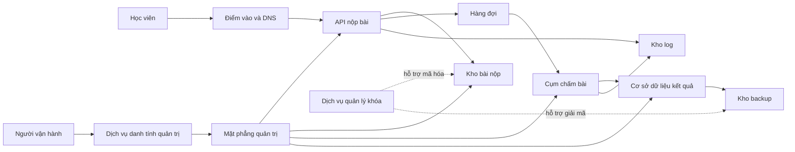

# Tài sản hạ tầng

## 1. Mục tiêu và phạm vi bài học

Tài sản hạ tầng là những thành phần cung cấp năng lực tính toán, lưu trữ, kết nối, quản trị và vận hành mà hệ thống cần để hoạt động. Ví dụ gồm máy chủ, máy ảo, cụm container, mạng, dịch vụ phân giải tên, hệ thống quản lý khóa, kho bản sao lưu và các mặt phẳng quản trị tương ứng.

Trong chương **Phân loại tài sản** của module yêu cầu bảo mật, mục tiêu không dừng ở việc kể tên thiết bị. Kết quả cần trả lời được:

- Thành phần nào đang nâng đỡ chức năng nghiệp vụ và dữ liệu quan trọng?
- Mất bí mật, bị sửa đổi trái phép hoặc ngừng hoạt động sẽ gây tác động gì?
- Ai chịu trách nhiệm, ai có quyền thay đổi và phạm vi ảnh hưởng của quyền đó tới đâu?
- Từ các đặc điểm trên, cần đặt yêu cầu bảo mật nào và kiểm chứng bằng cách nào?

Bài học tập trung vào cách biến mô tả tài sản hạ tầng thành đầu vào cho đặc tả xác thực, phân quyền, bảo vệ dữ liệu, ghi nhật ký và phục hồi. Các giá trị thời gian, chu kỳ kiểm tra và ngưỡng kỹ thuật trong ví dụ là **giả định của tình huống minh họa**, cần được chủ sở hữu nghiệp vụ và vận hành xác nhận trước khi áp dụng.

Sau bài học, bạn có thể lập hồ sơ tài sản hạ tầng, phân loại theo tác động và phạm vi ảnh hưởng, liên kết với mô hình đe dọa, rồi viết yêu cầu có chủ thể, điều kiện, kết quả và tiêu chí kiểm thử rõ ràng.

## 2. Nhận diện đúng tài sản hạ tầng

### 2.1. Không giới hạn ở phần cứng

Một máy chủ vật lý là tài sản hạ tầng, nhưng một cấu hình định tuyến, vùng DNS hay tài khoản quản trị đám mây cũng có thể quyết định an toàn của toàn hệ thống. Chỉ kiểm kê máy chủ sẽ bỏ sót nhiều điểm có quyền kiểm soát lớn.

| Nhóm | Ví dụ tài sản | Câu hỏi bảo mật cần đặt |
| --- | --- | --- |
| Tính toán | Máy chủ, máy ảo, node container, môi trường thực thi hàm | Ai có thể chạy mã, thay đổi ảnh máy hoặc truy cập hệ điều hành? |
| Mạng và kết nối | Router, firewall, mạng ảo, load balancer, VPN | Ai có thể mở đường truy cập hoặc đổi điểm đến của lưu lượng? |
| Phân giải tên và điểm vào | Vùng DNS, tài khoản quản lý tên miền, reverse proxy | Ai có thể chuyển hướng người dùng hoặc làm gián đoạn truy cập? |
| Lưu trữ | Volume, object storage, lớp lưu trữ cho cơ sở dữ liệu | Ai có thể đọc, sửa, xóa dữ liệu hoặc đổi chính sách truy cập? |
| Danh tính và quản trị | Tenant, tài khoản quản trị, nhà cung cấp danh tính dùng cho vận hành | Quyền nào kiểm soát nhiều hệ thống và cơ chế thu hồi quyền ra sao? |
| Khóa và bí mật vận hành | Dịch vụ quản lý khóa, kho bí mật, dịch vụ cấp chứng thư | Ai có thể lấy bí mật, đổi chính sách khóa hoặc phá vỡ khả năng giải mã? |
| Triển khai | Kho ảnh container, runner xây dựng, bộ điều phối triển khai | Ai có thể đưa mã hoặc cấu hình vào môi trường sản xuất? |
| Quan sát và bằng chứng | Bộ thu log, kho log, hệ thống cảnh báo, đồng bộ thời gian | Ai có thể làm mất dấu vết hoặc khiến cảnh báo không đến nơi? |
| Phục hồi | Kho backup, snapshot, bản sao cấu hình, môi trường khôi phục | Sau khi tài khoản vận hành bị chiếm, còn đường phục hồi nào? |
| Hạ tầng vật lý | Tủ máy, nguồn điện, thiết bị mạng, hệ thống kiểm soát ra vào | Ai có thể tiếp cận, ngắt nguồn hoặc can thiệp trực tiếp? |

Một tài sản có thể thuộc nhiều nhóm. Ví dụ, dịch vụ quản lý khóa vừa hỗ trợ bảo mật dữ liệu, vừa là phụ thuộc của khởi động ứng dụng và phục hồi bản sao lưu.

### 2.2. Phân biệt tài sản, dữ liệu và cách triển khai

Ba góc nhìn sau có liên hệ nhưng không thay thế nhau:

- **Tài sản hạ tầng:** cụm cơ sở dữ liệu được quản lý.
- **Tài sản thông tin:** hồ sơ học viên và kết quả học tập nằm trong cụm đó.
- **Cấu hình và quyền điều khiển:** chính sách truy cập, kết nối mạng, khóa mã hóa, tài khoản quản trị cụm.

Dữ liệu nhạy cảm khiến hạ tầng lưu trữ cần được bảo vệ tương xứng. Ngược lại, một hệ thống không lưu dữ liệu nhạy cảm vẫn có thể rất quan trọng vì nó điều khiển triển khai hoặc định tuyến lưu lượng.

Ví dụ, DNS công khai chủ yếu cung cấp thông tin công khai. Tuy nhiên, quyền sửa bản ghi của miền đăng nhập có yêu cầu cao về tính toàn vẹn vì việc đổi điểm đến có thể ảnh hưởng toàn bộ người dùng.

### 2.3. Chọn mức chi tiết vừa đủ

Không nhất thiết tạo một hồ sơ đánh giá thủ công cho từng container tồn tại vài phút. Có thể dùng:

- Hồ sơ cho dịch vụ logic, chẳng hạn “cụm xử lý bài tập sản xuất”.
- Hồ sơ cho nhóm tài nguyên cùng mục đích và chính sách, chẳng hạn “nhóm node chạy tác vụ học viên”.
- Danh sách thực thể đang chạy để theo dõi từng máy, node hoặc container cụ thể.

Cần tách hồ sơ khi các thành phần có chủ sở hữu, mức tác động, ranh giới tin cậy hoặc quyền quản trị khác nhau. Một runner có quyền triển khai sản xuất phải được phân biệt với runner chỉ chạy kiểm thử trên mã không tin cậy.

## 3. Đặt tài sản trong bối cảnh nghiệp vụ và kiến trúc

Tên tài nguyên không cho biết đầy đủ giá trị cần bảo vệ. Bắt đầu từ một chức năng nghiệp vụ, sau đó lần theo các phụ thuộc:

> Học viên nộp bài → API nhận bài → kho lưu bài → hàng đợi → cụm chấm bài → cơ sở dữ liệu kết quả.

Ngoài luồng xử lý trực tiếp, cần ghi nhận các phụ thuộc hỗ trợ:

- DNS giúp người dùng và dịch vụ tìm đúng điểm đến.
- Dịch vụ danh tính xác thực người dùng và người vận hành.
- Kho bí mật và quản lý khóa hỗ trợ truy cập dữ liệu.
- Hệ thống triển khai quyết định phiên bản ứng dụng đang chạy.
- Log và cảnh báo giúp phát hiện, điều tra sự cố.
- Backup và cấu hình khôi phục hỗ trợ phục hồi sau mất mát.

Một sơ đồ đơn giản có thể biểu diễn cả luồng sử dụng và đường quản trị:

Sơ đồ này là bản đồ phụ thuộc, chưa phải mô hình triển khai chi tiết. Khi đánh giá thực tế, cần bổ sung môi trường, ranh giới mạng, tài khoản quản trị và các quan hệ tin cậy cụ thể.

Một thành phần hỏng có thể làm nhiều dịch vụ ngừng hoạt động cùng lúc. Vì vậy, không chỉ hỏi “tài sản phục vụ ai” mà còn hỏi “những dịch vụ nào cùng phụ thuộc vào tài sản này”.

## 4. Hồ sơ tài sản tối thiểu

Một danh mục hữu ích phải hỗ trợ quyết định bảo mật. Danh sách tên máy và địa chỉ IP đơn thuần thường chưa đủ.

| Trường | Nội dung cần ghi | Giá trị sử dụng |
| --- | --- | --- |
| Định danh ổn định | Mã tài sản logic, tên dịch vụ, định danh tài nguyên | Liên kết yêu cầu, thay đổi và bằng chứng kiểm thử |
| Chức năng nghiệp vụ | Chức năng hoặc quy trình được hỗ trợ | Giải thích tác động khi tài sản gặp sự cố |
| Chủ sở hữu | Bên chịu trách nhiệm về mục đích và mức tác động | Phê duyệt phân loại và chấp nhận rủi ro còn lại |
| Đơn vị vận hành | Nhóm thực hiện cấu hình, giám sát, phục hồi | Xác định nơi thực thi và cung cấp bằng chứng |
| Môi trường | Phát triển, kiểm thử, sản xuất; tài khoản hoặc tenant | Tránh áp dụng nhầm chính sách |
| Loại và vòng đời | Máy ảo, dịch vụ quản lý, nhóm tài nguyên tạm thời | Chọn cách phát hiện và cập nhật danh mục |
| Dữ liệu liên quan | Nhóm dữ liệu xử lý, lưu trữ hoặc có thể truy cập | Suy ra nhu cầu bảo mật dữ liệu |
| Bề mặt tiếp xúc | Internet, nội bộ, đối tác, đường quản trị | Xác định đường tiếp cận và ranh giới tin cậy |
| Quyền điều khiển | Vai trò quản trị, danh tính dịch vụ, quyền triển khai | Đánh giá khả năng leo thang và phạm vi ảnh hưởng |
| Phụ thuộc | Mạng, DNS, khóa, danh tính, nguồn điện, dịch vụ khác | Nhận diện điểm lỗi chung và thứ tự phục hồi |
| Phân loại | Tác động tới bí mật, toàn vẹn, sẵn sàng; phạm vi ảnh hưởng | Chọn yêu cầu và độ mạnh của kiểm soát |
| Phục hồi | Mục tiêu phục hồi, nguồn khôi phục, phụ thuộc cần có | Thiết kế và kiểm thử phục hồi |
| Bằng chứng và cập nhật | Nguồn phát hiện, ngày rà soát, liên kết cấu hình | Chứng minh danh mục còn phản ánh hiện trạng |

Chủ sở hữu không nhất thiết là người có tài khoản quản trị. Ví dụ, nhóm sản phẩm chịu trách nhiệm tác động nghiệp vụ, còn nhóm nền tảng vận hành cụm lưu trữ.

Với dịch vụ do nhà cung cấp quản lý, cần ghi rõ phần trách nhiệm thuộc nhà cung cấp và phần cấu hình thuộc tổ chức. Không mặc định nhà cung cấp chịu trách nhiệm cho phân quyền dữ liệu, chính sách mạng, thời hạn lưu hoặc việc thử phục hồi nếu chưa xác định trong phạm vi dịch vụ.

## 5. Phân loại theo nhiều chiều

### 5.1. Tác động tới bí mật, toàn vẹn và sẵn sàng

Ba thuộc tính thường dùng để phân tích là:

- **Bí mật:** hậu quả nếu nội dung, cấu hình hoặc quyền truy cập bị lộ.
- **Toàn vẹn:** hậu quả nếu tài nguyên, cấu hình hoặc kết quả xử lý bị thay đổi trái phép.
- **Sẵn sàng:** hậu quả nếu tài nguyên không thể phục vụ trong một khoảng thời gian xác định.

Có thể bắt đầu với thang định tính như sau, rồi hiệu chỉnh theo bối cảnh tổ chức:

| Mức tác động | Cách hiểu minh họa |
| --- | --- |
| Thấp | Ảnh hưởng cục bộ, có cách thay thế đơn giản, không làm lộ hoặc sai lệch thông tin quan trọng |
| Trung bình | Gián đoạn một nhóm người dùng hoặc quy trình, cần can thiệp để khôi phục |
| Cao | Ảnh hưởng diện rộng, lộ dữ liệu nhạy cảm, sai kết quả nghiệp vụ hoặc vượt giới hạn chịu gián đoạn đã được xác nhận |

Không dùng các mô tả này để gán mức tự động. “Gián đoạn một giờ” có thể ít tác động vào cuối tuần nhưng rất nghiêm trọng trong thời điểm kết thúc kỳ thi.

Mỗi kết luận nên có lý do cụ thể. Ví dụ:

> Toàn vẹn cao: thay đổi trái phép trong kho ảnh container có thể đưa mã không được phê duyệt vào dịch vụ chấm bài sản xuất.

### 5.2. Độ nhạy dữ liệu và quyền truy cập gián tiếp

Không chỉ kiểm tra dữ liệu đang nằm trên tài sản. Cần xét dữ liệu mà tài sản có khả năng tiếp cận bằng quyền sẵn có.

Một máy chạy tác vụ không lưu hồ sơ học viên lâu dài nhưng có token đọc toàn bộ kho bài nộp vẫn có tác động bí mật cao. Một runner không lưu dữ liệu sản xuất nhưng có quyền cập nhật ứng dụng sản xuất vẫn có tác động toàn vẹn cao.

Không đưa giá trị bí mật thực vào danh mục tài sản. Danh mục chỉ cần tham chiếu đến kho bí mật, loại quyền và phạm vi sử dụng; bản thân danh mục cũng cần phân quyền phù hợp vì có thể tiết lộ cấu trúc hệ thống.

### 5.3. Phạm vi ảnh hưởng và quyền kiểm soát

Phạm vi ảnh hưởng là tập hợp tài sản, dữ liệu và chức năng có thể bị tác động khi một thành phần hoặc danh tính bị chiếm quyền.

Các dấu hiệu cần xem xét kỹ gồm:

- Một tài khoản có thể sửa chính sách nhiều môi trường.
- Một hệ thống danh tính phục vụ cả ứng dụng và quản trị.
- Một pipeline có thể triển khai đến nhiều dịch vụ sản xuất.
- Một khóa được dùng cho nhiều kho dữ liệu và bản sao lưu.
- Một dịch vụ mạng hoặc DNS phục vụ nhiều miền nghiệp vụ.
- Một tài khoản có thể xóa cả dữ liệu đang chạy và bản sao dùng để phục hồi.

Phạm vi ảnh hưởng lớn là lý do để cân nhắc phân tách quyền, giới hạn phạm vi và tạo đường phục hồi độc lập.

### 5.4. Bề mặt tiếp xúc và mức quan trọng là hai yếu tố khác nhau

Tài sản có thể tiếp cận từ Internet thường có nhiều cơ hội bị tấn công hơn. Tuy nhiên, tài sản chỉ truy cập nội bộ vẫn có thể bị tác động qua tài khoản bị chiếm, máy quản trị bị xâm nhập hoặc chuỗi triển khai bị can thiệp.

Cần ghi riêng:

- **Mức tác động:** hậu quả nếu tài sản bị xâm phạm.
- **Mức tiếp xúc:** các đường tiếp cận và điều kiện cần để khai thác.
- **Rủi ro:** kết quả đánh giá một kịch bản đe dọa, gồm hậu quả và khả năng xảy ra trong bối cảnh kiểm soát hiện có.

Phân loại tài sản không thay thế đánh giá rủi ro. Hai tài sản cùng mức tác động có thể cần ưu tiên xử lý khác nhau vì kịch bản tấn công và kiểm soát hiện tại khác nhau.

### 5.5. Khả năng thay thế và phục hồi

Đánh giá khả năng phục hồi phải xét cả trạng thái cần khôi phục và các phụ thuộc:

- Có thể dựng lại tài nguyên từ cấu hình đã kiểm soát phiên bản hay không?
- Dữ liệu nào không thể tái tạo?
- Bản sao lưu có nằm ngoài phạm vi xóa của tài khoản vận hành thông thường không?
- Khi dịch vụ danh tính chính không hoạt động, còn cách truy cập phục hồi được kiểm soát không?
- Có khôi phục được khóa, bí mật và quyền truy cập cần thiết không?
- Nguồn lực đích có đủ dung lượng, hạn mức và kết nối không?

**RPO** là mục tiêu về khoảng dữ liệu có thể mất, thường biểu diễn bằng độ dài thời gian trước sự cố. **RTO** là mục tiêu về thời gian khôi phục dịch vụ sau gián đoạn theo mốc bắt đầu và kết thúc đã thống nhất.

Có backup không đồng nghĩa đã đạt RPO hoặc RTO. Cần phục hồi thử, kiểm tra dữ liệu và đo thời gian theo phạm vi dịch vụ thực tế.

## 6. Cách phân loại có thể lặp lại

Một quy trình phù hợp cho nhóm phát triển và vận hành gồm các bước:

1. **Chọn chức năng nghiệp vụ và môi trường.** Xác định phạm vi đang xét, chẳng hạn chức năng nộp bài trong môi trường sản xuất.
2. **Liệt kê tài sản và phụ thuộc.** Bao gồm đường xử lý, đường quản trị, dịch vụ triển khai, quan sát và phục hồi.
3. **Chỉ định chủ sở hữu và đơn vị vận hành.** Tài sản chưa rõ trách nhiệm cần được xử lý như một khoảng trống quản trị.
4. **Xác định dữ liệu và quyền.** Ghi cả dữ liệu lưu trữ trực tiếp và khả năng truy cập gián tiếp.
5. **Đánh giá tác động theo từng thuộc tính.** Ghi lý do, phạm vi người dùng và thời điểm nhạy cảm.
6. **Ghi mức tiếp xúc, quyền điều khiển và phụ thuộc chung.** Nhận diện nơi một sự cố có thể lan sang nhiều thành phần.
7. **Liên kết kịch bản đe dọa.** Xác định hành động trái phép, đường tiếp cận và hậu quả.
8. **Đặc tả yêu cầu và bằng chứng.** Mỗi yêu cầu cần phạm vi, điều kiện kiểm thử, kết quả mong đợi và người chịu trách nhiệm.
9. **Xác nhận và cập nhật.** Chủ sở hữu xác nhận phân loại; nhóm triển khai cập nhật sau thay đổi có liên quan.

Nếu chưa đủ thông tin, ghi rõ điều chưa biết, người xử lý và thời điểm cần xác minh. Không tự coi “chưa thấy dữ liệu nhạy cảm” là bằng chứng để xếp mức thấp.

## 7. Ví dụ: hạ tầng của nền tảng học tập

### 7.1. Bối cảnh

Một nền tảng cho phép học viên đăng nhập, nộp bài và xem kết quả. Mã bài nộp được thực thi trong môi trường chấm bài. Tổ chức giả định:

- Kết quả học tập cần được bảo vệ khỏi thay đổi trái phép.
- Bài nộp không được công khai cho người không có quyền.
- Mã do học viên nộp được xem là đầu vào không tin cậy.
- Dịch vụ nộp bài phải phục hồi trong vòng 60 phút sau khi công bố sự cố.
- Khoảng dữ liệu bài nộp có thể mất không vượt quá 15 phút trước sự cố.
- Các mục tiêu trên áp dụng trong phạm vi tình huống kiểm thử đã được tổ chức xác định.

Hai mục tiêu phục hồi cuối cần đi kèm cách đo và các kịch bản sự cố được bao phủ; chúng không tự chứng minh hệ thống đáp ứng với mọi dạng thảm họa.

### 7.2. Hồ sơ phân loại rút gọn

Bảng dưới dùng T = thấp, TB = trung bình, C = cao. Mức ghi trong bảng là kết luận của ví dụ, không phải nhãn mặc định cho mọi hệ thống cùng loại.

| Mã | Tài sản | Bí mật | Toàn vẹn | Sẵn sàng | Lý do chính |
| --- | --- | --- | --- | --- | --- |
| AST-INF-01 | Tenant và danh tính quản trị sản xuất | C | C | C | Có thể thay đổi quyền, mạng và tài nguyên của nhiều dịch vụ |
| AST-INF-02 | Kho ảnh và bộ điều phối triển khai | C | C | C | Chứa quyền triển khai; bị sửa có thể phát hành mã trái phép |
| AST-INF-03 | Cụm chấm bài | C | C | C | Thực thi mã không tin cậy, truy cập bài nộp và tạo kết quả |
| AST-INF-04 | Kho bài nộp | C | C | C | Lưu nội dung riêng tư và dữ liệu cần cho chấm bài |
| AST-INF-05 | Kho log an ninh | C | C | TB | Có thông tin vận hành; bằng chứng bị sửa làm giảm khả năng điều tra |
| AST-INF-06 | Kho backup và dịch vụ khóa liên quan | C | C | C | Cần cho phục hồi; lộ hoặc mất khóa có thể làm mất giá trị bản sao |
| AST-INF-07 | Vùng DNS cho cổng học tập | T | C | C | Bản ghi công khai nhưng quyền sửa có thể chuyển hướng hoặc ngắt truy cập |

Những kết luận đáng chú ý:

- DNS có mức bí mật thấp nhưng không vì thế được coi là tài sản ít quan trọng.
- Cụm chấm bài cần phân tích quyền riêng vì thực thi mã từ học viên.
- Kho backup phải được xem cùng khóa và danh tính phục hồi.
- Kho log có thể cần mức sẵn sàng khác với dịch vụ nộp bài, nhưng phải quy định rõ khả năng đệm, cảnh báo mất log và xử lý khi vượt giới hạn.

## 8. Chuyển phân loại thành kịch bản đe dọa

Một mô tả đe dọa hữu ích nên có dạng:

> Tác nhân thực hiện hành động trái phép qua một đường tiếp cận, tác động đến tài sản và gây hậu quả xác định.

Ví dụ:

| Mã rủi ro | Kịch bản | Tài sản liên quan | Hệ quả cần ngăn ngừa hoặc giới hạn |
| --- | --- | --- | --- |
| R-INF-01 | Tài khoản vận hành bị chiếm và được dùng để đổi quyền sản xuất | AST-INF-01 | Mở rộng truy cập, sửa hoặc xóa nhiều tài nguyên |
| R-INF-02 | Mã bài nộp truy cập thông tin xác thực hoặc mạng quản trị của môi trường chạy | AST-INF-03 | Thoát khỏi phạm vi chấm bài, tác động dịch vụ khác |
| R-INF-03 | Quyền cấu hình kho bài nộp bị dùng để cấp quyền công khai | AST-INF-04 | Lộ hàng loạt bài nộp |
| R-INF-04 | Tài khoản quản trị bị chiếm và xóa cả dữ liệu lẫn bản sao phục hồi | AST-INF-04, AST-INF-06 | Không còn nguồn khôi phục đáng tin cậy |
| R-INF-05 | Đối tượng có quyền triển khai thay ảnh chạy bằng phiên bản chưa được phê duyệt | AST-INF-02, AST-INF-03 | Chạy mã trái phép và làm sai kết quả |
| R-INF-06 | Kẻ tấn công sửa hoặc ngừng gửi nhật ký sau khi thay đổi quyền | AST-INF-01, AST-INF-05 | Mất bằng chứng và trì hoãn phát hiện |

Phân loại cho biết hậu quả cần quan tâm. Kịch bản đe dọa làm rõ điều gì có thể xảy ra. Yêu cầu bảo mật xác định hành vi và điều kiện hệ thống phải bảo đảm.

## 9. Đặc tả yêu cầu bảo mật có thể kiểm chứng

### 9.1. Mẫu viết yêu cầu

Có thể dùng mẫu sau:

> Với [tài sản và môi trường], [chủ thể hoặc thành phần] phải [hành vi hoặc giới hạn] khi [điều kiện], đạt [ngưỡng hoặc kết quả đo được]. Kiểm chứng bằng [phương pháp] và lưu [bằng chứng].

Một yêu cầu còn nên có mã, lý do, rủi ro liên quan, đơn vị thực hiện và người chấp nhận kết quả.

Câu “hạ tầng phải an toàn và có backup” chưa đủ rõ vì không xác định quyền nào bị giới hạn, dữ liệu nào được phục hồi hay điều kiện đạt.

### 9.2. Các yêu cầu cho tình huống minh họa

**SEC-INF-01 — Xác thực và phân quyền quản trị**

Đối với AST-INF-01 trong môi trường sản xuất, truy cập quản trị tương tác phải dùng danh tính cá nhân và xác thực đa yếu tố. Quyền nâng cao phải có phạm vi, thời hạn và dấu vết phê duyệt; thời hạn tối đa trong ví dụ là 60 phút. Tài khoản vận hành thường ngày không được dùng để chỉnh sửa chính sách bảo vệ kho backup.

- Rủi ro liên quan: R-INF-01, R-INF-04.
- Kiểm chứng: thử truy cập bằng tài khoản không có vai trò, phiên chưa hoàn thành xác thực bắt buộc và quyền đã hết hạn; tất cả phải bị từ chối.
- Bằng chứng: kết quả kiểm thử, chính sách cấp quyền và sự kiện cấp, sử dụng, thu hồi quyền.
- Danh tính máy phải có yêu cầu riêng về cấp phát, phạm vi và thu hồi; không dùng MFA tương tác làm tiêu chí cho tiến trình tự động.
- Tài khoản khẩn cấp phải có phạm vi được xác định, cách bảo quản thông tin xác thực, cảnh báo khi sử dụng và kiểm tra sau sử dụng.

**SEC-INF-02 — Giới hạn môi trường thực thi bài nộp**

Đối với AST-INF-03, tác vụ chấm bài không được chứa thông tin xác thực quản trị cụm hoặc danh tính có quyền triển khai sản xuất. Mạng của tác vụ chỉ cho phép các đích đã được phê duyệt cho công việc chấm bài; endpoint quản trị và endpoint cung cấp thông tin xác thực của nền tảng phải bị chặn nếu tác vụ không có nhu cầu được phê duyệt.

- Rủi ro liên quan: R-INF-02.
- Kiểm chứng: từ đúng ngữ cảnh chạy bài nộp, thử gọi API quản trị, truy cập endpoint thông tin xác thực của nền tảng và kết nối đến đích ngoài danh sách cho phép; yêu cầu truy cập phải thất bại.
- Kiểm tra đường đi hợp lệ: tác vụ vẫn lấy được bài đã được giao và ghi được kết quả qua giao diện được cấp quyền.
- Bằng chứng: chính sách mạng, ánh xạ danh tính tác vụ và kết quả thử cả truy cập được phép lẫn bị cấm.
- Phạm vi kiểm thử này chứng minh các giới hạn đã nêu; cần đánh giá thêm cơ chế cách ly thực thi khi mô hình đe dọa bao gồm khả năng vượt ranh giới của môi trường chạy.

**SEC-INF-03 — Bảo vệ kho bài nộp**

Đối với AST-INF-04, truy cập ẩn danh và cấp quyền công khai ở cấp kho hoặc đối tượng phải bị ngăn bởi chính sách quản trị. Danh tính xử lý chỉ được truy cập phạm vi bài nộp cần cho công việc. Dữ liệu phải được mã hóa khi lưu và khi truyền trên các đường truy cập đã xác định; quyền sử dụng khóa phải được quản lý theo vai trò.

- Rủi ro liên quan: R-INF-03 và truy cập vượt phạm vi.
- Kiểm chứng: truy cập không xác thực, truy cập bài của nhóm ngoài phạm vi và thao tác đổi chính sách thành công khai đều phải bị từ chối.
- Kiểm tra riêng trạng thái mã hóa, cấu hình đường truyền và quyền dùng khóa; không suy ra “phân quyền đúng” chỉ từ việc đã bật mã hóa.
- Bằng chứng: cấu hình thực tế, kết quả kiểm thử quyền và sự kiện truy cập bị từ chối.

**SEC-INF-04 — Thu thập và bảo vệ nhật ký quản trị**

Các thao tác thay đổi quyền, chính sách mạng, cấu hình kho bài nộp và chính sách backup của các tài sản trong phạm vi phải phát sinh sự kiện chứa danh tính thực hiện, thời điểm, tài sản đích, hành động và kết quả. Trường dữ liệu trước/sau thay đổi phải được lọc để không ghi giá trị bí mật.

Trong ví dụ, sự kiện phải có mặt tại kho log trung tâm trong 5 phút. Nhóm thực hiện thay đổi không được sửa hoặc xóa log đã thu thập. Mất luồng log phải tạo cảnh báo trong 10 phút, bằng tín hiệu kiểm tra luồng hoặc cơ chế tương đương.

- Rủi ro liên quan: R-INF-06.
- Kiểm chứng: thực hiện một thay đổi được phép và một thay đổi bị từ chối; đối chiếu hai sự kiện trong kho trung tâm và đo độ trễ.
- Thử dừng chuyển tiếp log trong môi trường kiểm thử để xác nhận cảnh báo vẫn đến được nơi tiếp nhận.
- Bằng chứng: sự kiện mẫu đã che dữ liệu nhạy cảm, kết quả đo, chính sách truy cập kho log và bản ghi cảnh báo.
- Thời hạn lưu, đồng bộ thời gian, dung lượng đệm và xử lý khi kho log không nhận dữ liệu phải được đặc tả theo nhu cầu vận hành.

**SEC-INF-05 — Khả năng phục hồi bài nộp**

Đối với dịch vụ nộp bài sử dụng AST-INF-04 và AST-INF-06, phương án phục hồi phải đạt RPO không quá 15 phút và RTO không quá 60 phút trong kịch bản kiểm thử đã thống nhất. RTO trong ví dụ được đo từ lúc công bố sự cố đến khi chức năng nộp và đọc lại bài hoạt động đạt tiêu chí chấp nhận trên môi trường phục hồi.

Bản sao dùng để đáp ứng mục tiêu này phải nằm ngoài quyền sửa hoặc xóa của danh tính vận hành sản xuất thường ngày. Các biện pháp bảo vệ bản sao và khóa phải bao phủ thời gian giữ bản sao theo thiết kế.

- Rủi ro liên quan: R-INF-04.
- Kiểm chứng: thử xóa hoặc vô hiệu hóa nguồn phục hồi bằng danh tính vận hành thông thường; thao tác phải bị từ chối.
- Thực hiện diễn tập với dữ liệu tổng hợp có mốc thời gian để xác định điểm dữ liệu khôi phục gần nhất và đo khoảng mất dữ liệu.
- Khởi động dịch vụ trên môi trường phục hồi, kiểm tra bài nộp, quyền đọc và khả năng nộp mới; không chỉ kiểm tra tệp backup tồn tại.
- Bằng chứng: biên bản diễn tập, mốc thời gian, kiểm tra tính toàn vẹn, kết quả thử quyền, khả năng truy cập khóa và danh sách phụ thuộc đã khôi phục.

**SEC-INF-06 — Kiểm soát thay đổi triển khai**

Đối với AST-INF-02, môi trường sản xuất chỉ được nhận bản triển khai gắn với phiên bản hiện vật đã định danh và có bằng chứng phê duyệt theo quy trình. Danh tính dùng để chạy mã bài nộp không được sửa kho hiện vật, cấu hình triển khai hoặc chính sách phê duyệt.

- Rủi ro liên quan: R-INF-05.
- Kiểm chứng: thử triển khai hiện vật chưa được phê duyệt và thử sửa cấu hình triển khai bằng danh tính tác vụ; cả hai phải bị từ chối.
- Xác nhận phiên bản đang chạy khớp phiên bản đã được phê duyệt và lưu sự kiện triển khai.
- Bằng chứng: định danh hiện vật, quyết định phê duyệt, cấu hình kiểm soát và kết quả triển khai.

Các yêu cầu trên minh họa cách viết, chưa bao phủ mọi rủi ro của nền tảng học tập. Yêu cầu bổ sung phải xuất phát từ tài sản, phụ thuộc và kịch bản đe dọa thực tế.

## 10. Tạo liên kết giữa tài sản, kiến trúc và kiểm thử

Mỗi yêu cầu nên truy ngược được lý do tồn tại và truy xuôi được nơi thực hiện cùng bằng chứng xác nhận.

| Tài sản | Rủi ro | Yêu cầu | Điểm thực hiện trong kiến trúc | Kiểm chứng chính |
| --- | --- | --- | --- | --- |
| AST-INF-01 | R-INF-01 | SEC-INF-01 | Dịch vụ danh tính, bộ cấp quyền quản trị | Truy cập thiếu điều kiện hoặc hết hạn bị từ chối |
| AST-INF-03 | R-INF-02 | SEC-INF-02 | Cấu hình tác vụ, danh tính dịch vụ, chính sách mạng | Thử đường truy cập bị cấm và luồng nghiệp vụ hợp lệ |
| AST-INF-04 | R-INF-03 | SEC-INF-03 | Chính sách kho, quyền đối tượng, cấu hình mã hóa | Truy cập ẩn danh và thay đổi công khai bị từ chối |
| AST-INF-01, AST-INF-05 | R-INF-06 | SEC-INF-04 | Nguồn audit, bộ chuyển tiếp, kho log, cảnh báo | Đo độ trễ, thử ngừng gửi log và thử sửa log |
| AST-INF-04, AST-INF-06 | R-INF-04 | SEC-INF-05 | Sao lưu, khóa, quyền phục hồi, môi trường đích | Diễn tập phục hồi đầu cuối và đo RPO/RTO |
| AST-INF-02, AST-INF-03 | R-INF-05 | SEC-INF-06 | Kho hiện vật, luồng phê duyệt, bộ triển khai | Hiện vật chưa phê duyệt không được chạy ở sản xuất |

Một yêu cầu có thể cần nhiều bằng chứng:

- **Kiểm tra thiết kế:** kiến trúc có cơ chế đáp ứng yêu cầu hay chưa.
- **Kiểm tra cấu hình thực tế:** cơ chế có được bật và giới hạn đúng phạm vi không.
- **Kiểm thử hành vi:** thao tác được phép có thành công và thao tác bị cấm có thất bại không.
- **Diễn tập vận hành:** khi thành phần lỗi, nhóm vận hành có phát hiện và phục hồi trong giới hạn đã đặt không.

Chỉ đọc cấu hình khai báo chưa đủ chứng minh trạng thái đang chạy giống cấu hình đó. Chỉ kiểm tra luồng thành công cũng chưa đủ chứng minh quyền truy cập đã bị giới hạn đúng.

## 11. Phân loại trong vòng đời phát triển

### 11.1. Khi thiết kế

Nhóm thiết kế cần xác định sớm tài sản có quyền kiểm soát lớn và phụ thuộc dùng chung. Kết quả có thể dẫn đến quyết định tách môi trường, tách vai trò quản trị, tạo kho phục hồi độc lập hoặc giới hạn mạng cho mã không tin cậy.

Yêu cầu nên được đặt trước khi lựa chọn dịch vụ nếu đặc điểm của dịch vụ ảnh hưởng trực tiếp đến khả năng đáp ứng, chẳng hạn khả năng tách quyền xóa bản sao hoặc xuất nhật ký quản trị.

### 11.2. Khi xây dựng và triển khai

Các định danh và nhãn tài nguyên có thể hỗ trợ liên kết với danh mục: mã dịch vụ, môi trường, chủ sở hữu và hồ sơ phân loại. Thẻ gắn trên tài nguyên chỉ là dữ liệu nhận diện; nó không tự thực thi chính sách.

Với hạ tầng được khai báo bằng mã, thay đổi về mạng, quyền hoặc lưu trữ cần được đối chiếu với yêu cầu liên quan. Đồng thời phải kiểm tra sai lệch giữa khai báo và trạng thái đang vận hành.

Đối với tài nguyên tạm thời, mẫu cấu hình và danh tính gốc cần được kiểm soát, còn các thực thể phát sinh cần được phát hiện đủ nhanh để không tạo khoảng trống trong danh mục.

### 11.3. Khi vận hành

Rà soát phân loại khi có những thay đổi như:

- Bổ sung loại dữ liệu nhạy cảm.
- Chuyển tài nguyên từ nội bộ sang tiếp xúc Internet.
- Cấp thêm quyền quản trị hoặc quyền truy cập dữ liệu.
- Dùng chung tài sản cho nhiều dịch vụ hơn.
- Thay đổi nhà cung cấp, vùng triển khai hoặc mô hình vận hành.
- Thay đổi mục tiêu nghiệp vụ hoặc giới hạn chịu gián đoạn.
- Phát hiện sự cố cho thấy phạm vi ảnh hưởng lớn hơn dự kiến.

Chu kỳ rà soát định kỳ cần được tổ chức xác định, nhưng không thay thế việc cập nhật sau thay đổi có tác động.

### 11.4. Khi ngừng sử dụng

Tài sản ngừng phục vụ vẫn có thể để lại dữ liệu, snapshot, khóa, danh tính dịch vụ, bản ghi DNS và quyền truy cập.

Yêu cầu ngừng sử dụng cần nêu rõ:

- Dữ liệu nào phải giữ theo chính sách và dữ liệu nào phải xóa.
- Quyền, token, chứng thư và kết nối nào phải thu hồi.
- Bản ghi DNS hoặc điểm vào nào phải gỡ để tránh trỏ đến tài nguyên không còn thuộc quyền kiểm soát.
- Bản sao nào còn tồn tại, ai quản lý và khi nào được xóa.
- Bằng chứng nào xác nhận hoàn tất.

Không đóng hồ sơ chỉ vì máy chủ chính đã bị xóa.

## 12. Các sai lầm thường gặp

| Sai lầm | Vì sao gây thiếu sót | Cách khắc phục |
| --- | --- | --- |
| Chỉ kiểm kê máy chủ | Bỏ sót danh tính, DNS, pipeline, khóa và bản sao | Theo cả đường dữ liệu, quản trị, triển khai và phục hồi |
| Xếp mức theo giá mua hoặc cấu hình máy | Giá thiết bị không phản ánh hậu quả nghiệp vụ | Dùng tác động, dữ liệu, quyền điều khiển và phụ thuộc |
| Coi tài sản nội bộ là ít rủi ro | Bỏ qua tài khoản bị chiếm và tấn công từ thành phần khác | Ghi rõ ranh giới tin cậy và đường tiếp cận |
| Gán một mức chung mà không nêu lý do | Không thấy khác biệt giữa bí mật, toàn vẹn và sẵn sàng | Ghi từng chiều và giải thích hậu quả |
| Coi dịch vụ được quản lý là đã bảo mật đầy đủ | Bỏ sót phần cấu hình và quyền thuộc tổ chức | Xác định trách nhiệm theo từng cơ chế |
| Dùng cùng quyền cho sản xuất và backup | Một sự cố có thể phá cả hệ thống lẫn nguồn phục hồi | Tách phạm vi quyền và thử thao tác phá hủy |
| Chỉ chứng minh “backup thành công” | Chưa biết dữ liệu có dùng được và phục hồi có đủ nhanh không | Diễn tập phục hồi dịch vụ, kiểm tra dữ liệu, đo RPO/RTO |
| Viết “bật logging” | Không rõ sự kiện, độ trễ, quyền sửa và cảnh báo mất log | Đặc tả nội dung, luồng thu thập và cách kiểm chứng |
| Để danh mục lỗi thời | Yêu cầu có thể gắn với tài nguyên đã đổi hoặc không còn tồn tại | Đối chiếu nguồn phát hiện và cập nhật theo thay đổi |
| Tự hạ mức khi thiếu thông tin | Biến điều chưa biết thành kết luận an toàn | Ghi khoảng trống và giao trách nhiệm xác minh |

## 13. Bài tập tự thực hành

Bạn quản lý một dịch vụ nhận tệp bài tập gồm API, kho tệp, dịch vụ quét tệp, DNS, pipeline triển khai, kho log và backup. Dịch vụ quét tệp do nhóm khác vận hành nhưng có quyền đọc tệp đầu vào.

Thực hiện lần lượt:

1. Lập danh mục tài sản logic, chỉ rõ chủ sở hữu, môi trường và đơn vị vận hành.
2. Vẽ quan hệ phụ thuộc, tách luồng xử lý tệp khỏi luồng quản trị và triển khai.
3. Phân loại bí mật, toàn vẹn, sẵn sàng cho từng tài sản; mỗi mức phải có lý do.
4. Tìm một tài sản ít nhạy về dữ liệu nhưng có quyền điều khiển lớn.
5. Viết ba kịch bản đe dọa: truy cập tệp trái phép, sửa cấu hình triển khai và phá nguồn phục hồi.
6. Viết ít nhất một yêu cầu về xác thực hoặc phân quyền, một yêu cầu về log và một yêu cầu về phục hồi.
7. Với mỗi yêu cầu, xác định phép thử, kết quả đạt, bằng chứng và người xác nhận.
8. Mô tả một thay đổi khiến bạn phải phân loại lại tài sản.

Tự kiểm tra kết quả bằng các câu hỏi:

- Người khác có thể hiểu mức tác động mà không cần hỏi lại tên tài nguyên có nghĩa gì không?
- Có tài sản nào đã biết nhưng chưa có người chịu trách nhiệm không?
- Có quyền gián tiếp nào bị bỏ qua vì tài nguyên không lưu dữ liệu lâu dài không?
- Phép thử có kiểm tra hành vi bị cấm bên cạnh hành vi hợp lệ không?
- Phương án phục hồi có phụ thuộc vào đúng tài khoản hoặc khóa có thể bị mất trong sự cố không?
- Các ngưỡng đã được nghiệp vụ xác nhận hay chỉ là giả định cần làm rõ?

## 14. Những điểm cần ghi nhớ

Tài sản hạ tầng bao gồm cả năng lực phục vụ lẫn quyền điều khiển hệ thống. Danh tính, DNS, kho khóa, pipeline, log và backup cần được nhận diện cùng tài nguyên tính toán, mạng và lưu trữ.

Phân loại tốt mô tả hậu quả, dữ liệu liên quan, phạm vi ảnh hưởng và phụ thuộc bằng lý do cụ thể. Từ đó, nhóm phát triển và vận hành có thể viết yêu cầu bảo mật đo được, gắn yêu cầu với kiến trúc và lưu bằng chứng kiểm thử. Danh mục và phân loại cần tiếp tục phản ánh hiện trạng khi hệ thống thay đổi.
