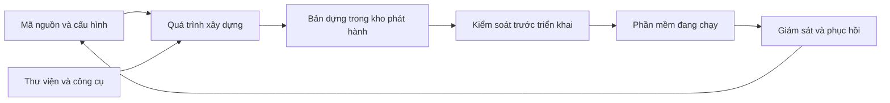

# Tài sản phần mềm

## 1. Mục tiêu bài học

Trong chương **Phân loại tài sản**, tài sản phần mềm là đối tượng cần được nhận diện trước khi đặc tả yêu cầu bảo mật. Một ứng dụng không chỉ có mã nguồn: nó còn phụ thuộc thư viện, công cụ xây dựng, cấu hình triển khai, bản phát hành và các thành phần đang thực thi. Nếu bỏ sót một mắt xích, yêu cầu bảo vệ có thể chỉ bao phủ ứng dụng ở môi trường chạy mà để hở đường đưa mã vào hệ thống.

Bài học này hướng dẫn cách:

- Xác định ranh giới của một tài sản phần mềm và lập danh mục có chủ sở hữu.
- Phân loại theo nhu cầu bảo mật, tính toàn vẹn, tính sẵn sàng và phạm vi ảnh hưởng.
- Liên kết tài sản với mô hình đe dọa, quyết định kiến trúc và yêu cầu bảo mật.
- Viết tiêu chí kiểm thử và bằng chứng chấp nhận cho từng yêu cầu.
- Duy trì kết quả phân loại khi phần mềm thay đổi trong vòng đời phát triển.

Các mức phân loại, thời hạn và ngưỡng định lượng trong bài là **quy ước minh họa của một hệ thống giả định**. Khi áp dụng, nhóm phải lựa chọn giá trị từ đánh giá rủi ro và nhu cầu vận hành của hệ thống cụ thể.

## 2. Tài sản phần mềm là gì?

**Tài sản phần mềm** là mã, thành phần hoặc sản phẩm phần mềm có giá trị đối với tổ chức, cần được quản lý và bảo vệ trong suốt vòng đời. Giá trị có thể đến từ chức năng kinh doanh, tri thức trong mã nguồn, quyền thực thi, khả năng điều khiển hạ tầng hoặc vai trò làm nền tảng cho các phần mềm khác.

Ví dụ:

| Nhóm | Ví dụ tài sản | Vì sao cần bảo vệ? |
| --- | --- | --- |
| Mã do tổ chức phát triển | Mã nguồn dịch vụ thanh toán, ứng dụng di động, script quản trị | Chứa logic nghiệp vụ; thay đổi trái phép có thể tạo cửa hậu hoặc làm sai giao dịch |
| Thành phần sử dụng lại | Thư viện xác thực, gói phụ thuộc trực tiếp và bắc cầu | Một thành phần bị sửa hoặc có lỗ hổng có thể ảnh hưởng nhiều ứng dụng |
| Sản phẩm xây dựng | Tệp JAR, gói cài đặt, image container | Là đầu vào thực tế của hoạt động triển khai và thực thi |
| Phần mềm hỗ trợ phát triển | Plugin xây dựng, trình biên dịch, công cụ sinh mã | Có thể can thiệp vào bản phát hành ngay cả khi mã nguồn ứng dụng không đổi |
| Mã điều khiển triển khai | Pipeline dưới dạng mã, manifest, chart, mã hạ tầng | Quyết định phần mềm nào chạy ở đâu và với quyền gì |
| Phần mềm đang vận hành | Phiên bản dịch vụ đang chạy, agent giám sát, bộ điều khiển cụm | Là nơi quyền thực thi và bề mặt tấn công trở thành hiện thực |
| Sản phẩm bên ngoài | Phần mềm thương mại, thành phần được nhà cung cấp vận hành | Phụ thuộc vào khả năng bảo trì, cập nhật, phục hồi và cam kết của nhà cung cấp |

Một dịch vụ thuê ngoài không nhất thiết cung cấp mã nguồn hoặc bản dựng cho khách hàng. Khi đó, danh mục vẫn cần ghi nhận sản phẩm được sử dụng, chủ sở hữu quan hệ với nhà cung cấp, phạm vi tích hợp và bằng chứng bảo đảm có thể thu thập. Không yêu cầu tổ chức kiểm soát trực tiếp những lớp mà hợp đồng và mô hình cung cấp không cho phép.

### 2.1. Phân biệt phần mềm với các tài sản liên quan

Phần mềm thường liên kết với nhiều loại tài sản khác:

- Mã nguồn của dịch vụ là tài sản phần mềm; hồ sơ khách hàng mà dịch vụ xử lý là tài sản dữ liệu.
- Tệp cấu hình triển khai có thể thuộc phạm vi quản lý phần mềm; mật khẩu có trong tệp vẫn là bí mật cần được nhận diện và bảo vệ riêng.
- Pipeline là tài sản phần mềm hoặc cấu hình điều khiển; danh tính được pipeline dùng để phát hành là tài sản danh tính và quyền truy cập.
- Image container chứa phần mềm; máy hoặc nền tảng chạy image là tài sản hạ tầng.

Các cách nhìn này có thể giao nhau. Mục đích của việc phân loại là bảo đảm yêu cầu bảo vệ đầy đủ, không phải ép mỗi đối tượng vào đúng một ô rồi bỏ qua quan hệ của nó.

Ví dụ, nhận diện pipeline là phần mềm chưa đủ. Nhóm còn phải biết pipeline có thể lấy bí mật nào, ghi vào kho bản phát hành nào và triển khai tới môi trường nào.

### 2.2. Chọn mức chi tiết đủ để ra quyết định

Không cần tạo một tài sản độc lập cho mọi hàm hoặc mọi tệp. Nên tách thành tài sản riêng khi đối tượng có ít nhất một khác biệt đáng kể về:

- Chủ sở hữu hoặc bên chịu trách nhiệm vận hành.
- Ranh giới tin cậy và quyền truy cập.
- Chu kỳ phát hành hoặc khả năng vá lỗi.
- Nhu cầu bảo vệ, tác động khi bị xâm phạm hoặc phương án phục hồi.
- Phạm vi sử dụng lại và số hệ thống bị ảnh hưởng.

Ví dụ, một thư viện xác thực dùng chung cho mười dịch vụ nên có bản ghi riêng dù mã của nó nằm cùng kho với các dịch vụ. Ngược lại, nhiều lớp tiện ích nội bộ có cùng chủ sở hữu và cùng vòng đời phát hành có thể được quản lý trong một tài sản dịch vụ.

## 3. Nhìn tài sản theo toàn bộ đường đi tới môi trường chạy

Một lỗi phổ biến là chỉ kiểm kê kho mã nguồn hoặc danh sách ứng dụng đang chạy. Cần theo dõi cả quá trình biến mã thành phần mềm thực thi:



Mỗi mũi tên cần trả lời được ba câu hỏi:

1. **Ai hoặc thành phần nào được phép chuyển sang bước tiếp theo?**
2. **Dùng bằng chứng gì để xác nhận đúng đầu vào và đúng bản phát hành?**
3. **Nếu phát hiện sai lệch, hệ thống chặn, cảnh báo và phục hồi thế nào?**

Kho mã được bảo vệ không bảo đảm bản dựng là đúng. Nếu công cụ xây dựng, nguồn phụ thuộc hoặc kho phát hành bị thay đổi trái phép, mã độc vẫn có thể xuất hiện trong sản phẩm cuối cùng.

Tương tự, bản dựng đã kiểm tra không bảo đảm môi trường đang chạy dùng đúng bản đó. Phải liên kết được phiên bản vận hành với định danh bản phát hành và bằng chứng nguồn gốc tương ứng.

## 4. Lập danh mục tài sản có thể sử dụng để viết yêu cầu

Danh mục tài sản cần giúp nhóm trả lời câu hỏi về rủi ro và trách nhiệm. Chỉ có tên ứng dụng và người liên hệ thường chưa đủ.

| Trường | Nội dung cần ghi | Ví dụ |
| --- | --- | --- |
| Định danh ổn định | Mã duy nhất để liên kết rủi ro, yêu cầu và kiểm thử | SW-PAY-001 |
| Tên và loại | Chức năng và dạng tài sản | Dịch vụ xử lý thanh toán; dịch vụ backend |
| Chủ sở hữu | Vai trò chịu trách nhiệm quyết định và duy trì | Nhóm Payment |
| Phạm vi và môi trường | Phần nào thuộc tài sản; dev, test hay production | API và tác vụ xử lý thanh toán ở production |
| Tham chiếu kỹ thuật | Kho mã, kho phát hành, định danh triển khai | Repository, đường dẫn gói, workload |
| Phiên bản và nhận dạng | Commit, phiên bản gói, digest hoặc mã bản phát hành | Commit được duyệt gắn với digest image |
| Nguồn gốc | Tự phát triển, bên thứ ba, nguồn cộng đồng | Tự phát triển; có thư viện bên thứ ba |
| Quyền và khả năng tiếp cận | Quyền chạy, truy cập mạng, danh tính sử dụng | Được gửi yêu cầu tới cổng thanh toán |
| Phụ thuộc | Thành phần cần có hoặc thành phần chịu ảnh hưởng | SDK thanh toán, thư viện xác thực |
| Quan hệ với dữ liệu | Loại dữ liệu xử lý và liên kết hồ sơ phân loại | Mã giao dịch, thông tin khách hàng đã giới hạn |
| Nhu cầu bảo vệ | Mức bảo mật, toàn vẹn, sẵn sàng và lý do | C trung bình, I cao, A cao |
| Vòng đời hỗ trợ | Khả năng cập nhật, thời điểm hết hỗ trợ, kế hoạch thay thế | Đang được bảo trì; rà soát theo sự kiện |
| Yêu cầu và bằng chứng | Mã yêu cầu, kiểm thử, ngoại lệ đang có hiệu lực | SR-SW-01, TC-SW-01 |
| Mốc xác minh | Khi nào và bởi ai bản ghi được xác nhận | Chủ sở hữu xác nhận tại kỳ rà soát |

### 4.1. Phân biệt danh mục, danh sách thành phần và trạng thái vận hành

Ba nguồn thông tin có vai trò khác nhau:

- **Danh mục tài sản** trả lời phần mềm phục vụ mục đích gì, ai sở hữu và cần được bảo vệ đến mức nào.
- **Danh sách thành phần phần mềm**, thường được biểu diễn bằng SBOM, mô tả các thành phần của một sản phẩm hoặc bản phát hành.
- **Thông tin vận hành** trả lời phiên bản nào đang chạy ở môi trường nào, với cấu hình và quyền nào.

SBOM không thay thế danh mục tài sản. Nó cũng không tự chứng minh phần mềm an toàn, đã bao phủ mọi thành phần hoặc không có mã độc. Giá trị của SBOM phụ thuộc phạm vi thu thập, độ chính xác, cách gắn với bản phát hành và khả năng cập nhật.

Danh sách thành phần phải quan tâm cả phụ thuộc trực tiếp, phụ thuộc bắc cầu và thành phần có điều kiện. Với công cụ chỉ tồn tại ở bước xây dựng, cần hồ sơ riêng hoặc phạm vi SBOM phù hợp để tránh hiểu nhầm rằng danh sách thành phần của sản phẩm đã bao phủ toàn bộ môi trường xây dựng.

### 4.2. Không dùng tên phiên bản làm bằng chứng duy nhất

Một nhãn như `latest` hoặc tên `payment-service-2.4` có thể không đủ để xác định nội dung thực tế. Khi cần kiểm chứng tính toàn vẹn, phải gắn bản phát hành với định danh nội dung cụ thể, chẳng hạn digest, và thông tin nguồn gốc tương ứng.

Digest giúp phát hiện nội dung khác với giá trị đã biết. Nó không chứng minh nội dung đó an toàn hoặc được phát hành bởi người có thẩm quyền. Nếu kẻ tấn công có thể thay cả bản dựng lẫn digest tham chiếu, phép so sánh đơn thuần mất ý nghĩa bảo vệ.

## 5. Phân loại nhu cầu bảo vệ theo ba chiều

Có thể bắt đầu bằng ba chiều:

- **Bảo mật — Confidentiality, C:** tác động nếu mã, cấu hình hoặc nội dung phần mềm bị tiết lộ cho bên không được phép.
- **Toàn vẹn — Integrity, I:** tác động nếu phần mềm bị thay đổi trái phép, bị thay thế hoặc thực thi logic sai.
- **Sẵn sàng — Availability, A:** tác động nếu không thể xây dựng, phát hành, sử dụng hoặc phục hồi phần mềm khi cần.

Bảng dưới là một quy ước nội bộ minh họa:

| Chiều | Thấp | Trung bình | Cao |
| --- | --- | --- | --- |
| C | Nội dung đã được phép công khai | Mã nội bộ hoặc chi tiết triển khai hạn chế người xem | Tiết lộ gây thiệt hại lớn về tri thức độc quyền hoặc khả năng bảo vệ hệ thống |
| I | Sai lệch gây ảnh hưởng cục bộ, dễ phát hiện và khôi phục | Sai lệch ảnh hưởng một quy trình hoặc một nhóm người dùng | Sai lệch có thể dẫn đến gian lận, vượt quyền hoặc lan rộng sang nhiều hệ thống |
| A | Có thể gián đoạn trong khoảng thời gian nghiệp vụ chấp nhận được | Gián đoạn ảnh hưởng đáng kể một quy trình có phương án tạm thời | Gián đoạn làm dừng chức năng trọng yếu và cần phục hồi trong thời gian ngắn |

Mức độ phải đi kèm **lý do cụ thể**. Ghi “I cao vì thay đổi logic kiểm tra quyền có thể cho phép đọc giao dịch của người khác” hữu ích hơn ghi “I cao vì đây là dịch vụ quan trọng”.

### 5.1. Không suy toàn bộ mức bảo vệ từ độ bí mật của mã

Một thư viện mã nguồn mở có thể có C thấp vì mã đã công khai, nhưng I cao vì nhiều dịch vụ tin tưởng kết quả xác thực của nó.

Một công cụ chuyển đổi báo cáo nội bộ có thể có C trung bình, trong khi A thấp nếu việc xử lý được phép trì hoãn.

Một pipeline phát hành không trực tiếp phục vụ người dùng vẫn có thể có I cao vì nó có quyền đưa mã tới production. A của pipeline cần được đánh giá theo cửa sổ phát hành và phục hồi, thay vì tự động sao chép A của ứng dụng.

### 5.2. Nhu cầu bảo vệ khác với mức rủi ro hiện tại

Phân loại thể hiện **hậu quả cần tránh và mức bảo vệ cần có**. Rủi ro còn phụ thuộc vào đe dọa, khả năng xảy ra, mức tiếp xúc, lỗ hổng và hiệu quả kiểm soát.

Ví dụ:

- Một dịch vụ I cao vẫn giữ nhu cầu bảo vệ đó sau khi đã có kiểm soát tốt; rủi ro còn lại có thể giảm.
- Một thành phần chỉ dùng trong mạng nội bộ không tự động có rủi ro thấp nếu có quyền thay đổi phần mềm toàn hệ thống.
- Không nên hạ phân loại chỉ vì chưa có công cụ phát hiện sự cố.

Không cộng ba mức C, I, A thành một điểm duy nhất rồi bỏ các chiều gốc. Hai tài sản có cùng tổng điểm có thể cần những nhóm kiểm soát rất khác nhau.

## 6. Bổ sung ngữ cảnh để ưu tiên yêu cầu

C, I, A cần được kết hợp với quan hệ kiến trúc và mô hình đe dọa:

| Yếu tố | Câu hỏi cần trả lời | Hàm ý đối với yêu cầu |
| --- | --- | --- |
| Mức tiếp xúc | Có nhận đầu vào từ Internet hoặc từ bên ít tin cậy hơn không? | Xác định yêu cầu xác thực, kiểm tra đầu vào và giới hạn sử dụng |
| Quyền thực thi | Có thể đọc bí mật, ký bản phát hành hoặc sửa hạ tầng không? | Giới hạn quyền, tách danh tính và kiểm soát thay đổi |
| Phạm vi ảnh hưởng | Bao nhiêu sản phẩm phụ thuộc hoặc được triển khai từ tài sản? | Ưu tiên bảo vệ thành phần dùng chung và khả năng thu hồi |
| Ranh giới tin cậy | Mã hoặc bản dựng đi từ tổ chức, nhà cung cấp hay môi trường nào? | Xác minh nguồn, phê duyệt và điều kiện tiếp nhận |
| Khả năng phục hồi | Có bản dựng tốt, nguồn phụ thuộc và hướng dẫn phục hồi không? | Đặt mục tiêu phục hồi và kiểm thử thực tế |
| Khả năng bảo trì | Có bản vá và người chịu trách nhiệm nâng cấp không? | Đặt yêu cầu hỗ trợ, thời hạn xử lý và kế hoạch thay thế |
| Khả năng quan sát | Có nhận diện được phiên bản và thay đổi đang chạy không? | Bổ sung dấu vết triển khai và đối chiếu vận hành |

Ưu tiên không chỉ dựa trên số lượng người dùng. Một plugin xây dựng ít được nhìn thấy nhưng có quyền đọc thông tin phát hành có thể tạo đường tấn công đáng chú ý hơn một ứng dụng tiện ích nhiều người sử dụng.

## 7. Ví dụ phân loại trong hệ thống thanh toán

Xét một hệ thống giả định gồm dịch vụ thanh toán, thư viện xác thực dùng chung và pipeline triển khai.

| Tài sản | C | I | A | Căn cứ chính |
| --- | --- | --- | --- | --- |
| Mã nguồn dịch vụ thanh toán | Trung bình | Cao | Trung bình | Mã nội bộ; thay đổi logic có thể làm sai giao dịch; gián đoạn kho mã ảnh hưởng bảo trì và phát hành |
| Thư viện xác thực dùng chung | Thấp nếu đã công khai hợp lệ | Cao | Trung bình | Không cần giữ kín mã nhưng phải ngăn sửa logic kiểm tra danh tính và quyền |
| Pipeline phát hành production | Trung bình | Cao | Cao trong cửa sổ phục hồi đã xác định | Có quyền phát hành; phải dùng được khi cần triển khai bản sửa khẩn cấp |
| Bản dựng thanh toán trong kho phát hành | Trung bình | Cao | Cao | Phải giữ đúng nội dung và truy xuất được bản tốt để phục hồi |
| Dịch vụ thanh toán đang chạy | Trung bình | Cao | Cao | Sai lệch ảnh hưởng tính đúng đắn giao dịch; gián đoạn chặn nghiệp vụ |

Mức C của phần mềm không thay thế phân loại dữ liệu mà dịch vụ xử lý. Nếu phần mềm có khả năng truy cập dữ liệu nhạy cảm, quan hệ đó phải tạo thêm yêu cầu về quyền truy cập và bảo vệ dữ liệu, kể cả khi mã nguồn đã công khai.

Các bản ghi trong bảng cần liên kết với nhau: từ phiên bản đang chạy truy ngược được tới bản dựng, mã nguồn và tập thành phần tương ứng. Nếu thiếu liên kết này, khi một thư viện phát sinh vấn đề, nhóm khó xác định phiên bản production nào cần xử lý.

## 8. Chuyển phân loại thành yêu cầu bảo mật

Một yêu cầu kiểm chứng được nên có cấu trúc:

> **Đối tượng + điều kiện áp dụng + hành vi bắt buộc + ngưỡng hoặc kết quả mong đợi + cách thu thập bằng chứng.**

Ví dụ “bảo vệ mã nguồn quan trọng” chưa đủ. Cần làm rõ tài sản nào, ai được thay đổi, điều kiện chấp nhận thay đổi và cách chứng minh quy tắc được thực thi.

### 8.1. Chuỗi truy vết từ tài sản tới kiểm thử

Với tài sản `SW-PAY-001`:

1. **Mục tiêu:** chỉ chạy phần mềm thanh toán đã được chấp thuận.
2. **Phân loại:** I cao vì thay đổi trái phép có thể làm sai giao dịch.
3. **Đe dọa:** tài khoản có quyền ghi vào kho bản phát hành thay bản dựng sau khi kiểm tra.
4. **Rủi ro:** môi trường production chạy mã không thuộc phiên bản được phê duyệt.
5. **Quyết định kiến trúc:** triển khai bằng định danh nội dung; đối chiếu với hồ sơ phát hành được bảo vệ; tách quyền tạo và quyền chấp thuận.
6. **Yêu cầu:** chặn triển khai khi nội dung hoặc bằng chứng phê duyệt không khớp.
7. **Kiểm thử:** thử triển khai một bản dựng đã bị sửa và xác nhận bị từ chối.
8. **Bằng chứng:** kết quả kiểm thử, sự kiện từ chối và hồ sơ phiên bản được chấp thuận.

Nếu chỉ ghi “I cao” mà không có các bước tiếp theo, kết quả phân loại chưa trở thành đầu vào hữu dụng cho phát triển.

### 8.2. Bộ yêu cầu minh họa

Các giá trị dưới đây là giả định để làm rõ cách đặc tả, cần được chủ sở hữu xác nhận trước khi áp dụng.

| Mã | Yêu cầu bảo mật | Tiêu chí chấp nhận và bằng chứng |
| --- | --- | --- |
| SR-SW-01 | Mọi dịch vụ production thuộc phạm vi phải có định danh tài sản, chủ sở hữu, phiên bản vận hành và tham chiếu bản phát hành | Đối chiếu danh sách dịch vụ từ nền tảng chạy với danh mục; không có dịch vụ thiếu các trường bắt buộc |
| SR-SW-02 | Người có quyền thay đổi chính sách bảo vệ nhánh hoặc chấp thuận phát hành phải dùng xác thực đa yếu tố; danh tính tự động được quản lý riêng | Thử hành động bằng tài khoản người dùng chưa đáp ứng điều kiện và xác nhận bị chặn; kiểm tra cấu hình và sự kiện xác thực |
| SR-SW-03 | Thay đổi vào nhánh phát hành của tài sản I cao phải được ít nhất một người đủ thẩm quyền, khác người tạo thay đổi, phê duyệt | Thử tự phê duyệt, ghi trực tiếp và dùng danh tính tự động không có quyền; tất cả trường hợp ngoài quy trình đều bị chặn |
| SR-SW-04 | Production chỉ tiếp nhận bản dựng có định danh nội dung khớp hồ sơ phát hành đã được phê duyệt và có bằng chứng nguồn gốc hợp lệ theo chính sách | Bản hợp lệ được chấp nhận; bản bị sửa, thiếu bằng chứng, sai chủ thể phát hành hoặc không được phê duyệt bị từ chối |
| SR-SW-05 | Mỗi bản phát hành phải có hồ sơ thành phần gắn với định danh bản dựng, bao gồm phụ thuộc trực tiếp và bắc cầu đã xác định trong phạm vi sản phẩm | Đối chiếu một mẫu thành phần có chủ đích với hồ sơ; bản thiếu hồ sơ bắt buộc không được phát hành |
| SR-SW-06 | Khi tiếp nhận thông tin lỗ hổng liên quan đến thành phần đang dùng, nhóm sở hữu phải xác định phạm vi ảnh hưởng trong 24 giờ; trường hợp được đánh giá cần xử lý khẩn phải được giảm thiểu hoặc khắc phục trong 72 giờ từ lúc phân loại | Hồ sơ có thời điểm tiếp nhận, tài sản bị ảnh hưởng, căn cứ đánh giá, quyết định xử lý và bằng chứng xác nhận kết quả |
| SR-SW-07 | Danh tính chạy dịch vụ thanh toán chỉ được truy cập các tài nguyên được liệt kê trong chính sách quyền; không có quyền ghi vào kho mã hoặc kho phát hành | Kiểm thử thao tác nghiệp vụ được phép thành công; thử ghi vào các kho nói trên thất bại và có dấu vết phù hợp |
| SR-SW-08 | Mọi thay đổi quyền phát hành, triển khai và ngoại lệ kiểm soát phải tạo sự kiện kiểm toán gửi tới nơi lưu trữ mà danh tính triển khai không có quyền sửa hoặc xóa | Sự kiện chứa chủ thể, thời gian, hành động, tài sản, phiên bản, kết quả và mã liên kết; thử sửa hoặc xóa bằng danh tính triển khai bị từ chối |
| SR-SW-09 | Dịch vụ thanh toán phải khôi phục được về một bản phát hành tốt đã biết trong 30 phút kể từ khi người có thẩm quyền tuyên bố bắt đầu phục hồi | Diễn tập trong môi trường đại diện, đo đến khi kiểm tra chức năng và bảo mật tối thiểu đạt; lưu mốc thời gian và kết quả |
| SR-SW-10 | Khóa ký hoặc thông tin phát hành bị nghi lộ phải được vô hiệu hóa theo quy trình ứng cứu và các bản phát hành liên quan phải được đánh giá lại | Diễn tập xác định được khóa, phạm vi bản dựng, hành động vô hiệu hóa và điều kiện tin cậy mới; bản dùng bằng chứng đã bị thu hồi bị từ chối theo chính sách |

Trong SR-SW-03, đường truy cập khẩn cấp nếu có phải được đặc tả riêng: ai được dùng, điều kiện kích hoạt, thời hạn quyền, bằng chứng bắt buộc và cách rà soát sau sự kiện. Nếu chỉ ghi “ngoại trừ quản trị viên”, yêu cầu có thể bị bỏ qua trong đúng tình huống cần bảo vệ nhất.

Trong SR-SW-04, chữ ký chỉ có giá trị khi xác minh đúng chủ thể được tin cậy, đúng nội dung và trạng thái tin cậy của khóa. Chữ ký hợp lệ không tự chứng minh mã không có lỗ hổng hoặc quá trình xây dựng không bị xâm phạm.

### 8.3. Yêu cầu bảo vệ dữ liệu và logging phải đi cùng phần mềm

Ngoài yêu cầu về bản thân mã và bản dựng, phân loại phần mềm còn dẫn tới yêu cầu về cách nó xử lý dữ liệu:

- Nếu dịch vụ đọc dữ liệu có giới hạn truy cập, phải kiểm tra quyền trên hành động và đối tượng dữ liệu, không chỉ kiểm tra người dùng đã đăng nhập.
- Nếu dịch vụ xử lý bí mật, phải xác định cách cấp phát và luân chuyển bí mật; không đưa bí mật vào mã nguồn, bản dựng hoặc log.
- Nếu log phục vụ điều tra, phải định nghĩa trường cần ghi, thời hạn lưu, người được đọc và khả năng phát hiện sửa đổi.
- Nếu dữ liệu trong log cần che hoặc loại bỏ, quy tắc phải áp dụng cả đường thành công, đường lỗi và thông tin chẩn đoán.

Ví dụ kiểm thử có thể gửi một yêu cầu bị từ chối chứa giá trị bí mật giả đã đánh dấu, sau đó kiểm tra các đầu ra log nằm trong phạm vi để bảo đảm giá trị đó không xuất hiện. Bằng chứng cần thể hiện phạm vi log đã kiểm tra; một kiểm thử đơn lẻ không chứng minh mọi đường thực thi đều an toàn.

### 8.4. Phục hồi phần mềm không đồng nghĩa phục hồi toàn hệ thống

Khôi phục bản dựng tốt là một phần của phục hồi. Dịch vụ còn phụ thuộc cấu hình, bí mật, dữ liệu và phiên bản lược đồ tương thích.

- Mục tiêu thời gian phục hồi cần nêu rõ bắt đầu đo và kết thúc đo khi nào.
- Mục tiêu mất dữ liệu cho phép phải được đặc tả với tài sản dữ liệu liên quan.
- Quy trình quay lui cần xét thay đổi dữ liệu hoặc lược đồ không tương thích.
- Tệp sao lưu mã nguồn chưa đủ nếu thiếu công cụ, phụ thuộc hoặc quyền cần thiết để tạo lại và triển khai bản chạy.

Diễn tập nên bao gồm tình huống kho phát hành chính không dùng được nếu đó là kịch bản thuộc mô hình đe dọa. Không mặc định có thể xây dựng lại nhanh chỉ vì còn mã nguồn.

## 9. Biểu diễn bản ghi phân loại và liên kết yêu cầu

Dưới đây là một **ví dụ dữ liệu minh họa**, không phải định dạng bắt buộc của mọi tổ chức:

```yaml
assetId: SW-PAY-001
name: payment-service
assetType: application-service
ownerRole: payment-service-owner
environment: production

classification:
  confidentiality: medium
  integrity: high
  availability: high
  rationale:
    confidentiality: "Mã nội bộ và cấu hình triển khai cần hạn chế truy cập."
    integrity: "Thay đổi trái phép có thể làm sai giao dịch hoặc vượt quyền."
    availability: "Gián đoạn chặn chức năng thanh toán."

relationships:
  sourceReference: "repository/payment-service"
  releaseReference: "release-record/PAY-2026-042"
  runtimeReference: "production/payment-service"
  dataAssetReferences:
    - DATA-TRANSACTION-001
  softwareDependencyReferences:
    - SW-AUTH-LIB-001

riskReferences:
  - RISK-UNAPPROVED-RELEASE
requirementReferences:
  - SR-SW-03
  - SR-SW-04
  - SR-SW-07
  - SR-SW-09
verificationReferences:
  - TC-CHANGE-APPROVAL
  - TC-RELEASE-INTEGRITY
  - TC-RUNTIME-PRIVILEGE
  - TC-RECOVERY
```

Bản ghi này vẫn cần hồ sơ bản phát hành để lưu commit, định danh bản dựng, danh sách thành phần và bằng chứng phê duyệt cụ thể. Danh mục tài sản giữ định danh ổn định; hồ sơ phát hành thay đổi theo từng phiên bản. Cách liên kết này giúp tránh ghi đè lịch sử khi có phiên bản mới.

Không lưu mật khẩu, khóa ký hoặc token trong danh mục. Chỉ ghi tham chiếu cần thiết tới hệ thống quản lý bí mật và giới hạn người được xem các tham chiếu nhạy cảm.

## 10. Kiểm chứng độ bao phủ của phân loại

Để biết danh mục có đủ dùng hay chưa, cần đối chiếu với các nguồn hiện có trong phạm vi:

- Kho mã chứa sản phẩm đang phát triển.
- Kho gói hoặc image dùng để phát hành.
- Danh sách ứng dụng và phiên bản trên nền tảng chạy.
- Cấu hình pipeline, công cụ xây dựng và mã triển khai.
- Hồ sơ mua sắm hoặc tích hợp phần mềm bên ngoài.

Kết quả đối chiếu cần tìm cả hai chiều:

1. Phần mềm đang chạy nhưng không có bản ghi tài sản.
2. Tài sản vẫn nằm trong danh mục nhưng đã ngừng dùng hoặc không còn người chịu trách nhiệm.

Một chỉ số minh họa:

> Tỷ lệ bao phủ chủ sở hữu = số dịch vụ production trong phạm vi có chủ sở hữu đã xác minh / tổng số dịch vụ production phát hiện trong cùng phạm vi và thời điểm.

Mẫu số phải được xác định từ nguồn phát hiện phù hợp, không chỉ lấy những mục đã có trong danh mục. Nếu phạm vi phát hiện chưa đầy đủ, phải ghi giới hạn đó. Chỉ số 100% của một danh sách thiếu nhiều dịch vụ có thể tạo cảm giác an toàn sai.

Các chỉ số bổ sung có thể theo dõi:

| Chỉ số | Ý nghĩa | Lưu ý khi diễn giải |
| --- | --- | --- |
| Số tài sản chưa phân loại | Phần chưa có quyết định về nhu cầu bảo vệ | Theo dõi tuổi của bản ghi chưa xử lý |
| Tỷ lệ bản phát hành truy vết được | Khả năng liên kết runtime, bản dựng và nguồn | Nêu rõ tập bản phát hành được kiểm tra |
| Số thành phần không rõ nguồn gốc | Điểm mù trong chuỗi cung ứng | Không gộp với thành phần đã biết nhưng có rủi ro |
| Số ngoại lệ quá hạn | Kiểm soát bị trì hoãn vượt thời hạn chấp thuận | Ngoại lệ phải có người chịu trách nhiệm và phạm vi |
| Thời gian xác định tài sản bị ảnh hưởng | Khả năng phản ứng khi có vấn đề ở một thành phần | Đo qua sự cố thực tế hoặc diễn tập có kịch bản |

## 11. Duy trì phân loại trong vòng đời phát triển

Phân loại không kết thúc sau một lần lập danh mục. Cần xác định thời điểm cập nhật và người phê duyệt.

| Sự kiện | Nội dung cần xem xét lại |
| --- | --- |
| Tạo dịch vụ hoặc mua phần mềm mới | Mục đích, chủ sở hữu, phạm vi, nguồn gốc và phân loại ban đầu |
| Thêm đường truy cập từ Internet | Mức tiếp xúc, xác thực, phân quyền và yêu cầu giám sát |
| Cấp quyền mới cho pipeline hoặc runtime | Phạm vi ảnh hưởng, tách quyền, ghi nhận kiểm toán |
| Thêm thành phần dùng chung | Các bên phụ thuộc, yêu cầu cập nhật và xử lý sự cố lan rộng |
| Chuyển nhà cung cấp hoặc nguồn gói | Ranh giới tin cậy, nguồn gốc và bằng chứng tiếp nhận |
| Thay đổi chức năng hoặc loại dữ liệu xử lý | Tác động C, I, A và yêu cầu bảo vệ dữ liệu liên quan |
| Thành phần hết hỗ trợ | Rủi ro duy trì, phương án giảm thiểu, thay thế hoặc ngừng dùng |
| Phát hiện lỗ hổng hay sự cố | Phạm vi ảnh hưởng, tính đầy đủ của danh mục và yêu cầu còn thiếu |
| Ngừng sử dụng | Thu hồi quyền, dừng triển khai, xử lý bản dựng và giữ bằng chứng cần thiết |

Có thể kết hợp rà soát định kỳ với cập nhật theo sự kiện. Chu kỳ rà soát phụ thuộc mức trọng yếu và tốc độ thay đổi; không dùng rà soát định kỳ làm lý do trì hoãn cập nhật sau một thay đổi lớn.

Khi chưa đáp ứng được yêu cầu, ngoại lệ cần có tài sản và phiên bản áp dụng, rủi ro, biện pháp bù, người chấp thuận, hạn hết hiệu lực và điều kiện đóng. Không hạ mức phân loại để làm cho tài sản có vẻ đã tuân thủ.

## 12. Những sai lầm thường gặp

| Sai lầm | Hệ quả | Cách sửa |
| --- | --- | --- |
| Chỉ kiểm kê ứng dụng do nội bộ viết | Bỏ sót thư viện, công cụ xây dựng và phần mềm bên thứ ba | Kiểm kê theo đường đi từ nguồn tới runtime |
| Mã công khai thì mọi chiều đều thấp | Bỏ qua nguy cơ sửa logic của thành phần dùng chung | Đánh giá C, I, A độc lập |
| Có SBOM là đủ hiểu tài sản | Thiếu chủ sở hữu, mục đích và trạng thái triển khai | Liên kết SBOM với danh mục và hồ sơ vận hành |
| Ghi “bảo mật cao” mà không có lý do | Không suy ra được yêu cầu hay kiểm thử | Gắn mức phân loại với hậu quả và kịch bản đe dọa |
| Chỉ kiểm tra phiên bản bằng tên gói | Không phát hiện nội dung bị thay dưới cùng tên | Dùng định danh nội dung và nguồn tham chiếu được bảo vệ |
| Tin mọi bản dựng có chữ ký | Chấp nhận bản ký bởi chủ thể không phù hợp hoặc khóa đã mất tin cậy | Xác minh danh tính phát hành, chính sách tin cậy và trạng thái khóa |
| Chỉ có kiểm thử đường hợp lệ | Không chứng minh khả năng chặn thay đổi trái phép | Thêm kiểm thử sai quyền, sai nội dung, thiếu bằng chứng và thu hồi |
| Coi quay lui phần mềm là hoàn tất phục hồi | Dịch vụ lỗi do dữ liệu hoặc cấu hình không tương thích | Diễn tập phục hồi các phụ thuộc cần thiết |
| Giữ tài sản đã bỏ dùng cùng quyền còn hiệu lực | Để lại đường truy cập không còn được giám sát | Gắn ngừng dùng với thu hồi quyền và cập nhật danh mục |

## 13. Bài tập vận dụng

Một plugin xây dựng được dùng bởi tám dịch vụ. Plugin không xử lý dữ liệu khách hàng nhưng có thể đọc biến môi trường của tác vụ xây dựng và thay đổi nội dung image. Mã plugin được công khai. Tất cả dịch vụ hiện chỉ lưu số phiên bản plugin, chưa gắn danh sách thành phần với digest bản dựng.

Hãy thực hiện:

1. Xác định có nên quản lý plugin như một tài sản riêng và nêu lý do.
2. Đề xuất mức C, I, A kèm căn cứ; chỉ rõ thông tin nào còn thiếu.
3. Nêu hai kịch bản đe dọa liên quan đến plugin.
4. Viết hai yêu cầu bảo mật có tiêu chí chấp nhận.
5. Xác định bằng chứng cần có để tìm các bản phát hành bị ảnh hưởng.

### Gợi ý tự đối chiếu

- Plugin nên có bản ghi riêng vì được sử dụng lại trên nhiều dịch vụ và có khả năng can thiệp quá trình xây dựng.
- C của mã có thể thấp nếu việc công khai đã được cho phép. I cần ưu tiên cao vì plugin có thể làm sai sản phẩm của nhiều dịch vụ. A cần biết có bản sao tin cậy, có phương án xây dựng thay thế và thời gian gián đoạn chấp nhận được; không đủ dữ kiện để tự kết luận.
- Một đe dọa là kẻ tấn công thay nội dung gói plugin được tải về. Đe dọa khác là bản plugin được chấp nhận có hành vi đọc và đưa bí mật của môi trường xây dựng ra ngoài.
- Yêu cầu thứ nhất có thể buộc tác vụ xây dựng chỉ sử dụng plugin có định danh nội dung khớp bản đã duyệt. Kiểm thử thay nội dung dưới cùng số phiên bản phải khiến tác vụ bị chặn.
- Yêu cầu thứ hai có thể giới hạn danh tính và bí mật mà tác vụ dùng plugin được tiếp cận. Kiểm thử đọc một bí mật ngoài phạm vi phải thất bại; cần kiểm tra thêm quyền của chính môi trường thực thi tác vụ.
- Bằng chứng cần nối được phiên bản và nội dung plugin với lần xây dựng, digest sản phẩm, hồ sơ phát hành và môi trường triển khai. Chỉ tìm kiếm số phiên bản trong mã nguồn chưa đủ để khẳng định phạm vi ảnh hưởng.

## 14. Kết quả cần tạo sau khi học

Với một phần mềm cụ thể, người học cần tạo được:

1. Bản ghi tài sản có phạm vi, chủ sở hữu, nguồn gốc và quan hệ phụ thuộc.
2. Phân loại C, I, A có lý do và các điểm chưa đủ thông tin.
3. Ít nhất một chuỗi liên kết từ tài sản tới đe dọa, rủi ro, yêu cầu và kiểm thử.
4. Tiêu chí chấp nhận quan sát được cho bảo vệ thay đổi, vận hành và phục hồi.
5. Quy tắc cập nhật phân loại khi quyền, chức năng, phụ thuộc hoặc vòng đời hỗ trợ thay đổi.

Một danh mục có giá trị phải giúp trả lời được: **phần mềm nào cần bảo vệ, vì sao, ai chịu trách nhiệm, yêu cầu nào đang áp dụng và có bằng chứng gì cho thấy yêu cầu đó được đáp ứng**.
