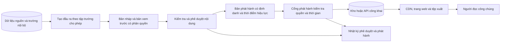

# Dữ liệu công khai

## 1. Dữ liệu công khai là gì?

**Dữ liệu công khai** là dữ liệu được chủ thể có thẩm quyền cho phép phổ biến tới công chúng trong một phạm vi nội dung, phiên bản, thời điểm và kênh công bố xác định. Việc người ngoài tổ chức có thể đọc đúng dữ liệu đã được duyệt không bị xem là sự cố tiết lộ bí mật trong phạm vi công bố đó.

Ví dụ có thể gồm danh mục sản phẩm đã phát hành, tài liệu hướng dẫn dành cho mọi người, thông cáo được duyệt, bộ dữ liệu mở hoặc thông tin trạng thái dịch vụ. Mỗi ví dụ chỉ trở thành dữ liệu công khai sau khi nội dung và điều kiện công bố đã được xác định. Bản nháp của cùng một tài liệu có thể vẫn là dữ liệu nội bộ.

Trong xây dựng yêu cầu bảo mật, nhãn công khai trả lời chủ yếu câu hỏi **ai được biết nội dung**. Nhãn đó không tự trả lời ai được sửa, phát hành, xóa hoặc khiến người dùng tin rằng nội dung đến từ một nguồn chính thức.

Một trang thông báo lịch bảo trì có thể không chứa bí mật. Tuy nhiên, nếu bị sửa để dẫn người dùng tới trang giả mạo, tác động vẫn lớn. Một tệp cấu hình được công bố cho ứng dụng khách có thể được mọi người đọc, nhưng việc thay đổi trái phép tệp có thể ảnh hưởng đến hành vi của nhiều ứng dụng.

Vì vậy, bài học này tiếp cận dữ liệu công khai như một loại tài sản cần đặc tả rõ: điều kiện được công bố, ranh giới với dữ liệu chưa công bố, quyền quản trị, yêu cầu toàn vẹn, mức sẵn sàng và tiêu chí kiểm chứng trong vòng đời phát triển.

## 2. Phân biệt công khai với những trạng thái dễ nhầm

### 2.1. Có thể truy cập không đồng nghĩa được phép công bố

Một kho lưu trữ bị cấu hình sai, một liên kết bị đoán được hoặc một bản ghi vô tình xuất hiện trong kết quả tìm kiếm không phải căn cứ để hạ mức phân loại dữ liệu. Nếu tài liệu nội bộ bị lộ, tài liệu vẫn cần được xử lý theo mức phân loại được xác định từ nội dung và quyết định có thẩm quyền.

Ngược lại, đường dẫn khó đoán không tạo ra tính bí mật đáng tin cậy. Nếu một bản nháp chỉ được bảo vệ bằng tên tệp dài, yêu cầu kiểm soát truy cập vẫn chưa được đáp ứng.

| Tình huống | Có đủ căn cứ gọi là công khai không? | Điều cần làm rõ |
|---|---|---|
| Bài hướng dẫn đã được duyệt và xuất bản cho mọi người | Có, trong phạm vi phiên bản đã công bố | Ai được cập nhật và nguồn nào là bản chính thức? |
| Tệp nội bộ có URL không yêu cầu đăng nhập do lỗi cấu hình | Không | Khôi phục kiểm soát truy cập và đánh giá sự cố tiết lộ |
| Bản nháp thông cáo gửi cho một nhóm đối tác | Không tự động | Tập người nhận được phép và thời điểm phát hành là gì? |
| Nội dung yêu cầu đăng nhập để phục vụ một nhóm khách hàng | Không đủ căn cứ | Đăng nhập nhằm giới hạn người được biết hay chỉ quản lý cách sử dụng dịch vụ? |
| Bộ dữ liệu tổng hợp từ thông tin đã công bố | Cần đánh giá riêng | Kết hợp dữ liệu có tạo ra thông tin nhạy cảm mới không? |
| Gói mã nguồn định công bố nhưng chứa bí mật truy cập | Không được công bố nguyên trạng | Phải loại bỏ bí mật và xử lý việc bí mật đã từng xuất hiện |

### 2.2. Công khai không đồng nghĩa được sử dụng theo mọi cách

Phân loại bảo mật, quyền tác giả, điều kiện cấp phép, quyền sử dụng hình ảnh và các hạn chế áp dụng cho nội dung là những vấn đề có liên quan nhưng khác nhau. Cho phép công chúng đọc không tự động có nghĩa là cho phép sao chép, bán lại hoặc dùng dữ liệu vào mọi mục đích.

Đặc tả nên ghi riêng điều kiện sử dụng khi cần. Không nên dùng một trường `public: true` để thay thế toàn bộ quyết định về quyền công bố và quyền sử dụng.

### 2.3. Công khai là quyết định có ngữ cảnh

Các yếu tố sau có thể làm thay đổi quyết định:

- **Thời điểm:** giá của sản phẩm đã mở bán có thể công khai, giá của chiến dịch chưa phát hành có thể chưa được phép tiết lộ.
- **Phiên bản:** bản cuối đã duyệt khác với bản có bình luận nội bộ và lịch sử chỉnh sửa.
- **Mức chi tiết:** số liệu tổng hợp có thể công khai trong khi bản ghi từng người không được công bố.
- **Nguồn và kênh:** một tệp đã phát hành chính thức khác với bản sao chưa được kiểm tra trên môi trường thử nghiệm.
- **Tập người nhận:** chia sẻ cho một nhóm bên ngoài không đồng nghĩa cho phép phổ biến tới mọi người.

Nếu một nội dung chỉ được phép tiết lộ cho một nhóm xác định, cần biểu diễn giới hạn đó trong chính sách. Không nên gắn nhãn công khai rồi kỳ vọng một thành phần khác tự suy ra các ngoại lệ.

## 3. Đánh giá bí mật, toàn vẹn và sẵn sàng độc lập

Ba thuộc tính thường được xem xét là **tính bí mật** — chỉ người được phép mới biết nội dung, **tính toàn vẹn** — dữ liệu không bị thay đổi trái phép, và **tính sẵn sàng** — người được phép có thể sử dụng dữ liệu khi cần. Với dữ liệu công khai, quyết định cho mọi người đọc chỉ làm giảm yêu cầu giữ bí mật đối với đúng phần đã công bố.

| Thuộc tính | Câu hỏi cần đặt ra | Ví dụ yêu cầu có thể phát sinh |
|---|---|---|
| Bí mật | Có thành phần nào chưa được duyệt hoặc không nằm trong phạm vi công bố không? | Chặn bản nháp, trường nội bộ, dữ liệu cá nhân và bí mật kỹ thuật khỏi đầu ra công khai |
| Toàn vẹn | Nếu nội dung bị sửa, người dùng có ra quyết định sai hoặc tải mã độc không? | Chỉ cho phép luồng phát hành được ủy quyền cập nhật; kiểm tra phiên bản và nguồn |
| Tính xác thực của nguồn | Người đọc có phân biệt được bản chính thức với bản giả không? | Phục vụ qua kênh đã xác thực; bảo vệ tên miền, cấu hình và cơ chế xác minh khi cần |
| Sẵn sàng | Gián đoạn công bố làm ảnh hưởng hoạt động nào? | Đặt mục tiêu dịch vụ, cơ chế dự phòng, phục hồi và kiểm soát lạm dụng phù hợp |
| Tính cập nhật | Nội dung cũ có thể gây hậu quả gì dù không bị sửa? | Đặt thời hạn cập nhật, dấu phiên bản, thời điểm hiệu lực và chính sách bộ nhớ đệm |

Tính xác thực và tính cập nhật được nêu riêng để giúp đặc tả rõ hơn. Chúng không có nghĩa mọi hệ thống phải xây thêm một cơ chế mật mã mới. Cơ chế được chọn phải phù hợp với cách người dùng nhận và sử dụng dữ liệu.

Ví dụ, danh sách biểu tượng trang trí có thể chịu được một khoảng gián đoạn khá dài. Trang trạng thái dịch vụ mà khách hàng dựa vào khi có sự cố có thể cần mức sẵn sàng cao và quy trình cập nhật độc lập hơn. Không thể suy ra cùng một mức sẵn sàng chỉ vì cả hai đều công khai.

## 4. Xác định đơn vị phân loại và ranh giới công bố

### 4.1. Không mặc định cả cơ sở dữ liệu đều công khai

Một bản ghi sản phẩm có thể chứa các trường sau:

```json
{
  "product_id": "P-101",
  "display_name": "Sổ tay bìa xanh",
  "description": "Sổ 120 trang",
  "list_price": 45000,
  "currency": "VND",
  "supplier_cost": 27000,
  "internal_note": "Đang thương lượng nhà cung cấp",
  "release_state": "draft",
  "approved_release_id": null
}
```

Các trường tên, mô tả và giá có thể nằm trong danh mục được phép công bố, nhưng bản ghi này vẫn chưa phải một bản phát hành công khai vì đang ở trạng thái nháp. Chi phí nhà cung cấp và ghi chú nội bộ không trở thành công khai chỉ vì được lưu cùng những trường dành cho khách hàng.

Đơn vị phân loại có thể là tập dữ liệu, tài liệu, bản ghi, trường hoặc một bản phát hành đã đóng gói. Cần chọn mức đủ chi tiết để thực thi được. Một nhãn ở cấp bảng có thể quá thô; một nhãn cho từng giá trị có thể quá khó vận hành nếu không có công cụ hỗ trợ.

### 4.2. Dùng mô hình đầu ra công khai có giới hạn rõ

Thay vì trả nguyên đối tượng lưu trữ rồi xóa vài trường nhạy cảm, có thể xây dựng một mô hình đầu ra chỉ gồm các trường được phép. Cách này tạo điều kiện để thay đổi cấu trúc dữ liệu nội bộ mà không tự động mở rộng nội dung công bố.

Ví dụ đầu ra từ một bản phát hành đã duyệt:

```json
{
  "release_id": "catalog-2026-11-r3",
  "effective_from": "2026-11-20T00:00:00Z",
  "product": {
    "product_id": "P-101",
    "display_name": "Sổ tay bìa xanh",
    "description": "Sổ 120 trang",
    "list_price": 45000,
    "currency": "VND"
  }
}
```

Đây là dữ liệu minh họa, không phải định dạng bắt buộc. Điểm cần kiểm soát là tập trường, phiên bản được duyệt, thời điểm hiệu lực và nguồn sinh đầu ra. Chỉ giới hạn trường chưa đủ nếu hệ thống vẫn trả đúng các trường đó từ một bản nháp chưa được phép phát hành.

### 4.3. Xem xét nội dung ẩn và dữ liệu dẫn xuất

Phạm vi kiểm tra không chỉ gồm phần nhìn thấy trên màn hình. Tài liệu có thể chứa bình luận, lịch sử sửa, trang ẩn, metadata hoặc tệp đính kèm. Ảnh có thể chứa thông tin vị trí trong metadata. Dữ liệu phản hồi API có thể chứa trường gỡ lỗi dù giao diện không hiển thị.

Đối với dữ liệu tổng hợp, bỏ tên không tự chứng minh rằng không thể nhận diện cá nhân. Nhóm quá nhỏ, tổ hợp thuộc tính hiếm hoặc khả năng nối với nguồn khác có thể làm lộ thông tin. Việc công bố cần dựa trên đánh giá phù hợp với dữ liệu thực tế, thay vì chỉ kiểm tra đã xóa một cột định danh hay chưa.

Mức phân loại của dữ liệu đầu ra phải được xác định cho chính đầu ra đó. Không mặc định dữ liệu tổng hợp luôn công khai, và cũng không mặc định mọi đầu ra từ dữ liệu hạn chế đều phải giữ nguyên mức phân loại nếu đã có quy trình biến đổi và phê duyệt phù hợp.

## 5. Ghi nhận quyết định phân loại để có thể truy vết

Một hồ sơ dữ liệu công khai nên giúp người phát triển và người kiểm thử xác định chính xác nội dung được phép đi qua ranh giới công bố.

| Trường cần ghi nhận | Ý nghĩa đối với yêu cầu bảo mật |
|---|---|
| Mã tập dữ liệu và chủ sở hữu | Xác định tài sản và người quyết định phạm vi công bố |
| Mục đích công bố, tập người nhận | Làm rõ vì sao công chúng cần truy cập và có giới hạn nào khác không |
| Đơn vị phân loại, tập trường và loại trừ | Cung cấp cơ sở cho mô hình đầu ra, bộ lọc và kiểm thử |
| Nguồn, phép biến đổi và kênh công bố | Truy vết từ dữ liệu gốc tới API, tệp, trang hoặc bản xuất |
| Trạng thái, phiên bản và thời điểm hiệu lực | Chặn công bố bản nháp hoặc công bố quá sớm |
| Người phê duyệt và bằng chứng | Chứng minh quyết định công khai có thẩm quyền |
| Tác động toàn vẹn, sẵn sàng và tính cập nhật | Chọn mức kiểm soát tương ứng với thiệt hại có thể xảy ra |
| Điều kiện sử dụng và thời hạn lưu | Tách quyền đọc khỏi các quyết định sử dụng, lưu trữ và loại bỏ |
| Quy trình sửa sai, gỡ bỏ và phục hồi | Xử lý nội dung sai, lộ ngoài ý muốn hoặc mất bản phát hành |
| Mã yêu cầu và kiểm thử liên quan | Nối quyết định phân loại với bằng chứng triển khai |

Ví dụ hồ sơ dưới đây mô tả một quyết định của dự án giả định. Đây không phải cấu hình cho một nền tảng cụ thể:

```yaml
dataset_id: PUBLIC-PRODUCT-CATALOG
classification: public
owner: product_content_owner
classification_unit: approved_release
audience: general_public
allowed_fields:
  - product_id
  - display_name
  - description
  - list_price
  - currency
excluded_fields:
  - supplier_cost
  - internal_note
  - supplier_contact
publication:
  source: approved_catalog_snapshot
  requires_approval: true
  release_time_check: required
  channels:
    - public_catalog_api
    - public_catalog_export
impact:
  unauthorized_disclosure_of_approved_output: low
  unauthorized_modification: high
  unavailability: medium
requirements:
  - PD-01
  - PD-02
  - PD-03
  - PD-05
```

Danh sách trường loại trừ trong hồ sơ giúp người đọc hiểu rủi ro, nhưng cơ chế thực thi nên dựa trên danh sách trường cho phép. Nếu chỉ cấm những trường đã biết, một trường nội bộ mới có thể vô tình xuất hiện trong đầu ra sau lần nâng cấp.

Không ghi bí mật hoặc dữ liệu gốc bị hạn chế vào chính hồ sơ phân loại. Hồ sơ cũng có thể chứa chi tiết hệ thống nội bộ, nên việc tập dữ liệu đầu ra công khai không kéo theo việc toàn bộ hồ sơ phải công khai.

## 6. Mô hình hóa luồng công bố và các ranh giới tin cậy

### 6.1. Từ dữ liệu nguồn đến bản công bố

Một luồng phổ biến là biên tập dữ liệu nguồn, tạo bản xem trước có kiểm soát truy cập, phê duyệt nội dung, tạo gói phát hành rồi đưa gói đó tới các kênh công khai.



CDN là mạng phân phối nội dung, thường giữ các bản sao ở nhiều nơi để phục vụ nhanh hơn. Việc có nhiều bản sao làm tăng khả năng phục vụ nhưng cũng mở rộng phạm vi phải xử lý khi sửa sai hoặc gỡ bỏ.

Điểm công bố không nhất thiết chỉ là thao tác bấm nút trên giao diện quản trị. Một bản xem trước để trong kho công khai, một tệp đính kèm truy cập trực tiếp hoặc một API xuất dữ liệu có thể đã vượt ranh giới công bố trước đó.

### 6.2. Tách quyền đọc, sửa và phát hành

| Vai trò minh họa | Quyền cần có | Quyền không tự động được cấp |
|---|---|---|
| Người đọc công chúng | Đọc bản phát hành công khai đang được phục vụ | Sửa nội dung, liệt kê bản nháp, ghi vào kho phát hành |
| Người biên tập | Tạo và sửa nội dung trong phạm vi được giao | Tự thay chính sách công khai hoặc mở quyền lưu trữ |
| Người phê duyệt | Duyệt nội dung đúng phạm vi thẩm quyền | Bỏ qua các bước kỹ thuật và sửa trực tiếp bản công bố |
| Dịch vụ phát hành | Đưa đúng gói đã duyệt tới đúng kênh | Xuất toàn bộ dữ liệu nguồn hay thay đổi quyền quản trị |
| Đơn vị vận hành | Duy trì hệ thống và xử lý sự cố theo quyền được cấp | Mặc định sở hữu quyền quyết định công khai mọi dữ liệu |

Một tổ chức nhỏ có thể để một người đảm nhiệm nhiều vai trò nếu rủi ro cho phép. Yêu cầu phải ghi rõ quyết định đó và bằng chứng cần giữ. Đối với dữ liệu có tác động lớn, có thể cần phân tách nhiệm vụ hoặc phê duyệt bởi người khác. Không nên mặc định mọi nội dung công khai đều cần cùng một quy trình phê duyệt.

Luồng ghi và quản trị vẫn cần xác thực và phân quyền phù hợp dù luồng đọc dành cho mọi người. Việc API đọc không yêu cầu đăng nhập không phải lý do để cho phép các phương thức cập nhật hoạt động ẩn danh.

## 7. Từ mô hình đe dọa đến yêu cầu bảo mật

### 7.1. Các đe dọa đặc trưng

| Đe dọa | Điều kiện có thể dẫn tới sự cố | Hậu quả |
|---|---|---|
| Công bố quá phạm vi | Trả nguyên đối tượng nguồn hoặc dùng chức năng xuất không giới hạn trường | Lộ trường nội bộ, dữ liệu cá nhân hoặc bí mật kỹ thuật |
| Công bố sớm | Chỉ ẩn trên giao diện nhưng URL, API hoặc kho đã truy cập được | Lộ nội dung chưa đến thời điểm phát hành |
| Sửa nội dung trái phép | Quyền biên tập, phát hành hoặc ghi kho quá rộng | Người dùng tin nội dung sai, liên kết giả hoặc tệp bị thay thế |
| Trả nhầm dữ liệu qua bộ nhớ đệm | Nội dung công khai và cá nhân hóa dùng chung khóa bộ nhớ đệm hoặc nguồn phản hồi | Phản hồi riêng của một người xuất hiện cho người khác |
| Phục vụ nội dung cũ | Bản sao, tệp xuất hoặc chỉ mục không cập nhật cùng bản chính | Người đọc nhận thông tin đã hết hiệu lực |
| Gây gián đoạn hoặc tăng chi phí | Truy vấn đắt, tải tệp không giới hạn hoặc tài nguyên dùng chung | Dịch vụ không phục vụ được người đọc hoặc ảnh hưởng hệ thống nguồn |
| Tạo niềm tin giả | Chiếm kênh phân phối, cấu hình hoặc tên miền | Nội dung giả trông như bản chính thức |
| Tái sử dụng ngoài dự kiến | Công bố tập dữ liệu mà chưa đánh giá phép nối hoặc metadata | Suy ra thông tin nhạy cảm từ nội dung tưởng đã an toàn |

Việc sao chép phần dữ liệu đã được phép công khai không tự động là sự cố bí mật. Nếu quan ngại chính là quá tải hoặc chi phí, yêu cầu nên nói về hạn mức tài nguyên và cách sử dụng dịch vụ. Nếu một phần nội dung không được phép cho mọi người biết, cần phân loại và kiểm soát phần đó trước khi công bố.

### 7.2. Viết yêu cầu có điều kiện và bằng chứng

Một yêu cầu hữu ích cần nêu rõ đối tượng, hành vi bắt buộc, điều kiện áp dụng, giới hạn và bằng chứng chấp nhận.

Ví dụ “dữ liệu công khai phải an toàn” không giúp lập trình viên chọn tập trường hoặc giúp người kiểm thử quyết định một phản hồi là đúng hay sai. Có thể thay bằng: “API danh mục công khai chỉ trả những trường có trong mô hình đầu ra đã duyệt và chỉ lấy dữ liệu từ bản phát hành có hiệu lực; bản nháp và trường mới của mô hình lưu trữ không được tự xuất hiện trong phản hồi”.

## 8. Bộ yêu cầu minh họa cho danh mục công khai

Các ngưỡng dưới đây thuộc một dự án giả định để minh họa cách đo. Khi áp dụng, chủ sở hữu phải lựa chọn giá trị dựa trên tác động, năng lực vận hành và nhu cầu sử dụng.

| Mã | Yêu cầu | Tiêu chí chấp nhận |
|---|---|---|
| PD-01 | Mỗi tập dữ liệu công khai phải có chủ sở hữu, tập trường cho phép, nguồn, kênh công bố và bằng chứng duyệt trước lần công bố đầu tiên. | Thử phát hành khi thiếu từng thành phần bắt buộc; luồng phát hành bị chặn và nêu rõ lý do. |
| PD-02 | API và tệp xuất công khai chỉ chứa trường được duyệt; trường thêm vào mô hình lưu trữ không được tự động đi vào đầu ra. | Thêm trường thử nội bộ vào nguồn, gọi mọi kênh công bố; trường đó không xuất hiện trong nội dung hoặc metadata đầu ra. |
| PD-03 | Chỉ bản phát hành đã được duyệt và đến thời điểm hiệu lực mới có thể truy cập từ bên ngoài; bản xem trước phải kiểm tra quyền ở phía máy chủ. | Gọi trực tiếp URL, API, tệp đính kèm và đường xuất trước thời điểm phát hành; bên không có quyền không nhận được nội dung nháp. |
| PD-04 | Người đọc ẩn danh không được ghi, sửa, xóa hoặc thay trạng thái phát hành; mọi thao tác đó phải kiểm tra danh tính và quyền theo tập dữ liệu. | Thử các đường cập nhật bằng yêu cầu ẩn danh, vai trò chỉ đọc và người biên tập ngoài phạm vi; dữ liệu và trạng thái không thay đổi. |
| PD-05 | Dịch vụ phát hành chỉ được ghi đúng gói có định danh đã duyệt; thay đổi nội dung gói sau phê duyệt phải làm mất hiệu lực phê duyệt cũ. | Sửa gói hoặc đổi tham chiếu sau duyệt rồi phát hành; thao tác bị từ chối, không có bản công khai chưa duyệt. |
| PD-06 | Phản hồi cá nhân hóa hoặc chứa dữ liệu chưa công khai không được đưa vào bộ nhớ đệm dùng chung cho nội dung công khai. | Luân phiên yêu cầu ẩn danh, người dùng A và B qua lớp phân phối; không có phản hồi riêng xuất hiện ở người khác hoặc ở truy cập ẩn danh. |
| PD-07 | Mỗi lần phê duyệt, phát hành, thay thế hoặc gỡ bản phải có nhật ký ghi danh tính, tập dữ liệu, định danh bản phát hành, hành động, kết quả và thời gian; sự kiện phải tới kho kiểm toán trong 5 phút. | Đối chiếu các thao tác thử với sự kiện nhận được, đo độ trễ và kiểm tra cả trường hợp bị từ chối. |
| PD-08 | Khi thay nội dung sai, các kênh và bản sao do tổ chức kiểm soát phải ngừng phục vụ bản cũ trong 10 phút kể từ khi phê duyệt bản sửa. | Thử với API, trang, CDN và tệp xuất thuộc danh sách quản lý; sau thời hạn không điểm kiểm tra nào còn trả bản sai. |
| PD-09 | API công khai không được cung cấp truy vấn tùy ý vào nguồn; mỗi trang kết quả tối đa 100 bản ghi và yêu cầu vượt giới hạn phải được xử lý theo hợp đồng API. | Thử giới hạn trang, truy vấn không hỗ trợ và chuỗi phân trang; không lấy vượt giới hạn hoặc thực thi truy vấn ngoài phạm vi. |
| PD-10 | Bản phát hành công khai phải có bản sao phục hồi và quan hệ với hồ sơ phê duyệt; hệ thống phải khôi phục được một bản đã duyệt trong 30 phút khi mất kho phục vụ chính. | Diễn tập phục hồi, đo thời gian và đối chiếu nội dung cùng định danh bản với bản được duyệt. |
| PD-11 | Trong bài thử nghiệm thu với tập dữ liệu, cấu hình và tải 200 yêu cầu/giây đã xác định, ít nhất 95% yêu cầu hợp lệ tới API danh mục phải hoàn thành trong 500 mili giây và tỷ lệ lỗi máy chủ không vượt 1%. | Báo cáo tải nêu rõ điểm đo, thời lượng ổn định, dữ liệu, trạng thái bộ nhớ đệm và kết quả; kiểm tra nguồn không bị mở truy cập ngoài thiết kế. |
| PD-12 | Nội dung công bố và sự kiện vận hành không được chứa thông tin xác thực, bí mật kỹ thuật hoặc dữ liệu ngoài phạm vi đã duyệt. | Dùng dữ liệu thử có dấu nhận diện, kiểm tra phản hồi, tệp tải, metadata, đường lỗi, nhật ký và các kênh xuất liên quan. |

PD-08 chỉ cam kết đối với các kênh và bản sao tổ chức kiểm soát. Đặc tả phải ghi danh sách này và vị trí đo. Với bản sao do người khác lưu, kết quả tìm kiếm hoặc nội dung đã được tải xuống, có thể cần thủ tục thông báo hoặc yêu cầu gỡ, nhưng không nên cam kết thu hồi kỹ thuật tuyệt đối.

PD-09 là giới hạn cho mỗi yêu cầu, chưa đủ để bảo đảm chống quá tải. Nếu nhiều yêu cầu đồng thời vẫn có thể làm cạn tài nguyên, cần thêm yêu cầu về ngân sách truy vấn, giới hạn đồng thời, hạn mức theo loại khách hàng hoặc cơ chế giảm tải. Không nên chỉ ghi “có phân trang” rồi coi rủi ro sẵn sàng đã được xử lý.

PD-11 là tiêu chí nghiệm thu trong điều kiện thử được xác định, không phải cam kết sẵn sàng liên tục ngoài thực tế. Mục tiêu dịch vụ vận hành cần nêu thêm khoảng đo, định nghĩa thành công, điểm quan sát và cách tính thời gian gián đoạn.

## 9. Một cách biểu diễn cổng phát hành

Mã giả sau minh họa các quyết định cần được kiểm tra ở phía máy chủ. Các hàm chỉ diễn tả ý tưởng, không phải thư viện hay mẫu triển khai hoàn chỉnh:

```text
publish(actor, releaseId, currentTime):
    require authenticated(actor)
    release = loadRelease(releaseId)
    require authorized(actor, "publish", release.datasetId)
    require release.classification == "public"
    require release.state == "approved"
    require currentTime >= release.effectiveFrom
    require approvalMatchesExactContent(release)
    require outputMatchesApprovedSchema(release)
    require requiredContentChecksPassed(release)

    publicationId = activateApprovedRelease(release)
    recordPublicationEvent(actor, releaseId, publicationId)
    return publicationId
```

Trạng thái `approved` chỉ đáng tin khi việc tạo và thay đổi trạng thái cũng được bảo vệ. Một người không được phép không thể tự sửa bản ghi thành `approved` rồi đi qua cổng phát hành. Tương tự, việc kiểm tra một bản và phát hành một bản khác tạo ra khoảng trống giữa kiểm tra và sử dụng. Cần ràng buộc phê duyệt với đúng nội dung hoặc phiên bản bất biến được phát hành.

Đường đọc công khai nên lấy dữ liệu từ nguồn đã công bố, thay vì đọc mọi bản ghi rồi dựa vào giao diện để giấu bản nháp:

```text
getPublicProduct(productId):
    release = loadActivePublicRelease()
    require release.isEffective
    product = release.findPublishedProduct(productId)
    if product does not exist:
        return notFound
    return mapToApprovedPublicFields(product, release.id)
```

Mô hình này vẫn cần xử lý đồng thời, bộ nhớ đệm, lỗi ghi nhật ký và thay thế bản phát hành theo thiết kế thực tế. Nếu việc kích hoạt thành công nhưng hệ thống mất bằng chứng phát hành, phải có cơ chế lưu sự kiện đáng tin cậy hoặc đối soát để không tạo khoảng trống kiểm toán. Một đoạn mã giả không tự chứng minh những thuộc tính đó đã được đáp ứng.

## 10. Quản lý vòng đời sau khi đã công khai

### 10.1. Tạo, duyệt và công bố

Trong giai đoạn tạo, nội dung chưa được gắn nhãn hoặc chưa có quyết định công bố cần được xử lý theo quy tắc mặc định an toàn của tổ chức. Không nên mặc định công khai chỉ vì thiếu nhãn.

Trước khi duyệt, cần kiểm tra đúng bản đầu ra: trường dữ liệu, nội dung ẩn, tệp đính kèm, metadata, liên kết và thông tin về nguồn. Nếu công bố một tập dữ liệu dẫn xuất, phải có bằng chứng về quy tắc biến đổi và đánh giá rủi ro phù hợp.

Khi phát hành, lưu quan hệ giữa người phê duyệt, phiên bản được duyệt, thời điểm có hiệu lực và các kênh đã nhận. Điều này hỗ trợ cả truy vết thay đổi lẫn xử lý một bản công bố sai.

### 10.2. Cập nhật và thay thế

Nội dung mới phải được đánh giá lại khi thay đổi phạm vi hoặc ý nghĩa công bố. Một trường “mô tả” từng chỉ chứa thông tin sản phẩm có thể bắt đầu được dùng để ghi tên người liên hệ; nhãn công khai cũ không tự bao phủ mục đích mới.

Yêu cầu cập nhật cần chỉ rõ:

- Cập nhật thay thế bản cũ hay tạo bản mới để người dùng chọn phiên bản?
- Người đọc nhận biết phiên bản và thời điểm hiệu lực bằng cách nào?
- Bản sao nào phải cập nhật đồng thời hoặc trong khoảng trễ cho phép?
- Khi cập nhật thất bại một phần, hệ thống tiếp tục phục vụ bản nào và cảnh báo cho ai?
- Khi quay lại bản trước, bản đó còn được duyệt và còn phù hợp với điều kiện công bố hiện tại không?

Quay lại một bản cũ không luôn là phục hồi an toàn. Bản cũ có thể chứa thông tin đã bị thu hồi hoặc một liên kết không còn đáng tin. Quy trình phục hồi cần kiểm tra điều kiện hiệu lực, thay vì chỉ chọn tệp gần nhất còn lưu.

### 10.3. Gỡ bỏ và chuyển mức phân loại

Khi phát hiện nội dung không nên công khai, có thể chặn nguồn phục vụ, vô hiệu hóa bản công bố và yêu cầu xóa các bản sao thuộc quyền kiểm soát. Đồng thời cần lưu bằng chứng và đánh giá phạm vi đã bị truy cập.

Gỡ khỏi trang chính không chứng minh dữ liệu đã biến mất khỏi tệp xuất, URL trực tiếp, bộ nhớ đệm, công cụ tìm kiếm hoặc bản tải xuống. Do đó, quyết định công bố ban đầu phải tính tới khả năng nội dung bị sao chép và khó thu hồi hoàn toàn.

Một nội dung có thể được chuyển sang mức hạn chế cho những lần phục vụ sau, nhưng quyết định đó không đảo ngược việc người khác đã biết nội dung. Hồ sơ nên phân biệt **trạng thái truy cập hiện tại** với **lịch sử đã công bố** để tránh kết luận sai về tính bí mật.

## 11. Logging và phục hồi tương xứng với rủi ro

### 11.1. Ghi nhận đúng những sự kiện cần điều tra

Với dữ liệu công khai, những sự kiện có giá trị thường gồm thay đổi quyền, sửa cấu hình nguồn, phê duyệt, phát hành, thay thế, gỡ bỏ và phát hiện sai lệch giữa các kênh. Có thể cần số liệu lưu lượng và lỗi để nhận biết quá tải hoặc thao tác bất thường.

Không nhất thiết phải giữ vĩnh viễn mọi địa chỉ mạng hoặc định danh người đọc chỉ vì trang là công khai. Yêu cầu logging cần nêu mục đích, trường dữ liệu, quyền truy cập và thời hạn lưu. Nhật ký truy cập có thể chứa dữ liệu cần bảo vệ dù nội dung được đọc là công khai.

Ví dụ một sự kiện phát hành:

```json
{
  "event_type": "public_release_activated",
  "dataset_id": "PUBLIC-PRODUCT-CATALOG",
  "release_id": "catalog-2026-11-r3",
  "actor_id": "catalog-publisher-service",
  "approval_ref": "approval-example-024",
  "timestamp": "2026-11-20T00:00:01Z",
  "result": "success",
  "correlation_id": "publication-example-089"
}
```

Không ghi toàn bộ dữ liệu nguồn vào sự kiện để tiện gỡ lỗi. Việc đó có thể tạo một đường công bố ngoài dự kiến tới công cụ giám sát hoặc người vận hành không có quyền đọc nguồn.

### 11.2. Phục hồi cả nội dung lẫn niềm tin vào nguồn

Bản sao phục hồi cần có nội dung, phiên bản, quan hệ với phê duyệt và những cấu hình cần để phục vụ đúng bản. Nếu chỉ phục hồi tệp mà không xác minh nó thuộc bản phát hành hợp lệ, hệ thống có thể đưa lại nội dung sai ra công chúng.

Diễn tập nên kiểm tra nội dung có thể tải được, quyền ghi được giữ đúng, URL và bộ nhớ đệm trỏ tới bản mong muốn, cùng các dấu hiệu phiên bản để người dùng phân biệt. Nếu kênh công bố bị chiếm quyền, việc khôi phục nội dung cần đi cùng xử lý quyền quản trị và cấu hình đã bị thay đổi.

Với nội dung cần xác minh khi được phân phối qua kênh khác, có thể thiết kế cơ chế chữ ký hoặc dấu kiểm toàn vẹn phù hợp. Tuy nhiên, một giá trị băm đặt cạnh tệp trên cùng nơi bị sửa không tự chống được đối phương thay cả hai. Yêu cầu phải xác định nguồn tin cậy để người nhận kiểm tra. Cơ chế kiểm tra tính toàn vẹn cũng không chứng minh nội dung được duyệt là đúng về mặt nghiệp vụ.

## 12. Ví dụ truy vết đầy đủ một rủi ro công bố

Giả sử nhóm bán hàng tạo bản nháp danh mục tháng tới. Đối tượng lưu trữ có tên, mô tả, giá công khai, giá vốn và ghi chú thương lượng. API mới vô tình trả trực tiếp đối tượng này cho mọi người.

| Mắt xích | Nội dung cụ thể |
|---|---|
| Tài sản và phạm vi | Bản danh mục đã duyệt là đầu ra công khai; giá vốn, ghi chú và bản nháp nằm ngoài phạm vi đó |
| Mục tiêu an toàn | Công chúng đọc được đúng bản có hiệu lực mà không nhận dữ liệu nội bộ |
| Đe dọa | Gọi trực tiếp API hoặc tệp xuất để lấy những trường giao diện không hiển thị |
| Rủi ro | Lộ thông tin thương lượng và công bố sớm giá chưa được duyệt |
| Yêu cầu | PD-02 về tập trường, PD-03 về trạng thái và thời điểm, PD-12 về các đường đầu ra |
| Quyết định kiến trúc | Mô hình đầu ra riêng, nguồn bản phát hành đã duyệt, cổng phát hành phía máy chủ |
| Kiểm thử dương | Đọc được bản có hiệu lực, đúng tập trường và đúng định danh bản |
| Kiểm thử âm | Không đọc được bản nháp qua URL trực tiếp, truy vấn API, tệp xuất hoặc phiên bản cũ của giao diện |
| Kiểm thử thay đổi | Thêm trường nội bộ mới vào nguồn không làm thay đổi tập trường công khai |
| Bằng chứng | Hồ sơ phê duyệt, kết quả kiểm thử hợp đồng đầu ra, nhật ký phát hành và kiểm tra các kênh phân phối |

Kiểm thử chỉ nhìn giao diện là chưa đủ vì trình duyệt có thể nhận trường dữ liệu mà không hiển thị. Kiểm thử chỉ một endpoint cũng có thể bỏ sót đường tải CSV, tệp đính kèm hoặc API cũ. Danh sách kênh công bố trong hồ sơ tài sản chính là cơ sở để xác định phạm vi kiểm chứng.

Sau khi một thay đổi được phát hành, bằng chứng cần cho thấy bản chạy thực tế khớp với bản đã duyệt. Việc có một bài kiểm thử trên máy phát triển không tự chứng minh cấu hình kho lưu trữ hoặc CDN ở môi trường phục vụ đã đúng.

## 13. Những sai lầm thường gặp

| Sai lầm | Hậu quả | Cách đặc tả rõ hơn |
|---|---|---|
| “Đã đọc được trên mạng thì là công khai” | Hợp thức hóa một sự cố tiết lộ ngoài ý muốn | Dựa vào quyền công bố và quyết định phân loại có thẩm quyền |
| “Công khai thì không cần bảo mật” | Bỏ qua sửa trái phép, giả nguồn và gián đoạn | Đánh giá độc lập bí mật, toàn vẹn, sẵn sàng và tính cập nhật |
| “Cả bảng là công khai vì có vài trường hiển thị” | Lộ dữ liệu nội bộ khi xuất hoặc thêm trường | Xác định đơn vị phân loại và mô hình đầu ra cho phép |
| “Ẩn nút hoặc đường dẫn là đủ bảo vệ bản nháp” | Truy cập trực tiếp vẫn lấy được nội dung | Kiểm tra quyền và trạng thái ở máy chủ, kho và mọi đường xuất |
| “Bỏ tên là có thể công bố” | Có thể suy ra danh tính qua thuộc tính hoặc dữ liệu khác | Đánh giá đầu ra, mức chi tiết và khả năng liên kết |
| “Tất cả người dùng đều đọc được nên ai cũng sửa được” | Mất toàn vẹn của nguồn chính thức | Tách quyền đọc công khai khỏi quyền biên tập và phát hành |
| “Xóa trang chính là đã thu hồi” | Bản cũ tiếp tục xuất hiện ở kênh khác | Kiểm kê kênh, kiểm soát bản sao và nêu giới hạn thu hồi |
| “Tệp có băm nên không thể bị giả” | Kẻ tấn công có thể thay cả tệp lẫn giá trị băm nếu cùng kiểm soát nguồn | Xác định nguồn xác minh đáng tin và mô hình tấn công |

## 14. Đầu ra cần có khi đặc tả dữ liệu công khai

Người xây dựng yêu cầu bảo mật cần tạo được các đầu ra có thể chuyển giao cho nhóm kiến trúc, phát triển, kiểm thử và vận hành:

1. **Quyết định phân loại:** dữ liệu nào, phiên bản nào, thời điểm nào và bởi ai được phép công bố.
2. **Ranh giới đầu ra:** tập trường, bản ghi, nội dung ẩn và các phép biến đổi được phép đi tới công chúng.
3. **Mô hình quyền:** ai đọc, ai sửa, ai phê duyệt, ai phát hành và ai thay đổi cấu hình.
4. **Yêu cầu bảo vệ:** kiểm soát công bố ngoài phạm vi, thay đổi trái phép, nội dung cũ, gián đoạn và lạm dụng tài nguyên.
5. **Kế hoạch vòng đời:** cập nhật, sửa sai, gỡ bỏ, phục hồi và quản lý các bản sao đã phân phối.
6. **Bằng chứng kiểm chứng:** kiểm thử dương, kiểm thử âm, kiểm thử thêm trường, kiểm tra kênh công bố và diễn tập phục hồi.

Một quyết định công khai rõ ràng giúp hệ thống mở đúng phần dữ liệu cần mở, đồng thời giữ được khả năng kiểm soát nguồn, thay đổi và vận hành. Khi quyết định đó được nối với rủi ro, kiến trúc và tiêu chí kiểm thử, nhãn phân loại trở thành cơ sở thực thi yêu cầu bảo mật xuyên suốt vòng đời phát triển.
