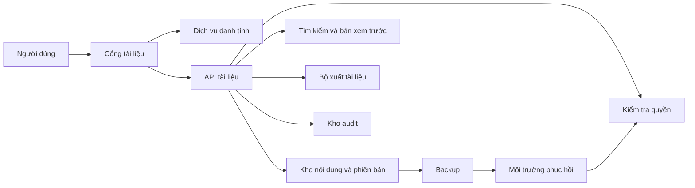

# Dữ liệu nội bộ

## 1. Mục tiêu bài học

Dữ liệu nội bộ là thông tin phục vụ hoạt động của tổ chức, được cung cấp cho những đối tượng đã được xác định và chưa được phê duyệt để công bố rộng rãi. Ví dụ có thể là hướng dẫn sử dụng công cụ nội bộ, lịch bảo trì thông thường hoặc tài liệu phối hợp công việc không chứa thông tin nhạy cảm hơn.

Trong chương **Phân loại dữ liệu** của module yêu cầu bảo mật, điều cần học không chỉ là gắn nhãn “nội bộ”. Nhãn phải dẫn đến quyết định cụ thể: ai được đọc, ai được sửa, có được chuyển ra ngoài hay không, hệ thống phải ghi lại điều gì và dữ liệu được phục hồi như thế nào.

Sau bài học, bạn có thể:

- Phân biệt dữ liệu nội bộ với dữ liệu công khai và dữ liệu cần bảo vệ ở mức cao hơn.
- Xác định chủ sở hữu, đối tượng được phép sử dụng và ranh giới chia sẻ.
- Đặc tả yêu cầu về xác thực, phân quyền, lưu trữ, truyền tải, ghi nhật ký và phục hồi.
- Liên kết yêu cầu với rủi ro, thành phần kiến trúc và tiêu chí kiểm thử.
- Xử lý bản sao, bản xuất, thông tin tổng hợp và thay đổi phân loại trong vòng đời dữ liệu.

Tên mức phân loại và các ngưỡng thời gian trong bài là **quy ước minh họa**. Tổ chức cần xác nhận chúng theo mục tiêu nghiệp vụ, tác động và mô hình đe dọa của mình.

## 2. Hiểu đúng nhãn “nội bộ”

### 2.1. Nội bộ không có nghĩa là mọi nhân viên đều được truy cập

“Nội bộ” mô tả một mức phân loại và phạm vi sử dụng dự kiến. Nó chưa trả lời đầy đủ câu hỏi ai có quyền trên từng tài liệu.

Một tổ chức có thể cho toàn bộ nhân viên đang làm việc đọc hướng dẫn đặt phòng họp, nhưng chỉ cho nhóm vận hành đọc tài liệu xử lý công việc của nhóm. Cả hai có thể được phân loại nội bộ nếu nội dung và tác động phù hợp, trong khi tập người được đọc khác nhau.

Cần tách hai thông tin:

- **Mức phân loại:** dữ liệu thuộc mức nào, cần nhóm biện pháp bảo vệ nào.
- **Phạm vi truy cập:** người, nhóm hoặc danh tính dịch vụ nào được thực hiện hành động nào trên dữ liệu cụ thể.

Nhân viên đã đăng nhập nhưng không thuộc nhóm được cấp quyền vẫn phải bị từ chối. Mạng văn phòng, địa chỉ email cùng miền hoặc một đường dẫn khó đoán không tự chứng minh quyền truy cập.

### 2.2. Nội bộ không phải nhãn cho mọi thứ chưa công khai

Thông tin chưa công bố có thể cần bảo vệ rất khác nhau. Một bản nháp thông báo bảo trì thông thường khác với thông tin xác thực quản trị, báo cáo lỗ hổng chưa xử lý hay hồ sơ đánh giá cá nhân.

Ví dụ về một hệ phân loại đơn giản:

| Mức minh họa | Phạm vi sử dụng | Ví dụ có điều kiện |
| --- | --- | --- |
| Công khai | Đã được phê duyệt để cung cấp rộng rãi | Hướng dẫn sử dụng sản phẩm đã công bố |
| Nội bộ | Phục vụ hoạt động tổ chức, giới hạn theo đối tượng được phép | Hướng dẫn dùng công cụ nội bộ không chứa bí mật hoặc dữ liệu cá nhân nhạy cảm |
| Bảo mật | Chỉ một phạm vi cần biết, hậu quả tiết lộ đáng kể | Kế hoạch thương mại chưa công bố, báo cáo sự cố có chi tiết nhạy cảm |
| Hạn chế nghiêm ngặt | Phạm vi rất hẹp và yêu cầu kiểm soát mạnh | Khóa bí mật, thông tin xác thực có quyền cao |

Đây không phải hệ phân loại bắt buộc cho mọi tổ chức. Quyết định thực tế phải dựa trên nội dung, mục đích, hậu quả và chính sách đã được xác nhận.

Không tự xếp toàn bộ thư điện tử, mã nguồn, danh sách nhân sự hoặc tài liệu họp vào mức nội bộ. Mỗi nhóm có thể chứa dữ liệu cần mức bảo vệ cao hơn.

### 2.3. Phân loại không chỉ xét hậu quả bị đọc trộm

Dữ liệu nội bộ thường được nhận diện trước tiên qua giới hạn công bố, nhưng tính toàn vẹn và sẵn sàng cũng quan trọng.

Ví dụ, hướng dẫn thao tác vận hành không chứa bí mật có thể được xếp nội bộ về phạm vi tiết lộ. Tuy nhiên, nếu bị sửa sai, nó có thể khiến người vận hành thực hiện thao tác gây gián đoạn. Tài liệu đó cần kiểm soát sửa đổi mạnh hơn một lịch họp thông thường.

Cần ghi riêng:

- Tác động khi người không có quyền đọc được nội dung.
- Tác động khi nội dung hoặc phiên bản bị sửa trái phép.
- Tác động khi người có quyền không tìm được hoặc không truy cập được thông tin đúng lúc.

Một nhãn “INTERNAL” không nên làm mất các khác biệt này.

## 3. Nhận diện dữ liệu phù hợp với mức nội bộ

### 3.1. Các câu hỏi phân loại

Khi tiếp nhận một tập dữ liệu hoặc tài liệu, chủ sở hữu cần trả lời:

1. Dữ liệu phục vụ hoạt động gì?
2. Những đối tượng nào cần sử dụng, với hành động nào?
3. Nội dung đã được phê duyệt công bố rộng rãi hay chưa?
4. Có thông tin xác thực, dữ liệu cá nhân, chi tiết an ninh hoặc bí mật kinh doanh không?
5. Nếu người ngoài nhận được, hậu quả cụ thể là gì?
6. Nếu bị sửa hoặc không còn truy cập được, quy trình nào bị ảnh hưởng?
7. Dữ liệu có nguồn gốc từ tài liệu được phân loại cao hơn không?
8. Khi kết hợp nhiều phần, thông tin tổng hợp có nhạy cảm hơn từng phần không?

Chỉ lựa chọn mức nội bộ khi có đủ căn cứ rằng mức này phù hợp. Nếu chưa rõ nội dung hoặc tác động, cần ghi nhận trạng thái chờ xác minh và giới hạn xử lý theo chính sách tạm thời đã xác định; không tự coi dữ liệu chưa có nhãn là nội bộ.

### 3.2. Ví dụ và trường hợp cần đánh giá lại

| Nội dung | Khi nào có thể là nội bộ? | Điều gì có thể làm thay đổi phân loại? |
| --- | --- | --- |
| Hướng dẫn dùng hệ thống đặt phòng | Chỉ mô tả thao tác thông thường | Có tài khoản dùng chung, mã truy cập hoặc dữ liệu nhân viên không cần thiết |
| Lịch bảo trì | Chỉ nêu thời gian và kênh hỗ trợ | Bổ sung chi tiết điểm yếu hoặc kế hoạch vô hiệu hóa kiểm soát |
| Biên bản họp phối hợp | Chỉ chứa phân công công việc thông thường | Có đánh giá nhân sự, giao dịch hoặc sự cố nhạy cảm |
| Mẫu báo cáo nội bộ | Dùng dữ liệu giả hoặc thông tin ít nhạy cảm | Chèn dữ liệu thật có phạm vi sử dụng hẹp hơn |
| Tài liệu hướng dẫn xử lý yêu cầu | Mô tả quy trình, không chứa dữ liệu khách hàng | Đính kèm hồ sơ thật, ảnh màn hình hoặc log có dữ liệu riêng tư |
| Thống kê sử dụng công cụ | Đã đánh giá mức chi tiết và nhóm người nhận | Có khả năng suy ra hành vi của cá nhân hoặc kế hoạch chưa công bố |

Tên tài liệu chỉ là gợi ý. Một tệp có tên “huong-dan-noi-bo.pdf” vẫn có thể chứa nội dung không phù hợp với mức nội bộ.

### 3.3. Chủ sở hữu và người quản trị có vai trò khác nhau

**Chủ sở hữu dữ liệu** chịu trách nhiệm về mục đích, phân loại, đối tượng sử dụng và quyết định công bố. **Người quản trị hệ thống** triển khai quyền truy cập, lưu trữ, nhật ký và phục hồi theo yêu cầu đã được xác nhận.

Quyền quản trị kỹ thuật không tự đồng nghĩa với quyền sử dụng dữ liệu cho mọi mục đích. Những trường hợp người quản trị cần đọc nội dung để hỗ trợ phải có phạm vi và dấu vết phù hợp.

Người tạo tài liệu có thể đề xuất phân loại, nhưng quyết định hạ mức hoặc công bố cần tuân theo thẩm quyền đã xác định.

## 4. Hồ sơ phân loại đủ để tạo yêu cầu

Một hồ sơ ngắn nhưng rõ giúp tránh việc các nhóm hiểu nhãn nội bộ theo cách khác nhau.

| Trường | Ví dụ minh họa | Mục đích |
| --- | --- | --- |
| Mã tập dữ liệu | DATA-INT-01 | Liên kết với rủi ro, yêu cầu và kiểm thử |
| Tên và mục đích | Thư viện hướng dẫn vận hành công cụ học tập | Xác định nhu cầu sử dụng |
| Chủ sở hữu | Nhóm vận hành đào tạo | Xác định người phê duyệt phạm vi và thay đổi |
| Mức phân loại | INTERNAL | Chọn quy tắc xử lý nền tảng |
| Phạm vi nội dung | Hướng dẫn thao tác; loại trừ khóa, mật khẩu và hồ sơ học viên | Tránh đưa dữ liệu ngoài phạm vi vào cùng mức |
| Đối tượng đọc | Nhóm cộng tác viên vận hành đang có hiệu lực | Xác định tập người được cấp quyền |
| Đối tượng sửa | Nhóm biên tập được chỉ định | Tách quyền đọc và thay đổi |
| Đối tượng duyệt | Chủ sở hữu hoặc người được ủy quyền | Kiểm soát nội dung có tác động nghiệp vụ |
| Chia sẻ bên ngoài | Không bật trong luồng thông thường | Xác định hành vi cần từ chối |
| Hệ thống xử lý | Cổng tài liệu, kho tệp, chỉ mục tìm kiếm | Bao phủ các nơi lưu và cung cấp nội dung |
| Tác động toàn vẹn | Cao với hướng dẫn thao tác quan trọng | Chọn yêu cầu phiên bản và phê duyệt |
| Mục tiêu phục hồi | Theo mục tiêu đã xác nhận cho dịch vụ tài liệu | Gắn dữ liệu với nhu cầu sẵn sàng |
| Chính sách lưu giữ | Theo loại tài liệu và phiên bản | Xác định khi nào giữ, lưu trữ hoặc xóa |
| Điều kiện rà soát | Thay đổi nội dung, nhóm nhận hoặc mục đích sử dụng | Kích hoạt đánh giá lại |

Thời hạn lưu giữ không tự suy ra từ nhãn nội bộ. Hướng dẫn còn hiệu lực và thông báo hết giá trị có thể cùng mức phân loại nhưng cần thời gian giữ khác nhau.

Một nhãn và phạm vi truy cập có thể được biểu diễn bằng siêu dữ liệu như sau:

```json
{
  "datasetId": "DATA-INT-01",
  "classification": "INTERNAL",
  "ownerGroup": "training-operations",
  "readerGroups": ["operations-collaborators"],
  "editorGroups": ["guide-editors"],
  "externalSharing": false,
  "retentionPolicyId": "INTERNAL-GUIDE-V1"
}
```

Đây là ví dụ mô tả dữ liệu chính sách. Nhãn không tự ngăn truy cập. Hệ thống phải xác thực người dùng, lấy nhóm quyền từ nguồn đáng tin cậy và kiểm tra quyền tại điểm cung cấp nội dung. Không tin các trường do trình duyệt tự gửi lên để quyết định quyền.

## 5. Quy tắc xử lý trong vòng đời dữ liệu

### 5.1. Tạo mới và tiếp nhận

Người tạo cần chọn loại dữ liệu, chủ sở hữu và phạm vi sử dụng. Nếu tài liệu được sao chép từ nguồn có phân loại cao hơn, không tự hạ mức chỉ vì chuyển sang thư mục nội bộ.

Đối với dữ liệu nhập từ bên ngoài, cần xác định nguồn gốc và quyền sử dụng trước khi chia sẻ lại. Nếu thiếu thông tin phân loại, hệ thống phải có luồng xử lý rõ: ví dụ lưu vào vùng chờ chỉ người gửi và người phân loại được chỉ định truy cập.

Một giá trị mặc định có thể hỗ trợ thao tác, nhưng không thay thế đánh giá nội dung.

### 5.2. Lưu trữ và truy cập

Dữ liệu nội bộ nên nằm trong hệ thống mà tổ chức quản lý được danh tính, quyền truy cập và vòng đời. Yêu cầu có thể bao gồm:

- Chặn truy cập ẩn danh trên API, kho tệp và đường tải xuống.
- Phân quyền theo nhóm và hành động; giới hạn quyền sửa, xóa, xuất dữ liệu.
- Bảo vệ đường truyền và dữ liệu lưu trữ theo chính sách đã xác nhận.
- Quản lý khóa và bí mật tách khỏi nội dung tài liệu.
- Kiểm soát bản sao lưu, tệp tạm, bản xem trước và chỉ mục tìm kiếm.

Mã hóa không thay thế phân quyền. Người dùng không có quyền vẫn phải bị từ chối dù dữ liệu được lưu trên ổ đĩa đã mã hóa.

### 5.3. Chia sẻ và cộng tác

Một yêu cầu chia sẻ phải xác định được người nhận, mục đích, phạm vi dữ liệu và thời hạn nếu cần. Có thể có cộng tác viên bên ngoài được ủy quyền, nhưng họ cần danh tính và quyền phù hợp với chính sách; địa chỉ email của đối tác không tự tạo quyền.

Trước khi bật một đường chia sẻ mới, cần quyết định:

- Cho phép gửi bản sao hay chỉ cho phép truy cập qua cổng tài liệu?
- Người nhận có quyền tải xuống hoặc xuất hàng loạt không?
- Liên kết có kiểm tra lại danh tính và quyền tại mỗi lần sử dụng không?
- Khi quyền bị thu hồi, các liên kết, phiên và bản cache chịu kiểm soát của hệ thống xử lý ra sao?
- Có dấu vết ai cấp quyền và dữ liệu nào đã được chia sẻ không?

Sau khi người dùng đã tải một bản sao ra thiết bị, hệ thống nguồn thường không thể bảo đảm thu hồi bản sao đó chỉ bằng cách xóa quyền trên máy chủ. Yêu cầu phải nêu đúng phạm vi kiểm soát và xem xét giới hạn tải xuống khi rủi ro đòi hỏi.

### 5.4. Sử dụng trong công cụ khác

Dữ liệu có thể rời hệ thống qua nhiều thao tác thông thường: gửi email, dán vào công cụ hỗ trợ, đính kèm phiếu hỗ trợ, tải lên công cụ AI hoặc đồng bộ đến ứng dụng cá nhân.

Đối với mỗi công cụ, cần xác định:

- Công cụ có được phép xử lý mức dữ liệu này không?
- Ai có thể truy cập dữ liệu sau khi gửi?
- Dữ liệu được giữ và xóa như thế nào?
- Có tạo thêm bản sao, chỉ mục hoặc dữ liệu dùng cho mục đích khác không?
- Chủ sở hữu có cho phép phạm vi sử dụng đó không?

Không suy ra công cụ được phép chỉ từ việc người dùng có thể đăng nhập bằng tài khoản công ty.

### 5.5. Lưu giữ, xóa và phục hồi

Yêu cầu lưu giữ phải gắn với loại tài liệu, mục đích và phiên bản. Khi xóa, cần xem xét cả nội dung chính, tệp đính kèm, bản xem trước, chỉ mục và các bản sao do hệ thống quản lý.

Backup có thể có lịch hết hạn riêng. Không tuyên bố xóa tức thời khỏi mọi backup nếu hệ thống không hỗ trợ. Thay vào đó, phải đặc tả cách hạn chế sử dụng, thời điểm hết hạn và cách xử lý dữ liệu đã xóa nếu phục hồi bản sao cũ.

Phục hồi phải áp dụng lại quyền hiện hành. Không để việc khôi phục phiên bản cũ làm sống lại tài khoản đã nghỉ việc, liên kết đã thu hồi hoặc quyền đã bị loại bỏ.

## 6. Các nơi dễ bị bỏ sót

### 6.1. Tìm kiếm, tiêu đề và bản xem trước

Không chỉ nội dung đầy đủ mới có giá trị. Tiêu đề, đoạn trích, tên tệp, danh sách kết quả và tổng số tài liệu cũng có thể tiết lộ thông tin.

Nếu một người không có quyền đọc tài liệu, yêu cầu phải xác định họ có được biết tài liệu tồn tại hay không. Với thư viện trong ví dụ, người ngoài phạm vi không được thấy tiêu đề hoặc đoạn trích của tài liệu đó.

Việc ẩn kết quả trong giao diện là chưa đủ. API tìm kiếm, API xem trước và đường tải tệp phải thực thi cùng chính sách.

### 6.2. Cache và bản sao tạm

Một tài liệu được bảo vệ ở máy chủ gốc vẫn có thể bị cung cấp sai qua cache dùng chung. Cần xác định cache nào được phép giữ nội dung, khóa phân biệt quyền truy cập và cách hết hạn hoặc vô hiệu hóa khi quyền thay đổi.

Không dùng chỉ tên tệp làm khóa cache nếu nhiều người dùng có quyền khác nhau đối với cùng đường dẫn. Chính sách cache phải phù hợp với khả năng kiểm tra quyền và mục tiêu thu hồi đã đặt.

### 6.3. Bản xuất và dữ liệu tổng hợp

Bản xuất là một đối tượng dữ liệu mới cần được kiểm soát. Tệp xuất chứa nhiều tài liệu nội bộ có thể tạo tác động lớn hơn từng tài liệu riêng lẻ.

Quy tắc phù hợp là:

- Giữ phân loại và giới hạn sử dụng tương ứng với nội dung nguồn.
- Khi trộn nhiều mức, mặc định bảo vệ theo mức cần thiết cao nhất của các phần được chứa, trừ khi đã có quy trình đánh giá và tạo bản giảm nhạy cảm được phê duyệt.
- Đánh giá lại khi việc tổng hợp làm tăng khả năng suy luận hoặc phạm vi ảnh hưởng.
- Phân quyền riêng cho thao tác xuất hàng loạt nếu hậu quả khác với đọc từng tài liệu.

Loại bỏ nhãn khỏi tệp không làm nội dung trở thành công khai. Ngược lại, chỉ xóa một vài trường cũng chưa chứng minh một bản tổng hợp đã đủ an toàn để công bố.

### 6.4. Nhật ký và dữ liệu giám sát

Log có thể vô tình trở thành bản sao của dữ liệu nội bộ. Không mặc định ghi toàn bộ nội dung tài liệu, truy vấn, tiêu đề nhạy cảm hoặc tham số chứa token.

Nên ưu tiên mã tài liệu, mã sự kiện, danh tính, hành động và kết quả đủ cho điều tra. Nếu cần ghi thêm trường, phải xác định mục đích, phạm vi truy cập và thời hạn lưu.

## 7. Ví dụ xuyên suốt: cổng tài liệu vận hành đào tạo

### 7.1. Bối cảnh và giả định

Một nền tảng học tập có cổng tài liệu phục vụ nhân viên và cộng tác viên vận hành được cấp quyền. Cổng chứa hướng dẫn sử dụng công cụ, phân công vận hành thông thường và lịch bảo trì. Nội dung này chưa được phê duyệt công bố.

Tổ chức xác định:

- Mã dữ liệu: **DATA-INT-01**.
- Phân loại: **INTERNAL**.
- Nhóm được đọc: thành viên đang có hiệu lực trong nhóm vận hành tương ứng.
- Nhóm được sửa: biên tập viên được chỉ định.
- Các hướng dẫn thao tác quan trọng cần người duyệt trước khi có hiệu lực.
- Khóa, mật khẩu, hồ sơ học viên và báo cáo sự cố nhạy cảm không thuộc phạm vi tập dữ liệu này.
- Hệ thống không bật chia sẻ ẩn danh hoặc chia sẻ cho bên ngoài trong luồng thông thường.

Các ngưỡng minh họa được xác nhận cho tình huống này:

| Nội dung | Mục tiêu minh họa |
| --- | --- |
| Thu hồi quyền | Chậm nhất 15 phút từ khi thay đổi có hiệu lực ở nguồn danh tính và quyền được chỉ định |
| Chuyển sự kiện audit về kho trung tâm | Chậm nhất 5 phút sau thao tác |
| Phục hồi dữ liệu | RPO không quá 24 giờ |
| Phục hồi dịch vụ tài liệu | RTO không quá 4 giờ trong kịch bản diễn tập đã xác định |

**RPO** thể hiện mục tiêu về khoảng dữ liệu có thể mất trước sự cố. **RTO** thể hiện mục tiêu về thời gian khôi phục dịch vụ theo mốc bắt đầu và kết thúc đã thống nhất. Đây là các mục tiêu riêng biệt, không phải cam kết tự động suy ra từ việc đã bật backup.

### 7.2. Kiến trúc liên quan



Trong kiến trúc này, nội dung, tìm kiếm, xuất dữ liệu và phục hồi đều phải dùng cùng ý nghĩa của phân loại và quyền. Đường tải tệp trực tiếp cũng phải được kiểm soát, dù sơ đồ không vẽ từng endpoint.

## 8. Liên kết với mô hình đe dọa

Những rủi ro cần nêu bằng hành động và hậu quả cụ thể:

| Mã | Kịch bản đe dọa | Hậu quả |
| --- | --- | --- |
| R-INT-01 | Người ngoài có liên kết và gọi trực tiếp API hoặc kho tệp | Đọc tài liệu chưa được phép công bố |
| R-INT-02 | Nhân viên dùng mã tài liệu của nhóm khác để truy cập | Vượt phạm vi công việc được giao |
| R-INT-03 | Người đã bị thu hồi quyền tiếp tục dùng phiên cũ hoặc bản cache của hệ thống | Truy cập kéo dài sau khi quyền không còn hiệu lực |
| R-INT-04 | Người chỉ có quyền đọc sửa hướng dẫn hoặc phát hành phiên bản chưa duyệt | Nội dung sai được dùng trong vận hành |
| R-INT-05 | Bộ tìm kiếm hoặc bản xem trước không kiểm tra quyền như API chính | Lộ nội dung qua tiêu đề, đoạn trích hoặc ảnh xem trước |
| R-INT-06 | Chức năng xuất cho phép gom dữ liệu ngoài phạm vi quyền của người gọi | Lộ nhiều tài liệu trong một thao tác |
| R-INT-07 | Thao tác thay quyền không có bằng chứng hoặc log chứa toàn bộ nội dung | Khó điều tra hoặc tạo thêm nơi rò rỉ dữ liệu |
| R-INT-08 | Phục hồi bản sao cũ khôi phục cả quyền đã thu hồi | Tái mở truy cập ngoài phạm vi hiện hành |
| R-INT-09 | Dữ liệu cần bảo vệ cao hơn bị lưu dưới nhãn nội bộ | Áp dụng kiểm soát thấp hơn mức cần thiết |

Nhãn nội bộ là đầu vào để đặt quy tắc. Rủi ro phụ thuộc vào các đường tiếp cận, hành động và khả năng thực thi quy tắc trong kiến trúc thực tế.

## 9. Đặc tả yêu cầu bảo mật có thể kiểm chứng

### 9.1. Mẫu yêu cầu

Một yêu cầu nên chứa:

> Với [phạm vi dữ liệu], [thành phần hoặc chủ thể] phải [hành vi] khi [điều kiện], đạt [kết quả hoặc ngưỡng]. Kiểm chứng bằng [phép thử] và lưu [bằng chứng].

Cần bổ sung mã yêu cầu, lý do, rủi ro liên quan, nhóm thực hiện và người chấp nhận kết quả.

“Chỉ người nội bộ được xem” chưa đủ rõ vì không định nghĩa danh tính hợp lệ, nhóm quyền, đường truy cập hoặc thời gian thu hồi.

### 9.2. SEC-INT-01 — Xác thực và quyền đọc

Mọi yêu cầu đọc DATA-INT-01 qua giao diện, API, tìm kiếm, xem trước, xuất hoặc tải tệp phải có danh tính đã được xác thực và quyền đọc còn hiệu lực đối với tài liệu đích. Nhóm quyền phải lấy từ nguồn có thẩm quyền; hệ thống không sử dụng nhãn hoặc danh sách nhóm do máy khách tự khai làm bằng chứng cấp quyền.

- Rủi ro: R-INT-01, R-INT-02, R-INT-05.
- Thực hiện: dịch vụ danh tính, lớp kiểm tra quyền và mọi điểm cung cấp nội dung.
- Kiểm thử: người chưa đăng nhập, người thuộc nhóm khác và người giả mạo trường nhóm trong yêu cầu đều không nhận được nội dung, tiêu đề hoặc đoạn trích bị bảo vệ.
- Kiểm thử chiều hợp lệ: người có quyền đọc nhận đúng tài liệu, không bị cấp thêm quyền sửa.
- Bằng chứng: ma trận vai trò, cấu hình tích hợp danh tính và kết quả thử trên từng đường truy cập.

Chính sách xác thực cần nêu thêm điều kiện MFA nếu áp dụng, thời hạn phiên và cách kiểm tra trạng thái tài khoản. Những điều kiện này phải được quyết định rõ theo bối cảnh, không suy ra chỉ từ chữ “nội bộ”.

### 9.3. SEC-INT-02 — Thu hồi quyền trong giới hạn thời gian

Sau khi một người bị loại khỏi nhóm được đọc DATA-INT-01 tại nguồn danh tính và quyền được chỉ định, mọi đường truy cập do hệ thống quản lý phải ngừng cung cấp dữ liệu cho người đó trong tối đa 15 phút.

Yêu cầu bao phủ phiên đang hoạt động, token còn thời hạn, cache quyền, tìm kiếm, xem trước, xuất dữ liệu và liên kết tải xuống. Nếu có công việc xuất đang chạy, hệ thống phải kiểm tra lại quyền trước khi cung cấp kết quả.

- Rủi ro: R-INT-03.
- Thực hiện: cơ chế kiểm tra quyền hiện hành, quản lý phiên, cache và cấp liên kết.
- Kiểm thử: đăng nhập, truy cập thành công, ghi mốc thu hồi tại nguồn có thẩm quyền rồi thử lại qua tất cả các đường truy cập bằng phiên cũ.
- Kết quả đạt: không đường nào còn cung cấp dữ liệu sau giới hạn 15 phút.
- Bằng chứng: mốc thời gian, kết quả truy cập và cấu hình thời hạn liên quan.

Thời hạn token 15 phút tự nó chưa chứng minh đạt yêu cầu. Cần tính cả độ trễ đồng bộ, cache và cách kiểm tra quyền ở các thành phần. Yêu cầu này không cam kết xóa được tệp mà người dùng đã tải về trước khi bị thu hồi.

### 9.4. SEC-INT-03 — Ngăn công khai và chia sẻ sai phạm vi

DATA-INT-01 không được cung cấp qua truy cập ẩn danh, kho tệp công khai hoặc liên kết chỉ dựa vào việc sở hữu URL. Trong luồng thông thường, người dùng không được cấp quyền cho danh tính nằm ngoài tập đối tượng đã phê duyệt.

- Rủi ro: R-INT-01, R-INT-06.
- Thực hiện: chính sách chia sẻ, kho tệp, API xuất và cơ chế tải xuống.
- Kiểm thử: sao chép URL sang phiên không có quyền; gọi thẳng đường tải; thử cấp quyền cho một danh tính ngoài tập được phép.
- Kết quả đạt: không đọc được dữ liệu và thao tác cấp quyền không được phép bị từ chối.
- Bằng chứng: chính sách chia sẻ, cấu hình kho và kết quả kiểm thử.
- Nếu có nhu cầu chia sẻ ngoài phạm vi, phải đi qua luồng ngoại lệ hoặc tạo bản được phê duyệt công bố; không tự đổi nhãn để bỏ qua kiểm soát.

### 9.5. SEC-INT-04 — Bảo vệ dữ liệu khi lưu và truyền

Nội dung chính, tệp đính kèm, bản xuất và bản sao lưu của DATA-INT-01 phải được lưu trong hệ thống được phê duyệt, bật cơ chế mã hóa theo chính sách mật mã của tổ chức. Các kết nối truyền dữ liệu trong phạm vi phải được bảo vệ theo cùng chính sách và xác thực đúng đầu nhận.

- Rủi ro: lộ dữ liệu từ phương tiện lưu trữ hoặc đường truyền.
- Thực hiện: cấu hình lưu trữ, kết nối, chứng thư và quản lý khóa.
- Kiểm thử: kiểm tra trạng thái mã hóa của từng nơi lưu; thử đường truy cập không đáp ứng chính sách truyền tải; xác minh ứng dụng không chấp nhận đầu nhận không hợp lệ.
- Bằng chứng: danh sách nơi lưu, cấu hình hiệu lực và kết quả thử.
- Chỉ có ảnh chụp tùy chọn “bật mã hóa” ở kho chính chưa đủ nếu bản xuất hoặc backup nằm ngoài phạm vi kiểm tra.

### 9.6. SEC-INT-05 — Kiểm soát sửa và phát hành phiên bản

Chỉ biên tập viên được chỉ định mới được sửa DATA-INT-01. Với tài liệu được đánh dấu cần duyệt, bản sửa không được trở thành phiên bản có hiệu lực trước khi có quyết định duyệt của vai trò có thẩm quyền. Mỗi phiên bản phải có định danh, người thực hiện và thời điểm thay đổi.

- Rủi ro: R-INT-04.
- Thực hiện: API sửa nội dung, kho phiên bản và luồng duyệt.
- Kiểm thử: người chỉ có quyền đọc thử sửa; biên tập viên thử đưa bản cần duyệt thành có hiệu lực mà chưa được duyệt.
- Kết quả đạt: các thao tác đó bị từ chối; phiên bản hợp lệ vẫn được truy cập theo quyền.
- Bằng chứng: lịch sử phiên bản, quyết định duyệt và kết quả thử quyền.
- Tổ chức phải xác định trường hợp nào cần người duyệt khác người sửa nếu rủi ro đòi hỏi tách nhiệm vụ.

### 9.7. SEC-INT-06 — Audit đủ dùng và hạn chế dữ liệu ghi log

Các thao tác tạo, sửa, xóa, xuất, đổi phân loại và đổi quyền của DATA-INT-01 phải tạo sự kiện audit chứa danh tính, mã tài liệu hoặc tác vụ xuất, hành động, thời điểm và kết quả. Sự kiện phải có tại kho audit trung tâm trong tối đa 5 phút.

Không ghi toàn bộ nội dung, token hoặc bí mật vào sự kiện audit. Người biên tập tài liệu không được sửa hoặc xóa log đã thu thập. Khi không thể chuyển tiếp sự kiện, phải có cơ chế đệm và cảnh báo được đặc tả phù hợp.

- Rủi ro: R-INT-07.
- Thực hiện: nguồn sự kiện, bộ chuyển tiếp và kho audit.
- Kiểm thử: thực hiện thao tác thành công và bị từ chối; đối chiếu sự kiện, đo độ trễ và thử sửa log bằng tài khoản biên tập.
- Kiểm tra dữ liệu log: dùng nội dung tổng hợp có chuỗi đánh dấu để xác nhận nội dung tài liệu không bị sao chép vào các trường không được phép.
- Bằng chứng: sự kiện đã che thông tin cần thiết, kết quả đo và chính sách truy cập kho log.

Đối với sự kiện đọc tài liệu, tổ chức cần xác định rõ mức ghi nhận cần thiết theo rủi ro và năng lực vận hành. Không mặc định ghi mọi nội dung đọc hoặc truy vấn chỉ vì dữ liệu được gắn nhãn nội bộ.

### 9.8. SEC-INT-07 — Phục hồi có dữ liệu và quyền đúng

Trong kịch bản diễn tập đã thống nhất, DATA-INT-01 phải được phục hồi với RPO không quá 24 giờ và dịch vụ tài liệu phải đạt RTO không quá 4 giờ. Trong ví dụ, RTO được đo từ lúc công bố sự cố đến khi người có quyền đọc được phiên bản phục hồi đã kiểm tra và quyền truy cập hiện hành được áp dụng.

Trước khi mở lại dịch vụ, phải đối chiếu quyền với nguồn hiện hành và xử lý danh sách tài liệu đã xóa hoặc bị giới hạn lại. Không dùng nguyên trạng quyền trong backup làm quyền có hiệu lực nếu chúng đã thay đổi.

- Rủi ro: R-INT-08 và mất khả năng sử dụng tài liệu.
- Thực hiện: backup, môi trường phục hồi, đồng bộ quyền và quy trình mở dịch vụ.
- Kiểm thử: tạo tài liệu mẫu có mốc thời gian; thay đổi quyền và xóa một tài liệu theo quy trình; phục hồi từ bản sao trước các thay đổi.
- Kết quả đạt: khoảng dữ liệu mất và thời gian phục hồi nằm trong giới hạn; tài khoản đã bị thu hồi không đọc được; tài liệu đã xóa được xử lý đúng quy tắc trước khi phục vụ.
- Bằng chứng: biên bản diễn tập, mốc thời gian, kết quả kiểm tra nội dung và ma trận quyền sau phục hồi.

### 9.9. SEC-INT-08 — Kiểm soát đổi phân loại và tạo bản công khai

Mọi thay đổi làm giảm mức bảo vệ hoặc mở rộng đối tượng của DATA-INT-01 phải có quyết định của chủ sở hữu hoặc vai trò được ủy quyền, ghi nhận phiên bản được xét và lý do. Bản công khai phải được tạo qua luồng duyệt công bố, có kiểm tra nội dung và điểm phân phối riêng được quản lý.

- Rủi ro: R-INT-09 và công bố trái phép.
- Thực hiện: quản lý siêu dữ liệu, quy trình phê duyệt và điểm phát hành.
- Kiểm thử: người không có thẩm quyền thử hạ mức; người có thẩm quyền thử phát hành khi chưa đủ điều kiện duyệt.
- Kết quả đạt: không phát hành được ngoài quy trình; quyết định hợp lệ gắn được với đúng phiên bản.
- Bằng chứng: sự kiện đổi mức, bản duyệt và phiên bản đã công bố.

## 10. Bảng truy vết yêu cầu

Bảng truy vết giúp một yêu cầu không bị tách rời khỏi lý do và nơi thực thi.

| Yêu cầu | Rủi ro chính | Điểm kiến trúc | Bằng chứng chấp nhận |
| --- | --- | --- | --- |
| SEC-INT-01 | R-INT-01, R-INT-02, R-INT-05 | Danh tính, kiểm tra quyền, các API cung cấp dữ liệu | Ma trận thử quyền theo vai trò, tài liệu và đường truy cập |
| SEC-INT-02 | R-INT-03 | Phiên, cache quyền, liên kết, tác vụ xuất | Kết quả đo thu hồi đầu cuối trong 15 phút |
| SEC-INT-03 | R-INT-01, R-INT-06 | Chia sẻ, kho tệp, tải và xuất | Truy cập ẩn danh và cấp quyền sai phạm vi bị từ chối |
| SEC-INT-04 | Lộ dữ liệu lưu trữ hoặc truyền tải | Các kho, backup, kết nối và khóa | Cấu hình hiệu lực và thử kết nối không hợp lệ |
| SEC-INT-05 | R-INT-04 | Kho phiên bản và luồng duyệt | Người đọc không sửa được, bản chưa duyệt không có hiệu lực |
| SEC-INT-06 | R-INT-07 | Thu thập và lưu audit | Sự kiện đủ trường, đúng độ trễ, không chứa nội dung ngoài phạm vi |
| SEC-INT-07 | R-INT-08, mất dữ liệu | Backup và môi trường phục hồi | Diễn tập đạt RPO/RTO và áp dụng quyền hiện hành |
| SEC-INT-08 | R-INT-09 | Phân loại và công bố | Quyết định gắn phiên bản, thử hạ mức trái phép bị từ chối |

Tùy hệ thống, một yêu cầu có thể được chia thành nhiều yêu cầu nhỏ để giao cho các nhóm. Khi chia, vẫn phải giữ điều kiện đạt ở cấp đầu cuối, chẳng hạn thời gian thu hồi qua toàn bộ đường đọc.

## 11. Kiểm thử theo đối tượng và đường truy cập

Không chỉ kiểm tra nút hiển thị trên giao diện. Một ma trận kiểm thử tối thiểu cho ví dụ có thể như sau:

| Đối tượng | Đọc tài liệu được giao | Đọc tài liệu ngoài phạm vi | Sửa nội dung | Thay đổi quyền |
| --- | --- | --- | --- | --- |
| Chưa xác thực | Từ chối | Từ chối | Từ chối | Từ chối |
| Người đọc đúng nhóm | Cho phép | Từ chối | Từ chối | Từ chối |
| Biên tập viên được chỉ định | Theo phạm vi được cấp | Từ chối nếu không được cấp | Cho phép trong phạm vi | Từ chối nếu không có vai trò riêng |
| Người đã bị thu hồi quyền | Từ chối sau giới hạn thu hồi | Từ chối | Từ chối | Từ chối |
| Chủ sở hữu hoặc người quản lý quyền | Theo phạm vi được cấp | Theo phạm vi được cấp | Theo quyền riêng | Cho phép trong thẩm quyền |

Áp dụng ma trận này cho:

- Trang chi tiết và API đọc.
- Tệp đính kèm và đường tải trực tiếp.
- Kết quả tìm kiếm, đoạn trích và bản xem trước.
- Chức năng xuất và liên kết tải kết quả.
- Phiên cũ sau khi thay đổi quyền.
- Môi trường sau phục hồi.

Phép thử phải dùng dữ liệu tổng hợp, có cả thao tác hợp lệ và không hợp lệ. Kết quả bị từ chối cần được kiểm tra cả phản hồi lẫn việc không rò rỉ nội dung qua trường phụ.

## 12. Duy trì phân loại trong vòng đời phát triển

### 12.1. Trong giai đoạn thiết kế

Xác định nơi lưu, nơi biến đổi, ai nhận dữ liệu và các đường xuất. Chọn phương án kiến trúc có thể kiểm tra quyền nhất quán, đồng bộ thu hồi và áp dụng lại chính sách khi phục hồi.

Nếu hệ thống tạo liên kết tải không kiểm tra danh tính, cần giải quyết sự không phù hợp đó ngay khi thiết kế yêu cầu chia sẻ.

### 12.2. Trong giai đoạn xây dựng

Gắn mã yêu cầu với chức năng cung cấp dữ liệu. Thay đổi thêm endpoint, chỉ mục tìm kiếm, cache hoặc công cụ xuất cần được xem là thay đổi bề mặt truy cập.

Siêu dữ liệu phân loại phải được bảo vệ khỏi sửa trái phép. Không chỉ hiển thị nhãn ở giao diện rồi cho phép API bỏ qua.

### 12.3. Trong giai đoạn vận hành

Rà soát khi có thay đổi về:

- Nội dung hoặc nguồn dữ liệu.
- Chủ sở hữu và nhóm người nhận.
- Tích hợp với dịch vụ hoặc công cụ mới.
- Quyền tải xuống, xuất hoặc chia sẻ.
- Mục đích sử dụng và mức độ tổng hợp.
- Kết quả điều tra sự cố cho thấy thông tin nhạy cảm hơn dự kiến.

Cần có quy trình xử lý tài liệu bị gắn nhãn sai: giới hạn chia sẻ, đánh giá lại, cập nhật quyền, xử lý bản sao trong phạm vi quản lý và ghi nhận quyết định.

### 12.4. Ngoại lệ có kiểm soát

Một ngoại lệ cần ghi rõ dữ liệu, người nhận, lý do, rủi ro, biện pháp bổ sung, người phê duyệt và thời hạn. Hết hạn phải có quyết định gia hạn hoặc thu hồi.

Ngoại lệ cho một nhóm tài liệu không tự mở rộng sang toàn bộ kho nội bộ. Nhãn phân loại và bằng chứng quyết định cần tiếp tục được giữ để truy vết.

## 13. Sai lầm thường gặp

| Sai lầm | Vấn đề phát sinh | Cách sửa |
| --- | --- | --- |
| Đồng nhất “đã đăng nhập” với “được phép đọc” | Nhân viên xem được dữ liệu ngoài nhiệm vụ | Kiểm tra quyền theo tài liệu và hành động |
| Coi mọi thứ trong mạng công ty là nội bộ an toàn | Bỏ qua danh tính bị chiếm và thiết bị không đáng tin | Xác thực và phân quyền tại điểm cung cấp dữ liệu |
| Mặc định mọi dữ liệu chưa công khai là nội bộ | Thông tin nhạy cảm bị bảo vệ dưới mức cần thiết | Đánh giá nội dung và hậu quả trước khi gán mức |
| Chỉ bảo vệ tệp chính | Tìm kiếm, preview, export hoặc cache làm lộ dữ liệu | Kiểm tra toàn bộ bản sao và đường truy cập |
| Dùng đường dẫn khó đoán thay cho quyền | Người nhận được URL có thể đọc | Kiểm tra danh tính và quyền khi cung cấp dữ liệu |
| Cho rằng mã hóa đã giải quyết phân quyền | Người có phiên sai phạm vi vẫn đọc được | Kiểm tra riêng mã hóa và quyền |
| Xóa quyền nhưng quên phiên cũ và liên kết | Thu hồi không có hiệu lực đầu cuối | Đo thời gian trên tất cả đường truy cập |
| Ghi toàn bộ nội dung vào log để dễ điều tra | Tạo kho dữ liệu phụ khó kiểm soát | Chỉ ghi trường có mục đích và phạm vi rõ |
| Phục hồi nguyên trạng quyền cũ | Tái cấp quyền cho người không còn được phép | Đối chiếu quyền hiện hành trước khi mở dịch vụ |
| Đổi nhãn thành công khai để gửi nhanh | Bỏ qua đánh giá và thẩm quyền công bố | Dùng luồng công bố gắn đúng phiên bản |

## 14. Bài tập thực hành

Một nhóm có 200 hướng dẫn làm việc. Toàn bộ được đặt trong một thư mục có tên “Nội bộ”. Trong đó có hướng dẫn dùng công cụ, bảng phân ca, ảnh chụp lỗi và tài liệu xử lý sự cố. Một chức năng mới cho phép xuất toàn bộ thư mục thành tệp nén.

Hãy thực hiện:

1. Chọn những thông tin cần biết trước khi kết luận cả thư mục thuộc mức nội bộ.
2. Xác định tài liệu có thể cần mức bảo vệ cao hơn và giải thích bằng hậu quả.
3. Lập hồ sơ cho nhóm hướng dẫn thông thường, nêu rõ chủ sở hữu và đối tượng đọc.
4. Viết yêu cầu ngăn bản xuất chứa tài liệu ngoài quyền của người gọi.
5. Viết yêu cầu thu hồi quyền, bao gồm phiên cũ và kết quả xuất đang chờ tải.
6. Viết yêu cầu audit không sao chép nội dung tài liệu vào log.
7. Thiết kế một phép thử phục hồi từ backup cũ mà không tái cấp quyền đã thu hồi.
8. Mô tả điều kiện tạo bản công khai từ một hướng dẫn nội bộ.

Tự kiểm tra bằng các câu hỏi:

- Mỗi yêu cầu đã chỉ rõ dữ liệu, đối tượng và hành động chưa?
- Các ngưỡng đo là quyết định đã xác nhận hay giả định còn chờ làm rõ?
- Phép thử có gọi API và đường tải trực tiếp không?
- Đã kiểm tra cả quyền đọc lẫn quyền sửa, xuất và chia sẻ chưa?
- Có phân biệt bản sao do hệ thống quản lý với bản đã tải xuống thiết bị không?
- Bằng chứng có thể gắn với đúng phiên bản dữ liệu và chính sách không?

## 15. Những điểm cần ghi nhớ

Dữ liệu nội bộ phục vụ một phạm vi sử dụng đã xác định và chưa được phê duyệt công bố rộng rãi. Nhãn nội bộ phải đi kèm chủ sở hữu, đối tượng được phép, hành động được phép và quy tắc vòng đời.

Yêu cầu bảo mật cần bao phủ nội dung chính, siêu dữ liệu, tìm kiếm, bản xuất, cache, log và backup. Giá trị của phân loại được thể hiện khi nhóm phát triển có thể triển khai kiểm soát, nhóm kiểm thử có thể xác nhận hành vi và nhóm vận hành có thể duy trì quyền cùng dữ liệu đúng sau thay đổi hoặc sự cố.
