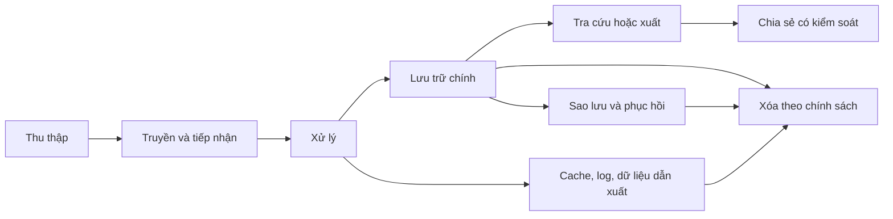

# Dữ liệu bí mật

## 1. Mục tiêu bài học

Trong chương **Phân loại dữ liệu**, dữ liệu bí mật là nhóm dữ liệu mà việc tiết lộ cho chủ thể không được phép có thể gây thiệt hại đáng kể cho cá nhân, tổ chức hoặc bên liên quan. Nhãn phân loại chỉ có ích khi được chuyển thành quy tắc cụ thể về ai được xem, được dùng vào việc gì, được chia sẻ qua đâu và phải lưu lại bằng chứng nào.

Bài học này giúp người học:

- Nhận diện dữ liệu bí mật từ nội dung, ngữ cảnh và hậu quả của việc tiết lộ.
- Phân biệt mức độ bí mật với loại dữ liệu, quyền sở hữu và yêu cầu toàn vẹn, sẵn sàng.
- Xác định phạm vi bảo vệ đối với dữ liệu gốc, dữ liệu dẫn xuất và các bản sao.
- Chuyển mô hình đe dọa thành yêu cầu xác thực, phân quyền, mã hóa, logging và phục hồi.
- Viết tiêu chí kiểm thử để chứng minh yêu cầu được thực thi trong vòng đời phát triển.

Các nhãn, thời hạn và ngưỡng định lượng trong bài là **quy ước minh họa**, không phải hệ thống phân loại hoặc nghĩa vụ áp dụng chung. Khi triển khai, cần dùng chính sách đã được tổ chức chấp thuận và các ràng buộc thực tế của dữ liệu.

## 2. Hiểu đúng về dữ liệu bí mật

**Dữ liệu bí mật** là dữ liệu chỉ được phép tiếp cận bởi những chủ thể có thẩm quyền, trong phạm vi và mục đích đã xác định, vì việc tiết lộ ngoài phạm vi đó có thể gây hậu quả cần ngăn ngừa.

Ví dụ có thể gồm:

| Dữ liệu | Ngữ cảnh khiến dữ liệu cần giữ bí mật | Hậu quả có thể xảy ra khi bị lộ |
| --- | --- | --- |
| Bảng lương chi tiết | Chỉ các vai trò được giao nhiệm vụ xử lý lương mới được xem toàn bộ | Xâm phạm đời tư, ảnh hưởng quan hệ lao động, hỗ trợ lừa đảo có mục tiêu |
| Giá mua và mức chiết khấu riêng | Điều kiện thương mại chưa được phép công bố | Giảm lợi thế đàm phán hoặc vi phạm cam kết với đối tác |
| Kế hoạch phát hành sản phẩm | Chưa đến thời điểm công bố và chưa được chủ sở hữu cho phép | Mất lợi thế cạnh tranh, ảnh hưởng kế hoạch kinh doanh |
| Hồ sơ khách hàng kèm thông tin giao dịch | Người dùng chỉ có quyền đối với một phạm vi hồ sơ | Tiết lộ hành vi, quan hệ kinh doanh hoặc thông tin cá nhân |
| Báo cáo sự cố chưa công bố | Chứa chi tiết hệ thống và thông tin điều tra hạn chế | Hỗ trợ khai thác điểm yếu hoặc làm lộ thông tin của bên liên quan |
| Khóa truy cập và token | Có thể dùng để thực hiện hành động với quyền được cấp | Truy cập trái phép, thay đổi dữ liệu hoặc chiếm quyền dịch vụ |

Những ví dụ này không có nghĩa mọi dữ liệu cùng tên luôn nhận cùng một mức phân loại. Một bảng giá đã được công bố hợp lệ khác với bảng giá đàm phán riêng. Một bản báo cáo đã lược bỏ thông tin cần bảo vệ có thể khác với bản gốc.

Trong bài, “bí mật” được dùng theo nghĩa kiểm soát việc tiết lộ trong thiết kế hệ thống. Không dùng thuật ngữ này để tự kết luận dữ liệu thuộc một chế độ phân loại pháp lý cụ thể.

### 2.1. Loại dữ liệu và mức phân loại là hai trục khác nhau

“Dữ liệu cá nhân”, “dữ liệu tài chính”, “dữ liệu vận hành” mô tả loại hoặc nội dung. “Công khai”, “nội bộ”, “bí mật” mô tả cách cần bảo vệ trong một chính sách cụ thể.

Vì vậy:

- Không mặc định mọi dữ liệu nội bộ đều có cùng độ bí mật.
- Không mặc định chỉ dữ liệu cá nhân mới cần giữ bí mật.
- Không mặc định dữ liệu đã mã hóa hoặc đã bỏ tên người là có thể công khai.
- Không mặc định chủ sở hữu tài khoản có quyền xem mọi dữ liệu do cùng tổ chức lưu trữ.

Một giá trị riêng lẻ có thể ít nhạy cảm, nhưng khi kết hợp với danh tính, thời điểm và thông tin khác lại tạo ra dữ liệu bí mật. Ví dụ, số tiền đứng riêng chưa chắc cho biết điều gì; khi gắn với mã nhân viên và kỳ lương, ý nghĩa bảo vệ thay đổi.

### 2.2. “Dữ liệu bí mật” không chỉ là mật khẩu và khóa

Mật khẩu, khóa riêng, token và thông tin khôi phục tài khoản là **bí mật xác thực hoặc mật mã**. Chúng cần cơ chế quản lý chuyên biệt vì người có được chúng có thể nhận thêm quyền.

Dữ liệu bí mật có phạm vi rộng hơn: một tài liệu chiến lược không dùng để đăng nhập vẫn cần hạn chế tiết lộ. Ngược lại, không nên bảo vệ khóa ký giống một tài liệu thông thường chỉ vì cả hai cùng có nhãn “bí mật”.

Cần kết hợp nhãn phân loại với loại dữ liệu. Ví dụ:

- Tài liệu bí mật cần quy tắc chia sẻ, đọc, tải xuống và thu hồi quyền.
- Token cần thêm quy tắc cấp phát, thời hạn, phạm vi quyền, luân chuyển và vô hiệu hóa.
- Mật khẩu dùng để xác minh người dùng cần cơ chế lưu trữ phù hợp cho mật khẩu, thay vì coi mã hóa có thể giải ngược là phương án mặc định.

### 2.3. Tính bí mật không thay thế toàn vẹn và sẵn sàng

Ba câu hỏi cần được đánh giá độc lập:

- **Bí mật:** ai được biết dữ liệu, trong điều kiện và mục đích nào?
- **Toàn vẹn:** ai được tạo hoặc sửa, và làm sao phát hiện thay đổi trái phép?
- **Sẵn sàng:** ai cần truy cập, vào thời điểm nào, và có thể gián đoạn bao lâu?

Bảng lương cần giữ kín, đồng thời phải đúng và truy cập được khi thực hiện nghiệp vụ. Mã hóa rất tốt nhưng làm mất khóa có thể khiến dữ liệu không còn sử dụng được. Hạn chế người đọc mà bỏ qua người sửa nhãn phân loại cũng có thể tạo đường tiết lộ trái phép.

## 3. Căn cứ nhận diện và phân loại

### 3.1. Bắt đầu từ hậu quả của việc tiết lộ

Với mỗi tập dữ liệu, cần trả lời:

1. Dữ liệu mô tả ai, điều gì hoặc hoạt động nào?
2. Ai đang có quyền quyết định việc sử dụng và công bố?
3. Nếu một người ngoài phạm vi được phép nhận được dữ liệu, họ có thể làm gì?
4. Hậu quả thay đổi thế nào nếu lộ một bản ghi, toàn bộ tập hoặc nhiều kỳ dữ liệu?
5. Dữ liệu có thể được liên kết với nguồn khác để suy ra thông tin gì?
6. Mức nhạy cảm có thay đổi theo thời điểm hoặc sự kiện không?
7. Có ràng buộc chia sẻ, lưu giữ hoặc sử dụng cần được phản ánh vào yêu cầu không?

Câu trả lời nên cụ thể: “người không thuộc bộ phận xử lý lương có thể đọc mức lương của toàn bộ nhân viên” hữu ích hơn “lộ dữ liệu gây mất uy tín”.

### 3.2. Một thang phân loại minh họa

| Nhãn | Ý nghĩa trong chính sách giả định | Ví dụ |
| --- | --- | --- |
| Công khai | Đã được người có thẩm quyền cho phép công bố | Tài liệu sản phẩm đã phát hành |
| Nội bộ | Phục vụ hoạt động nội bộ; không mặc định cho phép đưa ra ngoài | Hướng dẫn làm việc thông thường |
| Bí mật | Chỉ người có nhiệm vụ phù hợp mới được tiếp cận trong phạm vi xác định | Hồ sơ lương, điều kiện thương mại riêng |
| Hạn chế nghiêm ngặt | Việc tiết lộ có hậu quả đặc biệt lớn hoặc tạo quyền truy cập trực tiếp | Khóa riêng quan trọng, dữ liệu điều tra đặc biệt nhạy cảm |

Đây không phải tên mức bắt buộc. Một tổ chức có thể sử dụng nhãn khác hoặc ít mức hơn. Điều quan trọng là mỗi mức có định nghĩa, người có quyền quyết định và các quy tắc xử lý tương ứng.

Không xếp toàn bộ dữ liệu vào mức cao nhất chỉ để tránh phải đánh giá. Phân loại quá rộng có thể gây cản trở công việc, làm ngoại lệ tăng lên và khiến người dùng khó nhận ra dữ liệu thật sự cần bảo vệ nghiêm ngặt.

### 3.3. Phân loại đúng đơn vị và đúng ngữ cảnh

Có thể phân loại ở nhiều mức:

- **Trường dữ liệu:** mức lương, thông tin thanh toán, token.
- **Bản ghi:** hồ sơ lương của một nhân viên trong một kỳ.
- **Tập dữ liệu:** bảng lương của toàn doanh nghiệp.
- **Tài liệu hoặc gói xuất:** tệp chứa thông tin tổng hợp từ nhiều nguồn.
- **Kết quả truy vấn:** tập kết quả được tạo ra tại thời điểm sử dụng.

Khi một tài liệu chứa nhiều mức mà chưa có cơ chế tách đáng tin cậy, có thể áp dụng mức bảo vệ cao nhất của các nội dung cần giữ bí mật trong tài liệu đó. Quy tắc này cần được ghi rõ trong chính sách.

Tập dữ liệu tổng hợp có thể cần mức bảo vệ cao hơn từng phần riêng lẻ nếu việc tập hợp tạo ra khả năng suy luận mới. Việc che một vài trường không tự chứng minh cả tập đã giảm mức nhạy cảm.

Khi chưa đủ thông tin, nên gắn trạng thái chờ xác nhận, áp dụng bảo vệ tạm thời phù hợp và chỉ định chủ sở hữu cùng hạn xử lý. Không tự coi dữ liệu chưa có nhãn là công khai.

## 4. Hồ sơ phân loại cần chứa những gì?

Một hồ sơ đủ dùng cho đặc tả yêu cầu nên có:

| Trường | Mục đích |
| --- | --- |
| Định danh dữ liệu | Liên kết tới yêu cầu, rủi ro, hệ thống và kiểm thử |
| Mô tả nội dung, phạm vi | Xác định chính xác trường, bản ghi, tài liệu hoặc tập dữ liệu |
| Chủ sở hữu dữ liệu | Vai trò chịu trách nhiệm quyết định phân loại và việc sử dụng |
| Bên quản lý kỹ thuật | Nhóm triển khai lưu trữ, truy cập và vận hành |
| Nhãn và căn cứ | Giải thích hậu quả tiết lộ và lý do chọn mức |
| Mục đích sử dụng | Giới hạn việc thu thập, xử lý và chia sẻ |
| Chủ thể được phép | Vai trò, tổ chức, phạm vi bản ghi và điều kiện truy cập |
| Vị trí và bản sao | Kho chính, cache, bản xuất, backup, hệ thống phân tích |
| Nguồn và dữ liệu dẫn xuất | Truy vết từ dữ liệu gốc tới báo cáo hoặc kết quả xử lý |
| Thời hạn và điều kiện lưu giữ | Xác định khi nào cần rà soát, xóa hoặc giữ theo ngoại lệ |
| Điều kiện thay đổi nhãn | Ai được quyết định và bằng chứng cần có |
| Liên kết rủi ro, yêu cầu, kiểm thử | Biến phân loại thành đầu vào có thể kiểm chứng |
| Mốc xác nhận | Theo dõi ai đã duyệt và khi nào phải xem xét lại |

Chủ sở hữu dữ liệu là vai trò ra quyết định trong phạm vi được giao, không có nghĩa người đó được miễn mọi kiểm soát. Quản trị viên hạ tầng cũng không mặc nhiên là người được đọc nội dung phục vụ nghiệp vụ.

Ví dụ mô tả:

> DATA-PAY-001 là tập dữ liệu chi tiết lương theo nhân viên và kỳ lương, phục vụ tính lương và tra cứu cá nhân. Chủ sở hữu là vai trò phụ trách nghiệp vụ tiền lương. Nhãn bí mật được chọn vì việc tiết lộ có thể làm lộ thu nhập của cá nhân. Người lao động chỉ xem bản ghi của mình; người xử lý lương chỉ xem dữ liệu trong tổ chức được giao. Việc xuất toàn bộ tập cần quyền riêng.

Mô tả này chưa phải yêu cầu hoàn chỉnh, nhưng đã cung cấp đủ đầu vào để đặc tả quyền truy cập và kiểm thử.

## 5. Theo dõi dữ liệu bí mật qua toàn bộ vòng đời

Dữ liệu không chỉ tồn tại trong cơ sở dữ liệu chính. Nó có thể xuất hiện trong yêu cầu HTTP, bộ nhớ, cache, hàng đợi, log, tệp tạm, báo cáo và backup.



Mỗi điểm lưu hoặc truyền cần có câu trả lời về quyền, thời hạn tồn tại và cách kiểm chứng:

| Giai đoạn | Nguy cơ tiết lộ | Hướng yêu cầu |
| --- | --- | --- |
| Thu thập | Thu thập nhiều hơn mục đích cần dùng | Xác định trường bắt buộc và loại bỏ dữ liệu thừa |
| Truyền | Đọc trộm hoặc gửi sai bên nhận | Bảo vệ kênh truyền và xác minh đích nhận |
| Xử lý | Dịch vụ hoặc người vận hành đọc vượt phạm vi | Giới hạn quyền theo tác vụ và kiểm soát truy cập |
| Lưu trữ | Đọc trực tiếp tệp, snapshot hoặc cơ sở dữ liệu | Kết hợp quyền truy cập, mã hóa và quản lý khóa |
| Tra cứu | Người dùng hợp lệ đọc dữ liệu của người khác | Kiểm tra quyền trên đối tượng, trường và phạm vi tổ chức |
| Xuất và chia sẻ | Tệp xuất hoặc liên kết tải bị chuyển tiếp | Giới hạn người nhận, thời hạn và quyền tải |
| Ghi log, chẩn đoán | Payload hoặc lỗi chứa dữ liệu bí mật | Quy định trường được ghi và kiểm tra các đường lỗi |
| Sao lưu, phục hồi | Backup bị đọc hoặc dữ liệu đã xóa xuất hiện lại | Bảo vệ backup, kiểm soát phục hồi và xử lý dữ liệu hết hạn |
| Kết thúc sử dụng | Tệp tạm, cache hoặc bản sao còn tồn tại | Quy định xóa và xác minh theo từng loại lưu trữ |

Dữ liệu dẫn xuất cần được đánh giá riêng. Một báo cáo “chỉ có số trung bình” vẫn có thể làm lộ thu nhập nếu nhóm chỉ có một người hoặc có thể so sánh nhiều báo cáo để suy ra giá trị cá nhân.

## 6. Từ mô hình đe dọa đến yêu cầu bảo mật

Xét một hệ thống tính lương phục vụ nhiều tổ chức. Mỗi tổ chức là một phạm vi dữ liệu độc lập. Người lao động được xem phiếu lương của mình, còn người xử lý lương chỉ được xem phạm vi tổ chức đã được giao.

Giả sử dữ liệu gồm mã tham chiếu nhân viên, kỳ lương, tổng thu nhập, khoản khấu trừ và số tiền thực nhận. Tất cả giá trị dùng trong thiết kế và kiểm thử dưới đây là dữ liệu giả.

### 6.1. Mục tiêu bảo vệ

- Người dùng không đọc được phiếu lương ngoài phạm vi được cấp.
- Việc xuất hàng loạt phải có quyền riêng và được truy vết.
- Bản sao, log và backup không trở thành đường truy cập ít được bảo vệ hơn.
- Dịch vụ vẫn có thể phục hồi mà không làm mất kiểm soát truy cập hoặc đưa dữ liệu hết hạn trở lại sử dụng.

### 6.2. Nhận diện các đường tiết lộ

| Mã đe dọa | Kịch bản | Điều kiện hoặc ranh giới liên quan | Kết quả cần ngăn |
| --- | --- | --- | --- |
| T-D01 | Người dùng đổi mã phiếu lương trong yêu cầu | Ranh giới giữa danh tính đã xác thực và bản ghi được phép đọc | Đọc phiếu của người khác hoặc tổ chức khác |
| T-D02 | Liên kết tải báo cáo bị chuyển cho bên không có quyền | Ranh giới giữa tác vụ xuất, nơi lưu tệp và lượt tải | Bên nhận liên kết đọc được toàn bộ bảng lương |
| T-D03 | Cache trả kết quả của tổ chức A cho tổ chức B | Ranh giới cách ly dữ liệu tại lớp cache | Tiết lộ chéo tổ chức dù truy vấn gốc có kiểm tra quyền |
| T-D04 | Người có quyền đọc snapshot lấy được dữ liệu | Ranh giới giữa nơi lưu bản sao và quyền sử dụng khóa giải mã | Đọc dữ liệu từ bản sao ngoài đường truy cập nghiệp vụ |
| T-D05 | Payload lỗi được ghi vào log hoặc gửi vào công cụ hỗ trợ | Ranh giới giữa xử lý nghiệp vụ và quan sát vận hành | Người chỉ có quyền xem log đọc được nội dung lương |
| T-D06 | Sao chép production sang môi trường thử nghiệm | Ranh giới môi trường và người được truy cập | Dữ liệu thật đến tay người chỉ được dùng dữ liệu kiểm thử |

Mỗi kịch bản phải dẫn tới yêu cầu và kiểm thử tương ứng. Không thể khép T-D01 bằng một yêu cầu chỉ nói “mã hóa cơ sở dữ liệu”, vì ứng dụng vẫn có thể giải mã rồi trả dữ liệu cho sai người.

### 6.3. Một chuỗi truy vết đầy đủ

> **Dữ liệu:** DATA-PAY-001 — phiếu lương chi tiết.  
> **Phân loại:** bí mật vì tiết lộ làm lộ thu nhập cá nhân.  
> **Đe dọa:** T-D01 — đổi mã bản ghi để đọc phiếu lương khác.  
> **Rủi ro:** một tài khoản hợp lệ có thể thu thập dữ liệu của người khác.  
> **Quyết định kiến trúc:** kiểm tra quyền tại dịch vụ trước khi trả bản ghi, theo danh tính và phạm vi tổ chức đã xác minh.  
> **Yêu cầu:** từ chối đọc khi bản ghi không thuộc phạm vi được cấp, kể cả khi người dùng biết mã bản ghi.  
> **Kiểm thử:** dùng tài khoản A yêu cầu phiếu của A, người B cùng tổ chức và người C khác tổ chức.  
> **Bằng chứng:** A chỉ nhận dữ liệu được phép; hai yêu cầu còn lại không tiết lộ nội dung hoặc trường bí mật.

Sự kiện từ chối cần được ghi theo chính sách kiểm toán nhưng không được chứa nội dung phiếu lương. Nếu mã bản ghi cũng có tính nhạy cảm, bản thân dấu vết kiểm toán phải được bảo vệ tương ứng.

## 7. Thiết kế các nhóm kiểm soát

### 7.1. Xác thực và vòng đời quyền

Xác thực trả lời chủ thể là ai; phân quyền trả lời chủ thể đó được đọc dữ liệu nào. Cần đặc tả cả hai.

Các yêu cầu có thể bao gồm:

- Điều kiện xác thực bổ sung cho người có quyền xem hoặc xuất dữ liệu hàng loạt.
- Danh tính riêng cho dịch vụ tự động, tránh dùng chung tài khoản người vận hành.
- Thời điểm rà soát, cấp, thay đổi và thu hồi quyền khi vai trò thay đổi.
- Thời gian tối đa để thay đổi quyền có hiệu lực trên phiên, token và cache quyền.
- Cách xử lý truy cập khẩn cấp có giới hạn thời gian và có bằng chứng phê duyệt.

Với danh tính máy, không áp dụng máy móc cách xác thực dành cho người dùng. Cần quy định cách xác minh danh tính, phạm vi quyền, thời hạn thông tin xác thực và khả năng vô hiệu hóa.

### 7.2. Phân quyền trên đối tượng và trường dữ liệu

Quyền “xem phiếu lương” cần được bổ sung bằng phạm vi:

- Xem phiếu của chính mình hay xem toàn bộ tổ chức?
- Được xem tất cả trường hay chỉ số liệu tổng hợp?
- Được tra cứu đơn lẻ hay xuất hàng loạt?
- Quyền còn hợp lệ tại thời điểm bắt đầu và hoàn tất tác vụ không?

Vai trò có thể là một đầu vào, cùng với quan hệ sở hữu bản ghi, tổ chức, mục đích và trạng thái tác vụ. Mã tổ chức do người dùng gửi không được tự coi là căn cứ đủ để cấp quyền; dịch vụ phải kiểm tra nó với phạm vi của danh tính đã xác minh.

Kiểm tra cần được thực hiện ở phía máy chủ. Việc ẩn nút hoặc cột trên giao diện không ngăn người dùng gọi API trực tiếp.

Nhãn “bí mật” cũng không phải một quyền truy cập. Hai tập dữ liệu cùng nhãn vẫn có thể thuộc hai tổ chức và hai nhóm người đọc hoàn toàn khác nhau.

### 7.3. Mã hóa và quản lý khóa

Cần xác định dữ liệu được bảo vệ ở những trạng thái nào: trên đường truyền, trong lưu trữ chính, trong bản xuất và trong backup.

Mã hóa chỉ là một lớp. Đặc tả phải nêu thêm:

- Thành phần nào được sử dụng khóa và cho tác vụ nào.
- Người có quyền đọc tệp lưu trữ có đồng thời được giải mã hay không.
- Cách cấp, thay đổi, vô hiệu hóa và kiểm toán việc sử dụng khóa.
- Cách duy trì khả năng phục hồi khi thay khóa hoặc xảy ra sự cố.
- Cách kiểm tra ứng dụng không chuyển dữ liệu rõ sang log, tệp tạm hoặc hệ thống khác.

Nếu cùng một danh tính có thể lấy cả backup lẫn khóa giải mã mà không có kiểm soát bổ sung, mã hóa không giải quyết đầy đủ kịch bản danh tính đó bị chiếm.

Khi ứng dụng cần đọc dữ liệu để phục vụ nghiệp vụ, dữ liệu có thể xuất hiện ở dạng rõ trong quá trình xử lý được cho phép. Vì vậy, phải bảo vệ cả quyền chạy ứng dụng, chẩn đoán và truy cập bộ nhớ hoặc tệp kết xuất liên quan.

### 7.4. Bản xuất, liên kết tải và chia sẻ

Xuất dữ liệu tạo ra một bản sao có vòng đời riêng. Quyền được xem một bản ghi không mặc nhiên bao gồm quyền xuất cả tập dữ liệu.

Cần quy định:

- Ai được tạo tác vụ xuất và phạm vi dữ liệu tối đa.
- Quyền được kiểm tra lại tại những bước nào của tác vụ bất đồng bộ.
- Nơi lưu tệp, thời gian tồn tại và điều kiện tải.
- Định danh người nhận, khả năng thu hồi và dấu vết tải.
- Cách xóa tệp tạm và xử lý tác vụ thất bại.

Trong ví dụ này, liên kết tải không tự cấp quyền đọc. Khi tải, hệ thống vẫn kiểm tra danh tính và quyền hiện tại đối với tệp. Một người ngoài phạm vi có được URL cũng không được nhận dữ liệu.

Khi người dùng đã tải dữ liệu hợp lệ xuống thiết bị, việc thu hồi quyền trên máy chủ không tự xóa bản sao đó. Thiết kế cần phản ánh giới hạn này bằng chính sách thiết bị, chia sẻ và thời hạn lưu phù hợp.

### 7.5. Log, cache và công cụ hỗ trợ

Nên xác định danh sách trường được phép ghi cho từng loại sự kiện. Tránh ghi toàn bộ request hoặc response chứa dữ liệu bí mật.

Một sự kiện truy cập có thể cần chủ thể, hành động, phạm vi tổ chức, định danh tham chiếu đã được đánh giá, thời điểm, kết quả và mã liên kết. Nó thường không cần số tiền lương hoặc toàn bộ hồ sơ cá nhân.

Với cache:

- Phải cách ly dữ liệu theo tổ chức và ngữ cảnh truy cập phù hợp.
- Không được bỏ qua kiểm tra quyền chỉ vì dữ liệu đã có trong cache.
- Cần giới hạn thời gian lưu và xác định cách vô hiệu hóa khi quyền thay đổi.
- Nếu không thể chứng minh việc dùng chung cache đáp ứng phân quyền, phải chọn phương án không chia sẻ kết quả nhạy cảm giữa các ngữ cảnh đó.

Công cụ theo dõi lỗi, hỗ trợ khách hàng và phân tích cũng là nơi nhận dữ liệu. Quyết định gửi nội dung tới đó phải xét người được đọc, bên cung cấp, thời hạn lưu và mục đích sử dụng.

### 7.6. Môi trường phát triển và dữ liệu dẫn xuất

Ưu tiên dữ liệu tổng hợp hoặc dữ liệu giả để kiểm thử. Nếu cần dữ liệu có nguồn gốc từ production, phải có quyết định chấp thuận, phương pháp biến đổi và kiểm chứng phù hợp.

Cần phân biệt:

- **Che hiển thị:** thay đổi phần người dùng nhìn thấy; dữ liệu gốc có thể vẫn còn ở API hoặc nơi lưu.
- **Giả danh hóa:** thay định danh bằng giá trị khác nhưng vẫn có thể liên kết hoặc khôi phục quan hệ bằng thông tin bổ sung.
- **Ẩn danh hóa:** cần đánh giá khả năng nhận diện lại trong bối cảnh sử dụng; bỏ tên riêng không đủ để tự kết luận đã đạt.

Nhãn phân loại chỉ được giảm khi có căn cứ. Báo cáo tổng hợp, dữ liệu đã che hoặc dữ liệu đã giả danh vẫn cần xem xét nguy cơ liên kết và suy luận.

## 8. Viết yêu cầu cụ thể, đo được và kiểm chứng được

Một mẫu đặc tả:

> **Khi nào áp dụng + chủ thể hoặc thành phần + hành vi bắt buộc + kết quả hoặc giới hạn + cách kiểm chứng.**

Các yêu cầu dưới đây thuộc hệ thống tính lương giả định. Những mốc như 5 phút, 24 giờ, 4 giờ và 1 giờ được đặt để minh họa khả năng đo; chúng cần được xác nhận với chủ sở hữu nghiệp vụ và vận hành trước khi dùng thực tế.

| Mã | Yêu cầu | Tiêu chí chấp nhận và bằng chứng |
| --- | --- | --- |
| SR-CONF-01 | Trước khi đưa vào production, DATA-PAY-001 phải có nhãn bí mật, chủ sở hữu, mục đích, nhóm được đọc và danh sách nơi lưu đã được xác nhận | Hồ sơ đủ trường, có người duyệt; đối chiếu luồng dữ liệu thiết kế với các nơi lưu đã khai báo |
| SR-CONF-02 | Tài khoản người dùng có quyền xử lý hoặc xuất lương hàng loạt phải đáp ứng xác thực đa yếu tố trước khi dùng các chức năng đó | Tài khoản chưa đáp ứng điều kiện bị chặn; tài khoản đáp ứng điều kiện vẫn phải qua kiểm tra quyền và phạm vi dữ liệu |
| SR-CONF-03 | Mọi lượt đọc phiếu lương phải kiểm tra quyền phía máy chủ theo danh tính, bản ghi và phạm vi tổ chức | Kiểm thử bản ghi của mình, người khác cùng tổ chức và người khác tổ chức; chỉ trường hợp được cấp quyền trả nội dung |
| SR-CONF-04 | Sau khi thu hồi quyền, trong tối đa 5 phút mọi yêu cầu đọc hoặc tải mới sử dụng quyền đó phải bị từ chối, kể cả qua phiên và cache còn tồn tại | Ghi thời điểm thu hồi và thử lại qua các đường truy cập; tác vụ xuất đang chờ phải kiểm tra lại trước khi cung cấp tệp |
| SR-CONF-05 | Các kết nối mang DATA-PAY-001 phải dùng kênh truyền được chính sách chấp thuận và xác minh danh tính đầu bên kia; kết nối không đáp ứng phải bị từ chối | Kiểm tra cấu hình và thử kết nối không được bảo vệ, đích không hợp lệ; không được âm thầm chuyển sang kênh yếu hơn |
| SR-CONF-06 | Kho chính, snapshot và backup chứa DATA-PAY-001 phải được mã hóa; quyền đọc bản lưu không tự bao gồm quyền giải mã | Kiểm tra cấu hình; danh tính chỉ có quyền đọc đối tượng lưu trữ không giải mã được; truy cập giải mã có dấu vết |
| SR-CONF-07 | Tệp xuất lương chỉ được cấp cho người có quyền xuất và quyền đọc phạm vi tương ứng; phải xác thực và kiểm tra lại quyền tại lượt tải | Chuyển URL cho tài khoản khác, thu hồi quyền trước lượt tải và sửa định danh tệp đều không làm lộ nội dung |
| SR-CONF-08 | Tệp xuất tạm phải hết hiệu lực tải và được xóa khỏi vùng lưu tạm trong tối đa 24 giờ sau khi tạo; vùng này không được đưa vào backup | Kiểm tra tải sau thời hạn và đối chiếu vùng lưu; thử cả tác vụ thành công, bị hủy và thất bại; cấu hình backup loại trừ vùng tạm |
| SR-CONF-09 | Log nghiệp vụ, log lỗi và dữ liệu gửi tới công cụ theo dõi không được chứa số tiền lương, thông tin xác thực hoặc nội dung phiếu lương | Dùng giá trị giả có dấu nhận diện, chạy các đường thành công và lỗi đã xác định; không tìm thấy giá trị đó trong các đầu ra nằm trong phạm vi |
| SR-CONF-10 | Mọi tác vụ xuất lương hàng loạt phải tạo dấu vết về người yêu cầu, tổ chức, phạm vi, thời điểm, kết quả và tham chiếu tệp; người thực hiện tác vụ không có quyền sửa hoặc xóa dấu vết này | Thực hiện tác vụ được phép và bị từ chối; đối chiếu sự kiện; thử sửa hoặc xóa bằng danh tính tác vụ phải thất bại |
| SR-CONF-11 | Môi trường thử nghiệm không được nhận DATA-PAY-001 dạng thật nếu chưa có ngoại lệ còn hiệu lực và biện pháp bảo vệ được phê duyệt | Kiểm tra nguồn dữ liệu thử nghiệm và thử quy trình nhập; đường nhập không được chấp thuận bị chặn |
| SR-CONF-12 | Khi phục hồi DATA-PAY-001, phải khôi phục quyền truy cập phù hợp, khóa cần thiết và trạng thái xóa hoặc hết hạn trước khi mở lại dịch vụ | Diễn tập đạt thời gian phục hồi tối đa 4 giờ và mức mất dữ liệu tối đa 1 giờ theo mốc đã định; kiểm thử cách ly tổ chức và dữ liệu hết hạn trước khi mở truy cập |

SR-CONF-12 cần quy định mốc bắt đầu tính thời gian là lúc người có thẩm quyền tuyên bố bắt đầu phục hồi; mốc kết thúc là lúc dữ liệu và các kiểm tra chức năng, quyền truy cập tối thiểu đạt yêu cầu. Mức mất dữ liệu được đo từ thời điểm gián đoạn tới điểm dữ liệu được phục hồi nhất quán, theo phạm vi nghiệp vụ đã thỏa thuận.

Không coi các mốc minh họa là một cam kết đã được chứng minh. Chúng chỉ trở thành yêu cầu khả thi khi phương án backup, quản lý khóa, phục hồi dữ liệu và diễn tập thực tế hỗ trợ được.

### 8.1. Điều kiện lỗi và từ chối phải rõ ràng

Yêu cầu cần nêu hệ thống làm gì khi:

- Không tìm được nhãn phân loại hoặc thông tin quyền.
- Không xác minh được tổ chức của chủ thể.
- Dịch vụ quyết định quyền không sẵn sàng.
- Không tạo được bằng chứng kiểm toán bắt buộc cho tác vụ xuất.
- Tác vụ xuất kéo dài qua thời điểm quyền bị thu hồi.

Với ví dụ này, khi không thể xác định quyền đọc dữ liệu bí mật, hệ thống phải từ chối trả nội dung. Với tác vụ xuất hàng loạt không ghi được dấu vết bắt buộc, hệ thống không cung cấp tệp và trả trạng thái thất bại có thể theo dõi.

Các quyết định này cần xuất hiện trong thiết kế và kiểm thử, thay vì để từng lập trình viên tự chọn hành vi dự phòng.

## 9. Ví dụ hồ sơ phân loại có truy vết

Đoạn YAML sau chỉ minh họa một hồ sơ thiết kế. Nó không chứa dữ liệu lương thật và không phải định dạng bắt buộc:

```yaml
dataId: DATA-PAY-001
name: payroll-records
classification: confidential
ownerRole: payroll-data-owner
custodianRole: payroll-platform-team

scope:
  unit: employee-payroll-record
  fields:
    - employeeReference
    - payrollPeriod
    - grossAmount
    - deductionAmount
    - netAmount

rationale:
  disclosureImpact: "Có thể làm lộ thu nhập và khoản khấu trừ của cá nhân."
  aggregationConcern: "Tệp xuất nhiều nhân viên có phạm vi ảnh hưởng lớn hơn."

purpose:
  - payroll-processing
  - employee-self-service

accessPolicyReferences:
  - POLICY-PAYROLL-SELF
  - POLICY-PAYROLL-OPERATOR
  - POLICY-PAYROLL-EXPORT

storageScope:
  - payroll-primary-database
  - payroll-backup
  - payroll-export-temporary

retentionPolicyReference: RET-PAY-001
reclassificationApprovalRole: payroll-data-owner

riskReferences:
  - RISK-CROSS-TENANT-DISCLOSURE
  - RISK-EXPORT-LINK-DISCLOSURE
  - RISK-LOG-DISCLOSURE

requirementReferences:
  - SR-CONF-03
  - SR-CONF-07
  - SR-CONF-09
  - SR-CONF-12

verificationReferences:
  - TC-PAY-OBJECT-ACCESS
  - TC-PAY-EXPORT
  - TC-PAY-LOGGING
  - TC-PAY-RESTORE
```

Tham chiếu chính sách lưu giữ phải trỏ tới một quyết định đã được phê duyệt, có thời hạn, điểm bắt đầu tính và phạm vi áp dụng rõ ràng. Một mã tham chiếu chưa có nội dung không đủ để làm tiêu chí nghiệm thu.

Hồ sơ cũng phải được cập nhật nếu hệ thống có thêm cache, hệ thống phân tích hoặc nơi lưu mới. Liệt kê kho chính mà bỏ sót bản sao không phản ánh đầy đủ phạm vi của dữ liệu bí mật.

## 10. Xây dựng ma trận kiểm thử

### 10.1. Kiểm tra cả truy cập hợp lệ và truy cập bị cấm

Một kiểm thử thành công chỉ chứng minh đường hợp lệ hoạt động trong điều kiện đã thử. Để kiểm chứng phân quyền, cần thêm các tổ hợp bị cấm.

| Chủ thể và hành động | Kết quả mong đợi trong ví dụ | Yêu cầu liên quan |
| --- | --- | --- |
| Nhân viên A xem phiếu của A | Trả đúng các trường được phép | SR-CONF-03 |
| Nhân viên A đổi mã để xem phiếu của B cùng tổ chức | Không trả nội dung của B | SR-CONF-03 |
| Người xử lý lương tổ chức A xem dữ liệu tổ chức B | Bị từ chối, không lộ trường bí mật | SR-CONF-03 |
| Người chỉ có quyền xem cá nhân yêu cầu xuất toàn bộ | Bị từ chối | SR-CONF-07 |
| Người có quyền xuất nhưng chưa đạt điều kiện xác thực bổ sung | Bị chặn chức năng xuất | SR-CONF-02 |
| Người được cấp quyền tải tệp hợp lệ | Chỉ nhận đúng phạm vi đã được duyệt | SR-CONF-07 |
| Người khác có URL tải | Không nhận được nội dung tệp | SR-CONF-07 |
| Người đã bị thu hồi quyền dùng phiên cũ | Bị từ chối trong giới hạn hiệu lực đã đặc tả | SR-CONF-04 |
| Tác vụ xuất bị hủy sau khi đã tạo một phần tệp | Phần tệp không được chia sẻ; được xử lý theo thời hạn vùng tạm | SR-CONF-08 |
| Danh tính chỉ được đọc đối tượng backup | Không có khả năng giải mã theo chính sách quyền | SR-CONF-06 |
| Nhóm vận hành xem log lỗi | Nhận đủ thông tin điều tra được phép, không có nội dung lương | SR-CONF-09 |
| Dịch vụ sau phục hồi nhận yêu cầu chéo tổ chức | Vẫn bị từ chối trước khi mở lại lưu lượng thật | SR-CONF-12 |

Cần thử các đường truy cập thực tế: API trực tiếp, giao diện, tác vụ nền, tải tệp và cache nếu có. Đường giao diện an toàn không chứng minh API hoặc chức năng xuất cũng an toàn.

Nếu sự tồn tại của một hồ sơ cũng cần giữ bí mật, phải đặc tả cách phản hồi để không làm lộ thông tin đó qua nội dung lỗi. Việc có che sự tồn tại hay không là một quyết định cần ghi rõ theo từng ngữ cảnh.

### 10.2. Bằng chứng phải kiểm chứng được mà không làm lộ dữ liệu thật

Bằng chứng có thể gồm:

- Cấu hình quyền, mã chính sách hoặc phiên bản cấu hình được kiểm tra.
- Kết quả kiểm thử gắn với yêu cầu và bản phát hành.
- Dấu vết cho phép hoặc từ chối đã lược bỏ nội dung bí mật không cần thiết.
- Báo cáo đối chiếu nơi lưu dữ liệu với hồ sơ phân loại.
- Kết quả diễn tập phục hồi, bao gồm kiểm tra quyền và dữ liệu hết hạn.

Nên dùng dữ liệu giả có dấu nhận diện để kiểm tra khả năng lọt dữ liệu ra log hoặc công cụ theo dõi. Không đưa dữ liệu thật vào ảnh chụp màn hình, báo cáo kiểm thử hoặc ticket chỉ để chứng minh đã bảo vệ dữ liệu thật.

Kết quả “không tìm thấy dữ liệu bí mật trong log” phải nêu rõ đã thử những luồng nào và đã kiểm tra những đầu ra nào. Đây là bằng chứng trong phạm vi kiểm thử, không phải lời khẳng định bao phủ mọi trạng thái có thể có.

### 10.3. Theo dõi độ bao phủ

Một chỉ số có thể dùng:

> Tỷ lệ đường đọc có kiểm thử phân quyền = số đường đọc dữ liệu bí mật có kiểm thử hợp lệ và bị cấm / tổng số đường đọc đã xác định trong cùng phạm vi và phiên bản.

Mẫu số phải được hình thành từ việc nhận diện các đường đọc thực tế, không chỉ từ danh sách kiểm thử đã viết. Cần ghi nhận riêng những đường chưa biết đầy đủ hoặc chưa có bằng chứng.

Các chỉ số bổ sung có thể gồm số nơi lưu chưa có chủ sở hữu, số bản xuất quá hạn chưa xóa và số yêu cầu bảo mật chưa có kiểm thử. Chỉ số hỗ trợ tìm khoảng trống, không thay thế đánh giá nội dung yêu cầu.

## 11. Thay đổi nhãn, lưu giữ và kết thúc vòng đời

### 11.1. Thay đổi mức phân loại phải có điều kiện

Dữ liệu có thể bớt nhạy cảm sau một sự kiện, chẳng hạn thông tin đã được phép công bố. Tuy nhiên, công bố một phần không tự làm toàn bộ bản gốc trở thành công khai.

Một quy trình thay đổi nhãn cần nêu:

1. Ai được yêu cầu và ai được quyết định.
2. Phạm vi chính xác: bản gốc, một bản biên tập hay một tập kết quả.
3. Căn cứ: được phép công bố, đã loại bỏ thông tin nào hoặc thay đổi mục đích nào.
4. Những bản sao và hệ thống cần cập nhật.
5. Bằng chứng, thời điểm hiệu lực và cách xử lý nếu quyết định bị thu hồi.

Ví dụ, báo cáo tổng hợp lương được cho phép chia sẻ không có nghĩa bảng lương chi tiết cũng được phép chia sẻ. Nếu báo cáo có nhóm quá nhỏ, cần xem xét khả năng suy ra dữ liệu cá nhân trước khi giảm mức.

Nhãn phân loại cần được bảo vệ khỏi sửa trái phép. Nếu người dùng chỉ cần đổi nhãn “bí mật” thành “công khai” để bỏ qua quyền, chính cơ chế phân loại đã trở thành đường vượt kiểm soát.

### 11.2. Lưu giữ phải gắn với mục đích và từng bản sao

Không thể chỉ ghi “lưu dữ liệu trong thời gian cần thiết” rồi coi yêu cầu đã đo được. Cần nêu:

- Thời hạn hoặc sự kiện kết thúc cho từng loại dữ liệu.
- Điểm bắt đầu tính thời hạn.
- Những nơi lưu và bản sao nằm trong phạm vi.
- Người có quyền chấp thuận giữ lâu hơn và điều kiện ngoại lệ.
- Cách xác nhận xóa hoặc chặn sử dụng sau khi hết hạn.

Bản dữ liệu nghiệp vụ, tệp xuất tạm, log kiểm toán và backup có thể có thời hạn khác nhau. Thời hạn của một loại không tự áp dụng cho tất cả các loại.

Nếu có yêu cầu giữ lại phục vụ một mục đích đã được chấp thuận, phải ghi nhận phạm vi và người chịu trách nhiệm. Không để một ngoại lệ không có thời hạn trở thành lý do giữ mọi bản sao vô thời hạn.

### 11.3. Xóa và phục hồi cần được thiết kế cùng nhau

Xóa bản ghi khỏi kho chính không có nghĩa mọi bản sao đã biến mất. Cần xác định cách xử lý cache, chỉ mục tìm kiếm, tệp xuất, bản sao phân tích và backup.

Với backup không hỗ trợ xóa từng bản ghi, chính sách cần nêu thời hạn hết hiệu lực, giới hạn truy cập và cách bảo đảm dữ liệu đã hết hạn không quay lại phục vụ sau phục hồi. Có thể cần lưu trạng thái xóa hoặc mốc hết hạn trong một cơ chế đủ bền vững để áp dụng lại trước khi mở dịch vụ.

Xóa khóa mã hóa chỉ có ý nghĩa đối với khả năng truy cập dữ liệu nếu phạm vi khóa, mọi bản sao khóa và mọi bản dữ liệu rõ liên quan đã được hiểu rõ. Không tự coi thao tác vô hiệu hóa một khóa là bằng chứng mọi bản sao dữ liệu đã bị xóa.

## 12. Những sai lầm thường gặp

| Sai lầm | Hệ quả | Cách sửa |
| --- | --- | --- |
| Gọi mọi thứ là “nhạy cảm” nhưng không có định nghĩa | Nhóm phát triển không suy ra được hành vi cần làm | Ghi nhãn, hậu quả tiết lộ, phạm vi và chủ sở hữu |
| Đánh đồng dữ liệu bí mật với mật khẩu | Bỏ sót tài liệu kinh doanh, báo cáo và dữ liệu cá nhân | Đánh giá nội dung, ngữ cảnh và hậu quả |
| Mã hóa cơ sở dữ liệu rồi coi là hoàn tất | API vẫn có thể trả dữ liệu cho sai người | Kết hợp mã hóa với phân quyền theo đối tượng và phạm vi |
| Chỉ kiểm tra vai trò | Người đúng vai trò có thể đọc sai tổ chức hoặc sai bản ghi | Kiểm tra thêm quan hệ, tổ chức và quyền cụ thể |
| Chỉ che dữ liệu trên giao diện | Nội dung thật vẫn nằm trong API hoặc tệp tải | Kiểm soát dữ liệu ngay tại nơi tạo phản hồi |
| Tin rằng URL khó đoán là đủ | Người nhận URL ngoài phạm vi vẫn tải được | Đặc tả xác thực, quyền, thời hạn và thu hồi |
| Bỏ tên người rồi giảm nhãn | Các trường còn lại có thể cho phép nhận diện lại | Đánh giá khả năng liên kết và suy luận |
| Ghi toàn bộ payload để dễ gỡ lỗi | Log trở thành bản sao dữ liệu bí mật | Quy định trường được ghi và kiểm tra đường lỗi |
| Backup ít được bảo vệ hơn dữ liệu chính | Có thể lấy dữ liệu qua đường khôi phục | Bảo vệ quyền đọc, giải mã và thao tác phục hồi |
| Xóa kho chính nhưng không xét phục hồi | Dữ liệu hết hạn xuất hiện lại sau sự cố | Áp dụng lại trạng thái xóa và kiểm chứng trước khi mở dịch vụ |
| Kiểm thử bằng dữ liệu production | Báo cáo và công cụ kiểm thử trở thành nơi rò rỉ | Dùng dữ liệu giả hoặc quy trình đã được chấp thuận |
| Không xác định tác dụng của thay đổi quyền | Phiên cũ hoặc tác vụ nền tiếp tục đọc dữ liệu | Đặt giới hạn hiệu lực và thử qua các đường truy cập |

## 13. Bài tập vận dụng

Một doanh nghiệp dự định tạo báo cáo chi phí nhân sự theo phòng ban. Dữ liệu nguồn gồm mã nhân viên, phòng ban và số tiền thực nhận. Báo cáo chỉ hiển thị tổng tiền và số người. Một số phòng ban chỉ có một người.

Báo cáo được xuất thành tệp và gửi qua liên kết tải. Hệ thống hiện chỉ kiểm tra người dùng đã đăng nhập khi tạo báo cáo, chưa kiểm tra quyền tại lượt tải. Tệp tạm được giữ vô thời hạn và tác vụ lỗi ghi toàn bộ dữ liệu nguồn vào log.

Hãy thực hiện:

1. Giải thích vì sao báo cáo không có tên người vẫn có thể là dữ liệu bí mật.
2. Xác định ít nhất bốn vị trí hoặc bản sao cần đưa vào phạm vi phân loại.
3. Nêu ba kịch bản đe dọa và hậu quả tương ứng.
4. Viết ba yêu cầu bảo mật với tiêu chí chấp nhận.
5. Nêu bằng chứng cần có trước khi quyết định giảm mức phân loại của báo cáo.

### Gợi ý tự đối chiếu

- Với phòng ban có một người, tổng tiền có thể tiết lộ thu nhập cá nhân. Kết hợp nhiều báo cáo theo thời gian cũng có thể tạo thêm khả năng suy luận.
- Phạm vi cần xét gồm kho nguồn, kết quả xử lý, tệp xuất tạm, log lỗi và mọi backup có chứa các bản này.
- Các đe dọa gồm người ngoài phạm vi dùng liên kết tải, người đọc log tiếp cận dữ liệu nguồn và người có quyền đọc báo cáo tổng hợp suy ra thông tin cá nhân.
- Một yêu cầu có thể buộc kiểm tra danh tính và phạm vi được phép tại lượt tải; kiểm thử chuyển URL cho người ngoài phạm vi phải bị từ chối.
- Một yêu cầu khác có thể đặt thời hạn tệp tạm và hành vi xóa sau tác vụ lỗi; kiểm thử phải xét cả tệp hoàn chỉnh và tệp tạo dở.
- Yêu cầu thứ ba có thể giới hạn trường ghi log; dùng dữ liệu giả có dấu nhận diện để thử đường lỗi và xác nhận không xuất hiện nội dung bị cấm.
- Trước khi giảm nhãn cần biết chính xác nội dung công bố, người nhận, nguy cơ nhóm nhỏ và suy luận, phương pháp giảm khả năng tiết lộ, cùng quyết định của chủ sở hữu. Việc đã bỏ tên người là chưa đủ.

## 14. Sản phẩm đầu ra của bài học

Sau khi áp dụng bài học cho một tập dữ liệu, người học cần có:

1. Hồ sơ phân loại với phạm vi, nhãn, căn cứ và người chịu trách nhiệm.
2. Sơ đồ hoặc bảng theo dõi dữ liệu qua các nơi xử lý, lưu trữ và chia sẻ.
3. Danh sách kịch bản tiết lộ liên kết với rủi ro.
4. Yêu cầu về xác thực, phân quyền, mã hóa, logging, bản sao và phục hồi.
5. Ma trận kiểm thử và bằng chứng chấp nhận cho các đường được phép và bị cấm.
6. Điều kiện cập nhật nhãn, lưu giữ, xóa và xử lý ngoại lệ.

Kết quả phải giúp nhóm trả lời được: **dữ liệu nào cần giữ bí mật, vì sao, ai được tiếp cận, qua những đường nào, bản sao tồn tại ở đâu và dùng bằng chứng gì để xác nhận việc bảo vệ đang có hiệu lực**.
