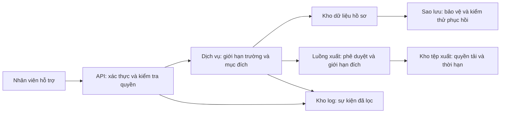

# Dữ liệu nhạy cảm

## 1. Hiểu đúng dữ liệu nhạy cảm trong thiết kế yêu cầu bảo mật

**Dữ liệu nhạy cảm** là dữ liệu mà việc bị truy cập, tiết lộ, sửa đổi hoặc sử dụng ngoài mục đích được phép có thể gây tác động đáng kể cho cá nhân, tổ chức hoặc hoạt động của hệ thống. Mức nhạy cảm phụ thuộc vào nội dung, ngữ cảnh sử dụng, người nhận, khả năng kết hợp với nguồn khác và hậu quả có thể xảy ra.

Một mật khẩu là dữ liệu nhạy cảm vì có thể mở đường truy cập vào hệ thống. Một bảng giá chưa công bố có thể nhạy cảm vì ảnh hưởng đến đàm phán. Một tập tọa độ không ghi tên vẫn có thể nhạy cảm nếu lịch sử di chuyển cho phép suy ra nơi ở hoặc danh tính của một người.

Trong phân loại dữ liệu, nhận diện dữ liệu nhạy cảm là đầu vào để quyết định mức bảo vệ. Trong thiết kế yêu cầu bảo mật, cần đi xa hơn nhãn phân loại: chỉ rõ ai được làm gì với dữ liệu, qua đường nào, với điều kiện nào và kiểm chứng bằng cách nào.

Chuỗi công việc cần có là:

**Nhận diện dữ liệu → xác định tác động và đe dọa → phân loại → đặc tả yêu cầu → bố trí kiểm soát trong kiến trúc → kiểm chứng.**

Sau bài học, bạn cần có khả năng:

- Nhận diện dữ liệu nhạy cảm trực tiếp và dữ liệu trở nên nhạy cảm do kết hợp hoặc suy luận.
- Phân biệt dữ liệu cá nhân, dữ liệu bí mật nghiệp vụ và thông tin xác thực.
- Xác định phạm vi bảo vệ trên dữ liệu chính, bản sao, log, tệp xuất và môi trường thử nghiệm.
- Viết yêu cầu về xác thực, phân quyền, che dữ liệu, lưu giữ, logging và phục hồi có tiêu chí đạt rõ ràng.
- Liên kết từng yêu cầu với rủi ro, chủ sở hữu và bằng chứng kiểm chứng.

Bài sử dụng góc nhìn quản trị và kỹ thuật. Thuật ngữ “dữ liệu nhạy cảm” trong bài có phạm vi rộng; các thuật ngữ pháp lý có tên tương tự cần được xác định riêng theo nghĩa vụ thực tế áp dụng cho tổ chức.

## 2. Những nhóm dữ liệu thường cần xem xét

Không nên chỉ tìm số giấy tờ hoặc số tài khoản rồi kết luận đã nhận diện đủ dữ liệu nhạy cảm. Thông tin nghiệp vụ, bí mật hệ thống và các dấu vết hoạt động cũng có thể tạo rủi ro lớn.

| Nhóm | Ví dụ | Tác động cần xem xét |
|---|---|---|
| Dữ liệu định danh và liên hệ | Họ tên, số điện thoại, địa chỉ, mã khách hàng có thể liên kết với một người | Giả mạo, lừa đảo, liên hệ ngoài mục đích, tiết lộ danh tính |
| Dữ liệu riêng tư hoặc có tác động lớn đến cá nhân | Hồ sơ sức khỏe, đặc điểm sinh học, thông tin đời sống riêng tư | Tổn hại quyền riêng tư, phân biệt đối xử, ảnh hưởng khó đảo ngược |
| Dữ liệu giao dịch và tài chính | Lịch sử mua hàng, thông tin thanh toán, dữ liệu đối soát | Gian lận, sai lệch giao dịch, lộ hoạt động kinh doanh |
| Thông tin xác thực và vật liệu mật mã | Mật khẩu, token, khóa API, khóa riêng, mã khôi phục | Chiếm quyền, giả danh dịch vụ, giải mã hoặc ký trái phép |
| Bí mật nghiệp vụ | Giá đàm phán, chiến lược sản phẩm, hợp đồng chưa công bố | Mất lợi thế cạnh tranh, vi phạm cam kết bảo mật |
| Thông tin vận hành và kiến trúc | Cấu hình nội bộ, bản sao cơ sở dữ liệu, sơ đồ quyền truy cập | Hỗ trợ tấn công, mở rộng phạm vi xâm nhập |
| Dữ liệu hành vi và vị trí | Lịch sử đăng nhập, truy cập, tìm kiếm, di chuyển | Theo dõi, suy luận đặc điểm cá nhân hoặc quan hệ |
| Dữ liệu suy ra và siêu dữ liệu | Nhãn đánh giá rủi ro, tên tệp, thời điểm xuất dữ liệu, người tham gia một nhóm | Tiết lộ thông tin dù không chứa nội dung gốc |

Các nhóm có thể chồng lấp. Một bản sao lưu có thể đồng thời chứa dữ liệu cá nhân, thông tin giao dịch và bí mật kỹ thuật. Một token có thể liên kết với một người nhưng rủi ro chính còn là khả năng sử dụng nó để thực hiện hành động.

Tên cột không đủ quyết định mức nhạy cảm. Cột `note` hoặc `description` có thể chứa thông tin riêng tư được nhập tự do; cột `id` có thể là mã ngẫu nhiên vô nghĩa bên ngoài hệ thống hoặc là định danh được nhiều bên cùng sử dụng.

### 2.1. Dữ liệu cá nhân không bao trùm mọi dữ liệu nhạy cảm

Dữ liệu về một cá nhân có thể cần bảo vệ ngay cả khi không phải bí mật kinh doanh. Ngược lại, một khóa ký phát hành ứng dụng hoặc kế hoạch mua lại doanh nghiệp vẫn có thể rất nhạy cảm dù không mô tả cá nhân nào.

Vì vậy, bộ câu hỏi phân loại không nên dừng ở “có dữ liệu cá nhân không?”. Cần hỏi thêm:

- Dữ liệu có cho phép truy cập, giả mạo hoặc thay đổi hệ thống không?
- Dữ liệu có làm lộ quyết định, hoạt động hoặc lợi thế của tổ chức không?
- Dữ liệu có thể gây thiệt hại nếu bị kết hợp, công bố hoặc sử dụng sai mục đích không?

### 2.2. Dữ liệu công khai vẫn có thể cần bảo vệ toàn vẹn và sẵn sàng

Một thông báo đã được phép công bố có thể ít nhạy cảm về bí mật. Tuy nhiên, sửa thông báo đó thành hướng dẫn thanh toán giả hoặc làm nó không truy cập được vẫn gây thiệt hại.

Phân loại về mức độ bí mật không thay thế đánh giá:

- **Tính bí mật:** ai được biết hoặc sử dụng dữ liệu?
- **Tính toàn vẹn:** dữ liệu phải chính xác, đầy đủ và không bị sửa trái phép thế nào?
- **Tính sẵn sàng:** dữ liệu cần có khi nào, và gián đoạn bao lâu thì gây tác động?

Một tập dữ liệu có thể cần bảo vệ rất cao ở một chiều và thấp hơn ở chiều khác. Yêu cầu bảo mật cần thể hiện các khác biệt đó.

## 3. Tính nhạy cảm phụ thuộc vào ngữ cảnh

### 3.1. Nội dung và mức độ chi tiết

Một thống kê tổng doanh thu đã công bố khác với danh sách giao dịch từng khách hàng. Thông tin ngày sinh đầy đủ thường cho phép liên kết chi tiết hơn một nhóm tuổi rộng. Tuy nhiên, giảm độ chi tiết không tự bảo đảm an toàn nếu tập dữ liệu vẫn chứa các thuộc tính dễ nhận diện khác.

Cần đánh giá đúng phiên bản dữ liệu được sử dụng: trường nào, độ chi tiết nào, khoảng thời gian nào và có dữ liệu tự do hay không.

### 3.2. Quy mô và khả năng kết hợp

Một bản ghi có thể gây tác động hạn chế, nhưng hàng triệu bản ghi làm tăng số người bị ảnh hưởng và khả năng phân tích hành vi. Một tập dữ liệu chỉ chứa mã khách hàng cũng có thể trở nên nhạy cảm khi kết hợp với bảng ánh xạ mã sang thông tin liên hệ.

Ví dụ:

- Tập A chứa mã người dùng và lịch sử truy cập.
- Tập B chứa mã người dùng và địa chỉ liên hệ.
- Người có quyền trên cả A và B có thể liên kết hoạt động với danh tính.

Đánh giá riêng từng tập mà bỏ qua quyền kết hợp có thể đánh giá thiếu rủi ro. Phân quyền cần xét cả những tập dữ liệu người dùng có thể truy cập đồng thời.

### 3.3. Đối tượng nhận và mục đích

Nhân viên hỗ trợ có thể cần số điện thoại để liên hệ theo một yêu cầu của khách hàng. Điều đó không đồng nghĩa họ được tải danh sách số điện thoại để phân tích tùy ý.

Quyền truy cập nên gắn với:

**Vai trò + hành động + đối tượng dữ liệu + mục đích được duyệt + điều kiện sử dụng.**

Điều kiện có thể là khách hàng thuộc nhóm đang phụ trách, yêu cầu hỗ trợ còn hiệu lực, môi trường truy cập được phép hoặc thời hạn quyền chưa hết.

### 3.4. Thời điểm và vòng đời

Một tài liệu có thể rất nhạy cảm trước ngày công bố và ít nhạy cảm hơn sau khi được công bố hợp lệ. Nhưng việc công bố một phần không làm các phụ lục, dữ liệu nguồn hoặc ghi chú nội bộ tự trở thành công khai.

Việc giảm mức phân loại cần có căn cứ, người có thẩm quyền phê duyệt và phạm vi phiên bản cụ thể. Không nên tự động hạ mức phân loại chỉ vì dữ liệu đã tồn tại lâu hoặc đã được gửi cho một đối tác.

### 3.5. Khả năng khắc phục sau khi bị lộ

Một token có thể bị vô hiệu hóa và cấp lại, dù vẫn phải xử lý hậu quả của thời gian bị sử dụng trái phép. Một số đặc điểm cá nhân hoặc thông tin đã bị phổ biến rộng khó thay đổi hoặc thu hồi.

Khi hậu quả khó đảo ngược, cần xem xét việc hạn chế thu thập, giảm số bản sao và giảm số người được tiếp cận ngay từ thiết kế.

## 4. Phân biệt các cách biến đổi dữ liệu

Che dữ liệu, thay mã, mã hóa và tổng hợp phục vụ những mục đích khác nhau. Không nên coi chúng là các cách tương đương để biến dữ liệu nhạy cảm thành dữ liệu công khai.

| Biện pháp | Ý nghĩa | Giới hạn cần đưa vào yêu cầu |
|---|---|---|
| Che dữ liệu | Ẩn một phần hoặc thay cách hiển thị một giá trị | Dữ liệu gốc có thể vẫn còn trong phản hồi API, trang web hoặc cơ sở dữ liệu |
| Thay định danh bằng mã thay thế | Dùng mã đại diện để giảm việc lộ định danh trực tiếp | Bảng ánh xạ và các thuộc tính còn lại có thể cho phép liên kết lại |
| Mã hóa | Biến đổi dữ liệu để chỉ bên có khả năng giải mã phù hợp đọc được | Không ngăn người dùng hoặc ứng dụng được cấp quyền giải mã sử dụng sai dữ liệu |
| Băm | Tạo giá trị đầu ra từ dữ liệu đầu vào để phục vụ một số mục đích kiểm tra hoặc đối chiếu | Giá trị đầu vào dễ đoán có thể bị dò; băm không tự tạo tính ẩn danh |
| Tổng hợp | Gộp các bản ghi thành thống kê | Nhóm quá nhỏ hoặc truy vấn chồng lấp có thể làm lộ thông tin về một người |
| Tạo dữ liệu tổng hợp | Tạo dữ liệu dùng cho kiểm thử hoặc phân tích theo phương pháp xác định | Cần đánh giá cách tạo; không mặc nhiên bảo đảm không tái hiện dữ liệu nguồn |
| Ẩn danh hóa | Xử lý nhằm giảm khả năng nhận diện cá nhân đến mức được đánh giá là phù hợp trong ngữ cảnh xác định | Cần xét nguồn phụ trợ, cách liên kết và điều kiện sử dụng; bỏ tên chưa đủ |

### 4.1. Che trên giao diện chưa phải giới hạn truy cập

Giả sử giao diện chỉ hiển thị `***` ở trường số điện thoại, nhưng phản hồi API vẫn chứa đầy đủ giá trị. Người có quyền mở công cụ mạng hoặc gọi trực tiếp API vẫn lấy được dữ liệu gốc.

Yêu cầu đúng phải xác định dữ liệu được trả về từ phía máy chủ cho từng quyền. Nếu người dùng không có quyền đọc một trường, hệ thống phải loại trường đó hoặc trả dạng đã được phê duyệt trước khi dữ liệu đến máy khách.

### 4.2. Thay mã vẫn cần bảo vệ

Mã `cust_demo_042` trong ví dụ là dữ liệu giả định. Trong hệ thống thật, một mã không chứa tên vẫn có thể liên kết với hóa đơn, log, email hoặc các tập dữ liệu khác.

Nếu giữ bảng ánh xạ, cần kiểm soát riêng bảng đó, danh tính được truy cập và thao tác liên kết lại. Các tập dữ liệu đã thay mã không nên được giảm mức bảo vệ chỉ vì không còn cột họ tên.

### 4.3. Mã hóa không thay cho phân quyền và quản lý khóa

Mã hóa khi truyền và khi lưu giúp giảm một số nguy cơ lộ dữ liệu. Nếu ứng dụng có quyền đọc dữ liệu gốc và trả dữ liệu đó cho sai người, mã hóa không khắc phục được lỗi phân quyền.

Yêu cầu cần xét cả:

- Danh tính nào được yêu cầu giải mã.
- Phạm vi dữ liệu được giải mã.
- Ai được quản trị khóa và ai được sử dụng khóa.
- Cách thay đổi hoặc thu hồi quyền sử dụng khóa.
- Khả năng phục hồi dữ liệu khi có sự cố về khóa.

Không đặt khóa giải mã cùng một nơi, cùng phạm vi quyền với mọi bản sao dữ liệu rồi coi việc mã hóa đã giải quyết đầy đủ rủi ro.

## 5. Nhận diện và lập hồ sơ dữ liệu nhạy cảm

### 5.1. Bắt đầu từ luồng dữ liệu và mục đích sử dụng

Cần xác định dữ liệu được thu thập ở đâu, xử lý bởi thành phần nào và đi đến những đích nào. Phạm vi thường rộng hơn cơ sở dữ liệu chính:

- Biểu mẫu, tệp tải lên và dữ liệu nhập từ đối tác.
- API, hàng đợi, bộ nhớ đệm và chỉ mục tìm kiếm.
- Cơ sở dữ liệu, kho phân tích và bản sao đọc.
- Log, trace, thông báo lỗi và công cụ theo dõi.
- Tệp xuất, báo cáo, thông báo qua kênh liên lạc.
- Bản sao lưu, kho lưu trữ dài hạn và môi trường thử nghiệm.
- Dữ liệu tạm trên máy làm việc hoặc tại nhà cung cấp.

Công cụ dò tìm mẫu có thể hỗ trợ phát hiện, nhưng không thay thế hiểu biết nghiệp vụ. Nó có thể bỏ sót dữ liệu tự do, dữ liệu đã mã hóa, bí mật có định dạng riêng hoặc thông tin nhạy cảm chỉ xuất hiện khi kết hợp.

Để đánh giá kết quả dò tìm, có thể dùng một tập mẫu đã gán nhãn và được bảo vệ phù hợp. Cần xem cả trường hợp phát hiện nhầm lẫn trường hợp bỏ sót, thay vì chỉ đếm số kết quả tìm thấy.

### 5.2. Thông tin tối thiểu cần ghi nhận

| Thuộc tính | Câu hỏi cần trả lời |
|---|---|
| Mã tập dữ liệu và trường | Đang nói đến dữ liệu nào và phiên bản cấu trúc nào? |
| Nội dung, nguồn và mục đích | Dữ liệu đến từ đâu, có thật sự cần cho mục đích đã duyệt không? |
| Chủ sở hữu và người quản lý | Ai quyết định mức bảo vệ, ai triển khai và cung cấp bằng chứng? |
| Mức phân loại và căn cứ | Tác động nào khiến dữ liệu cần mức bảo vệ đó? |
| Vị trí, môi trường và bản sao | Dữ liệu đang tồn tại hoặc được tạo ra ở đâu? |
| Đường truy cập và người nhận | Ai có thể đọc, sửa, xuất hoặc chia sẻ? |
| Thời hạn và điều kiện lưu giữ | Khi nào phải xóa, khi nào phải tạm giữ theo quyết định có thẩm quyền? |
| Quan hệ và khả năng liên kết | Có mã nối, bảng ánh xạ hoặc nguồn phụ trợ nào? |
| Yêu cầu và bằng chứng | Những kiểm soát nào bắt buộc, kiểm chứng ở đâu? |
| Thời điểm rà soát | Khi nào cần đánh giá lại, ai xác nhận kết quả? |

Hồ sơ này cũng có thể nhạy cảm vì mô tả nơi chứa dữ liệu và đường truy cập. Không ghi mật khẩu, token đang hoạt động hoặc khóa bí mật vào danh mục phân loại.

### 5.3. Phân loại ở cấp trường và cấp tập dữ liệu

Ví dụ một tập hồ sơ khách hàng có các trường sau:

| Trường | Tính chất cần xem xét | Hướng yêu cầu |
|---|---|---|
| `customer_id` | Định danh dùng để liên kết nhiều nguồn | Hạn chế truy vấn chéo, kiểm soát liên kết và xuất |
| `display_name` | Có thể nhận diện hoặc hỗ trợ nhận diện | Chỉ trả cho vai trò và nghiệp vụ cần thiết |
| `contact_phone` | Thông tin liên hệ trực tiếp | Che hoặc loại bỏ theo quyền, hạn chế xuất |
| `support_note` | Nội dung tự do, có thể chứa thông tin riêng tư ngoài dự kiến | Giới hạn thu thập, rà soát nội dung, hạn chế log và tìm kiếm |
| `account_status` | Có thể tiết lộ trạng thái quan hệ với dịch vụ | Giới hạn người xem, kiểm soát tính toàn vẹn |
| `recovery_token` | Thông tin có thể cấp khả năng truy cập | Không đưa vào tập trả lời nghiệp vụ thông thường; quản lý theo vòng đời bí mật |

Một tập dữ liệu chứa trường cần bảo vệ cao không nên bị giảm mức bảo vệ vì đa số trường còn lại ít nhạy cảm. Nếu muốn tạo phiên bản ít nhạy cảm hơn, cần mô tả phép biến đổi, trường được giữ, khả năng liên kết và phê duyệt phiên bản đầu ra.

Những nhãn như “Công khai”, “Nội bộ”, “Bí mật”, “Hạn chế” chỉ có ý nghĩa khi tổ chức định nghĩa tiêu chí và cách xử lý tương ứng. Tên nhãn trong bài là ví dụ, không phải thang phân loại bắt buộc.

## 6. Tình huống xuyên suốt: dữ liệu hồ sơ khách hàng

Xét một nền tảng có tập dữ liệu **DATA-CUST-005**, phục vụ hỗ trợ khách hàng. Đây là tình huống giả định; các thời hạn và ngưỡng ở phần yêu cầu là lựa chọn minh họa cần được đánh giá lại trước khi áp dụng.

Phạm vi gồm dữ liệu hồ sơ trong môi trường sản xuất, bản sao đọc, tệp xuất được duyệt, log liên quan và bản sao lưu. Dữ liệu kiểm thử hoàn toàn giả định có hồ sơ riêng; nếu sao chép dữ liệu thật sang môi trường kiểm thử, bản sao đó vẫn thuộc phạm vi cần bảo vệ.

- **Chủ sở hữu:** vai trò phụ trách nghiệp vụ hỗ trợ khách hàng, gắn với người đương nhiệm.
- **Người quản lý:** nhóm vận hành ứng dụng và dữ liệu theo phân công.
- **Mục đích:** giải quyết yêu cầu hỗ trợ được giao.
- **Vai trò hỗ trợ thông thường:** xem trạng thái và thông tin hiển thị đã duyệt của khách hàng được phân công.
- **Quyền xem thông tin liên hệ đầy đủ:** cấp riêng khi có nhu cầu hỗ trợ hợp lệ.
- **Quyền xuất dữ liệu:** tách khỏi quyền xem từng hồ sơ, cần phê duyệt riêng.
- **Mức phân loại:** “Hạn chế” theo chính sách minh họa, dựa trên tác động đến khách hàng khi bị lộ hoặc dùng sai mục đích.

Các đe dọa chính gồm:

1. Tài khoản hợp lệ đọc hồ sơ ngoài phạm vi được giao.
2. API hoặc log trả thêm dữ liệu nhạy cảm ngoài dự kiến.
3. Người dùng xuất nhiều hồ sơ và chuyển đến nơi không được duyệt.
4. Token khôi phục hoặc thông tin xác thực bị ghi vào log.
5. Bản sao ở môi trường thử nghiệm hoặc sao lưu không có kiểm soát tương ứng.
6. Dữ liệu bị sửa hoặc xóa trái phép, khiến hoạt động hỗ trợ gián đoạn hoặc đưa ra quyết định sai.

Phân loại đã giúp xác định nhu cầu bảo vệ, nhưng chưa phải một đặc tả. Phần tiếp theo chuyển các đe dọa này thành yêu cầu cụ thể.

## 7. Chuyển phân loại thành yêu cầu bảo mật

Một yêu cầu nên nêu rõ tài sản, điều kiện, hành vi bắt buộc, giới hạn, người chịu trách nhiệm và cách xác minh. Câu “dữ liệu nhạy cảm phải được bảo vệ” không đủ để triển khai hoặc kiểm thử.

Khuôn có thể dùng:

> Với [dữ liệu và phạm vi], khi [điều kiện], [thành phần hoặc vai trò] phải [hành vi]. Giới hạn là [tập trường, phạm vi đối tượng, thời gian hoặc ngưỡng]. Bằng chứng gồm [đầu ra]. Kiểm chứng bằng [phương pháp và điều kiện đạt].

Chủ sở hữu phê duyệt nhu cầu nghiệp vụ và giới hạn sử dụng; nhóm triển khai đưa yêu cầu vào hệ thống; người kiểm chứng đối chiếu hành vi thực tế với đặc tả. Nếu có ngoại lệ, quyết định phải có người có thẩm quyền, phạm vi, thời hạn và biện pháp bù đắp.

### 7.1. Nhận diện trước khi phát hành

**SD-INV-01 — Kiểm kê và phân loại.** Trước khi phát hành một cấu trúc dữ liệu mới hoặc thay đổi trường của DATA-CUST-005, phải cập nhật danh sách trường, mục đích, mức phân loại, chủ sở hữu, đích lưu trữ và các đích nhận dữ liệu. Quy trình phát hành phải kiểm tra phê duyệt phân loại cho phiên bản cấu trúc đó.

**Kiểm chứng:** thử phát hành thay đổi thêm một trường nhưng chưa có hồ sơ tương ứng; quy trình phải chặn. Khi hồ sơ hợp lệ, đối chiếu danh sách trường với cấu trúc và hợp đồng API thực tế.

Yêu cầu này giúp tránh tình trạng hệ thống đã thu thập dữ liệu mới trong khi ma trận quyền và cơ chế lọc log vẫn dùng phiên bản cũ.

### 7.2. Xác thực và phạm vi quyền

**SD-AUTH-01 — Xác thực cho thao tác nhạy cảm.** Các thao tác xem thông tin liên hệ đầy đủ, xuất dữ liệu và quản trị DATA-CUST-005 phải yêu cầu danh tính cá nhân đã xác thực đa yếu tố theo chính sách của tình huống. Danh tính dịch vụ phải có phạm vi quyền riêng và không được dùng như tài khoản tương tác dùng chung.

**Kiểm chứng:** thực hiện từng thao tác qua mọi đường đã kiểm kê, gồm API và công cụ quản trị; phiên chưa đáp ứng điều kiện xác thực phải bị từ chối. Đối chiếu danh tính dịch vụ với danh sách nghiệp vụ được phép.

**SD-ACC-01 — Kiểm tra quyền theo đối tượng và hành động.** Mỗi yêu cầu đọc hoặc thay đổi hồ sơ phải được máy chủ kiểm tra quyền theo vai trò, thao tác và khách hàng được phân công. Có quyền đọc không tự có quyền sửa hoặc xuất. Giá trị mã khách hàng hoặc nhãn quyền do máy khách gửi không được coi là bằng chứng cấp quyền.

**Kiểm chứng:** dùng tài khoản được giao khách hàng A để yêu cầu hồ sơ B, đổi mã đối tượng trong URL và gửi truy vấn theo lô chứa cả A lẫn B. Hệ thống phải xử lý theo hợp đồng đã định và không trả trường hay sự tồn tại của đối tượng ngoài quyền qua nội dung lỗi không cần thiết. Kiểm tra riêng thao tác sửa và xuất bằng tài khoản chỉ có quyền đọc.

Chính sách cấp quyền cần được thực thi ở mọi đường truy cập phù hợp. Một đường truy vấn trực tiếp hoặc một bản sao đọc có quyền rộng hơn có thể vô hiệu hóa giới hạn của API.

### 7.3. Giới hạn trường dữ liệu và thu thập tối thiểu

**SD-VIEW-01 — Danh sách trường được phép trả về.** Phản hồi cho vai trò hỗ trợ thông thường chỉ chứa các trường đã được duyệt cho nghiệp vụ. Trường liên hệ đầy đủ và token khôi phục phải bị loại khỏi phản hồi đó từ phía máy chủ. Thêm một trường vào mô hình lưu trữ không được tự động thêm trường đó vào phản hồi API.

**Kiểm chứng:** đối chiếu hợp đồng phản hồi với dữ liệu trả về; kiểm tra trường lồng nhau, quan hệ mở rộng, tham số chọn trường, đường tải tệp và phản hồi lỗi. Thử thêm một trường giả định vào dữ liệu lưu trữ và xác nhận nó không tự xuất hiện trong đầu ra.

Đối với thu thập mới, chủ sở hữu phải trả lời “cần trường này để thực hiện nghiệp vụ nào?”. Nếu không có mục đích được duyệt, không nên thu thập chỉ vì có thể hữu ích về sau.

Trường ghi chú tự do cần hướng dẫn người dùng không nhập thông tin không cần thiết. Cảnh báo ở giao diện chỉ là một phần: còn cần giới hạn nơi hiển thị, tìm kiếm, xuất và ghi log của trường đó.

### 7.4. Quyền xuất và chia sẻ

**SD-EXP-01 — Xuất dữ liệu có phê duyệt và thời hạn.** Mỗi lần xuất hàng loạt phải gắn với yêu cầu được chủ sở hữu hoặc người được ủy quyền phê duyệt. Phê duyệt phải xác định người yêu cầu, tập đối tượng, tập trường, mục đích và nơi nhận được phép. Người yêu cầu không được tự phê duyệt.

Tệp xuất chỉ được tạo trong kho đã chỉ định, kiểm tra quyền ở mỗi lần tải và không được công khai bằng URL không cần xác thực. Tệp phải được xóa khỏi kho xuất trong tối đa 24 giờ kể từ khi tạo xong, trừ trường hợp tạm giữ đã được phê duyệt. Khi quyền bị thu hồi, yêu cầu tải tiếp theo phải bị từ chối dù người dùng vẫn giữ đường dẫn cũ.

**Kiểm chứng:** thử yêu cầu thiếu phê duyệt, người duyệt không đúng phạm vi, thêm trường ngoài phê duyệt, dùng danh tính khác tải tệp, tải sau thu hồi quyền và tải sau hết hạn. Kiểm tra nội dung thực tế cùng trạng thái xóa tại kho xuất, không chỉ thông báo trên giao diện.

Thời hạn tải không thu hồi được bản đã tải về. Vì vậy, quyết định xuất còn phải xét quyền lưu trữ tại nơi nhận, việc chuyển tiếp, thời hạn sử dụng và bằng chứng xử lý ở đích. Tệp xuất không tự trở thành ít nhạy cảm hơn cơ sở dữ liệu nguồn.

### 7.5. Logging có ích mà không làm lộ dữ liệu

**SD-LOG-01 — Ghi sự kiện bằng cấu trúc cho phép.** Đọc thông tin liên hệ đầy đủ, thay đổi dữ liệu, cấp hoặc thu hồi quyền và xuất hàng loạt phải tạo sự kiện kiểm toán. Sự kiện phải có mã yêu cầu, danh tính tác động, hành động, mã đối tượng phù hợp, thời điểm, kết quả và mã phê duyệt nếu có.

Log không được chứa mật khẩu, token, khóa bí mật, giá trị liên hệ đầy đủ hoặc toàn bộ nội dung hồ sơ. Với tình huống này, log kiểm toán được lưu 30 ngày; quyền đọc và sửa/xóa log phải tách theo vai trò đã duyệt. Người vận hành dữ liệu không mặc nhiên được sửa hoặc xóa log kiểm toán.

**Kiểm chứng:** sinh từng loại sự kiện và đối chiếu cấu trúc; gửi giá trị đánh dấu giả định vào header, tham số URL, thân yêu cầu và các nhánh lỗi để xác nhận không bị ghi ra log hoặc trace. Thử truy cập, sửa và xóa log bằng vai trò không được cấp quyền.

Một sự kiện minh họa chỉ dùng giá trị giả định:

```json
{
  "event_type": "customer.contact.read",
  "actor_ref": "staff_demo_017",
  "subject_ref": "cust_demo_042",
  "request_id": "req_demo_103",
  "purpose_ref": "support_case_demo_208",
  "result": "denied"
}
```

Mã tham chiếu giúp điều tra nhưng vẫn có thể liên kết về một người. Vì vậy, log có cấu trúc không tự trở thành dữ liệu công khai. Không ghi nguyên nội dung yêu cầu rồi kỳ vọng sẽ xóa hết trường nhạy cảm về sau; một số trường có thể đã đi qua nhiều hệ thống thu thập log.

### 7.6. Mã hóa và bí mật phục vụ truy cập

**SD-CRY-01 — Bảo vệ đường truyền, bản lưu và quyền giải mã.** Các đường truyền, bản lưu và bản sao lưu trong phạm vi DATA-CUST-005 phải sử dụng cơ chế mã hóa theo hồ sơ thiết kế đã phê duyệt. Hồ sơ phải ghi rõ cơ chế, tham số cấu hình, cách xác minh đích kết nối, nơi quản lý khóa, danh tính được sử dụng khóa và quy trình phục hồi khóa.

Quyền quản trị tài nguyên lưu trữ không được tự động kéo theo quyền đọc dữ liệu gốc. Những vai trò cần cả hai quyền phải được phê duyệt rõ ràng. Mật khẩu, token khôi phục và khóa API phải có quy tắc riêng về cấp, sử dụng, hết hạn, thu hồi và xử lý khi nghi bị lộ.

**Kiểm chứng:** đối chiếu cấu hình với phiên bản hồ sơ đã duyệt; thử đường kết nối không đáp ứng điều kiện bảo vệ, danh tính không có quyền giải mã và trường hợp xác minh đích thất bại. Kiểm tra bản sao lưu và quyền tại dịch vụ quản lý khóa, không chỉ cơ sở dữ liệu chính.

Không đưa bí mật đang hoạt động vào mã nguồn, cấu hình công khai hoặc log. Nếu bí mật bị lộ, chỉ xóa bản ghi chứa bí mật chưa bảo đảm an toàn; cần xem xét vô hiệu hóa hoặc thay thế theo quy trình sự cố và điều tra việc sử dụng.

### 7.7. Lưu giữ, xóa và phục hồi

**SD-RET-01 — Xóa theo lịch lưu giữ có căn cứ.** Mỗi nhóm trường phải có mục đích, sự kiện bắt đầu tính thời hạn và thời hạn được chủ sở hữu phê duyệt. Trong tình huống này, dữ liệu đã được xác nhận hết hạn lưu giữ và không thuộc quyết định tạm giữ phải bị xóa khỏi các bản lưu đang hoạt động trong tối đa 24 giờ sau thời điểm hết hạn.

Bản sao lưu có chu kỳ lưu tối đa 30 ngày. Bản sao lưu không hỗ trợ xóa chọn lọc phải được hạn chế sử dụng, tự hết hạn theo lịch và áp dụng lại danh sách xóa trước khi dữ liệu phục hồi được đưa vào phục vụ. Danh sách xóa phải được bảo vệ, chứa lượng thông tin tối thiểu để thực thi và còn hiệu lực khi các bản sao có thể phục hồi vẫn tồn tại.

**Kiểm chứng:** tạo bản ghi thử với các mốc hết hạn khác nhau, có và không có tạm giữ; chạy theo lịch vận hành được định nghĩa, đối chiếu cơ sở dữ liệu, bản sao đọc, chỉ mục và bộ nhớ đệm thuộc phạm vi. Phục hồi từ bản sao trước khi xóa và xác nhận bản ghi đã xóa không tái xuất hiện trong dịch vụ.

Cần phân biệt hết hạn quyền truy cập, xóa bản ghi tại nguồn và xử lý mọi bản sao liên quan. Chúng là các đầu ra khác nhau và có thể cần phương pháp kiểm chứng khác nhau.

**SD-REC-01 — Phục hồi đúng dữ liệu và đúng quyền.** Trong kịch bản sự cố đã duyệt, mục tiêu mất dữ liệu tối đa RPO là 15 phút và mục tiêu phục hồi dịch vụ RTO là 4 giờ. Kiểm thử theo quý và sau thay đổi lớn ảnh hưởng phục hồi. Dữ liệu phục hồi phải qua kiểm tra toàn vẹn, áp dụng lại phân quyền hiện hành và các quyết định xóa trước khi mở truy cập.

RPO đo mức lùi dữ liệu có thể phục hồi so với thời điểm sự cố; RTO được đo từ lúc sự cố làm nghiệp vụ không đáp ứng đến lúc nghiệp vụ đã chọn hoạt động và qua kiểm tra chấp nhận.

**Kiểm chứng:** phục hồi trong môi trường cô lập; đo các mốc, kiểm tra tính đầy đủ của giao dịch, quyền đọc/sửa, phiên hoặc bí mật đã bị thu hồi và việc xử lý dữ liệu đã xóa. Không đưa bí mật cũ trở lại hoạt động chỉ vì chúng có mặt trong bản sao lưu.

### 7.8. Bản sao dùng cho phát triển và thử nghiệm

**SD-ENV-01 — Kiểm soát dữ liệu ngoài sản xuất.** Môi trường phát triển mặc định chỉ được dùng bộ dữ liệu giả định đã phê duyệt. Việc dùng dữ liệu sản xuất phải có ngoại lệ xác định mục đích, tập trường, người nhận, thời hạn, phép biến đổi và kiểm soát môi trường đích.

**Kiểm chứng:** đối chiếu nguồn gốc bộ dữ liệu, yêu cầu phê duyệt, dữ liệu còn lại sau biến đổi và quyền truy cập thực tế. Kiểm tra cả bản tải xuống, ảnh chụp màn hình phục vụ hỗ trợ và công cụ theo dõi lỗi có thu thập nội dung từ môi trường đó.

Chuyển dữ liệu thật sang môi trường thử nghiệm không làm giảm tính nhạy cảm. Một môi trường ít kiểm soát hơn thậm chí có thể làm rủi ro tăng lên.

## 8. Đặt kiểm soát ở đúng điểm trong kiến trúc

Sơ đồ dưới đây mô tả các đường dữ liệu cần xem xét. Đây là sơ đồ khái niệm, không phải cấu hình triển khai.



Các điểm cần chú ý:

- API phải kiểm tra quyền trước khi trả dữ liệu; không giao quyết định này hoàn toàn cho giao diện.
- Dịch vụ phải tạo đầu ra theo danh sách trường được phép, tránh trả nguyên đối tượng lưu trữ.
- Luồng xuất phải có chính sách riêng, vì xuất hàng loạt có tác động khác với xem từng hồ sơ.
- Log cần được lọc tại nơi phát sinh, trước khi chuyển đến hệ thống thu thập.
- Kho dữ liệu, bản sao đọc và công cụ quản trị cần chính sách truy cập phù hợp để tránh đường vòng.
- Sao lưu cần bảo vệ bí mật, kiểm tra toàn vẹn và cơ chế phục hồi đáp ứng nhu cầu nghiệp vụ.
- Tệp xuất, bản sao và log cần được đăng ký là các đích dữ liệu có trách nhiệm quản lý rõ ràng.

Một yêu cầu có thể cần nhiều điểm kiểm soát. Ngược lại, một cơ chế như mã hóa không đủ thay thế mọi yêu cầu bảo vệ dữ liệu nhạy cảm.

### 8.1. Logic quyết định minh họa

```text
Khi nhận yêu cầu đọc hồ sơ:
    Xác minh danh tính và trạng thái phiên.
    Xác định vai trò và phạm vi từ nguồn tin cậy phía máy chủ.
    Kiểm tra quyền đối với hành động và hồ sơ được yêu cầu.
    Nếu thiếu điều kiện: từ chối và ghi sự kiện không chứa dữ liệu gốc.
    Nếu đủ điều kiện:
        Chọn tập trường được phép cho nghiệp vụ hiện tại.
        Tạo phản hồi từ tập trường đó.
        Ghi sự kiện theo cấu trúc đã duyệt.
        Trả phản hồi.

Khi gặp trường hoặc nhãn chưa có trong chính sách:
    Không tự đưa trường đó vào đầu ra.
    Chuyển sang quy trình phân loại và phê duyệt thay đổi.
```

Đoạn trên là mã giả để diễn đạt yêu cầu. Một triển khai thực tế còn phải xử lý nhất quán giao dịch, lỗi, truy cập đồng thời và thay đổi quyền trong lúc xử lý.

## 9. Liên kết rủi ro, yêu cầu và bằng chứng

Một bảng truy vết giúp giải thích vì sao có yêu cầu và kiểm tra xem đe dọa nào chưa được xử lý.

| Rủi ro hoặc đe dọa | Yêu cầu chính | Bằng chứng phù hợp |
|---|---|---|
| Có trường mới nhưng chưa được phân loại | SD-INV-01, SD-VIEW-01 | Hồ sơ phiên bản cấu trúc, kết quả chặn phát hành, hợp đồng phản hồi |
| Tài khoản hợp lệ đọc hồ sơ ngoài phạm vi | SD-AUTH-01, SD-ACC-01 | Ma trận quyền, log quyết định, kiểm thử theo đối tượng |
| Giao diện che nhưng API vẫn trả dữ liệu gốc | SD-VIEW-01 | Phản hồi mạng đã kiểm tra, kết quả kiểm thử trường lồng nhau |
| Tệp xuất bị chia sẻ rộng hoặc giữ quá hạn | SD-EXP-01, SD-RET-01 | Phê duyệt, nội dung tệp, cấu hình kho xuất, kết quả kiểm tra hết hạn |
| Log làm lộ token hoặc dữ liệu hồ sơ | SD-LOG-01 | Cấu trúc sự kiện, thử nghiệm nhánh lỗi, cấu hình thu thập log |
| Bản sao bị đọc bởi người không có quyền giải mã | SD-CRY-01 | Cấu hình mã hóa, quyền khóa, thử nghiệm truy cập bị từ chối |
| Phục hồi làm tái xuất hiện dữ liệu đã xóa hoặc quyền cũ | SD-RET-01, SD-REC-01 | Biên bản phục hồi, đối chiếu danh sách xóa, kiểm tra quyền hiện hành |
| Dữ liệu sản xuất bị dùng tùy ý ở môi trường phát triển | SD-ENV-01 | Nguồn gốc bộ dữ liệu, ngoại lệ, quyền và kết quả kiểm tra môi trường |

Bằng chứng phải chứng minh được yêu cầu tương ứng. Ảnh chụp một mục cấu hình mã hóa không chứng minh rằng người dùng chỉ đọc đúng hồ sơ được giao. Kết quả quét không thấy số điện thoại không chứng minh rằng tập dữ liệu không thể liên kết về cá nhân.

Khi thay đổi kiến trúc hoặc mục đích sử dụng, cần cập nhật bảng truy vết. Thêm công cụ phân tích hoặc nhà cung cấp hỗ trợ có thể tạo đích dữ liệu và phạm vi người nhận mới.

## 10. Những sai lầm thường gặp

| Sai lầm | Vì sao chưa đủ | Cách điều chỉnh |
|---|---|---|
| Chỉ coi số giấy tờ hoặc dữ liệu thanh toán là nhạy cảm | Bỏ sót bí mật hệ thống, dữ liệu hành vi và bí mật nghiệp vụ | Đánh giá tác động, mục đích và khả năng kết hợp |
| Gắn một nhãn chung rồi không ghi cách xử lý | Không tạo được quyết định kỹ thuật hoặc tiêu chí kiểm thử | Gắn nhãn với yêu cầu về quyền, đầu ra, lưu giữ và bằng chứng |
| Bỏ tên là coi đã ẩn danh | Các thuộc tính khác vẫn có thể liên kết về một người | Đánh giá lại định danh gián tiếp và nguồn phụ trợ |
| Băm định danh dễ đoán rồi công bố | Có thể dò đầu vào hoặc liên kết nhiều tập dữ liệu | Đánh giá khả năng đoán, liên kết và mục đích công bố |
| Mã hóa cơ sở dữ liệu nhưng cấp quyền đọc quá rộng | Người có quyền vẫn nhận dữ liệu gốc | Kết hợp phân quyền, giới hạn trường và kiểm soát xuất |
| Che ở giao diện nhưng giữ dữ liệu gốc trong API | Người dùng vẫn có thể lấy dữ liệu ngoài giao diện | Lọc đầu ra tại máy chủ theo quyền |
| Ghi toàn bộ yêu cầu để dễ điều tra | Log trở thành một bản sao nhạy cảm khó kiểm soát | Ghi sự kiện có cấu trúc, chỉ giữ trường cần thiết |
| Cho rằng quyền xem bao gồm quyền xuất | Quy mô và khả năng chuyển tiếp dữ liệu tăng rủi ro | Tách quyền và phê duyệt xuất |
| Chỉ xóa tại cơ sở dữ liệu chính | Dữ liệu vẫn còn ở bản sao, chỉ mục hoặc tệp xuất | Xác định phạm vi và kiểm chứng từng đích |
| Có sao lưu là coi đã phục hồi được | Có thể thiếu khóa, cấu hình hoặc phục hồi quyền cũ | Kiểm thử nghiệp vụ, quyền và dữ liệu sau phục hồi |
| Chuyển trách nhiệm hoàn toàn cho nhà cung cấp | Không còn đầu mối nội bộ quyết định mục đích và xác nhận đáp ứng | Giữ chủ sở hữu nội bộ, đặc tả trách nhiệm và bằng chứng nhận từ nhà cung cấp |

## 11. Bài tập thực hành

Một hệ thống tiếp nhận yêu cầu hỗ trợ lưu các trường:

```text
case_id
customer_id
contact_email
issue_title
issue_description
attachment
assigned_staff_id
resolution_status
created_at
```

Nhân viên chỉ được xử lý yêu cầu được phân công. Nhóm phân tích muốn nhận dữ liệu để tìm loại lỗi thường gặp. Nhóm phát triển muốn có dữ liệu để tái hiện lỗi. Các tệp đính kèm có thể chứa ảnh chụp màn hình do khách hàng gửi.

Thực hiện:

1. Xác định trường nhạy cảm trực tiếp, trường có thể nhạy cảm do nội dung tự do và trường có thể liên kết với nguồn khác.
2. Vẽ các đích dữ liệu, gồm log, tệp xuất, bản sao lưu và dữ liệu phục vụ phát triển.
3. Ghi chủ sở hữu, người quản lý và căn cứ phân loại của từng tập đầu ra.
4. Thiết kế một phiên bản dữ liệu cho nhóm phân tích theo mục đích đã nêu; giải thích vì sao từng trường còn lại là cần thiết.
5. Viết yêu cầu đọc theo người được phân công, yêu cầu xuất và yêu cầu không ghi dữ liệu gốc vào log.
6. Với mỗi yêu cầu, đưa ra một trường hợp hợp lệ, một trường hợp phải bị từ chối và bằng chứng cần thu.
7. Mô tả cách xử lý khi phục hồi bản sao lưu chứa một yêu cầu hỗ trợ đã hết hạn lưu giữ.

Gợi ý tự đánh giá:

- Không mặc định tệp đính kèm hoặc nội dung mô tả chỉ chứa thông tin kỹ thuật.
- Không coi thay email bằng mã là đủ để chia sẻ toàn bộ nội dung tự do.
- Không dùng thao tác che giao diện để chứng minh API không lộ dữ liệu.
- Không gửi dữ liệu thật sang môi trường phát triển khi chưa có quyết định và kiểm soát tương ứng.
- Không chấp nhận câu “đã bảo vệ” nếu chưa chỉ ra hành vi, phạm vi và tiêu chí đạt.

## 12. Các câu hỏi cần trả lời trước khi chốt yêu cầu

Trước khi chấp nhận một đặc tả cho dữ liệu nhạy cảm, cần trả lời được:

- Dữ liệu nào nhạy cảm, trong ngữ cảnh nào và tác động là gì?
- Ai có thẩm quyền quyết định mục đích, phân loại và người nhận?
- Dữ liệu đang tồn tại ở những bản sao, môi trường và đường truyền nào?
- Ai được đọc, sửa, xuất hoặc liên kết dữ liệu, với điều kiện nào?
- Trường mới hoặc trường chưa phân loại có được ngăn xuất hiện ngoài dự kiến không?
- Log và công cụ theo dõi có đang tạo thêm bản sao dữ liệu gốc không?
- Cơ chế lưu giữ, xóa và phục hồi có nhất quán với nhau không?
- Mỗi yêu cầu có bằng chứng và phương pháp kiểm chứng phù hợp không?

Một nhãn phân loại hữu ích phải dẫn đến hành vi bảo vệ cụ thể. Khi dữ liệu nhạy cảm được nối với rủi ro, quyền quyết định, kiến trúc và tiêu chí kiểm thử, nhóm phát triển mới có cơ sở để triển khai và chứng minh hệ thống đáp ứng yêu cầu.
