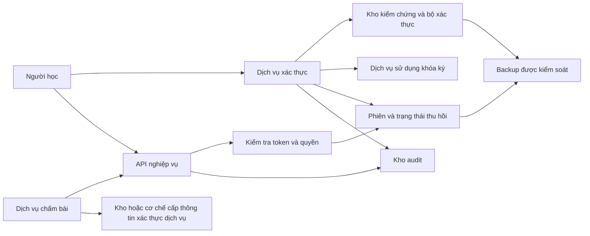

# Dữ liệu xác thực

## 1. Mục tiêu và phạm vi bài học

Dữ liệu xác thực là dữ liệu được dùng để chứng minh, kiểm chứng hoặc duy trì sự xác nhận về danh tính của người dùng, dịch vụ hay thiết bị. Nhóm này bao gồm mật khẩu, dữ liệu kiểm chứng mật khẩu, khóa của bộ xác thực, mã khôi phục, token và thông tin phiên. Một số thành phần là bí mật; một số được phép công khai nhưng phải được bảo vệ chặt về tính toàn vẹn.

Trong chương **Phân loại dữ liệu** của module yêu cầu bảo mật, mục tiêu là xác định dữ liệu nào có thể trao quyền truy cập, hậu quả khi bị lộ hoặc sửa đổi và yêu cầu cụ thể để kiểm soát các hậu quả đó.

Sau bài học, bạn có thể:

- Phân biệt định danh, bí mật xác thực, dữ liệu kiểm chứng và thông tin phiên.
- Phân loại theo khả năng giả mạo, phạm vi quyền, thời gian có hiệu lực và khả năng thu hồi.
- Đặc tả yêu cầu về lưu trữ, truyền tải, phân quyền, logging, luân chuyển và phục hồi.
- Liên kết yêu cầu với rủi ro, thành phần kiến trúc và tiêu chí kiểm thử.
- Xử lý tình huống rò rỉ mà không làm sống lại thông tin xác thực đã bị thu hồi.

Các tên mức phân loại và ngưỡng thời gian trong bài là **quy ước minh họa**, cần được chủ sở hữu hệ thống xác nhận trước khi áp dụng. Bài học không đưa ra một cấu hình mật mã dùng chung cho mọi hệ thống.

## 2. Phân biệt các loại dữ liệu liên quan đến xác thực

### 2.1. Định danh không đồng nghĩa với bằng chứng xác thực

Tên đăng nhập, mã người dùng hoặc mã ứng dụng giúp chỉ ra chủ thể đang được nhắc tới. Chúng thường không đủ để chứng minh người gửi yêu cầu là chủ thể đó.

Ví dụ:

- Mã học viên cho biết tài khoản nào đang được truy cập.
- Mật khẩu và yếu tố bổ sung có thể được dùng để xác thực tài khoản.
- Cookie phiên cho phép hệ thống liên kết các yêu cầu tiếp theo với phiên đã xác thực.
- Vai trò và chính sách quyền quyết định phiên đó được làm gì.

**Xác thực** trả lời câu hỏi danh tính nào đã được kiểm chứng. **Phân quyền** trả lời danh tính đó được phép thực hiện hành động nào trên tài nguyên nào. Token hợp lệ không tự cấp mọi quyền trên hệ thống.

Định danh vẫn có thể là dữ liệu riêng tư hoặc nhạy cảm trong bối cảnh cụ thể. Việc không phải bí mật xác thực không làm nó mặc nhiên trở thành dữ liệu công khai.

### 2.2. Bảng phân nhóm

| Nhóm dữ liệu | Ví dụ | Thuộc tính cần chú ý |
| --- | --- | --- |
| Bí mật người dùng biết | Mật khẩu, PIN trong phạm vi một bộ xác thực | Lộ có thể hỗ trợ giả mạo; phải xét cơ chế và giới hạn thử |
| Dữ liệu kiểm chứng mật khẩu | Giá trị dẫn xuất mật khẩu, salt và tham số đi kèm | Không phải mật khẩu gốc nhưng có thể bị dùng để đoán ngoại tuyến |
| Bí mật dùng chung với bộ xác thực | Hạt giống tạo mã dùng một lần theo thời gian | Lộ có thể cho phép tạo mã hợp lệ trong tương lai |
| Khóa riêng của bộ xác thực | Khóa riêng dùng để ký bằng chứng đăng nhập | Phải bảo vệ khỏi sao chép hoặc sử dụng trái phép |
| Dữ liệu kiểm chứng công khai | Khóa công khai đã liên kết với tài khoản | Không cần giấu như khóa riêng nhưng phải ngăn thay thế trái phép |
| Mã một lần và khôi phục | Mã đặt lại mật khẩu, mã khôi phục tài khoản | Thường là bí mật có thời hạn hoặc chỉ được dùng một lần |
| Token và thông tin phiên | Session ID, access token, refresh token | Một số loại cho phép bên sở hữu sử dụng quyền mà không nhập lại mật khẩu |
| Thông tin xác thực dịch vụ | API key, client secret, khóa đăng nhập của workload | Cần phân loại theo quyền thực tế, không theo tên gọi |
| Dữ liệu quản trị xác thực | Liên kết bộ xác thực, trạng thái thu hồi, phiên bản khóa | Sửa trái phép có thể tạo đường chiếm tài khoản |
| Bằng chứng và sự kiện | Kết quả đăng nhập, thời điểm, phương thức đã dùng | Cần đủ cho điều tra nhưng không được trở thành kho chứa bí mật |

Một khóa dùng để mã hóa dữ liệu nghiệp vụ không tự động là dữ liệu xác thực. Cần phân loại theo chức năng thực tế: ký bằng chứng danh tính, xác thực dịch vụ, mã hóa dữ liệu hay nhiều chức năng cùng lúc.

### 2.3. Những khác biệt ảnh hưởng trực tiếp đến yêu cầu

**Giá trị băm mật khẩu không phải dữ liệu có thể công khai.** Nếu kẻ tấn công lấy được dữ liệu kiểm chứng, họ có thể thử đoán mật khẩu mà không đi qua giới hạn đăng nhập của ứng dụng. Vì vậy, kho kiểm chứng cần phân quyền, bảo vệ bản sao và kiểm soát truy cập như một tài sản nhạy cảm.

**Salt không phải bí mật.** Salt cần được tạo và sử dụng đúng trong cơ chế kiểm chứng mật khẩu để giảm khả năng dùng lại công việc đoán giữa các bản ghi. Giữ salt bí mật không thay thế thuật toán dẫn xuất mật khẩu phù hợp.

**Khóa công khai không cần giấu như khóa riêng.** Tuy nhiên, nếu người không có quyền thay khóa công khai đã gắn với tài khoản bằng khóa của họ, hệ thống có thể xác thực sai chủ thể. Trong trường hợp này, tính toàn vẹn của liên kết tài khoản–khóa là trọng tâm.

**Token có chữ ký không đồng nghĩa token được mã hóa.** Nội dung của token chỉ được ký có thể đọc được. Ngoài ra, token vẫn có thể là bí mật cần bảo vệ nếu bên sở hữu có thể dùng nó để thực hiện yêu cầu.

**ID token, access token và refresh token có mục đích khác nhau.** Thành phần tiếp nhận phải kiểm tra loại token và mục đích sử dụng. Không chấp nhận một token cho mọi API chỉ vì kiểm tra chữ ký thành công.

## 3. Phân loại theo khả năng trao quyền và hậu quả

### 3.1. Không dùng một nhãn duy nhất cho mọi dữ liệu xác thực

Một hệ thống có thể dùng các mức minh họa như “bảo mật” và “hạn chế nghiêm ngặt”. Mức cụ thể phải dựa trên tác động, không chỉ dựa vào tên trường dữ liệu.

| Câu hỏi phân loại | Ý nghĩa đối với yêu cầu |
| --- | --- |
| Người có dữ liệu có thể giả mạo ai? | Xác định danh tính và tài nguyên có thể bị tác động |
| Cần thêm yếu tố hoặc điều kiện nào để sử dụng? | Đánh giá dữ liệu có đủ để chiếm quyền hay chỉ là một phần bằng chứng |
| Quyền được trao rộng đến đâu? | Phân biệt đọc một tài nguyên với quản trị nhiều môi trường |
| Có thể dùng lại hoặc phát lại không? | Xác định giới hạn sử dụng, thời hạn và cơ chế chống phát lại |
| Có thể tạo thêm thông tin xác thực không? | Nhận diện bí mật gốc hoặc token có khả năng kéo dài truy cập |
| Có thể thu hồi trong bao lâu? | Đặt mục tiêu thu hồi và kiểm tra các cache, phiên, dịch vụ phụ thuộc |
| Việc thay đổi dữ liệu có thể chiếm tài khoản không? | Bảo vệ liên kết bộ xác thực, kênh khôi phục và trạng thái tài khoản |
| Nếu mất dữ liệu thì ai bị khóa ngoài? | Đặt mục tiêu sẵn sàng, phục hồi và đường quản trị khẩn cấp |

Ví dụ, API key chỉ đọc một tập dữ liệu thử nghiệm và khóa ký token cho toàn bộ người dùng có phạm vi ảnh hưởng rất khác nhau. Cả hai là bí mật nhưng không nên có cùng phạm vi người được tiếp cận hay cùng quy trình xử lý sự cố.

### 3.2. Đánh giá bí mật, toàn vẹn và sẵn sàng

- **Bí mật:** hậu quả khi thông tin xác thực hoặc dữ liệu kiểm chứng bị lộ.
- **Toàn vẹn:** hậu quả khi khóa liên kết, thông số kiểm chứng, chính sách cấp token hoặc trạng thái thu hồi bị sửa.
- **Sẵn sàng:** hậu quả khi người dùng, dịch vụ hoặc quy trình phục hồi không thể xác thực đúng lúc.

Ví dụ:

| Tài sản dữ liệu | Bí mật | Toàn vẹn | Sẵn sàng |
| --- | --- | --- | --- |
| Dữ liệu kiểm chứng mật khẩu | Cao vì hỗ trợ đoán ngoại tuyến | Cao vì có thể thay bằng dữ liệu kiểm chứng của kẻ tấn công | Gắn với khả năng đăng nhập |
| Khóa công khai đã đăng ký | Không nhất thiết cần giữ bí mật | Cao vì liên kết sai có thể dẫn đến giả mạo | Gắn với khả năng sử dụng bộ xác thực |
| Refresh token | Cao nếu việc sở hữu cho phép đổi token | Cao đối với liên kết, trạng thái và thời hạn | Gắn với khả năng duy trì phiên |
| Danh sách thu hồi | Có thể chứa dữ liệu vận hành cần hạn chế | Cao vì xóa hoặc sửa có thể tái mở quyền | Phụ thuộc cách các dịch vụ kiểm tra thu hồi |
| Khóa ký của bên phát hành token | Rất cao về phạm vi ảnh hưởng nếu bị dùng để tạo token giả | Cao đối với cấu hình sử dụng và liên kết khóa | Có thể ảnh hưởng toàn bộ luồng đăng nhập |

Các mức trong bảng là mô tả tác động của tình huống thông thường, không thay thế phân tích quyền và kiến trúc thực tế.

### 3.3. Xét cả dữ liệu dẫn xuất và bản sao

Dữ liệu xác thực có thể xuất hiện ngoài kho chính:

- Header yêu cầu, cookie và tham số URL.
- Log reverse proxy, trace phân tán và báo cáo lỗi.
- Ảnh chụp màn hình, phiếu hỗ trợ và tệp xuất phục vụ điều tra.
- Bộ nhớ đệm, tệp cấu hình, biến môi trường và ảnh triển khai.
- Snapshot, backup và môi trường phục hồi.
- Mã QR đăng ký bộ xác thực hoặc gói xuất chứa khóa.

Việc đưa bí mật vào một chuỗi đã mã hóa định dạng, như Base64, không làm giảm mức nhạy cảm. Che một phần chuỗi cũng chưa đủ nếu phần còn lại vẫn có thể dùng được hoặc tiết lộ thông tin không cần thiết.

## 4. Lập hồ sơ dữ liệu xác thực

Một hồ sơ nên hỗ trợ cả thiết kế và vận hành:

| Trường | Nội dung cần ghi |
| --- | --- |
| Mã dữ liệu | Định danh ổn định để liên kết rủi ro, yêu cầu và kiểm thử |
| Chức năng | Đăng nhập, duy trì phiên, xác thực dịch vụ, khôi phục tài khoản |
| Chủ sở hữu | Bên chịu trách nhiệm về mục đích và mức tác động |
| Chủ thể liên quan | Người dùng, ứng dụng, workload, thiết bị hoặc bên phát hành |
| Loại dữ liệu | Bí mật, dữ liệu kiểm chứng, khóa công khai, trạng thái thu hồi |
| Quyền được trao | Phạm vi tài nguyên, hành động, môi trường và khả năng cấp tiếp |
| Nơi xuất hiện | Bộ xác thực, trình duyệt, API, kho bí mật, backup, đường log |
| Cách bảo vệ | Băm hoặc dẫn xuất một chiều, mã hóa, giới hạn sử dụng khóa, phân quyền |
| Thời hạn | Thời gian có hiệu lực, điều kiện hết hạn và số lần sử dụng |
| Thu hồi | Điều kiện kích hoạt, nơi thực thi và thời gian tối đa |
| Luân chuyển | Người thực hiện, cách phân phối, thời gian chuyển tiếp nếu có |
| Phục hồi và xóa | Nguồn khôi phục, dữ liệu cần vô hiệu hóa, thời điểm loại bỏ |
| Bằng chứng | Cấu hình, sự kiện và kết quả kiểm thử được phép lưu |

Không ghi giá trị bí mật thực vào danh mục. Có thể lưu tham chiếu và thông tin quản trị:

```json
{
  "credentialId": "CRED-SVC-017",
  "owner": "grading-service",
  "kind": "SERVICE_CREDENTIAL",
  "environment": "production",
  "secretReference": "secret-store/grading/upstream",
  "allowedAudience": "submission-api",
  "allowedActions": ["submission.read-assigned"],
  "revocationProcedureId": "PROC-CRED-REVOKE"
}
```

Tham chiếu không phải giá trị bí mật, nhưng vẫn có thể tiết lộ cấu trúc hạ tầng. Danh mục phải có quyền truy cập phù hợp. Các trường trong ví dụ là mô tả chính sách, không tự thực thi chính sách.

## 5. Yêu cầu xử lý theo vòng đời

### 5.1. Tạo, cấp phát và đăng ký

Hệ thống cần xác định bên tạo thông tin xác thực, cách bảo đảm chất lượng ngẫu nhiên khi cần, cách liên kết với chủ thể và kênh chuyển giao.

Các nguyên tắc cần chuyển thành yêu cầu cụ thể:

- Không dùng một bí mật chung cho nhiều dịch vụ hoặc môi trường khi cần thu hồi độc lập.
- Không tạo token hoặc khóa bằng cơ chế ngẫu nhiên có thể dự đoán.
- Không lưu bản rõ của mật khẩu chỉ để có thể gửi lại cho người dùng.
- Với mã khôi phục, xác định thời hạn, số lần dùng và giới hạn thử.
- Việc đăng ký, thay thế hoặc thêm bộ xác thực phải có kiểm tra danh tính đủ mạnh và thông báo phù hợp.
- Không cho rằng một phiên đang đăng nhập luôn đủ để đổi mọi yếu tố hoặc kênh khôi phục.

Khôi phục tài khoản là đường xác thực có tác động lớn. Nếu quy trình hỗ trợ cho phép bỏ qua mọi kiểm soát bằng một thông tin dễ biết, cơ chế đăng nhập mạnh có thể mất giá trị.

### 5.2. Lưu trữ theo chức năng dữ liệu

Không dùng một cách lưu cho tất cả các loại:

- **Mật khẩu:** dùng cơ chế dẫn xuất mật khẩu một chiều phù hợp với chính sách mật mã, có salt và tham số được quản lý. Một hàm băm nhanh đơn thuần không phải cơ chế lưu mật khẩu phù hợp.
- **Bí mật phải dùng lại:** ví dụ hạt giống tạo mã hoặc client secret cần được hệ thống sử dụng, phải được bảo vệ bằng mã hóa và quyền truy cập thích hợp nếu lưu ở dạng có thể khôi phục.
- **Khóa riêng:** ưu tiên kiểm soát khả năng sử dụng khóa và khả năng xuất khóa theo yêu cầu của kiến trúc; không chỉ bảo vệ tệp chứa khóa.
- **Token hoặc mã chỉ cần đối chiếu:** có thể lưu dữ liệu kiểm chứng thay cho bản gốc nếu thiết kế cho phép. Với mã có không gian giá trị nhỏ, vẫn phải xét đoán ngoại tuyến và giới hạn thử.
- **Khóa công khai và siêu dữ liệu:** bảo vệ tính toàn vẹn của liên kết, nguồn cập nhật và lịch sử thay đổi.

Nếu dùng thêm một bí mật phía máy chủ trong cơ chế kiểm chứng mật khẩu, bí mật đó phải có chủ sở hữu, nơi lưu và phương án thay đổi riêng. Không tự thiết kế thuật toán mật mã để thay thế cơ chế đã được lựa chọn.

### 5.3. Truyền và sử dụng

Bí mật phải đi qua kênh được bảo vệ và đúng đầu nhận. Không đưa mật khẩu, token truy cập, refresh token hoặc mã khôi phục vào URL vì chúng có thể lan sang lịch sử, log và thành phần trung gian.

Với token, thành phần tiếp nhận cần kiểm tra các điều kiện phù hợp với loại token: tính xác thực, bên phát hành, đối tượng nhận, thời hạn, mục đích và phạm vi quyền. Kiểm tra chữ ký thành công là một phần của quá trình này.

Đối với phiên trình duyệt, cần đặc tả chính sách cookie, truy cập từ mã phía trình duyệt, gửi cookie và chống giả mạo yêu cầu phù hợp với luồng ứng dụng. Các thuộc tính cookie hỗ trợ giảm rủi ro nhưng không thay thế phân quyền hoặc mọi kiểm soát chống tấn công.

### 5.4. Hết hạn, thu hồi và luân chuyển

Ba hoạt động có ý nghĩa khác nhau:

- **Hết hạn:** thông tin xác thực không còn được chấp nhận sau mốc đã định.
- **Thu hồi:** vô hiệu hóa trước hoặc ngoài mốc hết hạn do sự kiện quản trị hay sự cố.
- **Luân chuyển:** thay thế bằng giá trị hoặc khóa mới theo một quy trình có kiểm soát.

Một token tự chứa có chữ ký có thể vẫn được chấp nhận đến lúc hết hạn nếu dịch vụ không có cơ chế nhận biết thu hồi. Vì vậy, yêu cầu thu hồi phải được thiết kế đến từng điểm kiểm tra, không chỉ ghi trạng thái tại máy chủ đăng nhập.

Thời gian chuyển tiếp giữa khóa cũ và mới có thể phù hợp khi thay đổi có kế hoạch. Nếu khóa cũ đã bị lộ, không mặc định tiếp tục chấp nhận nó theo lịch chuyển tiếp thông thường.

### 5.5. Sao lưu, phục hồi và loại bỏ

Backup chứa dữ liệu kiểm chứng, hạt giống hoặc khóa phải được phân loại và giới hạn quyền tương ứng. Có backup không đồng nghĩa nên khôi phục nguyên trạng mọi thông tin xác thực.

Cần quyết định:

- Những phiên, token và mã khôi phục nào phải vô hiệu hóa khi phục hồi?
- Nguồn nào xác định tài khoản đã khóa và thông tin xác thực đã thu hồi?
- Có thể truy cập khóa giải mã mà không phụ thuộc vào thành phần đang hỏng không?
- Làm thế nào không khôi phục lại khóa đã bị lộ hoặc liên kết bộ xác thực đã bị gỡ?
- Khi loại bỏ tài khoản, những bản sao nào còn tồn tại và khi nào hết hạn?

Tính sẵn sàng phải đi cùng tính đúng đắn của danh tính và quyền sau phục hồi.

## 6. Ví dụ: xác thực cho nền tảng học tập

### 6.1. Bối cảnh

Một nền tảng học tập có:

- Người học đăng nhập bằng mật khẩu và có thể đăng ký yếu tố bổ sung.
- Phiên người dùng được duy trì bằng token theo thiết kế đã chọn.
- Dịch vụ chấm bài gọi API lấy bài được giao bằng danh tính dịch vụ.
- Bộ phận hỗ trợ xử lý yêu cầu khôi phục tài khoản.
- Hệ thống audit nhận sự kiện đăng nhập và thay đổi dữ liệu xác thực.

Các nhóm dữ liệu được đặt mã:

| Mã | Dữ liệu | Điều cần bảo vệ |
| --- | --- | --- |
| AUTH-D01 | Dữ liệu kiểm chứng mật khẩu | Chống lấy cắp để đoán ngoại tuyến, sửa trái phép hoặc xuất ngoài phạm vi |
| AUTH-D02 | Hạt giống yếu tố bổ sung và mã khôi phục | Chống tạo mã giả mạo, dùng lại và lộ qua hỗ trợ |
| AUTH-D03 | Token phiên và refresh token | Chống sử dụng trái phép, phát lại và duy trì truy cập sau thu hồi |
| AUTH-D04 | Thông tin xác thực dịch vụ chấm bài | Giới hạn API, hành động và bài được phép tiếp cận |
| AUTH-D05 | Khóa ký token và liên kết khóa kiểm chứng | Chống phát hành giả và thay đổi nguồn tin cậy |
| AUTH-D06 | Liên kết bộ xác thực, trạng thái tài khoản và thu hồi | Chống chiếm tài khoản qua sửa cấu hình hoặc phục hồi dữ liệu cũ |
| AUTH-D07 | Sự kiện audit xác thực | Đủ cho điều tra, không chứa bí mật hoặc dữ liệu kiểm chứng nhạy cảm |

Trong tình huống này, tổ chức chọn các mục tiêu minh họa:

- Thu hồi phiên người dùng có hiệu lực tại mọi API trong tối đa **5 phút** từ lúc sự kiện thu hồi được ghi nhận thành công tại nguồn có thẩm quyền.
- Thu hồi thông tin xác thực dịch vụ có hiệu lực trong tối đa **5 phút** theo cùng cách đo.
- Mã đặt lại mật khẩu có thời hạn tối đa **15 phút** và chỉ được dùng thành công **một lần**.
- Sự kiện audit phải tới kho trung tâm trong tối đa **2 phút**.
- Dịch vụ xác thực được phục hồi trong **60 phút** trong kịch bản diễn tập đã thống nhất, không mở lại truy cập bằng dữ liệu đã bị thu hồi.

Những ngưỡng này không phải mức mặc định cho mọi nền tảng. Nếu thời hạn token, độ trễ đồng bộ hoặc chu kỳ cache không đáp ứng được, kiến trúc phải thay đổi hoặc mục tiêu cần được xem xét lại có thẩm quyền.

### 6.2. Sơ đồ thành phần và đường dữ liệu



Sơ đồ biểu diễn các trách nhiệm logic. Không bắt buộc API phải gọi trực tiếp kho trạng thái trong mọi yêu cầu, nhưng phương án kiểm tra được chọn phải đạt giới hạn thu hồi đã xác nhận.

Đường audit chỉ nhận sự kiện đã chọn lọc. Mật khẩu, mã một lần, token và giá trị khóa không được đi theo đường này.

## 7. Liên kết dữ liệu với kịch bản đe dọa

| Mã rủi ro | Kịch bản | Dữ liệu liên quan | Hậu quả |
| --- | --- | --- | --- |
| R-AUTH-01 | Kho kiểm chứng hoặc backup bị đọc ngoài quyền | AUTH-D01 | Đoán mật khẩu ngoại tuyến và chiếm tài khoản |
| R-AUTH-02 | Mã đặt lại mật khẩu lọt vào log hoặc phiếu hỗ trợ | AUTH-D02 | Kẻ có mã đổi mật khẩu của người khác |
| R-AUTH-03 | Token bị lấy và tiếp tục được chấp nhận sau thu hồi | AUTH-D03 | Kéo dài truy cập trái phép |
| R-AUTH-04 | Thông tin xác thực dịch vụ dùng chung cho nhiều môi trường | AUTH-D04 | Một điểm lộ mở rộng ảnh hưởng sang sản xuất |
| R-AUTH-05 | Khóa ký hoặc cấu hình khóa kiểm chứng bị thay đổi trái phép | AUTH-D05 | Token giả được phát hành hoặc chấp nhận |
| R-AUTH-06 | Phiên bị chiếm được dùng để thêm bộ xác thực của kẻ tấn công | AUTH-D06 | Duy trì chiếm tài khoản ngay cả sau đổi mật khẩu |
| R-AUTH-07 | Bản backup cũ làm sống lại tài khoản hoặc khóa đã bị vô hiệu hóa | AUTH-D03, AUTH-D05, AUTH-D06 | Quyền truy cập đã đóng được mở lại |
| R-AUTH-08 | Người có quyền hỗ trợ đọc được bí mật hoặc bỏ qua bước kiểm chứng | AUTH-D02, AUTH-D06 | Chiếm tài khoản qua đường khôi phục |
| R-AUTH-09 | API nhận token đúng chữ ký nhưng sai đối tượng nhận hoặc sai mục đích | AUTH-D03 | Token bị sử dụng ngoài phạm vi được cấp |
| R-AUTH-10 | Thử sai không bị giới hạn hoặc thất bại không được giám sát | AUTH-D01, AUTH-D02 | Tăng khả năng đoán hoặc lạm dụng luồng xác thực |

Không chỉ đánh giá xác suất bị đọc kho chính. Cần xét cả kênh hỗ trợ, quyền quản trị, môi trường kiểm thử, endpoint khôi phục và luồng thu thập lỗi.

## 8. Đặc tả yêu cầu có thể kiểm chứng

### 8.1. Mẫu yêu cầu

Có thể viết theo cấu trúc:

> Với [dữ liệu và môi trường], [thành phần] phải [hành vi hoặc giới hạn] khi [điều kiện], đạt [kết quả đo được]. Kiểm chứng bằng [phép thử] và lưu [bằng chứng].

Mỗi yêu cầu nên có mã, dữ liệu áp dụng, rủi ro, bên triển khai và người chấp nhận kết quả. Những từ như “an toàn”, “mạnh” hoặc “nhanh” cần được thay bằng điều kiện có thể kiểm tra.

### 8.2. SEC-AUTH-01 — Bảo vệ dữ liệu kiểm chứng mật khẩu

Đối với AUTH-D01, hệ thống không được lưu mật khẩu ở dạng bản rõ hoặc dạng có thể giải mã để lấy lại mật khẩu gốc. Mỗi bản ghi phải dùng cơ chế dẫn xuất mật khẩu được phê duyệt, salt riêng và tham số được quản lý theo phiên bản chính sách.

Chỉ thành phần thực hiện kiểm chứng và các tác vụ được phê duyệt mới được tiếp cận dữ liệu cần thiết. API quản trị, chức năng xuất người dùng và giao diện hỗ trợ không được trả về giá trị kiểm chứng.

- Rủi ro: R-AUTH-01.
- Kiểm chứng: tạo tài khoản thử có cùng mật khẩu; kiểm tra bản ghi và salt, phiên bản cơ chế, tham số và cách kiểm chứng.
- Thử xuất tài khoản bằng vai trò hỗ trợ và quản trị thông thường; kết quả không được chứa mật khẩu hoặc giá trị kiểm chứng.
- Kiểm tra cả backup và bản sao dùng cho hỗ trợ trong phạm vi.
- Bằng chứng: cấu hình đã che dữ liệu nhạy cảm, báo cáo quyền và kết quả thử; không đính kèm giá trị kiểm chứng thật vào báo cáo.

Giới hạn thử đăng nhập trực tuyến phải được đặc tả riêng; nó không bảo vệ được một bản dữ liệu kiểm chứng đã bị lấy ra ngoài.

### 8.3. SEC-AUTH-02 — Bảo vệ bí mật có thể sử dụng lại

Đối với AUTH-D02, AUTH-D04 và khóa riêng trong AUTH-D05, giá trị bí mật phải được lưu hoặc sử dụng qua cơ chế được phê duyệt, có mã hóa hoặc biện pháp bảo vệ khóa phù hợp. Quyền đọc giá trị, quyền sử dụng và quyền thay đổi chính sách phải được phân biệt theo khả năng của kiến trúc.

Bộ phận hỗ trợ và tài khoản quản trị ứng dụng thông thường không được lấy hạt giống tạo mã, client secret hoặc khóa riêng. Nếu giao diện đăng ký cần cung cấp bí mật một lần, phải giới hạn người nhận, thời điểm hiển thị và ngăn lưu qua cache hoặc log ngoài phạm vi.

- Rủi ro: R-AUTH-02, R-AUTH-04, R-AUTH-05, R-AUTH-08.
- Kiểm chứng: thử đọc hoặc xuất bí mật bằng các vai trò không được phép; phải bị từ chối.
- Kiểm tra danh tính dịch vụ hợp lệ vẫn thực hiện được đúng chức năng cần thiết.
- Kiểm tra cơ chế mã hóa, quyền dùng khóa và backup chứa dữ liệu tương ứng.
- Bằng chứng: chính sách truy cập, nhật ký thao tác và kết quả thử, không chứa giá trị bí mật.

### 8.4. SEC-AUTH-03 — Mã khôi phục có thời hạn và dùng một lần

Mã đặt lại mật khẩu của tình huống minh họa phải gắn với đúng tài khoản và mục đích, có thời hạn tối đa 15 phút, chỉ được dùng thành công một lần và được kiểm chứng bằng dữ liệu lưu phù hợp thay vì bản rõ nếu thiết kế cho phép.

Việc đánh dấu đã dùng phải ngăn hai yêu cầu đồng thời cùng hoàn tất bằng một mã. Luồng phát hành và kiểm tra mã phải có giới hạn thử được xác định bằng số cụ thể trong chính sách triển khai; không dựa vào thời hạn ngắn như biện pháp duy nhất.

- Rủi ro: R-AUTH-02, R-AUTH-08, R-AUTH-10.
- Kiểm chứng: thử mã hết hạn, sai tài khoản, sai mục đích, dùng lại và dùng đồng thời.
- Kết quả đạt: mã hết hạn hoặc sai phạm vi không được chấp nhận; tối đa một yêu cầu dùng mã hợp lệ được hoàn tất.
- Thử vượt giới hạn đã cấu hình để xác nhận hệ thống áp dụng biện pháp giới hạn và ghi nhận sự kiện.
- Bằng chứng: kết quả thử với mã tổng hợp, cấu hình chính sách và sự kiện đã lọc bí mật.

Mã số có ít khả năng lựa chọn có thể bị đoán ngoại tuyến nếu chỉ lưu bằng một hàm băm nhanh. Thiết kế lưu dữ liệu kiểm chứng phải xét đặc điểm này, không chỉ xét việc “không lưu bản rõ”.

### 8.5. SEC-AUTH-04 — Kiểm tra đúng token và quyền

Mỗi API tiếp nhận AUTH-D03 phải kiểm tra loại token, tính xác thực, bên phát hành, đối tượng nhận, thời hạn và các điều kiện bắt buộc theo giao thức đã chọn. Sau đó, API phải kiểm tra quyền đối với hành động và tài nguyên.

Không chấp nhận token chỉ vì đọc được nội dung, token có định dạng đúng hoặc chữ ký hợp lệ. Token được phát cho dịch vụ khác, dùng cho mục đích khác hoặc có phạm vi không đủ phải bị từ chối.

- Rủi ro: R-AUTH-09.
- Kiểm chứng: token hợp lệ nhưng sai đối tượng nhận, sai mục đích, hết hạn hoặc thiếu quyền đều không thực hiện được thao tác.
- Thử token bị sửa hoặc không vượt qua cơ chế kiểm chứng của loại token đó.
- Kiểm thử chiều hợp lệ: danh tính và phạm vi đúng thực hiện được đúng hành động.
- Bằng chứng: ma trận trường hợp thử, cấu hình kiểm chứng và kết quả; không lưu token thật trong báo cáo.

### 8.6. SEC-AUTH-05 — Thu hồi có hiệu lực đầu cuối

Khi phiên hoặc thông tin xác thực dịch vụ trong phạm vi bị thu hồi tại nguồn có thẩm quyền, tất cả API tiếp nhận phải từ chối việc sử dụng trong tối đa 5 phút.

Với phiên người dùng bị thu hồi toàn bộ, không được dùng refresh token liên quan để cấp lại token hợp lệ ngoài quyết định thu hồi. Yêu cầu phải bao phủ cache trạng thái, phiên trên nhiều thiết bị và các dịch vụ kiểm chứng token độc lập.

- Rủi ro: R-AUTH-03, R-AUTH-04.
- Kiểm chứng: xác nhận truy cập thành công, ghi nhận mốc thu hồi rồi tiếp tục thử bằng thông tin xác thực cũ tại từng API.
- Thử đổi token qua các đường làm mới liên quan sau sự kiện thu hồi.
- Kết quả đạt: mọi điểm tiếp nhận đều ngừng chấp nhận trong giới hạn đã đặt.
- Bằng chứng: mốc thu hồi, thời điểm bị từ chối cuối cùng, danh sách điểm tiếp nhận và cấu hình cache.

Cần đặc tả riêng hành vi khi nguồn trạng thái không truy cập được: loại thao tác nào bị chặn, loại nào được tiếp tục trong giới hạn nào và cách cảnh báo. Không để lỗi kết nối tự tạo một ngoại lệ cho phép vô thời hạn.

### 8.7. SEC-AUTH-06 — Thay đổi bộ xác thực và đường khôi phục

Thao tác thêm, thay thế hoặc gỡ bộ xác thực, đổi kênh khôi phục và đặt lại yếu tố bổ sung của AUTH-D06 phải kiểm tra lại danh tính theo chính sách đã phê duyệt cho loại thay đổi đó.

Phiên hiện tại không được coi là bằng chứng duy nhất trong mọi trường hợp. Kênh hỗ trợ phải có quy trình kiểm chứng riêng, quyền thao tác giới hạn và audit; không được yêu cầu người dùng cung cấp mật khẩu, mã khôi phục còn hiệu lực hoặc mã một lần để nhân viên đăng nhập thay.

- Rủi ro: R-AUTH-06, R-AUTH-08.
- Kiểm chứng: dùng phiên không đáp ứng điều kiện kiểm tra lại để thêm bộ xác thực; thao tác phải bị từ chối.
- Dùng vai trò hỗ trợ ngoài thẩm quyền để đặt lại yếu tố; phải bị từ chối.
- Xác nhận thay đổi hợp lệ tạo thông báo qua kênh được phê duyệt và có sự kiện audit.
- Bằng chứng: quy trình, ma trận quyền và kết quả kiểm thử, không chứa dữ liệu khôi phục thực.

### 8.8. SEC-AUTH-07 — Audit không chứa bí mật

Đối với AUTH-D07, các sự kiện đăng nhập thành công hoặc thất bại, cấp hoặc thu hồi phiên, thay đổi bộ xác thực, thay khóa và thao tác khôi phục phải ghi được chủ thể hoặc định danh tham chiếu phù hợp, thời điểm, loại hành động, kết quả và mã tương quan.

Sự kiện phải có tại kho trung tâm trong tối đa 2 phút. Không ghi mật khẩu, giá trị kiểm chứng mật khẩu, hạt giống, mã một lần, mã khôi phục, token đầy đủ hoặc khóa riêng vào log ứng dụng, proxy, trace hay báo cáo lỗi.

- Rủi ro: R-AUTH-02 và rò rỉ qua hệ thống quan sát.
- Kiểm chứng: dùng dữ liệu tổng hợp có dấu nhận biết riêng để thực hiện luồng thành công và lỗi; kiểm tra từng nơi thu thập trong phạm vi.
- Thử lỗi tại các tầng để xác nhận dữ liệu yêu cầu không bị ghi nguyên khối.
- Đo độ trễ chuyển sự kiện, kiểm tra quyền sửa và xóa audit.
- Bằng chứng: danh sách trường được ghi, kết quả kiểm tra không lộ bí mật và mốc thời gian.

Lọc log tại một điểm không đủ nếu proxy hoặc công cụ báo lỗi đã thu thập bí mật ở điểm khác. Mã người dùng, địa chỉ nguồn và dấu vết thiết bị cũng cần phạm vi truy cập và thời hạn lưu phù hợp.

### 8.9. SEC-AUTH-08 — Tách thông tin xác thực dịch vụ

AUTH-D04 phải có định danh, chủ sở hữu, môi trường, đối tượng nhận và quyền được giới hạn theo nhiệm vụ. Dịch vụ chấm bài chỉ được đọc bài được giao qua API đã xác định; không được dùng thông tin xác thực đó để quản trị tài khoản hoặc truy cập môi trường khác.

Thông tin xác thực không được đưa trực tiếp vào mã nguồn, ảnh triển khai hoặc tệp cấu hình được phân phối rộng. Cơ chế cấp và phân phối phải cho phép thu hồi riêng từng danh tính trong phạm vi đã thiết kế.

- Rủi ro: R-AUTH-04.
- Kiểm chứng: dùng danh tính dịch vụ gọi đúng API nhưng yêu cầu bài ngoài phạm vi, gọi API quản trị và gọi môi trường khác.
- Kết quả đạt: các thao tác ngoài quyền bị từ chối; thao tác lấy bài được giao vẫn thành công.
- Kiểm tra hiện vật triển khai bằng dữ liệu và quy trình phù hợp để xác nhận không chứa bí mật được nhúng.
- Bằng chứng: ma trận quyền, cấu hình cấp phát và kết quả thử.

### 8.10. SEC-AUTH-09 — Luân chuyển và xử lý khóa bị lộ

Mỗi bí mật hoặc khóa thuộc AUTH-D04 và AUTH-D05 phải có quy trình thay thế, danh sách thành phần sử dụng, điều kiện kết thúc chuyển tiếp và phép kiểm tra giá trị cũ không còn được chấp nhận.

Với thay đổi có kế hoạch, thời gian chồng lấn phải được xác định và theo dõi. Với dữ liệu đã bị lộ, quy trình phải ưu tiên chặn sử dụng trái phép theo mục tiêu ứng phó; không áp dụng mặc định thời gian chồng lấn của thay đổi thông thường.

- Rủi ro: R-AUTH-04, R-AUTH-05.
- Kiểm chứng: thay khóa hoặc bí mật trong môi trường thử, xác nhận thành phần hợp lệ sử dụng giá trị mới.
- Sau khi kết thúc chuyển tiếp, thử dùng giá trị cũ tại mọi điểm liên quan; phải bị từ chối.
- Diễn tập tình huống khóa ký bị lộ để kiểm tra cập nhật nguồn tin cậy, xử lý token liên quan và tính nhất quán giữa API.
- Bằng chứng: danh sách bên sử dụng, mốc thay đổi và kết quả thử, không đính kèm khóa.

### 8.11. SEC-AUTH-10 — Phục hồi không tái kích hoạt dữ liệu đã thu hồi

Dịch vụ xác thực phải phục hồi trong tối đa 60 phút theo kịch bản diễn tập của ví dụ. Thời gian được đo từ lúc công bố sự cố đến khi đăng nhập hợp lệ và kiểm tra quyền hoạt động đạt tiêu chí chấp nhận.

Trước khi mở lại dịch vụ, phải đối chiếu trạng thái tài khoản, bộ xác thực, khóa và thu hồi với nguồn cập nhật được bảo vệ hoặc áp dụng phương án vô hiệu hóa an toàn đã phê duyệt. Nếu không thể xác minh một phiên cũ còn hợp lệ, không được tự coi phiên đó hợp lệ chỉ vì có trong backup.

- Rủi ro: R-AUTH-07.
- Kiểm chứng: tạo bản sao, sau đó khóa một tài khoản, thu hồi một phiên và thay một khóa trong môi trường thử; phục hồi từ bản sao cũ.
- Kết quả đạt: tài khoản đã khóa không đăng nhập được, phiên đã thu hồi không gọi được API và khóa cũ bị vô hiệu theo quyết định hiện hành.
- Xác nhận người dùng hợp lệ vẫn có đường xác thực hoặc khôi phục được kiểm soát.
- Bằng chứng: biên bản diễn tập, mốc thời gian và kết quả kiểm tra các trạng thái.

Mục tiêu RPO cho dữ liệu đăng ký cần được xác nhận riêng. RPO của backup không phải lý do chấp nhận việc làm mất trạng thái thu hồi hoặc kích hoạt lại bí mật đã bị lộ.

## 9. Truy vết từ dữ liệu đến bằng chứng

| Dữ liệu | Rủi ro chính | Yêu cầu | Điểm thực hiện | Bằng chứng chính |
| --- | --- | --- | --- | --- |
| AUTH-D01 | R-AUTH-01 | SEC-AUTH-01 | Kho kiểm chứng, quyền xuất, backup | Kiểm tra cơ chế lưu và thử xuất ngoài quyền |
| AUTH-D02 | R-AUTH-02, R-AUTH-10 | SEC-AUTH-02, SEC-AUTH-03 | Kho bí mật, luồng đăng ký và khôi phục | Thử đọc bí mật, mã hết hạn, dùng lại và đồng thời |
| AUTH-D03 | R-AUTH-03, R-AUTH-09 | SEC-AUTH-04, SEC-AUTH-05 | Kiểm tra token, quyền và trạng thái phiên | Ma trận token và đo thu hồi trên mọi API |
| AUTH-D04 | R-AUTH-04 | SEC-AUTH-08, SEC-AUTH-09 | Cấp danh tính dịch vụ, API và phân phối bí mật | Thử vượt phạm vi và thử giá trị cũ sau thay thế |
| AUTH-D05 | R-AUTH-05 | SEC-AUTH-02, SEC-AUTH-09 | Dịch vụ khóa và cấu hình kiểm chứng | Thử quyền sử dụng, thay khóa và vô hiệu khóa cũ |
| AUTH-D06 | R-AUTH-06, R-AUTH-08 | SEC-AUTH-06 | Quản lý bộ xác thực, hỗ trợ và khôi phục | Thử thiếu kiểm tra lại và vượt thẩm quyền |
| AUTH-D01 đến AUTH-D06 | R-AUTH-07 | SEC-AUTH-10 | Backup và môi trường phục hồi | Diễn tập không làm sống lại dữ liệu đã vô hiệu |
| AUTH-D07 | Rò rỉ qua log | SEC-AUTH-07 | Ứng dụng, proxy, trace và audit | Kiểm tra trường log và độ trễ thu thập |

Một bảng truy vết không thay thế cấu hình thực tế hoặc kiểm thử hành vi. Nó giúp phát hiện dữ liệu chưa có yêu cầu, yêu cầu chưa có nơi thực hiện và kiểm thử chưa có bằng chứng.

## 10. Thiết kế kiểm thử mà không tạo thêm rò rỉ

### 10.1. Dùng dữ liệu tổng hợp và kiểm tra cả đường lỗi

Không dùng mật khẩu, token hoặc mã khôi phục của người thật để đưa vào báo cáo. Tài khoản thử phải có quyền và thời hạn phù hợp; dữ liệu thử cần được vô hiệu hóa sau khi kết thúc.

Các nhóm trường hợp cần bao phủ:

| Nhóm | Trường hợp điển hình |
| --- | --- |
| Danh tính | Đúng chủ thể, sai chủ thể, tài khoản khóa, tài khoản không còn hiệu lực |
| Token | Đúng loại, sai loại, sai đối tượng nhận, hết hạn, bị sửa, bị thu hồi |
| Mã một lần | Hợp lệ, sai, hết hạn, dùng lại, dùng đồng thời, vượt giới hạn thử |
| Phân quyền | Đúng tài nguyên, ngoài phạm vi, quyền người dùng so với quyền dịch vụ |
| Thay đổi dữ liệu | Thiếu kiểm tra lại, sai vai trò, thay bộ xác thực, thay kênh khôi phục |
| Quan sát | Lỗi ứng dụng, lỗi proxy, timeout và báo cáo lỗi không lộ bí mật |
| Vận hành | Cache chưa cập nhật, mất nguồn trạng thái, thay khóa và phục hồi backup |

Một kịch bản kiểm thử đầu cuối có thể viết:

```gherkin
Given một tài khoản thử có phiên đang truy cập được hai API trong phạm vi
And thời điểm thu hồi được ghi nhận ở nguồn có thẩm quyền
When tiếp tục dùng phiên cũ và thử làm mới phiên trong hơn 5 phút
Then cả hai API không chấp nhận phiên đã thu hồi sau giới hạn
And đường làm mới không tái cấp quyền trái với quyết định thu hồi
And audit có mã tương quan nhưng không chứa token hoặc bí mật
```

Kịch bản phải kiểm tra thời điểm thực tế ở các điểm tiếp nhận, không chỉ kiểm tra nút “Thu hồi” trả về thành công.

### 10.2. Phân biệt mức bằng chứng

- **Thiết kế:** có cơ chế đáp ứng yêu cầu và xử lý phụ thuộc.
- **Cấu hình:** cơ chế thực sự được bật với đúng phạm vi và tham số.
- **Hành vi:** truy cập hợp lệ thành công, truy cập sai điều kiện bị từ chối.
- **Vận hành:** thu hồi, thay khóa, cảnh báo và phục hồi đạt mục tiêu khi có lỗi.

Kiểm tra tên thuật toán trong cấu hình không chứng minh bí mật không lọt vào log. Kiểm tra đăng nhập thành công không chứng minh mã khôi phục chỉ dùng được một lần.

## 11. Ứng phó khi nghi ngờ lộ dữ liệu xác thực

Trình tự xử lý phải dựa trên loại dữ liệu và khả năng trao quyền:

1. **Xác định phạm vi:** dữ liệu nào bị lộ, cho ai, ở môi trường nào và trong khoảng thời gian nào.
2. **Giới hạn truy cập:** chặn đường rò rỉ, hạn chế quyền liên quan và bảo vệ bằng chứng.
3. **Thu hồi hoặc thay thế:** xử lý phiên, token, khóa và thông tin xác thực dịch vụ trong phạm vi ảnh hưởng.
4. **Kiểm tra khả năng duy trì truy cập:** xem xét bộ xác thực mới, kênh khôi phục, refresh token và quyền đã bị thay đổi.
5. **Xử lý bản sao:** kiểm tra log, báo cáo lỗi, tệp hỗ trợ và backup thuộc phạm vi quản lý.
6. **Khôi phục có kiểm soát:** xác nhận danh tính hợp lệ vẫn có đường truy cập và dữ liệu đã thu hồi không sống lại.
7. **Ghi nhận kết quả:** lưu sự kiện và quyết định mà không sao chép bí mật vào hồ sơ sự cố.

Đổi mật khẩu không tự bảo đảm mọi phiên và token bị vô hiệu. Thay khóa ký không tự bảo đảm mọi API đã ngừng tin khóa cũ. Xóa bí mật khỏi phiên bản mã nguồn hiện tại không xử lý các bản sao lịch sử hoặc giá trị đã bị lấy. Mỗi kết quả cần có phép kiểm chứng riêng.

## 12. Duy trì yêu cầu trong vòng đời phát triển

Ở giai đoạn thiết kế, xác định loại dữ liệu, nơi kiểm chứng và cách thu hồi trước khi chọn cách triển khai. Nếu mục tiêu thu hồi ngắn hơn khả năng cập nhật của kiến trúc, cần giải quyết mâu thuẫn đó từ đầu.

Ở giai đoạn xây dựng, mọi endpoint đăng nhập, khôi phục, thay yếu tố, phát token và kiểm tra quyền phải liên kết với yêu cầu tương ứng. Các tích hợp proxy, trace, hỗ trợ và báo cáo lỗi cũng thuộc phạm vi bảo vệ dữ liệu xác thực.

Ở giai đoạn triển khai và vận hành, duy trì danh mục chủ sở hữu, môi trường, bên sử dụng và quy trình thu hồi. Rà soát khi có:

- API hoặc dịch vụ mới chấp nhận cùng thông tin xác thực.
- Mở rộng quyền, kéo dài thời hạn hoặc thay đổi cách làm mới token.
- Bổ sung bộ xác thực hoặc kênh khôi phục.
- Thay kho bí mật, dịch vụ khóa hoặc cơ chế backup.
- Thay đổi cách ghi log, chụp lỗi hoặc đồng bộ danh tính.
- Sự cố cho thấy phạm vi ảnh hưởng lớn hơn dự kiến.

Khi ngừng một tài khoản, dịch vụ hoặc môi trường, cần xử lý cả quyền, bí mật, phiên, khóa, bản sao và bên sử dụng còn sót lại. Không kết thúc công việc chỉ vì đã xóa ứng dụng chính.

## 13. Các sai lầm thường gặp

| Sai lầm | Hậu quả | Cách sửa |
| --- | --- | --- |
| Coi giá trị băm mật khẩu là dữ liệu không nhạy cảm | Cho phép xuất hoặc ghi log, hỗ trợ đoán ngoại tuyến | Phân loại và hạn chế dữ liệu kiểm chứng |
| Mã hóa mật khẩu để có thể gửi lại | Tạo khả năng lấy lại hàng loạt mật khẩu gốc | Dùng kiểm chứng một chiều và luồng đặt lại |
| Giữ salt bí mật nhưng dùng cơ chế kiểm chứng yếu | Không xử lý đúng rủi ro đoán mật khẩu | Chọn cơ chế dẫn xuất và tham số phù hợp |
| Coi khóa công khai không cần kiểm soát | Kẻ tấn công thay liên kết khóa để giả mạo | Bảo vệ nguồn và tính toàn vẹn của liên kết |
| Cho rằng token có chữ ký thì nội dung đã được giấu | Đưa dữ liệu riêng tư hoặc bí mật vào payload | Giới hạn nội dung và phân biệt ký với mã hóa |
| Chỉ kiểm tra chữ ký token | Chấp nhận token sai đối tượng hoặc mục đích | Kiểm tra đầy đủ điều kiện và quyền |
| Đổi mật khẩu nhưng bỏ qua phiên đang hoạt động | Truy cập trái phép vẫn tiếp tục | Đặc tả quyết định thu hồi và kiểm tra đầu cuối |
| Dùng một API key cho nhiều dịch vụ | Khó giới hạn phạm vi và thay thế độc lập | Tách danh tính và quyền theo nhiệm vụ |
| Ghi toàn bộ yêu cầu để gỡ lỗi | Mật khẩu, cookie và token lan sang log | Chọn lọc trường và kiểm tra mọi tầng thu thập |
| Phục hồi nguyên trạng dữ liệu xác thực cũ | Tái kích hoạt tài khoản hoặc khóa đã thu hồi | Đối chiếu trạng thái hiện hành trước khi mở dịch vụ |
| Cho phép hỗ trợ bỏ qua kiểm chứng danh tính | Tạo đường chiếm tài khoản khác với đăng nhập | Giới hạn quyền, quy trình và bằng chứng khôi phục |

## 14. Bài tập tự thực hành

Một hệ thống có mật khẩu, mã đặt lại qua email, khóa công khai của bộ xác thực, token phiên, API key cho công cụ nhập dữ liệu và log đăng nhập. Nhóm vận hành muốn sao chép cơ sở dữ liệu sản xuất sang môi trường kiểm thử để điều tra lỗi.

Thực hiện các bước sau:

1. Phân nhóm dữ liệu thành bí mật, dữ liệu kiểm chứng, dữ liệu công khai cần bảo vệ toàn vẹn và dữ liệu vận hành.
2. Giải thích vì sao bản sao dữ liệu kiểm chứng mật khẩu vẫn cần được bảo vệ.
3. Xác định dữ liệu nào không nên được sao chép nguyên trạng sang môi trường kiểm thử và nêu phương án thay bằng dữ liệu tổng hợp hoặc vô hiệu hóa.
4. Viết một yêu cầu cho mã đặt lại mật khẩu có thời hạn và chỉ dùng một lần.
5. Viết một yêu cầu thu hồi token bao phủ nhiều API và cache.
6. Viết một yêu cầu bảo vệ thay đổi khóa công khai liên kết với tài khoản.
7. Thiết kế phép thử log không chứa mật khẩu, token hay mã khôi phục.
8. Thiết kế diễn tập phục hồi mà tài khoản đã khóa và API key đã thu hồi vẫn không dùng được.

Tự kiểm tra:

- Mỗi yêu cầu có dữ liệu, chủ thể, điều kiện, kết quả và bằng chứng không?
- Đã phân biệt biết một định danh với chứng minh danh tính chưa?
- Có dữ liệu nào cho phép tạo thêm thông tin xác thực hoặc kéo dài truy cập không?
- Giới hạn thu hồi được đo ở nguồn quản trị hay ở nơi thật sự chấp nhận yêu cầu?
- Có kiểm tra đường lỗi, yêu cầu đồng thời và bản sao cũ không?
- Báo cáo kiểm thử có vô tình trở thành nơi chứa bí mật không?

## 15. Những điểm cần ghi nhớ

Dữ liệu xác thực cần được phân loại theo khả năng giả mạo, quyền được trao, thời hạn và phạm vi ảnh hưởng. Bí mật, dữ liệu kiểm chứng và khóa công khai có nhu cầu bảo vệ khác nhau; tính toàn vẹn của liên kết danh tính quan trọng không kém tính bí mật.

Yêu cầu tốt bao phủ toàn bộ vòng đời: tạo, lưu, truyền, sử dụng, thu hồi, thay thế, ghi nhận và phục hồi. Mỗi yêu cầu phải gắn với dữ liệu, kịch bản đe dọa, điểm thực hiện trong kiến trúc và bằng chứng cho thấy hành vi thực tế đạt điều kiện đã xác nhận.
