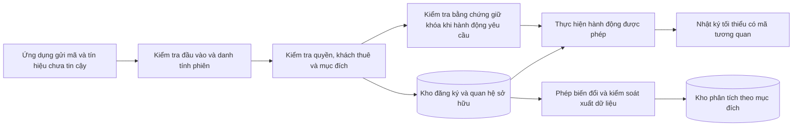

# Dữ liệu định danh thiết bị

## 1. Khái niệm và vai trò trong phân loại dữ liệu

**Dữ liệu định danh thiết bị** là giá trị hoặc tập thuộc tính được sử dụng để phân biệt, nhận ra hoặc liên kết một thiết bị, giao diện mạng, bản cài ứng dụng hay môi trường trình duyệt trong một phạm vi xác định. Giá trị có thể do nhà sản xuất cấp, hệ điều hành hoặc ứng dụng tạo, hay được suy ra từ nhiều tín hiệu quan sát được.

Điểm cần đặc tả trước tiên là **định danh đang đại diện cho đối tượng nào**. Mã của một bản cài ứng dụng không nhất thiết đại diện cho một thiết bị vật lý. Một thiết bị có thể có nhiều giao diện mạng, nhiều hồ sơ trình duyệt hoặc nhiều người sử dụng. Một người cũng có thể dùng nhiều thiết bị.

Ví dụ, hệ thống nhận mã `installation-demo-17` do ứng dụng gửi lên. Chỉ từ mã này, hệ thống chưa thể kết luận rằng:

- Đây luôn là cùng một thiết bị vật lý qua mọi lần cài lại.
- Thiết bị chỉ thuộc về một tài khoản.
- Người gửi mã đang giữ thiết bị đã đăng ký.
- Bên gọi có quyền đọc dữ liệu hoặc thực hiện giao dịch của chủ tài khoản.

Trong chương **Phân loại dữ liệu**, việc phân loại định danh thiết bị cần dẫn tới các quyết định thực thi được: có nên thu thập không, mức độ liên kết cho phép, ai được truy cập, khi nào phải thay hoặc xóa, và bằng chứng nào được dùng để xác minh yêu cầu bảo mật.

Giá trị ngắn, không có tên người hoặc được tạo ngẫu nhiên vẫn có thể hỗ trợ theo dõi hành vi lâu dài. Ngược lại, một mã được in công khai trên thiết bị không tự mang cùng mức bí mật với hồ sơ liên kết mã đó tới chủ sở hữu và vị trí sử dụng. Phải đánh giá **giá trị, quan hệ liên kết và ngữ cảnh sử dụng** cùng nhau.

## 2. Các loại định danh và giới hạn ý nghĩa

| Loại dữ liệu | Đối tượng thường được đại diện | Giới hạn cần ghi trong đặc tả |
|---|---|---|
| Số sê-ri, mã thiết bị do nhà sản xuất cấp | Một sản phẩm hoặc bộ phận trong phạm vi cấp mã | Không mặc định duy nhất toàn cầu; có thể bị sao chép, khai sai hoặc đọc từ bên ngoài |
| IMEI hoặc mã thiết bị di động tương tự | Thiết bị hoặc thành phần liên quan đến thiết bị di động theo cơ chế cấp mã | Không coi giá trị do ứng dụng gửi là bằng chứng sở hữu; khả năng lấy và dùng phụ thuộc nền tảng |
| Địa chỉ MAC | Một giao diện mạng trong ngữ cảnh mạng tương ứng | Một thiết bị có thể có nhiều MAC; giá trị có thể thay đổi hoặc bị giả mạo |
| Địa chỉ IP kèm thời gian quan sát | Điểm kết nối hoặc đường ra mạng ở thời điểm đó | Có thể dùng chung, thay đổi hoặc đi qua trung gian; không phải mã bền vững của thiết bị |
| Mã bản cài ứng dụng | Một bản cài, hồ sơ hoặc trạng thái lưu trữ do ứng dụng quản lý | Có thể mất khi xóa dữ liệu, thay đổi khi cài lại hoặc bị sao chép cùng bản sao lưu |
| Mã lưu trong trình duyệt | Một hồ sơ trình duyệt hoặc vùng lưu trữ nhất định | Không đại diện chắc chắn cho cả máy; có thể bị xóa, phân tách hoặc dùng chung |
| Mã phục vụ quảng cáo hoặc phân tích | Phạm vi nhận diện do nền tảng hoặc hệ thống phân tích quy định | Khả năng đặt lại và giới hạn sử dụng phải được xét; không dùng làm danh tính đăng nhập |
| Dấu vân tay thiết bị | Kết quả suy luận từ nhiều thuộc tính phần mềm, phần cứng hoặc hành vi | Có tính xác suất, có thể trùng, biến đổi hoặc bị giả mạo |
| Mã đăng ký và khóa công khai của thiết bị | Một quan hệ đăng ký và một khóa trong hệ thống | Mã là tham chiếu; chứng minh giữ khóa riêng là bước khác và có phạm vi riêng |

### 2.1. Định danh mạng không đồng nhất với định danh thiết bị

Một địa chỉ MAC quan sát trong mạng cục bộ không được truyền nguyên trạng xuyên qua mọi chặng IP để máy chủ ở xa nhìn thấy. Nếu một dịch vụ Internet có trường MAC, cần ghi rõ trường đó đến từ ứng dụng, tác nhân quản lý hay một nguồn khác. Không được mô tả nó như thuộc tính đã được máy chủ tự xác minh qua kết nối mạng.

Tương tự, nhiều thiết bị có thể dùng chung địa chỉ IP công cộng, và một thiết bị có thể xuất hiện qua nhiều địa chỉ IP. Cặp IP và thời gian có thể là tín hiệu phục vụ điều tra trong điều kiện phù hợp, nhưng không tự chứng minh thiết bị hay người thực hiện hành động.

Mã thuê bao hoặc mã liên quan đến SIM cũng không nên bị coi mặc nhiên là mã thiết bị vật lý. Đặc tả phải phân biệt thiết bị, thuê bao, bản cài và tài khoản để tránh gán sai quyền hoặc quy trách nhiệm sai.

### 2.2. Nhận diện, xác thực và phân quyền là ba việc khác nhau

- **Nhận diện:** tìm đối tượng mà một mã đang tham chiếu tới.
- **Xác thực:** kiểm tra bằng chứng về danh tính hoặc quyền kiểm soát một thông tin xác thực theo giao thức đã thiết kế.
- **Phân quyền:** quyết định chủ thể được thực hiện hành động nào trên tài nguyên nào.

Một mã đăng ký có thể dùng để tra bản ghi thiết bị. Nếu ai biết mã cũng được bỏ qua xác thực hoặc xem thông tin chủ sở hữu, mã đã vô tình trở thành một thông tin xác thực mang quyền. Nếu đó không phải thiết kế có chủ đích, hệ thống đang dựa vào tính khó đoán của tham chiếu để bảo vệ tài nguyên.

Với đăng ký dựa trên khóa, thiết bị có thể chứng minh đang giữ khóa riêng bằng một thử thách mới gắn với yêu cầu. Bằng chứng đó vẫn không tự chứng minh người đang thao tác là chủ tài khoản, thiết bị không bị chiếm quyền, hay khóa không thể bị sao chép. Các kết luận phải nằm trong giới hạn của cơ chế bảo vệ khóa và giao thức thực tế.

## 3. Các chiều phân loại cần đánh giá

### 3.1. Khả năng phân biệt và liên kết

| Chiều đánh giá | Câu hỏi cần trả lời | Hệ quả đối với yêu cầu |
|---|---|---|
| Phạm vi duy nhất | Giá trị duy nhất trong một tài khoản, khách thuê, ứng dụng hay nhiều hệ thống? | Ghi rõ miền định danh và tránh phép nối ngoài phạm vi |
| Tính bền vững | Giá trị tồn tại qua đăng xuất, cài lại, đặt lại hoặc chuyển chủ không? | Định nghĩa thay đổi hợp lệ và giới hạn thời gian liên kết |
| Khả năng liên kết | Có thể nối với tài khoản, vị trí, giao dịch hoặc nguồn bên ngoài không? | Kiểm soát truy vấn liên kết và phân loại cả bảng ánh xạ |
| Khả năng đặt lại | Người dùng hoặc đơn vị quản lý có thay được mã không? | Tránh tự nối lại lịch sử khi chưa có căn cứ được phép |
| Nguồn và độ tin cậy | Do máy chủ cấp, khách tự khai hay được kiểm tra bằng bằng chứng nào? | Không sử dụng tín hiệu tự khai như thuộc tính đã được xác minh |
| Độ nhạy theo ngữ cảnh | Mã cho biết gì khi xuất hiện trong địa điểm hoặc hệ thống cụ thể? | Đánh giá tác động ngoài bản thân chuỗi mã |
| Khả năng bị sao chép | Có thể nhân bản mã, trạng thái ứng dụng hoặc khóa liên quan không? | Xử lý xung đột và tránh khẳng định sai về cùng một thiết bị |

Một mã ngẫu nhiên có thể khó đoán nhưng vẫn là cầu nối ổn định giữa nhiều lần truy cập. Tính ngẫu nhiên giúp giảm một số khả năng suy đoán giá trị, không tự loại bỏ khả năng theo dõi khi mã đã được quan sát.

### 3.2. Bí mật, toàn vẹn và sẵn sàng

**Tính bí mật** cần được đánh giá cho cả định danh và quan hệ đi kèm. Hồ sơ `mã thiết bị → tài khoản → vị trí → lịch sử hoạt động` thường có tác động khác hẳn một danh sách số sê-ri không chứa liên kết. Khả năng nhận diện một người trực tiếp hoặc gián tiếp cũng phải được xét khi xác định cách xử lý dữ liệu; không nên kết luận chỉ từ việc thiếu họ tên.

**Tính toàn vẹn** quan trọng khi định danh được dùng cho quản lý thiết bị, cảnh báo rủi ro hoặc phân quyền. Nếu kẻ tấn công sửa quan hệ sở hữu, tráo khách thuê hay giả định danh của thiết bị được tin cậy, hệ thống có thể trả dữ liệu sai hoặc cấp quyền sai.

**Tính sẵn sàng** quan trọng khi mất kho đăng ký làm người dùng không thể quản lý thiết bị hoặc khiến hệ thống không kiểm tra được trạng thái thu hồi. Phương án khi phụ thuộc này gián đoạn phải được đặc tả theo từng hành động. Không nên tự bỏ qua kiểm tra quyền chỉ để giữ luồng đăng nhập hoạt động.

Nhãn phân loại nên xuất phát từ tác động và chính sách của tổ chức. Không có quy tắc rằng mọi mã thiết bị luôn là bí mật cao nhất, hoặc mọi mã đã băm đều có thể công khai.

### 3.3. Ví dụ đánh giá theo tập dữ liệu

| Tập dữ liệu | Rủi ro nổi bật | Hướng kiểm soát cần đặc tả |
|---|---|---|
| Mã sản phẩm in trên nhãn ngoài vỏ | Người ngoài có thể đọc hoặc chụp lại | Không dùng riêng giá trị đó để xác thực chủ sở hữu |
| Bảng gắn thiết bị với nhân viên | Theo dõi phân công và thói quen sử dụng | Giới hạn người đọc, mục đích tra cứu và thời gian lưu |
| Lịch sử IP gắn tài khoản và thời gian | Liên kết hoạt động, suy ra vị trí ở mức độ phụ thuộc nguồn | Tối thiểu hóa, hạn chế truy vấn và ghi nhận việc truy cập điều tra |
| Bản đăng ký thiết bị có khóa công khai và trạng thái thu hồi | Thay đổi trái phép có thể làm sai quyết định tin cậy | Kiểm soát toàn vẹn, quy trình đổi khóa và phục hồi trạng thái |
| Mã phân tích dùng chung ở nhiều khách thuê | Liên kết hoạt động giữa những miền đáng lẽ tách biệt | Tách không gian định danh và chặn truy vấn liên miền ngoài thẩm quyền |
| Dấu vân tay dùng để chấm điểm rủi ro | Theo dõi quá mức hoặc chặn nhầm người dùng hợp lệ | Hạn chế mục đích, đo chất lượng và có đường xác minh bổ sung |

## 4. Thu thập tối thiểu theo mục đích

Trước khi chọn một mã bền vững, cần viết rõ chức năng cần giải quyết. “Có thể hữu ích sau này” không đủ để xác định phạm vi thu thập và lưu giữ.

| Mục đích | Dữ liệu có thể cần | Câu hỏi để thu hẹp phạm vi |
|---|---|---|
| Hiển thị danh sách đăng ký của tài khoản | Mã đăng ký nội bộ, nhãn người dùng đặt, thời điểm hoạt động gần nhất | Có cần số sê-ri phần cứng hay chỉ cần tham chiếu cho quan hệ đăng ký? |
| Quản lý thiết bị do doanh nghiệp cấp | Mã tài sản, quan hệ phân công, trạng thái quản lý | Ai cần xem người nhận và có cần toàn bộ lịch sử không? |
| Phát hiện hành vi bất thường | Một số tín hiệu thiết bị, mạng và thời gian | Có thể giảm độ chi tiết hoặc thời gian lưu mà vẫn đạt mục tiêu không? |
| Thống kê mức sử dụng | Chỉ số tổng hợp hoặc mã giới hạn theo khoảng thời gian | Có thực sự cần nối cùng một thiết bị qua nhiều năm không? |
| Xác minh đăng ký dựa trên khóa | Mã đăng ký, khóa công khai, kết quả thử thách và trạng thái | Có cần thu thập thêm định danh phần cứng không? |

Nên ưu tiên mã nội bộ có phạm vi phù hợp khi không cần một định danh toàn cục. Ví dụ, mã riêng cho từng khách thuê và mục đích giúp giảm khả năng ghép hoạt động giữa các khách thuê, nếu hệ thống không cung cấp một bảng nối toàn cục cho mọi bên.

Việc đặt lại mã chỉ có ý nghĩa khi các đường khác không âm thầm nối lại mã mới với lịch sử cũ trái mục đích đã xác định. Cần kiểm tra cả cookie, dữ liệu ứng dụng, tài khoản, kho phân tích và các bản xuất để hiểu phạm vi liên kết còn tồn tại.

Các nghĩa vụ về quyền xử lý, thông báo, sự đồng ý hoặc quyền của người liên quan, nếu áp dụng, cần được ghi thành yêu cầu riêng theo bối cảnh của dự án. Nhãn phân loại dữ liệu không thay thế việc xác định các nghĩa vụ đó.

## 5. Hồ sơ phân loại cần chứa những gì?

Hồ sơ nên mô tả cả giá trị định danh lẫn cách hệ thống sử dụng và liên kết giá trị đó. Nếu chỉ ghi “device ID — dữ liệu nội bộ”, người triển khai chưa biết phải bảo vệ trường nào, ai được truy vấn hoặc phải xóa những bản sao nào.

| Thành phần hồ sơ | Nội dung cần xác định |
|---|---|
| Tên và kiểu định danh | Định danh phần cứng, bản cài, trình duyệt, đăng ký hay tín hiệu suy luận |
| Đối tượng và phạm vi | Thiết bị vật lý hay bản cài; duy nhất ở đâu; có bao gồm khách thuê và mục đích không |
| Nguồn và độ tin cậy | Do ai cấp, có thể bị sửa ở đâu, đã xác minh thuộc tính nào bằng cách nào |
| Mục đích và chủ sở hữu | Chức năng cần dùng và đơn vị chịu trách nhiệm quyết định |
| Quan hệ liên kết | Bảng ánh xạ tới tài khoản, nhân viên, vị trí, giao dịch và các kho khác |
| Mức tác động | Hậu quả khi lộ, sửa, giả mạo, liên kết ngoài phạm vi hoặc mất khả năng tra cứu |
| Quyền truy cập | Ai xem mã, ai xem chủ sở hữu, ai xuất dữ liệu, ai thay quan hệ đăng ký |
| Nơi lưu và luồng truyền | Ứng dụng, máy chủ, bộ nhớ đệm, log, nền tảng phân tích và bên nhận khác |
| Vòng đời | Tạo, kích hoạt, đặt lại, chuyển chủ, thu hồi, hết hạn và xóa |
| Lưu giữ và phục hồi | Mốc tính thời hạn, ngoại lệ được duyệt, bản sao lưu và xử lý khi phục hồi |
| Yêu cầu và bằng chứng | Mã yêu cầu, kiểm thử ranh giới, kết quả xóa và bằng chứng diễn tập |

Ví dụ sau là hồ sơ minh họa cho một tập đăng ký, không phải cấu hình sản phẩm hay bản ghi thiết bị thật:

```yaml
dataset_id: DEVICE-REGISTRATION
identifier_type: server_issued_registration_id
represents: application_registration
uniqueness_scope: tenant_and_purpose
purpose: account_device_management
owner: account_security_owner
trust:
  client_claim_is_untrusted: true
  key_possession_checked_for: sensitive_device_actions
links:
  account_mapping: restricted
  activity_history: restricted_by_purpose
access:
  list_own_registrations: authenticated_account_owner
  cross_account_lookup: approved_investigation_role
  update_binding: controlled_registration_workflow
lifecycle:
  reset: create_new_registration_and_retire_old_binding
  transfer: remove_old_account_binding_before_new_activation
  restore: reapply_revocations_before_serving_requests
requirements:
  - DI-01
  - DI-03
  - DI-04
  - DI-13
```

Quyền xem một tham chiếu thiết bị không nên mặc nhiên bao gồm quyền truy vấn tất cả tài khoản từng liên quan. Tra cứu quan hệ nhiều tài khoản có thể cần vai trò điều tra riêng, mục đích cụ thể và nhật ký truy cập. Nếu có xuất dữ liệu hàng loạt, đó cũng là một hành động cần được đặc tả riêng.

## 6. Quản lý vòng đời và quan hệ sở hữu

### 6.1. Đăng ký không phải thuộc tính bất biến của phần cứng

Một mô hình đăng ký nên tách ít nhất:

- Định danh đối tượng đăng ký do máy chủ quản lý.
- Định danh nguồn hoặc tín hiệu do thiết bị cung cấp, nếu thực sự cần.
- Quan hệ với tài khoản và khách thuê, có thời điểm hiệu lực.
- Thông tin xác thực hoặc khóa được gắn với đăng ký, nếu có.
- Trạng thái tin cậy, thu hồi và thời điểm hoạt động.

Quan hệ này có thể là nhiều-nhiều theo thời gian. Một máy dùng chung không thể được gán vĩnh viễn cho tài khoản đầu tiên chỉ vì mã phần cứng không đổi. Ngược lại, việc một tài khoản đăng ký nhiều thiết bị là tình huống bình thường, chưa đủ để kết luận gian lận.

### 6.2. Định nghĩa trạng thái bằng hành vi

| Giai đoạn hoặc sự kiện | Điều cần đặc tả |
|---|---|
| Tiếp nhận khai báo | Kiểm tra định dạng, độ dài, nguồn và quyền tạo đăng ký; chưa tự cấp trạng thái tin cậy |
| Chờ xác minh | Bằng chứng nào còn thiếu; được phép thực hiện hành động nào trong thời gian chờ |
| Đang hoạt động | Tài khoản, khách thuê, mục đích và thông tin xác thực nào được liên kết |
| Thay đổi tín hiệu | Khi IP, hệ điều hành hoặc thuộc tính thiết bị thay đổi thì ghi nhận, xác minh bổ sung hay tạo đăng ký mới |
| Đặt lại hoặc cài lại | Có tạo mã mới không; trạng thái cũ được thu hồi hay giữ phục vụ mục đích nào |
| Chuyển chủ hoặc dùng chung | Tách dữ liệu người cũ; xác minh quan hệ mới; tránh kế thừa quyền tự động |
| Nghi ngờ sao chép | Khoanh vùng quyền nào, yêu cầu bằng chứng bổ sung nào, tránh kết luận chỉ từ một tín hiệu |
| Thu hồi hoặc nghỉ sử dụng | Ngừng cho phép hành động dựa vào đăng ký; xử lý bộ nhớ đệm và thông tin xác thực liên quan |
| Hết hạn lưu và xóa | Xóa trường, quan hệ và bản sao nào; giữ bằng chứng tối thiểu nào theo chính sách |

Đăng xuất, thu hồi thiết bị và xóa lịch sử là các hành động khác nhau. Đăng xuất có thể kết thúc một phiên nhưng vẫn để lại đăng ký. Thu hồi đăng ký có thể ngăn dùng thông tin xác thực liên quan nhưng không tự xóa mọi bản ghi điều tra. Yêu cầu phải ghi rõ hiệu lực mong muốn thay vì dùng một nút “xóa thiết bị” cho mọi ý nghĩa.

### 6.3. Lưu giữ và xóa theo từng lớp dữ liệu

Không cần gán cùng thời hạn cho mã thô, quan hệ đăng ký, lịch sử truy cập và số liệu tổng hợp. Với mỗi lớp, xác định mục đích, mốc bắt đầu tính thời hạn, nơi lưu, người có quyền duyệt ngoại lệ và bằng chứng xử lý.

Một yêu cầu xóa cần bao phủ các bản sao hoạt động như chỉ mục tìm kiếm, bộ nhớ đệm, kho phân tích và bản xuất được quản lý. Với bản sao lưu chưa thể sửa từng bản ghi, cần xác định hạn tồn tại và cơ chế áp dụng lại quyết định xóa hoặc thu hồi trước khi phục hồi dữ liệu vào hệ thống phục vụ.

Khôi phục một bản sao cũ không được âm thầm làm sống lại đăng ký đã bị thu hồi hoặc quan hệ sở hữu đã chấm dứt. Lưu dấu thu hồi cần thiết cho phục hồi cũng phải có phạm vi, quyền truy cập và thời hạn riêng; không nên giữ toàn bộ hồ sơ vô thời hạn dưới tên gọi “dấu xóa”.

## 7. Băm, mã hóa và thay thế định danh

### 7.1. Băm không tự làm dữ liệu vô danh

Giả sử hệ thống thay số sê-ri bằng giá trị băm cố định. Khi hai bản ghi có cùng đầu vào và cách xử lý, đầu ra vẫn giúp nối các lần xuất hiện. Nếu tập đầu vào dễ đoán, đối phương có thể thử các giá trị để đối chiếu. Thêm một giá trị salt dùng chung nhưng được biết không tự ngăn việc thử đoán cho từng đầu vào.

Vì vậy, việc bỏ mã gốc không đủ để khẳng định không còn khả năng nhận diện hoặc liên kết. **Thay định danh** có thể giảm mức lộ trực tiếp, nhưng dữ liệu thay thế vẫn cần được bảo vệ khi có thể dùng để theo dõi, nối bảng hoặc tìm lại người liên quan.

Mã hóa bảo vệ khả năng đọc trong điều kiện khóa được kiểm soát, nhưng không thay đổi bản chất dữ liệu bên dưới. Một tập định danh nhạy cảm được mã hóa vẫn cần cùng quyết định về mục đích, quyền truy cập và lưu giữ.

### 7.2. Mã ngẫu nhiên và HMAC theo phạm vi

Nếu chỉ cần tham chiếu nội bộ, một mã ngẫu nhiên cùng bảng ánh xạ có kiểm soát thường giúp tránh mang định danh nguồn tới mọi thành phần. Bảng ánh xạ trở thành tài sản cần bảo vệ, và mã thay thế vẫn không được dùng để bỏ qua phân quyền.

Nếu cần đối chiếu có tính quyết định, có thể cân nhắc **HMAC**, tức mã xác thực thông điệp dùng khóa bí mật, để tạo giá trị thay thế trong phạm vi đã định. Biểu thức minh họa:

```text
scopedIdentifier = HMAC(
    keyForScope,
    encode(version, tenantId, purpose, identifierType, normalizedValue)
)
```

`encode` phải tạo biểu diễn không nhập nhằng, chẳng hạn biểu diễn có thông tin độ dài hoặc cấu trúc được xác định rõ. Không nên nối chuỗi tùy ý khiến hai bộ trường khác nhau tạo cùng thông điệp đầu vào. Quy tắc chuẩn hóa phải theo từng loại mã; tự chuyển toàn bộ mã opaque sang chữ thường có thể làm hai giá trị vốn khác nhau bị nhập làm một.

Giá trị có khóa bí mật giúp giảm một số khả năng đối chiếu hoặc đoán ngoại tuyến khi đối phương không có khóa. Tuy nhiên, nó vẫn cho phép liên kết trong phạm vi tạo mã. Nếu có API cho phép thử đầu vào và nhận đầu ra, khả năng đoán trực tuyến vẫn phải được kiểm soát.

Phân tách khóa hoặc ngữ cảnh theo khách thuê và mục đích giúp hạn chế nối ngoài phạm vi. Điều đó chỉ có tác dụng khi không đồng thời cung cấp các bảng ánh xạ hoặc dịch vụ chuyển đổi quá rộng. Khóa, quyền tạo mã, lịch sử phiên bản và quy trình thay khóa đều thuộc phạm vi yêu cầu bảo mật.

Khi thay khóa tạo mã, giá trị thay thế có thể thay đổi. Cần quy định đối chiếu trong giai đoạn chuyển tiếp, thời hạn giữ phiên bản cũ và cách xóa mọi ánh xạ liên quan. Không được biến nhu cầu chuyển đổi thành một bảng nối lịch sử không giới hạn thời gian.

HMAC hoặc mã băm của định danh không phải bằng chứng rằng người gửi kiểm soát thiết bị. Đây là cơ chế xử lý dữ liệu, không tự thay thế giao thức xác thực thiết bị.

## 8. Liên kết dữ liệu với mô hình đe dọa

### 8.1. Luồng xử lý có ranh giới rõ



Một trường như `X-Device-ID` là đầu vào do bên gọi cung cấp, trừ khi kiến trúc có cơ chế kiểm chứng riêng. Việc trường xuất hiện qua kết nối được mã hóa không chứng minh nội dung trường là đúng. Bảo vệ đường truyền và xác minh tuyên bố là hai việc cần được đặc tả riêng.

### 8.2. Những đường lạm dụng cần xem xét

| Đe dọa | Tình huống | Yêu cầu cần phát sinh |
|---|---|---|
| Giả định danh | Gửi mã của thiết bị người khác để xin trạng thái tin cậy | Không cấp quyền từ mã tự khai; xác minh danh tính, quan hệ và bằng chứng phù hợp |
| Truy cập đối tượng trái quyền | Thay mã đăng ký trên URL để xem chủ sở hữu khác | Kiểm tra quyền ở máy chủ cho từng đối tượng và khách thuê |
| Liên kết chéo mục đích | Nối mã phân tích với hồ sơ điều tra mà không có quyết định cho phép | Giới hạn không gian định danh, quyền truy vấn và đường xuất |
| Phát lại bằng chứng | Dùng lại thử thách hoặc chữ ký hợp lệ của lần trước | Ràng buộc với yêu cầu, thời gian, mục đích và tính dùng một lần theo giao thức |
| Nhân bản trạng thái | Sao chép mã bản cài hoặc thông tin xác thực sang môi trường khác | Đánh giá khả năng sao chép, kiểm tra bổ sung và xử lý xung đột |
| Thay quan hệ sở hữu | Sửa tài khoản hoặc khách thuê trong yêu cầu cập nhật | Lấy ngữ cảnh từ danh tính đã xác thực và kiểm tra quyền chuyển giao |
| Rò rỉ qua vận hành | Đưa mã thô vào URL, trace, báo lỗi hoặc công cụ hỗ trợ | Tối thiểu hóa đầu ra, che phù hợp và phân quyền kho vận hành |
| Khôi phục trạng thái cũ | Bản sao lưu làm sống lại thiết bị đã thu hồi | Áp dụng lại thu hồi trước phục vụ và diễn tập phục hồi |

Nếu sử dụng dấu vân tay để chấm điểm rủi ro, cần coi đó là tín hiệu xác suất. Thay đổi trình duyệt hoặc mạng có thể làm điểm thay đổi mà không có hành vi tấn công. Một mẫu giống nhau cũng không đủ để quy hai tài khoản cho cùng một người. Yêu cầu nên nêu cách đo chấp nhận nhầm, từ chối nhầm và đường xác minh bổ sung phù hợp.

Nếu sử dụng bằng chứng chứng thực môi trường thiết bị, cần ghi rõ thuộc tính nào được chứng thực, nguồn xác minh, độ mới, đối tượng nhận và cách gắn với yêu cầu. Một kết quả chứng thực không tự chứng minh danh tính con người hoặc bảo đảm thiết bị không có mọi dạng hành vi độc hại.

## 9. Chuyển kết quả phân loại thành yêu cầu kiểm chứng được

### 9.1. Cấu trúc yêu cầu

Một yêu cầu nên chứa **đối tượng dữ liệu, hành vi bắt buộc, điều kiện áp dụng, phạm vi và bằng chứng chấp nhận**. Có thể liên kết yêu cầu tới mã tài sản, kịch bản đe dọa và quyết định kiến trúc để truy vết trong vòng đời phát triển.

Ví dụ chưa đủ: “Device ID phải được bảo mật”. Câu này không cho biết định danh nào, phải bí mật với ai, có được liên kết giữa các hệ thống không và thời hạn lưu là bao lâu.

Ví dụ cụ thể hơn: “API danh sách đăng ký chỉ trả các đăng ký thuộc tài khoản và khách thuê trong ngữ cảnh đã xác thực; thay mã tài khoản, khách thuê hoặc mã đăng ký trong yêu cầu không được làm lộ hồ sơ của chủ thể khác”. Người kiểm thử có thể dựng các tổ hợp hợp lệ và không hợp lệ để kiểm chứng trực tiếp.

### 9.2. Bộ yêu cầu minh họa

Các thời hạn sau thuộc **một dự án giả định**, nhằm minh họa cách làm yêu cầu đo được. Chúng cần được lựa chọn theo tác động, mục đích xử lý và chính sách áp dụng, không phải thời hạn chung cho mọi dữ liệu định danh thiết bị.

| Mã | Yêu cầu | Bằng chứng chấp nhận |
|---|---|---|
| DI-01 | Mỗi loại định danh được thu thập phải có hồ sơ về đối tượng đại diện, nguồn, mục đích, phạm vi liên kết, chủ sở hữu và lưu giữ trước khi đưa vào môi trường sản xuất. | Đối chiếu các trường thực tế ở ứng dụng, API và nền tảng phân tích với hồ sơ; loại định danh chưa được duyệt không được bật thu thập. |
| DI-02 | Mọi thao tác đọc hoặc thay đổi đăng ký phải kiểm tra quyền theo tài khoản, khách thuê và hành động ở phía máy chủ. | Thay lần lượt mã đăng ký, tài khoản và khách thuê bằng giá trị của chủ thể khác; không đọc được dữ liệu, không đổi được trạng thái và không lộ thông tin ngoài hợp đồng lỗi. |
| DI-03 | Mã thiết bị hoặc số sê-ri tự khai không được dùng một mình để cấp trạng thái đã xác thực, bỏ qua bước xác minh hoặc kế thừa quyền của đăng ký khác. | Gửi lại mã của thiết bị hợp lệ từ một phiên chưa đủ bằng chứng; không nhận được quyền hoặc trạng thái tin cậy tương ứng. |
| DI-04 | Mã thay thế dùng cho phân tích phải giới hạn theo khách thuê và mục đích đã duyệt; người có quyền đọc một tập dữ liệu không mặc nhiên có quyền lấy bảng ánh xạ liên miền. | Cùng dữ liệu nguồn ở hai phạm vi tạo mã không thể dùng như khóa nối chung qua giao diện được cấp; thử tra ánh xạ chéo bị từ chối. |
| DI-05 | Luồng xuất sang kho phân tích phải loại bỏ định danh phần cứng thô và quan hệ chủ sở hữu khi chúng không nằm trong tập trường được duyệt cho mục đích đó. | Đưa dữ liệu thử có dấu nhận diện vào nguồn, kiểm tra dữ liệu xuất, đường lỗi và trường lồng nhau; không có giá trị ngoài phạm vi. |
| DI-06 | Mã phần cứng thô và bảng ánh xạ tài khoản không được ghi vào URL, trace, thông báo lỗi hoặc nhật ký ứng dụng thông thường; tra cứu điều tra phải đi qua kho và vai trò được chỉ định. | Kiểm tra truy cập thành công, bị từ chối, lỗi xác thực và lỗi phụ thuộc bằng dữ liệu thử; các đầu ra vận hành chỉ chứa thông tin được duyệt. |
| DI-07 | Thay đổi quan hệ sở hữu, thông tin xác thực, trạng thái tin cậy và thu hồi phải có sự kiện kiểm toán trong 5 phút, gồm chủ thể thực hiện, phạm vi, tham chiếu đăng ký, hành động, kết quả và thời gian. | Đối chiếu tập thao tác thử với sự kiện nhận được; xác minh người không có quyền không thể sửa hoặc xóa bằng chứng. |
| DI-08 | Với hành động nhạy cảm được quy định là cần bằng chứng giữ khóa, thử thách phải gắn với tài khoản, khách thuê, đăng ký, hành động và nội dung yêu cầu; chỉ dùng một lần trong tối đa 120 giây. | Dùng lại bằng chứng, đổi nội dung, đổi phạm vi, dùng sau hạn hoặc gửi đồng thời cùng thử thách; chỉ yêu cầu hợp lệ đầu tiên có thể được chấp nhận. |
| DI-09 | Sau khi thu hồi đăng ký, mọi điểm kiểm tra của các hành động dựa vào đăng ký đó phải ngừng chấp nhận trong 60 giây, bao gồm các bộ nhớ đệm được quản lý. | Kiểm thử qua nhiều phiên bản dịch vụ và trạng thái bộ nhớ đệm; sau thời hạn không thực hiện được hành động dựa vào đăng ký bị thu hồi. |
| DI-10 | Tín hiệu quan sát thô phục vụ phát hiện lạm dụng được lưu 30 ngày tính từ thời điểm máy chủ tiếp nhận; quá hạn phải được loại khỏi kho hoạt động trong 24 giờ, trừ ngoại lệ có chủ sở hữu và ngày hết hạn. | Tạo dữ liệu ở các mốc biên, chạy cơ chế xử lý hết hạn và kiểm tra kho chính, chỉ mục, kho phân tích; kiểm tra riêng ngoại lệ và thời điểm kết thúc ngoại lệ. |
| DI-11 | Chuyển thiết bị sang tài khoản khác phải kết thúc quan hệ cũ và xác minh quan hệ mới trước khi cho phép sử dụng quyền mới; tài khoản mới không được nhận lịch sử riêng của người cũ. | Thử chuyển chủ, chuyển thất bại và dùng chung theo kịch bản được hỗ trợ; xác minh quyền, lịch sử và trạng thái ở cả hai tài khoản. |
| DI-12 | Khi phục hồi kho đăng ký, phải áp dụng lại các quyết định thu hồi và xóa có hiệu lực sau bản sao trước khi cho phép hành động phụ thuộc vào đăng ký. | Khôi phục bản sao cũ có đăng ký từng hoạt động; đăng ký đã thu hồi không được dùng lại, bản ghi đã xóa không trở lại đường phục vụ trái chính sách. |
| DI-13 | Bảng liên kết định danh với tài khoản phải được bảo vệ khi truyền và lưu; quyền đọc hàng loạt, xuất dữ liệu và thay chính sách phải được cấp riêng theo vai trò. | Kiểm tra cấu hình, quyền, đường xuất và danh tính dịch vụ; vai trò chỉ đọc một hồ sơ không thể tải toàn bộ bảng hoặc sửa chính sách. |
| DI-14 | Quyết định từ dấu vân tay phải ghi nhận phiên bản quy tắc và được đánh giá về chấp nhận nhầm, từ chối nhầm trên dữ liệu thử phù hợp; không dùng sự trùng dấu vân tay như bằng chứng duy nhất về cùng một người. | Báo cáo đo nêu tập đánh giá, tiêu chí đã duyệt, kết quả và đường xác minh bổ sung; thử các thay đổi hợp lệ của môi trường thiết bị. |
| DI-15 | Đầu vào định danh phải tuân theo kiểu, độ dài và quy tắc chuẩn hóa đã công bố; dữ liệu không hợp lệ không được tạo liên kết mới hoặc làm thay đổi hồ sơ hiện có. | Thử thiếu giá trị, vượt độ dài, ký tự điều khiển, biểu diễn không chuẩn và hai giá trị có nguy cơ bị nhập làm một; không có thay đổi trái phép hoặc chèn nội dung vào nhật ký. |

DI-04 giảm khả năng nối qua các giao diện và dữ liệu được cấp trong phạm vi thử. Nó không phải lời khẳng định rằng không ai có thể suy luận quan hệ bằng mọi nguồn dữ liệu khác. Cần nêu rõ đối phương, nguồn họ có và giới hạn của kết luận.

DI-08 chỉ áp dụng cho các hành động đã yêu cầu bằng chứng giữ khóa trong kiến trúc. Không được dùng thử thách để thay thế kiểm tra quyền tài khoản. Việc giữ khóa riêng và việc được phép thực hiện một hành động là hai điều kiện khác nhau.

DI-10 dành cho tín hiệu thô của một mục đích cụ thể. Quan hệ đăng ký đang hoạt động, nhật ký kiểm toán và số liệu tổng hợp có thể có thời hạn khác, phải được đặc tả riêng. Việc đổi tên kho hoặc chuyển dữ liệu sang bản xuất không được tự đặt lại thời hạn lưu.

## 10. Ví dụ kiểm soát một hành động nhạy cảm

Giả sử ứng dụng cho phép thiết bị đã đăng ký thay đổi một thiết lập bảo mật của chính nó. Chính sách yêu cầu phiên người dùng đủ mức xác minh và bằng chứng giữ khóa của đăng ký. Mã giả dưới đây minh họa các điều kiện, không phải triển khai hoàn chỉnh:

```text
changeSensitiveSetting(session, registrationId, request, proof):
    require authenticated(session)
    require sessionMeetsRequiredAssurance(session)

    registration = loadWithinScope(
        tenant = session.tenant,
        account = session.account,
        registrationId = registrationId
    )
    require registration exists
    require authorized(session, "change_sensitive_setting", registration)
    require registration.state == "active"

    require verifyFreshSingleUseProof(
        publicKey = registration.publicKey,
        proof = proof,
        expectedTenant = session.tenant,
        expectedAccount = session.account,
        expectedRegistration = registration.id,
        expectedAction = "change_sensitive_setting",
        expectedRequest = request
    )

    commitIfStillAuthorizedAndActive(registration, request)
    recordSecurityEvent(session, registration, "setting_changed")
```

Các hàm kiểm tra là tên mô tả ý tưởng. Thiết kế thực tế cần bảo đảm thao tác dùng thử thách một lần và kiểm tra trạng thái không bị vượt qua bởi các yêu cầu đồng thời. Nếu đăng ký bị thu hồi giữa lúc kiểm tra và lúc ghi thay đổi, phải có cơ chế ngăn thực thi dựa trên trạng thái cũ theo mô hình nhất quán đã chọn.

Khóa công khai phải lấy từ quan hệ đăng ký đã được bảo vệ. Không được xác minh chữ ký bằng một khóa mới do chính yêu cầu gửi tới rồi coi đó là bằng chứng của đăng ký cũ. Việc thay khóa hoặc thêm thông tin xác thực mới cần quy trình riêng.

Khi kho đăng ký hoặc nguồn trạng thái thu hồi không sẵn sàng, hành động nhạy cảm có thể cần bị từ chối hoặc chờ xác minh theo chính sách. Hệ thống không được tự chuyển sang chấp nhận mã thiết bị thuần túy để thay cho bằng chứng bị thiếu. Thông báo lỗi cần đủ cho người dùng xử lý mà không tiết lộ hồ sơ tài khoản khác.

## 11. Logging, điều tra và khả năng phục hồi

### 11.1. Nhật ký có ích mà không nhân bản hồ sơ theo dõi

Định danh thiết bị thường bị sao chép vào nhiều công cụ vì thuận tiện gỡ lỗi. Mỗi bản sao có thể có tập người đọc và thời hạn lưu khác nhau, làm mất kiểm soát phạm vi liên kết ban đầu.

Một sự kiện có thể dùng tham chiếu nội bộ giới hạn phạm vi thay cho mã phần cứng thô:

```json
{
  "event_type": "device_registration_revoked",
  "actor_ref": "account-scope-demo-04",
  "tenant_ref": "tenant-demo-02",
  "registration_ref": "registration-demo-17",
  "result": "success",
  "reason_code": "owner_requested",
  "timestamp": "2026-11-20T09:00:00Z",
  "correlation_id": "request-demo-65"
}
```

Các giá trị đều là ví dụ. Tham chiếu thay thế vẫn có thể liên kết hoạt động nên kho nhật ký cần quyền truy cập, bảo vệ toàn vẹn và thời hạn lưu phù hợp. Không nên gọi chúng là vô danh chỉ vì không phải số sê-ri.

Nếu điều tra thực sự cần mã nguồn, có thể sử dụng kho hạn chế và quy trình tra cứu được duyệt. Cần ghi người tra cứu, mục đích và phạm vi kết quả thay vì mở toàn bộ bảng ánh xạ cho mọi người vận hành. Nội dung bằng chứng không nên chứa khóa riêng, token hay thử thách còn có thể sử dụng.

### 11.2. Phục hồi không làm hồi sinh quyền cũ

Phục hồi cần bao gồm định danh, quan hệ tài khoản, khóa công khai liên quan, trạng thái thu hồi và quyết định xóa. Chỉ khôi phục bảng đăng ký mà bỏ qua lịch sử quyết định có hiệu lực sau bản sao có thể tái cấp quyền ngoài ý muốn.

Ví dụ diễn tập: tại thời điểm T1, tạo bản sao khi đăng ký A còn hoạt động; tại T2, chủ tài khoản thu hồi A; tại T3, phục hồi bản sao T1. Tiêu chí chấp nhận là hệ thống áp dụng lại quyết định T2 trước khi chấp nhận hành động từ A, đồng thời không trả lại dữ liệu đã bị loại khỏi phạm vi phục vụ.

Kế hoạch cần nêu nguồn tin cậy để lấy những quyết định này và hành vi khi nguồn chưa sẵn sàng. Nếu cần thời gian phục hồi tối đa, phải đo từ một mốc sự cố đã xác định tới khi các chức năng được khôi phục trong trạng thái quyền đúng, thay vì chỉ đo lúc cơ sở dữ liệu khởi động xong.

## 12. Truy vết từ tài sản tới tiêu chí kiểm thử

Xét một dịch vụ nhiều khách thuê cho phép người dùng xem và thu hồi các đăng ký của mình. Nhóm phát triển dự định dùng mã bản cài do ứng dụng gửi để tìm hồ sơ và bỏ qua xác minh bổ sung khi mã trùng.

| Mắt xích | Nội dung cụ thể |
|---|---|
| Tài sản | Mã bản cài, quan hệ đăng ký với tài khoản/khách thuê, trạng thái tin cậy và lịch sử hoạt động |
| Mục tiêu an toàn | Chỉ chủ thể có quyền được xem, thay đổi hoặc sử dụng quan hệ đăng ký |
| Đe dọa | Kẻ tấn công sao chép mã, thay tham chiếu đăng ký hoặc gửi khách thuê khác trong yêu cầu |
| Rủi ro | Truy cập lịch sử người khác hoặc được hưởng trạng thái tin cậy của đăng ký khác |
| Yêu cầu | DI-02, DI-03, DI-08 cho hành động cần bằng chứng, DI-09 về thu hồi và DI-13 về bảng ánh xạ |
| Quyết định kiến trúc | Tra đăng ký trong phạm vi phiên đã xác thực; kiểm tra quyền; tách mã tham chiếu khỏi bằng chứng giữ khóa |
| Kiểm thử dương | Chủ tài khoản xem và thu hồi đúng đăng ký thuộc phạm vi của mình |
| Kiểm thử âm | Người khác biết mã đăng ký hoặc mã bản cài vẫn không đọc được lịch sử, không thay quan hệ và không được nâng mức tin cậy |
| Kiểm thử ranh giới | Tráo tài khoản, khách thuê, khóa và bằng chứng; thử phát lại, thu hồi đồng thời và truy cập qua bộ nhớ đệm |
| Bằng chứng vận hành | Sự kiện quản trị đủ truy vết trong kho hạn chế; không phát tán mã phần cứng thô sang nhật ký thông thường |

Phạm vi kiểm chứng cần bao gồm API chi tiết, danh sách, tìm kiếm, xuất dữ liệu, tác vụ nền và công cụ hỗ trợ. Một API chính kiểm tra quyền đúng không chứng minh đường xuất CSV hoặc trang quản trị cũng đúng.

Với rủi ro liên kết, kiểm thử phải xem dữ liệu mà từng vai trò hoặc hệ thống thực sự nhận được, không chỉ tên trường. Hai tập dữ liệu dùng tên trường khác nhau nhưng cùng một mã ổn định vẫn có thể nối với nhau. Với rủi ro phân quyền, cần kiểm tra cả trạng thái không bị sửa sau yêu cầu bị từ chối, thay vì chỉ nhìn mã phản hồi lỗi.

## 13. Sai lầm thường gặp và cách sửa yêu cầu

| Sai lầm | Vấn đề | Điều cần bổ sung |
|---|---|---|
| “Không có họ tên nên không nhạy cảm” | Có thể liên kết với tài khoản, vị trí và hành vi | Đánh giá quan hệ, nguồn ghép và tác động theo ngữ cảnh |
| “Một device ID là một người” | Thiết bị có thể dùng chung; một người có nhiều thiết bị | Mô hình hóa quan hệ theo thời gian và tránh kết luận danh tính tuyệt đối |
| “MAC hoặc IP là mã phần cứng đáng tin” | Phạm vi quan sát, thay đổi và giả mạo không được xét | Ghi nguồn dữ liệu và giới hạn của tín hiệu |
| “Biết mã là đủ chứng minh sở hữu” | Mã có thể bị nhìn thấy hoặc sao chép | Xác thực, kiểm tra quyền và bằng chứng phù hợp với hành động |
| “Đã băm thì cho phép xuất mọi nơi” | Giá trị băm vẫn nối lịch sử và có thể bị thử đoán | Giới hạn phạm vi, bảo vệ ánh xạ và đánh giá khả năng suy luận |
| “Fingerprint trùng chứng minh gian lận” | Suy luận có thể sai hoặc bị giả mạo | Đo sai số, nêu phiên bản quy tắc và có đường xác minh bổ sung |
| “Xóa bản ghi chính là xóa xong” | Log, chỉ mục, phân tích và bản sao có thể còn dữ liệu | Đặc tả phạm vi xóa và hành vi phục hồi |
| “Khôi phục đăng ký hoạt động cũ là đủ” | Có thể khôi phục cả quyền đã bị thu hồi | Áp dụng lại quyết định thu hồi, chuyển chủ và xóa trước khi phục vụ |

## 14. Kết quả cần tạo ra sau khi phân loại

Đối với mỗi loại dữ liệu định danh thiết bị, cần tạo được các đầu ra phục vụ phát triển và kiểm chứng:

1. **Định nghĩa đối tượng và phạm vi:** thiết bị, bản cài, giao diện, trình duyệt hay quan hệ đăng ký; mức duy nhất và độ bền dự kiến.
2. **Đánh giá tác động:** khả năng theo dõi, liên kết, giả mạo, sửa quan hệ và gián đoạn chức năng phụ thuộc.
3. **Quyết định thu thập và sử dụng:** mục đích, trường tối thiểu, miền liên kết, bên nhận và giới hạn truy vấn.
4. **Mô hình quyền và bằng chứng:** ai được đọc hoặc thay đổi, mã nào chỉ là tham chiếu, hành động nào cần xác minh bổ sung.
5. **Yêu cầu vòng đời:** đăng ký, đặt lại, chuyển chủ, thu hồi, lưu giữ, xóa và phục hồi.
6. **Chuỗi truy vết:** tài sản → đe dọa → rủi ro → yêu cầu → quyết định kiến trúc → kiểm thử và bằng chứng vận hành.

Khi các đầu ra này rõ ràng, dữ liệu định danh thiết bị có thể hỗ trợ quản lý và bảo vệ hệ thống mà không bị sử dụng vượt quá ý nghĩa của nó. Việc nối quyết định phân loại với yêu cầu đo được giúp nhóm phát triển kiểm soát đồng thời quyền truy cập, khả năng liên kết và tính đúng đắn của các quyết định tin cậy.
