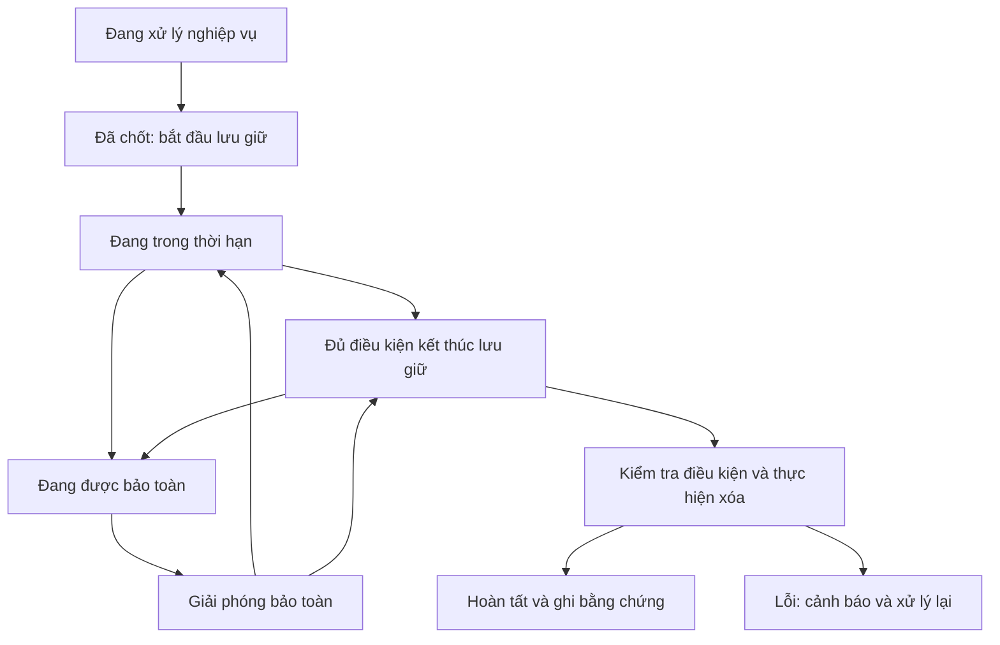

# Dữ liệu cần lưu giữ

## 1. Mục tiêu bài học

Trong chương **Phân loại dữ liệu**, “cần lưu giữ” mô tả yêu cầu duy trì một tập dữ liệu trong một khoảng thời gian hoặc đến khi một điều kiện được thỏa mãn. Đây là đầu vào quan trọng của thiết kế bảo mật: hệ thống phải ngăn xóa sớm, bảo vệ tính toàn vẹn, giữ khả năng truy xuất và xử lý dữ liệu đúng lúc khi việc lưu giữ kết thúc.

Không thể đặc tả đầy đủ chỉ bằng câu “lưu dữ liệu lâu dài”. Nhóm phát triển cần biết dữ liệu nào, vì sao phải giữ, thời điểm bắt đầu tính, ai được đọc, ai được sửa, bản sao nào nằm trong phạm vi và bằng chứng nào chứng minh yêu cầu đã được đáp ứng.

Sau bài học, người học có thể:

- Nhận diện dữ liệu cần lưu giữ từ mục đích nghiệp vụ, cam kết và quyết định quản trị đã được xác nhận.
- Phân biệt lưu giữ với sao lưu, lưu trữ dài hạn và khả năng truy cập trực tuyến.
- Xây dựng lịch lưu giữ với thời hạn, sự kiện bắt đầu, ngoại lệ và điều kiện kết thúc rõ ràng.
- Chuyển nguy cơ mất, sửa, xóa sớm hoặc giữ quá lâu thành yêu cầu bảo mật có thể kiểm chứng.
- Liên kết yêu cầu với kiến trúc, phân quyền, logging, phục hồi và kiểm thử trong vòng đời phát triển.

Các thời hạn và ngưỡng trong bài là **giả định phục vụ học tập**. Không dùng chúng để suy ra thời hạn bắt buộc cho một loại hồ sơ thực tế. Căn cứ áp dụng phải được người có thẩm quyền của tổ chức xác nhận trước khi trở thành yêu cầu của hệ thống.

## 2. “Cần lưu giữ” có nghĩa gì?

**Dữ liệu cần lưu giữ** là dữ liệu đã được xác định phải được bảo toàn trong phạm vi, thời hạn và điều kiện cụ thể để phục vụ một mục đích được chấp thuận.

Ví dụ:

| Nhóm dữ liệu | Mục đích lưu giữ có thể có | Điều cần xác định thêm |
| --- | --- | --- |
| Hồ sơ xử lý yêu cầu hoàn tiền | Đối chiếu quyết định và giải quyết tranh chấp | Thời điểm hồ sơ kết thúc, phiên bản quyết định, tài liệu cần giữ |
| Chứng từ giao dịch | Đối soát và chứng minh giao dịch | Bản có giá trị tham chiếu, tính toàn vẹn và cách truy xuất |
| Nhật ký kiểm toán | Điều tra hành động và kiểm chứng kiểm soát | Loại sự kiện, trường bắt buộc, thời hạn và người được xem |
| Hợp đồng và phụ lục | Chứng minh nội dung đã thỏa thuận | Phiên bản có hiệu lực, sự kiện bắt đầu tính và quan hệ giữa các bản |
| Hồ sơ sự cố | Phân tích nguyên nhân và theo dõi xử lý | Phạm vi bằng chứng, tính xác thực và quyền tiếp cận |
| Dữ liệu nghiên cứu đã được chấp thuận | Tái hiện hoặc kiểm tra kết quả | Mục đích sử dụng, định dạng và điều kiện tiếp tục giữ |

Không phải mọi trường trong cùng một bảng đều cần giữ như nhau. Một hồ sơ giao dịch có thể cần giữ quyết định và mã đối chiếu nhưng không cần giữ toàn bộ nội dung chẩn đoán hoặc dữ liệu tạm đã thu thập trong quá trình xử lý.

### 2.1. Phân loại theo thời hạn độc lập với phân loại theo độ bí mật

Một dữ liệu có thể đồng thời:

- Là bí mật vì chỉ một nhóm được phép đọc.
- Cần toàn vẹn cao vì dùng làm bằng chứng.
- Cần lưu giữ nhiều năm vì một mục đích đã được phê duyệt.
- Chỉ cần truy xuất theo yêu cầu, thay vì luôn sẵn có trên màn hình nghiệp vụ.

Ngược lại, một dữ liệu rất nhạy cảm có thể chỉ cần tồn tại trong thời gian ngắn. Giữ lâu không đồng nghĩa quan trọng hơn, và dữ liệu công khai vẫn có thể cần bảo toàn để chứng minh nội dung đã công bố tại một thời điểm.

Không suy thời hạn từ nhãn “bí mật”, “quan trọng” hoặc tên bảng. Cần quyết định riêng về thời gian và mục đích lưu giữ.

### 2.2. Phân biệt các khái niệm dễ nhầm

| Khái niệm | Câu hỏi chính | Giới hạn |
| --- | --- | --- |
| Lưu giữ dữ liệu | Phải giữ dữ liệu gì, đến khi nào và dưới điều kiện nào? | Không tự quyết định nơi lưu hoặc công nghệ |
| Lưu trữ dài hạn | Giữ dữ liệu ít sử dụng ở đâu và đọc lại thế nào? | Chuyển sang kho lưu trữ không tự đáp ứng quyền, toàn vẹn hoặc xóa đúng hạn |
| Sao lưu | Khôi phục dữ liệu sau mất mát hoặc sai hỏng bằng cách nào? | Backup theo vòng quay có thể không giữ đủ lịch sử của một hồ sơ |
| Khả năng sẵn sàng | Khi cần thì truy cập hoặc phục hồi trong bao lâu? | Dữ liệu còn tồn tại nhưng không thể đọc vẫn có thể không đáp ứng nhu cầu |
| Bảo toàn tạm thời | Trường hợp nào phải tạm dừng việc xóa theo lịch? | Phải có phạm vi, thẩm quyền, theo dõi và điều kiện giải phóng |
| Xóa hoặc hủy | Khi nào và bằng cách nào kết thúc việc lưu giữ? | Xóa kho chính chưa chứng minh đã xử lý mọi bản sao |

Một bản backup tồn tại không đủ để kết luận hồ sơ đã được lưu giữ đúng. Có thể backup không chứa phiên bản cần thiết, không tìm được hồ sơ, thiếu khóa giải mã hoặc đã bị ghi đè trước thời hạn.

## 3. Nhận diện phạm vi và căn cứ lưu giữ

### 3.1. Bắt đầu bằng mục đích và người chịu trách nhiệm

Với từng tập dữ liệu, cần trả lời:

1. Mục đích nào đòi hỏi phải giữ dữ liệu?
2. Ai có thẩm quyền xác nhận mục đích và thời hạn?
3. Căn cứ nào đã được chấp thuận: nhu cầu nghiệp vụ, cam kết, quy định nội bộ hoặc nghĩa vụ đã được bộ phận phụ trách xác minh?
4. Dữ liệu nào thực sự cần thiết cho mục đích đó?
5. Cần giữ bản gốc, bản chốt, lịch sử sửa đổi hay bản dẫn xuất?
6. Thời hạn tính từ sự kiện nào và ai xác nhận sự kiện?
7. Dữ liệu phải đọc lại được nhanh đến mức nào?
8. Khi hết hạn, phải xóa, ẩn danh, bàn giao hay tiếp tục giữ theo một quyết định khác?

Không để nhóm kỹ thuật tự đặt thời hạn chỉ vì công cụ có sẵn một giá trị mặc định. Công cụ hiện thực hóa quyết định, không thay thế người có thẩm quyền quyết định.

### 3.2. Xác định đúng đơn vị lưu giữ

Đơn vị có thể là một hồ sơ, một giao dịch, một tài liệu, một loại sự kiện hoặc một tập dữ liệu đã chốt.

Ví dụ, hồ sơ hoàn tiền có thể gồm:

- Quyết định xử lý cuối cùng.
- Bằng chứng cần thiết cho quyết định.
- Mã liên kết giao dịch.
- Danh tính người phê duyệt và thời điểm phê duyệt.
- Các phiên bản trước đó nếu chính sách yêu cầu giữ lịch sử.

Tệp tạm dùng để chuyển đổi tài liệu hoặc dữ liệu hỗ trợ không cần thiết không tự động được hưởng cùng thời hạn. Cần xác định riêng để tránh sao chép toàn bộ dữ liệu rồi giữ lâu hơn mục đích cho phép.

### 3.3. Phân biệt bản tham chiếu và các bản sao

Cần chỉ rõ:

- **Bản hồ sơ chính thức:** phiên bản được dùng làm căn cứ khi đối chiếu.
- **Bản sao vận hành:** phục vụ đọc nhanh, tìm kiếm hoặc xử lý nghiệp vụ.
- **Bản sao bảo vệ:** phục vụ phục hồi theo kịch bản đã xác định.
- **Bản xuất hoặc bản dẫn xuất:** có thể mang dữ liệu sang nơi quản lý khác.

Các bản sao không nhất thiết có cùng lịch xóa, nhưng mỗi lịch đều phải có căn cứ. Bản xuất không được trở thành đường giữ dữ liệu vô thời hạn chỉ vì đã ra khỏi cơ sở dữ liệu chính.

## 4. Thiết kế lịch lưu giữ rõ ràng

Một **lịch lưu giữ** mô tả cách tính và thực thi thời gian giữ cho một nhóm dữ liệu.

| Thành phần | Nội dung cần đặc tả |
| --- | --- |
| Mã chính sách và phiên bản | Xác định bộ quy tắc áp dụng cho hồ sơ |
| Phạm vi | Loại dữ liệu, trường, bản ghi, tài liệu và bản sao liên quan |
| Căn cứ và người phê duyệt | Vì sao có thời hạn và ai chịu trách nhiệm xác nhận |
| Sự kiện bắt đầu | Tạo giao dịch, kết thúc hồ sơ, hết hiệu lực hợp đồng hoặc sự kiện khác |
| Mốc thời gian đáng tin cậy | Nguồn thời gian, cách ghi nhận và quyền sửa |
| Thời hạn tối thiểu | Trước mốc nào không được xóa nếu chính sách yêu cầu |
| Giới hạn lưu giữ | Khi nào phải kết thúc hoặc rà soát; khoảng xử lý cho phép |
| Yêu cầu truy xuất | Thời gian đáp ứng, định dạng và điều kiện đọc lại |
| Quy tắc bảo toàn tạm thời | Ai được tạm dừng xóa, phạm vi và thời điểm hiệu lực |
| Hành động khi hết hạn | Xóa, hủy, ẩn danh hoặc bàn giao theo quyết định cụ thể |
| Phạm vi backup | Vòng đời bản sao và cách ngăn tái sử dụng dữ liệu đã hết hạn |
| Bằng chứng | Sự kiện kiểm toán, báo cáo xử lý và kết quả kiểm thử |

### 4.1. Thời hạn tối thiểu và giới hạn tối đa là hai ràng buộc khác nhau

Giả sử một chính sách yêu cầu giữ ít nhất 24 tháng kể từ khi hồ sơ kết thúc. Điều này ngăn xóa sớm, nhưng chưa trả lời có được giữ 10 năm hay không.

Nếu chính sách còn yêu cầu xóa khỏi kho trực tuyến trong 24 giờ sau khi đủ điều kiện, cần đặc tả thêm:

- “Đủ điều kiện” bao gồm hết thời hạn và không còn lệnh bảo toàn hợp lệ.
- Kho nào được coi là trực tuyến.
- Bản sao nào có lịch riêng.
- Cách xử lý lỗi khiến tác vụ xóa chậm.
- Ai nhận cảnh báo và chịu trách nhiệm khắc phục.

Khi hai căn cứ đưa ra yêu cầu không tương thích, không tự chọn thời hạn dài nhất hoặc ngắn nhất. Cần ghi nhận xung đột và yêu cầu vai trò có thẩm quyền xác nhận cách xử lý trước khi cấu hình quy tắc chính thức.

### 4.2. Tính thời hạn từ sự kiện đã được xác định

Công thức khái niệm:

> **Mốc hết thời hạn cơ sở = thời điểm sự kiện bắt đầu + khoảng lưu giữ theo chính sách.**

Phải xác định rõ:

- “Tháng” là tháng lịch hay số ngày cố định.
- Mốc được hiểu theo múi giờ nào.
- Cách xử lý ngày cuối tháng và năm nhuận.
- So sánh tại đúng thời điểm hết hạn như thế nào.
- Hồ sơ chưa có sự kiện kết thúc sẽ ở trạng thái nào.

Không dùng `updatedAt` làm mốc thay thế nếu chính sách nói tính từ lúc hồ sơ kết thúc. Một lần sửa lỗi chính tả có thể thay `updatedAt` và vô tình kéo dài thời hạn.

Nếu hồ sơ được mở lại, cần quy tắc riêng: giữ mốc cũ, xác nhận sự kiện kết thúc mới hay tạo hồ sơ liên quan. Không để hành vi này phát sinh ngầm từ cách cập nhật bản ghi.

### 4.3. Phiên bản chính sách và thay đổi hồi tố

Khi chính sách thay đổi, cần biết:

- Hồ sơ mới áp dụng từ ngày nào.
- Hồ sơ cũ có được tính lại hay không.
- Thay đổi làm rút ngắn thời hạn có được phép áp dụng ngay không.
- Lệnh bảo toàn đang hiệu lực có bị ảnh hưởng không.
- Bằng chứng quyết định và lịch sử thời hạn cũ được lưu ở đâu.

Một thay đổi cấu hình có thể làm hàng triệu hồ sơ đồng thời đủ điều kiện xóa. Vì vậy, thay đổi chính sách cần có đánh giá tác động, phê duyệt theo mức rủi ro và khả năng kiểm tra trước danh sách bị ảnh hưởng.

## 5. Mô hình trạng thái và bảo toàn tạm thời

Một mô hình đơn giản có thể gồm:



Hai nhánh sau khi giải phóng bảo toàn phụ thuộc thời hạn cơ sở đã hết hay chưa. Giải phóng bảo toàn không mặc nhiên bắt đầu lại toàn bộ thời hạn.

**Bảo toàn tạm thời** là quyết định tạm dừng xóa đối với dữ liệu xác định, chẳng hạn khi đang điều tra hoặc xử lý một vụ việc. Hồ sơ quyết định cần có:

- Người hoặc vai trò ban hành.
- Căn cứ và mã vụ việc.
- Phạm vi dữ liệu đủ chính xác.
- Thời điểm có hiệu lực.
- Lịch rà soát hoặc điều kiện kết thúc.
- Người được phép giải phóng và bằng chứng quyết định.

Bảo toàn không tự cấp thêm quyền đọc. Một hồ sơ đang được giữ để điều tra vẫn phải tuân thủ các giới hạn truy cập.

Đặc biệt, phải xử lý tình huống tác vụ xóa đã vào hàng đợi rồi lệnh bảo toàn mới được ghi nhận. Việc đủ điều kiện khi xếp hàng chưa đủ: trước hành động xóa không thể đảo ngược, hệ thống phải kiểm tra điều kiện hiện tại và phối hợp để không bỏ qua lệnh đã có hiệu lực.

## 6. Ví dụ: hồ sơ hoàn tiền đã kết thúc

Xét một hệ thống giả định quản lý hồ sơ hoàn tiền cho nhiều tổ chức. Dữ liệu `DATA-REF-001` gồm quyết định cuối cùng, tài liệu làm căn cứ, mã giao dịch liên quan và dấu vết phê duyệt.

Chủ sở hữu nghiệp vụ đã chấp thuận chính sách minh họa:

| Thuộc tính | Quyết định giả định |
| --- | --- |
| Đơn vị lưu giữ | Một hồ sơ đã chốt cùng tài liệu cần thiết của nó |
| Sự kiện bắt đầu | Dịch vụ ghi nhận hồ sơ kết thúc bằng một sự kiện được kiểm soát |
| Thời hạn cơ sở | 24 tháng lịch kể từ sự kiện kết thúc |
| Tham chiếu thời gian | UTC; quy tắc ngày cuối tháng được ghi trong chính sách |
| Sửa hồ sơ đã chốt | Tạo bản bổ sung có liên kết, không ghi đè nội dung đã chốt |
| Truy cập | Chỉ người có nhiệm vụ và đúng phạm vi tổ chức |
| Bảo toàn | Tạm dừng xóa khi có quyết định còn hiệu lực áp dụng cho hồ sơ |
| Khi đủ điều kiện | Xử lý bản hồ sơ và bản sao phục vụ lưu giữ trong tối đa 24 giờ |
| Backup theo vòng quay | Thời hạn riêng 35 ngày từ lúc tạo, xử lý hết hạn trong tối đa 24 giờ |
| Khả năng phục hồi | Phục hồi kho hồ sơ trong 4 giờ với kịch bản mất kho chính đã xác định |
| Kết thúc phục hồi | Hồ sơ đọc được, kiểm tra toàn vẹn đạt, quyền và trạng thái bảo toàn được áp dụng |

Trong chính sách này, lịch backup đã được phê duyệt riêng. Vì vậy, thời điểm xóa khỏi kho phục vụ truy cập không đồng nghĩa mọi bản backup đã biến mất ngay. Nếu căn cứ áp dụng yêu cầu xóa mọi bản sao trước một hạn tuyệt đối, thiết kế backup phải đáp ứng hạn đó; không được dùng lịch backup làm lý do tự kéo dài.

### 6.1. Ví dụ tính mốc

Một hồ sơ kết thúc lúc `2026-01-15T00:00:00Z`. Với thời hạn 24 tháng lịch:

- Mốc hết thời hạn cơ sở là `2028-01-15T00:00:00Z`.
- Trước mốc đó, tác vụ xóa theo lịch không được xóa hồ sơ.
- Từ đúng mốc đó, nếu không còn điều kiện giữ khác, hồ sơ đủ điều kiện kết thúc lưu giữ.
- Bản hồ sơ và bản sao phục vụ lưu giữ phải được xử lý trong 24 giờ tiếp theo theo chính sách giả định.

Nếu có lệnh bảo toàn hiệu lực đến `2028-03-01T10:00:00Z`, hồ sơ chưa đủ điều kiện xóa trong thời gian lệnh còn hiệu lực. Sau khi giải phóng lệnh và xác nhận không còn căn cứ giữ khác, thời hạn xử lý 24 giờ bắt đầu từ thời điểm hồ sơ thực sự đủ điều kiện.

Không cộng thêm 24 tháng kể từ lúc giải phóng lệnh, trừ khi một chính sách đã được phê duyệt yêu cầu rõ như vậy.

### 6.2. Những đe dọa cần đưa vào thiết kế

| Mã | Kịch bản | Hậu quả |
| --- | --- | --- |
| T-RET-01 | Người có quyền sửa ứng dụng đổi mốc kết thúc để hồ sơ hết hạn sớm | Mất dữ liệu trước thời hạn |
| T-RET-02 | Người vận hành ghi đè tài liệu hoặc xóa trực tiếp qua đường quản trị kho lưu | Không còn bằng chứng đúng với hồ sơ đã chốt |
| T-RET-03 | Tác vụ xóa dùng danh sách cũ, bỏ qua lệnh bảo toàn vừa có hiệu lực | Xóa dữ liệu đang được yêu cầu bảo toàn |
| T-RET-04 | Mất kho chính và các bản sao nằm cùng miền sự cố | Không khôi phục được hồ sơ cần giữ |
| T-RET-05 | Dữ liệu còn nhưng khóa giải mã hoặc phần mềm đọc không còn | Không thể truy xuất dù tệp vẫn tồn tại |
| T-RET-06 | Khôi phục backup làm dữ liệu hết hạn xuất hiện trở lại | Giữ hoặc cung cấp dữ liệu vượt chính sách |
| T-RET-07 | Quyền đọc kho lưu trữ rộng hơn quyền đọc kho nghiệp vụ | Lộ hồ sơ qua đường lưu trữ dài hạn |
| T-RET-08 | Cấu hình thời hạn mới bị áp dụng sai hàng loạt | Xóa sớm hoặc giữ quá lâu trên diện rộng |

Một chuỗi truy vết cụ thể:

> **Tài sản dữ liệu:** DATA-REF-001.  
> **Mục tiêu:** bảo toàn hồ sơ đã chốt trong thời hạn được chấp thuận.  
> **Đe dọa:** T-RET-03.  
> **Rủi ro:** lệnh bảo toàn không ngăn được tác vụ xóa đã xếp hàng.  
> **Quyết định kiến trúc:** lưu trạng thái bảo toàn có kiểm soát và phối hợp nó với bước quyết định xóa cuối cùng.  
> **Yêu cầu:** lệnh bảo toàn đã được xác nhận hiệu lực trước điểm cam kết xóa phải ngăn xóa hồ sơ.  
> **Kiểm thử:** xếp hồ sơ vào hàng đợi, xác nhận lệnh bảo toàn, sau đó cho tác vụ tiếp tục.  
> **Bằng chứng:** hồ sơ còn nguyên, tác vụ ghi nhận đã bỏ qua vì đang được bảo toàn.

## 7. Các quyết định kiến trúc ảnh hưởng trực tiếp đến lưu giữ

### 7.1. Bảo toàn nội dung và tính xác thực

Cần phân biệt ba việc:

- **Phát hiện thay đổi:** nội dung hiện tại có khác nội dung đã chốt không?
- **Xác định nguồn gốc:** ai tạo hoặc phê duyệt phiên bản này?
- **Chứng minh trình tự quản lý:** dữ liệu đã được tiếp nhận, chuyển và truy cập như thế nào?

Giá trị băm có thể hỗ trợ phát hiện khác biệt khi giá trị tham chiếu được bảo vệ. Nó không tự chứng minh ai tạo dữ liệu hoặc nội dung đó đúng sự thật. Nếu người sửa tệp cũng sửa được giá trị băm tham chiếu, phép so sánh không còn bảo vệ trước người đó.

Chữ ký có thể hỗ trợ xác minh chủ thể ký và nội dung đã ký khi mô hình tin cậy được thiết kế đúng. Vẫn phải quản lý danh tính ký, khóa, thời gian, bằng chứng xác minh và khả năng đọc lại trong thời gian lưu giữ.

Với hồ sơ đã chốt, cách sửa phù hợp có thể là tạo phiên bản bổ sung và liên kết với bản trước. Không ghi đè bản gốc rồi chỉ giữ lại thời điểm “cập nhật cuối”.

### 7.2. Chống xóa sớm không đồng nghĩa khóa vô thời hạn

Cơ chế hạn chế ghi đè hoặc xóa trước một mốc có thể giúp bảo vệ hồ sơ. Trước khi áp dụng phải hiểu:

- Phạm vi nào bị khóa: một đối tượng, phiên bản hay toàn bộ kho?
- Danh tính nào còn khả năng bỏ qua hoặc thay đổi quy tắc?
- Mốc khóa có khớp thời hạn đã được phê duyệt không?
- Lệnh bảo toàn tác động thế nào?
- Sau khi hết hạn, làm sao thực thi việc xóa?

Khóa dữ liệu lâu hơn thời hạn được phép có thể tạo vấn đề mới. Cần kiểm tra cấu hình trước khi ghi dữ liệu vào một cơ chế khó đảo ngược.

### 7.3. Tách các quyền có khả năng phá vỡ chính sách

Những quyền cần xem xét riêng gồm:

- Đọc nội dung hồ sơ.
- Sửa nội dung trước khi chốt.
- Phê duyệt hoặc xác nhận chốt.
- Sửa chính sách lưu giữ.
- Ban hành hoặc giải phóng lệnh bảo toàn.
- Thực hiện xóa theo chính sách.
- Quản lý khóa giải mã.
- Sửa hoặc xóa bằng chứng kiểm toán.

Một tác vụ tự động được phép xóa hồ sơ đủ điều kiện không cần quyền tự rút ngắn thời hạn hoặc giải phóng lệnh bảo toàn.

Các thao tác đặc quyền có thể cần xác thực bổ sung, phê duyệt độc lập và quyền có thời hạn. Quy tắc cụ thể phải tương xứng rủi ro và bao phủ cả giao diện quản trị, API và đường truy cập kho dữ liệu trực tiếp.

### 7.4. Giữ khả năng đọc lại và phục hồi

Lưu giữ dài hạn phải xét:

- Định dạng dữ liệu và phần mềm đọc.
- Phiên bản lược đồ, mã hóa ký tự và quan hệ giữa các tài liệu.
- Chỉ mục hoặc danh mục giúp tìm đúng hồ sơ.
- Khóa giải mã và bằng chứng xác thực cần thiết.
- Bản sao nằm ngoài miền sự cố đang được xem xét.
- Năng lực chuyển dữ liệu khi hệ thống hoặc nhà cung cấp thay đổi.

Khi chuyển định dạng, cần kiểm tra nội dung và ý nghĩa có được giữ đúng không. Hai tệp có băm khác nhau sau chuyển đổi chưa chắc là sai, nhưng cần bằng chứng khác để đối chiếu tính đầy đủ, nội dung và quan hệ với bản nguồn.

Trong ví dụ, nếu yêu cầu không mất hồ sơ đã xác nhận lưu khi kho chính bị mất, hệ thống chỉ được xác nhận hoàn tất sau khi bản sao phục hồi trong miền sự cố độc lập đã được ghi và kiểm tra theo thiết kế. Chỉ đặt mục tiêu mất dữ liệu bằng không trong tài liệu mà không thay đổi điều kiện xác nhận ghi là chưa đủ.

### 7.5. Quản lý khóa trong suốt thời hạn

Phải giữ khả năng giải mã cho dữ liệu còn cần dùng mà không cấp quyền đọc rộng hơn mức cần thiết.

Thay khóa cần có cách bảo đảm các dữ liệu và bản sao còn trong thời hạn vẫn đọc được: giữ khóa cũ được kiểm soát, chuyển bọc khóa hoặc mã hóa lại theo thiết kế. Mỗi phương án cần kiểm thử phục hồi tương ứng.

Không hủy một khóa dùng chung chỉ vì một số hồ sơ đã hết hạn. Khóa đó có thể còn bảo vệ hồ sơ đang trong thời hạn hoặc đang được bảo toàn. Quyết định hủy khóa phải xét đúng phạm vi dữ liệu, mọi bản sao khóa và các dữ liệu rõ liên quan.

## 8. Bộ yêu cầu bảo mật minh họa

Mẫu viết:

> **Đối tượng + điều kiện áp dụng + hành vi bắt buộc + ngưỡng hoặc kết quả + bằng chứng kiểm chứng.**

Bảng dưới dùng chính sách giả định ở mục 6. Nó không thiết lập thời hạn cho bất kỳ hệ thống thực tế nào.

| Mã | Yêu cầu | Tiêu chí chấp nhận và bằng chứng |
| --- | --- | --- |
| SR-RET-01 | Mỗi hồ sơ DATA-REF-001 được chốt phải gắn với chính sách có phiên bản, sự kiện kết thúc và thời điểm hết thời hạn cơ sở | Thử chốt khi thiếu từng trường hoặc dùng chính sách không được duyệt; hệ thống không xác nhận hoàn tất lưu hồ sơ |
| SR-RET-02 | Các đường thao tác trong phạm vi kiểm soát không được xóa hồ sơ trước thời hạn cơ sở hoặc khi còn lệnh bảo toàn hiệu lực | Thử xóa qua API nghiệp vụ, tác vụ định kỳ và các quyền quản trị kho đã xác định; thao tác trái quy tắc bị chặn |
| SR-RET-03 | Nội dung đã chốt và sự kiện làm căn cứ tính hạn không được sửa ghi đè; điều chỉnh phải tạo bản bổ sung liên kết | Thử sửa trực tiếp bằng vai trò nghiệp vụ và tác vụ vận hành thông thường; bản chốt giữ nguyên, lịch sử bổ sung truy vết được |
| SR-RET-04 | Người đọc chỉ được truy xuất hồ sơ trong tổ chức và phạm vi nhiệm vụ được cấp, kể cả qua kho lưu trữ và chức năng tải tài liệu | Tài khoản đúng phạm vi đọc được; tài khoản khác tổ chức hoặc không có nhiệm vụ không nhận nội dung |
| SR-RET-05 | Hệ thống chỉ xác nhận lưu thành công một hồ sơ đã chốt khi bản dữ liệu phục hồi độc lập với kho chính được ghi và kiểm tra theo thiết kế | Mô phỏng lỗi ghi bản sao; hệ thống không trả xác nhận lưu thành công; sau mất kho chính, mọi hồ sơ đã được xác nhận trong tập thử đều phục hồi được |
| SR-RET-06 | Lệnh bảo toàn được xác nhận hiệu lực trước điểm cam kết xóa phải ngăn xóa, kể cả khi hồ sơ đã có trong hàng đợi | Kiểm thử xen kẽ hai tác vụ; hồ sơ còn nguyên và sự kiện ghi đúng lý do bỏ qua |
| SR-RET-07 | Hồ sơ hết thời hạn, không còn căn cứ giữ khác, phải được xử lý khỏi bản hồ sơ và các bản sao phục vụ lưu giữ trong tối đa 24 giờ | Dùng đồng hồ kiểm thử để đi qua mốc; đối chiếu kho, bản sao và chỉ mục; bản đang được bảo toàn không nằm trong kết quả xóa |
| SR-RET-08 | Danh tính tác vụ xóa không được sửa chính sách, thay sự kiện kết thúc hoặc giải phóng bảo toàn | Thử ba nhóm thao tác bằng danh tính tác vụ; tất cả bị từ chối và có dấu vết theo chính sách |
| SR-RET-09 | Mọi thay đổi chính sách, ban hành hoặc giải phóng bảo toàn, xóa và phục hồi phải tạo sự kiện kiểm toán liên kết được với hồ sơ hoặc phạm vi tác động | Sự kiện có chủ thể, thời gian, hành động, chính sách, kết quả và mã liên kết; không ghi nội dung tài liệu không cần thiết |
| SR-RET-10 | Với một hồ sơ không quá 10 MiB, hệ thống phải trả nội dung được phép trong 2 phút ở phép thử 10 yêu cầu đồng thời trên tập 10.000 hồ sơ | Đo từ lúc dịch vụ nhận yêu cầu hợp lệ đến khi nhận đủ nội dung; mọi phản hồi đúng hồ sơ, quyền và kiểm tra toàn vẹn |
| SR-RET-11 | Trong kịch bản mất kho chính đã xác định, dịch vụ lưu giữ phải phục hồi trong 4 giờ và không mất hồ sơ đã xác nhận lưu trong tập kiểm thử | Đo từ lúc tuyên bố bắt đầu phục hồi đến khi đạt các kiểm tra bắt buộc; đối chiếu danh sách hồ sơ đã xác nhận trước sự cố |
| SR-RET-12 | Backup theo vòng quay hết hạn sau 35 ngày từ lúc tạo và phải được xử lý trong 24 giờ; dữ liệu đã hết hạn không được mở lại cho truy cập nghiệp vụ sau phục hồi | Kiểm tra tuổi bản backup; diễn tập phục hồi có dữ liệu hết hạn và xác nhận đã áp dụng trạng thái xóa trước khi mở dịch vụ |
| SR-RET-13 | Khi thay khóa hoặc chuyển định dạng, dữ liệu còn cần lưu phải giữ khả năng truy xuất và bằng chứng toàn vẹn phù hợp | Đối chiếu hồ sơ trước và sau thay đổi, thử các phiên bản thuộc phạm vi và khôi phục từ bản sao sử dụng khóa hoặc định dạng liên quan |

Ngưỡng truy xuất ở SR-RET-10 chỉ có ý nghĩa trong điều kiện đo đã nêu. Khi cần cam kết cho tải hoặc kích thước khác, phải bổ sung điều kiện và thử nghiệm tương ứng.

SR-RET-11 cũng có phạm vi sự cố cụ thể: mất kho chính trong khi bản phục hồi độc lập và các thành phần cần thiết còn khả dụng. Không suy ra khả năng chịu mọi thảm họa từ một diễn tập như vậy.

### 8.1. Đặc tả lỗi và điều kiện không rõ

Cần nêu hành vi khi:

- Không tìm thấy phiên bản chính sách.
- Thiếu mốc sự kiện hoặc mốc có dấu hiệu bị sửa.
- Không xác định được lệnh bảo toàn có áp dụng không.
- Kho lưu trữ hoặc nơi ghi bằng chứng không sẵn sàng.
- Chỉ một phần trong nhiều bản sao được xóa thành công.
- Không còn khóa hoặc công cụ đọc cần thiết.

Với thao tác xóa trong ví dụ, không xác định được điều kiện đủ thì không được tiếp tục xóa. Hệ thống phải ghi nhận trạng thái cần xử lý và cảnh báo, tránh vừa xóa nhầm vừa giữ dữ liệu quá hạn mà không ai biết.

Khi xóa một phần thất bại, không đánh dấu toàn bộ hồ sơ đã được xử lý xong. Cần theo dõi từng phạm vi bản sao và chỉ báo hoàn tất theo tiêu chí đã đặc tả.

## 9. Biểu diễn chính sách và hồ sơ lưu giữ

Ví dụ YAML sau minh họa một chính sách thiết kế, không phải cấu hình dùng chung cho mọi hệ thống:

```yaml
policyId: RET-REFUND-001
version: 1
status: approved
dataScope: DATA-REF-001
ownerRole: refund-records-owner

retention:
  triggerEvent: refund-case-closed
  duration:
    value: 24
    unit: calendar-months
  timezone: UTC
  endOfMonthRule: last-valid-day
  protectTriggerFromOverwrite: true

preservation:
  retainFinalRecord: true
  retainRequiredEvidence: true
  corrections: linked-addendum
  requireIndependentRecoveryCopyBeforeAcknowledgement: true

holds:
  supported: true
  effect: suspend-disposition
  releaseDoesNotResetBaseRetention: true

disposition:
  action: delete
  primaryAndRetentionCopiesGraceHours: 24
  requireCurrentEligibilityCheck: true

backup:
  purpose: disaster-recovery
  lifetimeDaysFromCreation: 35
  dispositionGraceHours: 24
  reapplyDeletionAndHoldStateBeforeReopening: true

retrieval:
  maxRecordSizeMiB: 10
  maxElapsedSeconds: 120
  verificationDatasetRecords: 10000
  verificationConcurrentRequests: 10

recovery:
  scenario: primary-store-loss
  maxElapsedHours: 4
  acceptedFinalRecordLossInScenario: 0

requirementReferences:
  - SR-RET-01
  - SR-RET-05
  - SR-RET-06
  - SR-RET-07
  - SR-RET-11
  - SR-RET-12
```

Theo quy tắc ngày cuối tháng trong ví dụ, cộng tháng vào một ngày không tồn tại ở tháng đích sẽ dùng ngày hợp lệ cuối cùng của tháng đích. Quy tắc phải được thực hiện nhất quán và kiểm thử, thay vì phụ thuộc ngầm vào thư viện ngày giờ.

Một bản ghi hồ sơ có thể tham chiếu chính sách như sau:

```yaml
recordId: REF-DEMO-001
tenantReference: TENANT-DEMO-A
policyReference: RET-REFUND-001
policyVersion: 1
closedEventReference: EVT-DEMO-CLOSED-001
closedAt: "2026-01-15T00:00:00Z"
baseRetentionExpiresAt: "2028-01-15T00:00:00Z"
contentVersionReference: REF-DEMO-001-FINAL-1
preservationState: retained
holdReferences: []
recoveryCopyReference: RECOVERY-DEMO-001
```

Các định danh đều là dữ liệu giả. Bản ghi quản lý cần được bảo vệ vì sửa thời điểm kết thúc, phiên bản chính sách hoặc danh sách bảo toàn có thể làm thay đổi quyết định xóa.

Không coi trường thời điểm hết hạn là nguồn chân lý duy nhất nếu không kiểm tra được nó được tính từ đâu. Phải truy được chính sách và sự kiện làm căn cứ.

### 9.1. Quyết định đủ điều kiện và thực hiện xóa là hai bước

Mã giả sau mô tả bước đánh giá; đây không phải chương trình xóa dữ liệu hoàn chỉnh:

```text
evaluateDisposition(record, now):
    policy = loadApprovedPolicy(record.policyReference, record.policyVersion)

    if policy is missing:
        return NEEDS_REVIEW("missing approved policy")

    if record.closedEvent is missing or invalid:
        return NEEDS_REVIEW("invalid retention trigger")

    if hasEffectiveHold(record):
        return KEEP("effective hold")

    expiry = calculateExpiry(record.closedEvent, policy)

    if now < expiry:
        return KEEP("retention period not ended")

    if hasOtherApprovedRetentionBasis(record):
        return KEEP("another retention basis applies")

    return ELIGIBLE_FOR_DISPOSITION
```

Kết quả đủ điều kiện có thể hết hiệu lực trước lúc tác vụ thực sự chạy. Bước thực hiện phải phối hợp với trạng thái chính sách và bảo toàn hiện tại theo một cơ chế nhất quán.

Chỉ “kiểm tra thêm một lần” mà không xử lý khả năng lệnh bảo toàn xuất hiện giữa kiểm tra và xóa vẫn có thể để lại khoảng tranh chấp. Thiết kế phải xác định điểm mà hệ thống cam kết xóa và điểm mà hệ thống xác nhận lệnh bảo toàn có hiệu lực.

Nếu xóa đã hoàn tất trước khi nhận lệnh mới, không được báo lệnh đã bảo toàn thành công một dữ liệu không còn tồn tại. Phải trả kết quả đúng và chuyển tình huống tới quy trình xử lý phù hợp.

## 10. Ma trận kiểm thử và bằng chứng

### 10.1. Kiểm thử mốc thời gian

Dùng nguồn thời gian có thể điều khiển trong môi trường kiểm thử, tránh phải chờ thời hạn thật.

| Tình huống | Kết quả mong đợi |
| --- | --- |
| Một giây trước mốc hết thời hạn cơ sở | Chưa đủ điều kiện xóa |
| Đúng mốc hết thời hạn, không có căn cứ giữ khác | Đủ điều kiện theo chính sách |
| Sau mốc hết thời hạn nhưng lệnh bảo toàn còn hiệu lực | Không xóa |
| Giải phóng một lệnh nhưng còn lệnh khác áp dụng | Vẫn không xóa |
| Giải phóng lệnh cuối cùng trước khi hết thời hạn cơ sở | Tiếp tục giữ đến mốc cơ sở |
| Giải phóng lệnh cuối cùng sau mốc cơ sở | Đánh giá đủ điều kiện và bắt đầu giới hạn xử lý tương ứng |
| Mốc sự kiện rơi vào ngày cuối tháng hoặc năm nhuận | Tính hạn đúng quy tắc đã đặc tả |
| Thay đổi múi giờ trên máy chạy tác vụ | Không làm thay đổi mốc đã được chính sách xác định |
| Hồ sơ chưa được xác nhận kết thúc | Không tự suy ra thời hạn từ ngày sửa gần nhất |

Cần thử cả trường hợp dữ liệu đến muộn, hồ sơ được mở lại và chính sách có phiên bản mới. Mỗi trường hợp phải theo quy tắc đã phê duyệt, không mặc nhiên đặt lại đồng hồ.

### 10.2. Kiểm thử quyền, tranh chấp và lỗi một phần

| Tình huống | Kết quả mong đợi | Bằng chứng cần lưu |
| --- | --- | --- |
| Người dùng nghiệp vụ sửa sự kiện kết thúc | Bị chặn hoặc đi qua quy trình điều chỉnh được phép | Sự kiện từ chối hoặc lịch sử điều chỉnh |
| Tác vụ xóa tự giải phóng bảo toàn | Bị từ chối | Kiểm tra quyền và dấu vết thao tác |
| Hồ sơ vào hàng đợi rồi được bảo toàn trước điểm cam kết xóa | Không bị xóa | Thứ tự thời gian, trạng thái lệnh và kết quả tác vụ |
| Xóa hoàn tất trước khi có yêu cầu bảo toàn mới | Không báo bảo toàn thành công cho dữ liệu đã mất | Phản hồi chính xác và sự kiện xử lý |
| Một kho bản sao không sẵn sàng khi xóa | Không đánh dấu đã xử lý toàn bộ | Trạng thái từng nơi lưu và lịch xử lý lại |
| Chạy lại tác vụ đã hoàn tất một phần | Không xóa nhầm hồ sơ khác hoặc tạo kết quả mâu thuẫn | Mã tác vụ, danh sách mục tiêu và kết quả từng lần |
| Không ghi được bằng chứng bắt buộc | Tác vụ không đi tiếp nếu chưa có cơ chế ghi nhận bền vững đã được duyệt | Trạng thái lỗi, cảnh báo và bằng chứng xử lý lại |
| Người dùng khác tổ chức tải hồ sơ trong kho lưu | Không nhận nội dung | Kết quả kiểm thử quyền tại đường đọc thực tế |

Việc xóa nội dung và việc ghi sự kiện có thể nằm ở các hệ thống khác nhau. Cần thiết kế cách ghi nhận ý định, kết quả và đối chiếu để một sự cố giữa hai thao tác không làm mất dấu vết. Không chờ đến sau hành động không thể đảo ngược mới phát hiện không có cách lưu bằng chứng.

### 10.3. Kiểm thử phục hồi

Một diễn tập có ý nghĩa cần:

1. Chuẩn bị tập hồ sơ có phiên bản, chính sách, thời hạn và trạng thái bảo toàn đã biết.
2. Có cả hồ sơ còn hạn, hết hạn, đang được bảo toàn và có bản bổ sung.
3. Ghi danh sách hồ sơ đã được hệ thống xác nhận lưu thành công.
4. Mô phỏng mất kho chính theo đúng phạm vi sự cố.
5. Khôi phục dữ liệu, khóa, chỉ mục, chính sách và trạng thái bảo toàn từ nguồn được thiết kế.
6. Đối chiếu nội dung, số lượng, quan hệ phiên bản và quyền truy cập.
7. Xử lý trạng thái xóa hoặc hết hạn trước khi mở lại truy cập nghiệp vụ.
8. Đo thời gian và ghi nhận những phần chưa đạt.

Nếu trạng thái xóa chỉ nằm trong chính backup cũ, thông tin xóa xảy ra sau thời điểm backup có thể bị mất khi phục hồi. Cần có nguồn hoặc cơ chế đủ bền vững để áp dụng lại các thay đổi đó trong kịch bản sự cố.

Tương tự, lệnh bảo toàn cần tồn tại và được áp dụng đúng sau phục hồi. Không được dùng một bản trạng thái cũ để kết luận hồ sơ không còn bị giữ.

### 10.4. Bằng chứng không cần chứa toàn bộ nội dung hồ sơ

Bằng chứng có thể gồm:

- Phiên bản chính sách và quyết định phê duyệt.
- Định danh hồ sơ hoặc tham chiếu phạm vi đã được bảo vệ.
- Thời điểm nhận, chốt, thay đổi trạng thái và thực hiện tác vụ.
- Kết quả kiểm tra toàn vẹn và nguồn tham chiếu.
- Kết quả xử lý ở từng nơi lưu.
- Lỗi, hành động xử lý lại và người chịu trách nhiệm.

Nhật ký chứng minh một hồ sơ đã được xóa không nên sao chép toàn bộ hồ sơ đó vào chính nhật ký. Nhật ký cũng cần phân loại, quyền truy cập và lịch lưu giữ riêng; không giải quyết việc xóa dữ liệu bằng cách chuyển dữ liệu sang một nơi được giữ vô thời hạn.

## 11. Vận hành và cập nhật trong vòng đời phát triển

### 11.1. Các chỉ số hữu ích

| Chỉ số | Mục đích | Điểm cần lưu ý |
| --- | --- | --- |
| Số hồ sơ thiếu chính sách hoặc mốc bắt đầu | Tìm dữ liệu chưa có quyết định lưu giữ đầy đủ | Không tự coi là đã hết hạn |
| Số hồ sơ đủ điều kiện nhưng xử lý quá hạn | Phát hiện việc giữ lâu hơn chính sách | Tách lỗi kỹ thuật với trường hợp chưa rõ căn cứ |
| Số bản sao chưa đối chiếu được | Tìm điểm mù về nơi lưu | Gồm cả kho lưu trữ, bản xuất và nơi tìm kiếm |
| Số lệnh bảo toàn quá kỳ rà soát | Tránh giữ không kiểm soát | Quá kỳ rà soát không đồng nghĩa được tự giải phóng |
| Tỷ lệ hồ sơ truy xuất đạt yêu cầu | Kiểm tra khả năng sử dụng dữ liệu đã giữ | Nêu tập kiểm thử, định dạng và điều kiện đo |
| Kết quả diễn tập phục hồi | Kiểm tra thời gian và mức mất dữ liệu | Ghi rõ kịch bản và những thành phần còn khả dụng |

Một chỉ số bao phủ có thể là:

> Tỷ lệ hồ sơ có lịch lưu giữ hợp lệ = số hồ sơ trong phạm vi có chính sách, mốc tính và chủ sở hữu đã xác nhận / tổng số hồ sơ phát hiện trong cùng phạm vi và thời điểm.

Mẫu số cần dựa trên nơi dữ liệu thực sự tồn tại, không chỉ những hồ sơ đã được đăng ký. Phải ghi nhận giới hạn phát hiện nếu chưa kiểm kê đủ.

### 11.2. Những sự kiện phải xem xét lại yêu cầu

- Thêm loại hồ sơ, tài liệu hoặc trường dữ liệu.
- Đổi quy trình kết thúc, mở lại hoặc điều chỉnh hồ sơ.
- Thay chính sách và căn cứ lưu giữ.
- Thêm hệ thống phân tích, kho tìm kiếm hoặc đường xuất dữ liệu.
- Đổi nơi lưu, nhà cung cấp, khóa hoặc định dạng.
- Thay mô hình quyền và danh tính vận hành.
- Xuất hiện vụ việc cần bảo toàn.
- Diễn tập hoặc sự cố cho thấy không thể phục hồi đúng.
- Ngừng một ứng dụng nhưng dữ liệu vẫn còn thời hạn.

Ngừng phần mềm không tự kết thúc nghĩa vụ lưu giữ dữ liệu đã được chấp thuận. Cần bàn giao quyền sở hữu, dữ liệu, công cụ đọc, khóa và bằng chứng sang phương án tiếp tục quản lý.

### 11.3. Ngoại lệ phải được quản lý rõ

Một ngoại lệ cần có phạm vi, lý do, rủi ro, người chấp thuận, biện pháp bù, thời hạn và điều kiện đóng.

Ví dụ, một kho chưa thể xóa tự động có thể cần xử lý thủ công được giám sát trong thời gian chuyển đổi. Điều đó không có nghĩa đổi thời hạn chính sách để che phần chưa đáp ứng.

Lệnh bảo toàn đối với một vụ việc cũng không mặc nhiên kéo dài mọi bản backup của hệ thống. Cần bảo toàn đúng dữ liệu cần thiết trong phương án đã chấp thuận. Nếu một bản backup cụ thể chính là đối tượng cần bảo toàn, phải ghi nhận riêng phạm vi và cách xử lý xung đột với lịch backup.

## 12. Những sai lầm thường gặp

| Sai lầm | Hệ quả | Cách sửa |
| --- | --- | --- |
| Giữ mọi dữ liệu vô thời hạn để phòng khi cần | Tăng phạm vi tiết lộ, chi phí và dữ liệu khó quản lý | Xác định mục đích, phạm vi và điều kiện kết thúc |
| Đồng nhất backup với lưu giữ hồ sơ | Không tìm hoặc khôi phục được đúng phiên bản | Thiết kế hồ sơ chính thức, khả năng tra cứu và lịch bản sao |
| Tính hạn từ ngày sửa gần nhất | Kéo dài hoặc rút ngắn sai thời hạn | Dùng sự kiện đã được chính sách xác định |
| Chỉ bảo vệ nội dung, bỏ qua metadata thời hạn | Người sửa metadata có thể gây xóa sớm | Bảo vệ sự kiện, chính sách và trạng thái bảo toàn |
| Gắn khóa chống xóa dài hơn mức được phép | Khó thực hiện việc kết thúc lưu giữ đúng hạn | Đánh giá mốc và phạm vi khóa trước khi ghi |
| Chỉ kiểm tra bảo toàn khi xếp hàng | Bỏ qua lệnh đến trong lúc chờ | Phối hợp kiểm tra tại điểm quyết định xóa cuối cùng |
| Cho tác vụ xóa sửa chính sách | Một danh tính có thể tự tạo điều kiện xóa | Tách quyền và kiểm thử đường quản trị |
| Giữ tệp nhưng bỏ khóa hoặc phần mềm đọc | Dữ liệu còn mà không sử dụng được | Duy trì và kiểm thử toàn bộ phụ thuộc truy xuất |
| Xóa kho chính rồi báo đã hoàn tất mọi bản sao | Bản sao tiếp tục tồn tại không được theo dõi | Theo dõi phạm vi và kết quả từng nơi lưu |
| Phục hồi rồi mở dịch vụ ngay | Dữ liệu hết hạn hoặc sai quyền xuất hiện lại | Áp dụng trạng thái và kiểm tra trước khi mở truy cập |
| Ghi toàn bộ dữ liệu vào bằng chứng xóa | Tạo bản sao mới không được quản lý | Dùng thông tin chứng minh tối thiểu phù hợp |
| Tự chọn thời hạn dài nhất khi có xung đột | Có thể vi phạm một ràng buộc khác | Đưa xung đột tới người có thẩm quyền quyết định |

## 13. Bài tập vận dụng

Một hệ thống giữ hồ sơ khiếu nại trong 18 tháng sau khi kết thúc. Kho chính cho phép quản trị viên xóa trực tiếp. Backup giữ 14 ngày. Tác vụ xóa chỉ kiểm tra thời hạn lúc tạo danh sách vào đầu ngày.

Một hồ sơ kết thúc đã 18 tháng và được xếp vào danh sách xóa lúc 01:00. Lúc 09:00, một lệnh bảo toàn có hiệu lực được xác nhận. Tác vụ dự kiến xóa lúc 10:00. Hệ thống cũng chưa lưu lịch sử thay đổi mốc kết thúc.

Hãy thực hiện:

1. Xác định ba rủi ro đối với tính toàn vẹn và khả năng lưu giữ.
2. Giải thích vì sao backup 14 ngày chưa chứng minh khả năng giữ hồ sơ 18 tháng.
3. Viết yêu cầu xử lý trường hợp lệnh bảo toàn xuất hiện sau khi xếp hàng.
4. Viết một yêu cầu bảo vệ mốc kết thúc và một yêu cầu phục hồi.
5. Xác định bằng chứng cần có trước khi báo một hồ sơ đã được xử lý hết hạn hoàn tất.

### Gợi ý tự đối chiếu

- Rủi ro gồm xóa trực tiếp trước hạn, sửa mốc kết thúc không để lại lịch sử và tác vụ dùng danh sách cũ bỏ qua lệnh bảo toàn.
- Backup theo vòng quay chỉ cung cấp các điểm khôi phục trong phạm vi của nó. Nếu hồ sơ đã mất mà không được phát hiện trước khi backup bị thay thế, có thể không còn nguồn phục hồi. Cần phương án bảo toàn và phát hiện mất mát phù hợp với toàn bộ thời hạn.
- Yêu cầu về lệnh bảo toàn phải xác định thứ tự hiệu lực với điểm cam kết xóa. Kiểm thử cho lệnh có hiệu lực lúc 09:00 rồi chạy tác vụ lúc 10:00 phải giữ nguyên hồ sơ và ghi lý do không xóa.
- Mốc kết thúc cần được ghi từ sự kiện có kiểm soát, không cho sửa ghi đè ngoài quy trình; mọi điều chỉnh phải truy vết được.
- Yêu cầu phục hồi cần nêu kịch bản mất mát, thời gian, mức mất dữ liệu chấp nhận và phụ thuộc cần khôi phục. Không tự lấy thời hạn 18 tháng để suy ra các ngưỡng này.
- Bằng chứng hoàn tất cần đối chiếu đúng chính sách, điều kiện không còn bảo toàn, phạm vi bản sao và kết quả xử lý từng nơi lưu. Backup có lịch riêng phải được phản ánh đúng, không báo đã xóa khỏi mọi nơi khi thực tế chưa đạt.

## 14. Sản phẩm đầu ra của bài học

Khi áp dụng cho một tập dữ liệu, người học cần tạo được:

1. Hồ sơ phân loại theo nhu cầu lưu giữ, có mục đích, phạm vi và chủ sở hữu.
2. Lịch lưu giữ có căn cứ, mốc bắt đầu, thời hạn, lịch bản sao và điều kiện kết thúc.
3. Mô hình trạng thái thể hiện bảo toàn, đủ điều kiện, xử lý lỗi và hoàn tất.
4. Các yêu cầu bảo vệ nội dung, metadata, quyền, khóa, truy xuất và phục hồi.
5. Liên kết từ đe dọa tới yêu cầu, kiểm thử và bằng chứng.
6. Quy trình thay đổi chính sách, xử lý ngoại lệ và bàn giao khi hệ thống ngừng dùng.

Kết quả phải trả lời được: **dữ liệu nào cần giữ, giữ vì sao và đến khi nào, ai được quyết định, làm sao biết dữ liệu còn đúng và đọc được, và dùng bằng chứng gì để xác nhận đã kết thúc lưu giữ đúng điều kiện**.
