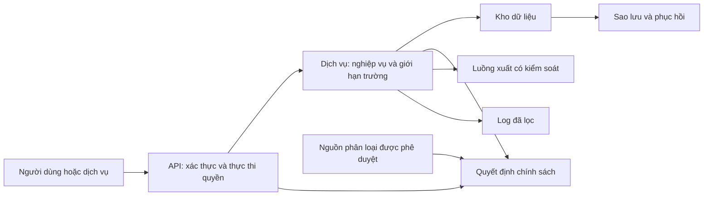

# Data classification và security control

## 1. Từ nhãn phân loại đến hành vi bảo vệ

**Data classification** là việc phân loại dữ liệu dựa trên giá trị, độ nhạy cảm, tác động khi dữ liệu bị xâm phạm và các yêu cầu xử lý liên quan. **Security control** là biện pháp quản trị, vận hành hoặc kỹ thuật được dùng để giảm rủi ro đối với dữ liệu đó.

Hai khái niệm có liên hệ chặt chẽ nhưng đảm nhiệm hai công việc khác nhau:

- Phân loại cung cấp căn cứ để quyết định cần bảo vệ dữ liệu đến mức nào.
- Kiểm soát tạo ra hành vi bảo vệ trong quy trình và hệ thống.
- Yêu cầu bảo mật nối hai bên bằng một đặc tả có thể triển khai và kiểm chứng.

Một bảng dữ liệu được gắn nhãn “Hạn chế” vẫn có thể bị đọc trái phép nếu kho lưu trữ cho phép truy cập công khai. Ngược lại, bật mã hóa không chứng minh rằng hệ thống chỉ trả đúng dữ liệu cho đúng người.

Chuỗi thiết kế cần có là:

**Dữ liệu và ngữ cảnh → tác động, đe dọa → phân loại → mục tiêu kiểm soát → yêu cầu bảo mật → cơ chế thực thi → bằng chứng.**

Bài học này giúp bạn xây dựng chuỗi đó, lựa chọn kiểm soát phù hợp với rủi ro và viết tiêu chí kiểm chứng. Những mức phân loại, mã tài sản và thời hạn trong bài là ví dụ giả định, cần được tổ chức phê duyệt trước khi áp dụng.

## 2. Phân biệt phân loại, yêu cầu và cơ chế kiểm soát

| Thành phần | Câu hỏi cần trả lời | Ví dụ |
|---|---|---|
| Phân loại dữ liệu | Dữ liệu có giá trị hoặc nhạy cảm thế nào trong ngữ cảnh này? | Danh sách khách hàng được xếp mức “Hạn chế” |
| Mục tiêu kiểm soát | Cần ngăn chặn, phát hiện hoặc khắc phục điều gì? | Ngăn nhân viên xem khách hàng ngoài phạm vi phụ trách |
| Yêu cầu bảo mật | Hệ thống hoặc vai trò phải làm gì, trong điều kiện nào? | Máy chủ phải kiểm tra phạm vi khách hàng cho mỗi yêu cầu đọc |
| Cơ chế kiểm soát | Thực thi yêu cầu bằng cách nào? | Chính sách truy cập theo vai trò và phạm vi đối tượng tại API |
| Tiêu chí kiểm chứng | Quan sát gì để kết luận đạt hoặc không đạt? | Tài khoản phụ trách nhóm A không đọc được hồ sơ nhóm B |
| Bằng chứng | Lưu đầu ra nào để chứng minh kết quả? | Kết quả kiểm thử, phiên bản chính sách, log quyết định truy cập |

Một yêu cầu có thể cần nhiều cơ chế. Ví dụ, bảo vệ tệp xuất dữ liệu cần phân quyền tải, giới hạn thời hạn, bảo vệ kho lưu và quản lý nơi nhận. Một cơ chế cũng có thể phục vụ nhiều yêu cầu: log kiểm toán có thể hỗ trợ phát hiện truy cập bất thường và điều tra thay đổi dữ liệu.

### 2.1. Các loại kiểm soát

Xét theo cách tổ chức thực hiện:

- **Quản trị:** chính sách phân loại, chủ sở hữu dữ liệu, thẩm quyền phê duyệt và quy trình ngoại lệ.
- **Vận hành:** rà soát quyền, xử lý cảnh báo, bàn giao trách nhiệm, diễn tập phục hồi.
- **Kỹ thuật:** kiểm tra quyền, mã hóa, lọc trường trả về, ghi log, giới hạn xuất và tự hết hạn.

Xét theo tác dụng:

- **Phòng ngừa:** giảm khả năng hành vi trái phép xảy ra, như chặn truy cập ngoài quyền.
- **Phát hiện:** nhận biết sai lệch hoặc sự kiện đáng ngờ, như cảnh báo xuất dữ liệu bất thường.
- **Khắc phục, phục hồi:** hạn chế hậu quả và đưa hệ thống về trạng thái chấp nhận được.

Các cách nhìn này bổ sung cho nhau. Một cơ chế phát hiện không tự thay thế cho quyết định cấp quyền; một quy trình phê duyệt cũng không có tác dụng đầy đủ nếu hệ thống vẫn cho phép bỏ qua nó.

## 3. Phân loại phải phản ánh ngữ cảnh và các chiều tác động

### 3.1. Không dùng một nhãn bí mật để suy ra mọi yêu cầu

Nhiều tổ chức dùng mức phân loại để biểu diễn độ nhạy cảm khi tiết lộ. Trong trường hợp đó, cần đánh giá thêm tính toàn vẹn và tính sẵn sàng:

| Chiều tác động | Câu hỏi | Ví dụ cần bảo vệ |
|---|---|---|
| Bí mật — Confidentiality | Điều gì xảy ra nếu dữ liệu bị người ngoài phạm vi biết hoặc sử dụng? | Hồ sơ khách hàng, khóa bí mật, điều kiện đàm phán |
| Toàn vẹn — Integrity | Điều gì xảy ra nếu dữ liệu bị sửa, thêm hoặc xóa trái phép? | Bảng giá công bố, địa chỉ nhận hàng, cấu hình quyền |
| Sẵn sàng — Availability | Điều gì xảy ra nếu dữ liệu không dùng được đúng lúc? | Danh mục phục vụ bán hàng, dữ liệu xử lý đơn, cấu hình khởi động dịch vụ |

Một bảng giá đã công bố có thể cần ít hạn chế người đọc, nhưng vẫn cần kiểm soát người sửa, quy trình duyệt phiên bản và khả năng phục hồi. Một tài liệu nội bộ ít được sử dụng có thể cần giữ bí mật nhưng không cần mục tiêu phục hồi giống hệ thống giao dịch.

Vì vậy, hồ sơ dữ liệu nên ghi ít nhất mức bí mật, tác động đến toàn vẹn và nhu cầu sẵn sàng, thay vì lấy một nhãn duy nhất làm đại diện cho mọi chiều.

### 3.2. Phạm vi, mục đích và khả năng kết hợp

Phân loại cần xét:

- Nội dung và độ chi tiết của các trường.
- Số lượng bản ghi và khoảng thời gian dữ liệu bao phủ.
- Khả năng liên kết với các nguồn khác.
- Người nhận, mục đích và môi trường sử dụng.
- Hậu quả có thể xảy ra và khả năng khắc phục sau sự cố.
- Những yêu cầu bắt buộc hoặc cam kết mà tổ chức phải đáp ứng.

Một mã khách hàng không chứa tên vẫn có thể nối với bảng liên hệ. Một thống kê tổng hợp vẫn có thể làm lộ thông tin nếu nhóm thống kê quá nhỏ hoặc các truy vấn cho phép suy ra một cá nhân.

Việc che, mã hóa hoặc thay định danh bằng mã không tự động làm giảm mức phân loại. Muốn giảm mức bảo vệ của đầu ra, cần đánh giá phép biến đổi, dữ liệu còn lại, khả năng liên kết và điều kiện sử dụng.

### 3.3. Dữ liệu chính và các bản sao

Phạm vi phân loại phải đi theo luồng dữ liệu, bao gồm cơ sở dữ liệu, bản sao đọc, bộ nhớ đệm, hàng đợi, tệp xuất, chỉ mục tìm kiếm, log, môi trường thử nghiệm và bản sao lưu.

Ví dụ, một API giới hạn trường rất tốt nhưng log lại ghi toàn bộ phản hồi có thể tạo ra một bản sao nhạy cảm nằm ngoài chính sách truy cập của API.

Cần xác định cho từng đích:

1. Dữ liệu nào thực sự đi đến đích đó?
2. Mức phân loại nào áp dụng?
3. Ai là chủ sở hữu và ai quản lý kỹ thuật?
4. Kiểm soát nào được kế thừa, kiểm soát nào phải triển khai riêng?
5. Khi dữ liệu thay đổi hoặc bị xóa, các bản sao được xử lý thế nào?

### 3.4. Trách nhiệm đối với phân loại và kiểm soát

Chủ sở hữu dữ liệu xác nhận mục đích, tác động, mức phân loại và nhóm người được sử dụng. Nhóm quản lý kỹ thuật triển khai, vận hành và cung cấp bằng chứng về kiểm soát. Nhóm an toàn thông tin hỗ trợ phân tích rủi ro, thiết kế tiêu chí và kiểm chứng.

Khi việc đáp ứng yêu cầu cần nguồn lực hoặc có rủi ro vượt thẩm quyền của chủ sở hữu, cần đưa quyết định đến đúng cấp có thẩm quyền. Nhóm triển khai không tự hạ phân loại chỉ vì một kiểm soát khó thực hiện.

## 4. Xây dựng baseline và hồ sơ kiểm soát theo phân loại

**Baseline** là tập kiểm soát nền áp dụng cho một phạm vi đã xác định. **Hồ sơ kiểm soát theo phân loại** bổ sung hoặc tăng cường yêu cầu dựa trên mức phân loại và ngữ cảnh.

Baseline tránh việc mỗi nhóm tự bắt đầu từ đầu. Hồ sơ theo phân loại giúp các tài sản có đặc điểm tương tự được xử lý nhất quán. Tuy nhiên, cả hai vẫn phải được điều chỉnh theo rủi ro cụ thể.

### 4.1. Baseline chung không biến mất khi dữ liệu được công khai

Một baseline minh họa cho hệ thống trực tuyến có thể yêu cầu:

- Mỗi tập dữ liệu có định danh, chủ sở hữu, mục đích và phạm vi.
- Các đường quản trị được xác thực, phân quyền và ghi dấu vết.
- Đường truyền và bản lưu được bảo vệ theo thiết kế đã phê duyệt.
- Thay đổi dữ liệu có kiểm tra hợp lệ và giới hạn người được sửa.
- Cấu hình, quyền và phụ thuộc có cơ chế quản lý thay đổi.
- Có lưu giữ, xóa và phương án phục hồi phù hợp với nhu cầu.
- Có quy trình xử lý sai lệch, sự cố và ngoại lệ.

“Công khai” mô tả quyền đọc đối với phiên bản được phép công bố. Nó không có nghĩa mọi bản nháp được công khai, mọi người được sửa hoặc hệ thống không cần bảo vệ.

### 4.2. Ma trận xử lý dữ liệu minh họa

Bảng dưới đây dùng bốn mức **về bí mật**. Tên gọi là quy ước minh họa của tổ chức, không mặc nhiên mang ý nghĩa của một hệ thống phân loại pháp lý.

| Khía cạnh | C0 — Công khai | C1 — Nội bộ | C2 — Bí mật | C3 — Hạn chế |
|---|---|---|---|---|
| Người đọc | Mọi người với đúng phiên bản đã duyệt công bố | Nhân sự hoặc dịch vụ thuộc nhóm nội bộ được phép | Vai trò có nhu cầu nghiệp vụ xác định | Nhóm được phê duyệt cụ thể, theo phạm vi đối tượng và hành động |
| Cấp quyền | Xác thực và phân quyền cho thao tác quản trị, công bố | Theo vai trò, có thu hồi khi thay đổi công việc | Có phê duyệt nhu cầu và rà soát phạm vi | Có phê duyệt, thời hạn, tách quyền nhạy cảm và điều kiện xác thực tăng cường |
| Chia sẻ, xuất | Chỉ đầu ra được duyệt công khai | Kênh nội bộ đã được phép | Giới hạn người nhận, trường dữ liệu, mục đích | Quyền xuất tách riêng, phê duyệt từng phạm vi và kiểm soát đích |
| Logging | Ghi thay đổi quản trị và công bố | Ghi truy cập hoặc thay đổi theo rủi ro | Ghi các thao tác nhạy cảm, tránh dữ liệu gốc | Ghi quyết định và thao tác nhạy cảm với giám sát phù hợp |
| Ngoài sản xuất | Có thể dùng phiên bản công khai đã duyệt | Dùng theo chính sách môi trường đích | Ưu tiên dữ liệu giả định hoặc đã xử lý được phê duyệt | Dùng dữ liệu thật chỉ qua ngoại lệ có phạm vi và thời hạn |
| Giảm mức phân loại | Kiểm soát việc công bố phiên bản | Chủ sở hữu phê duyệt theo căn cứ | Đánh giá nội dung và các bản sao trước thay đổi | Đánh giá rủi ro, biến đổi và thẩm quyền rõ ràng trước thay đổi |

Các kiểm soát baseline vẫn áp dụng cho cả bốn cột. Bảng này chưa phải cấu hình triển khai: những cụm như “rà soát” hoặc “giám sát phù hợp” cần được đặc tả tiếp thành chu kỳ, điều kiện kích hoạt, thời gian xử lý và tiêu chí kiểm chứng.

### 4.3. Bổ sung theo toàn vẹn và sẵn sàng

Mức C3 không tự có nghĩa phải phục hồi nhanh hơn mọi dữ liệu C0. Cần bổ sung các yêu cầu theo tác động thực tế:

| Tác động | Hướng yêu cầu bổ sung |
|---|---|
| Sửa sai gây hậu quả lớn | Phê duyệt thay đổi, kiểm tra hợp lệ, giới hạn người sửa, lưu lịch sử, kiểm tra đối soát |
| Không thể chấp nhận mất nhiều dữ liệu | Mục tiêu RPO và phương án sao lưu hoặc ghi nhận thay đổi tương ứng |
| Gián đoạn gây tác động lớn | Mục tiêu RTO, dự phòng, giám sát phụ thuộc và diễn tập phục hồi |
| Cần chứng minh ai đã làm gì | Danh tính cá nhân, log có bảo vệ, liên kết yêu cầu và phiên bản dữ liệu |
| Dữ liệu khó thay thế sau khi bị lộ | Hạn chế thu thập, giảm bản sao, giới hạn đầu ra và người được tiếp cận |

RPO là mục tiêu về mức mất dữ liệu được chấp nhận, thường biểu diễn bằng khoảng thời gian lùi dữ liệu. RTO là mục tiêu về thời gian đưa khả năng cung cấp dịch vụ trở lại trong phạm vi đã xác định.

### 4.4. Chọn kiểm soát theo kịch bản rủi ro

Hồ sơ kiểm soát nên được xây dựng theo công thức tư duy:

**Baseline + yêu cầu theo phân loại + yêu cầu về toàn vẹn, sẵn sàng + yêu cầu từ đe dọa và nghĩa vụ áp dụng.**

Ví dụ, dữ liệu C2 được dùng bởi một dịch vụ nội bộ và dữ liệu C2 được xuất cho đối tác có thể cần các kiểm soát khác nhau tại ranh giới chia sẻ.

Nếu kiểm soát trong hồ sơ không phù hợp, cần ghi rõ lý do, rủi ro, phương án thay thế, người phê duyệt và thời hạn. Việc điều chỉnh phải giữ được mục tiêu bảo vệ hoặc được xử lý như một ngoại lệ rủi ro có thẩm quyền.

## 5. Quy trình chuyển phân loại thành thiết kế kiểm soát

### Bước 1: Xác định dữ liệu và các đường sử dụng

Ghi rõ tập dữ liệu, trường, mục đích, chủ sở hữu, môi trường, bản sao và đích nhận. Tránh những phạm vi quá rộng như “toàn bộ dữ liệu công ty”.

### Bước 2: Đánh giá tác động và phân loại

Chủ sở hữu xác nhận tác động nếu dữ liệu bị lộ, bị sửa sai hoặc không dùng được. Kết quả cần có căn cứ, ngày xác nhận và phiên bản, để biết một quyết định kiểm soát đang dựa trên đánh giá nào.

### Bước 3: Viết các kịch bản đe dọa

Không chỉ hỏi “dữ liệu có nhạy cảm không?”, mà cần hỏi:

- Tài khoản hợp lệ có thể đọc quá phạm vi không?
- Có đường trực tiếp bỏ qua kiểm tra của ứng dụng không?
- Log, tệp xuất hoặc công cụ hỗ trợ có tạo bản sao ngoài ý muốn không?
- Ai có thể thay nhãn hoặc hạ mức phân loại?
- Khi khôi phục dữ liệu, quyền cũ hoặc dữ liệu đã xóa có quay trở lại không?
- Nếu dịch vụ chính sách gặp lỗi, hệ thống sẽ quyết định thế nào?

### Bước 4: Xác định mục tiêu kiểm soát

Ví dụ: ngăn truy cập ngoài nhóm được phân công, ngăn xuất tập trường chưa được duyệt, phát hiện thay đổi nhãn trái phép, bảo đảm phục hồi không làm sống lại quyền đã thu hồi.

Mỗi mục tiêu cần nối với ít nhất một kịch bản rủi ro. Tránh thêm kiểm soát chỉ vì nó có tên trong một danh sách phổ biến mà chưa hiểu mục tiêu.

### Bước 5: Đặc tả yêu cầu

Viết rõ hành vi, phạm vi, điều kiện, thời gian và bằng chứng. Với yêu cầu vận hành, ghi người thực hiện và hạn xử lý. Với yêu cầu hệ thống, ghi điểm thực thi và phản ứng khi thiếu điều kiện.

### Bước 6: Chọn cơ chế và phân công triển khai

Một yêu cầu phân quyền có thể cần kiểm tra ở API, dịch vụ nghiệp vụ, kho dữ liệu và luồng xuất. Xác định thành phần nào chịu trách nhiệm cho quyết định nào, tránh giả định rằng “nhóm khác chắc đã xử lý”.

### Bước 7: Xác định cách kiểm chứng và xử lý sai lệch

Có thể cần kiểm thử hành vi, kiểm tra cấu hình, diễn tập phục hồi và kiểm tra hồ sơ phê duyệt. Khi không đáp ứng yêu cầu, cần quyết định khắc phục hoặc ngoại lệ có thẩm quyền, không tự đánh dấu đạt vì đã cài một công cụ.

## 6. Tình huống minh họa: dữ liệu đơn hàng và danh mục công khai

### 6.1. Phạm vi và phân loại

Một nền tảng bán hàng có hai tập dữ liệu:

| Tập dữ liệu | Nội dung và ngữ cảnh | Đánh giá minh họa |
|---|---|---|
| DS-ORDER-011 | Đơn hàng, thông tin giao nhận, liên hệ, trạng thái xử lý và dữ liệu phục vụ đối soát nội bộ | C3 về bí mật; tác động cao nếu trạng thái bị sửa trái phép; cần phục hồi để tiếp tục xử lý |
| DS-CATALOG-011 | Tên sản phẩm, mô tả và giá đã được duyệt công bố | C0 đối với phiên bản công khai; vẫn cần bảo vệ người sửa, tính chính xác và khả năng phục vụ |

Chủ sở hữu đơn hàng là vai trò phụ trách vận hành đơn hàng; người đương nhiệm và người thay thế được ghi trong hồ sơ. Nhóm ứng dụng và dữ liệu thực hiện quản lý kỹ thuật theo phạm vi được giao.

Nhân viên chỉ được xử lý đơn thuộc phạm vi phụ trách. Quyền xem liên hệ đầy đủ, thay đổi trạng thái và xuất dữ liệu là các quyền riêng. Dữ liệu đơn hàng có thể đi qua API, hàng đợi, bản sao đọc, kho xuất, log và bản sao lưu.

DS-CATALOG-011 cho thấy một điểm quan trọng: mở quyền đọc công khai không mở quyền sửa công khai. Tệp nháp chứa chi phí nội bộ cũng không thuộc phiên bản C0 chỉ vì được dùng để tạo danh mục.

### 6.2. Các kịch bản rủi ro cần xử lý

| Kịch bản | Mục tiêu kiểm soát |
|---|---|
| Nhân viên đổi mã đơn để đọc đơn của nhóm khác | Kiểm tra quyền theo đối tượng ở phía máy chủ |
| Trường liên hệ bị thêm vào đầu ra ngoài dự kiến | Tạo phản hồi theo danh sách trường được phép |
| Người dùng tự đổi nhãn C3 thành C0 | Bảo vệ quyền thay nhãn và quy trình giảm mức phân loại |
| Tệp xuất vượt phê duyệt hoặc được giữ vô thời hạn | Kiểm soát phạm vi, người nhận, quyền tải và vòng đời |
| Log ghi toàn bộ đơn hàng hoặc token | Chỉ ghi dữ liệu sự kiện cần thiết theo cấu trúc cho phép |
| Bản sao đọc có quyền rộng hơn dịch vụ chính | Áp dụng kiểm soát tương đương trên đường truy cập thay thế |
| Phục hồi đưa quyền cũ trở lại | Áp dụng trạng thái quyền hiện hành trước khi mở dịch vụ |
| Danh mục công khai bị sửa bởi tài khoản chỉ có quyền đọc | Tách quyền đọc và quyền quản trị, duyệt phiên bản công bố |

### 6.3. Khuôn yêu cầu có thể kiểm chứng

Có thể dùng cấu trúc:

> Với [dữ liệu và phạm vi], khi [điều kiện], [thành phần hoặc vai trò] phải [hành vi]. Giới hạn là [đối tượng, trường, thời gian hoặc ngưỡng]. Người xác nhận là [vai trò]. Bằng chứng gồm [đầu ra]. Đạt khi [tiêu chí].

Các yêu cầu bên dưới dùng thời hạn giả định. Chúng minh họa cách đặc tả, không tạo giá trị mặc định cho mọi hệ thống.

### 6.4. Yêu cầu về phân loại và quyền thay đổi

**CL-CLASS-01 — Phân loại trước khi phát hành.** Trước khi phát hành trường, tập dữ liệu hoặc đích nhận mới của DS-ORDER-011, phải có hồ sơ phân loại được chủ sở hữu phê duyệt, nêu mức bí mật, tác động toàn vẹn, nhu cầu sẵn sàng và hồ sơ kiểm soát áp dụng. Quy trình phát hành phải kiểm tra hồ sơ cho đúng phiên bản thay đổi.

**Kiểm chứng:** thêm một trường hoặc đích xuất chưa có trong hồ sơ; quy trình phải chặn phát hành. Khi được phê duyệt, đối chiếu hồ sơ với cấu trúc dữ liệu, hợp đồng API và đích triển khai thực tế.

**CL-LABEL-01 — Bảo vệ metadata phân loại.** Nhãn dùng để quyết định kiểm soát phải lấy từ nguồn quản lý tin cậy phía máy chủ. Người gọi API không được tự đặt mức phân loại bằng tham số yêu cầu. Mọi thay đổi nhãn phải có danh tính, lý do, phiên bản trước/sau và phê duyệt hợp lệ; giảm mức phân loại cần quyết định của chủ sở hữu theo thẩm quyền.

**Kiểm chứng:** gửi nhãn C0 trong yêu cầu đọc dữ liệu C3, sửa metadata bằng tài khoản không có quyền và phát lại quyết định thay đổi đã hết hiệu lực. Hệ thống phải từ chối việc thay nhãn không hợp lệ và không nới quyền truy cập.

Việc một người được quản trị máy chủ không tự trao quyền quyết định hạ mức phân loại dữ liệu nghiệp vụ.

### 6.5. Yêu cầu về xác thực và phân quyền

**CL-AUTH-01 — Điều kiện xác thực cho quyền nhạy cảm.** Thao tác quản trị chính sách, xem thông tin liên hệ đầy đủ và xuất DS-ORDER-011 phải dùng danh tính cá nhân đáp ứng xác thực đa yếu tố theo chính sách của tình huống. Danh tính dịch vụ phải được cấp quyền theo nghiệp vụ riêng và không được dùng như tài khoản tương tác dùng chung.

**Kiểm chứng:** thử từng thao tác qua các đường đã kiểm kê với phiên thiếu điều kiện xác thực, phiên hợp lệ và danh tính dịch vụ ngoài phạm vi. Chỉ các trường hợp đáp ứng chính sách mới được tiếp tục đến bước kiểm tra quyền.

**CL-ACC-01 — Phân quyền theo hành động và đối tượng.** Mỗi yêu cầu đọc, sửa hoặc xuất phải được kiểm tra theo danh tính, vai trò, tập đơn được phân công và hành động. Quyền đọc không bao gồm quyền sửa hoặc xuất. Trong tối đa 5 phút từ khi hệ thống quản lý quyền tiếp nhận quyết định thu hồi hợp lệ, các quyền tương ứng phải mất hiệu lực trên mọi đường thuộc phạm vi, kể cả phiên và token đang tồn tại.

**Kiểm chứng:** dùng tài khoản của nhóm A đọc hoặc sửa đơn nhóm B; thử API theo lô, bản sao đọc và công cụ trực tiếp bằng các quyền tương ứng. Sau thu hồi, kiểm tra lại với phiên đã mở trước đó và đối chiếu mốc thời gian. Nếu dùng bộ nhớ đệm quyền, kiểm thử phải bao gồm trường hợp bộ nhớ đệm còn dữ liệu cũ.

Thời hạn 5 phút bắt đầu từ lúc tiếp nhận quyết định, nên quy trình phát hiện và gửi quyết định thu hồi cần mục tiêu riêng nếu muốn kiểm soát toàn bộ thời gian xử lý.

### 6.6. Yêu cầu về đầu ra và xuất dữ liệu

**CL-OUT-01 — Đầu ra theo tập trường cho phép.** Với vai trò xử lý đơn thông thường, phản hồi chỉ chứa các trường được duyệt cho nghiệp vụ đó. Trường liên hệ đầy đủ phải bị loại hoặc biến đổi ở máy chủ theo chính sách. Trường mới trong mô hình lưu trữ không được tự động xuất hiện trong phản hồi.

**Kiểm chứng:** đối chiếu phản hồi API, trường lồng nhau, tham số mở rộng, tệp tải và thông báo lỗi. Thêm một trường giả định vào mô hình lưu trữ và xác nhận nó chưa được trả ra khi chưa có quyết định cho phép. Che trên giao diện không được dùng làm bằng chứng duy nhất.

**CL-EXP-01 — Xuất theo phạm vi đã phê duyệt.** Yêu cầu xuất phải nêu người nhận, mục đích, bộ lọc đối tượng, tập trường và nơi nhận. Người yêu cầu không được tự duyệt. Tác vụ xuất phải kiểm tra lại hiệu lực phê duyệt và phạm vi quyền tại thời điểm thực hiện, không chỉ lúc xếp hàng.

Tệp xuất được lưu trong kho được chỉ định, kiểm tra quyền ở mỗi lần tải và bị xóa trong tối đa 2 giờ sau khi tạo xong, trừ quyết định tạm giữ hợp lệ. Thu hồi quyền phải được áp dụng theo CL-ACC-01; hết thời hạn không được chỉ ẩn nút tải trong khi tệp vẫn truy cập được.

**Kiểm chứng:** thử đổi tập trường sau phê duyệt, mở rộng bộ lọc, thu hồi quyền khi tác vụ còn trong hàng đợi, tải bằng người khác và tải sau hết hạn. Đối chiếu nội dung tệp với phê duyệt và kiểm tra trạng thái tại kho lưu.

Tệp đã tải về không thể bị thu hồi chỉ bằng việc xóa tệp trên máy chủ. Quyết định chia sẻ còn phải xác định nơi nhận được phép, trách nhiệm lưu giữ và việc chuyển tiếp.

### 6.7. Yêu cầu về logging và bảo vệ bản lưu

**CL-LOG-01 — Sự kiện kiểm toán không chứa dữ liệu gốc không cần thiết.** Hệ thống phải ghi sự kiện cho cấp hoặc thu hồi quyền, thay nhãn, đọc thông tin liên hệ đầy đủ, thay đổi trạng thái đơn và xuất dữ liệu. Sự kiện chứa mã dữ liệu hoặc đối tượng phù hợp, danh tính tác động, thời điểm, hành động, kết quả, mã yêu cầu và mã phê duyệt nếu có.

Không ghi toàn bộ đơn hàng, giá trị liên hệ đầy đủ, mật khẩu hoặc token vào log. Quyền sửa hoặc xóa kho log phải tách khỏi quyền vận hành dữ liệu theo phân công đã duyệt.

**Kiểm chứng:** sinh từng loại sự kiện; đưa giá trị đánh dấu giả định vào thân yêu cầu, header và nhánh lỗi để kiểm tra chúng không bị ghi ra ngoài cấu trúc cho phép. Thử sửa hoặc xóa log bằng tài khoản chỉ có quyền vận hành đơn hàng.

Mã tham chiếu trong log vẫn có thể liên kết về khách hàng. Log phải có phân loại, người quản lý và thời hạn lưu riêng, thay vì mặc định coi nó là dữ liệu ít nhạy cảm.

**CL-STORE-01 — Bảo vệ bản lưu và quyền giải mã.** Kho chính, bản sao đọc, kho xuất và sao lưu phải được bảo vệ bằng cơ chế mã hóa theo hồ sơ thiết kế đã duyệt. Hồ sơ cần chỉ rõ cơ chế, cấu hình, nơi quản lý khóa, danh tính được dùng khóa, đường kết nối và cách xác minh đích. Quyền quản trị lưu trữ không được tự động kéo theo quyền đọc dữ liệu gốc nếu chưa được phê duyệt.

**Kiểm chứng:** đối chiếu cấu hình với phiên bản thiết kế; thử danh tính không có quyền giải mã, kết nối không đáp ứng điều kiện và truy cập trực tiếp vào từng loại bản lưu. Việc kiểm tra một kho không chứng minh mọi bản sao đều được bảo vệ.

### 6.8. Yêu cầu về toàn vẹn và phục hồi

**CL-INT-01 — Chuyển trạng thái đơn theo quy tắc được phép.** Chỉ vai trò được cấp quyền mới được chuyển trạng thái đơn, và hệ thống phải kiểm tra quy tắc chuyển trạng thái ở máy chủ. Yêu cầu thay đổi phải gắn với phiên bản dữ liệu hiện hành để tránh ghi đè thay đổi mới bằng dữ liệu cũ. Tác vụ tự động phải có danh tính và phạm vi riêng.

**Kiểm chứng:** thử chuyển trạng thái ngoài luồng cho phép, dùng vai trò chỉ đọc, gửi lại yêu cầu cũ và thực hiện hai thay đổi đồng thời. Kết quả phải tuân theo quy tắc xử lý xung đột đã đặc tả và có dấu vết quyết định.

Với DS-CATALOG-011, yêu cầu tương ứng là chỉ công bố phiên bản đã duyệt và giới hạn người sửa; quyền đọc công khai không thay đổi các điều kiện đó.

**CL-REC-01 — Phục hồi có kiểm tra dữ liệu và chính sách.** Trong kịch bản đã duyệt, DS-ORDER-011 có RPO không quá 15 phút và RTO không quá 4 giờ. Thực hiện kiểm thử theo quý và sau thay đổi lớn ảnh hưởng phục hồi. Trước khi mở truy cập, phải kiểm tra tính toàn vẹn, quyền hiện hành, dữ liệu đã có quyết định xóa và trạng thái bí mật đã thu hồi.

RTO được đo từ lúc sự cố giả lập làm nghiệp vụ đã chọn không đáp ứng đến lúc nghiệp vụ đó hoạt động và qua kiểm tra chấp nhận. RPO phải được kiểm tra bằng dữ liệu có thể khôi phục đầy đủ, không chỉ dựa trên thời gian tạo tệp sao lưu.

**Kiểm chứng:** phục hồi trong môi trường cô lập, đối chiếu giao dịch và trạng thái, thử quyền đã thu hồi và kiểm tra các bản ghi đã xóa theo lịch lưu giữ. Ghi kết quả cùng các phụ thuộc như khóa, định danh dịch vụ và cấu hình.

Mục tiêu phục hồi của DS-CATALOG-011 phải được đánh giá từ tác động gián đoạn của nó. Không suy ra mục tiêu đó chỉ từ nhãn C0 hoặc dùng nguyên mục tiêu của DS-ORDER-011.

## 7. Đưa phân loại vào kiến trúc thực thi

Phân loại cần được lưu và quản lý ở một nguồn đủ tin cậy để các thành phần sử dụng nhất quán. Điểm quyết định chính sách cần biết dữ liệu, danh tính, hành động và ngữ cảnh; điểm thực thi phải áp dụng quyết định trước khi trả dữ liệu hoặc thay đổi trạng thái.



Sơ đồ là mô hình khái niệm; không bắt buộc mọi hệ thống phải triển khai một dịch vụ chính sách tách riêng. Điều cần bảo đảm là nguồn chính sách, trách nhiệm quyết định và vị trí thực thi rõ ràng.

### 7.1. Metadata cần đủ để truy vết quyết định

Một quyết định truy cập có thể cần các thông tin sau:

| Thông tin | Mục đích |
|---|---|
| Mã tập dữ liệu và đối tượng | Biết yêu cầu đang tác động đến đâu |
| Phiên bản phân loại | Biết quyết định dựa trên phân loại nào |
| Phiên bản hồ sơ kiểm soát | Biết tập yêu cầu nào đang được áp dụng |
| Danh tính, vai trò và phạm vi | Xác định người gọi được làm gì |
| Hành động và tập trường | Phân biệt đọc, sửa, xuất và giới hạn đầu ra |
| Phê duyệt hoặc ngoại lệ | Kiểm tra căn cứ, thời hạn và phạm vi |
| Kết quả quyết định | Thực thi và phục vụ điều tra theo cấu trúc log đã duyệt |

Không lấy nhãn phân loại, vai trò hoặc mã phê duyệt do máy khách tự khai làm căn cứ duy nhất. Cần xác minh chúng từ nguồn có thẩm quyền và ràng buộc với đúng đối tượng, hành động và người thực hiện.

### 7.2. Logic thực thi minh họa

```text
Nhận yêu cầu:
    Xác minh danh tính và trạng thái phiên.
    Xác định tập dữ liệu, đối tượng và hành động.
    Lấy phân loại và chính sách từ nguồn tin cậy.
    Nếu chưa có phân loại hoặc chính sách cho hành động:
        Không cấp thêm quyền truy cập.
        Ghi sự kiện sai lệch theo cấu trúc cho phép.
        Chuyển vấn đề đến đầu mối chịu trách nhiệm.
    Nếu có chính sách hợp lệ:
        Kiểm tra vai trò, phạm vi, điều kiện xác thực và phê duyệt.
        Nếu không đạt: từ chối.
        Nếu đạt:
            Thực thi đúng hành động và tập trường cho phép.
            Ghi kết quả cùng phiên bản chính sách phù hợp.
```

Đây là mã giả để biểu đạt yêu cầu. Triển khai thực tế còn cần xử lý giao dịch, bộ nhớ đệm, thay đổi quyền, lỗi và các đường truy cập trực tiếp.

### 7.3. Khi không lấy được chính sách

Cần đặc tả trước hành vi khi nguồn chính sách không hoạt động:

- Không mặc định cấp quyền mới hoặc coi nhãn không xác định là C0.
- Nếu dùng chính sách lưu đệm, phải quy định thời hạn hợp lệ, phạm vi dùng và cách đáp ứng yêu cầu thu hồi.
- Quyền khẩn cấp phải qua quy trình riêng có giới hạn, dấu vết, thời hạn và rà soát.
- Có giám sát, dự phòng và phương án khôi phục để giảm tác động đến sẵn sàng.

Với nội dung công khai đã được phê duyệt, hệ thống có thể phục vụ bản lưu đệm nếu thiết kế xác nhận bản đó vẫn là phiên bản được phép công bố. Điều này cần được quy định rõ, không mở rộng thành quyền phục vụ mọi dữ liệu khi chính sách gặp lỗi.

Không nên đặt yêu cầu phân quyền rồi để một nhánh xử lý lỗi trả dữ liệu mà không kiểm tra.

### 7.4. Bảo vệ xuyên qua các đường thay thế

Phân loại không chỉ áp dụng cho đường đi từ giao diện đến API. Cần xét:

- Tác vụ nền và các thông điệp trong hàng đợi.
- API theo lô, công cụ quản trị và bản sao đọc.
- Chỉ mục tìm kiếm, bộ nhớ đệm và dữ liệu tải trước.
- Truy vấn phân tích và tệp phục vụ báo cáo.
- Công cụ theo dõi lỗi, trace và các tệp hỗ trợ.
- Bản sao lưu, phục hồi và môi trường ngoài sản xuất.

Một tác vụ nền vẫn cần danh tính, phạm vi và chính sách. Quyền tại thời điểm tạo tác vụ có thể khác quyền tại thời điểm chạy; yêu cầu xuất trong tình huống đã quy định kiểm tra lại ở thời điểm thực hiện.

## 8. Thay đổi phân loại và duy trì kiểm soát trong vòng đời

### 8.1. Khi có dữ liệu hoặc mục đích mới

Một trường mới, một nhà cung cấp mới hoặc một mục đích phân tích mới có thể làm thay đổi rủi ro. Cần cập nhật:

1. Hồ sơ dữ liệu và luồng đi.
2. Căn cứ phân loại và tác động.
3. Hồ sơ kiểm soát và các yêu cầu cụ thể.
4. Chính sách truy cập, tập trường và nơi nhận.
5. Kịch bản kiểm chứng và bằng chứng cần lưu.

Ví dụ, thêm ghi chú tự do vào đơn hàng có thể làm xuất hiện thông tin nhạy cảm ngoài dự kiến. Chỉ cập nhật cấu trúc cơ sở dữ liệu mà không cập nhật log, tìm kiếm và xuất dữ liệu sẽ để lại khoảng trống.

### 8.2. Khi tăng mức bảo vệ

Tăng mức phân loại cần kế hoạch áp dụng cho các bản sao hiện hữu, không chỉ dữ liệu mới:

- Thu hẹp quyền không còn phù hợp.
- Cập nhật chính sách, cấu hình và thời hạn bộ nhớ đệm.
- Xử lý tệp xuất hoặc đường chia sẻ đang còn hiệu lực.
- Đánh giá các tác vụ chờ và đầu ra đang tạo.
- Xác định thời hạn hoàn thành và đầu mối theo dõi.

Nếu mức phân loại thay đổi trong khi một tác vụ xuất đang chạy, cần có quy tắc rõ: dừng, giữ kết quả để đánh giá lại hoặc thực hiện theo quyết định đã được phê duyệt cho tình huống đó. Không để tác vụ tự tiếp tục chỉ vì nó được tạo trước thay đổi.

### 8.3. Khi giảm mức bảo vệ hoặc công bố đầu ra

Giảm mức phân loại phải gắn với phiên bản dữ liệu và căn cứ cụ thể. Ví dụ, một báo cáo đã loại bỏ dữ liệu khách hàng và được đánh giá phù hợp để công bố là một đầu ra có hồ sơ riêng. Quyết định đó không tự giảm phân loại của dữ liệu đơn hàng nguồn.

Cần xác nhận:

- Những trường, bản ghi hoặc độ chi tiết nào còn trong đầu ra.
- Khả năng liên kết, suy luận hoặc khôi phục thông tin nhạy cảm.
- Người nhận và điều kiện sử dụng.
- Phiên bản được phép công bố.
- Người có thẩm quyền phê duyệt và bằng chứng đánh giá.

Nếu một tập dữ liệu chứa nhiều loại thông tin, có thể tách một phiên bản đầu ra được kiểm soát thay vì nới quyền đối với toàn bộ tập nguồn. Khi chưa đánh giá được, cần xử lý theo mức bảo vệ thận trọng đã quy định trong chính sách.

### 8.4. Khi lưu giữ, xóa và ngừng sử dụng

Mỗi nhóm dữ liệu cần có mục đích, sự kiện bắt đầu tính thời hạn, thời hạn và trường hợp tạm giữ hợp lệ. Phân loại hỗ trợ quyết định cách bảo vệ trong thời gian lưu, còn thời hạn phải dựa trên nhu cầu và các nghĩa vụ thực tế.

Khi xóa, cần xét kho chính, bản sao đọc, bộ nhớ đệm, chỉ mục, tệp xuất và bên nhận được quản lý. Với bản sao lưu không hỗ trợ xóa chọn lọc, phải xác định lịch hết hạn, giới hạn sử dụng và cách áp dụng lại quyết định xóa khi phục hồi.

Bằng chứng ngừng sử dụng cần thể hiện quyền đã thu hồi, luồng dữ liệu đã dừng và các bản sao được xử lý theo kế hoạch. Đổi trạng thái trong danh mục không tự chứng minh các việc này đã hoàn tất.

## 9. Kiểm chứng quan hệ giữa classification và control

Một kiểm soát chỉ có giá trị khi hành vi thực tế đáp ứng yêu cầu. Cần chọn cách kiểm chứng đúng với bản chất của yêu cầu:

| Loại yêu cầu | Phương pháp phù hợp |
|---|---|
| Có chủ sở hữu, căn cứ và phê duyệt phân loại | Kiểm tra hồ sơ và thẩm quyền |
| Chỉ đúng vai trò được truy cập đúng đối tượng | Kiểm thử hành vi với các danh tính và phạm vi khác nhau |
| Mã hóa và quyền sử dụng khóa | Kiểm tra cấu hình, quyền và thử truy cập không hợp lệ |
| Tệp xuất theo phê duyệt, tự hết hạn | Kiểm thử luồng, kiểm tra nội dung và trạng thái tại kho |
| Log đủ sự kiện, không chứa dữ liệu gốc | Sinh sự kiện, kiểm tra đầu ra và nhánh lỗi |
| Đạt RPO, RTO và phục hồi đúng quyền | Diễn tập có đo lường và kiểm tra dữ liệu, nghiệp vụ |
| Thu hồi áp dụng trên mọi đường | Kiểm thử phiên cũ, bộ nhớ đệm và đường thay thế |

### 9.1. Ma trận kiểm thử cho tình huống

Các bộ dữ liệu và tài khoản kiểm thử dưới đây là giả định, được thiết lập để biết trước quyền và kết quả mong đợi.

| Trường hợp | Kết quả mong đợi | Yêu cầu liên quan |
|---|---|---|
| Người dùng không đăng nhập đọc đúng phiên bản danh mục công khai | Được đọc nội dung đã công bố, không được sửa | Baseline C0, CL-INT-01 theo phạm vi danh mục |
| Nhân viên nhóm A đọc trường được phép của đơn nhóm A | Được trả đúng tập trường, có dấu vết theo chính sách | CL-ACC-01, CL-OUT-01 |
| Nhân viên nhóm A đổi mã để đọc đơn nhóm B | Không nhận dữ liệu ngoài quyền | CL-ACC-01 |
| Người gọi gửi nhãn C0 cho dữ liệu C3 | Nhãn gửi lên không làm nới quyền | CL-LABEL-01 |
| Mô hình lưu trữ có trường mới chưa được duyệt đầu ra | Trường không tự xuất hiện trong API hoặc tệp | CL-CLASS-01, CL-OUT-01 |
| Quyền bị thu hồi khi tác vụ xuất còn chờ | Tác vụ kiểm tra lại và không tạo đầu ra trái quyền | CL-ACC-01, CL-EXP-01 |
| Người dùng dùng đường tải cũ sau thời hạn tệp | Không tải được; trạng thái kho phù hợp yêu cầu xóa | CL-EXP-01 |
| API lỗi khi nhận nội dung có giá trị đánh dấu nhạy cảm giả định | Log chỉ chứa trường được phép | CL-LOG-01 |
| Chính sách không sẵn sàng hoặc bộ nhớ đệm quá hạn | Không cấp quyền vượt chính sách đã đặc tả | CL-ACC-01 và thiết kế xử lý lỗi |
| Phục hồi bản sao cũ chứa quyền đã bị thu hồi | Quyền hiện hành được áp dụng trước khi mở dịch vụ | CL-REC-01 |

Chỉ kiểm thử đường thành công chưa đủ. Những trường hợp từ chối, lỗi, thay đổi đồng thời và tác vụ chạy trễ thường giúp phát hiện khoảng trống giữa chính sách và thực thi.

### 9.2. Bằng chứng cần nối được với phiên bản

Một hồ sơ kiểm chứng nên ghi:

- Tập dữ liệu, môi trường và phạm vi đã kiểm tra.
- Phiên bản phân loại, hồ sơ kiểm soát, chính sách và bản phát hành.
- Điều kiện ban đầu và dữ liệu kiểm thử.
- Kết quả mong đợi, kết quả quan sát và thời điểm.
- Sai lệch, người xử lý và quyết định tiếp theo.

Không đưa dữ liệu sản xuất nhạy cảm hoặc bí mật hoạt động vào báo cáo kiểm thử chỉ để chứng minh đã bảo vệ chúng. Dùng dữ liệu giả định hoặc cơ chế trình bày bằng chứng đã được kiểm soát.

### 9.3. Theo dõi chất lượng triển khai

Có thể theo dõi các chỉ số như:

- Tỷ lệ tập dữ liệu trong phạm vi có phân loại và chủ sở hữu đã xác nhận.
- Số đích dữ liệu chưa được gắn với hồ sơ kiểm soát.
- Số quyền hoặc ngoại lệ đã hết hạn nhưng chưa bị thu hồi.
- Thời gian áp dụng thay đổi chính sách trên các điểm thực thi.
- Tỷ lệ kịch bản phục hồi đáp ứng tiêu chí đã duyệt.

Cần ghi rõ mẫu số, nguồn đo và thời điểm. Một danh mục có 100% bản ghi được gắn nhãn chưa chứng minh rằng nhãn đúng hoặc các kiểm soát đang hoạt động.

## 10. Đánh giá chi phí, khả năng vận hành và rủi ro tồn dư

Áp dụng nhiều kiểm soát không tự tạo ra kết quả tốt hơn nếu thiếu khả năng vận hành. Ví dụ:

- Ghi quá nhiều log có thể làm tăng dữ liệu nhạy cảm và giảm khả năng điều tra.
- Rà soát quyền rất thường xuyên nhưng không có người xử lý sai lệch sẽ ít hiệu quả.
- Phê duyệt thủ công mọi thao tác có thể tạo điểm nghẽn và thúc đẩy việc dùng tài khoản chung.
- Mục tiêu phục hồi quá ngắn nhưng không có nguồn lực, phụ thuộc hoặc diễn tập sẽ thiếu căn cứ.

Cần đánh giá kiểm soát theo khả năng giảm rủi ro, phạm vi bao phủ, tác động nghiệp vụ, nguồn lực và khả năng cung cấp bằng chứng. Với thao tác lặp lại, có thể phê duyệt trước quy tắc cấp quyền hoặc quy tắc xử lý tự động, miễn là điều kiện, phạm vi và kiểm chứng được xác định rõ.

Nếu chưa đáp ứng được một yêu cầu, hồ sơ ngoại lệ cần có:

| Thành phần | Nội dung |
|---|---|
| Phạm vi | Dữ liệu, hệ thống và yêu cầu bị ảnh hưởng |
| Lý do | Điều kiện khiến chưa thể đáp ứng |
| Rủi ro | Đe dọa, tác động và khoảng trống còn lại |
| Biện pháp bù đắp | Kiểm soát tạm thời và giới hạn của nó |
| Trách nhiệm | Người xử lý, người có thẩm quyền phê duyệt |
| Thời hạn | Ngày hết hiệu lực và kế hoạch hoàn tất |
| Bằng chứng | Kết quả theo dõi, rà soát và quyết định gia hạn nếu có |

Ngoại lệ không được tự gia hạn khi hết hạn. Việc chấp nhận rủi ro nội bộ cũng không tự loại bỏ yêu cầu bắt buộc mà tổ chức phải tuân thủ.

## 11. Các lỗi thường gặp

| Lỗi | Hậu quả | Cách xử lý |
|---|---|---|
| Coi nhãn là biện pháp bảo vệ | Có phân loại nhưng hệ thống vẫn cho truy cập rộng | Nối nhãn với yêu cầu, điểm thực thi và kiểm thử |
| Dữ liệu C0 thì bỏ bảo vệ sửa đổi | Nội dung công khai có thể bị thay trái phép | Đánh giá toàn vẹn và sẵn sàng riêng |
| Dữ liệu C3 luôn cần cùng một RTO | Tốn nguồn lực hoặc bỏ sót nhu cầu thực tế | Chọn RTO từ tác động gián đoạn và phụ thuộc |
| Đặt cùng một bộ kiểm soát cho mọi dữ liệu | Quy trình khó vận hành, kiểm soát thiếu trọng tâm | Dùng baseline rồi bổ sung theo rủi ro |
| Cho máy khách tự khai mức phân loại | Có thể hạ nhãn để vượt quyền | Dùng nguồn metadata tin cậy, giới hạn quyền thay đổi |
| Chỉ áp dụng chính sách ở giao diện | API hoặc đường trực tiếp trở thành đường vòng | Thực thi tại các điểm truy cập phía máy chủ |
| Mã hóa rồi cấp quyền giải mã quá rộng | Người không cần biết vẫn đọc được dữ liệu gốc | Phân quyền dữ liệu và khóa theo nhiệm vụ |
| Chỉ bảo vệ cơ sở dữ liệu chính | Log, tệp xuất và bản sao bị bỏ sót | Theo dõi toàn bộ luồng và đích dữ liệu |
| Hạ nhãn nguồn khi một báo cáo đã được công bố | Dữ liệu gốc bị mở rộng quyền ngoài ý muốn | Quản lý riêng phiên bản đầu ra và phê duyệt |
| Chính sách lỗi thì mặc định cho phép | Sự cố phụ thuộc làm mất kiểm soát truy cập | Đặc tả hành vi lỗi, giới hạn lưu đệm và quy trình khẩn cấp |
| Cài công cụ là đánh dấu yêu cầu đã đạt | Không biết hành vi thực tế có đúng hay không | Kiểm chứng theo yêu cầu và lưu bằng chứng |
| Phục hồi dữ liệu nhưng không phục hồi chính sách đúng | Quyền cũ hoặc dữ liệu đã xóa có thể quay lại | Kiểm tra trạng thái hiện hành trước mở truy cập |

## 12. Bài tập thực hành

Một tổ chức có ba tập dữ liệu:

1. Tài liệu hướng dẫn sử dụng đã được duyệt công bố.
2. Danh sách khách hàng, lịch sử đơn hàng và thông tin giao nhận.
3. Log vận hành có mã người dùng, thời điểm truy cập và thông báo lỗi.

Thực hiện:

1. Xác định phạm vi và chủ sở hữu của từng tập, gồm ít nhất hai bản sao hoặc đích dữ liệu liên quan.
2. Đề xuất mức bí mật và đánh giá riêng tác động đến toàn vẹn, sẵn sàng.
3. Viết một baseline chung và các kiểm soát bổ sung cho từng tập.
4. Với danh sách khách hàng, đặc tả quyền đọc, sửa và xuất theo vai trò, đối tượng, trường và mục đích.
5. Với log, xác định sự kiện cần giữ và các giá trị không được ghi.
6. Viết ba yêu cầu có giới hạn rõ ràng, người chịu trách nhiệm và tiêu chí đạt.
7. Mô tả hành vi khi nhãn chưa xác định, quyền vừa bị thu hồi và hệ thống được phục hồi từ bản sao cũ.

Đầu ra tự thực hành nên có bảng truy vết với các cột:

**Dữ liệu → phân loại và tác động → đe dọa → yêu cầu → điểm thực thi → bằng chứng.**

Tự đối chiếu xem mỗi rủi ro đã có yêu cầu xử lý chưa, mỗi yêu cầu đã có người triển khai và cách kiểm chứng chưa, và các bản sao có nằm trong phạm vi bảo vệ không.

Phân loại dữ liệu phát huy giá trị khi nó dẫn đến các quyết định có thể thực thi. Một thiết kế đầy đủ cần giải thích được vì sao chọn kiểm soát, kiểm soát hoạt động ở đâu và bằng chứng nào chứng minh yêu cầu đã được đáp ứng.
