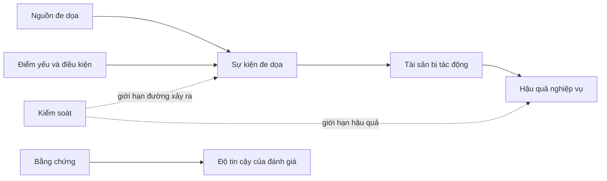

# Threat, vulnerability và impact

## 1. Mục tiêu bài học

Khi phân tích an toàn thông tin, các câu như “hệ thống có rủi ro bị tấn công”, “có lỗ hổng nghiêm trọng” hoặc “cần tăng bảo mật” thường chưa đủ để viết yêu cầu có thể kiểm chứng. Cần xác định điều gì có thể xảy ra, điều kiện nào cho phép nó xảy ra và hậu quả nào cần ngăn ngừa hoặc giới hạn.

Ba khái niệm nền tảng là:

- **Threat — mối đe dọa:** nguồn hoặc sự kiện có khả năng gây tổn hại trong một bối cảnh cụ thể.
- **Vulnerability — điểm yếu hoặc lỗ hổng:** đặc điểm yếu trong thiết kế, triển khai, cấu hình, quy trình hoặc vận hành có thể bị khai thác hoặc bị kích hoạt để gây hậu quả.
- **Impact — tác động:** hậu quả đối với tài sản, con người, hoạt động hoặc mục tiêu nghiệp vụ khi sự kiện xảy ra.

Trong chương **Rủi ro và mức đảm bảo** của module yêu cầu bảo mật, ba khái niệm này giúp nối mục tiêu bảo vệ với mô hình đe dọa, kiến trúc, yêu cầu và bằng chứng kiểm thử.

Sau bài học, bạn có thể phân biệt ba khái niệm, viết một kịch bản rủi ro có căn cứ, giải thích cách lựa chọn kiểm soát và xác định bằng chứng cần thiết để tin rằng yêu cầu đã được đáp ứng.

Các thang mức, thời gian và số lượng trong ví dụ là **giả định minh họa**, không phải ngưỡng bắt buộc cho mọi hệ thống.

## 2. Phân biệt bằng một tình huống đơn giản

Một nền tảng học tập cung cấp API tải bài nộp. Người dùng phải đăng nhập nhưng API chỉ tìm tệp theo mã bài, không kiểm tra người gọi có quyền với bài đó hay không.

| Thành phần | Nội dung trong tình huống |
| --- | --- |
| Tài sản cần bảo vệ | Nội dung bài nộp và quyền riêng tư của học viên |
| Nguồn đe dọa | Người có tài khoản nhưng muốn đọc bài của người khác |
| Sự kiện đe dọa | Người đó yêu cầu tải bài ngoài phạm vi được phép |
| Điểm yếu | API thiếu kiểm tra quyền trên bài nộp cụ thể |
| Điều kiện cần | Có phiên hợp lệ, tiếp cận được API và tham chiếu được bài đích |
| Tác động | Nội dung bài của người khác bị tiết lộ; có thể ảnh hưởng tính công bằng của đánh giá |
| Kiểm soát cần xem xét | Kiểm tra quyền theo người gọi, hành động và bài nộp ở phía máy chủ |
| Bằng chứng | Tài khoản thử không có quyền bị từ chối trên API và đường tải thực tế |

Trong tình huống này:

- “Người dùng có ý đồ đọc bài người khác” là nguồn đe dọa, không phải lỗ hổng.
- “Gửi yêu cầu đọc bài ngoài quyền” là sự kiện đe dọa.
- “Thiếu kiểm tra quyền theo bài nộp” là điểm yếu.
- “Bài nộp bị lộ” là hậu quả trực tiếp.
- “Ảnh hưởng công bằng kỳ đánh giá” là hậu quả nghiệp vụ tiếp theo.

Đăng nhập thành công chỉ xác nhận một danh tính theo cơ chế đã dùng. Nó không chứng minh người đó được đọc mọi bài nộp.

## 3. Threat: điều gì có thể gây tổn hại?

### 3.1. Tách nguồn đe dọa và sự kiện đe dọa

Từ “threat” có thể được dùng khá rộng trong trao đổi. Để tránh hiểu khác nhau, nên ghi riêng:

- **Nguồn đe dọa:** ai hoặc cái gì có thể gây sự kiện.
- **Sự kiện đe dọa:** hành động hoặc biến cố có thể tác động đến hệ thống.

Ví dụ:

| Nguồn | Sự kiện có thể xảy ra |
| --- | --- |
| Người ngoài tổ chức | Gửi yêu cầu đăng nhập tự động bằng thông tin xác thực đã bị lộ |
| Người dùng đã đăng nhập | Truy cập tài liệu hoặc bài nộp ngoài quyền được cấp |
| Tài khoản quản trị bị chiếm | Sửa quyền, xóa dữ liệu hoặc thay cấu hình bảo vệ |
| Nhân viên vận hành | Vô tình triển khai chính sách cho phép truy cập công khai |
| Thiết bị hoặc dịch vụ phụ thuộc | Hỏng hoặc ngừng phục vụ khiến chức năng bảo mật không hoạt động |
| Sự cố môi trường vật lý | Mất nguồn điện hoặc kết nối làm gián đoạn dịch vụ |

Không phải mọi nguồn đe dọa đều có ý đồ. Sai sót, hỏng hóc và sự kiện môi trường cũng có thể gây mất bí mật, toàn vẹn hoặc sẵn sàng.

### 3.2. Viết sự kiện theo hành động cụ thể

“Tin tặc” là mô tả quá rộng. Một mô tả có ích cho thiết kế cần cho biết hành động, đường tiếp cận và mục tiêu:

> Một người có phiên học viên gọi API tải bài để lấy nội dung bài của học viên khác.

Mô tả này rõ hơn “hệ thống bị tấn công” vì có thể xác định điểm kiểm tra quyền và thiết kế phép thử.

Tương tự:

- “Mã độc” là một nhóm phương tiện hoặc tác nhân; cần nói rõ mã độc có thể đọc khóa, mã hóa dữ liệu hay làm ngừng dịch vụ nào.
- “Rò rỉ dữ liệu” chủ yếu mô tả một kết quả; cần bổ sung sự kiện nào dẫn đến kết quả đó.
- “Tấn công vào đăng nhập” cần được cụ thể hóa thành đoán mật khẩu, dùng lại thông tin bị lộ, chiếm phiên hay lạm dụng khôi phục.

### 3.3. Gắn khả năng và quyền sẵn có vào bối cảnh

Hai nguồn đe dọa cùng muốn đọc dữ liệu nhưng có điều kiện rất khác:

- Người chưa đăng nhập chỉ tiếp cận điểm vào công khai.
- Học viên có phiên hợp lệ và được gọi API nghiệp vụ.
- Dịch vụ có danh tính máy với một số quyền truy cập.
- Người quản trị có thể sửa cấu hình hoặc chính sách quyền.

Không nên giả định mọi tác nhân có quyền quản trị ngay từ đầu. Nếu kịch bản cần chiếm tài khoản quản trị trước, điều kiện đó phải được ghi rõ hoặc liên kết với một kịch bản khác.

Ngược lại, không loại bỏ người dùng đã đăng nhập khỏi mô hình đe dọa. Một danh tính hợp lệ vẫn có thể thực hiện hành động ngoài phạm vi được phép.

## 4. Vulnerability: điều kiện yếu nằm ở đâu?

### 4.1. Điểm yếu có thể nằm ngoài mã nguồn

Lỗ hổng không chỉ là lỗi lập trình:

| Vị trí | Ví dụ điểm yếu | Hành vi hoặc hậu quả có thể được tạo điều kiện |
| --- | --- | --- |
| Thiết kế | Một danh tính có thể xóa cả dữ liệu đang chạy và toàn bộ backup | Một lần chiếm quyền có thể phá cả dịch vụ lẫn khả năng phục hồi |
| Mã nguồn | Chỉ kiểm tra đăng nhập, không kiểm tra quyền theo tài nguyên | Người dùng đọc hoặc sửa dữ liệu ngoài phạm vi |
| Cấu hình | Kho tệp cho phép truy cập ẩn danh ngoài chủ đích | Người không có quyền lấy dữ liệu |
| Quản lý danh tính | Quyền của người đã rời nhóm không được thu hồi đúng hạn | Truy cập tiếp tục sau khi nhu cầu đã kết thúc |
| Quy trình | Khôi phục tài khoản không kiểm chứng đủ danh tính | Người yêu cầu chiếm tài khoản qua đường hỗ trợ |
| Vận hành | Không phát hiện luồng audit đã ngừng gửi | Chậm phát hiện hoặc thiếu bằng chứng điều tra |
| Kiến trúc phụ thuộc | Thành phần thiết yếu có một điểm lỗi chung không được xử lý | Một sự cố làm nhiều dịch vụ ngừng hoạt động |

Một biện pháp chưa được triển khai không tự động là lỗ hổng trong mọi bối cảnh. Cần giải thích biện pháp đó xử lý kịch bản nào và vì sao việc thiếu nó tạo điều kiện gây hại.

Ví dụ, “chưa có firewall sản phẩm X” chưa phải mô tả điểm yếu. “Endpoint quản trị cho phép kết nối từ mạng chạy mã không tin cậy, trái với ranh giới đã thiết kế” là một mô tả cụ thể hơn.

### 4.2. Phân biệt điểm yếu với bề mặt tiếp xúc

Bề mặt tiếp xúc là nơi tác nhân có thể tương tác: API công khai, cổng tải tệp, tài khoản quản trị hoặc đường tích hợp.

Một API xuất hiện trên Internet không tự chứng minh API có lỗ hổng. Nó làm rõ đường tiếp cận và có thể ảnh hưởng khả năng xảy ra của một kịch bản.

Ngược lại, một dịch vụ chỉ truy cập nội bộ vẫn có thể có lỗ hổng. Điểm yếu đó có thể bị tiếp cận từ tài khoản bị chiếm, dịch vụ khác hoặc người dùng nội bộ.

Cần ghi riêng:

- Đường tiếp cận.
- Quyền hoặc điều kiện cần có.
- Điểm yếu cụ thể.
- Kiểm soát đang giới hạn đường đi đó.

### 4.3. Phân biệt nghi ngờ và bằng chứng đã xác nhận

Một kết quả quét hoặc nhận xét thiết kế có thể là đầu mối, chưa phải bằng chứng đầy đủ về khả năng khai thác trong hệ thống thực tế.

Có thể dùng các trạng thái minh họa:

| Trạng thái | Cách ghi phù hợp |
| --- | --- |
| Giả định cần xác minh | Chưa xác nhận endpoint có kiểm tra quyền ở lớp dùng chung |
| Phát hiện có căn cứ | Đã xác định một đường xử lý bỏ qua chính sách quyền |
| Xác nhận bằng thử nghiệm | Tài khoản thử A đọc được dữ liệu thử của B ngoài chính sách |
| Đã có biện pháp giảm thiểu | Đường truy cập đã bị chặn nhưng nguyên nhân gốc chưa được sửa |
| Đã sửa và xác minh | Phép thử ban đầu thất bại đúng mong đợi; luồng hợp lệ vẫn hoạt động |

Không khẳng định “không có lỗ hổng” chỉ vì một công cụ không phát hiện vấn đề. Kết luận phải giới hạn theo phạm vi kiểm tra, cấu hình, phiên bản và đường xử lý đã được xem xét.

Một điểm yếu có thể tồn tại nhưng chưa được xác nhận có thể tiếp cận trong môi trường đang xét. Khi đó, cần ghi điều chưa biết và công việc xác minh, không tự kết luận nó chắc chắn khai thác được hoặc hoàn toàn không có rủi ro.

## 5. Impact: hậu quả nào đáng quan tâm?

### 5.1. Đi từ hậu quả kỹ thuật đến hậu quả nghiệp vụ

Một phân tích tác động tốt giải thích chuỗi hậu quả:

> Đọc bài ngoài quyền → nội dung bài bị tiết lộ → người khác có thể sao chép trước hạn nộp → ảnh hưởng tính công bằng của kỳ đánh giá.

Một chuỗi khác:

> Xóa kho bài và backup → không phục hồi được bài đã nộp → phải tổ chức nộp lại hoặc chấm lại → gián đoạn kế hoạch đào tạo.

Không cần mọi chuỗi đều kết thúc bằng tổn thất tiền. Sự riêng tư, tính đúng đắn của kết quả, thời hạn nghiệp vụ và khả năng vận hành đều có thể là giá trị cần bảo vệ.

### 5.2. Xem xét bí mật, toàn vẹn và sẵn sàng

| Thuộc tính | Câu hỏi tác động | Ví dụ |
| --- | --- | --- |
| Bí mật | Ai có thể biết điều mà họ không được phép biết? | Lộ bài nộp, dữ liệu cá nhân hoặc token |
| Toàn vẹn | Điều gì bị sửa, tạo hoặc xóa trái phép? | Thay điểm số, đổi người sở hữu bài, sửa hướng dẫn vận hành |
| Sẵn sàng | Ai không sử dụng được chức năng nào, trong bao lâu? | Không nộp được bài gần thời điểm đóng cổng |

Một sự kiện có thể tác động đồng thời nhiều thuộc tính. Việc chiếm tài khoản quản trị có thể dẫn đến đọc dữ liệu, sửa quyền và làm ngừng dịch vụ.

Cần phân biệt hậu quả có căn cứ với hậu quả giả định. Nếu mới xác nhận một bản ghi thử bị đọc, không báo cáo rằng toàn bộ dữ liệu sản xuất đã bị lấy. Phạm vi ảnh hưởng tiềm năng cần được phân tích riêng, còn thiệt hại thực tế cần bằng chứng riêng.

### 5.3. Phạm vi, thời gian và khả năng phục hồi làm thay đổi tác động

Các yếu tố nên ghi nhận:

- Số lượng tài khoản, tài liệu hoặc quy trình có thể bị ảnh hưởng.
- Độ nhạy của dữ liệu và quyền được trao.
- Sự kiện xảy ra trước, trong hay sau thời điểm nghiệp vụ quan trọng.
- Thời gian gián đoạn và khả năng dùng phương án thay thế.
- Khả năng phát hiện sai lệch, xác định phiên bản đúng và phục hồi.
- Khả năng thu hồi dữ liệu đã bị tiết lộ hoặc thông tin xác thực đã bị lộ.
- Ảnh hưởng tới bên phụ thuộc và các hệ thống dùng chung.

Một giờ gián đoạn có thể được xử lý bằng lịch bảo trì ở thời điểm ít sử dụng, nhưng gây tác động lớn nếu rơi vào giờ cuối kỳ thi. Mức tác động phải gắn với bối cảnh đó.

Backup có thể giảm hậu quả mất dữ liệu nếu phục hồi được. Backup không thu hồi được dữ liệu mà người không có quyền đã tải xuống.

### 5.4. Thang tác động cần có tiêu chí

Ví dụ một thang định tính:

| Mức minh họa | Dấu hiệu để thảo luận |
| --- | --- |
| Thấp | Ảnh hưởng cục bộ, có cách khắc phục đơn giản, chưa vượt giới hạn nghiệp vụ đã thống nhất |
| Trung bình | Một nhóm người dùng hoặc quy trình bị ảnh hưởng đáng kể, cần can thiệp và phục hồi có tổ chức |
| Cao | Dữ liệu nhạy cảm bị tiết lộ diện rộng, kết quả nghiệp vụ quan trọng bị sai hoặc dịch vụ vượt giới hạn chịu gián đoạn |

Đây là mẫu thảo luận, không phải tiêu chí đủ để tự gán mức. Chủ sở hữu cần xác nhận các ngưỡng cụ thể, chẳng hạn nhóm dữ liệu nào được xem là nhạy cảm, thời gian nào không thể chấp nhận và quy trình nào có tính quyết định.

Không dùng số lượng bản ghi làm tiêu chí duy nhất. Một khóa có thể cấp quyền quản trị toàn hệ thống dù chỉ là một bản ghi.

## 6. Ghép ba khái niệm thành kịch bản rủi ro

### 6.1. Cấu trúc kịch bản

Một mẫu thực hành:

> Trong [phạm vi và điều kiện], [nguồn đe dọa] có thể thực hiện [sự kiện] qua [đường tiếp cận], lợi dụng [điểm yếu hoặc điều kiện yếu], tác động tới [tài sản] và dẫn đến [hậu quả].

Ví dụ:

> Trong môi trường sản xuất, người có phiên học viên có thể gọi API tải bài để yêu cầu bài của người khác. Nếu API không kiểm tra quyền trên bài đích, nội dung bài có thể bị tiết lộ ngoài phạm vi lớp học, ảnh hưởng quyền riêng tư và tính công bằng của kỳ đánh giá.

Sau mô tả, cần ghi:

- Bằng chứng hoặc giả định về điểm yếu.
- Kiểm soát hiện có và nơi thực thi.
- Khả năng xảy ra theo bối cảnh.
- Tác động và lý do.
- Điều chưa biết, người xác minh và thời điểm cần có kết quả.
- Quyết định xử lý và rủi ro còn lại.

### 6.2. Sơ đồ quan hệ

Sơ đồ không phải công thức xác suất. Một kiểm soát có thể ngăn sự kiện, giới hạn phạm vi, hỗ trợ phát hiện hoặc hỗ trợ phục hồi. Cần chỉ rõ tác dụng nào đang được kỳ vọng.

### 6.3. Risk không đồng nghĩa với ba khái niệm trên

**Rủi ro** là sự đánh giá về khả năng và hậu quả của một kịch bản trong bối cảnh cụ thể. Nó không chỉ là tên một mối đe dọa, một danh sách lỗ hổng hoặc một mức tác động.

- Có nguồn đe dọa chưa có nghĩa sự kiện chắc chắn xảy ra.
- Có điểm yếu chưa có nghĩa mọi tác nhân đều tiếp cận được.
- Tác động cao chưa có nghĩa khả năng xảy ra cao.
- Khả năng xảy ra thấp không tự làm hậu quả trở nên chấp nhận được.
- Chưa biết điểm yếu không phải bằng chứng rằng mọi đường gây hại đều đã được loại trừ.

Chất lượng đánh giá phụ thuộc vào cách ghi giả định, bằng chứng và phạm vi, không chỉ phụ thuộc một nhãn “cao” hay “thấp”.

## 7. Ví dụ xuyên suốt: bảo vệ bài nộp trên nền tảng học tập

### 7.1. Bối cảnh và giới hạn

Một nền tảng có API nộp bài, kho tệp, dịch vụ chấm bài, cổng quản trị và kho backup. Trong ví dụ:

- Học viên chỉ được đọc bài của mình.
- Người chấm chỉ được truy cập bài trong phạm vi được phân công.
- Dịch vụ chấm bài chỉ được lấy bài đã giao cho tác vụ.
- Người vận hành quản lý dịch vụ nhưng không mặc nhiên có quyền sử dụng nội dung bài cho mọi mục đích.
- Bài nộp và kết quả cần được giữ đúng qua thời hạn đánh giá.

Phân tích ban đầu đưa ra ba kịch bản. Những điểm yếu chưa kiểm chứng được ghi là giả định; chỉ sau thử nghiệm hoặc kiểm tra mới chuyển thành phát hiện đã xác nhận.

### 7.2. Ba kịch bản khác nhau

| Mã | Threat: nguồn và sự kiện | Vulnerability hoặc điều kiện yếu | Impact |
| --- | --- | --- | --- |
| R-01 | Học viên yêu cầu tải bài của người khác | Giả định API chỉ kiểm tra đăng nhập, chưa kiểm tra quyền theo bài | Lộ bài, ảnh hưởng riêng tư và công bằng đánh giá |
| R-02 | Danh tính dịch vụ chấm bài bị chiếm được dùng để đổi kết quả | Giả định cùng danh tính có quyền lấy bài và sửa kết quả ngoài tác vụ | Kết quả học tập bị thay đổi trái phép |
| R-03 | Tài khoản vận hành bị chiếm hoặc thao tác nhầm làm mất dữ liệu và bản sao | Giả định một vai trò có thể xóa cả kho đang chạy và mọi nguồn phục hồi | Mất bài nộp, gián đoạn chấm bài, phải tổ chức xử lý lại |

Ba kịch bản có thể dùng chung tài sản nhưng cần kiểm soát khác nhau:

- R-01 cần phân quyền theo đối tượng dữ liệu trên mọi đường đọc.
- R-02 cần giới hạn danh tính dịch vụ, hành động và phạm vi tác vụ.
- R-03 cần giới hạn quyền phá hủy và nguồn phục hồi nằm ngoài phạm vi xóa của tài khoản vận hành thông thường.

MFA cho tài khoản vận hành có thể giúp giảm một số đường chiếm tài khoản trong R-03. Nó không sửa lỗi phân quyền của R-01 và không ngăn được mọi thao tác nhầm của tài khoản đã xác thực.

### 7.3. Lập sổ rủi ro có căn cứ

Một bản ghi cho R-01 có thể trình bày:

| Trường | Giá trị minh họa |
| --- | --- |
| Tài sản | Bài nộp và tệp đính kèm |
| Phạm vi | API đọc, xem trước, tải trực tiếp và xuất bài |
| Chủ sở hữu | Nhóm sản phẩm đào tạo |
| Nguồn đe dọa | Người có tài khoản học viên |
| Sự kiện | Yêu cầu bài ngoài quyền |
| Điểm yếu cần xác minh | Kiểm tra quyền không được áp dụng nhất quán trên từng đường đọc |
| Bằng chứng ban đầu | Chưa có; cần kiểm tra thiết kế và thử với dữ liệu tổng hợp |
| Tác động tiềm năng | Lộ nội dung và ảnh hưởng công bằng đánh giá |
| Khả năng xảy ra | Chưa kết luận trước khi xác minh các điều kiện tiếp cận |
| Kiểm soát dự kiến | Chính sách quyền dùng chung và thực thi tại nơi cung cấp nội dung |
| Điều kiện đóng phát hiện | Các đường đọc ngoài quyền bị từ chối, đường hợp lệ hoạt động đúng |
| Rủi ro còn lại | Cần đánh giá thêm việc chia sẻ bản đã tải và tài khoản hợp lệ bị chiếm |

Nếu kiểm thử sau đó xác nhận học viên A đọc được bài thử của B, cập nhật bằng chứng theo đúng phạm vi đó. Không biến kết quả trên dữ liệu thử thành kết luận về sự cố rò rỉ đã xảy ra trong sản xuất.

## 8. Đánh giá khả năng xảy ra và ưu tiên xử lý

### 8.1. Các yếu tố hỗ trợ đánh giá

Đối với mỗi kịch bản, xem xét:

- Tác nhân có tiếp cận được điểm vào không?
- Cần có tài khoản, vai trò hoặc bước chiếm quyền nào trước?
- Điểm yếu đã được xác nhận hay vẫn là giả định?
- Cần kỹ năng, thời gian hoặc nguồn lực nào?
- Sự kiện có thể tự động hóa hoặc lặp lại không?
- Kiểm soát hiện có ngăn, phát hiện hoặc giới hạn hành vi ở đâu?
- Có phụ thuộc nào mà khi hỏng sẽ làm kiểm soát mất tác dụng?
- Phân tích áp dụng cho khoảng thời gian và môi trường nào?

“Có thể xảy ra” không đồng nghĩa “xảy ra thường xuyên”. Nếu chưa có dữ liệu để ước lượng tần suất, dùng thang định tính có lý do thay vì bịa xác suất.

### 8.2. Ma trận chỉ là công cụ tổ chức quyết định

Một ma trận ưu tiên minh họa:

| Khả năng xảy ra / Tác động | Thấp | Trung bình | Cao |
| --- | --- | --- | --- |
| Thấp | Ưu tiên thấp | Ưu tiên trung bình | Cần xem xét riêng và xác nhận thẩm quyền |
| Trung bình | Ưu tiên trung bình | Ưu tiên cao | Ưu tiên cao |
| Cao | Ưu tiên trung bình | Ưu tiên cao | Ưu tiên rất cao |

Bảng này là quy tắc minh họa của một tổ chức giả định. Nó không chứng minh rủi ro đã được đo chính xác và không tự quyết định cho phép phát hành.

Nếu gán số cho các mức, phép nhân các số thứ bậc chỉ tạo một chỉ số theo quy ước. Không diễn giải kết quả như xác suất thực hoặc tổn thất tài chính kỳ vọng khi chưa có mô hình và dữ liệu phù hợp.

Những kịch bản có hậu quả vượt giới hạn nghiệp vụ có thể cần quyết định riêng dù khả năng xảy ra được đánh giá thấp.

### 8.3. Đánh giá rủi ro trước và sau kiểm soát

Cần thống nhất đang đánh giá trạng thái nào:

- **Trước các kiểm soát đang xét:** hậu quả và khả năng nếu chưa áp dụng nhóm biện pháp dự kiến.
- **Hiện tại:** có tính đến các kiểm soát đã tồn tại và có bằng chứng hoạt động.
- **Còn lại sau xử lý:** có tính đến biện pháp đã triển khai và đã xác minh.

Không hạ mức rủi ro chỉ vì một biện pháp đã được đưa vào kế hoạch. “Đã tạo việc cần làm” chưa phải “đã giảm rủi ro”.

Một kiểm soát có thể thay đổi khả năng xảy ra, tác động hoặc cả hai. Audit thường hỗ trợ phát hiện và điều tra; nó không tự ngăn lần đọc trái phép đầu tiên. Phục hồi có thể giảm thời gian gián đoạn; nó không giải quyết mọi hậu quả tiết lộ dữ liệu.

## 9. Chuyển kịch bản thành yêu cầu bảo mật

### 9.1. Tránh nhảy thẳng từ tên rủi ro sang sản phẩm

Câu “có rủi ro truy cập trái phép nên mua thêm công cụ bảo mật” bỏ qua cơ chế gây hại. Trước hết cần xác định hành vi mà hệ thống phải bảo đảm.

Mẫu yêu cầu:

> Với [tài sản và môi trường], [thành phần hoặc chủ thể] phải [hành vi hoặc giới hạn] khi [điều kiện], đạt [kết quả hoặc ngưỡng]. Kiểm chứng bằng [phương pháp] và lưu [bằng chứng].

Một yêu cầu phải gắn được với đường đe dọa hoặc hậu quả cụ thể. Cũng cần có bên thực hiện và người chấp nhận kết quả.

### 9.2. SEC-01 — Xác thực và thu hồi phiên

Mọi đường truy cập bài nộp không được phê duyệt công khai phải yêu cầu danh tính đã xác thực và phiên còn được phép sử dụng. Khi phiên bị thu hồi tại nguồn có thẩm quyền, các điểm tiếp nhận phải ngừng chấp nhận phiên trong tối đa 5 phút theo giả định của ví dụ.

- Liên quan: R-01 và điều kiện tài khoản bị chiếm.
- Điểm thực hiện: dịch vụ danh tính, quản lý phiên và các API tiếp nhận.
- Kiểm chứng: thử phiên không hợp lệ, hết hạn và bị thu hồi trên từng đường đọc.
- Kết quả đạt: không có nội dung bài được cung cấp ngoài điều kiện đã đặt.
- Bằng chứng: ma trận điểm tiếp nhận, mốc thu hồi và kết quả thử.

Yêu cầu này không thay thế kiểm tra quyền theo bài. Người có phiên hợp lệ vẫn phải đáp ứng SEC-02.

### 9.3. SEC-02 — Phân quyền theo bài nộp

API đọc, xem trước, tải tệp và xuất bài phải kiểm tra quyền của danh tính đối với hành động và bài đích trước khi cung cấp dữ liệu. Quyền phải được xác định từ nguồn có thẩm quyền; không tin trường người sở hữu hoặc vai trò do máy khách tự khai.

- Liên quan: R-01.
- Điểm thực hiện: lớp kiểm tra quyền và mọi đường cung cấp nội dung.
- Kiểm chứng: học viên A truy cập bài thử của B; người chấm truy cập bài ngoài phân công; danh tính không có quyền gọi trực tiếp đường tải.
- Kết quả đạt: yêu cầu ngoài quyền bị từ chối, không lộ nội dung hoặc bản xem trước thuộc phạm vi bảo vệ.
- Kiểm thử chiều hợp lệ: học viên đọc bài của mình và người chấm đọc bài được giao.
- Bằng chứng: chính sách quyền, dữ liệu thử và kết quả theo từng đường truy cập.

### 9.4. SEC-03 — Giới hạn danh tính dịch vụ

Danh tính dịch vụ chấm bài phải tách theo môi trường và chỉ có quyền thực hiện hành động cần cho tác vụ được giao. Danh tính lấy bài không được mặc nhiên sửa kết quả của mọi học viên hoặc quản trị tài khoản.

- Liên quan: R-02.
- Điểm thực hiện: cấp danh tính dịch vụ, chính sách API và liên kết tác vụ.
- Kiểm chứng: dùng danh tính tác vụ đọc bài không được giao, sửa kết quả ngoài phạm vi và gọi API quản trị.
- Kết quả đạt: thao tác ngoài phạm vi bị từ chối; đường xử lý bài được giao vẫn hoàn tất.
- Bằng chứng: ma trận quyền, cấu hình có hiệu lực và kết quả thử.

Nếu kiến trúc cần một thành phần ghi kết quả, phải chỉ rõ thành phần đó được ghi cho tác vụ nào và điều kiện kiểm chứng kết quả. Không giải quyết bằng cách cấp quyền rộng cho mọi tiến trình.

### 9.5. SEC-04 — Bảo vệ dữ liệu và các bản sao

Bài nộp, tệp đính kèm, bản xuất và backup phải được lưu trong hệ thống được phê duyệt, bảo vệ đường truyền và dữ liệu lưu theo chính sách đã xác nhận. Kho tệp không được cung cấp truy cập ẩn danh trái với phạm vi sử dụng.

- Liên quan: R-01 và các đường tiết lộ ngoài API chính.
- Điểm thực hiện: kho tệp, đường truyền, bản xuất và backup.
- Kiểm chứng: thử truy cập trực tiếp không có quyền; kiểm tra chính sách công khai và cấu hình bảo vệ tại các nơi lưu.
- Kết quả đạt: không có đường đọc ngoài chính sách; cấu hình và trạng thái thực tế phù hợp với yêu cầu.
- Bằng chứng: danh sách nơi lưu, chính sách hiệu lực và kết quả kiểm thử.

Mã hóa không sửa lỗi phân quyền theo đối tượng. SEC-04 và SEC-02 xử lý các điều kiện khác nhau, cần bằng chứng riêng.

### 9.6. SEC-05 — Audit và phát hiện bất thường

Các thao tác bị từ chối do vượt quyền, thay đổi quyền, thay đổi kết quả và xóa dữ liệu hoặc backup trong phạm vi phải tạo sự kiện chứa danh tính, hành động, tài sản đích, thời điểm và kết quả. Không ghi nội dung bài, mật khẩu hoặc token đầy đủ vào sự kiện.

Trong ví dụ, sự kiện phải đến kho audit trung tâm trong tối đa 5 phút. Cảnh báo cho hành vi vượt ngưỡng phải có quy tắc cụ thể được xác nhận, nêu số lần, cửa sổ thời gian, nơi nhận và cách xử lý trùng lặp.

- Liên quan: R-01, R-02, R-03.
- Điểm thực hiện: nguồn audit, bộ chuyển tiếp, kho log và cơ chế cảnh báo.
- Kiểm chứng: tạo thao tác thành công và bị từ chối, đo độ trễ và kiểm tra nội dung sự kiện.
- Với quy tắc cảnh báo đã chọn, tạo chuỗi sự kiện tổng hợp dưới và trên ngưỡng để kiểm tra.
- Bằng chứng: sự kiện đã lọc dữ liệu nhạy cảm, kết quả đo và bản ghi cảnh báo.

Ngưỡng chưa được xác nhận là phần đặc tả còn thiếu, không phải điều kiện đạt đã hoàn chỉnh. Có log không đồng nghĩa đã ngăn truy cập trái phép.

### 9.7. SEC-06 — Giới hạn quyền phá hủy nguồn phục hồi

Danh tính vận hành thông thường không được có khả năng xóa hoặc làm mất khả năng sử dụng tất cả nguồn phục hồi của bài nộp. Quyền với kho backup và khóa cần cho phục hồi phải được thiết kế để một phạm vi chiếm quyền không phá đồng thời dữ liệu chính và mọi nguồn khôi phục.

- Liên quan: R-03.
- Điểm thực hiện: chính sách quyền, kho backup, khóa và tài khoản phục hồi.
- Kiểm chứng: dùng đúng danh tính vận hành thông thường thử xóa bản sao, đổi thời hạn giữ hoặc vô hiệu hóa khóa ngoài thẩm quyền trong môi trường thử.
- Kết quả đạt: không thể phá toàn bộ nguồn phục hồi bằng danh tính đó.
- Bằng chứng: chính sách hiệu lực và kết quả thử quyền, bao gồm cả phụ thuộc khóa.

“Tách kho” chưa đủ nếu cùng một danh tính vẫn xóa được mọi kho và khóa tương ứng.

### 9.8. SEC-07 — Phục hồi đầu cuối

Trong tình huống minh họa, dịch vụ nộp bài phải đạt **RPO không quá 15 phút** và **RTO không quá 60 phút** cho kịch bản mất kho dữ liệu chính đã thống nhất.

RPO là mục tiêu về khoảng dữ liệu có thể mất trước sự cố. RTO là mục tiêu về thời gian khôi phục; trong ví dụ được đo từ lúc công bố sự cố đến khi người có quyền nộp và đọc lại bài thành công, dữ liệu và quyền đã được kiểm tra.

- Liên quan: R-03.
- Điểm thực hiện: backup, môi trường đích, danh tính, khóa, kết nối và quy trình phục hồi.
- Kiểm chứng: diễn tập mất kho chính bằng dữ liệu tổng hợp có mốc thời gian, phục hồi rồi kiểm tra nội dung và quyền.
- Kết quả đạt: khoảng mất dữ liệu và thời gian nằm trong mục tiêu, người ngoài quyền vẫn bị từ chối.
- Bằng chứng: biên bản, mốc thời gian, kết quả kiểm tra dữ liệu và ma trận quyền.

Các mục tiêu chỉ được coi là đã xác minh trong kịch bản và điều kiện thử đã nêu. Không suy rộng thành bảo đảm cho mọi dạng thảm họa.

## 10. Từ mức rủi ro đến mức đảm bảo

### 10.1. Mức đảm bảo nói về độ tin cậy của kết luận

Mức đảm bảo phản ánh mức tin cậy rằng yêu cầu được đáp ứng, dựa trên cách thiết kế, triển khai, kiểm tra và duy trì bằng chứng.

Nó không đồng nghĩa với:

- Mức tác động của tài sản.
- Số lượng sản phẩm bảo mật đã cài.
- Việc có một báo cáo kiểm thử.
- Một nhãn rủi ro thấp do nhóm tự gán.

Tuyên bố “API kiểm tra quyền” cần bằng chứng về nơi kiểm tra, phạm vi bao phủ, kết quả trên đường bị cấm và trạng thái đang chạy. Với chức năng có hậu quả nghiêm trọng, cần độ sâu kiểm tra và độ độc lập tương xứng.

### 10.2. Các lớp bằng chứng

| Lớp | Câu hỏi cần trả lời | Ví dụ với SEC-02 |
| --- | --- | --- |
| Thiết kế | Cơ chế có xử lý đúng đường gây hại không? | Mọi đường đọc đều đi qua chính sách quyền hoặc cơ chế tương đương |
| Triển khai | Cơ chế có được áp dụng đầy đủ không? | API tải và xuất không bỏ qua kiểm tra |
| Cấu hình thực tế | Môi trường đang chạy có đúng chính sách không? | Kho tệp không có đường công khai vượt kiểm soát |
| Hành vi | Hành động được phép và bị cấm có kết quả đúng không? | A không đọc được bài B, người chấm đọc đúng phân công |
| Vận hành | Kiểm soát còn đúng sau thay đổi hoặc sự cố không? | Thu hồi nhóm, cache và phục hồi không mở lại quyền |

Một mức bằng chứng minh họa cho kịch bản tác động cao có thể bao gồm rà soát thiết kế bởi người khác người triển khai, kiểm thử hành vi trên mọi đường truy cập và bằng chứng cấu hình môi trường phát hành. Đây là lựa chọn của tổ chức giả định, không phải một hệ mức chuẩn hóa.

Không đổi tên những mức tự đặt thành chứng nhận hoặc tuyên bố tuân thủ một tiêu chuẩn.

### 10.3. Rủi ro giảm chỉ khi kiểm soát có tác dụng đúng

Đối với R-01:

- Kiểm tra đăng nhập có thể chặn người chưa có danh tính hợp lệ.
- Kiểm tra quyền theo bài mới xử lý hành vi của người đã đăng nhập ngoài phạm vi.
- Giới hạn xuất có thể giảm số lượng dữ liệu bị lấy trong một thao tác.
- Audit có thể hỗ trợ phát hiện và điều tra.
- Mã hóa ổ đĩa xử lý một đường đọc dữ liệu khác.

Một tập kiểm soát nhìn có vẻ đầy đủ vẫn có thể bỏ trống đường đe dọa chính. Khi đánh giá rủi ro còn lại, phải gắn tác dụng từng kiểm soát với kịch bản.

## 11. Bảng truy vết và điều kiện chấp nhận

| Rủi ro | Mục tiêu bảo vệ | Yêu cầu | Bằng chứng chính | Bên xác nhận tác động |
| --- | --- | --- | --- | --- |
| R-01 | Chỉ đúng đối tượng đọc được bài | SEC-01, SEC-02, SEC-04, SEC-05 | Ma trận quyền trên API, tải, xem trước và xuất | Chủ sở hữu chức năng nộp bài |
| R-02 | Danh tính dịch vụ không sửa ngoài phạm vi | SEC-03, SEC-05 | Thử quyền danh tính dịch vụ và đối chiếu kết quả | Chủ sở hữu quy trình đánh giá |
| R-03 | Giữ được nguồn phục hồi và khôi phục đúng hạn | SEC-05, SEC-06, SEC-07 | Thử quyền phá hủy và diễn tập phục hồi | Chủ sở hữu dịch vụ và vận hành |

Điều kiện chấp nhận nên phân biệt:

- Yêu cầu đã đạt với bằng chứng.
- Phát hiện còn mở.
- Giả định chưa xác minh.
- Rủi ro còn lại đã được người có thẩm quyền chấp nhận.
- Ngoại lệ có thời hạn và điều kiện rà soát.

Đóng một phát hiện kỹ thuật không tự đóng mọi rủi ro liên quan. Sửa một endpoint vẫn có thể để lại đường tải khác. Ngược lại, một biện pháp giới hạn phạm vi có thể giảm rủi ro hiện tại dù việc sửa nguyên nhân gốc còn phải tiếp tục.

## 12. Sai lầm thường gặp

| Nhận định | Vấn đề | Cách diễn đạt hoặc xử lý tốt hơn |
| --- | --- | --- |
| “Tin tặc là lỗ hổng” | Nhầm nguồn đe dọa với điểm yếu | Ghi tác nhân, hành động và điều kiện yếu riêng |
| “Mất dữ liệu là threat đầy đủ” | Chỉ có hậu quả, chưa có sự kiện và đường đi | Nêu ai hoặc điều gì làm mất dữ liệu, qua điểm yếu nào |
| “Có Internet là có lỗ hổng” | Nhầm bề mặt tiếp xúc với điểm yếu | Xác định chức năng nào thiếu kiểm soát |
| “Nội bộ nên không có threat” | Bỏ qua người dùng hợp lệ, sai sót và tài khoản bị chiếm | Phân tích quyền và hành vi trong từng ranh giới |
| “Đã đăng nhập thì không đọc trái phép được” | Nhầm xác thực với phân quyền | Kiểm tra quyền theo hành động và tài nguyên |
| “Điểm yếu nghiêm trọng thì mọi nơi đều rủi ro cao như nhau” | Bỏ qua tài sản, quyền cần có và kiểm soát hiện tại | Đánh giá theo kịch bản và môi trường cụ thể |
| “Chưa thấy khai thác nên tác động thấp” | Nhầm thiếu bằng chứng xảy ra với hậu quả nếu xảy ra | Tách khả năng, tác động và mức không chắc chắn |
| “Có backup nên không lo rò rỉ” | Kiểm soát không xử lý hậu quả tiết lộ | Phân biệt phục hồi với bảo mật nội dung |
| “Có log nên hành vi bị ngăn” | Nhầm phát hiện với phòng ngừa | Chỉ rõ nơi từ chối và vai trò của audit |
| “Không quét thấy lỗi là hệ thống an toàn” | Kết luận vượt phạm vi bằng chứng | Ghi rõ phạm vi, giới hạn và phần chưa kiểm tra |
| “Đã lên kế hoạch sửa là rủi ro đã giảm” | Nhầm dự kiến với hiệu lực thực tế | Chỉ cập nhật sau triển khai và xác minh |
| “Điểm rủi ro 12 nghĩa là xác suất 12%” | Diễn giải sai thang thứ bậc | Dùng điểm theo đúng quy ước, không tạo độ chính xác giả |

## 13. Thực hành và tự đánh giá

### 13.1. Bài tập phân loại khái niệm

Xem các phát biểu:

1. “API cập nhật điểm không kiểm tra người gọi có được phân công lớp đó.”
2. “Một người chấm muốn sửa điểm của lớp ngoài phạm vi.”
3. “Kết quả đánh giá của học viên bị thay đổi trái phép.”
4. “Một tài khoản quản trị bị chiếm được dùng để xóa backup.”
5. “Danh tính vận hành có thể xóa cả dữ liệu chính và mọi bản sao.”

Hãy xác định phát biểu nào mô tả nguồn hoặc sự kiện đe dọa, điểm yếu hay tác động. Sau đó ghép chúng thành hai kịch bản có điều kiện và tài sản rõ ràng.

Gợi ý:

- Phát biểu 1 mô tả một điểm yếu phân quyền.
- Phát biểu 2 mô tả nguồn và ý định; cần bổ sung hành động cụ thể.
- Phát biểu 3 mô tả tác động về tính toàn vẹn.
- Phát biểu 4 mô tả nguồn trong trạng thái bị chiếm và sự kiện phá hủy.
- Phát biểu 5 mô tả điều kiện yếu về phạm vi quyền và khả năng phục hồi.

### 13.2. Bài tập viết yêu cầu

Với chức năng cập nhật điểm:

1. Xác định tài sản và chủ sở hữu.
2. Viết một sự kiện đe dọa có đường tiếp cận.
3. Nêu điểm yếu đã biết hoặc giả định cần xác minh.
4. Mô tả hậu quả kỹ thuật và hậu quả nghiệp vụ.
5. Viết yêu cầu phân quyền có kết quả kiểm thử rõ.
6. Viết yêu cầu audit không ghi dữ liệu vượt nhu cầu.
7. Xác định bằng chứng cần có trước khi chấp nhận phát hành.
8. Ghi rủi ro còn lại và người có thẩm quyền quyết định.

Một yêu cầu mẫu:

> API cập nhật điểm phải kiểm tra người gọi có vai trò và phân công còn hiệu lực đối với lớp và lần đánh giá đích. Yêu cầu ngoài phân công phải bị từ chối và không làm thay đổi dữ liệu. Kiểm chứng bằng tài khoản thử có vai trò đúng nhưng không được phân công, cùng phép thử hợp lệ trên lớp được giao; lưu kết quả và sự kiện audit không chứa bí mật.

Yêu cầu này rõ hơn “chỉ người có quyền được sửa điểm” vì nêu đối tượng phân quyền, điều kiện và cách quan sát việc từ chối.

### 13.3. Câu hỏi tự kiểm tra

- Tôi có tách tác nhân, hành động, điểm yếu và hậu quả không?
- Kịch bản có điều kiện tiếp cận và môi trường cụ thể không?
- Điểm yếu đã được xác nhận hay mới là giả định?
- Tác động có gắn với dữ liệu, thời điểm và mục tiêu nghiệp vụ không?
- Kiểm soát được chọn ngăn đường xảy ra hay chỉ giúp phát hiện hoặc phục hồi?
- Yêu cầu có phép thử cả hành vi hợp lệ lẫn bị cấm không?
- Bằng chứng có phản ánh cấu hình đang chạy và mọi đường liên quan không?
- Kết luận có vượt quá phạm vi dữ liệu hoặc phép thử đã thực hiện không?

## 14. Những điểm cần ghi nhớ

Threat mô tả nguồn hoặc sự kiện có thể gây hại. Vulnerability mô tả điều kiện yếu có thể bị lợi dụng hoặc bị kích hoạt. Impact mô tả hậu quả đối với tài sản và mục tiêu nghiệp vụ. Một kịch bản rủi ro cần nối ba khái niệm với đường tiếp cận, điều kiện, kiểm soát và bằng chứng.

Yêu cầu bảo mật được xây dựng từ cơ chế gây hại và hậu quả cần giới hạn. Mức đảm bảo đến từ độ phù hợp và chất lượng của bằng chứng thiết kế, triển khai, kiểm thử và vận hành. Các kết luận cần giữ đúng phạm vi và ghi rõ phần còn chưa biết.
