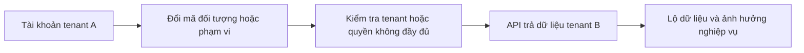

# Likelihood và impact

## 1. Hai câu hỏi nền tảng khi đánh giá rủi ro bảo mật

Khi một hệ thống có nguy cơ bị xâm phạm, nhóm phát triển cần trả lời hai câu hỏi khác nhau:

- **Likelihood — khả năng xảy ra:** trong một khoảng thời gian và điều kiện xác định, kịch bản có khả năng xảy ra đến đâu?
- **Impact — mức tác động:** nếu kịch bản đó xảy ra, hậu quả đối với dữ liệu, hoạt động, con người và tổ chức sẽ nghiêm trọng đến mức nào?

Ví dụ, một API có thể cho phép người dùng đọc hồ sơ của khách hàng khác. Việc API được đưa ra Internet, cách kiểm tra quyền và khả năng phát hiện lỗi ảnh hưởng đến likelihood. Loại dữ liệu bị đọc, số người bị ảnh hưởng và khả năng khắc phục hậu quả ảnh hưởng đến impact.

Hai thành phần này giúp nhóm xác định ưu tiên, lựa chọn yêu cầu bảo mật và mức bằng chứng cần thu thập. Chúng không tự chứng minh hệ thống an toàn, cũng không thay thế cho việc mô tả đúng kịch bản.

Trong thiết kế yêu cầu bảo mật, chuỗi cần có là:

**Tài sản → kịch bản đe dọa → likelihood và impact → quyết định xử lý → yêu cầu → kiểm chứng → đánh giá lại rủi ro.**

Bài học sử dụng các thang điểm, mốc thời gian và số liệu giả định để minh họa phương pháp. Chúng không phải ngưỡng bắt buộc cho mọi tổ chức.

## 2. Đánh giá một kịch bản cụ thể

### 2.1. Định nghĩa đối tượng được đánh giá

Những câu như “rủi ro API cao” hoặc “mật khẩu yếu có impact lớn” thiếu thông tin để đánh giá nhất quán. Một kịch bản nên nêu:

| Thành phần | Câu hỏi |
|---|---|
| Tài sản và nghiệp vụ | Dữ liệu hoặc chức năng nào cần bảo vệ? |
| Tác nhân và điều kiện | Ai hoặc điều gì có thể khởi phát sự kiện? |
| Đường đi, điểm yếu | Kịch bản đi qua thành phần và ranh giới nào? |
| Sự kiện không mong muốn | Hành vi hoặc trạng thái nào được coi là đã xảy ra? |
| Hậu quả | Bí mật, toàn vẹn, sẵn sàng hoặc nghiệp vụ bị ảnh hưởng ra sao? |
| Phạm vi và thời gian | Môi trường, phiên bản, nhóm người dùng và khoảng đánh giá nào? |
| Kiểm soát hiện có | Biện pháp nào đang hoạt động và có bằng chứng đến đâu? |
| Giả định, bất định | Những điều gì chưa biết hoặc có thể thay đổi kết quả? |

Một khuôn diễn đạt:

> Trong [phạm vi và khoảng thời gian], [tác nhân] có thể thông qua [đường đi và điều kiện] gây ra [sự kiện], dẫn đến [hậu quả], trong khi [kiểm soát và giả định] đang áp dụng.

### 2.2. Tình huống xuyên suốt

Xét nền tảng quản lý đơn hàng cho nhiều doanh nghiệp thuê chung dịch vụ. Mỗi doanh nghiệp là một **tenant**, có dữ liệu và người dùng riêng.

Kịch bản **RISK-003**:

> Trong 12 tháng tiếp theo, một tài khoản của tenant A có thể thay mã đối tượng hoặc phạm vi truy vấn tại API để đọc trái phép dữ liệu đơn hàng của tenant B. Tác động được xét là việc trả dữ liệu ngoài tenant qua API đọc, có thể lặp lại để thu thập nhiều hồ sơ. Hệ thống hiện đã xác thực người dùng, nhưng mức bao phủ kiểm tra quyền theo đối tượng và tenant chưa được xác minh đầy đủ.

Phạm vi gồm các API đọc đơn hàng, API theo lô và tìm kiếm có thể trả cùng dữ liệu. Chức năng xuất tệp và quyền quản trị toàn hệ thống cần các kịch bản riêng nếu điều kiện tấn công hoặc hậu quả khác đáng kể.

Sự kiện được đánh giá là **có ít nhất một lần trả dữ liệu ngoài tenant trái phép trong 12 tháng**, không phải chỉ có người gửi yêu cầu thử.

Đây là một chuỗi giả định cần xác minh. Xác thực người dùng ở đầu chuỗi không tự ngăn việc đọc sai tenant ở cuối chuỗi.

### 2.3. Giữ cùng một kịch bản khi đánh giá hai thành phần

Likelihood và impact phải nói về cùng sự kiện và phạm vi hậu quả. Không ghép khả năng cao của việc “có người thử đổi mã” với hậu quả tệ nhất của “toàn bộ cơ sở dữ liệu bị tải xuống” nếu chưa chứng minh đường đi giữa chúng.

Nếu phạm vi hậu quả rất khác nhau, có thể tách thành:

- Một lần đọc trái phép một hồ sơ.
- Khai thác lặp lại để thu thập nhiều hồ sơ.
- Chiếm quyền quản trị và truy cập toàn bộ dữ liệu.

Các kịch bản có thể liên quan nhưng không mặc nhiên có cùng likelihood. Khi tách, cần tránh cộng tác động của cùng một sự cố nhiều lần.

## 3. Đánh giá likelihood

### 3.1. Likelihood cần có khoảng thời gian

“Khả năng xảy ra 10%” chưa đủ rõ. Cần biết 10% trong một ngày, một năm hay toàn bộ vòng đời hệ thống, và đó là khả năng của sự kiện nào.

Một cách diễn đạt có thể kiểm tra được là:

> Ước lượng khả năng có ít nhất một lần API trả dữ liệu ngoài tenant trái phép trong 12 tháng, với kiến trúc, quy mô sử dụng và kiểm soát đang được mô tả.

Thay đổi khoảng thời gian có thể thay đổi xác suất. Không tự nhân xác suất tháng với 12 để suy ra xác suất năm; cách tính phụ thuộc mô hình sự kiện, điều kiện và quan hệ giữa các khoảng thời gian.

### 3.2. Các yếu tố ảnh hưởng

| Yếu tố | Câu hỏi cần xem xét | Bằng chứng có thể dùng |
|---|---|---|
| Mức phơi lộ | Ai tiếp cận được bề mặt tấn công? | Luồng mạng, danh sách API, cơ chế đăng ký tài khoản |
| Năng lực và động cơ | Tác nhân cần kỹ năng, quyền và nguồn lực gì? | Phân tích đường khai thác, điều kiện tài khoản, giá trị dữ liệu |
| Khả năng khai thác | Điểm yếu có tồn tại và có thể kích hoạt không? | Kiểm thử hành vi, phân tích mã, tái hiện có kiểm soát |
| Điều kiện tiên quyết | Cần đoán mã, có tài khoản, vượt giới hạn hoặc kết hợp lỗi nào? | Kết quả thử nghiệm và mô hình đe dọa |
| Hiệu lực phòng ngừa | Kiểm soát có chặn đúng đường đi không? | Kiểm thử quyền theo đối tượng, tenant và đường thay thế |
| Khả năng phát hiện, ứng phó | Có phát hiện và chặn trước khi hậu quả mở rộng không? | Diễn tập, log, thời gian xử lý cảnh báo |
| Tần suất thay đổi | Cấu hình, mã hoặc quyền có dễ tạo lại điểm yếu không? | Lịch sử thay đổi, lỗi lặp lại, độ bao phủ kiểm tra phát hành |
| Chất lượng quan sát | Có nhìn thấy sự kiện và các lần thử không? | Độ bao phủ log, thời gian lưu, khả năng phát hiện thực tế |

Không nên suy ra likelihood chỉ từ một yếu tố. “Có Internet” không đồng nghĩa chắc chắn bị khai thác; “cần đăng nhập” không đồng nghĩa khó xảy ra nếu ai cũng có thể tạo tài khoản hoặc tài khoản thường xuyên bị chiếm quyền.

### 3.3. Phân biệt số lần thử, tần suất sự cố và xác suất

Ba đại lượng sau không giống nhau:

- **Số lần thử:** có bao nhiêu yêu cầu hoặc hành động tấn công được quan sát.
- **Tần suất sự cố:** có bao nhiêu sự cố theo định nghĩa trong một đơn vị thời gian.
- **Xác suất:** khả năng một sự kiện được xác định xảy ra trong khoảng thời gian đã chọn.

Một triệu yêu cầu bị chặn không chứng minh xác suất bị xâm phạm là một triệu lần cao hơn một hệ thống khác. Dữ liệu đó cần được đặt trong ngữ cảnh chất lượng kiểm soát, lượng lưu lượng, khả năng phát hiện và định nghĩa sự cố.

Một thử nghiệm khai thác thành công chứng minh có đường khai thác trong điều kiện thử. Nó không tự cho biết xác suất một sự cố thực tế trong năm tiếp theo.

### 3.4. Các điều kiện trong chuỗi tấn công có thể phụ thuộc nhau

Với hai sự kiện A và B, quan hệ xác suất là:

**P(A và B) = P(A) × P(B | A).**

Trong đó, P(B | A) là xác suất B khi A đã xảy ra. Chỉ được thay bằng P(B) khi có căn cứ phù hợp về tính độc lập.

Ví dụ, việc chiếm được tài khoản và khả năng dùng tài khoản đó đọc dữ liệu có thể cùng phụ thuộc vào một cấu hình quyền sai. Không nên tự coi các bước độc lập rồi nhân những con số ước đoán để tạo một kết quả có vẻ chính xác.

Khi dữ liệu chưa đủ, mô tả điều kiện, khoảng ước lượng và bất định thường hữu ích hơn một xác suất có nhiều chữ số.

### 3.5. Không có sự cố được ghi nhận chưa đủ chứng minh likelihood thấp

Cần phân biệt:

- Không có sự cố xảy ra trong dữ liệu quan sát đủ tin cậy.
- Có sự cố nhưng không phát hiện được.
- Có dấu hiệu nhưng chưa được điều tra hoặc phân loại.
- Hệ thống mới, thời gian quan sát quá ngắn.

Với RISK-003, nếu log không ghi tenant của người gọi và tenant của đối tượng, lịch sử “chưa ghi nhận truy cập chéo tenant” có giá trị hạn chế. Cần cải thiện bằng chứng thay vì tự hạ đánh giá.

## 4. Đánh giá impact

### 4.1. Impact là hậu quả khi kịch bản xảy ra

Đánh giá impact cần xét sự kiện đã xác định, phạm vi dữ liệu và bối cảnh nghiệp vụ. Không chỉ hỏi “dữ liệu có nhạy cảm không?”, mà còn cần biết dữ liệu bị lộ bao nhiêu, ai bị ảnh hưởng, có thể bị dùng làm gì và khắc phục được đến đâu.

Các chiều thường cần xem xét:

| Chiều tác động | Ví dụ |
|---|---|
| Bí mật và quyền riêng tư | Lộ liên hệ, lịch sử đơn, thông tin nội bộ của tenant |
| Toàn vẹn | Dữ liệu bị sửa khiến giao hàng, đối soát hoặc ra quyết định sai |
| Sẵn sàng | Không tra cứu hoặc xử lý đơn trong thời gian cần thiết |
| Vận hành | Dừng quy trình, xử lý thủ công, điều tra và khôi phục |
| Thiệt hại kinh tế | Chi phí ứng phó, phục hồi, gián đoạn và mất cơ hội kinh doanh |
| Cam kết, nghĩa vụ áp dụng | Không đáp ứng trách nhiệm với khách hàng hoặc yêu cầu bắt buộc |
| Uy tín và quan hệ | Mất lòng tin, mất khách hàng hoặc đối tác |
| Con người | Hậu quả đối với cá nhân hoặc an toàn trong bối cảnh có liên quan |

Không phải kịch bản nào cũng có tác động lớn ở mọi chiều. Với RISK-003 là đọc dữ liệu trái phép, không tự gán thêm hậu quả sửa dữ liệu nếu chưa có đường tấn công tương ứng.

### 4.2. Phạm vi ảnh hưởng quan trọng hơn một nhãn chung

Cần xác định:

- Một bản ghi, một tenant hay nhiều tenant có thể bị ảnh hưởng?
- Dữ liệu lộ một lần hay có thể bị thu thập lặp lại?
- Có bí mật cho phép mở rộng truy cập không?
- Hậu quả kéo dài bao lâu?
- Dữ liệu có thể thay thế, thu hồi hoặc sửa được không?
- Sự cố có lan sang hệ thống hoặc nghiệp vụ khác không?

Dữ liệu đã bị tải về có thể không thu hồi được chỉ bằng việc đóng API. Ngược lại, khôi phục bản sao lưu có thể hỗ trợ tính toàn vẹn và sẵn sàng nhưng không xóa hậu quả của việc dữ liệu đã bị tiết lộ.

### 4.3. Tác động điển hình, nghiêm trọng có cơ sở và cực đoan

Nên phân biệt:

- Hậu quả điển hình trong các điều kiện đang xét.
- Hậu quả nghiêm trọng nhưng có đường xảy ra hợp lý.
- Kịch bản cực đoan cần thêm nhiều điều kiện chưa được chứng minh.

Tổ chức phải chọn quy ước dùng để ra quyết định và ghi rõ. Nếu dùng hậu quả nghiêm trọng có cơ sở, cần nêu đường dẫn đến hậu quả đó; không lấy hậu quả lớn nhất tưởng tượng được cho mọi kịch bản.

Với RISK-003, khả năng thu thập nhiều đơn cần xem xét tính dự đoán của mã, chức năng tìm kiếm, giới hạn truy vấn, thời gian phát hiện và phạm vi dữ liệu mỗi phản hồi.

### 4.4. Tránh cộng trùng tác động

Chi phí gián đoạn, chi phí xử lý thủ công và mất doanh thu có thể chồng lấp. Khi tổng hợp, cần chỉ rõ thành phần nào đã bao gồm trong thành phần khác.

Nếu đánh giá bằng nhiều chiều, có thể dùng quy tắc chọn mức cao nhất theo chính sách để tránh việc tác động nghiêm trọng ở một chiều bị trung bình hóa. Đây là quy tắc ra quyết định cần được phê duyệt, không phải phép đo tự nhiên của tổn thất.

## 5. Chọn thang đánh giá và quy tắc ưu tiên

### 5.1. Thang likelihood định tính

Khi chưa có dữ liệu đủ để ước lượng xác suất, có thể dùng thang định tính. Thang cần có hướng dẫn để các nhóm giải thích cùng một mức theo cách gần nhau.

Bảng dưới đây là một thang minh họa cho cùng khoảng đánh giá 12 tháng. Các mô tả là căn cứ để lập luận, không phải điều kiện đủ để tự động gán mức.

| Mức | Tên gọi | Căn cứ điển hình cần xem xét |
|---|---|---|
| L1 | Rất thấp | Đường xảy ra cần những điều kiện hiếm hoặc chưa hiện diện; kiểm soát phòng ngừa có bằng chứng mạnh trên phạm vi liên quan |
| L2 | Thấp | Kịch bản còn khả thi nhưng bị giới hạn bởi điều kiện hoặc kiểm soát đã được xác minh; vẫn có bất định cần theo dõi |
| L3 | Trung bình | Có đường xảy ra hợp lý và cơ hội tiếp cận; bằng chứng về khả năng khai thác hoặc hiệu lực kiểm soát còn chưa đầy đủ |
| L4 | Cao | Đường khai thác khả thi, điều kiện tiên quyết dễ đáp ứng và kiểm soát chưa đủ hiệu lực trong phạm vi quan trọng |
| L5 | Rất cao | Có căn cứ mạnh rằng kịch bản dễ lặp lại trong điều kiện vận hành, cùng cơ hội xảy ra thường xuyên hoặc dấu hiệu khai thác rõ ràng |

Không mặc định L3 chỉ vì “chưa biết”. Thiếu dữ liệu là một thuộc tính bất định cần ghi riêng. Nếu chưa thể chọn mức có căn cứ, có thể dùng khoảng mức và ưu tiên thu thập bằng chứng.

Các mức L1–L5 là thứ bậc. Chúng không tự tương ứng với 1%, 2%, 3%, 4%, 5% hay bất kỳ xác suất nào. Nếu tổ chức dùng ngưỡng xác suất, cần định nghĩa rõ khoảng, cách ước lượng và dữ liệu hiệu chỉnh.

### 5.2. Thang impact định tính

Thang impact nên phản ánh nghiệp vụ và có ví dụ giúp phân biệt mức. Bảng sau chỉ minh họa cách xây dựng thang; việc gán mức phải dựa trên hậu quả có cơ sở.

| Mức | Tên gọi | Ví dụ về mức hậu quả |
|---|---|---|
| I1 | Không đáng kể | Sai lệch cục bộ, dễ xử lý trong công việc thường ngày, không gây hậu quả đáng kể ngoài phạm vi nhỏ |
| I2 | Nhỏ | Một nhóm bị ảnh hưởng, cần khắc phục có giới hạn, hoạt động chính vẫn duy trì và hậu quả có thể đảo ngược |
| I3 | Đáng kể | Một nghiệp vụ quan trọng hoặc một tập khách hàng bị ảnh hưởng, cần phối hợp ứng phó và phục hồi có tổ chức |
| I4 | Nghiêm trọng | Phạm vi khách hàng lớn, gián đoạn đáng kể hoặc tiết lộ thông tin tạo hậu quả khó khắc phục, ảnh hưởng lớn đến cam kết và quan hệ |
| I5 | Rất nghiêm trọng | Ảnh hưởng diện rộng hoặc kéo dài, hậu quả khó đảo ngược, đe dọa nghiêm trọng đến hoạt động hoặc con người trong bối cảnh liên quan |

Để sử dụng thực tế, tổ chức cần bổ sung ngưỡng theo từng chiều: thời gian gián đoạn, số người hoặc tenant bị ảnh hưởng, loại dữ liệu, chi phí và khả năng khắc phục. Không nên lấy ngưỡng từ một doanh nghiệp khác mà chưa đánh giá sự phù hợp.

Trong ví dụ này, quy ước tổng hợp là dùng mức cao nhất trong các chiều có hậu quả hợp lý đã ghi nhận. Không cần mọi chiều đều đạt I4 mới xếp kịch bản I4.

### 5.3. Ma trận likelihood–impact

Một ma trận giúp áp dụng nhất quán quy tắc ưu tiên đã phê duyệt. Đây là ma trận minh họa, không phải công thức xác suất.

| Likelihood \ Impact | I1 | I2 | I3 | I4 | I5 |
|---|---|---|---|---|---|
| L1 | Thấp | Thấp | Trung bình | Trung bình | Cao |
| L2 | Thấp | Trung bình | Trung bình | Cao | Cao |
| L3 | Trung bình | Trung bình | Cao | Cao | Rất cao |
| L4 | Trung bình | Cao | Cao | Rất cao | Rất cao |
| L5 | Cao | Cao | Rất cao | Rất cao | Rất cao |

Ma trận này thể hiện lựa chọn rằng hậu quả I5 vẫn cần ưu tiên cao ngay cả khi likelihood thấp. Tổ chức khác có thể có quy tắc khác, nhưng phải giải thích và áp dụng nhất quán.

“Cao” hay “Rất cao” chưa tự quy định ai được phê duyệt phát hành. Cần có chính sách xử lý tương ứng, ví dụ cấp quyết định, hạn xử lý và điều kiện cho phép tiếp tục vận hành.

### 5.4. Giới hạn của phép nhân điểm

Cách tính “điểm rủi ro = điểm likelihood × điểm impact” có thể được dùng như quy tắc xếp hạng nội bộ nếu tổ chức định nghĩa rõ. Tuy nhiên:

- Điểm thứ bậc không phải xác suất hoặc đơn vị tổn thất.
- L4 không tự có khả năng gấp đôi L2.
- Hai tích bằng nhau không chứng minh hai rủi ro tương đương.
- Một điểm tổng có thể che mất kịch bản ít xảy ra nhưng hậu quả rất lớn.
- Thay thang 1–3 bằng 1–5 có thể thay thứ tự ưu tiên dù tình huống thực tế không đổi.

Nếu dùng điểm, cần giữ lại cặp likelihood–impact, căn cứ và bất định, thay vì chỉ giữ con số tổng.

### 5.5. Khi có dữ liệu định lượng

Trong mô hình đơn giản có tối đa một sự kiện trong khoảng đánh giá, tổn thất bằng 0 nếu sự kiện không xảy ra:

**Tổn thất kỳ vọng = P(sự kiện) × E[tổn thất | sự kiện xảy ra].**

Ví dụ hoàn toàn giả định: xác suất 0,1 và tổn thất trung bình có điều kiện là 100 đơn vị quy ước cho tổn thất kỳ vọng 10 đơn vị trong khoảng đó.

Kết quả 10 không có nghĩa mỗi kỳ chắc chắn mất 10, cũng không thể hiện đầy đủ khả năng có hậu quả rất lớn. Với sự cố có thể lặp lại, hậu quả chồng lấp hoặc phụ thuộc nhau, cần mô hình phù hợp hơn. Không thay xác suất bằng điểm L3 và tổn thất bằng điểm I4 rồi diễn giải tích là tổn thất kỳ vọng.

## 6. Ghi nhận bất định và độ tin cậy

### 6.1. Mỗi đánh giá cần chỉ rõ điều chưa biết

Những bất định thường gặp gồm:

- Chưa kiểm kê đủ API, bản sao hoặc đường truy cập.
- Chưa có kiểm thử cho truy vấn theo lô và tìm kiếm.
- Không biết dữ liệu thực sự được trả về khi có lỗi.
- Thiếu log để đánh giá hoạt động khai thác.
- Chưa biết số đối tượng có thể bị truy cập lặp lại.
- Giả định về kiểm soát chưa được thử trong môi trường tương ứng.

Có thể ghi khoảng “L2–L4, I3–I4” và nêu lý do. Không lấy trung điểm để tạo một kết quả có vẻ chắc chắn.

### 6.2. Độ tin cậy không phải mức rủi ro

Một rủi ro có thể được đánh giá “Cao, độ tin cậy thấp” nếu hậu quả nghiêm trọng nhưng còn thiếu bằng chứng. Một rủi ro “Thấp, độ tin cậy cao” cần bằng chứng tốt cho phạm vi và giả định đã xác định.

Có thể ghi độ tin cậy theo quy ước:

| Mức | Đặc điểm bằng chứng |
|---|---|
| Thấp | Nhiều giả định quan trọng, phạm vi kiểm tra hẹp hoặc dữ liệu cũ |
| Trung bình | Có bằng chứng trực tiếp cho một phần đường đi, vẫn còn khoảng trống ảnh hưởng kết luận |
| Cao | Bằng chứng trực tiếp, phù hợp phiên bản và phạm vi; các giả định quan trọng đã được kiểm tra |

“Cao” không có nghĩa chắc chắn tuyệt đối. Bằng chứng vẫn có giới hạn và có thể mất tính phù hợp khi hệ thống thay đổi.

### 6.3. Giảm bất định bằng đầu việc cụ thể

Với RISK-003, thay vì ghi “cần kiểm tra thêm”, có thể tạo đầu việc:

| Điều chưa biết | Việc cần làm | Đầu ra phục vụ quyết định |
|---|---|---|
| API nào có thể trả đơn hàng? | Kiểm kê các API đọc, theo lô, tìm kiếm và đường thay thế | Danh sách phạm vi có chủ sở hữu |
| Quyền tenant có được kiểm tra mọi nơi? | Kiểm thử và xem xét các điểm thực thi quyền | Đường bị chặn, đường chưa kiểm tra, đường có sai lệch |
| Có thể thu thập nhiều hồ sơ không? | Thử có kiểm soát bằng dữ liệu giả định và giới hạn an toàn | Căn cứ về phạm vi hậu quả |
| Log có thấy truy cập chéo tenant không? | Sinh sự kiện giả định và kiểm tra khả năng nhận biết | Độ bao phủ và khoảng trống phát hiện |

Ưu tiên thu thập bằng chứng có thể làm thay đổi quyết định quan trọng. Không cần chờ mọi bất định biến mất mới thực hiện biện pháp giảm rủi ro rõ ràng và khả thi.

## 7. Phân biệt rủi ro trước xử lý, hiện tại và sau xử lý

### 7.1. Ghi rõ quy ước về kiểm soát

Các tổ chức có thể dùng thuật ngữ “rủi ro vốn có” theo những quy ước khác nhau. Trong bài này:

- **Rủi ro vốn có:** đánh giá giả định chưa tính các kiểm soát được lựa chọn để xử lý kịch bản, nhưng vẫn giữ bối cảnh hệ thống đã mô tả.
- **Rủi ro hiện tại:** đánh giá có tính các kiểm soát đang áp dụng, với bằng chứng hiện có.
- **Rủi ro mục tiêu:** mức dự kiến sau khi hoàn thành biện pháp đã đề xuất.
- **Rủi ro tồn dư đã xác minh:** đánh giá sau khi biện pháp được triển khai và kiểm chứng trong phạm vi nêu rõ.

Cần ghi chính xác những kiểm soát nào được loại trừ hoặc tính đến. Không bỏ qua mọi đặc điểm của hệ thống rồi đánh giá một tình huống không còn liên quan.

### 7.2. Kiểm soát có thể ảnh hưởng hai thành phần khác nhau

| Kiểm soát | Tác dụng chính có thể có | Điều cần thận trọng |
|---|---|---|
| Kiểm tra quyền theo tenant và đối tượng | Giảm likelihood của việc đọc trái phép qua đường được kiểm soát | Không tự giảm hậu quả của dữ liệu nếu một đường khác vẫn làm lộ |
| Giới hạn trường trả về | Có thể giảm phạm vi thông tin bị lộ | Cần kiểm tra mọi đường đầu ra và khả năng liên kết |
| Phân tách phạm vi dữ liệu, giảm bản sao | Có thể hạn chế phạm vi hậu quả | Phụ thuộc mức độc lập và các quyền dùng chung |
| Cảnh báo và phản ứng sớm | Có thể hạn chế thời gian khai thác và quy mô hậu quả | Cần chứng minh khả năng phát hiện và thời gian phản ứng |
| Sao lưu, phục hồi | Giảm một số hậu quả về toàn vẹn và sẵn sàng | Không thu hồi dữ liệu đã bị tiết lộ |
| Bảo vệ bí mật xác thực | Giảm một số đường chiếm tài khoản hoặc dịch vụ | Không tự giải quyết lỗi phân quyền của tài khoản hợp lệ |

Tác dụng phụ thuộc kịch bản. Không đánh dấu cả likelihood và impact cùng giảm chỉ vì đã thêm một kiểm soát.

### 7.3. Ví dụ cập nhật RISK-003

Giả sử quá trình kiểm tra diễn ra như sau. Đây là diễn biến minh họa, không phải kết quả của một hệ thống thực được kiểm tra trong bài.

| Trạng thái | Bằng chứng và giả định | Đánh giá theo thang minh họa |
|---|---|---|
| Ban đầu | Có tài khoản người dùng và API; chưa đủ bằng chứng về quyền theo tenant và phạm vi đọc | Ghi khoảng L2–L4, I3–I4; độ tin cậy thấp, cần xác minh |
| Sau khi tái hiện | API theo lô trả dữ liệu ngoài tenant với tài khoản thông thường; có thể lặp lại trên nhiều hồ sơ trong điều kiện thử | L4, I4, Rất cao; căn cứ trực tiếp về đường khai thác, vẫn cần tách bất định về tần suất ngoài thực tế |
| Kế hoạch xử lý | Đề xuất kiểm tra quyền thống nhất và bổ sung kiểm thử | Mục tiêu L2, I4; chưa được ghi là tồn dư đã xác minh |
| Sau triển khai, kiểm chứng | Các đường trong phạm vi đã được kiểm tra; sai lệch được sửa; có kiểm tra phát hành và theo dõi thay đổi | Có thể đề xuất L2, I4, Cao, kèm phạm vi, giới hạn và người phê duyệt đánh giá |

Impact vẫn I4 trong ví dụ vì nếu dữ liệu vẫn bị lộ qua một đường chưa biết, hậu quả có thể còn nghiêm trọng. Muốn giảm impact cần căn cứ cho thay đổi phạm vi hậu quả, chẳng hạn loại bớt dữ liệu không cần thiết và xác minh sự phân tách.

Theo ma trận đã chọn, L2–I4 vẫn là “Cao”. Vì vậy, hoàn tất một đợt sửa lỗi không tự đồng nghĩa với việc rủi ro được phép chấp nhận.

## 8. Từ likelihood và impact đến mức đảm bảo

**Mức đảm bảo** mô tả mức độ tin cậy có căn cứ rằng yêu cầu bảo mật đã được đáp ứng trong phạm vi xác định. Nó liên quan đến độ đầy đủ, chất lượng và tính độc lập của bằng chứng.

Cần phân biệt:

| Khái niệm | Nội dung |
|---|---|
| Likelihood | Khả năng kịch bản xảy ra trong điều kiện và thời gian đã chọn |
| Impact | Hậu quả khi kịch bản xảy ra |
| Độ tin cậy của đánh giá rủi ro | Mức chắc chắn có căn cứ của nhận định likelihood và impact |
| Mức đảm bảo về yêu cầu | Mức tin cậy được tạo bởi bằng chứng rằng thiết kế và triển khai đáp ứng yêu cầu |

Rủi ro cao thường đòi hỏi bằng chứng sâu hơn hoặc độc lập hơn trước khi ra quyết định. Tuy nhiên, không nên gán một “cấp đảm bảo” chung cho toàn bộ hệ thống chỉ từ một điểm rủi ro.

Một cách lập kế hoạch bằng chứng nội bộ có thể là:

| Nhu cầu quyết định | Cách tăng cường bằng chứng |
|---|---|
| Đường xử lý có tác động hạn chế | Kiểm tra yêu cầu, cấu hình và hành vi trong phạm vi đã nêu |
| Dữ liệu nhạy cảm hoặc quyền cao | Bổ sung mô hình đe dọa, trường hợp từ chối, lỗi, thay đổi quyền và đường thay thế |
| Ranh giới có hậu quả nghiêm trọng | Bổ sung xem xét độc lập, thử nghiệm đối kháng có phạm vi, diễn tập và kiểm tra tính đầy đủ của bằng chứng |

Đây là cách tổ chức công việc minh họa, không phải tên cấp chứng nhận theo một tiêu chuẩn bên ngoài. Mức cần chọn phải gắn với quyết định cụ thể, ví dụ cho phép phát hành API đọc đa tenant hay chấp nhận một ngoại lệ.

## 9. Chuyển kết quả đánh giá thành yêu cầu bảo mật

Câu “giảm rủi ro truy cập chéo tenant” chưa đủ để triển khai. Cần viết hành vi bắt buộc, điều kiện, giới hạn và cách xác minh.

Khuôn yêu cầu có thể dùng:

> Với [tài sản và phạm vi], khi [điều kiện], [hệ thống hoặc vai trò] phải [hành vi]. Giới hạn là [đối tượng, trường, thời gian hoặc ngưỡng]. Bằng chứng gồm [đầu ra]. Đạt khi [kết quả quan sát được].

### 9.1. Yêu cầu minh họa cho RISK-003

Các thời hạn dưới đây là lựa chọn giả định của tình huống. Cần đánh giá tính khả thi và tác động trước khi dùng cho một hệ thống thực.

| Mã | Yêu cầu | Kiểm chứng và bằng chứng |
|---|---|---|
| LR-AUTH-01 | Mọi API trong phạm vi đọc đơn phải xác minh danh tính và trạng thái phiên ở phía máy chủ trước khi trả dữ liệu. Tenant của người gọi phải lấy từ nguồn tin cậy, không lấy từ một header tự khai làm căn cứ duy nhất. | Thử không có phiên, phiên hết hạn, token không hợp lệ và thay tenant trong yêu cầu. Lưu kết quả theo từng đường đã kiểm kê. |
| LR-AUTHZ-01 | Mỗi yêu cầu đọc phải kiểm tra quyền đối với hành động, tenant và đối tượng. API theo lô, tìm kiếm, phân trang và mở rộng quan hệ không được trả bản ghi hoặc trường ngoài phạm vi quyền. | Dùng các tenant và tài khoản giả định; thử đổi mã, trộn đối tượng trong truy vấn theo lô và truy cập qua đường thay thế. Đối chiếu nội dung cùng thông tin phụ có thể làm lộ dữ liệu. |
| LR-DATA-01 | Vai trò xử lý đơn thông thường chỉ nhận tập trường đã được chủ sở hữu duyệt cho nghiệp vụ. Thông tin liên hệ đầy đủ cần quyền riêng; trường mới trong mô hình lưu trữ không tự xuất hiện trong phản hồi. | Kiểm tra phản hồi API, trường lồng nhau, lỗi và tệp tải. Thêm một trường thử chưa có trong chính sách đầu ra và xác nhận nó không được trả ra. |
| LR-REV-01 | Trong tối đa 5 phút từ khi hệ thống quản lý quyền nhận quyết định thu hồi hợp lệ, quyền đọc tương ứng phải mất hiệu lực trên các đường thuộc phạm vi, kể cả phiên, token và bộ nhớ đệm quyền đang tồn tại. | Mở phiên trước khi thu hồi, ghi mốc bắt đầu và thử lại trên từng đường sau hạn. Lưu phiên bản chính sách và cấu hình thời hạn bộ nhớ đệm. |
| LR-LOG-01 | Quyết định truy cập phải tạo sự kiện có danh tính, tenant người gọi, hành động, đối tượng hoặc phạm vi phù hợp, kết quả, thời điểm và mã yêu cầu. Phạm vi mục tiêu chỉ ghi khi được xác minh từ nguồn tin cậy. Không ghi token, toàn bộ đơn hoặc thông tin liên hệ đầy đủ. | Sinh trường hợp cho phép, từ chối và lỗi; dùng giá trị đánh dấu giả định để kiểm tra không bị ghi ra ngoài cấu trúc. Kiểm tra quyền đọc, sửa và xóa kho log. |
| LR-DET-01 | Khi nhận đủ 5 sự kiện từ chối do sai phạm vi tenant của cùng một danh tính trong cửa sổ 5 phút, hệ thống phát hiện phải tạo cảnh báo trong tối đa 60 giây kể từ lúc nhận sự kiện thứ năm. Đầu mối trực phải ghi nhận tiếp nhận trong tối đa 15 phút kể từ lúc cảnh báo được tạo. | Sinh chuỗi sự kiện giả định, đo thời gian tạo cảnh báo và tiếp nhận. Kiểm tra cảnh báo chứa đủ tham chiếu để điều tra mà không kèm dữ liệu đơn gốc. |
| LR-FAIL-01 | Nếu không thể xác minh tenant hoặc chính sách quyền hợp lệ, hệ thống không được trả dữ liệu đơn theo một nhánh mặc định cho phép. Chính sách lưu đệm phải có thời hạn và vẫn đáp ứng LR-REV-01. | Làm gián đoạn phụ thuộc trong môi trường thử, dùng chính sách quá hạn và thử nhánh lỗi. Kết quả không được mở quyền ngoài thiết kế đã duyệt. |

LR-AUTH-01 xử lý điều kiện danh tính, còn LR-AUTHZ-01 xử lý quyền trên dữ liệu. Một người đã đăng nhập hợp lệ vẫn có thể không được đọc một đơn cụ thể.

LR-DET-01 tạo tín hiệu theo ngưỡng đã chọn; nó không chứng minh rằng mọi lần khai thác đều bị phát hiện. Tác nhân có thể hành động dưới ngưỡng hoặc qua đường chưa có sự kiện. Cần ghi giới hạn này trong đánh giá hiệu lực kiểm soát.

### 9.2. Liên kết yêu cầu với hai thành phần rủi ro

| Yêu cầu | Lập luận về tác dụng |
|---|---|
| LR-AUTH-01, LR-AUTHZ-01, LR-FAIL-01 | Nhằm ngăn đường đọc trái phép, hỗ trợ giảm likelihood nếu được thực thi đầy đủ và xác minh |
| LR-DATA-01 | Hạn chế dữ liệu trong một phản hồi, có thể giảm một phần impact nếu đầu ra và các đường khác đều được kiểm soát |
| LR-REV-01 | Giới hạn thời gian quyền cũ còn sử dụng được trong kịch bản có thu hồi |
| LR-LOG-01, LR-DET-01 | Hỗ trợ nhận biết và ứng phó; tác dụng giảm hậu quả còn phụ thuộc độ bao phủ và hiệu quả xử lý |

Không gán một tỷ lệ giảm likelihood cố định cho từng yêu cầu rồi cộng hoặc nhân các tỷ lệ đó khi chưa có mô hình và dữ liệu phù hợp.

### 9.3. Yêu cầu, kiểm thử và quyết định cần truy vết được

Một bảng truy vết nên nối:

**RISK-003 → giả định và đường tấn công → yêu cầu → điểm thực thi → kịch bản kiểm thử → bằng chứng → quyết định tồn dư.**

Ví dụ, LR-AUTHZ-01 cần bằng chứng cho API đọc đơn lẻ, theo lô và tìm kiếm. Một kiểm thử thành công trên API đơn lẻ không đủ để suy ra toàn bộ yêu cầu đã đạt.

Bằng chứng cần ghi phiên bản ứng dụng, chính sách, môi trường, dữ liệu thử, danh tính thử và giới hạn. Không dùng dữ liệu khách hàng thật khi dữ liệu giả định đủ để chứng minh hành vi.

## 10. Ra quyết định và đánh giá lại

### 10.1. Chọn cách xử lý

Sau khi có likelihood và impact, có thể xem xét:

- **Tránh:** dừng hoặc thay đổi hoạt động tạo ra kịch bản, chẳng hạn bỏ một chức năng không có nhu cầu rõ ràng.
- **Giảm:** thay đổi thiết kế hoặc vận hành để giảm likelihood, impact hoặc cả hai theo căn cứ.
- **Chia sẻ hoặc chuyển một phần hậu quả:** thông qua thỏa thuận hoặc cơ chế phù hợp; cần biết phần trách nhiệm và rủi ro còn lại.
- **Chấp nhận:** người có thẩm quyền quyết định tiếp tục trong phạm vi, điều kiện và thời hạn đã nêu.

Việc dùng nhà cung cấp không tự làm biến mất rủi ro. Việc chấp nhận nội bộ cũng không tự loại bỏ nghĩa vụ bắt buộc đang áp dụng.

### 10.2. Hồ sơ quyết định tối thiểu

| Trường | Nội dung |
|---|---|
| Kịch bản và phạm vi | Tài sản, đường đi, sự kiện, hậu quả và khoảng thời gian |
| Đánh giá | Likelihood, impact, quy tắc tổng hợp và độ tin cậy |
| Căn cứ | Bằng chứng trực tiếp, nguồn quan sát, giả định và khoảng trống |
| Biện pháp | Yêu cầu cần thực hiện, chủ sở hữu đầu việc và hạn hoàn thành |
| Đánh giá sau xử lý | Mức mục tiêu hoặc mức tồn dư đã xác minh, được phân biệt rõ |
| Quyết định | Người có thẩm quyền, điều kiện cho phép và lý do |
| Hiệu lực | Ngày quyết định, ngày hết hạn hoặc lịch rà soát |
| Tín hiệu đánh giá lại | Thay đổi nào khiến kết luận cần được xem xét lại |

Chủ sở hữu rủi ro cần có thẩm quyền đối với hậu quả đang được chấp nhận. Nhóm kỹ thuật có thể cung cấp phân tích và bằng chứng, nhưng không tự thay thế cấp quyết định chỉ vì đã hoàn tất triển khai.

### 10.3. Khi nào cần đánh giá lại?

Không chỉ chờ một chu kỳ cố định. Các sự kiện kích hoạt có thể gồm:

- Thêm API, chức năng theo lô, xuất dữ liệu hoặc tích hợp mới.
- Thay đổi mô hình tenant, danh tính hoặc chính sách quyền.
- Thu thập trường mới, tăng quy mô hoặc thay đổi người nhận.
- Phát hiện điểm yếu, sai lệch, sự cố hoặc đường khai thác mới.
- Kiểm thử cho thấy kiểm soát không hoạt động như giả định.
- Thay đổi nhà cung cấp, vùng triển khai hoặc phụ thuộc quan trọng.
- Bằng chứng quá cũ hoặc không còn phù hợp với bản phát hành.

Có thể theo dõi số đường đã kiểm kê và kiểm chứng, thời gian thu hồi quyền, độ bao phủ sự kiện và thời gian ứng phó. Những chỉ số này hỗ trợ cập nhật đánh giá; chúng không tự tương đương với xác suất sự cố.

### 10.4. Không dùng điểm tổng để che quyết định khó

Hai kịch bản có thể cùng nằm trong ô “Cao” nhưng cần cách xử lý khác nhau. Một kịch bản thường xảy ra, hậu quả có thể khắc phục; kịch bản khác ít xảy ra nhưng hậu quả khó đảo ngược.

Hồ sơ cần giữ lại bản chất hậu quả, người bị ảnh hưởng, mức bất định và lý do chấp nhận hoặc ưu tiên. Ma trận là công cụ hỗ trợ quyết định, không phải cơ chế tự phê duyệt.

## 11. Các sai lầm thường gặp

| Sai lầm | Hệ quả | Cách sửa |
|---|---|---|
| Đánh giá “hệ thống có rủi ro cao” mà không có kịch bản | Các nhóm đang chấm những sự kiện khác nhau | Xác định tác nhân, đường đi, sự kiện, hậu quả và thời gian |
| Lấy số lần quét hoặc thử làm xác suất xâm phạm | Kết luận sai về khả năng xảy ra | Phân biệt số lần thử, sự cố và xác suất |
| Không ghi khoảng thời gian | Không thể so sánh hoặc kiểm tra giả định | Dùng cùng khoảng đánh giá khi so sánh |
| Có đăng nhập thì likelihood thấp | Bỏ sót hành vi trái phép của tài khoản hợp lệ | Phân tích quyền theo hành động và đối tượng |
| Chưa thấy sự cố thì coi rất thấp | Bỏ qua giới hạn quan sát | Đánh giá độ bao phủ log và khả năng phát hiện |
| Dùng hậu quả lớn nhất tưởng tượng được | Impact thiếu căn cứ, khó ưu tiên | Nêu đường dẫn đến hậu quả nghiêm trọng có cơ sở |
| Ghép khả năng của sự kiện nhẹ với hậu quả của sự kiện khác | Đánh giá bị phóng đại hoặc không nhất quán | Giữ likelihood và impact trên cùng kịch bản |
| Nhân các bước tấn công như thể độc lập | Tạo xác suất thiếu căn cứ | Dùng điều kiện phụ thuộc hoặc ghi định tính |
| Lấy L3 × I4 làm tổn thất kỳ vọng | Điểm thứ bậc bị diễn giải sai đơn vị | Tách xếp hạng nội bộ khỏi mô hình định lượng |
| Cài kiểm soát là hạ cả likelihood và impact | Đánh giá hiệu lực quá mức | Ghi rõ kiểm soát tác động đến thành phần nào |
| Ghi mức mục tiêu thành mức tồn dư | Quyết định dựa trên việc chưa được thực hiện | Chỉ cập nhật sau triển khai và kiểm chứng |
| Dùng sao lưu để giảm tác động lộ dữ liệu | Bỏ sót hậu quả không thu hồi được | Tách tác động bí mật khỏi toàn vẹn và sẵn sàng |
| Rủi ro cao nhưng chỉ kiểm thử đường thành công | Không đủ bằng chứng cho ranh giới quan trọng | Kiểm thử từ chối, lỗi, đường thay thế và thay đổi quyền |
| Mọi mức “Cao” đều chấp nhận theo cùng cách | Che mất hậu quả và bất định khác nhau | Giữ căn cứ và cấp quyết định phù hợp |

## 12. Bài tập thực hành

Một dịch vụ cho phép nhân viên tải báo cáo đơn hàng. Báo cáo được tạo bởi tác vụ nền và lưu để tải sau. Người dùng có thể đổi nhóm phụ trách hoặc bị thu hồi quyền trong lúc tác vụ đang chờ.

Thực hiện:

1. Viết một kịch bản về việc người dùng nhận báo cáo ngoài quyền sau khi bị thu hồi.
2. Xác định sự kiện được tính là xảy ra và khoảng thời gian đánh giá.
3. Liệt kê ít nhất bốn yếu tố ảnh hưởng likelihood, phân biệt điều đã biết với giả định.
4. Đánh giá impact theo dữ liệu, số người hoặc tenant, khả năng chuyển tiếp và khắc phục.
5. Chọn mức hoặc khoảng likelihood–impact theo thang đã định nghĩa; ghi độ tin cậy.
6. Viết yêu cầu kiểm tra lại quyền khi chạy tác vụ, khi tải tệp và khi hết hạn.
7. Mô tả kiểm thử cho phiên cũ, tác vụ đang chờ, đường tải cũ và trường hợp nguồn chính sách lỗi.
8. Ghi rủi ro mục tiêu và bằng chứng cần có trước khi đề xuất mức tồn dư.

Câu hỏi tự đánh giá:

- Likelihood đang nói về một lần thử hay một lần nhận dữ liệu trái phép?
- Có ghép hậu quả của nhiều kịch bản khác nhau không?
- Nếu tệp đã được tải, việc thu hồi quyền còn giảm hậu quả nào?
- Thay đổi nào thực sự giảm likelihood, thay đổi nào hạn chế impact?
- Ai có quyền chấp nhận rủi ro còn lại, và quyết định có thời hạn không?

Đánh giá hữu ích cần giúp người đọc hiểu kịch bản, căn cứ và quyết định tiếp theo. Likelihood và impact phát huy giá trị khi chúng dẫn đến yêu cầu rõ ràng, bằng chứng phù hợp và việc xem xét lại có trách nhiệm trong vòng đời phát triển.
