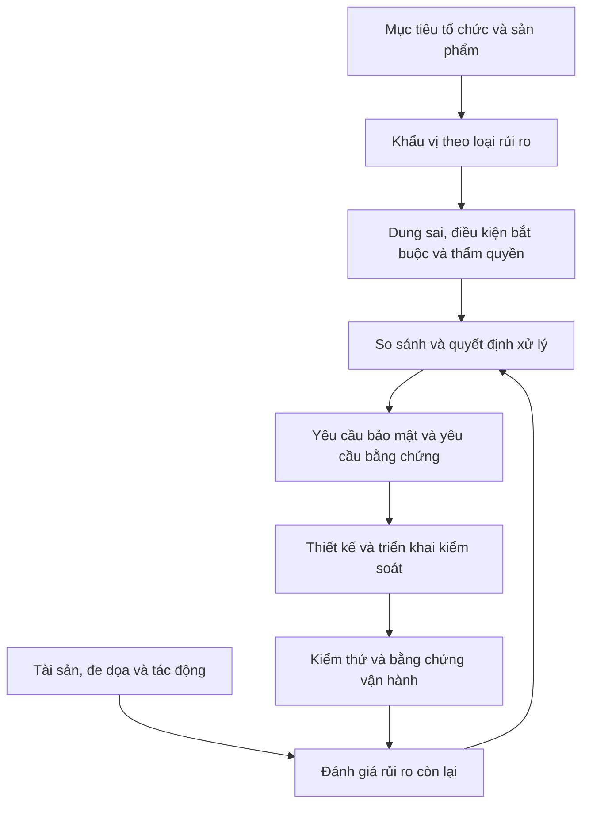

# Risk appetite

## 1. Khẩu vị rủi ro là gì?

**Risk appetite — khẩu vị rủi ro** là định hướng về loại và mức rủi ro mà tổ chức sẵn sàng theo đuổi hoặc duy trì khi thực hiện mục tiêu. Trong an toàn thông tin, định hướng này giúp trả lời: để đạt mục tiêu kinh doanh hoặc vận hành, tổ chức sẵn sàng đối diện với những bất định nào, ở mức nào và trong điều kiện nào?

Ví dụ, một nền tảng cộng tác có thể chấp nhận rủi ro báo cáo thống kê cập nhật chậm để giảm chi phí vận hành, nhưng có khẩu vị rất thấp đối với việc tài liệu của khách thuê này bị khách thuê khác đọc được. Hai chức năng cùng thuộc một sản phẩm nhưng cần giới hạn vận hành, kiểm soát và mức bằng chứng khác nhau.

Khẩu vị rủi ro không phải tỷ lệ sự cố mà nhóm được quyền gây ra. Nó cũng không phải một lần phê duyệt bỏ qua kiểm soát. Đây là cơ sở để đặt giới hạn, lựa chọn cách xử lý rủi ro và xác định trường hợp phải chuyển cấp quyết định.

Trong module xây dựng yêu cầu bảo mật, vai trò của khẩu vị rủi ro là nối các mục tiêu cấp tổ chức với những quyết định cụ thể về xác thực, phân quyền, bảo vệ dữ liệu, logging và phục hồi. Câu “chúng ta có khẩu vị thấp với rò rỉ dữ liệu” chỉ trở nên hữu ích khi chuyển được thành phạm vi bảo vệ, điều kiện phát hành và tiêu chí kiểm chứng.

## 2. Phân biệt các khái niệm gần nhau

Thuật ngữ có thể được các tổ chức dùng theo cách khác nhau. Khi xây dựng yêu cầu, cần thống nhất định nghĩa nội bộ và cách ánh xạ giữa các cấp. Bài học này sử dụng cách phân biệt sau:

| Khái niệm | Ý nghĩa làm việc | Câu hỏi điển hình |
|---|---|---|
| **Risk capacity — khả năng chịu đựng rủi ro** | Mức tác động hoặc phơi nhiễm mà tổ chức có thể chịu trước khi đe dọa nghiêm trọng khả năng hoạt động hoặc mục tiêu trọng yếu | Nếu rủi ro xảy ra, tổ chức còn có thể duy trì hoạt động không? |
| **Risk appetite — khẩu vị rủi ro** | Loại và mức rủi ro tổ chức sẵn sàng duy trì để theo đuổi mục tiêu, trong giới hạn được phép | Chúng ta chủ động sẵn sàng đối diện với loại rủi ro nào? |
| **Risk tolerance — ngưỡng dung sai rủi ro** | Biên độ hoặc giới hạn cụ thể cho một mục tiêu, loại rủi ro hay kết quả | Sai lệch đến đâu thì phải can thiệp hoặc chuyển cấp? |
| **Operational limit — giới hạn vận hành** | Quy tắc hoặc ngưỡng áp dụng vào hoạt động để giữ phơi nhiễm trong vùng đã duyệt | Khi nào chặn thao tác, giảm phạm vi hoặc cảnh báo? |
| **Risk acceptance — chấp nhận rủi ro** | Quyết định có thẩm quyền đối với một rủi ro cụ thể, trong phạm vi và thời hạn xác định | Ai chấp nhận rủi ro còn lại này và dựa trên bằng chứng nào? |

Khả năng chịu đựng không có nghĩa tổ chức muốn dùng hết khả năng đó. Một doanh nghiệp có thể đủ nguồn lực khắc phục một sự cố lớn nhưng vẫn chọn khẩu vị rất thấp với loại sự cố làm mất niềm tin của khách hàng.

Ngược lại, một tuyên bố khẩu vị cao không làm tăng khả năng chịu thiệt hại thực tế. Các quyết định cần xét đồng thời nguồn lực, nghĩa vụ áp dụng, mức tập trung rủi ro và các hậu quả khó phục hồi.

### 2.1. Ví dụ đi từ định hướng tới giới hạn

- **Mục tiêu:** cho phép khách hàng truy cập tài liệu dự án đúng quyền và ổn định.
- **Khẩu vị:** rất thấp đối với tiết lộ tài liệu giữa các khách thuê; có thể duy trì một mức rủi ro gián đoạn ngắn đã được đánh giá để cân đối chi phí.
- **Dung sai:** xác định tác động gián đoạn tối đa cho chức năng cốt lõi và điều kiện phải chuyển cấp khi không đáp ứng được.
- **Giới hạn vận hành:** từ chối yêu cầu không xác định được quyền; ngăn phát hành khi còn đường truy cập chéo khách thuê đã được xác nhận; cảnh báo khi kiểm thử phục hồi không đạt mục tiêu.
- **Chấp nhận cụ thể:** người có thẩm quyền xem xét một phương án tạm thời, với phạm vi, kiểm soát bù, ngày hết hạn và rủi ro còn lại được ghi nhận.

Các nghĩa vụ bắt buộc và các điều kiện không cho phép ngoại lệ phải được ghi riêng. Một người quản lý dự án không thể dùng tuyên bố khẩu vị để tự cho phép vượt thẩm quyền hoặc bỏ qua nghĩa vụ áp dụng.

## 3. Xác định rủi ro trước khi nói cao hay thấp

### 3.1. Mô tả bằng kịch bản

Một tuyên bố như “rủi ro API cao” quá rộng để đưa ra quyết định. Nên mô tả ít nhất:

> Do điều kiện hoặc điểm yếu X, tác nhân hoặc sự kiện Y có thể gây hành vi Z trên tài sản A, dẫn đến hậu quả B đối với mục tiêu C.

Ví dụ:

> Do luồng tải tệp không kiểm tra quan hệ khách thuê tại thời điểm truy cập, người dùng của khách thuê A có thể đổi mã tệp để tải tài liệu của B, gây tiết lộ nội dung dự án và mất niềm tin vào khả năng cô lập dữ liệu.

Mô tả này chỉ ra tài sản, đường tấn công và tác động. Từ đó mới có thể xem rủi ro thuộc loại nào trong khẩu vị đã duyệt và cần kiểm soát gì.

### 3.2. Đánh giá nhiều chiều tác động

| Chiều tác động | Câu hỏi cần đặt ra |
|---|---|
| Bí mật và quyền riêng tư | Ai có thể biết dữ liệu nào; phạm vi người hoặc khách hàng bị ảnh hưởng ra sao? |
| Toàn vẹn | Ai có thể sửa dữ liệu, cấu hình, quyền hoặc bằng chứng; quyết định nghiệp vụ nào có thể sai? |
| Sẵn sàng | Chức năng nào dừng, trong bao lâu, có đường phục hồi hay phương án thay thế nào? |
| Tài chính và vận hành | Chi phí trực tiếp, thời gian nhân sự, gián đoạn quy trình và nguồn lực phục hồi là gì? |
| Niềm tin và quan hệ khách hàng | Hậu quả đối với cam kết sản phẩm và khả năng tiếp tục hợp tác là gì? |
| Nghĩa vụ áp dụng | Có điều kiện bắt buộc nào không được vượt qua bằng quyết định nội bộ thông thường? |
| Mức tập trung | Một lỗi có thể ảnh hưởng một đối tượng hay nhiều khách thuê và nhiều dịch vụ cùng lúc? |

Không nên lấy điểm trung bình để làm biến mất một tác động vượt giới hạn. Một rủi ro có xác suất ước lượng thấp nhưng hậu quả làm mất khả năng vận hành vẫn cần được xem xét riêng.

### 3.3. Phạm vi đánh giá phải rõ

Khẩu vị có thể áp dụng ở cấp tổ chức, sản phẩm, chức năng hoặc danh mục rủi ro. Một dự án không nên tự đặt mức chấp nhận rộng hơn định hướng cấp trên nếu không được ủy quyền.

Phải ghi rõ môi trường, dữ liệu, nhóm người dùng, khoảng thời gian và giả định. Một thử nghiệm chỉ dùng dữ liệu tổng hợp trong môi trường cô lập có thể có quyết định khác với tính năng phục vụ dữ liệu khách hàng thật. Nếu phạm vi thay đổi, kết luận cũ cần được xem lại.

## 4. Viết tuyên bố khẩu vị có thể sử dụng được

### 4.1. Thành phần tối thiểu

Một tuyên bố hữu ích nên gồm:

1. **Mục tiêu được hỗ trợ:** tăng khả năng phục vụ, rút ngắn thời gian đưa tính năng ra thị trường hoặc bảo vệ một cam kết trọng yếu.
2. **Loại rủi ro:** tiết lộ dữ liệu, thay đổi trái phép, gián đoạn, mất khả năng điều tra hoặc phụ thuộc bên cung cấp.
3. **Định hướng chấp nhận:** rất thấp, thấp, có giới hạn hay sẵn sàng thử nghiệm trong phạm vi nào.
4. **Ranh giới:** dữ liệu, khách hàng, chức năng và môi trường nằm trong phạm vi.
5. **Giới hạn và điều kiện chuyển cấp:** khi nào phải xử lý, thu hẹp hoặc dừng hoạt động liên quan.
6. **Chủ sở hữu, thẩm quyền và thời điểm rà soát:** ai quyết định, ai theo dõi và khi nào phải cập nhật.

“Khẩu vị thấp” có thể là điểm bắt đầu để trao đổi, nhưng không đủ làm tiêu chí nghiệm thu. Cần có cách diễn giải nhất quán thành dung sai, giới hạn và yêu cầu.

### 4.2. Ví dụ tuyên bố theo loại rủi ro

| Loại rủi ro | Tuyên bố minh họa | Quyết định cần dẫn xuất |
|---|---|---|
| Tiết lộ tài liệu giữa khách thuê | Có khẩu vị rất thấp vì cô lập dữ liệu là cam kết cốt lõi của sản phẩm | Mọi đường đọc và xuất phải kiểm tra phạm vi; lỗi chéo khách thuê đã xác nhận là điều kiện chặn phát hành |
| Chiếm quyền quản trị | Có khẩu vị rất thấp với hành động quản trị không gắn được danh tính và bằng chứng xác minh phù hợp | Xác thực tăng cường, giới hạn quyền, nhật ký và kiểm thử các đường khôi phục |
| Gián đoạn báo cáo tổng hợp | Có thể chấp nhận một mức rủi ro cập nhật chậm nếu không ảnh hưởng giao dịch và có thông báo rõ | Tách báo cáo khỏi luồng cốt lõi; đặt ngưỡng trễ, cảnh báo và phương án xử lý |
| Mất bằng chứng kiểm toán | Có khẩu vị thấp với khoảng trống làm không thể điều tra thay đổi quyền hoặc xuất dữ liệu | Lưu sự kiện đáng tin cậy, phát hiện mất thu thập và kiểm soát khi ghi bằng chứng thất bại |
| Thử nghiệm tính năng mới | Sẵn sàng thử trong phạm vi cô lập, có giới hạn phơi nhiễm và khả năng quay lại | Giới hạn đối tượng, dữ liệu, thời gian; đặt tiêu chí dừng và đánh giá lại trước mở rộng |

Chấp nhận bất định trong thử nghiệm không đồng nghĩa được dùng dữ liệu thật ngoài phạm vi đã duyệt. Cần phân biệt lợi ích của thử nghiệm với hậu quả mà tổ chức sẵn sàng chịu nếu giả định sai.

### 4.3. Tách điều kiện bắt buộc khỏi mục tiêu cải thiện

Một tổ chức có thể đặt điều kiện bắt buộc rằng mọi truy cập tài liệu phải được phân quyền ở máy chủ. Đồng thời, tổ chức có mục tiêu tăng độ bao phủ kiểm thử hoặc giảm thời gian phát hiện lỗi. Mục tiêu cải thiện chưa đạt không tự đồng nghĩa được bỏ điều kiện bắt buộc.

Tương tự, khẩu vị rất thấp không phải lời bảo đảm không bao giờ có sự cố. Ý nghĩa thực thi là yêu cầu kiểm soát và bằng chứng nghiêm hơn, giới hạn phơi nhiễm chặt hơn và thẩm quyền rõ khi có bất định hoặc sai lệch.

## 5. Đánh giá rủi ro để so với khẩu vị

### 5.1. Rủi ro vốn có, hiện tại và mục tiêu

**Rủi ro vốn có** mô tả rủi ro trước tập kiểm soát đang được xem xét. Phải nêu rõ giả định đã bỏ những kiểm soát nào, vì đánh giá “không có bất kỳ kiểm soát nào” thường không phản ánh một kiến trúc khả thi.

**Rủi ro còn lại hiện tại** là rủi ro sau các kiểm soát đã được triển khai, xét theo bằng chứng hiện có về hiệu lực của chúng. **Rủi ro còn lại mục tiêu** là mức dự kiến sau phương án xử lý chưa hoàn tất.

Không được dùng rủi ro mục tiêu như thể đó là trạng thái đang có. Một dòng kế hoạch “sẽ bổ sung kiểm tra khách thuê” chưa chứng minh API hiện tại đã ngăn được truy cập trái quyền.

Ví dụ hồ sơ đánh giá nên tách:

| Nội dung | Câu hỏi cần trả lời |
|---|---|
| Kịch bản và tài sản | Ai có thể gây ra sự kiện gì, dữ liệu và mục tiêu nào chịu tác động? |
| Kiểm soát hiện hữu | Cơ chế nào thực sự đang chạy ở phạm vi nào? |
| Bằng chứng và khoảng trống | Có kết quả kiểm thử, cấu hình vận hành và quan sát nào; còn điều gì chưa biết? |
| Rủi ro còn lại hiện tại | Sau kiểm soát đã chứng minh, khả năng và tác động được đánh giá ra sao? |
| Phương án xử lý | Sửa gì, thu hẹp gì, ai làm và khi nào hoàn tất? |
| Rủi ro mục tiêu | Mức dự kiến sau xử lý, với những giả định nào? |
| So sánh với giới hạn | Trong vùng được ủy quyền, cần chuyển cấp hay vi phạm điều kiện bắt buộc? |

### 5.2. Giữ ý nghĩa của thang đo

Nếu dùng mức thấp, trung bình và cao, cần định nghĩa bằng ví dụ và tiêu chí tác động. Nếu dùng ma trận xác suất–tác động, cần thống nhất khoảng thời gian và cách xếp hạng.

Các nhãn thứ bậc không tự có ý nghĩa số học. Nhân điểm 4 với điểm 5 có thể là quy ước ưu tiên của tổ chức, nhưng kết quả 20 không phải số tiền tổn thất hay xác suất sự cố. Cũng không nên cộng các điểm của nhiều rủi ro rồi coi tổng đó là mức tổn thất kỳ vọng.

Một ngưỡng chung trên ma trận có thể bỏ sót khác biệt giữa các loại rủi ro. Rủi ro tiết lộ dữ liệu và rủi ro báo cáo cập nhật chậm có thể cùng nhãn “trung bình” nhưng thuộc hai vùng khẩu vị khác nhau.

### 5.3. Ước lượng định lượng không thay thế đánh giá hậu quả lớn

Một mô hình đơn giản có thể dùng:

```text
Tổn thất kỳ vọng trong năm
    = Tần suất sự kiện ước lượng trong năm
      × Tổn thất trung bình ước lượng mỗi sự kiện
```

Ví dụ hoàn toàn giả định:

| Kịch bản | Tần suất giả định | Tổn thất giả định mỗi sự kiện | Tổn thất kỳ vọng theo mô hình |
|---|---|---|---|
| Nhiều sự cố gián đoạn nhỏ | 0,5 sự kiện/năm | 200 triệu đồng | 100 triệu đồng/năm |
| Sự cố hiếm có tác động rất lớn | 0,01 sự kiện/năm | 10 tỷ đồng | 100 triệu đồng/năm |

Hai giá trị kỳ vọng bằng nhau không làm hai kịch bản tương đương. Sự cố thứ hai có thể vượt khả năng chịu đựng hoặc giới hạn của loại rủi ro liên quan. Tần suất sự kiện cũng không được diễn giải tùy ý thành xác suất có ít nhất một sự kiện nếu chưa có mô hình thích hợp.

Các con số trong ví dụ không phải số liệu thực nghiệm. Khi dùng số liệu thật, cần ghi nguồn, khoảng bất định, giả định và mức tin cậy. Không nên chọn một con số chính xác bề ngoài để che việc thiếu dữ liệu.

### 5.4. Xem xét rủi ro tích lũy và phụ thuộc

Nhiều ngoại lệ nhỏ có thể cùng phụ thuộc vào một nhà cung cấp danh tính, một hệ thống quản lý khóa hoặc một tài khoản quản trị. Khi phụ thuộc chung bị ảnh hưởng, tác động có thể vượt xa từng đánh giá riêng lẻ.

Rà soát tổng thể cần tìm quan hệ chung và tránh đếm trùng cùng một kịch bản. Một lỗ hổng ở thư viện được mười dịch vụ dùng không tự đồng nghĩa có mười sự kiện độc lập. Ngược lại, việc mỗi nhóm tự chấp nhận một phần rủi ro có thể che phạm vi ảnh hưởng toàn sản phẩm.

Chưa thấy sự cố không chứng minh rủi ro thấp. Có thể hệ thống chưa bị tấn công, chưa có đủ quan sát hoặc chưa phát hiện được hành vi. Bằng chứng về kiểm soát và khả năng phát hiện phải được xem cùng số liệu sự cố.

## 6. Ví dụ chuyển khẩu vị thành giới hạn của sản phẩm

Giả sử một nền tảng lưu và chia sẻ tài liệu theo khách thuê. Chức năng đọc, cập nhật và xuất tài liệu là cốt lõi; bảng thống kê sử dụng là chức năng hỗ trợ. Các giá trị dưới đây đều là quyết định minh họa của dự án.

| Loại rủi ro và khẩu vị | Dung sai hoặc điều kiện quyết định | Giới hạn vận hành dẫn xuất |
|---|---|---|
| Rất thấp với tiết lộ chéo khách thuê | Không phê duyệt phát hành tính năng còn đường đọc chéo đã được xác nhận và chưa xử lý | Kiểm thử quyền cho đường đọc, tải tệp, xuất, tác vụ nền; khi phát hiện lỗi trên hệ thống đang chạy phải khoanh vùng đường bị ảnh hưởng |
| Rất thấp với chiếm quyền quản trị | Hành động đặc quyền phải gắn được danh tính, quyền và mức xác minh đã quy định | Kiểm tra xác thực tăng cường, quyền theo hành động và các đường cấp lại quyền |
| Thấp với mất bằng chứng xuất dữ liệu | Không bắt đầu xuất nếu chưa ghi nhận được sự kiện yêu cầu vào nơi lưu bền vững được thiết kế | Chặn trước khi trả nội dung nếu không ghi được; theo dõi và đối soát kết quả xuất |
| Có giới hạn với gián đoạn chức năng cốt lõi | Mục tiêu phục hồi 60 phút và mất dữ liệu tối đa 15 phút theo kịch bản đã duyệt | Sao lưu, bảo vệ phụ thuộc và diễn tập; không đạt phải có phương án xử lý hoặc quyết định đúng thẩm quyền |
| Rộng hơn với trễ bảng thống kê | Có thể chấp nhận dữ liệu trễ tối đa 24 giờ nếu không dùng để quyết định quyền hoặc giao dịch | Hiển thị thời điểm dữ liệu, cảnh báo sớm và giữ luồng thống kê tách khỏi luồng cốt lõi |

**RTO — mục tiêu thời gian phục hồi** xác định khoảng thời gian cần để khôi phục chức năng theo điều kiện đã đặc tả. **RPO — mục tiêu điểm phục hồi** xác định mức mất dữ liệu theo khoảng thời gian có thể chấp nhận khi phục hồi. Trong ví dụ, 60 phút là RTO và 15 phút là RPO cho phạm vi đã nêu.

RTO không phải thời gian cho phép mọi sự cố đều kéo dài mà không cần hành động. RPO cũng không tự chứng minh đã đáp ứng chỉ vì có lịch chạy sao lưu mỗi 15 phút. Cần xác minh bản sao thực sự có thể sử dụng, các phụ thuộc cần thiết còn hoạt động và dữ liệu phục hồi đạt mốc yêu cầu.

Độ trễ thống kê 24 giờ là một giới hạn kết quả, chưa phải yêu cầu triển khai hoàn chỉnh. Cần xác định mốc đo, nguồn thời gian, loại dữ liệu, cách phát hiện và ai xử lý khi vượt ngưỡng.

## 7. Viết yêu cầu bảo mật từ các quyết định đó

### 7.1. Chuỗi truy vết



Đánh giá rủi ro không chỉ diễn ra một lần trước phát triển. Khi bằng chứng cho thấy kiểm soát không đạt, hoặc kiến trúc thay đổi, phải đánh giá lại rủi ro còn lại và quyết định liên quan.

### 7.2. Bộ yêu cầu minh họa

| Mã | Yêu cầu | Bằng chứng chấp nhận |
|---|---|---|
| RA-01 | Mỗi chức năng đọc, tải và xuất tài liệu phải nằm trong danh sách đường truy cập có chủ sở hữu, tài sản và rủi ro chéo khách thuê liên quan trước nghiệm thu. | Đối chiếu API, đường tải trực tiếp, tác vụ nền và công cụ quản trị với danh sách; đường chưa được đánh giá không được bỏ qua cổng nghiệm thu. |
| RA-02 | Mọi đường truy cập tài liệu phải kiểm tra quyền và phạm vi khách thuê ở phía máy chủ; khách thuê không được xác định chỉ từ trường do bên gọi tự khai. | Kiểm thử người dùng khác quyền, khác khách thuê, tham chiếu bị tráo và đường tải trực tiếp; không trả nội dung ngoài quyền và không tạo tác dụng phụ trái phép. |
| RA-03 | Các hành động quản trị đã liệt kê phải yêu cầu mức xác thực tăng cường được phê duyệt, được thực thi tại thời điểm hành động và không có đường thay thế yếu hơn ngoài quy trình được duyệt. | Thử phiên chưa đủ mức, phiên hết hạn xác minh, API gọi trực tiếp và đường khôi phục; mọi đường đều tuân thủ chính sách. |
| RA-04 | Kho tài liệu, bản sao và luồng truyền phải áp dụng biện pháp bảo vệ dữ liệu đã được phê duyệt; quyền dùng khóa hoặc đọc bản rõ phải giới hạn theo vai trò và phạm vi. | Kiểm tra cấu hình và quyền thực tế; vai trò không được cấp không thể đọc bản rõ hoặc sử dụng phép giải mã tương ứng. |
| RA-05 | Trước khi bắt đầu xuất nội dung, hệ thống phải lưu bền vững sự kiện yêu cầu xuất gồm danh tính, khách thuê, phạm vi và mã tương quan; phải bổ sung hoặc đối soát kết quả kết thúc. | Gây lỗi nơi ghi sự kiện trước khi xuất; không có nội dung được trả khi chưa ghi được. Với thao tác đã bắt đầu, có thể đối soát kết quả hoặc phát hiện trường hợp chưa rõ. |
| RA-06 | Sự kiện thay đổi quyền và xuất dữ liệu phải tới hệ thống giám sát trong 5 phút; mất thu thập hoặc vượt độ trễ phải tạo cảnh báo theo luồng vận hành đã duyệt. | Đối chiếu thao tác thử với sự kiện đến nơi nhận, đo độ trễ và thử gián đoạn thu thập; cảnh báo đủ thông tin, không chứa bí mật hoặc bản rõ tài liệu. |
| RA-07 | Khi không xác định được quyền truy cập tài liệu, hệ thống phải từ chối hoặc trì hoãn thao tác theo hợp đồng lỗi; không chuyển sang cho phép truy cập để duy trì khả năng phục vụ. | Gây gián đoạn phụ thuộc phân quyền, thử các bản sao dịch vụ và bộ nhớ đệm; không có đường mặc định mở quyền. |
| RA-08 | Trong kịch bản mất kho phục vụ đã duyệt, hệ thống phải khôi phục chức năng cốt lõi trong RTO 60 phút và đạt RPO 15 phút, bao gồm dữ liệu, quyền, khóa và phụ thuộc cần thiết. | Diễn tập từ mốc sự cố đã định, kiểm tra mốc dữ liệu và quyền sau phục hồi; không chỉ ghi nhận thời điểm cơ sở dữ liệu chạy lại. |
| RA-09 | Bảng thống kê phải hiển thị mốc dữ liệu; khi độ trễ đạt 12 giờ phải cảnh báo sớm, và khi vượt 24 giờ phải thực hiện phương án xử lý đã được phê duyệt. | Tạo dữ liệu trễ ở hai phía các mốc biên, đo từ mốc nguồn đã quy định; xác minh hiển thị, cảnh báo và hành động xử lý. |
| RA-10 | Quyết định chấp nhận rủi ro hoặc ngoại lệ phải có phạm vi, người có thẩm quyền, rủi ro còn lại, kiểm soát bù, chủ sở hữu và ngày hết hạn; hết hạn không được tự gia hạn. | Thử hồ sơ thiếu điều kiện, sai thẩm quyền và hết hạn; cổng quyết định hoặc quy trình có kiểm soát không coi đó là phê duyệt hợp lệ. |
| RA-11 | Trước mở rộng sang loại dữ liệu, khách thuê hoặc kiến trúc làm tăng phạm vi ảnh hưởng, phải đánh giá lại rủi ro và đối chiếu khẩu vị liên quan. | Hồ sơ thay đổi thể hiện tác động, yêu cầu cần cập nhật và quyết định; không dùng nguyên quyết định cũ cho phạm vi mới. |

Các yêu cầu không chỉ mô tả có công cụ hay không. Chẳng hạn, RA-05 quy định hành vi khi logging thất bại; RA-08 yêu cầu bằng chứng phục hồi cả dữ liệu lẫn quyền; RA-10 quy định hiệu lực của quyết định. Đây là cách biến định hướng rủi ro thành kết quả có thể quan sát.

### 7.3. Mẫu một yêu cầu có truy vết

```text
Mã: RA-02
Tài sản: tài liệu dự án và quan hệ sở hữu theo khách thuê.
Kịch bản: người dùng thay tham chiếu để truy cập tài liệu khách thuê khác.
Khẩu vị liên quan: rất thấp với tiết lộ chéo khách thuê.
Hành vi bắt buộc: kiểm tra danh tính, quyền và phạm vi tại mọi đường truy cập.
Khi thiếu bằng chứng quyền: từ chối hoặc trì hoãn, không trả nội dung.
Bằng chứng: kiểm thử chéo khách thuê, kiểm tra đường tải và cấu hình phục vụ.
Điều kiện nghiệm thu: không còn trường hợp đọc chéo đã được xác nhận chưa xử lý.
Người xác nhận rủi ro còn lại: chủ sở hữu rủi ro theo phân quyền quyết định.
```

Điều kiện nghiệm thu nêu trên không chứng minh đã phát hiện mọi lỗi có thể tồn tại. Nó phải đi cùng phạm vi kiểm tra và mức đảm bảo đã chọn để kết luận không vượt quá bằng chứng.

## 8. Khẩu vị rủi ro ảnh hưởng thế nào đến mức đảm bảo?

**Mức đảm bảo** thể hiện mức tin cậy có căn cứ rằng các yêu cầu và kiểm soát đáp ứng mục tiêu trong phạm vi đã xác định. Một thiết kế có nhiều kiểm soát chưa chắc có mức đảm bảo cao nếu không có bằng chứng về cách chúng được triển khai và hoạt động.

Khi khẩu vị thấp, tác động lớn hoặc độ bất định cao, thường cần tăng chất lượng và độ sâu của bằng chứng. Điều đó có thể gồm:

- Rà soát mô hình đe dọa và ranh giới tin cậy, kể cả luồng quản trị và khôi phục.
- Kiểm thử phủ định với chủ thể đã xác thực nhưng không đủ quyền, thay vì chỉ thử yêu cầu ẩn danh.
- Kiểm tra cấu hình triển khai, quyền của dịch vụ và các đường truy cập ngoài giao diện chính.
- Thử lỗi phụ thuộc và phục hồi để xác minh hành vi khi kiểm soát không sẵn sàng.
- Rà soát bởi người đủ năng lực và có mức độc lập phù hợp với quyết định rủi ro.

Không nên biến “rủi ro thấp hơn” thành lý do bỏ mọi kiểm soát nền tảng. Có thể giảm phạm vi thử chuyên sâu theo rủi ro, nhưng vẫn phải đáp ứng những điều kiện bắt buộc của hệ thống.

### 8.1. Yêu cầu về bằng chứng cũng cần cụ thể

Ví dụ với đường xuất tài liệu có tác động lớn:

> Trước khi mở tính năng xuất cho dữ liệu sản xuất, phải có rà soát ranh giới khách thuê, kiểm thử truy cập trái quyền trên các đường xuất và tải, thử lỗi nơi ghi sự kiện và xác nhận cấu hình phục vụ. Người đánh giá đủ thẩm quyền phải ghi phạm vi đã kiểm tra, phiên bản và các khoảng trống còn lại.

Bằng chứng cần gắn với phiên bản phần mềm, cấu hình và môi trường liên quan. Kết quả thử của phiên bản cũ có thể không còn đủ sau khi thay đường tải hoặc cơ chế phân quyền.

Nếu chưa đủ bằng chứng để kết luận rủi ro nằm trong giới hạn, cần ghi rõ mức chưa biết. Có thể tiếp tục công việc độc lập hoặc thử trong phạm vi hẹp đã được duyệt, đồng thời chưa mở phần phơi nhiễm cần bằng chứng còn thiếu. Thiếu thông tin không phải căn cứ để mặc định rủi ro bằng không.

### 8.2. Phân biệt thước đo kiểm soát với thước đo rủi ro

| Thước đo | Điều có thể cho biết | Điều chưa thể kết luận chỉ từ thước đo đó |
|---|---|---|
| Tỷ lệ chức năng có kiểm thử phân quyền | Mức bao phủ của hoạt động kiểm chứng theo danh sách hiện có | Tất cả đường truy cập đã được kiểm kê hoặc không còn lỗi |
| Số ngoại lệ và tuổi ngoại lệ | Mức tích lũy sai lệch, khả năng xử lý đúng hạn | Mọi ngoại lệ có tác động ngang nhau hoặc có thể cộng thành xác suất |
| Độ trễ sự kiện kiểm toán | Hiệu lực thu thập theo điểm đo | Nội dung sự kiện đầy đủ, đúng và không thể bị sửa |
| Kết quả diễn tập RTO/RPO | Khả năng phục hồi trong kịch bản và điều kiện đã thử | Mọi kịch bản sự cố đều phục hồi được tương tự |
| Số sự cố đã phát hiện | Những sự kiện hệ thống quan sát và xác nhận được | Không có sự cố chưa phát hiện hoặc rủi ro tự động giảm |
| Mức thay đổi phạm vi dữ liệu | Dấu hiệu phơi nhiễm có thể tăng | Mức tác động mới nếu chưa đánh giá quan hệ và độ nhạy dữ liệu |

Tỷ lệ bao phủ cao không được dùng để che một đường có tác động lớn chưa kiểm tra. Cần xem nội dung của khoảng trống và loại rủi ro, thay vì chỉ đặt màu xanh cho một tỷ lệ tổng hợp.

## 9. Ra quyết định khi rủi ro ở trong hoặc ngoài giới hạn

### 9.1. Các phương án xử lý

| Phương án | Ý nghĩa | Ví dụ |
|---|---|---|
| Giảm rủi ro | Giảm khả năng, tác động hoặc cả hai bằng kiểm soát và thay đổi thiết kế | Thêm kiểm tra quyền, giới hạn phạm vi xuất và cải thiện phát hiện |
| Tránh rủi ro | Không thực hiện hoặc thay đổi hoạt động làm phát sinh rủi ro không phù hợp | Chưa mở chức năng xuất hàng loạt khi chưa có kiểm soát cần thiết |
| Chia sẻ hoặc chuyển giao một phần | Phân bổ một số tác động hoặc trách nhiệm thực hiện theo phương án phù hợp | Dùng dịch vụ chuyên trách, kèm yêu cầu, giám sát và đánh giá phụ thuộc |
| Chấp nhận rủi ro còn lại | Giữ rủi ro trong phạm vi và thẩm quyền đã xác định | Cho phép một phương án tạm thời với kiểm soát bù, thời hạn và theo dõi |

Thuê bên khác thực hiện một chức năng không làm biến mất rủi ro đối với sản phẩm. Có thể giảm một loại rủi ro và tăng loại khác, chẳng hạn phụ thuộc nhà cung cấp hoặc tập trung dữ liệu. Cần đánh giá phần còn lại và bằng chứng của toàn luồng.

### 9.2. Quy tắc quyết định theo trạng thái

| Trạng thái đánh giá | Hành động cần xác định |
|---|---|
| Trong giới hạn, đáp ứng điều kiện bắt buộc và đủ bằng chứng | Người được ủy quyền xác nhận quyết định và tiếp tục giám sát |
| Gần giới hạn hoặc giả định dễ thay đổi | Bổ sung cảnh báo sớm, hạn chế phơi nhiễm và chuẩn bị phương án xử lý |
| Vượt giới hạn thuộc thẩm quyền hiện tại | Chuyển cấp với phương án giảm, tránh hoặc quyết định của cấp có quyền |
| Vi phạm điều kiện không cho phép ngoại lệ | Dừng hoặc thu hẹp phần hoạt động liên quan cho tới khi đáp ứng điều kiện |
| Chưa đủ bằng chứng để đánh giá | Thu thập bằng chứng, giảm phạm vi thử hoặc giữ phần chức năng chưa đủ điều kiện ngoài vận hành |

Việc rủi ro nằm trong khẩu vị không tự tạo phê duyệt cho mọi thay đổi. Vẫn cần đúng người quyết định và đúng quy trình cho phạm vi đó. Ngược lại, việc chuyển cấp không đảm bảo sẽ được chấp nhận; cấp quyết định có thể yêu cầu sửa thiết kế hoặc giảm phạm vi.

Không nên sửa nhãn mức rủi ro hoặc nới ngưỡng chỉ để kịp ngày phát hành. Nếu định hướng tổ chức thực sự thay đổi, phải ghi nhận căn cứ, hệ quả và thẩm quyền, rồi cập nhật các yêu cầu phụ thuộc.

## 10. Quản lý chấp nhận rủi ro và ngoại lệ có thời hạn

### 10.1. Một quyết định cần có gì?

Hồ sơ cần ghi rõ rủi ro cụ thể, phạm vi phơi nhiễm, kiểm soát đang có, bằng chứng, phần chưa biết, lý do chọn phương án, người chịu trách nhiệm và người phê duyệt. Với phương án tạm thời, cần có ngày kết thúc, điều kiện dừng sớm và kế hoạch xử lý lâu dài.

**Chủ sở hữu rủi ro** chịu trách nhiệm về quyết định trong phạm vi được giao. **Chủ sở hữu kiểm soát** chịu trách nhiệm triển khai hoặc vận hành biện pháp. Nhóm bảo mật cung cấp phân tích và đánh giá, nhưng không mặc nhiên có quyền thay mặt đơn vị nghiệp vụ chấp nhận mọi hậu quả.

Một hồ sơ minh họa ở trạng thái đề xuất:

```yaml
risk_id: RISK-REPORTING-DELAY-01
decision_status: proposed
scope:
  function: usage_statistics_dashboard
  period: time_limited
  core_document_access: outside_this_proposal
scenario: delayed_detection_of_stale_reporting_data
appetite_reference: bounded_reporting_delay
current_controls:
  - dashboard_shows_data_timestamp
  - reporting_is_separate_from_core_access
proposed_compensating_controls:
  - manual_freshness_check_every_4_hours
  - assigned_operator_and_backup_operator
  - escalation_before_the_24_hour_delay_limit
required_evidence:
  - tested_freshness_measurement
  - operator_coverage_and_escalation_test
maximum_duration_days: 7
risk_owner: product_owner_with_delegated_authority
approval_reference: required_before_activation
expiry_action: stop_using_the_temporary_arrangement_and_follow_approved_plan
```

Đây là mẫu đề xuất, không phải một phê duyệt có hiệu lực. Trước khi sử dụng, cần đánh giá liệu kiểm tra thủ công và khả năng can thiệp có thực sự giữ rủi ro trong giới hạn không. Nếu không đủ người trực, không đo được độ trễ hoặc không có cách xử lý trước ngưỡng, việc điền đủ trường không làm phương án trở nên chấp nhận được.

### 10.2. Kiểm soát bù và thời hạn phải có hiệu lực thực tế

Kiểm soát bù phải tác động tới cùng kịch bản rủi ro hoặc giải thích rõ phần nào được giảm. Tăng logging không tự thay thế kiểm tra quyền ngăn người dùng tải tài liệu của người khác. Đào tạo cũng không tự thay thế một kiểm soát kỹ thuật khi đường tấn công không phụ thuộc hành vi nhân viên.

Khi hết hạn, phải biết chính xác phương án nào còn được phép: đã có kiểm soát chính, chức năng bị thu hẹp, hay quyết định mới được xem xét đúng thẩm quyền. Không nên tự gia hạn vì chưa có sự cố.

Ngoại lệ lặp lại cần được xem ở cấp tổng thể. Nhiều hồ sơ tạm thời cho cùng một thiếu sót có thể cho thấy thiết kế hoặc nguồn lực đang không phù hợp với khẩu vị đã tuyên bố.

## 11. Ví dụ ra quyết định dưới áp lực phát hành

Nhóm sản phẩm muốn mở chức năng xuất tài liệu vào cuối tuần. Kiểm thử phát hiện người dùng A có thể tải tệp xuất của khách thuê B nếu biết tham chiếu. Nhóm đề xuất giữ liên kết khó đoán và thêm cảnh báo truy cập vì “chưa có sự cố thực tế”.

Chuỗi quyết định cần được phân tích như sau:

1. **Đối chiếu kịch bản:** đây là đường tiết lộ chéo khách thuê đã được xác nhận, thuộc loại khẩu vị rất thấp và vi phạm điều kiện phát hành trong ví dụ.
2. **Xem kiểm soát được đề xuất:** tham chiếu khó đoán không thay kiểm tra quyền; cảnh báo chỉ hỗ trợ phát hiện, không ngăn việc tải nội dung khi có tham chiếu.
3. **Phân biệt hiện tại và mục tiêu:** kế hoạch sửa sau cuối tuần chưa làm giảm rủi ro hiện tại của chức năng đang mở.
4. **Chọn phương án:** sửa và kiểm chứng trước khi mở, hoặc chưa mở chức năng xuất; có thể tiếp tục phần sản phẩm độc lập đã đủ điều kiện.
5. **Xác minh sau xử lý:** thử chéo khách thuê trên yêu cầu tạo, tải, dùng lại liên kết, đường API cũ và tác vụ nền; đối chiếu cấu hình thực tế.
6. **Ghi nhận quyết định:** lưu rủi ro còn lại, phạm vi bằng chứng, người xác nhận và điều kiện cần đánh giá lại.

Trong một tình huống khác, bảng thống kê chỉ cập nhật chậm hơn mục tiêu tối ưu nhưng còn trong dung sai đã duyệt, không ảnh hưởng quyền truy cập hay giao dịch. Người có thẩm quyền có thể chấp nhận phương án tạm thời nếu đủ bằng chứng, kiểm soát theo dõi và giới hạn thời gian. Quyết định khác nhau vì loại rủi ro, hậu quả và ranh giới khác nhau, không chỉ vì cùng một hạn phát hành.

## 12. Rà soát khẩu vị trong vòng đời phát triển

Khẩu vị cần được chuyển thành đầu vào cho đặc tả và được rà soát khi điều kiện quan trọng thay đổi. Những tác nhân điển hình gồm:

- Bổ sung dữ liệu nhạy cảm hơn hoặc chức năng quản trị, xuất dữ liệu mới.
- Tăng số khách thuê, khối lượng dữ liệu hoặc phạm vi ảnh hưởng của một lỗi.
- Đổi kiến trúc cô lập, nhà cung cấp danh tính, nơi giữ khóa hoặc phương án phục hồi.
- Phát hiện kiểm soát không hoạt động như giả định, có sự cố hoặc diễn tập không đạt.
- Tích lũy nhiều ngoại lệ, thay đổi năng lực vận hành hoặc nghĩa vụ áp dụng.

Trong bước thiết kế, các nhóm thống nhất kịch bản và giới hạn. Trong phát triển, yêu cầu được nối với kiểm soát và kiểm thử. Trước phát hành, người có thẩm quyền xem bằng chứng của trạng thái thực tế. Khi vận hành, số liệu và sự kiện cập nhật đánh giá rủi ro; các thay đổi quan trọng quay lại bước đặc tả.

Không nên đóng hồ sơ chỉ vì đã viết xong một yêu cầu. Cần biết kiểm soát đã triển khai ở đâu, bằng chứng nào còn hiệu lực và ai đang theo dõi giới hạn liên quan.

## 13. Sai lầm thường gặp

| Sai lầm | Hệ quả | Cách xử lý |
|---|---|---|
| Một nhãn “khẩu vị thấp” cho mọi loại rủi ro | Không phân biệt được quyết định cần nghiêm hay có thể linh hoạt | Tách theo loại tác động, mục tiêu và phạm vi |
| Đồng nhất khả năng chịu thiệt hại với mong muốn chấp nhận | Dùng hết biên an toàn mà không có chủ đích | Xác định capacity, appetite và dung sai riêng |
| Dùng điểm ma trận như tiền hoặc xác suất | Tạo độ chính xác giả và ưu tiên sai | Nêu rõ ý nghĩa thang đo và giới hạn tính toán |
| Đánh giá bằng kiểm soát mới nằm trong kế hoạch | Rủi ro hiện tại bị trình bày thấp hơn thực tế | Tách hiện tại, mục tiêu và bằng chứng triển khai |
| Chưa có sự cố nên coi rủi ro chấp nhận được | Bỏ qua khả năng chưa phát hiện hoặc chưa bị khai thác | Xem bằng chứng kiểm soát, quan sát và độ bất định |
| Tăng cảnh báo để thay mọi kiểm soát phòng ngừa | Không giảm đường gây thiệt hại theo cách đã tuyên bố | Đối chiếu kiểm soát bù với kịch bản và tác động |
| Mỗi nhóm tự chấp nhận mà không nhìn phụ thuộc chung | Rủi ro tích lũy vượt phạm vi ủy quyền | Rà soát tổng thể, tập trung và tương quan |
| Ngoại lệ không có ngày hết hạn hoặc tự gia hạn | Phương án tạm thời thành trạng thái lâu dài không được xem lại | Gắn chủ sở hữu, điều kiện dừng, thời hạn và cơ chế đánh giá mới |

## 14. Kết quả cần có để sử dụng khẩu vị rủi ro

Người xây dựng yêu cầu bảo mật cần tạo được:

1. **Tuyên bố theo loại rủi ro:** mục tiêu, phạm vi, định hướng và người có thẩm quyền.
2. **Giới hạn thực thi:** dung sai, điều kiện bắt buộc, cảnh báo sớm và hành động khi vượt ngưỡng.
3. **Hồ sơ đánh giá:** kịch bản, tác động, giả định, độ bất định, kiểm soát hiện tại và rủi ro còn lại.
4. **Yêu cầu kiểm chứng được:** xác thực, phân quyền, dữ liệu, logging và phục hồi phù hợp với loại rủi ro.
5. **Yêu cầu về mức đảm bảo:** phạm vi đánh giá, chất lượng bằng chứng, phiên bản và vai trò xác nhận.
6. **Quyết định có hiệu lực:** người chấp nhận đúng thẩm quyền, thời hạn, kiểm soát bù và tác nhân cần rà soát lại.

Khẩu vị rủi ro có giá trị khi giúp các nhóm đưa ra quyết định nhất quán trước những đánh đổi cụ thể. Khi được nối với tài sản, mô hình đe dọa, yêu cầu và bằng chứng, nó trở thành cơ sở để xác định điều kiện phát triển, phát hành và vận hành phù hợp với mục tiêu của tổ chức.
