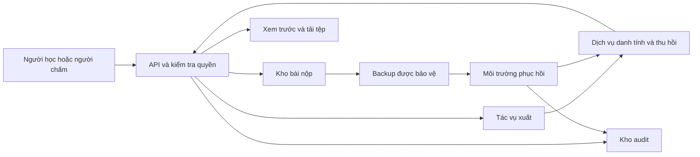

# Residual risk

## 1. Mục tiêu bài học

**Residual risk**, hay **rủi ro còn lại**, là rủi ro vẫn tồn tại sau khi tính đến các biện pháp xử lý đang có hiệu lực trong một phạm vi xác định.

Triển khai xác thực, phân quyền, mã hóa, logging hoặc backup không làm mọi khả năng gây hại biến mất. Kiểm soát có giới hạn về phạm vi, cấu hình, thời gian phản ứng, phụ thuộc và điều kiện vận hành. Cần biết phần rủi ro nào đã giảm, phần nào còn tồn tại và dựa vào bằng chứng nào để đưa ra quyết định.

Trong chương **Rủi ro và mức đảm bảo** của module yêu cầu bảo mật, residual risk là điểm nối giữa:

- Mục tiêu bảo vệ và kịch bản đe dọa.
- Yêu cầu bảo mật và kiến trúc thực hiện.
- Kết quả kiểm thử và mức tin cậy của đánh giá.
- Quyết định phát hành, vận hành, xử lý tiếp hoặc chấp nhận có điều kiện.

Sau bài học, bạn có thể mô tả rủi ro còn lại mà không chỉ dùng một nhãn “thấp”, xác định người chịu trách nhiệm quyết định, viết yêu cầu kiểm soát đo được và duy trì quyết định trong vòng đời phát triển.

Các mức, thời hạn và ngưỡng trong bài là **quy ước minh họa**, cần được tổ chức xác nhận trước khi sử dụng.

## 2. Hiểu đúng rủi ro còn lại

### 2.1. Nhắc lại cấu trúc một kịch bản rủi ro

Một kịch bản cần có:

- **Tài sản và mục tiêu:** điều gì cần được bảo vệ.
- **Nguồn hoặc sự kiện đe dọa:** ai hoặc điều gì có thể gây hại.
- **Điểm yếu và điều kiện:** vì sao sự kiện có thể xảy ra.
- **Hậu quả:** mất bí mật, toàn vẹn, sẵn sàng hoặc ảnh hưởng nghiệp vụ.
- **Bối cảnh:** môi trường, phạm vi người dùng, thời gian và phụ thuộc.

Ví dụ:

> Một người không được phép có thể lấy bài nộp qua API, đường tải tệp hoặc chức năng xuất nếu các đường này không kiểm tra quyền nhất quán, làm tiết lộ nội dung và ảnh hưởng tính công bằng của kỳ đánh giá.

Đánh giá residual risk phải quay lại kịch bản đó sau khi kiểm soát được triển khai. Không chỉ hỏi “đã bật tính năng bảo mật chưa” mà phải hỏi “những đường gây hại nào còn khả thi, trong điều kiện nào và với hậu quả gì”.

### 2.2. Phân biệt các trạng thái đánh giá

Các tổ chức có thể dùng thuật ngữ khác nhau. Trước khi đánh giá cần thống nhất cách dùng. Bài học sử dụng các nghĩa sau:

| Thuật ngữ | Ý nghĩa trong bài |
| --- | --- |
| Rủi ro vốn có | Đánh giá trước nhóm kiểm soát được xác định là đối tượng xem xét; phải ghi rõ giả định |
| Rủi ro hiện tại | Đánh giá với các kiểm soát thực sự đang có hiệu lực tại thời điểm xem xét |
| Rủi ro còn lại dự kiến | Dự báo sau khi thực hiện các biện pháp đang lên kế hoạch |
| Rủi ro còn lại đã đánh giá | Đánh giá sau xử lý, dựa trên phạm vi triển khai và bằng chứng có thật |
| Rủi ro được chấp nhận | Rủi ro có quyết định chấp nhận của người có thẩm quyền, trong điều kiện và thời hạn rõ ràng |

Rủi ro hiện tại có thể chính là rủi ro còn lại của một vòng xử lý trước. Không cần tạo ra hai con số khác nhau chỉ để điền đủ hai cột.

“Được chấp nhận” là trạng thái quyết định quản trị, không phải một thuộc tính làm giảm khả năng hoặc hậu quả. Rủi ro không tự nhỏ đi sau khi có chữ ký.

### 2.3. Kế hoạch chưa phải kiểm soát có hiệu lực

Giả sử nhóm đã tạo một công việc “bổ sung kiểm tra quyền cho API xuất bài”, dự kiến hoàn thành tuần tới.

- Trước khi triển khai, điểm yếu vẫn thuộc đánh giá hiện tại.
- Sau khi viết mã nhưng chưa triển khai, môi trường đang chạy có thể vẫn giữ đường truy cập cũ.
- Sau khi triển khai nhưng chưa xác minh, chỉ có thông tin về thay đổi, chưa đủ bằng chứng về hiệu quả.
- Sau khi kiểm thử đạt trong phạm vi đã nêu, có thể cập nhật đánh giá cho phạm vi đó.

Không dùng mức rủi ro dự kiến làm mức hiện tại để đạt điều kiện phát hành.

### 2.4. Residual risk không có nghĩa là mọi yêu cầu đã đạt

Rủi ro còn lại có thể được đánh giá khi:

- Các yêu cầu đã đáp ứng nhưng vẫn có khả năng gây hại ngoài giới hạn kiểm soát.
- Một số kiểm soát chỉ giảm được một phần phạm vi.
- Một yêu cầu chưa đạt và cần xử lý hoặc ngoại lệ đúng thẩm quyền.
- Bằng chứng còn thiếu, khiến kết luận có độ không chắc chắn lớn.

Tuy nhiên, việc ghi nhận residual risk không tự cho phép bỏ qua điều kiện phát hành bắt buộc. Nếu dự án đã xác định một yêu cầu là điều kiện phải đạt, quyết định rủi ro phải tuân theo cơ chế quản trị điều kiện đó.

Một phát hiện chưa sửa không nên được đổi tên thành “rủi ro còn lại đã chấp nhận” để tránh ghi nhận công việc còn thiếu.

## 3. Vì sao rủi ro vẫn tồn tại sau kiểm soát?

### 3.1. Kiểm soát chỉ bao phủ một số đường gây hại

Mã hóa khi lưu có thể giảm rủi ro từ việc lấy phương tiện lưu trữ. Nó không ngăn API trả dữ liệu cho người sai quyền.

MFA có thể giảm một số đường chiếm tài khoản. Nó không sửa lỗi phân quyền theo tài nguyên và không ngăn mọi hành động sai của người đã được xác thực.

Backup có thể giảm hậu quả mất dữ liệu nếu phục hồi được. Nó không thu hồi dữ liệu đã bị tiết lộ.

Mỗi kiểm soát cần gắn với một cơ chế tác động cụ thể:

| Loại tác dụng | Ví dụ | Giới hạn cần ghi |
| --- | --- | --- |
| Ngăn ngừa | Kiểm tra quyền trước khi cung cấp bài nộp | Cần bao phủ cả tải trực tiếp, xem trước và xuất |
| Giới hạn phạm vi | Tách danh tính dịch vụ theo nhiệm vụ | Danh tính bị chiếm vẫn có thể gây hại trong phạm vi được cấp |
| Phát hiện | Cảnh báo nhiều lần truy cập ngoài quyền | Không tự ngăn lần truy cập trái phép đầu tiên |
| Ứng phó | Thu hồi phiên bị nghi ngờ | Có độ trễ từ phát hiện đến thu hồi và thực thi |
| Phục hồi | Khôi phục từ bản sao độc lập | Phụ thuộc dữ liệu, khóa, quyền, kết nối và thời gian thực hiện |

### 3.2. Có cửa sổ thời gian chưa được loại bỏ

Một phiên bị lấy cắp có thể được sử dụng trước khi bị phát hiện hoặc trước khi lệnh thu hồi có hiệu lực. Nếu mục tiêu thu hồi là 5 phút, vẫn phải phân tích:

- Thời gian phát hiện sự kiện.
- Thời gian quyết định và phát lệnh thu hồi.
- Thời gian đồng bộ đến mọi điểm tiếp nhận.
- Khối lượng thao tác có thể thực hiện trong các khoảng đó.

Yêu cầu “thu hồi trong 5 phút từ lúc ghi nhận lệnh” không đồng nghĩa “mọi lần chiếm phiên chỉ gây hại tối đa 5 phút”. Khoảng trước khi phát hiện vẫn tồn tại.

### 3.3. Có giả định và phụ thuộc

Một kiểm soát có thể dựa vào:

- Dịch vụ danh tính cung cấp trạng thái đúng.
- Các API sử dụng cùng ý nghĩa của quyền.
- Kho log nhận được sự kiện và nơi tiếp nhận cảnh báo có người xử lý.
- Khóa phục hồi vẫn sử dụng được khi kho chính gặp sự cố.
- Môi trường phục hồi có đủ tài nguyên và kết nối.
- Thành viên vận hành thực hiện đúng quy trình.

Phải ghi giả định nào quan trọng và cách phát hiện khi giả định không còn đúng. Không biến một phụ thuộc chưa được kiểm tra thành một bảo đảm.

### 3.4. Biện pháp xử lý có thể tạo thêm rủi ro

Ví dụ:

- Tập trung danh tính giúp quản lý quyền nhưng có thể tạo phụ thuộc sẵn sàng dùng chung.
- Tăng thu thập log giúp điều tra nhưng có thể tạo thêm kho dữ liệu nhạy cảm.
- Cơ chế phục hồi khẩn cấp giúp tránh bị khóa ngoài nhưng có thể trở thành đường vượt kiểm soát nếu bảo vệ yếu.
- Cache quyền cải thiện hiệu năng nhưng có thể kéo dài thời gian thu hồi.

Rủi ro mới do biện pháp tạo ra cần được ghi riêng hoặc liên kết rõ với kịch bản ban đầu. Không chỉ nhìn phần cải thiện.

## 4. Đánh giá residual risk dựa trên bằng chứng

### 4.1. Quy trình thực hành

1. **Cố định phạm vi đánh giá.** Ghi môi trường, phiên bản, chức năng, dữ liệu và thời điểm.
2. **Mô tả kịch bản gây hại.** Nêu tác nhân hoặc sự kiện, đường tiếp cận, điều kiện và hậu quả.
3. **Liệt kê kiểm soát thực sự có hiệu lực.** Tách khỏi biện pháp mới dự kiến.
4. **Thu thập bằng chứng.** Kiểm tra thiết kế, cấu hình, hành vi và vận hành phù hợp với kịch bản.
5. **Phân tích phần còn khả thi.** Xem đường chưa bao phủ, phạm vi quyền còn lại và độ trễ.
6. **Đánh giá khả năng và tác động còn lại.** Dùng tiêu chí đã thống nhất, kèm lý do.
7. **Ghi độ tin cậy và điều chưa biết.** Không suy ra mức thấp từ việc chưa có thông tin.
8. **Đưa ra quyết định.** Xử lý tiếp, thay đổi phạm vi, tránh hoạt động hoặc chấp nhận theo thẩm quyền.
9. **Đặt điều kiện theo dõi.** Xác định tín hiệu, người nhận và thời điểm đánh giá lại.

Đánh giá là một lập luận có bằng chứng, không phải thao tác trừ một số điểm sau mỗi kiểm soát.

### 4.2. Chất lượng bằng chứng

| Bằng chứng | Cho biết điều gì? | Chưa tự chứng minh điều gì? |
| --- | --- | --- |
| Sơ đồ kiến trúc | Cơ chế và ranh giới dự kiến | Cấu hình đang chạy đúng thiết kế |
| Cấu hình đã triển khai | Chính sách hiện hành tại thành phần được kiểm tra | Mọi đường truy cập đều thực thi đúng |
| Kiểm thử hành vi | Trường hợp đã thử có kết quả đúng hoặc sai | Không còn bất kỳ đường lỗi nào |
| Diễn tập thu hồi | Độ trễ trong điều kiện thử | Thời gian phát hiện mọi vụ chiếm tài khoản |
| Diễn tập phục hồi | Dữ liệu và dịch vụ phục hồi được trong kịch bản thử | Mọi loại sự cố đều đạt cùng kết quả |
| Audit vận hành | Sự kiện đã được quan sát trong phạm vi ghi nhận | Không có sự kiện nào xảy ra ngoài khả năng quan sát |

Bằng chứng cần gắn với phiên bản và môi trường. Kết quả trên một môi trường có quyền hoặc cấu hình khác có thể chưa đủ để kết luận cho môi trường phát hành.

### 4.3. Tách mức rủi ro và độ tin cậy

Hai kết luận sau khác nhau:

> Rủi ro được đánh giá thấp với bằng chứng bao phủ các đường truy cập đã xác định.

> Chưa thấy sự cố nên tạm gọi rủi ro thấp.

Kết luận thứ hai không có cùng cơ sở. Có thể ghi riêng:

- Mức khả năng xảy ra và tác động theo tiêu chí.
- Độ tin cậy của đánh giá.
- Những giả định chưa xác minh.
- Phạm vi chưa được kiểm thử.
- Hành động cần thực hiện để giảm độ không chắc chắn.

Độ tin cậy thấp không bắt buộc mọi kịch bản đều mang cùng một mức rủi ro. Nhưng nó phải xuất hiện trong quyết định, đặc biệt khi hậu quả tiềm năng lớn.

### 4.4. Không dùng công thức hiệu lực tùy ý

Cách tính như “rủi ro ban đầu 100, thêm MFA giảm 80%, mã hóa giảm tiếp 50%” thường không có ý nghĩa nếu không có mô hình và dữ liệu chứng minh.

Các kiểm soát có thể phụ thuộc nhau hoặc xử lý cùng một đường gây hại. Không nhân các tỷ lệ tự đặt như thể chúng độc lập.

Với thang định tính, nên ghi:

- Vì sao đường tiếp cận khó hơn hoặc phạm vi ảnh hưởng nhỏ hơn.
- Bằng chứng nào xác nhận sự thay đổi.
- Khả năng và tác động còn lại nằm ở đâu theo tiêu chí.
- Điều gì có thể làm đánh giá mất hiệu lực.

Điểm số thứ bậc hỗ trợ sắp xếp, không tự tạo ra xác suất hay tổn thất kỳ vọng.

## 5. Hồ sơ rủi ro còn lại cần chứa gì?

| Trường | Nội dung cần ghi |
| --- | --- |
| Mã rủi ro | Định danh để liên kết yêu cầu và thay đổi |
| Tài sản và chủ sở hữu | Giá trị nghiệp vụ và bên chịu trách nhiệm |
| Kịch bản | Nguồn, sự kiện, điều kiện, đường tiếp cận và hậu quả |
| Phạm vi | Môi trường, chức năng, phiên bản và thời điểm |
| Đánh giá trước xử lý | Khả năng, tác động, giả định và kiểm soát đã tính |
| Kiểm soát hiện hành | Mã yêu cầu, nơi thực thi và tình trạng triển khai |
| Bằng chứng | Kết quả, điều kiện thử, phiên bản và ngày thực hiện |
| Phần rủi ro còn lại | Đường gây hại, phạm vi và cửa sổ thời gian còn tồn tại |
| Đánh giá còn lại | Khả năng, tác động và lý do |
| Độ tin cậy | Mức bao phủ và điều chưa biết |
| Xử lý tiếp | Công việc, người thực hiện và thời hạn |
| Quyết định | Ai chấp nhận hoặc yêu cầu thay đổi, với lý do gì |
| Điều kiện | Giới hạn người dùng, dữ liệu, thời gian hoặc chức năng |
| Theo dõi | Chỉ báo, ngưỡng, nơi nhận và hành động |
| Rà soát | Mốc thời gian và sự kiện làm phải đánh giá lại |

Không chỉ ghi “residual risk = low”. Người đọc phải hiểu còn nguy cơ gì, trong phạm vi nào và vì sao quyết định hiện tại hợp lý.

## 6. Ví dụ xuyên suốt: nền tảng nộp bài

### 6.1. Bối cảnh và mục tiêu

Một nền tảng cho phép học viên nộp bài, người chấm xem bài được phân công và dịch vụ chấm bài xử lý tác vụ. Hệ thống có API, kho tệp, chức năng xuất, dịch vụ danh tính, kho audit và backup.

Tổ chức giả định có hai kịch bản chính:

| Mã | Kịch bản | Hậu quả cần xử lý |
| --- | --- | --- |
| R-DATA | Người không được phép lấy bài qua API, tải tệp, xem trước, xuất hoặc sử dụng phiên đã bị thu hồi | Lộ nội dung, ảnh hưởng riêng tư và công bằng đánh giá |
| R-AVAIL | Kho dữ liệu chính bị mất hoặc bị xóa, nguồn phục hồi không dùng được hoặc phục hồi quá chậm | Mất bài đã nộp, gián đoạn kế hoạch đánh giá |

Mục tiêu trong ví dụ:

- Người học chỉ đọc được bài của mình.
- Người chấm chỉ đọc được bài trong phạm vi phân công.
- Các đường truy cập do hệ thống quản lý ngừng chấp nhận phiên trong tối đa 5 phút từ lúc lệnh thu hồi được ghi nhận thành công tại nguồn có thẩm quyền.
- Nguồn phục hồi cần thiết nằm ngoài phạm vi phá hủy của danh tính vận hành thông thường.
- Với kịch bản mất kho chính đã xác định, mục tiêu là RPO không quá 15 phút và RTO không quá 60 phút.
- Không mở lại quyền đã thu hồi khi phục hồi dữ liệu cũ.

**RPO** là mục tiêu về khoảng dữ liệu có thể mất trước sự cố. **RTO** là mục tiêu thời gian khôi phục dịch vụ theo mốc đo đã thống nhất.

Trong ví dụ, RTO bắt đầu từ lúc công bố sự cố và kết thúc khi người có quyền nộp, đọc lại bài thành công, dữ liệu và quyền đã được kiểm tra. Thời gian từ lúc sự cố phát sinh đến lúc công bố cần được theo dõi riêng để không che giấu thời gian gián đoạn thực tế.

### 6.2. Kiến trúc và vị trí thực thi



Sơ đồ cho thấy kiểm soát không chỉ nằm trong API chính. Tác vụ xuất cần kiểm tra quyền khi cung cấp kết quả; môi trường phục hồi phải áp dụng trạng thái danh tính và quyền hiện hành.

## 7. Viết yêu cầu để giảm rủi ro và tạo bằng chứng

### 7.1. SEC-RR-01 — Xác thực và thu hồi

Mọi đường đọc bài không được phê duyệt công khai phải yêu cầu danh tính đã xác thực và phiên còn được chấp nhận theo chính sách. Sau khi phiên bị thu hồi, mọi điểm tiếp nhận trong phạm vi phải từ chối cung cấp dữ liệu trong tối đa 5 phút tính từ mốc thu hồi đã xác định.

- Rủi ro liên quan: R-DATA.
- Bao phủ: API, xem trước, tải tệp, xuất và liên kết tải kết quả xuất.
- Kiểm chứng: tạo phiên hợp lệ, xác nhận các đường truy cập, thu hồi rồi thử lại bằng phiên và liên kết cũ.
- Kết quả đạt: không điểm nào còn cung cấp dữ liệu sau giới hạn.
- Bằng chứng: mốc thu hồi, danh sách điểm tiếp nhận, kết quả và cấu hình cache.

Nếu quá trình xuất kéo dài, hệ thống phải kiểm tra lại quyền trước khi cung cấp kết quả. Không dùng quyền ở thời điểm tạo tác vụ làm bảo đảm duy nhất cho thời điểm tải xuống.

### 7.2. SEC-RR-02 — Phân quyền theo tài nguyên

Mỗi yêu cầu đọc hoặc xuất bài phải được kiểm tra theo danh tính, hành động, bài nộp và phân công hiện hành. Học viên không được đọc bài người khác; người chấm không được đọc bài ngoài phân công.

- Rủi ro liên quan: R-DATA.
- Điểm thực hiện: chính sách quyền và mọi thành phần cung cấp nội dung.
- Kiểm chứng: dùng tài khoản thử khác chủ sở hữu, người chấm ngoài phân công và danh tính dịch vụ ngoài tác vụ.
- Kết quả đạt: thao tác ngoài quyền bị từ chối, thao tác đúng quyền thành công.
- Bằng chứng: ma trận quyền và kết quả theo từng đường truy cập.

Đã xác thực không đồng nghĩa đã được phân quyền. Hai yêu cầu SEC-RR-01 và SEC-RR-02 cần được kiểm tra riêng.

### 7.3. SEC-RR-03 — Bảo vệ dữ liệu và bản sao

Bài nộp, bản xem trước, bản xuất và backup phải nằm trong hệ thống lưu trữ được phê duyệt, có chính sách truy cập phù hợp. Dữ liệu khi lưu và khi truyền phải đáp ứng chính sách bảo vệ đã xác nhận; không bật truy cập công khai trái phạm vi sử dụng.

- Rủi ro liên quan: R-DATA và các đường tiết lộ ngoài API chính.
- Kiểm chứng: truy cập trực tiếp kho hoặc đường tải mà không có quyền; kiểm tra trạng thái bảo vệ tại từng nơi lưu và đường truyền.
- Kết quả đạt: không có đường đọc ngoài chính sách và cấu hình thực tế phù hợp với yêu cầu.
- Bằng chứng: danh sách nơi lưu, cấu hình hiệu lực và kết quả thử.

Mã hóa không giảm rủi ro từ một API chủ động trả dữ liệu cho người sai quyền. Phải phân tích tác dụng SEC-RR-03 theo đúng đường gây hại mà nó xử lý.

### 7.4. SEC-RR-04 — Audit và phát hiện mất khả năng quan sát

Thao tác truy cập bị từ chối, xuất dữ liệu, đổi quyền, thu hồi phiên và thay đổi chính sách backup phải tạo sự kiện chứa danh tính tham chiếu, hành động, tài sản đích, thời điểm và kết quả. Không ghi nội dung bài hoặc token đầy đủ.

Trong ví dụ, sự kiện phải đến kho trung tâm trong tối đa 5 phút; mất luồng audit phải tạo cảnh báo trong 10 phút bằng cơ chế kiểm tra luồng phù hợp.

- Rủi ro liên quan: R-DATA và R-AVAIL.
- Kiểm chứng: tạo thao tác hợp lệ và không hợp lệ, đo độ trễ, kiểm tra trường dữ liệu và thử ngừng chuyển tiếp.
- Kết quả đạt: đủ sự kiện, không lộ bí mật, cảnh báo đến nơi tiếp nhận trong giới hạn.
- Bằng chứng: mẫu sự kiện đã lọc dữ liệu, kết quả đo và bản ghi cảnh báo.

Sự kiện audit không chứng minh người vận hành đã xử lý cảnh báo. Thời gian tiếp nhận và ứng phó cần được đặc tả riêng nếu được dùng để lập luận giảm rủi ro.

### 7.5. SEC-RR-05 — Bảo vệ nguồn phục hồi

Danh tính vận hành thông thường không được có khả năng xóa hoặc làm mất khả năng sử dụng toàn bộ nguồn phục hồi cần cho bài nộp trong thời gian giữ bản sao đã xác định.

Phạm vi bảo vệ phải bao gồm bản sao, chính sách giữ, khóa giải mã và quyền truy cập cần cho phục hồi.

- Rủi ro liên quan: R-AVAIL.
- Kiểm chứng: dùng đúng vai trò vận hành thử thao tác xóa bản sao, giảm thời gian giữ hoặc vô hiệu hóa khóa ngoài thẩm quyền trong môi trường thử.
- Kết quả đạt: còn nguồn phục hồi sử dụng được theo thiết kế khi danh tính này bị chiếm hoặc thao tác sai.
- Bằng chứng: chính sách hiệu lực, kết quả thử và danh sách phụ thuộc.

Tách hai kho nhưng vẫn để cùng một danh tính phá hủy cả hai không đáp ứng mục tiêu.

### 7.6. SEC-RR-06 — Phục hồi đúng dữ liệu và quyền

Trong kịch bản mất kho chính của ví dụ, dịch vụ phải đạt RPO không quá 15 phút và RTO không quá 60 phút theo mốc đo đã xác định. Trước khi mở dịch vụ phải kiểm tra nội dung, phiên bản và quyền hiện hành.

- Rủi ro liên quan: R-AVAIL, đồng thời tránh tạo lại đường truy cập của R-DATA.
- Kiểm chứng: dùng dữ liệu tổng hợp có mốc thời gian, thu hồi một quyền sau khi tạo backup, phục hồi từ bản sao cũ rồi kiểm tra.
- Kết quả đạt: mục tiêu dữ liệu và thời gian được đáp ứng; quyền đã thu hồi không sống lại.
- Bằng chứng: biên bản diễn tập, mốc thời gian và kết quả kiểm tra chức năng, dữ liệu, quyền.

Phục hồi được một tệp chưa chứng minh dịch vụ đã sẵn sàng. Ngược lại, dịch vụ khởi động được chưa chứng minh dữ liệu và quyền đã đúng.

## 8. Đọc kết quả và đánh giá phần còn lại

### 8.1. Bộ bằng chứng minh họa

Các mã và kết quả dưới đây là dữ liệu giả định để học cách lập luận, không phải báo cáo kiểm thử thực tế của một hệ thống.

| Mã | Kết quả giả định | Kết luận được phép rút ra |
| --- | --- | --- |
| E-01 | Ma trận quyền đạt trên API, xem trước, tải và xuất với các vai trò thử | Các trường hợp quyền đã thử có hành vi đúng trong phiên bản được kiểm tra |
| E-02 | Thu hồi được thực thi sau 3 phút ở API và sau 9 phút ở đường tải kết quả xuất | SEC-RR-01 chưa đạt cho phạm vi đầy đủ |
| E-03 | Các nơi lưu được kiểm tra không có truy cập công khai; cấu hình bảo vệ phù hợp | Các đường lưu trữ được kiểm tra đáp ứng SEC-RR-03 |
| E-04 | Audit đến trong 2 phút; cảnh báo mất luồng đến trong 8 phút | Các ngưỡng đã thử của SEC-RR-04 được đáp ứng |
| E-05 | Vai trò vận hành không xóa hoặc vô hiệu hóa được nguồn phục hồi được bảo vệ | Giới hạn quyền đã thử hỗ trợ SEC-RR-05 |
| E-06 | Diễn tập mất kho chính có khoảng dữ liệu mất 12 phút, phục hồi dịch vụ trong 52 phút; quyền thu hồi không sống lại | SEC-RR-06 đạt trong kịch bản và điều kiện diễn tập đó |

Không kết luận “mọi sự cố đều đạt RTO 60 phút” từ E-06. Cần giữ phạm vi là loại sự cố, dữ liệu, dung lượng, nhân sự và phụ thuộc đã được thử.

### 8.2. Đánh giá R-DATA

Những gì đã được hỗ trợ bằng bằng chứng:

- Kiểm tra quyền hoạt động đúng trong các trường hợp của E-01.
- Không thấy đường công khai trong các nơi đã kiểm tra ở E-03.
- Audit hỗ trợ nhận biết một số hành vi theo E-04.

Phần chưa đạt hoặc còn tồn tại:

- Đường tải kết quả xuất còn chấp nhận phiên quá giới hạn 5 phút.
- Dữ liệu đã được tải hợp lệ trước thu hồi không thể được thu hồi chỉ bằng xóa quyền trên máy chủ.
- Tài khoản hoặc phiên bị chiếm có thể hoạt động trước khi sự kiện được phát hiện.
- Các trường hợp không nằm trong ma trận thử chưa được chứng minh bằng E-01.

Kết luận phù hợp:

> R-DATA đã có biện pháp giảm một số đường truy cập, nhưng yêu cầu thu hồi chưa đạt trên chức năng xuất. Không đủ cơ sở kết luận toàn bộ phạm vi đã đáp ứng điều kiện phát hành. Cần sửa và xác minh lại đường tải kết quả xuất; rủi ro dự kiến sau sửa phải tách khỏi rủi ro hiện tại.

Nếu SEC-RR-01 là điều kiện bắt buộc của phiên bản, không thể dùng nhãn “residual risk thấp” để thay kết quả chưa đạt. Một đề xuất tắt chức năng xuất chỉ có thể được tính vào trạng thái mới sau khi đã thực hiện, kiểm tra mọi đường liên quan và cập nhật phạm vi.

### 8.3. Đánh giá R-AVAIL

Những gì được hỗ trợ:

- E-05 cho thấy vai trò vận hành đã thử không phá được nguồn phục hồi trong phạm vi kiểm tra.
- E-06 đạt mục tiêu RPO và RTO của kịch bản mất kho chính.
- Quyền hiện hành được áp dụng lại trước khi mở dịch vụ.

Phần rủi ro còn lại:

- Vẫn có thể mất một khoảng dữ liệu mới hơn điểm phục hồi.
- Vẫn có thời gian gián đoạn trong lúc phục hồi.
- Sự cố đồng thời ở kho chính, nguồn phục hồi và dịch vụ khóa chưa được diễn tập trong bộ bằng chứng này.
- Dung lượng hoặc phụ thuộc thay đổi có thể làm kết quả 52 phút không còn đại diện.

Một quyết định có thể chấp nhận rủi ro này trong phạm vi sự cố và điều kiện đã được xác nhận, đồng thời yêu cầu kiểm tra bổ sung cho phụ thuộc chung. Không diễn giải thành chấp nhận mọi loại mất dữ liệu.

Việc R-AVAIL được chấp nhận không làm R-DATA tự đạt. Quyết định cho cả phiên bản phải xem xét đầy đủ các rủi ro và điều kiện phát hành.

## 9. Quyết định xử lý hoặc chấp nhận

### 9.1. Các lựa chọn thường dùng

| Lựa chọn | Ý nghĩa | Ví dụ |
| --- | --- | --- |
| Giảm thiểu tiếp | Bổ sung hoặc sửa kiểm soát | Sửa đường xuất để đạt mục tiêu thu hồi |
| Tránh hoạt động | Không thực hiện hoặc đổi cách thực hiện phần tạo rủi ro | Chưa cung cấp xuất hàng loạt trong phạm vi phát hành |
| Chia sẻ hoặc chuyển giao một phần | Phân bổ một số trách nhiệm hoặc hậu quả cho bên khác | Dùng dịch vụ có cam kết và phân công trách nhiệm rõ |
| Chấp nhận có điều kiện | Cho phép tiếp tục trong phạm vi và thời hạn xác định | Chấp nhận gián đoạn của kịch bản đã thử với kế hoạch theo dõi |

Dùng nhà cung cấp không tự làm biến mất rủi ro đối với mục tiêu của tổ chức. Cần xác định bên nào chịu trách nhiệm cấu hình, phát hiện, xử lý, khôi phục và cung cấp bằng chứng.

### 9.2. Ai có quyền chấp nhận?

Người chấp nhận cần có thẩm quyền đối với hậu quả và phạm vi bị ảnh hưởng. Nhóm phát triển cung cấp thông tin kỹ thuật nhưng không mặc nhiên thay chủ sở hữu nghiệp vụ quyết định mọi tổn thất có thể chấp nhận.

Có thể phân vai:

- **Chủ sở hữu rủi ro:** chịu trách nhiệm theo dõi và đề xuất xử lý.
- **Nhóm kỹ thuật:** triển khai kiểm soát, mô tả giới hạn và cung cấp bằng chứng.
- **Nhóm kiểm thử hoặc đánh giá:** xác minh trong phạm vi được giao.
- **Chủ sở hữu nghiệp vụ:** xác nhận tác động và giới hạn chấp nhận.
- **Người phê duyệt theo cơ chế dự án:** ra quyết định trong thẩm quyền.
- **Vận hành:** giám sát điều kiện, phát hiện thay đổi và thực hiện ứng phó.

Một quyết định không thể chỉ ghi “nhóm đã đồng ý”. Phải biết ai quyết định, dựa trên thông tin nào và điều kiện gì làm quyết định cần xem xét lại.

### 9.3. Mẫu quyết định chấp nhận có điều kiện

Ví dụ cho R-AVAIL:

```text
Mã quyết định: ACCEPT-AVAIL-01
Phạm vi: Dịch vụ nộp bài, phiên bản và môi trường đã đánh giá.
Kịch bản: Mất kho chính; nguồn phục hồi và phụ thuộc còn hoạt động.
Bằng chứng: E-05 và E-06 của tình huống minh họa.
Rủi ro còn lại: Khoảng dữ liệu có thể mất và thời gian gián đoạn
trong giới hạn mục tiêu đã xác nhận; còn bất định với sự cố đồng thời.
Người phê duyệt: Vai trò có thẩm quyền đối với dịch vụ đào tạo.
Điều kiện: Duy trì bảo vệ backup, quyền và phụ thuộc như đã đánh giá.
Hành động tiếp: Đánh giá phụ thuộc chung và kịch bản chưa được bao phủ.
Thời hạn rà soát: Sau 30 ngày hoặc sớm hơn khi điều kiện thay đổi.
Giới hạn: Không thay cho quyết định xử lý R-DATA.
```

Các trường về người, thời hạn và điều kiện phải được điền cụ thể trong hồ sơ thật. Một mẫu chưa có người quyết định không phải bằng chứng đã chấp nhận.

Đến hạn rà soát không có nghĩa được tự tắt biện pháp bảo vệ. Phải thực hiện cơ chế đánh giá lại, gia hạn, xử lý tiếp hoặc điều chỉnh vận hành theo thẩm quyền đã xác định.

### 9.4. Chấp nhận không đồng nghĩa đóng và quên

Rủi ro được chấp nhận vẫn cần:

- Giữ hồ sơ và lý do.
- Duy trì kiểm soát mà quyết định dựa vào.
- Theo dõi các điều kiện và ngưỡng.
- Xử lý thay đổi hoặc sự cố làm đánh giá mất hiệu lực.
- Rà soát theo thời hạn.
- Ghi nhận khi rủi ro không còn trong phạm vi hoặc đã được xử lý khác.

Trạng thái “đã chấp nhận” không làm một kiểm soát hỏng trở nên chấp nhận được trong mọi tình huống.

## 10. Theo dõi điều kiện để quyết định còn giá trị

### 10.1. Chọn tín hiệu gắn với lập luận rủi ro

Không cần thu thập mọi số liệu có thể có. Cần quan sát những điều kiện mà quyết định dựa vào:

| Điều kiện đang được tin cậy | Tín hiệu cần theo dõi | Khi nào phải hành động? |
| --- | --- | --- |
| Thu hồi đạt giới hạn | Độ trễ thực thi tại các điểm tiếp nhận | Có điểm vượt 5 phút hoặc không có bằng chứng kiểm tra còn phù hợp |
| Nguồn phục hồi được bảo vệ | Thay đổi quyền, chính sách giữ và khả năng sử dụng khóa | Quyền mới có thể phá nguồn phục hồi hoặc thay đổi chưa được đánh giá |
| Backup đủ mới | Tuổi điểm phục hồi và lỗi tạo bản sao | Khoảng dữ liệu có thể mất vượt mục tiêu đã xác nhận |
| Có thể phục hồi đúng hạn | Dung lượng, phụ thuộc, kết quả diễn tập và sai lệch cấu hình | Điều kiện thay đổi làm kết quả cũ không còn đại diện |
| Audit hoạt động | Độ trễ, mất luồng và khả năng tiếp nhận cảnh báo | Vượt ngưỡng hoặc mất khả năng quan sát |
| Phạm vi dữ liệu phù hợp | Loại dữ liệu và số lượng đối tượng thực tế | Bổ sung dữ liệu nhạy cảm hơn hoặc mở rộng phạm vi ảnh hưởng |

Các tín hiệu không phải phép đo trực tiếp toàn bộ rủi ro. Ví dụ, tuổi backup hỗ trợ đánh giá khả năng đáp ứng RPO nhưng chưa chứng minh dữ liệu có thể phục hồi hoặc khóa còn dùng được.

### 10.2. Viết yêu cầu cho việc theo dõi

Một yêu cầu bổ sung có thể là:

> Khi quyền trên kho backup hoặc khóa phục hồi của dịch vụ thay đổi, hệ thống phải tạo sự kiện và chuyển đến nhóm chịu trách nhiệm trong tối đa 5 phút. Thay đổi phải được đối chiếu với điều kiện của quyết định chấp nhận đang có hiệu lực trước khi được coi là đã xử lý xong.

Kiểm chứng bằng một thay đổi tổng hợp trong môi trường thử, đối chiếu thời điểm, người nhận và bản ghi xử lý. Phải có người chịu trách nhiệm đánh giá, không chỉ một thông báo tự động không có nơi tiếp nhận.

Một chỉ số cảnh báo vượt ngưỡng nên dẫn đến hành động đã định: xác minh, giới hạn chức năng, áp dụng phương án dự phòng hoặc chuyển quyết định lên người có thẩm quyền. Không mặc định mọi chỉ số vượt ngưỡng đều dẫn đến cùng một phản ứng.

### 10.3. Những sự kiện buộc đánh giá lại

- Đưa thêm loại dữ liệu hoặc chức năng vào phạm vi.
- Mở thêm API, đường tải, bản xuất hoặc tích hợp.
- Tăng quyền của một danh tính hoặc dùng chung cho nhiều môi trường.
- Thay đổi cơ chế xác thực, cache, token hoặc thu hồi.
- Thay kho backup, khóa, nhà cung cấp hoặc vùng triển khai.
- Mở rộng số người dùng hoặc thay đổi thời điểm nghiệp vụ quan trọng.
- Có sự cố, phát hiện mới hoặc bằng chứng kiểm soát không hoạt động.
- Đến hạn rà soát hoặc hết điều kiện ngoại lệ.

Không chờ đến kỳ rà soát định kỳ nếu một giả định quan trọng đã sai.

## 11. Không đánh giá từng rủi ro một cách tách biệt

### 11.1. Phụ thuộc chung có thể làm tăng phạm vi hậu quả

Giả sử ba dịch vụ đều được đánh giá có rủi ro còn lại ở mức chấp nhận được. Cả ba lại dùng cùng dịch vụ danh tính và cùng tài khoản quản trị backup.

Một sự cố ở phụ thuộc chung có thể:

- Làm nhiều dịch vụ ngừng đồng thời.
- Khiến đường phục hồi cùng mất khả năng truy cập.
- Làm một tài khoản bị chiếm tác động đến nhiều nguồn dữ liệu.
- Khiến các kế hoạch phục hồi cạnh tranh cùng nhân lực hoặc tài nguyên.

Không cộng hoặc lấy trung bình các mức thứ bậc để kết luận tổng thể an toàn. Cần tạo kịch bản liên dịch vụ và xem xét phạm vi ảnh hưởng chung.

### 11.2. Kiểm tra độ nhạy của kết luận

Một cách thực hành là thay đổi từng giả định:

- Nếu dung lượng tăng gấp đôi, mục tiêu RTO còn có căn cứ không?
- Nếu mất dịch vụ danh tính, ai có thể khởi động phục hồi?
- Nếu cảnh báo chậm thêm 30 phút, dữ liệu nào có thể bị lấy?
- Nếu một người có cả quyền ứng dụng và quyền backup, ranh giới bảo vệ còn đúng không?
- Nếu sự cố xảy ra ngay trước hạn nộp, hậu quả nghiệp vụ có tăng không?

Mục tiêu là tìm giả định có thể làm thay đổi quyết định. Khi chưa có dữ liệu, ghi công việc cần xác minh thay vì tự khẳng định kiểm soát vẫn đủ.

## 12. Truy vết trong vòng đời phát triển

### 12.1. Từ rủi ro đến quyết định

| Rủi ro | Yêu cầu | Bằng chứng minh họa | Hệ quả đối với quyết định |
| --- | --- | --- | --- |
| R-DATA | SEC-RR-01 | E-02 cho thấy đường xuất mất 9 phút | Chưa đạt giới hạn 5 phút; cần xử lý trước khi đáp ứng điều kiện toàn phạm vi |
| R-DATA | SEC-RR-02 | E-01 | Hỗ trợ kết luận về quyền trong các trường hợp đã thử |
| R-DATA | SEC-RR-03 | E-03 | Hỗ trợ bảo vệ các nơi lưu và đường truy cập đã kiểm tra |
| R-DATA, R-AVAIL | SEC-RR-04 | E-04 | Hỗ trợ phát hiện, không thay cho kiểm soát ngăn ngừa |
| R-AVAIL | SEC-RR-05 | E-05 | Hỗ trợ lập luận tách phạm vi phá hủy nguồn phục hồi |
| R-AVAIL | SEC-RR-06 | E-06 | Hỗ trợ chấp nhận có điều kiện cho kịch bản diễn tập |

Bảng phải được cập nhật khi mã, cấu hình, phạm vi hoặc bằng chứng thay đổi. Một liên kết đến kết quả cũ không tự chứng minh phiên bản mới vẫn đạt.

### 12.2. Trong thiết kế, xây dựng và phát hành

Ở giai đoạn thiết kế, xác định trước hậu quả không chấp nhận được và mức bằng chứng cần có. Điều này giúp tránh chọn kiến trúc không thể đáp ứng mục tiêu thu hồi hoặc phục hồi.

Ở giai đoạn xây dựng, giữ rủi ro dự kiến tách khỏi trạng thái hiện tại. Mỗi yêu cầu cần nơi thực hiện và phép thử phù hợp với đường gây hại.

Trước phát hành, đối chiếu điều kiện bắt buộc, kết quả chưa đạt, giả định chưa xác minh và quyết định chấp nhận. Không thay mọi trạng thái thành “đã đóng” chỉ để hoàn tất danh sách.

### 12.3. Trong vận hành và ngừng sử dụng

Trong vận hành, theo dõi điều kiện và tính đại diện của bằng chứng. Mức đảm bảo giảm khi kiểm soát thay đổi nhưng không được xác minh, hoặc khi không còn quan sát được hoạt động của nó.

Khi ngừng một chức năng, đánh giá những gì còn tồn tại: bản xuất, tài khoản, token, log, backup và dữ liệu tại bên tích hợp. Tắt API chính chưa chắc đã loại bỏ đường gây hại hoặc mọi hậu quả.

Một rủi ro có thể được kết thúc khi không còn trong phạm vi hoặc cơ chế gây hại đã được loại bỏ có căn cứ. Hồ sơ vẫn nên giữ lại quyết định và bằng chứng theo chính sách quản lý tài liệu.

## 13. Những sai lầm thường gặp

| Sai lầm | Vì sao không đủ | Cách xử lý |
| --- | --- | --- |
| Ghi “còn lại thấp” mà không có kịch bản | Không biết còn gì và đánh giá cho ai | Mô tả đường gây hại, hậu quả, phạm vi và lý do |
| Tính cả kiểm soát chưa triển khai | Làm mức hiện tại thấp hơn thực tế | Tách hiện tại và dự kiến |
| Có cấu hình là coi như kiểm soát hiệu quả | Chưa kiểm tra hành vi và đường bỏ qua | Thu thập bằng chứng phù hợp trên điểm thực thi |
| Mỗi kiểm soát giảm một tỷ lệ tùy ý | Không có mô hình, có thể đếm trùng tác dụng | Lập luận theo đường xảy ra, phạm vi và bằng chứng |
| Đồng nhất chấp nhận với giảm rủi ro | Quyết định không đổi khả năng hoặc hậu quả | Ghi trạng thái quyết định riêng |
| Dùng residual risk để bỏ qua yêu cầu chưa đạt | Che giấu điều kiện phát hành còn thiếu | Ghi rõ thất bại và áp dụng đúng cơ chế xử lý |
| Không phân biệt chưa biết với mức thấp | Thiếu thông tin bị hiểu thành an toàn | Ghi độ tin cậy và kế hoạch xác minh |
| Chấp nhận một rủi ro rồi coi cả phiên bản được duyệt | Bỏ qua các kịch bản và điều kiện khác | Đánh giá tổng hợp trước quyết định phạm vi phát hành |
| Cho rằng backup xử lý mọi hậu quả | Không xử lý dữ liệu đã lộ hoặc sai lệch chưa phát hiện | Chọn kiểm soát theo từng hậu quả |
| Dùng nhà cung cấp để tuyên bố hết rủi ro | Chưa xem trách nhiệm và phụ thuộc còn lại | Làm rõ phạm vi chia sẻ và bằng chứng |
| Không rà soát sau thay đổi | Quyết định dựa trên giả định đã hết đúng | Gắn điều kiện kích hoạt và chủ sở hữu |
| Chỉ nhìn rủi ro từng dịch vụ | Bỏ qua lỗi chung và phạm vi ảnh hưởng kết hợp | Phân tích phụ thuộc và kịch bản liên dịch vụ |

## 14. Bài tập thực hành

Một hệ thống quản lý tài liệu có yêu cầu:

- Chỉ thành viên đúng nhóm được đọc tài liệu.
- Thu hồi quyền có hiệu lực trong 10 phút.
- Dịch vụ phải phục hồi trong 2 giờ cho kịch bản mất kho chính.
- Không ghi nội dung tài liệu hoặc token vào log.

Nhóm đưa ra các thông tin:

1. Kiểm tra quyền ở API chính đã đạt.
2. Chưa kiểm tra đường tải tệp trực tiếp.
3. Cache quyền đang có thời hạn 30 phút.
4. Diễn tập phục hồi hoàn tất sau 95 phút trong một kịch bản đã xác định.
5. Có kế hoạch bổ sung cảnh báo mất luồng log vào tháng tới.
6. Chủ sở hữu nghiệp vụ chưa xác nhận khoảng dữ liệu có thể mất.

Hãy thực hiện:

1. Viết hai kịch bản rủi ro và chỉ rõ tài sản, nguồn, điều kiện, hậu quả.
2. Tách kiểm soát có hiệu lực, bằng chứng đã có, kế hoạch và phần chưa biết.
3. Giải thích vì sao chưa thể kết luận yêu cầu thu hồi 10 phút đã đạt.
4. Nêu kết luận đúng phạm vi từ kết quả phục hồi 95 phút.
5. Viết một yêu cầu cho đường tải trực tiếp và một yêu cầu cho audit.
6. Lập hồ sơ rủi ro còn lại, có chủ sở hữu, điều kiện và thời hạn rà soát.
7. Đề xuất ai cần xác nhận tác động và ai có quyền chấp nhận.
8. Nêu một thay đổi khiến quyết định phải được xem xét lại ngay.

Một cách diễn đạt phù hợp cho phần thu hồi:

> Rủi ro hiện tại chưa được đánh giá đầy đủ trên mọi đường đọc. API chính đã có bằng chứng kiểm tra quyền, nhưng đường tải trực tiếp chưa được thử và cache 30 phút tạo nghi vấn không đáp ứng mục tiêu thu hồi 10 phút. Cần xác minh hành vi đầu cuối và xử lý trước khi kết luận yêu cầu đạt; việc dự kiến sửa cache chưa được tính là giảm rủi ro hiện tại.

Tự kiểm tra:

- Tôi đã mô tả phần rủi ro còn lại hay chỉ ghi một mức?
- Kiểm soát được tính có thật sự đang có hiệu lực không?
- Bằng chứng có đúng môi trường, phiên bản và đường truy cập không?
- Tôi có phân biệt thời gian phát hiện với thời gian thực thi thu hồi không?
- Kết quả diễn tập có bị suy rộng vượt kịch bản đã thử không?
- Có điều kiện bắt buộc nào chưa đạt hoặc giả định quan trọng chưa xác minh không?
- Người chấp nhận có thẩm quyền đối với hậu quả không?
- Quyết định có tín hiệu theo dõi và điều kiện đánh giá lại không?

## 15. Những điểm cần ghi nhớ

Residual risk là phần rủi ro còn tồn tại sau khi tính đến kiểm soát có hiệu lực trong phạm vi xác định. Nó cần được mô tả bằng kịch bản, khả năng, hậu quả, bằng chứng và giới hạn; một kế hoạch hoặc một chữ ký không tự làm rủi ro giảm đi.

Quyết định chấp nhận phải gắn với thẩm quyền, điều kiện, thời hạn và trách nhiệm theo dõi. Yêu cầu bảo mật, kiến trúc, phép kiểm chứng và hồ sơ rủi ro phải tiếp tục liên kết khi hệ thống thay đổi, để quyết định luôn dựa trên trạng thái có thể giải thích và kiểm tra được.
