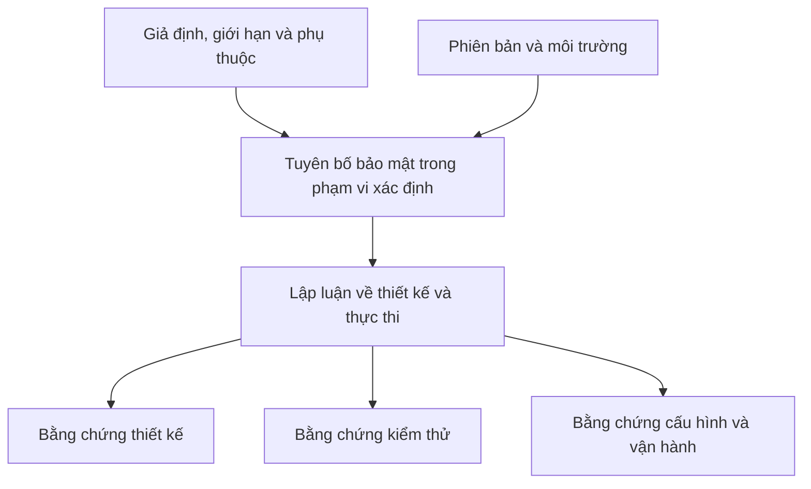

# Low, medium và high assurance

## 1. Assurance là mức tin cậy có căn cứ

Trong bảo mật, **assurance — mức đảm bảo** thể hiện mức tin cậy được hỗ trợ bằng bằng chứng rằng một hệ thống, thành phần hoặc quy trình đáp ứng các yêu cầu bảo mật đã nêu, trong phạm vi và điều kiện xác định.

Một tuyên bố có ý nghĩa thường phải trả lời:

> Có căn cứ gì để tin rằng yêu cầu này được đáp ứng, trên phiên bản nào, trong môi trường nào và với những giới hạn nào?

Ví dụ, “dịch vụ có phân quyền” là thông tin về một cơ chế. “Các đường đọc dữ liệu trong phạm vi đã được kiểm chứng theo tenant, vai trò, trạng thái quyền và các nhánh lỗi, trên phiên bản chính sách xác định” là một phần lập luận về assurance.

**Low, medium và high assurance** là ba mức mô tả nhu cầu và chất lượng bằng chứng theo một quy ước. Ý nghĩa cụ thể phải được định nghĩa trước khi áp dụng. Trong bài này, chúng là hồ sơ đảm bảo nội bộ minh họa, không phải cấp chứng nhận hay mức tương đương của một tiêu chuẩn bên ngoài.

Bài học tập trung vào cách:

- Phân biệt mức đảm bảo với mức rủi ro và độ mạnh của kiểm soát.
- Định nghĩa bằng chứng phù hợp cho low, medium và high assurance.
- Chọn mức theo hậu quả, ranh giới tin cậy và mức bất định.
- Đặc tả yêu cầu kiểm chứng có phạm vi, người thực hiện và tiêu chí chấp nhận.
- Duy trì tính phù hợp của bằng chứng trong vòng đời phát triển.

## 2. Phân biệt assurance với các khái niệm liên quan

| Khái niệm | Câu hỏi chính | Ví dụ |
|---|---|---|
| Mục tiêu bảo mật | Cần bảo vệ điều gì? | Người của tenant A không được đọc dữ liệu tenant B |
| Yêu cầu bảo mật | Hệ thống phải có hành vi nào? | Máy chủ kiểm tra tenant và quyền đối tượng trước khi trả dữ liệu |
| Kiểm soát | Thực hiện yêu cầu bằng cách nào? | Chính sách truy cập và điểm thực thi tại API, dịch vụ, kho dữ liệu |
| Rủi ro | Điều gì có thể xảy ra và gây hậu quả thế nào? | Lỗi kiểm tra tenant dẫn đến lộ dữ liệu giữa các khách hàng |
| Assurance | Vì sao tin rằng yêu cầu được đáp ứng? | Thiết kế, kiểm thử, cấu hình và xem xét độc lập cùng hỗ trợ kết luận |
| Độ tin cậy của đánh giá rủi ro | Nhận định về khả năng và hậu quả có chắc đến đâu? | Chưa đủ log để đánh giá tần suất khai thác ngoài thực tế |

Một hệ thống có kiểm soát mạnh nhưng chưa được xác minh vẫn có thể thiếu assurance. Ngược lại, bằng chứng rất rõ rằng một kiểm soát yếu hoạt động đúng không có nghĩa mục tiêu bảo mật đã được đáp ứng; cần xem chính yêu cầu và thiết kế có xử lý đúng đe dọa hay không.

### 2.1. Rủi ro cao làm tăng nhu cầu bằng chứng

Khi một sai lệch có thể làm lộ dữ liệu nhiều khách hàng, thay đổi quyền quản trị hoặc gián đoạn nghiệp vụ quan trọng, tổ chức thường cần bằng chứng sâu hơn và khả năng xem xét độc lập cao hơn trước khi ra quyết định.

Tuy nhiên:

- Rủi ro cao không tự chứng minh hệ thống đã đạt high assurance.
- Rủi ro thấp không cho phép bỏ yêu cầu bắt buộc hoặc kiểm soát nền.
- High assurance không đồng nghĩa không còn rủi ro.
- Một mức assurance không tự áp dụng cho mọi thành phần và mọi phiên bản.

Cần tách **mức mục tiêu** khỏi **mức đã được chứng minh**. Chọn high assurance trong kế hoạch chỉ xác định công việc cần làm; kết luận đạt phải dựa trên bằng chứng thực tế.

### 2.2. Assurance của hệ thống không chỉ là độ mạnh xác thực

Xác thực người dùng là một phần của bảo mật. Assurance trong bài còn bao gồm yêu cầu về phân quyền, dữ liệu, logging, quản trị cấu hình và phục hồi.

Một hệ thống yêu cầu nhiều yếu tố xác thực vẫn có thể trả sai tenant, ghi token vào log hoặc phục hồi quyền đã bị thu hồi. Không dùng một mức xác thực để thay thế cho đánh giá đảm bảo của toàn bộ các yêu cầu này.

## 3. Cấu trúc một lập luận đảm bảo

Một hồ sơ đảm bảo nên có bốn phần:

1. **Tuyên bố cần chứng minh:** yêu cầu hoặc thuộc tính bảo mật, với phạm vi rõ ràng.
2. **Lập luận:** lý do các bằng chứng đủ hỗ trợ tuyên bố.
3. **Bằng chứng:** đầu ra cụ thể từ thiết kế, cấu hình, kiểm thử, xem xét hoặc vận hành.
4. **Giả định và giới hạn:** điều kiện để kết luận còn đúng và phần chưa được chứng minh.

Ví dụ:

| Phần | Nội dung minh họa |
|---|---|
| Tuyên bố | Luồng tải báo cáo không trả tệp của tenant khác cho người không có quyền |
| Phạm vi | API tải, kho tệp, đường tải cũ và chính sách của bản phát hành được nêu |
| Lập luận | Danh tính và tenant được lấy từ nguồn tin cậy; quyền được kiểm tra khi tải; kho không cho tải qua đường công khai |
| Bằng chứng | Luồng thiết kế, cấu hình kho, kiểm thử chéo tenant, kiểm thử sau thu hồi và xem xét chính sách |
| Giả định | Dịch vụ định danh và nguồn tenant hoạt động theo hợp đồng được xác nhận |
| Giới hạn | Không bao gồm bản tệp người nhận đã tải xuống và tự chuyển tiếp ngoài phạm vi hệ thống |

Một sơ đồ khái niệm:



Nhiều bằng chứng không tự tạo thành lập luận tốt. Cần chỉ ra mỗi bằng chứng hỗ trợ phần nào của tuyên bố và khoảng trống nào còn tồn tại.

### 3.1. Đặc điểm của bằng chứng hữu ích

Bằng chứng cần được đánh giá theo:

- **Liên quan:** có chứng minh đúng yêu cầu đang xét không?
- **Bao phủ:** đã kiểm tra những đường, vai trò, trạng thái và môi trường nào?
- **Chiều sâu:** chỉ kiểm tra cấu hình hay đã quan sát hành vi, nhánh lỗi và cách vượt kiểm soát?
- **Tin cậy:** phương pháp, công cụ và người thực hiện có phù hợp không?
- **Độc lập:** ai có thể phát hiện và phản biện giả định của người triển khai?
- **Tính cập nhật:** bằng chứng còn đúng với phiên bản hiện hành không?
- **Khả năng truy vết:** có nối được yêu cầu, kết quả, sai lệch và quyết định không?

Ảnh chụp một tùy chọn mã hóa không chứng minh phân quyền đúng. Báo cáo quét không có phát hiện không tự chứng minh không tồn tại lỗi nghiệp vụ. Một kết quả kiểm thử cũ cần được đánh giá lại nếu thiết kế hoặc cấu hình liên quan đã thay đổi.

## 4. Hồ sơ low, medium và high assurance

Bảng dưới đây là quy ước minh họa để lập kế hoạch. Với mọi mức, các yêu cầu bắt buộc trong phạm vi vẫn phải được đáp ứng; mức thấp hơn không được dùng để đổi một yêu cầu thất bại thành đạt.

| Khía cạnh | Low assurance | Medium assurance | High assurance |
|---|---|---|---|
| Phạm vi tuyên bố | Hẹp, ít ranh giới và phụ thuộc; giới hạn được nêu rõ | Bao phủ luồng nghiệp vụ và các thành phần liên quan | Bao phủ các ranh giới, đường thay thế và phụ thuộc quan trọng của tuyên bố |
| Yêu cầu | Có tiêu chí chấp nhận và người chịu trách nhiệm | Có truy vết yêu cầu, rủi ro và điểm thực thi | Có lập luận về tính đầy đủ của yêu cầu đối với đe dọa quan trọng |
| Thiết kế | Mô tả cơ chế và cấu hình chính | Xem xét luồng dữ liệu, danh tính, quyền và xử lý lỗi | Xem xét sâu ranh giới tin cậy, cách kết hợp kiểm soát và khả năng đi vòng |
| Kiểm thử | Kiểm tra hành vi chính và trường hợp từ chối liên quan trong phạm vi hẹp | Bổ sung lỗi, thay đổi trạng thái, tích hợp và đường thay thế | Bổ sung thử nghiệm đối kháng theo đe dọa, thay đổi đồng thời, chuỗi khai thác và phục hồi khi liên quan |
| Độc lập | Người thực hiện có thể thuộc nhóm triển khai; vẫn có người chịu trách nhiệm chấp nhận bằng chứng | Có người xem xét khác với tác giả ở phần quan trọng | Có người đủ năng lực xem xét độc lập với việc tạo ra thiết kế, mã hoặc cấu hình được đánh giá |
| Môi trường | Ghi rõ môi trường thử và các khác biệt | Đối chiếu các cấu hình ảnh hưởng đến yêu cầu | Chứng minh các đặc điểm an ninh quan trọng đại diện cho sản xuất và kiểm tra khác biệt còn lại |
| Hồ sơ bằng chứng | Kết quả, phiên bản, phạm vi và giới hạn | Ma trận truy vết cùng sai lệch và quyết định xử lý | Hồ sơ lập luận, bằng chứng, phản biện và quyết định có thẩm quyền |
| Duy trì | Chạy lại khi thay đổi phần liên quan | Kết hợp kiểm tra phát hành và rà soát vận hành | Có phân tích tác động thay đổi, tiêu chí mất hiệu lực và kiểm chứng lại theo rủi ro |

### 4.1. Low assurance

Low assurance phù hợp với tuyên bố có hậu quả hạn chế, phạm vi rõ và ít bất định quan trọng. Ví dụ, kiểm chứng quyền đọc đối với một bản tài liệu hướng dẫn đã được duyệt công khai có thể có phạm vi tương đối hẹp.

Vẫn cần xác nhận đúng phiên bản được công bố, quyền sửa và đường quản trị liên quan. Nếu tuyên bố chỉ được kiểm tra trên một đường, kết luận phải giới hạn ở đường đó; không mở rộng thành “toàn bộ hệ thống đã an toàn”.

### 4.2. Medium assurance

Medium assurance phù hợp khi có nhiều vai trò, thành phần hoặc trạng thái nghiệp vụ cần phối hợp. Ví dụ, một chức năng nội bộ thay đổi trạng thái hàng hóa cần kiểm tra quyền sửa, quy tắc chuyển trạng thái, lỗi và lịch sử thay đổi.

Bằng chứng cần thể hiện hành vi tích hợp, thay vì chỉ gồm kết quả riêng lẻ của từng thành phần. Người xem xét cần kiểm tra các giả định giữa nhóm ứng dụng, định danh và dữ liệu.

### 4.3. High assurance

High assurance phù hợp với các tuyên bố mà sai lệch có hậu quả lớn hoặc ranh giới bảo vệ phức tạp. Ví dụ, bảo đảm dữ liệu của nhiều tenant không bị trả nhầm trong một luồng xuất bất đồng bộ.

Cần chú trọng tính đầy đủ của phạm vi, chất lượng lập luận, các cách đi vòng, lỗi phụ thuộc và xem xét độc lập. Tùy yêu cầu, có thể dùng phân tích hình thức hoặc các phương pháp chuyên sâu cho phần logic quan trọng. Không mặc định mọi trường hợp high assurance đều phải dùng cùng một kỹ thuật.

High assurance vẫn là kết luận có điều kiện trên phạm vi và bằng chứng. Nó không phải cam kết rằng mọi trạng thái có thể xảy ra đều đã được thử hoặc mọi lỗi tương lai đều bị loại bỏ.

## 5. Chọn mức đảm bảo theo rủi ro và phạm vi quyết định

### 5.1. Những yếu tố cần xem xét

| Yếu tố | Câu hỏi quyết định |
|---|---|
| Tác động | Nếu yêu cầu bị vi phạm, hậu quả có nghiêm trọng, diện rộng hoặc khó đảo ngược không? |
| Khả năng khai thác | Có đường tiếp cận dễ dàng, tác nhân có động cơ hoặc điểm yếu đã được tái hiện không? |
| Dữ liệu và quyền | Có dữ liệu nhạy cảm, quyền quản trị hoặc khả năng xuất hàng loạt không? |
| Ranh giới tin cậy | Có tenant, tổ chức, dịch vụ hoặc nhà cung cấp khác nhau không? |
| Độ phức tạp | Có tác vụ nền, bộ nhớ đệm, đồng thời, nhiều trạng thái hoặc nhiều đường truy cập không? |
| Bất định | Có giả định quan trọng chưa được kiểm tra hoặc bằng chứng không còn phù hợp không? |
| Nghĩa vụ áp dụng | Có yêu cầu bắt buộc, hợp đồng hoặc chính sách đặt mức kiểm chứng tối thiểu không? |
| Phụ thuộc | Kết luận có dựa vào danh tính, cấu hình hoặc kiểm soát của thành phần khác không? |

Không cần cộng các yếu tố thành một điểm nếu chưa có quy tắc được định nghĩa. Một hậu quả rất lớn hoặc một ranh giới đặc biệt quan trọng có thể đủ để tăng nhu cầu bằng chứng.

### 5.2. Các bước lựa chọn

1. Viết tuyên bố bảo mật và quyết định cần hỗ trợ, chẳng hạn cho phép phát hành một chức năng.
2. Xác định tài sản, dữ liệu, người dùng, môi trường và các đường nằm trong phạm vi.
3. Phân tích đe dọa, hậu quả và giả định.
4. Xác định mức bằng chứng tối thiểu theo chính sách và các nghĩa vụ áp dụng.
5. Chọn hồ sơ low, medium hoặc high, rồi điều chỉnh cho kịch bản.
6. Ghi phương pháp, người thực hiện, người xem xét và tiêu chí chấp nhận.
7. Để người có thẩm quyền phê duyệt kế hoạch và quyết định sau khi có bằng chứng.

Nếu nguồn lực chưa đủ cho mức cần thiết, cần đổi phạm vi, lùi quyết định hoặc xử lý ngoại lệ theo thẩm quyền. Không tự hạ nhãn mục tiêu chỉ để khớp tiến độ.

### 5.3. Chọn theo chức năng, đồng thời xét phụ thuộc chung

Một sản phẩm có thể có:

- Phạm vi đọc tài liệu công khai với nhu cầu bằng chứng hẹp.
- Phạm vi nghiệp vụ nội bộ cần kiểm chứng tích hợp.
- Phạm vi quản trị hoặc dữ liệu nhiều tenant cần bằng chứng chuyên sâu.

Tuy nhiên, dịch vụ định danh, chính sách quyền hoặc kho cấu hình dùng chung có thể là phụ thuộc quan trọng của phạm vi high assurance. Không thể bỏ qua chúng chỉ vì tên chức năng đang được đánh giá là “xuất báo cáo”.

Cũng không nên suy ra assurance của toàn hệ thống bằng trung bình các mức của thành phần. Sự kết hợp, giao diện và giả định giữa các thành phần cần bằng chứng riêng.

### 5.4. Bằng chứng tốt hơn không tự thay đổi cơ chế bảo vệ

Tăng mức đảm bảo có thể làm giảm bất định hoặc phát hiện một sai lệch cần sửa. Chỉ khi thiết kế, triển khai hoặc vận hành được thay đổi phù hợp thì mới có căn cứ nói một đường rủi ro đã được giảm.

Một đợt xem xét sâu có thể làm đánh giá rủi ro tăng lên vì phát hiện đường khai thác trước đó chưa biết. Đó là thông tin cần thiết cho quyết định, không phải bằng chứng rằng quá trình đảm bảo thất bại.

## 6. Cùng một yêu cầu, nhu cầu bằng chứng khác nhau

Xét yêu cầu minh họa:

> Trong tối đa 5 phút kể từ khi hệ thống quản lý truy cập nhận thông báo thu hồi hợp lệ, quyền đọc dữ liệu tương ứng phải mất hiệu lực trên các đường trong phạm vi, kể cả phiên và token đã tồn tại.

Nội dung yêu cầu không trở nên tùy chọn khi chọn low assurance. Điều thay đổi là phạm vi tuyên bố và cách thu thập, đánh giá bằng chứng phải tương xứng với rủi ro.

| Hồ sơ | Ví dụ cách lập bằng chứng |
|---|---|
| Low | Với một chức năng đơn giản có một đường đọc đã xác định: kiểm tra nguồn thông báo, mốc bắt đầu, phiên đã mở, hành vi sau thu hồi và cấu hình thời hạn. Kết luận chỉ cho phạm vi đó. |
| Medium | Với luồng nhiều thành phần: bổ sung các vai trò, API liên quan, token, bộ nhớ đệm quyền, lỗi thông báo và kiểm tra thời gian tích hợp. Có người khác xem xét kết quả và giới hạn. |
| High | Với ranh giới dữ liệu có hậu quả lớn: kiểm kê đường thay thế, tác vụ đang chờ, đồng thời, mất kết nối, chính sách lưu đệm và phục hồi; có xem xét độc lập về tính đầy đủ và bằng chứng đo thời gian. |

Nếu một phạm vi low thực tế có đường đọc thứ hai chưa được kiểm tra, cần cập nhật phạm vi và bằng chứng. Không được dùng kết quả một đường để khẳng định yêu cầu đã đạt trên cả hai.

Các điểm cần cố định trước khi kiểm chứng:

- Mốc bắt đầu đo là lúc hệ thống nhận thông báo, không phải lúc người dùng nghỉ việc, trừ khi yêu cầu đã định nghĩa khác.
- Mốc kết thúc là lúc quyền thực sự không còn dùng được trên các đường liên quan.
- Phiên cũ, token và bộ nhớ đệm phải được xử lý theo yêu cầu.
- Môi trường, danh tính, dữ liệu và cấu hình thử cần ghi rõ.
- Sai lệch phải được lưu và có người xử lý.

Điểm số độ bao phủ mã hoặc số lượng ca kiểm thử có thể hỗ trợ phân tích. Chúng không tự chứng minh ranh giới quyền đã được kiểm chứng đầy đủ.

## 7. Tình huống xuyên suốt: xuất báo cáo nhiều tenant

### 7.1. Bối cảnh và mức mục tiêu

Một nền tảng phục vụ nhiều doanh nghiệp. Mỗi doanh nghiệp là một **tenant**, có người dùng và dữ liệu riêng. Nhân viên có thể yêu cầu tạo báo cáo khách hàng; tác vụ được xử lý nền và lưu tệp để tải sau.

Dữ liệu trong phạm vi **EXPORT-007** gồm thông tin liên hệ và lịch sử giao dịch đã được nghiệp vụ cho phép xuất. Tình huống là giả định; các mốc thời gian trong phần yêu cầu dùng để minh họa cách đặc tả.

Luồng chính:

**Người dùng → API yêu cầu → hàng đợi → worker tạo báo cáo → kho tệp → API tải.**

Các đe dọa quan trọng:

1. Người dùng đổi tenant hoặc bộ lọc để lấy dữ liệu doanh nghiệp khác.
2. Người dùng bị thu hồi quyền sau khi tạo yêu cầu nhưng tác vụ vẫn chạy hoặc tệp vẫn tải được.
3. Worker dùng quyền dịch vụ rộng để tạo đầu ra vượt quyền người yêu cầu.
4. Đường tải trực tiếp bỏ qua API kiểm tra quyền.
5. Log, tệp tạm hoặc phục hồi tạo bản sao có quyền không phù hợp.

Chủ sở hữu dữ liệu xác nhận mục đích, tập trường và người nhận được phép. Nhóm ứng dụng, dữ liệu và nền tảng chịu trách nhiệm triển khai theo phạm vi. Người có thẩm quyền quyết định rủi ro còn lại được chỉ định riêng.

Do hậu quả lộ nhiều khách hàng và luồng nhiều ranh giới, nhóm chọn **high assurance làm mục tiêu cho tuyên bố cách ly tenant và quyền xuất**. Quyết định này bao gồm các phụ thuộc ảnh hưởng trực tiếp đến tuyên bố, không chỉ worker tạo tệp.

### 7.2. Yêu cầu về hành vi bảo mật

| Mã | Yêu cầu minh họa |
|---|---|
| SEC-ID-01 | Người tạo yêu cầu xuất và người quản trị chính sách xuất phải dùng danh tính cá nhân đáp ứng xác thực đa yếu tố theo chính sách tình huống. Worker có danh tính dịch vụ và phạm vi riêng, không thay thế quyền nghiệp vụ của người yêu cầu. |
| SEC-TEN-01 | Hệ thống phải kiểm tra quyền tại lúc tạo yêu cầu, lúc worker thực hiện và mỗi lần tải tệp. Quyền phải ràng buộc đúng người yêu cầu, tenant, tập đối tượng và tập trường đã duyệt; dữ liệu tự khai từ máy khách không được dùng làm căn cứ duy nhất. |
| SEC-REV-01 | Quyết định thu hồi hợp lệ phải làm mất quyền tương ứng trong tối đa 5 phút từ lúc hệ thống quản lý quyền nhận thông báo, kể cả đối với tác vụ đang chờ, phiên và token đã tồn tại. |
| SEC-TIME-01 | Tệp trong kho xuất đang hoạt động chỉ được tải qua đường có kiểm tra quyền và phải bị xóa trong tối đa 2 giờ kể từ khi tạo xong, trừ quyết định tạm giữ hợp lệ. Tệp tạm và bản sao liên quan phải có phạm vi cùng lịch xử lý được đăng ký. |
| SEC-LOG-01 | Các sự kiện yêu cầu, phê duyệt nếu có, tạo, từ chối và tải phải có mã liên kết, danh tính, tenant, thời điểm và kết quả. Log không chứa token, toàn bộ báo cáo hoặc giá trị liên hệ đầy đủ; quyền sửa/xóa log được tách theo phân công. |
| SEC-REC-01 | Trước khi mở lại luồng sau phục hồi, phải áp dụng chính sách quyền hiện hành, quyết định thu hồi và hết hạn; không tự kích hoạt lại tác vụ hoặc tệp trái quyền từ trạng thái sao lưu cũ. |

Tệp đã được tải về không thể bị thu hồi chỉ bằng xóa tệp trên máy chủ. Phạm vi tuyên bố cần ghi giới hạn này; việc chia sẻ ra đích còn cần quyết định về người nhận, mục đích và trách nhiệm sử dụng.

### 7.3. Yêu cầu về đảm bảo

Yêu cầu bảo mật mô tả hành vi cần có. Yêu cầu đảm bảo mô tả bằng chứng phải có để chấp nhận kết luận về hành vi đó.

| Mã | Yêu cầu đảm bảo | Tiêu chí chấp nhận |
|---|---|---|
| AS-SCOPE-01 | Trước đánh giá, phải lập danh mục các đường tạo, xử lý, lưu, tải, quản trị và phục hồi dữ liệu thuộc EXPORT-007, kèm phụ thuộc và phiên bản chính sách. | Có chủ sở hữu xác nhận; mọi đường được phát hiện trong đánh giá đều được đưa vào phạm vi hoặc có lý do loại trừ được chấp thuận. |
| AS-TRACE-01 | Mỗi yêu cầu SEC trong phạm vi phải nối với đe dọa, điểm thực thi, phương pháp và bằng chứng tương ứng. | Không có yêu cầu thiếu căn cứ kết luận; bằng chứng cho biết bản phát hành, cấu hình, môi trường và giới hạn. |
| AS-TEST-01 | Kế hoạch phải kiểm tra các vai trò, tenant, trạng thái quyền và nhánh lỗi liên quan; bắt buộc gồm đổi tenant, thu hồi khi tác vụ chờ, tải bằng người khác, đường tải trực tiếp và phục hồi trạng thái cũ. | Kết quả quan sát đáp ứng yêu cầu; sai lệch được ghi và xử lý trước khi xác nhận tuyên bố liên quan đạt. |
| AS-IND-01 | Người đủ năng lực, độc lập với việc tạo ra phần thiết kế, mã hoặc cấu hình được đánh giá, phải xem xét lập luận, phạm vi, kết quả và các cách đi vòng quan trọng. | Có danh tính, phạm vi trách nhiệm, ý kiến phản biện, xử lý ý kiến và kết luận; người triển khai không tự phê duyệt kết luận độc lập cho phần mình tạo. |
| AS-ENV-01 | Các đặc điểm ảnh hưởng bảo mật của môi trường thử phải được đối chiếu với sản xuất: danh tính, chính sách quyền, hàng đợi, quyền kho, thời hạn và đường mạng. | Mọi khác biệt được đánh giá; phần ảnh hưởng kết luận có bằng chứng bổ sung phù hợp trước quyết định phát hành. |
| AS-CHANGE-01 | Thay đổi điểm thực thi quyền, cấu trúc dữ liệu đầu ra, quyền worker, cấu hình kho hoặc cơ chế phục hồi phải kích hoạt phân tích tác động bằng chứng. | Kế hoạch kiểm chứng lại được xác nhận; bằng chứng cũ không được tái sử dụng cho phần đã mất tính phù hợp. |

Độc lập không nhất thiết đòi hỏi một công ty bên ngoài. Cần xác định năng lực, quyền phản biện và xung đột lợi ích thực tế. Một chữ ký khác tên nhưng không có xem xét nội dung chưa đáp ứng mục tiêu.

### 7.4. Ma trận bằng chứng dự kiến

Bảng này là kế hoạch minh họa, không phải báo cáo rằng các kiểm thử đã được chạy.

| Yêu cầu | Tình huống kiểm chứng | Bằng chứng dự kiến |
|---|---|---|
| SEC-ID-01 | Phiên thiếu điều kiện xác thực; danh tính dịch vụ vượt phạm vi | Kết quả từ chối, cấu hình danh tính và log đã lọc |
| SEC-TEN-01 | Tenant A yêu cầu đối tượng B; thay bộ lọc hoặc trường; dùng mã tệp người khác | Kết quả hành vi tại API, worker, kho và API tải |
| SEC-REV-01 | Thu hồi khi chờ, đang xử lý và đã tạo tệp | Mốc thời gian, trạng thái tác vụ, kết quả tải bằng phiên cũ |
| SEC-TIME-01 | Hết thời hạn, dùng đường tải cũ và truy cập kho trực tiếp | Trạng thái tệp, chính sách kho và kết quả từ chối |
| SEC-LOG-01 | Lỗi, từ chối và thành công với dữ liệu đánh dấu giả định | Cấu trúc sự kiện, kết quả kiểm tra giá trị bị cấm và quyền kho log |
| SEC-REC-01 | Phục hồi bản sao trước thời điểm thu hồi hoặc hết hạn | Biên bản phục hồi, chính sách hiện hành và kết quả kiểm tra quyền |

Bằng chứng cần đủ để người xem xét hiểu kết quả đã được tạo như thế nào. Không đưa dữ liệu khách hàng thật hoặc bí mật đang hoạt động vào báo cáo chỉ để chứng minh hệ thống có bảo vệ chúng.

## 8. Thực hiện đánh giá và ra quyết định

### 8.1. Lập kế hoạch trước khi triển khai

Kế hoạch đảm bảo nên được tạo cùng yêu cầu và thiết kế, để nhóm biết cần xây dựng khả năng kiểm chứng nào. Ví dụ, muốn đo thu hồi trong 5 phút phải có mốc thời gian, sự kiện và cách quan sát các đường liên quan.

Kế hoạch tối thiểu gồm:

- Tuyên bố và các yêu cầu nằm trong phạm vi.
- Mức assurance mục tiêu cùng lý do lựa chọn.
- Đe dọa và giả định quan trọng.
- Danh mục thành phần, giao diện và phụ thuộc.
- Phương pháp, môi trường và dữ liệu thử.
- Người thực hiện, người xem xét và người quyết định.
- Tiêu chí đạt, cách xử lý sai lệch và điều kiện kiểm chứng lại.

Một mẫu đặc tả minh họa:

```text
Tuyên bố:
    Luồng EXPORT-007 không trả dữ liệu ngoài tenant và quyền xuất đã duyệt.

Mức mục tiêu:
    High assurance theo hồ sơ nội bộ được chọn cho phạm vi này.

Yêu cầu:
    SEC-ID-01, SEC-TEN-01, SEC-REV-01,
    SEC-TIME-01, SEC-LOG-01, SEC-REC-01.

Bằng chứng:
    Mô hình đe dọa, thiết kế luồng,
    cấu hình và chính sách theo phiên bản,
    kết quả kiểm thử, xem xét độc lập,
    kết quả kiểm chứng phục hồi.

Giới hạn:
    Không bao gồm việc tự chuyển tiếp bản đã tải
    ngoài các đích được tổ chức quản lý.

Điều kiện kết luận:
    Các yêu cầu trong phạm vi có bằng chứng phù hợp;
    không có sai lệch chưa xử lý làm vô hiệu tuyên bố;
    giả định và giới hạn được người có thẩm quyền chấp thuận.
```

### 8.2. Thu thập và đánh giá bằng chứng

Quá trình nên giữ được đầu vào, cấu hình, kết quả mong đợi và kết quả thực tế. Khi có sai lệch, cần phân biệt:

- Yêu cầu chưa rõ hoặc chưa xử lý đúng đe dọa.
- Thiết kế không đáp ứng yêu cầu.
- Mã hoặc cấu hình sai với thiết kế.
- Phương pháp kiểm chứng không đủ hoặc môi trường không phù hợp.
- Phụ thuộc không đáp ứng giả định.

Sửa một lỗi và chạy lại một ca chưa chắc đủ. Cần phân tích phần bị ảnh hưởng, gồm những ca hoặc lập luận dựa trên cùng cơ chế. Việc chạy lại phải có lý do từ thay đổi và phạm vi tác động.

Với high assurance, cần dành thời gian phản biện: có đường truy cập bị bỏ sót không, trạng thái nào chưa được xét, kết quả có thể do dữ liệu thử quá đơn giản không, và bằng chứng có thật sự phản ánh môi trường được chấp nhận không?

### 8.3. Xử lý giới hạn của kiểm thử

Kiểm thử thông thường chỉ quan sát một tập hữu hạn đầu vào và trạng thái. Để tăng tính thuyết phục, cần lựa chọn theo mô hình đe dọa và phân lớp trạng thái, thay vì chỉ tăng số lượng ca gần giống nhau.

Ví dụ, với quyền xuất:

- Vai trò không có quyền, có quyền và vừa bị thu hồi.
- Cùng tenant, khác tenant và tenant không được xác minh.
- Tác vụ đang chờ, đang chạy, đã tạo tệp và hết hạn.
- Chính sách hợp lệ, quá hạn và phụ thuộc không sẵn sàng.
- Yêu cầu đơn lẻ, lặp lại và thay đổi đồng thời.

Các lớp này giúp lập luận về độ bao phủ. Chúng không tự chứng minh đã xét mọi tổ hợp; phần chưa xét cần được nhận diện và đánh giá.

### 8.4. Kết luận đánh giá phải nói rõ phạm vi

Có thể phân biệt các kết quả:

| Kết quả | Ý nghĩa |
|---|---|
| Có đủ căn cứ trong phạm vi | Bằng chứng đáp ứng hồ sơ mục tiêu và các yêu cầu liên quan, với giả định và giới hạn đã nêu |
| Chưa đủ bằng chứng | Chưa thể kết luận, dù chưa quan sát thấy vi phạm |
| Không đáp ứng | Có bằng chứng cho thấy yêu cầu hoặc tuyên bố bị vi phạm |
| Cần đánh giá lại | Bằng chứng từng phù hợp nhưng đã có thay đổi làm ảnh hưởng kết luận |

Không nên đổi “chưa đủ bằng chứng” thành “đạt” chỉ vì hết thời gian. Nếu thay đổi phạm vi kết luận, phải được ghi và xem xét tác động, không âm thầm bỏ phần khó kiểm chứng.

### 8.5. Quyết định phát hành và chấp nhận rủi ro

Kết luận về assurance và quyết định phát hành có liên hệ nhưng là hai việc khác nhau. Một cấp có thẩm quyền có thể xem xét một ngoại lệ theo chính sách, nhưng quyết định đó không biến yêu cầu chưa đạt thành đã đạt.

Ví dụ, nếu đường tải trực tiếp vẫn cho phép tải ngoài tenant, tuyên bố cách ly tenant chưa được đáp ứng. Việc ghi “đã chấp nhận rủi ro” không đủ để gọi tuyên bố đó là high assurance.

Hồ sơ quyết định cần giữ:

- Yêu cầu đã có căn cứ đáp ứng.
- Yêu cầu thất bại hoặc còn thiếu bằng chứng.
- Rủi ro và giới hạn còn lại.
- Người có thẩm quyền, điều kiện và thời hạn.
- Việc cần hoàn thành trước hoặc sau quyết định theo quy tắc áp dụng.

Ngoại lệ nội bộ không tự loại bỏ nghĩa vụ bắt buộc của tổ chức. Không dùng nhãn assurance để che một khoảng trống đã biết.

## 9. Duy trì assurance trong vòng đời phát triển

### 9.1. Bằng chứng gắn với phiên bản và điều kiện

Một hồ sơ bằng chứng nên ghi định danh của:

| Thành phần | Thông tin cần lưu |
|---|---|
| Yêu cầu | Mã, nội dung và phiên bản tiêu chí chấp nhận |
| Thiết kế | Luồng dữ liệu, ranh giới và giả định được đánh giá |
| Triển khai | Bản phát hành, thành phần và cấu hình liên quan |
| Chính sách | Vai trò, quyền, tenant, thời hạn và phiên bản |
| Môi trường | Phụ thuộc, quyền hạ tầng và khác biệt được chấp thuận |
| Kiểm chứng | Người thực hiện, phương pháp, dữ liệu thử, thời điểm và kết quả |
| Quyết định | Người xem xét, người chấp nhận, giới hạn và hạn hiệu lực |

Thời gian gần đây chưa đủ chứng minh bằng chứng còn phù hợp. Một kết quả hôm qua có thể mất giá trị với phần quyền đã đổi hôm nay. Ngược lại, một phân tích thiết kế cũ có thể vẫn hữu ích nếu giả định, phạm vi và cơ chế liên quan không thay đổi.

### 9.2. Sự kiện kích hoạt kiểm chứng lại

Đối với EXPORT-007, cần phân tích lại khi:

- Thêm đường tạo, tải, tìm kiếm hoặc chia sẻ báo cáo.
- Thay đổi mô hình tenant, vai trò hoặc chính sách thu hồi.
- Thay danh tính hoặc quyền của worker.
- Thay cơ chế hàng đợi, thử lại tác vụ hoặc xử lý đồng thời.
- Thay kho tệp, quyền truy cập hoặc đường tải.
- Thêm trường nhạy cảm vào đầu ra.
- Thay log, công cụ theo dõi hoặc cơ chế phục hồi.
- Phát hiện sai lệch, sự cố hoặc giả định không đúng.

Phân tích tác động giúp xác định bằng chứng nào còn dùng được và phần nào phải làm lại. Không cần lặp toàn bộ hoạt động khi không có căn cứ, nhưng cũng không giữ nguyên kết luận cho phần đã thay đổi.

### 9.3. Bằng chứng vận hành

Kiểm chứng trước phát hành cần được bổ sung bằng quan sát vận hành, chẳng hạn:

- Sai lệch cấu hình và quyền so với thiết kế đã duyệt.
- Thời gian thu hồi thực tế so với yêu cầu.
- Tác vụ hoặc tệp còn tồn tại sau thời hạn.
- Cảnh báo không được tiếp nhận hoặc thiếu sự kiện.
- Kết quả phục hồi và việc áp dụng quyền hiện hành.
- Ngoại lệ sắp hết hạn hoặc đã quá hạn.

Những chỉ số này có thể làm thay đổi kết luận. Tuy nhiên, “không có cảnh báo” chưa chứng minh không có sự cố nếu cơ chế phát hiện chưa được kiểm chứng.

### 9.4. Phụ thuộc và nhà cung cấp

Khi một phần kiểm soát do nhà cung cấp thực hiện, cần xác định:

1. Nhà cung cấp chịu trách nhiệm cho thuộc tính nào.
2. Tổ chức phải tự cấu hình và kiểm chứng phần nào.
3. Bằng chứng của nhà cung cấp bao phủ dịch vụ, phiên bản, thời kỳ và phạm vi nào.
4. Có giả định hoặc ngoại lệ nào ảnh hưởng tuyên bố đang xét.
5. Giao diện giữa các bên được xác minh bằng cách nào.

Một báo cáo đánh giá chung của nhà cung cấp không tự chứng minh kho tệp của tổ chức đang có quyền đúng. Bằng chứng kế thừa phải được nối với cấu hình và cách dùng thực tế.

## 10. Cân bằng mức đảm bảo với nguồn lực

Assurance cần tương xứng với quyết định. Có thể dùng các cách sau để tập trung nguồn lực:

- Đặt yêu cầu và tiêu chí sớm để tránh thu thập bằng chứng thiếu mục tiêu.
- Ưu tiên ranh giới có hậu quả lớn và giả định chưa được xác minh.
- Tự động hóa các kiểm tra lặp lại có đầu vào, đầu ra rõ.
- Dùng xem xét độc lập cho phần cần phản biện thiết kế và đường đi vòng.
- Tái sử dụng bằng chứng khi đã xác nhận phạm vi, phiên bản và giả định còn phù hợp.
- Ghi rõ phần chưa được chứng minh để người quyết định hiểu giới hạn.

Không đồng nhất high assurance với số giờ kiểm thử thủ công hoặc số lượng công cụ. Tự động hóa có thể tạo bằng chứng mạnh nếu kiểm tra đúng thuộc tính; xem xét thủ công có thể cần thiết cho lỗi nghiệp vụ và giả định khó mô hình hóa.

Có thể theo dõi:

| Chỉ số | Điều cần ghi kèm |
|---|---|
| Tỷ lệ yêu cầu có bằng chứng phù hợp | Danh sách yêu cầu trong mẫu số và tiêu chí “phù hợp” |
| Đường quan trọng đã được kiểm chứng | Nguồn danh mục đường và phần chưa được đánh giá |
| Sai lệch chưa xử lý | Mức tác động đến tuyên bố, người xử lý và hạn |
| Bằng chứng bị ảnh hưởng bởi thay đổi | Phiên bản, thay đổi và kế hoạch làm lại |
| Ý kiến xem xét độc lập còn mở | Nội dung, kết luận và người quyết định |

Các chỉ số hỗ trợ quản lý công việc. Không chuyển một tỷ lệ phần trăm thành nhãn high assurance nếu thiếu lập luận về phần quan trọng chưa được chứng minh.

## 11. Những sai lầm thường gặp

| Sai lầm | Hệ quả | Cách điều chỉnh |
|---|---|---|
| Low assurance nghĩa là không cần kiểm thử | Không có căn cứ cho yêu cầu tối thiểu | Giữ tiêu chí bắt buộc và giới hạn phạm vi kết luận |
| High assurance nghĩa là không còn lỗi | Tạo kỳ vọng vượt bằng chứng | Nêu phạm vi, giả định và rủi ro còn lại |
| Thêm kiểm soát là tự tăng assurance | Không biết cơ chế có hoạt động đúng không | Bổ sung lập luận và bằng chứng phù hợp |
| Chỉ có xác thực mạnh là bảo mật toàn hệ thống | Bỏ sót phân quyền, dữ liệu, log và phục hồi | Đánh giá theo từng tuyên bố bảo mật |
| Nhiều ca kiểm thử là mức cao | Có thể lặp cùng một đường và bỏ ranh giới quan trọng | Chọn theo đe dọa, trạng thái và phạm vi |
| Quét không có phát hiện là đã đạt | Công cụ có thể không thấy lỗi nghiệp vụ | Kết hợp phương pháp và ghi giới hạn |
| Người khác ký tên là độc lập | Không có phản biện thực chất | Xác định năng lực, vai trò và xử lý ý kiến |
| Báo cáo nhà cung cấp bao phủ mọi cấu hình | Kế thừa assurance sai phạm vi | Đối chiếu trách nhiệm và kiểm chứng cách dùng thực tế |
| Bằng chứng mới luôn còn đúng | Thay đổi cấu hình có thể làm mất kết luận | Gắn với phiên bản và phân tích tác động |
| Chấp nhận rủi ro là yêu cầu đã đạt | Trộn quyết định với kết quả kỹ thuật | Ghi riêng sai lệch, ngoại lệ và kết luận |
| Trung bình mức các thành phần thành mức hệ thống | Bỏ qua giao diện và phụ thuộc yếu | Lập luận cho luồng và ranh giới tổng thể |
| Chỉ thử trước phát hành | Không thấy sai lệch vận hành hoặc quyền cũ sau phục hồi | Bổ sung quan sát và kiểm chứng lại theo sự kiện |

## 12. Bài tập thực hành

Một sản phẩm có ba phạm vi:

1. Trang hướng dẫn sử dụng công khai.
2. Chức năng nội bộ điều chỉnh trạng thái hàng tồn.
3. Luồng xuất dữ liệu khách hàng của nhiều tenant.

Thực hiện:

1. Viết một tuyên bố bảo mật cho mỗi phạm vi, nêu rõ dữ liệu, hành động và giới hạn.
2. Chọn low, medium hoặc high assurance làm mục tiêu và giải thích theo hậu quả, độ phức tạp, bất định.
3. Ghi yêu cầu bắt buộc và các phụ thuộc dùng chung của từng tuyên bố.
4. Lập kế hoạch bằng chứng: thiết kế, cấu hình, kiểm thử, xem xét và vận hành.
5. Với luồng xuất, đưa ra ít nhất một ca hợp lệ, một ca khác tenant, một ca sau thu hồi và một ca phụ thuộc lỗi.
6. Chỉ định người thực hiện, người xem xét và người quyết định.
7. Mô tả một thay đổi khiến bằng chứng mất tính phù hợp và cách kiểm chứng lại.
8. Viết kết luận giả định trong hai trường hợp: đủ bằng chứng và còn một đường tải chưa được kiểm tra.

Tự đối chiếu:

- Tuyên bố có rộng hơn phạm vi bằng chứng không?
- Có đang dùng một công cụ hoặc một điểm số để thay cho lập luận không?
- Phần quan trọng nhất đã có người đủ năng lực phản biện chưa?
- Có phân biệt mức mục tiêu với mức đã chứng minh không?
- Quyết định rủi ro và kết quả đáp ứng yêu cầu có được ghi riêng không?

Một mức đảm bảo hữu ích phải giúp người quyết định hiểu vì sao có thể tin vào yêu cầu, phần nào đã được chứng minh và điều kiện nào có thể làm kết luận thay đổi. Low, medium và high chỉ có giá trị khi gắn với phạm vi, bằng chứng và trách nhiệm cụ thể.
