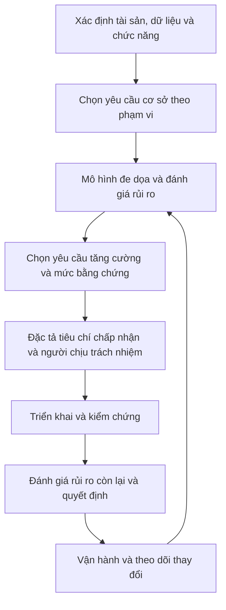

# Yêu cầu tối thiểu và yêu cầu tăng cường

## 1. Mục tiêu bài học

Trong chương **Rủi ro và mức đảm bảo**, một quyết định quan trọng là xác định hệ thống phải đáp ứng yêu cầu bảo mật nào và cần mức bằng chứng nào để chứng minh đã đáp ứng. Không phải mọi hệ thống cần cùng một cấu hình kiểm soát, nhưng việc lựa chọn phải có căn cứ và có thể kiểm tra lại.

Bài học này giúp người học:

- Phân biệt yêu cầu tối thiểu với yêu cầu tăng cường.
- Xác định phạm vi áp dụng từ tài sản, dữ liệu, chức năng và mô hình đe dọa.
- Chuyển điều kiện rủi ro thành yêu cầu cụ thể về xác thực, phân quyền, dữ liệu, logging và phục hồi.
- Phân biệt tăng cường kiểm soát với tăng cường bằng chứng đảm bảo.
- Viết tiêu chí chấp nhận, xử lý ngoại lệ và cập nhật yêu cầu trong vòng đời phát triển.

Các nhãn, ngưỡng và thời hạn trong bài là **quy ước minh họa cho một tổ chức giả định**. Chúng không tạo thành một tiêu chuẩn áp dụng chung hoặc một mức chứng nhận.

## 2. Hai nhóm yêu cầu khác nhau ở đâu?

### 2.1. Yêu cầu tối thiểu

**Yêu cầu tối thiểu** là tập yêu cầu bắt buộc áp dụng cho một phạm vi đã xác định, tạo thành đường cơ sở bảo mật của phạm vi đó.

Ví dụ:

- Mọi API thay đổi dữ liệu đơn hàng phải xác thực chủ thể và kiểm tra quyền phía máy chủ.
- Mọi bản sao chứa dữ liệu thuộc diện bảo vệ phải có quyền truy cập phù hợp.
- Các hành động quản trị được xác định phải tạo dấu vết kiểm toán.
- Dịch vụ thuộc phạm vi cần phục hồi phải có phương án và bằng chứng khôi phục.

“Tối thiểu” thể hiện ranh giới không được bỏ qua trong phạm vi áp dụng. Nó không có nghĩa kiểm soát đó yếu, triển khai sơ sài hoặc chỉ cần làm khi còn thời gian.

Đường cơ sở cần gắn với một loại hệ thống hoặc chức năng. Yêu cầu đăng nhập cho một API sửa dữ liệu không tự động có nghĩa mọi trang nội dung đã được phép công khai cũng phải bắt người đọc đăng nhập.

### 2.2. Yêu cầu tăng cường

**Yêu cầu tăng cường** là yêu cầu bổ sung hoặc yêu cầu có mức bảo vệ cao hơn đường cơ sở, được lựa chọn khi hậu quả, đe dọa, mức tiếp xúc hoặc độ chưa chắc chắn đòi hỏi.

Ví dụ:

- Ngoài quyền thay đổi thông tin tài khoản thụ hưởng, phải có người phê duyệt độc lập.
- Ngoài phiên đăng nhập hợp lệ, một hành động nhạy cảm phải có xác thực bổ sung còn mới.
- Ngoài lưu log, một thao tác rủi ro cao phải có bằng chứng kiểm toán bền vững trước khi xác nhận hoàn tất.
- Ngoài khả năng phục hồi thông thường, một nhóm dữ liệu đã được chấp nhận không mất sau một kịch bản sự cố cụ thể cần cơ chế xác nhận ghi phù hợp.

Khi điều kiện áp dụng đã được xác nhận và yêu cầu tăng cường đã được phê duyệt, nó trở thành **bắt buộc trong phạm vi đó**. Không tiếp tục xem nó như một tùy chọn “nâng cấp nếu có ngân sách”.

### 2.3. So sánh hai nhóm

| Khía cạnh | Yêu cầu tối thiểu | Yêu cầu tăng cường |
| --- | --- | --- |
| Căn cứ chính | Chính sách cơ sở và các yêu cầu bắt buộc đã xác nhận | Đánh giá rủi ro, kịch bản đe dọa và điều kiện áp dụng bổ sung |
| Phạm vi | Nhóm hệ thống hoặc chức năng được định nghĩa | Phần có yếu tố rủi ro tương ứng |
| Tính bắt buộc | Bắt buộc khi thuộc phạm vi | Bắt buộc khi được kích hoạt và chấp thuận áp dụng |
| Hình thức | Kiểm soát nền tảng, hành vi cần có | Thêm kiểm soát, giảm quyền, siết giới hạn hoặc tăng khả năng phục hồi |
| Bằng chứng | Chứng minh đáp ứng yêu cầu cơ sở | Chứng minh cả phần cơ sở lẫn phần tăng cường |
| Rà soát | Khi chính sách hoặc phạm vi thay đổi | Khi điều kiện rủi ro hoặc hiệu quả kiểm soát thay đổi |

Không nên cộng số lượng yêu cầu để kết luận hệ thống an toàn hơn. Một kiểm soát đúng vào đường tấn công quan trọng có thể có giá trị hơn nhiều yêu cầu không liên quan đến kịch bản cần xử lý.

### 2.4. Ba điều cần tránh nhầm lẫn

**Sửa cho đạt đường cơ sở không phải tăng cường.** Nếu API chưa kiểm tra quyền trên đối tượng, bổ sung kiểm tra đó là hoàn thành yêu cầu tối thiểu đã áp dụng.

**Mức ưu tiên triển khai không quyết định tính bắt buộc.** Một công việc được xếp vào đợt sau vẫn có thể là điều kiện phải đạt trước khi mở chức năng.

**Có thêm công cụ chưa chắc tạo thêm mức bảo vệ.** Một công cụ chỉ có ý nghĩa khi nó hỗ trợ yêu cầu, có phạm vi và kết quả kiểm chứng được.

## 3. Xác định đường cơ sở từ đâu?

### 3.1. Làm rõ nguồn và thẩm quyền của yêu cầu

Nguồn có thể gồm:

- Chính sách bảo mật nội bộ đã được phê duyệt.
- Nghĩa vụ và cam kết đã được bộ phận phụ trách xác minh.
- Mục tiêu nghiệp vụ, khả năng chịu gián đoạn và hậu quả mất dữ liệu.
- Phân loại tài sản, dữ liệu và danh tính.
- Mô hình đe dọa, kiến trúc và ranh giới tin cậy.
- Bài học từ sự cố hoặc kết quả đánh giá.

Mỗi yêu cầu nên có nguồn tham chiếu và vai trò chịu trách nhiệm xác nhận. Không tự đặt một giá trị kỹ thuật rồi coi đó là thời hạn hoặc ngưỡng bắt buộc của mọi hệ thống.

Khi các nguồn mâu thuẫn, cần làm rõ với người có thẩm quyền. Không tự bỏ một yêu cầu chỉ vì nguồn khác dễ đáp ứng hơn.

### 3.2. Xác định phạm vi ở mức đủ chi tiết

Một hệ thống có thể có nhiều phần với yêu cầu khác nhau:

| Phần hệ thống | Yêu cầu cơ sở có thể khác nhau |
| --- | --- |
| Trang thông tin công khai | Bảo vệ tính toàn vẹn nội dung và đường quản trị |
| Tài khoản người dùng | Xác thực, phiên, khôi phục tài khoản và dữ liệu cá nhân |
| API nghiệp vụ | Phân quyền theo hành động, đối tượng và phạm vi tổ chức |
| Tác vụ nền | Danh tính dịch vụ, kiểm tra phạm vi và quản lý bí mật |
| Chức năng quản trị | Quyền đặc biệt, xác thực và dấu vết thay đổi |
| Kho sao lưu | Quyền đọc, giải mã, thời hạn lưu và phục hồi |
| Pipeline phát hành | Quyền đưa mã vào hệ thống và xác minh bản phát hành |

Một chức năng rủi ro cao không nhất thiết buộc mọi phần ít liên quan phải dùng cùng một luồng người dùng. Tuy nhiên, những thành phần hỗ trợ có khả năng vô hiệu hóa kiểm soát cũng phải được xem xét.

Ví dụ, thêm phê duyệt cho API thay đổi tài khoản thụ hưởng sẽ không đủ nếu một tác vụ nền vẫn được ghi trực tiếp vào cùng dữ liệu mà bỏ qua quy tắc đó.

### 3.3. “Không áp dụng” cần có lý do

Một yêu cầu có thể không áp dụng nếu điều kiện của nó thực sự không tồn tại trong phạm vi xét.

Ví dụ, yêu cầu kiểm tra tệp do người dùng tải lên có thể không áp dụng cho một thành phần không nhận tệp, không có đường nhập tệp gián tiếp và không xử lý tệp từ bên ít tin cậy hơn.

Hồ sơ cần ghi:

- Điều kiện áp dụng của yêu cầu.
- Căn cứ kết luận không áp dụng.
- Phạm vi và phiên bản được xét.
- Người xác nhận.
- Sự kiện khiến phải xem xét lại.

Không dùng “chưa triển khai”, “chưa có công cụ” hoặc “người dùng ít” làm lý do tự động đánh dấu không áp dụng.

## 4. Chọn yêu cầu tăng cường theo rủi ro

### 4.1. Những điều kiện thường cần xem xét

| Điều kiện | Câu hỏi đánh giá | Hướng tăng cường có thể phù hợp |
| --- | --- | --- |
| Hậu quả tài chính hoặc nghiệp vụ lớn | Một thao tác sai có thể gây thiệt hại tới đâu? | Phê duyệt độc lập, giới hạn phạm vi, kiểm tra tính toàn vẹn |
| Dữ liệu có phạm vi tiết lộ lớn | Có thể đọc một bản ghi hay xuất toàn bộ tập? | Quyền xuất riêng, xác thực bổ sung, hạn chế bản sao |
| Quyền đặc biệt | Chủ thể có thể sửa quyền, khóa hoặc bản phát hành không? | Tách quyền, cấp quyền có thời hạn, kiểm toán chặt hơn |
| Tiếp xúc với bên ít tin cậy | Đầu vào hoặc yêu cầu đi qua ranh giới nào? | Xác minh danh tính, kiểm tra dữ liệu và giới hạn tác động |
| Phụ thuộc dùng chung | Một lỗi có ảnh hưởng nhiều sản phẩm không? | Kiểm soát thay đổi, xác minh nguồn gốc, đánh giá rộng hơn |
| Độ chưa chắc chắn cao | Có giả định quan trọng chưa được chứng minh không? | Bổ sung phân tích và bằng chứng trước quyết định |
| Nhu cầu phục hồi nghiêm ngặt | Mất dữ liệu hoặc gián đoạn nào không được chấp nhận? | Bản phục hồi độc lập và điều kiện xác nhận ghi mạnh hơn |

Bảng chỉ gợi ý hướng. Phải liên kết mỗi yêu cầu được chọn với kịch bản cụ thể, thay vì áp dụng mọi kiểm soát cho mọi điều kiện.

### 4.2. Điều kiện kích hoạt phải đủ rõ

So sánh:

> “Áp dụng bảo mật cao cho chức năng quan trọng.”

với:

> “Mọi thay đổi thông tin tài khoản nhận tiền của tổ chức phải dùng quy trình yêu cầu và phê duyệt bởi hai người khác nhau trước khi có hiệu lực.”

Câu thứ hai cho biết chức năng, phạm vi và hành vi có thể kiểm thử. Nếu cần giới hạn theo số tiền hoặc khối lượng dữ liệu, phải nêu giá trị, đơn vị, cách cộng dồn và cách xử lý tại đúng ngưỡng.

Chỉ chọn ngưỡng sau khi đánh giá mục đích và hậu quả. Một ngưỡng số lượng đơn lẻ có thể không phản ánh rủi ro nếu vài bản ghi đã đủ gây thiệt hại lớn.

### 4.3. Mô hình đe dọa quyết định kiểm soát có phù hợp không

Với đe dọa người dùng đọc dữ liệu của tổ chức khác, kiểm tra quyền trên đối tượng là yêu cầu trực tiếp. Mã hóa lưu trữ không thay thế được kiểm tra đó.

Với đe dọa người có quyền hợp lệ tự ý thay thông tin thụ hưởng, chỉ thêm kiểm tra vai trò có thể chưa đủ. Phê duyệt bởi người khác, ràng buộc nội dung phê duyệt và dấu vết thay đổi mới giải quyết thêm phần kịch bản này.

Risk owner cần hiểu phần rủi ro nào được giảm, phần nào còn lại và kiểm soát dựa trên giả định nào.

## 5. Phân biệt tăng cường kiểm soát và tăng cường mức đảm bảo

**Kiểm soát** làm thay đổi khả năng xảy ra, tác động, phát hiện hoặc ứng phó với kịch bản. **Bằng chứng đảm bảo** giúp có căn cứ tin rằng kiểm soát đáp ứng yêu cầu trong phạm vi đã xét.

| Thay đổi | Loại thay đổi chính |
| --- | --- |
| Thêm người phê duyệt độc lập cho một hành động | Tăng cường kiểm soát |
| Giới hạn quyền của danh tính dịch vụ | Tăng cường kiểm soát |
| Giảm thời gian phát hiện và phản ứng với thay đổi trái phép | Tăng cường kiểm soát |
| Bổ sung kiểm thử đường bị cấm và điều kiện lỗi | Tăng cường bằng chứng |
| Người không trực tiếp triển khai rà soát thiết kế và kết quả | Tăng cường bằng chứng |
| Đối chiếu cấu hình triển khai với cấu hình đã thử | Tăng cường bằng chứng |

Có thể cần cả hai. Một chức năng thay đổi thông tin thụ hưởng có thể phải dùng phê duyệt độc lập và được xác minh bởi người không trực tiếp xây dựng thay đổi.

Không kết luận kiểm soát mạnh hơn chỉ vì có báo cáo đánh giá dài hơn. Cũng không kết luận mức đảm bảo cao chỉ vì thiết kế có nhiều lớp nhưng chưa có bằng chứng hoạt động.

## 6. Quy trình xây dựng tập yêu cầu áp dụng



Tập yêu cầu áp dụng có thể hiểu là:

> **Các yêu cầu cơ sở áp dụng + các yêu cầu tăng cường đã được xác nhận + các yêu cầu riêng từ nguồn bắt buộc.**

Nếu nhiều nguồn cùng nói về một hành vi, nên hợp nhất cách đặc tả nhưng giữ truy vết tới các nguồn. Không cộng thành nhiều mục trùng nhau rồi dùng số mục làm thước đo.

Mỗi yêu cầu cần tối thiểu:

- Định danh và nội dung rõ ràng.
- Nguồn, phạm vi và điều kiện áp dụng.
- Rủi ro hoặc mục tiêu được xử lý.
- Chủ sở hữu kiểm soát và người xác nhận.
- Tiêu chí chấp nhận và phương pháp kiểm chứng.
- Phiên bản, trạng thái và điều kiện rà soát lại.

## 7. Ví dụ: thay đổi tài khoản thụ hưởng của đối tác

Một nền tảng quản lý đối tác cho phép cập nhật thông tin tài khoản nhận tiền. Mỗi tổ chức đối tác có các cá nhân được xác minh để thực hiện nhiệm vụ. Tài khoản quản trị nền tảng được quản lý riêng.

Phạm vi ví dụ gồm API, giao diện, tác vụ nền, kho dữ liệu, dấu vết kiểm toán và quy trình phục hồi. Đường nhập dữ liệu nội bộ nếu có cũng phải tuân theo cùng quy tắc nghiệp vụ.

### 7.1. Từ mục tiêu và đe dọa tới yêu cầu

Mục tiêu là chỉ áp dụng thay đổi do đúng người yêu cầu, đúng người phê duyệt, đúng nội dung và trong đúng tổ chức.

| Mã rủi ro | Kịch bản | Hướng yêu cầu |
| --- | --- | --- |
| R-BEN-01 | Người dùng sửa thông tin của tổ chức khác | Phân quyền trên tổ chức và đối tượng ở mọi đường ghi |
| R-BEN-02 | Người có phiên hợp lệ tự ý đổi thông tin nhận tiền | Xác thực bổ sung và phê duyệt bởi người khác |
| R-BEN-03 | Nội dung bị thay sau khi phê duyệt | Ràng buộc quyết định với phiên bản nội dung cụ thể |
| R-BEN-04 | Yêu cầu hoặc phê duyệt bị phát lại, áp dụng nhiều lần | Kiểm soát trạng thái, tính duy nhất và xử lý đồng thời |
| R-BEN-05 | Mất kho chính làm mất thay đổi đã được xác nhận | Phục hồi với điều kiện ghi và mục tiêu mất dữ liệu phù hợp |
| R-BEN-06 | Người thực hiện che dấu hành động qua log | Bằng chứng bền vững và quyền sửa, xóa được tách biệt |

Tổ chức giả định xác định thay đổi tài khoản thụ hưởng là điều kiện kích hoạt yêu cầu tăng cường vì nó có thể làm thay đổi đích nhận tiền. Không cần chờ thao tác vượt một ngưỡng tiền cụ thể mới áp dụng.

### 7.2. Tập yêu cầu tối thiểu của ví dụ

Các mốc phục hồi dưới đây chỉ dùng cho thiết kế giả định và phải được chủ sở hữu nghiệp vụ chấp thuận khi áp dụng thực tế.

| Mã | Yêu cầu tối thiểu | Tiêu chí chấp nhận |
| --- | --- | --- |
| BASE-01 | Mọi yêu cầu tạo hoặc sửa dữ liệu đối tác phải gắn với danh tính được xác thực; danh tính dịch vụ phải được quản lý riêng | Yêu cầu không có danh tính, danh tính không hợp lệ hoặc hết hiệu lực bị từ chối; dịch vụ không dùng chung tài khoản người vận hành |
| BASE-02 | Mọi đường ghi phải kiểm tra quyền theo hành động, đối tượng và tổ chức ở phía máy chủ | Đổi mã tổ chức, mã đối tác hoặc gọi đường nội bộ không cho phép ghi ngoài phạm vi được cấp |
| BASE-03 | Thông tin tài khoản thụ hưởng phải được bảo vệ khi truyền và lưu; quyền đọc dữ liệu, đọc backup và sử dụng khóa phải có phạm vi được xác định | Kiểm tra cấu hình; danh tính ngoài phạm vi không đọc được nội dung; không lưu bí mật truy cập trong mã nguồn |
| BASE-04 | Tạo, sửa và thay đổi quyền liên quan phải có sự kiện kiểm toán gồm chủ thể, thời gian, hành động, đối tượng, kết quả và mã liên kết | Thử đường thành công và bị từ chối; sự kiện không chứa thông tin xác thực hoặc toàn bộ thông tin tài khoản không cần thiết |
| BASE-05 | Với kịch bản mất kho chính đã xác định, dịch vụ phải phục hồi trong 4 giờ, với mức mất dữ liệu cơ sở không quá 15 phút | Diễn tập đo mốc thời gian, đối chiếu điểm dữ liệu phục hồi và kiểm tra quyền trước khi mở lại dịch vụ |
| BASE-06 | Dữ liệu nhập và chuyển trạng thái phải được kiểm tra phía máy chủ; khi không xác định được quyền thì không thực hiện thay đổi | Thử dữ liệu thiếu, sai trạng thái và lỗi phụ thuộc quyền; không có thay đổi trái quy tắc |

BASE-05 là đường cơ sở của hồ sơ hệ thống giả định. Với thay đổi tài khoản thụ hưởng đã được xác nhận hoàn tất, yêu cầu tăng cường bên dưới siết mức mất dữ liệu của chính nhóm bản ghi đó. Mục tiêu chặt hơn không được hiểu là tự động áp dụng cho mọi dữ liệu của hệ thống.

### 7.3. Tập yêu cầu tăng cường đã được chọn

| Mã | Yêu cầu tăng cường | Tiêu chí chấp nhận |
| --- | --- | --- |
| ENH-01 | Người yêu cầu và người phê duyệt phải hoàn tất xác thực đa yếu tố bổ sung trong vòng 5 phút trước hành động xác nhận tương ứng | Phiên đăng nhập thông thường chưa đủ; kết quả xác thực quá 5 phút, của chủ thể khác hoặc sai mục đích không cho xác nhận |
| ENH-02 | Thay đổi phải do một người tạo yêu cầu và một người khác có quyền phê duyệt trong cùng tổ chức chấp thuận | Tự phê duyệt, dùng hai tài khoản cùng một người theo hồ sơ danh tính hoặc dùng người khác tổ chức đều bị chặn |
| ENH-03 | Phê duyệt phải gắn với phiên bản nội dung thay đổi cụ thể; mọi sửa đổi nội dung sau đó làm mất hiệu lực phê duyệt cũ | Đổi bất kỳ trường thuộc nội dung cần phê duyệt rồi gửi quyết định cũ không làm thay đổi có hiệu lực |
| ENH-04 | Mỗi yêu cầu thay đổi chỉ được áp dụng một lần theo trạng thái hợp lệ; gửi lại hoặc xử lý đồng thời không tạo lần áp dụng mới | Gửi lặp và chạy đồng thời vẫn cho một kết quả nghiệp vụ; yêu cầu đã hủy hoặc phê duyệt không còn hiệu lực không được áp dụng |
| ENH-05 | Trước khi xác nhận hoàn tất, hệ thống phải có bằng chứng kiểm toán bền vững liên kết đúng yêu cầu, nội dung, hai chủ thể và kết quả; người thực hiện không được sửa hoặc xóa bằng chứng | Mô phỏng lỗi ghi bằng chứng; không trả xác nhận hoàn tất khi thiếu bằng chứng; thử sửa hoặc xóa bằng danh tính nghiệp vụ bị từ chối |
| ENH-06 | Với kịch bản mất kho chính, không được mất thay đổi tài khoản thụ hưởng đã xác nhận hoàn tất; chỉ xác nhận sau khi dữ liệu phục hồi cần thiết được lưu ở miền sự cố độc lập theo thiết kế | Làm lỗi bước ghi bản phục hồi thì không nhận xác nhận hoàn tất; sau khi xác nhận rồi mất kho chính, mọi thay đổi trong tập thử được phục hồi đúng cùng trạng thái phê duyệt |

Ở ENH-02, “hai người” phải được xác định bằng quan hệ danh tính được quản lý đáng tin cậy, không chỉ bằng hai tên đăng nhập khác nhau. Nếu một tổ chức không có đủ người phù hợp, cần một quy trình thay thế được phê duyệt; không để hệ thống tự bỏ kiểm soát.

Ở ENH-03, nội dung mà người phê duyệt xem phải đủ để nhận biết thay đổi đang chấp thuận. Nhãn “đã phê duyệt” không thể được chuyển sang một nội dung mới chỉ vì cùng mã yêu cầu.

Ở ENH-05, gọi hàm ghi log trước khi cập nhật chưa đủ chứng minh tính nhất quán. Thiết kế phải ràng buộc trạng thái nghiệp vụ với bằng chứng bền vững và có cách đối chiếu khi lỗi xảy ra giữa các bước.

Ở ENH-06, mục tiêu không mất dữ liệu có phạm vi là những thay đổi đã được xác nhận trong kịch bản đã nêu. Nó đòi hỏi thay đổi điều kiện xác nhận và phương án phục hồi, không chỉ thêm một dòng cấu hình thời gian.

### 7.4. Quan hệ giữa yêu cầu cơ sở và tăng cường

Ví dụ:

- BASE-01 yêu cầu biết chủ thể là ai; ENH-01 yêu cầu xác thực bổ sung còn mới cho hành động cụ thể.
- BASE-02 yêu cầu đúng quyền và tổ chức; ENH-02 bổ sung tách người yêu cầu với người phê duyệt.
- BASE-04 yêu cầu sự kiện kiểm toán; ENH-05 siết tính bền vững, liên kết và quyền sửa, xóa trước xác nhận hoàn tất.
- BASE-05 cho mức phục hồi cơ sở; ENH-06 siết mức mất dữ liệu cho thay đổi nhạy cảm đã xác nhận.

Tập tăng cường không thay thế tập cơ sở. Một quy trình hai người vẫn sai nếu cả hai có thể thao tác lên tổ chức khác.

## 8. Viết tiêu chí chấp nhận và chọn bằng chứng

### 8.1. Đặc tả yêu cầu theo hành vi quan sát được

Một mẫu hữu ích:

> **Khi điều kiện nào xảy ra, thành phần nào phải làm gì, với giới hạn nào, và dùng kết quả gì để kiểm chứng?**

So sánh:

| Diễn đạt chưa đủ | Diễn đạt kiểm chứng được |
| --- | --- |
| Tăng cường đăng nhập | Yêu cầu xác thực bổ sung đúng chủ thể, mục đích và còn trong 5 phút trước xác nhận |
| Kiểm soát thay đổi tài khoản | Không cho người tạo tự phê duyệt; kiểm tra cả quan hệ giữa tài khoản và cá nhân |
| Ghi log đầy đủ | Chỉ rõ sự kiện, trường, tính bền vững, quyền truy cập và hành vi khi ghi thất bại |
| Sao lưu an toàn | Chỉ rõ dữ liệu, kịch bản sự cố, thời gian phục hồi, mức mất dữ liệu và cách đối chiếu |
| Có kiểm thử bảo mật | Nêu đường hợp lệ, đường bị cấm, lỗi phụ thuộc, đồng thời và phiên bản được kiểm chứng |

Các ngưỡng phải có đơn vị và mốc tính. “Trong 5 phút” ở ENH-01 được tính theo thời gian phía máy chủ từ khi xác thực bổ sung thành công đến lúc nhận xác nhận hợp lệ. Cần quy định cách xử lý đúng tại biên; trong ví dụ, tuổi xác thực không quá 5 phút thì đạt điều kiện thời gian.

Việc đạt điều kiện thời gian không bỏ qua kiểm tra quyền hiện tại, nội dung và trạng thái yêu cầu.

### 8.2. Ma trận kiểm thử của ví dụ

| Tình huống | Kết quả mong đợi | Yêu cầu chính |
| --- | --- | --- |
| Người được cấp quyền tạo yêu cầu đúng tổ chức | Tạo được yêu cầu ở trạng thái chờ, chưa tự áp dụng | BASE-01, BASE-02, ENH-02 |
| Thay mã tổ chức trong yêu cầu | Không tạo hoặc sửa dữ liệu ngoài phạm vi | BASE-02 |
| Có phiên hợp lệ nhưng thiếu xác thực bổ sung | Không xác nhận hành động nhạy cảm | ENH-01 |
| Xác thực bổ sung đã quá giới hạn | Yêu cầu thực hiện lại xác thực phù hợp | ENH-01 |
| Người tạo dùng tài khoản khác của cùng cá nhân để phê duyệt | Bị từ chối theo quan hệ danh tính đã xác minh | ENH-02 |
| Người có quyền phê duyệt của tổ chức khác | Bị từ chối | BASE-02, ENH-02 |
| Nội dung bị sửa sau khi đã phê duyệt | Phê duyệt cũ không còn dùng để áp dụng | ENH-03 |
| Hai tiến trình cùng áp dụng một yêu cầu | Chỉ có một lần áp dụng có hiệu lực | ENH-04 |
| Kho bằng chứng bắt buộc không ghi được | Không báo đã hoàn tất; có trạng thái lỗi hoặc chờ đúng thiết kế | ENH-05 |
| Bản phục hồi độc lập không ghi được | Không xác nhận hoàn tất thay đổi | ENH-06 |
| Mất kho chính sau khi nhận xác nhận thành công | Khôi phục được thay đổi và trạng thái phê duyệt đúng | BASE-05, ENH-06 |
| Tác vụ nhập dữ liệu gọi đường ghi khác | Vẫn áp dụng các điều kiện bắt buộc của thay đổi | BASE-02, BASE-06, ENH-02 |

Nếu một trường hợp không có trong kiểm thử, phải xem mức ảnh hưởng tới kết luận thay vì mặc nhiên coi đã được bao phủ.

### 8.3. Bằng chứng cần gắn với phiên bản và môi trường

Một gói bằng chứng nên nêu:

- Định danh yêu cầu và rủi ro được kiểm chứng.
- Phiên bản phần mềm, cấu hình và chính sách.
- Môi trường, dữ liệu giả và danh tính dùng để thử.
- Điều kiện đầu vào, bước thử và kết quả mong đợi.
- Kết quả thực tế, lỗi và phạm vi chưa thử.
- Người thực hiện, người rà soát và yêu cầu độc lập nếu có.
- Căn cứ đối chiếu với nơi triển khai thực tế.

Đối với ví dụ, tổ chức giả định chọn rà soát thiết kế và xác minh độc lập các yêu cầu tăng cường trước khi mở chức năng. Đây là yêu cầu về mức đảm bảo của phạm vi đó.

Bằng chứng chỉ còn giá trị trong các điều kiện đã nêu. Khi thay cách xác định tổ chức, liên kết danh tính hoặc cơ chế phục hồi, cần đánh giá phần bằng chứng bị ảnh hưởng.

## 9. Điều kiện phát hành và xử lý ngoại lệ

### 9.1. Ba trạng thái cần phân biệt

| Trạng thái | Ý nghĩa đối với quyết định |
| --- | --- |
| Áp dụng và đã đạt | Có bằng chứng đủ theo yêu cầu; vẫn cần theo dõi thay đổi |
| Áp dụng nhưng chưa đạt hoặc chưa đủ bằng chứng | Có khoảng trống phải xử lý hoặc đưa tới đúng thẩm quyền |
| Không áp dụng có căn cứ | Có lý do được xác nhận, phạm vi và điều kiện rà soát lại |

“Chưa thử” không đồng nghĩa “đã đạt”. “Chưa xảy ra sự cố” cũng không thay thế được bằng chứng kiểm chứng yêu cầu.

Trong ví dụ, khi bất kỳ yêu cầu tăng cường đã được xác định là điều kiện mở chức năng còn chưa đạt, không mở chức năng thay đổi tài khoản thụ hưởng theo phạm vi dự kiến. Có thể chọn tiếp tục phát triển, giảm phạm vi hoặc dùng phương án thay thế đã được chấp thuận.

### 9.2. Ngoại lệ phải đúng thẩm quyền và đúng phạm vi

Một ngoại lệ cần nêu:

- Yêu cầu cụ thể chưa đáp ứng.
- Phạm vi hệ thống, chức năng, dữ liệu và thời hạn.
- Kịch bản rủi ro phát sinh.
- Biện pháp bù và bằng chứng hiệu quả.
- Người chịu trách nhiệm, người phê duyệt đủ quyền.
- Kế hoạch đạt yêu cầu, điều kiện hết hiệu lực và hành vi khi hết hạn.

Không phải yêu cầu nào cũng cho phép ngoại lệ. Nếu nguồn yêu cầu không cho phép người đang quyết định miễn trừ, chữ ký chấp nhận rủi ro của người đó không thay thế việc đáp ứng.

Biện pháp bù cần xử lý cùng mục tiêu và đường đe dọa liên quan. Thêm cảnh báo sau khi tiền đã được chuyển không tự tương đương với ngăn một thay đổi trái phép trước khi có hiệu lực.

### 9.3. Không hạ đường cơ sở để che khoảng trống

Thiếu ngân sách, công cụ hoặc thời gian là thông tin phục vụ quyết định về phạm vi và tiến độ. Chúng không tự thay đổi điều kiện áp dụng của yêu cầu.

Nếu cần sửa đường cơ sở, phải đánh giá tác động tới các hệ thống đang dùng, căn cứ rủi ro, nguồn bắt buộc và thẩm quyền phê duyệt. Việc sửa chính sách phải có lịch sử và không được ngầm biến một yêu cầu chưa đạt thành đã đạt.

## 10. Ví dụ hồ sơ lựa chọn yêu cầu

Đoạn YAML dưới đây minh họa **kết quả chọn yêu cầu trước khi kiểm chứng triển khai**. Nó là dữ liệu thiết kế trong bài học, không phải cấu hình bắt buộc hoặc bằng chứng hệ thống đã đáp ứng:

```yaml
profileId: PARTNER-BENEFICIARY-SECURITY
profileVersion: 1
selectionStatus: approved-for-implementation
implementationStatus: not-yet-verified

scope:
  service: partner-management
  operation: change-beneficiary-account
  coveredPaths:
    - interactive-api
    - background-worker
    - internal-import
    - administrative-operation

responsibility:
  riskOwnerRole: partner-business-owner
  systemOwnerRole: partner-platform-owner
  requirementApprovalRole: authorized-security-governance-role

baseline:
  sourceReference: BASE-PARTNER-DEMO-V1
  applicableRequirements:
    - BASE-01
    - BASE-02
    - BASE-03
    - BASE-04
    - BASE-05
    - BASE-06

enhancement:
  trigger:
    condition: "Thao tác làm thay đổi tài khoản nhận tiền của tổ chức."
    appliesToAllCoveredPaths: true
  riskReferences:
    - R-BEN-02
    - R-BEN-03
    - R-BEN-04
    - R-BEN-05
    - R-BEN-06
  applicableRequirements:
    - ENH-01
    - ENH-02
    - ENH-03
    - ENH-04
    - ENH-05
    - ENH-06

assurance:
  designReviewRequired: true
  negativeAuthorizationTestsRequired: true
  concurrencyTestsRequired: true
  recoveryExerciseRequired: true
  independentVerificationRequired: true

releaseCondition:
  allApplicableMandatoryRequirementsVerified: true
  unresolvedApplicabilityDecisions: 0
  approvalRequiredBeforeOpeningFunction: true

reassessmentTriggers:
  - new-write-path
  - identity-person-mapping-change
  - approval-content-model-change
  - recovery-architecture-change
  - material-control-failure
```

Trường `allApplicableMandatoryRequirementsVerified: true` trong phần điều kiện phát hành mô tả điều kiện phải đạt, không khẳng định hiện tại đã đạt. Trạng thái triển khai vẫn là chưa được kiểm chứng.

Hồ sơ thực cần thêm bằng chứng, phiên bản được xác minh, quyết định rủi ro còn lại và kết quả phê duyệt trước khi mở chức năng.

### 10.1. Bảng quyết định áp dụng ở mức từng yêu cầu

Nên quản lý thêm một bảng để tránh việc chỉ chọn một nhãn chung cho cả hệ thống:

| Yêu cầu | Áp dụng? | Căn cứ | Người phụ trách | Bằng chứng cần có |
| --- | --- | --- | --- | --- |
| BASE-02 | Có | Hệ thống phục vụ nhiều tổ chức và có đường ghi dữ liệu | Chủ sở hữu API và các đường ghi | Kiểm thử quyền trên đối tượng ở từng đường |
| ENH-02 | Có | Thay đổi tài khoản thụ hưởng kích hoạt quy tắc hai người | Chủ sở hữu quy trình phê duyệt | Kiểm thử tự phê duyệt và liên kết danh tính |
| ENH-06 | Có | Thay đổi đã xác nhận không được mất trong kịch bản mất kho chính | Chủ sở hữu dữ liệu và phục hồi | Diễn tập mất kho chính và đối chiếu thay đổi |
| Yêu cầu xử lý tệp người dùng tải lên | Tùy đường nhập thực tế | Phải xác nhận có nhận và xử lý tệp từ bên ít tin cậy hay không | Chủ sở hữu đường nhập | Mô tả luồng, quyết định áp dụng và kiểm thử phù hợp |

Hàng cuối cho thấy thiếu thông tin phải được xử lý thành một quyết định, không được tự bỏ qua. Nếu chức năng nhập nội bộ có nhận tệp từ người vận hành hoặc đối tác, cần đánh giá ranh giới tin cậy và bổ sung yêu cầu tương ứng trước khi mở đường đó.

## 11. Duy trì yêu cầu trong vòng đời phát triển

### 11.1. Những thay đổi có thể kích hoạt yêu cầu mới

| Thay đổi | Cần xem xét lại |
| --- | --- |
| Từ đọc đơn lẻ sang xuất hàng loạt | Phạm vi tiết lộ, quyền xuất, xác thực bổ sung và vòng đời bản xuất |
| Từ một tổ chức sang nhiều tổ chức | Cách ly dữ liệu ở API, tác vụ, cache và kho tệp |
| Thêm thao tác thay đổi quyền hoặc thông tin nhận tiền | Quyền đặc biệt, tách nhiệm vụ, phê duyệt và kiểm toán |
| Thêm nhập dữ liệu hàng loạt | Kiểm tra đầu vào, phạm vi, nội dung phê duyệt và xử lý lỗi một phần |
| Dùng thư viện hoặc nền tảng chung mới | Phạm vi ảnh hưởng, nguồn gốc, quyền thực thi và khả năng cập nhật |
| Đổi cơ chế ghi hoặc backup | Điều kiện xác nhận, mức mất dữ liệu và cách đối chiếu sau phục hồi |
| Thay nguồn danh tính | Quan hệ giữa tài khoản, cá nhân, tổ chức và quyết định quyền |
| Phát hiện kiểm soát thất bại | Tính đầy đủ của đường cơ sở, yêu cầu tăng cường và bằng chứng trước đó |

Một tính năng ban đầu chỉ đọc dữ liệu có thể trở thành đường ghi gián tiếp sau khi thêm tác vụ nền. Cần nhìn hành vi thực tế, không chỉ tên API hoặc nhãn giao diện.

### 11.2. Quản lý phiên bản và truy vết tác động

Khi đường cơ sở thay đổi, nên ghi:

- Yêu cầu nào thêm, sửa hoặc kết thúc.
- Lý do và nguồn quyết định.
- Hệ thống, chức năng và phiên bản chịu ảnh hưởng.
- Thời điểm bắt đầu áp dụng.
- Kế hoạch chuyển đổi và điều kiện tạm thời được phép.
- Bằng chứng phải tạo mới hoặc kiểm tra lại.

Một kết quả kiểm thử của phiên bản cũ chỉ có thể tái sử dụng nếu có căn cứ phần liên quan không thay đổi. Nếu thay đổi tác động tới chính giả định được kiểm thử, phải bổ sung bằng chứng tương ứng.

Giảm bớt yêu cầu tăng cường cũng cần căn cứ. Không dùng việc “chưa gặp sự cố” để kết luận điều kiện kích hoạt đã biến mất.

### 11.3. Theo dõi độ bao phủ có ý nghĩa

Có thể sử dụng:

> Tỷ lệ yêu cầu đã được kiểm chứng = số yêu cầu áp dụng có bằng chứng đạt trong phạm vi xét / tổng số yêu cầu áp dụng trong cùng phạm vi và phiên bản.

Cần tách:

- Yêu cầu tối thiểu và tăng cường.
- Yêu cầu bắt buộc chưa đạt.
- Yêu cầu chưa rõ có áp dụng hay không.
- Yêu cầu có ngoại lệ còn hiệu lực.
- Bằng chứng đã cũ hoặc bị ảnh hưởng bởi thay đổi.

Ví dụ, 10 trong 12 yêu cầu có bằng chứng đạt không đủ để quyết định nếu hai yêu cầu còn thiếu là phê duyệt độc lập và phục hồi thay đổi đã xác nhận. Tỷ lệ chỉ cho biết tiến độ bao phủ, không chứng minh đã đạt điều kiện phát hành.

Mẫu số cũng cần phản ánh mọi yêu cầu đang áp dụng. Không bỏ các yêu cầu khó kiểm chứng ra khỏi danh sách để làm tỷ lệ tăng.

### 11.4. Theo dõi trong vận hành

Một số tín hiệu phù hợp với ví dụ:

- Thao tác xác nhận thiếu bằng chứng xác thực bổ sung.
- Yêu cầu phê duyệt từ cùng cá nhân với người tạo.
- Nội dung thay đổi sau khi có phê duyệt.
- Lần áp dụng trùng hoặc sai trạng thái.
- Kho bằng chứng hoặc bản phục hồi không đáp ứng điều kiện ghi.
- Chênh lệch giữa cấu hình triển khai và cấu hình đã xác minh.
- Ngoại lệ hoặc quyết định đã hết hiệu lực.

Mỗi tín hiệu cần có người tiếp nhận và hành động được xác định. Chỉ tạo cảnh báo mà không quy định cách xử lý chưa hoàn tất yêu cầu vận hành.

## 12. Những sai lầm thường gặp

| Sai lầm | Hệ quả | Cách sửa |
| --- | --- | --- |
| Hiểu “tối thiểu” là làm ở mức sơ sài | Kiểm soát nền tảng không đủ hiệu quả | Đặc tả kết quả và bằng chứng cho từng yêu cầu |
| Xem tăng cường là tùy chọn dù đã được kích hoạt | Chức năng mở với rủi ro đã biết nhưng thiếu kiểm soát | Gắn điều kiện áp dụng và điều kiện phát hành rõ ràng |
| Dùng cùng một tập yêu cầu cho mọi chức năng | Gây cản trở không cần thiết hoặc bỏ sót phần rủi ro cao | Chọn theo phạm vi, dữ liệu và đường đe dọa |
| Gọi việc sửa phân quyền bị thiếu là tăng cường | Đường cơ sở bị hiểu sai và dễ bỏ qua | Phân biệt hoàn thành yêu cầu cơ sở với bổ sung bảo vệ |
| Thêm nhiều công cụ rồi kết luận an toàn hơn | Không biết kịch bản nào thực sự được xử lý | Liên kết công cụ với yêu cầu và tiêu chí kiểm chứng |
| Chỉ tăng số lần kiểm thử, không bổ sung kiểm soát cần thiết | Có nhiều bằng chứng về một thiết kế chưa xử lý rủi ro | Phân biệt tăng cường kiểm soát với mức đảm bảo |
| Chỉ kiểm soát giao diện | API, tác vụ hoặc nhập nội bộ bỏ qua quy tắc | Bao phủ mọi đường thực hiện cùng hành vi |
| Dùng hai tài khoản làm bằng chứng hai người | Một cá nhân vẫn có thể tự hoàn tất quy trình | Kiểm tra quan hệ danh tính từ nguồn đáng tin cậy |
| Thay nội dung mà giữ phê duyệt cũ | Phê duyệt không còn phản ánh hành động thực tế | Ràng buộc với phiên bản nội dung cụ thể |
| Đặt mục tiêu không mất dữ liệu nhưng không sửa cách ghi | Có thể mất thay đổi dù đã báo thành công | Ràng buộc xác nhận với dữ liệu phục hồi cần thiết |
| Coi ngoại lệ là không áp dụng | Che khoảng trống và mất theo dõi thời hạn | Ghi riêng căn cứ ngoại lệ, rủi ro và thẩm quyền |
| Dùng tỷ lệ đạt cao làm điều kiện duy nhất | Bỏ sót một yêu cầu quyết định khả năng ngăn sự cố | Xét từng yêu cầu bắt buộc và các điều kiện mở phạm vi |

## 13. Bài tập vận dụng

Một hệ thống quản lý đối tác trước đây chỉ cho nhân viên tra cứu hồ sơ. Nhóm phát triển bổ sung chức năng nhập hàng loạt thông tin tài khoản thụ hưởng từ tệp.

Thiết kế hiện tại:

- Người có vai trò “quản lý đối tác” được nhập tối đa 20 bản ghi mỗi ngày.
- API kiểm tra vai trò nhưng chưa kiểm tra từng bản ghi thuộc tổ chức nào.
- Một người có thể tạo và phê duyệt cùng yêu cầu bằng hai tài khoản.
- Nội dung tệp có thể được thay sau khi đã phê duyệt.
- Log ghi “cập nhật thành công” nhưng không liên kết phiên bản nội dung.
- Phục hồi mới chỉ được thử với dữ liệu hồ sơ thông thường.
- Nhóm dự định gọi mọi phần cần sửa là “tăng cường” và triển khai sau.

Hãy thực hiện:

1. Xác định những điểm chưa đáp ứng yêu cầu tối thiểu của phạm vi mới.
2. Nêu những điều kiện khiến yêu cầu tăng cường cần được áp dụng.
3. Giải thích vì sao giới hạn 20 bản ghi mỗi ngày chưa thay thế kiểm soát quyền và phê duyệt.
4. Viết ba yêu cầu có tiêu chí chấp nhận, bao gồm một yêu cầu về nội dung phê duyệt.
5. Chọn bằng chứng cần có trước khi mở chức năng.
6. Nêu một phương án xử lý khi chưa đáp ứng yêu cầu và thông tin cần có để phê duyệt phương án đó.

### Gợi ý tự đối chiếu

- Kiểm tra quyền theo từng tổ chức và đối tượng là phần cơ sở cần hoàn thành, không chỉ là nâng cấp tùy chọn.
- Chức năng mới nhận tệp và ghi dữ liệu hàng loạt nên cần đánh giá thêm đầu vào, lỗi một phần và các đường ghi, ngoài các yêu cầu đã áp dụng.
- Thay đổi tài khoản thụ hưởng kích hoạt các yêu cầu tăng cường của ví dụ vì hậu quả không chỉ phụ thuộc số lượng bản ghi.
- Hai tài khoản không chứng minh hai người khác nhau. Cần dùng quan hệ danh tính đã được xác minh và cấm tự phê duyệt.
- Phê duyệt phải gắn với nội dung cụ thể. Khi tệp hoặc dữ liệu chuẩn hóa dùng để áp dụng thay đổi, quyết định cũ không được sử dụng cho nội dung mới.
- Kiểm thử cần gồm bản ghi khác tổ chức, tự phê duyệt, sửa sau phê duyệt, gửi lại, chạy đồng thời và phục hồi thay đổi đã xác nhận.
- Có thể tiếp tục dừng chức năng nhập hoặc giới hạn bằng một quy trình thay thế được phê duyệt. Quyết định cần nêu phạm vi, rủi ro, bằng chứng biện pháp bù, thẩm quyền và điều kiện kết thúc.
- Gọi tất cả phần chưa làm là tăng cường không thay đổi tính bắt buộc hoặc điều kiện phát hành.

## 14. Sản phẩm đầu ra của bài học

Với một hệ thống hoặc chức năng cụ thể, người học cần tạo được:

1. Phạm vi và tập yêu cầu tối thiểu có nguồn, phiên bản và điều kiện áp dụng.
2. Danh sách kịch bản rủi ro cùng điều kiện kích hoạt yêu cầu tăng cường.
3. Bảng truy vết từ yêu cầu tới rủi ro, chủ sở hữu kiểm soát, kiểm thử và bằng chứng.
4. Tiêu chí chấp nhận quan sát được cho cả đường hợp lệ, đường bị cấm và điều kiện lỗi.
5. Quyết định về mức đảm bảo, điều kiện phát hành và ngoại lệ nếu được phép.
6. Cơ chế cập nhật yêu cầu sau thay đổi và theo dõi hiệu quả trong vận hành.

Kết quả phải trả lời được: **đường cơ sở nào áp dụng, vì sao cần tăng cường ở phần nào, yêu cầu nào đang bắt buộc và bằng chứng gì cho thấy các yêu cầu đó đã được đáp ứng trong phạm vi được phép vận hành**.
