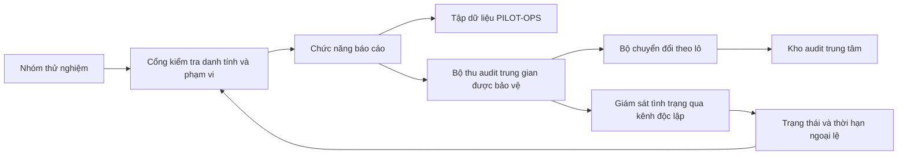

# Security exception

## 1. Mục tiêu và phạm vi bài học

**Security exception**, hay **ngoại lệ bảo mật**, là quyết định có thẩm quyền cho phép một phạm vi xác định tạm thời chưa đáp ứng một yêu cầu hoặc quy tắc bảo mật, với lý do, rủi ro, điều kiện kiểm soát và thời hạn rõ ràng.

Ví dụ, một tích hợp cũ chưa chuyển audit về kho trung tâm đủ nhanh theo yêu cầu. Tổ chức có thể xem xét cho phép dùng tích hợp đó trong một đợt thử nghiệm giới hạn, nếu cơ chế quản trị cho phép và các điều kiện giảm rủi ro đã được thực hiện. Đây không phải việc tự đánh dấu yêu cầu thành đạt.

Trong bài, thuật ngữ này nói về **quản lý ngoại lệ đối với yêu cầu bảo mật**, không phải lỗi chương trình hoặc lớp ngoại lệ trong một ngôn ngữ lập trình.

Trong chương **Rủi ro và mức đảm bảo** của module yêu cầu bảo mật, quản lý ngoại lệ giúp nối:

- Yêu cầu chưa đáp ứng với tài sản và kịch bản đe dọa.
- Giới hạn kỹ thuật với hậu quả nghiệp vụ.
- Biện pháp bù đắp với kiến trúc và bằng chứng kiểm thử.
- Quyết định chấp nhận với người chịu trách nhiệm, thời hạn và cách kết thúc.

Sau bài học, bạn có thể viết hồ sơ ngoại lệ có thể xem xét, phân biệt ngoại lệ với chấp nhận rủi ro, xác định điều kiện phê duyệt và đặc tả cơ chế theo dõi, hết hạn, thu hồi, đóng ngoại lệ.

Mọi mức, số lượng và thời gian trong bài là **giả định minh họa**, cần được xác nhận theo bối cảnh tổ chức.

## 2. Ngoại lệ bảo mật khác gì các khái niệm gần nhau?

### 2.1. Yêu cầu gốc vẫn cần được nhận diện

Một hồ sơ ngoại lệ phải chỉ ra yêu cầu nào chưa đáp ứng và sai lệch chính xác là gì.

Câu “xin ngoại lệ bảo mật cho hệ thống báo cáo” quá rộng. Câu rõ hơn là:

> Xin tạm thời áp dụng giới hạn chuyển audit về kho trung tâm không quá 15 phút thay cho yêu cầu gốc không quá 2 phút, chỉ với các sự kiện của chức năng báo cáo thử nghiệm, trong 14 ngày và với các điều kiện được mô tả.

Cần giữ riêng:

- Yêu cầu gốc và phiên bản có hiệu lực.
- Kết quả thực tế so với yêu cầu.
- Phạm vi được phép sai lệch.
- Điều kiện bổ sung để quyết định ngoại lệ có hiệu lực.

Ngoại lệ không làm thay đổi lịch sử kiểm thử. Nếu kiểm thử cho thấy yêu cầu 2 phút chưa đạt, kết quả đó vẫn là chưa đạt, dù đã có quyết định cho phép vận hành có điều kiện.

### 2.2. Bảng phân biệt

| Khái niệm | Ý nghĩa | Quan hệ với ngoại lệ |
| --- | --- | --- |
| Chấp nhận rủi ro | Quyết định cho phép tiếp tục với rủi ro đã được mô tả | Có thể là một phần của ngoại lệ, nhưng không phải mọi chấp nhận đều liên quan yêu cầu chưa đạt |
| Biện pháp bù đắp | Kiểm soát khác giúp giảm một phần rủi ro do sai lệch | Cần chứng minh tác dụng và giới hạn, không chỉ liệt kê tên |
| Cách triển khai thay thế | Dùng cơ chế khác nhưng vẫn đáp ứng mục tiêu và tiêu chí của yêu cầu | Có thể không cần ngoại lệ nếu cơ chế đó nằm trong phạm vi cho phép |
| Phát hiện sai | Kết quả ban đầu không phản ánh vấn đề thực tế | Cần xác minh và sửa kết luận, không tạo ngoại lệ để bỏ qua |
| Vi phạm chưa được phép | Hoạt động sai yêu cầu mà chưa có quyết định hợp lệ | Không trở thành ngoại lệ chỉ vì đã gửi yêu cầu phê duyệt |
| Thay đổi yêu cầu hoặc chính sách | Điều chỉnh quy tắc áp dụng theo cơ chế quản trị | Cần xét phạm vi rộng và tác động; không dùng chuỗi gia hạn để thay thế |
| Ngoại lệ hết hạn | Khoảng cho phép sai lệch đã kết thúc | Không đồng nghĩa yêu cầu đã được đáp ứng hoặc rủi ro đã hết |

**Residual risk**, hay rủi ro còn lại, là rủi ro vẫn tồn tại sau khi tính đến kiểm soát có hiệu lực. Một ngoại lệ cần mô tả phần rủi ro này, nhưng hồ sơ ngoại lệ và hồ sơ rủi ro có mục đích khác nhau.

### 2.3. Có trường hợp không được cấp ngoại lệ

Không mặc định người quản lý dự án có quyền miễn mọi yêu cầu. Cần biết:

- Quy tắc nào cho phép ngoại lệ.
- Yêu cầu nào thuộc phạm vi được xem xét.
- Vai trò nào có thẩm quyền với dữ liệu, chức năng và hậu quả.
- Điều kiện nào là bắt buộc và không nằm trong quyền miễn của người phê duyệt.
- Khi vượt thẩm quyền thì phải chuyển quyết định đến đâu.

Nếu cơ chế quản trị không cho phép sai lệch đối với yêu cầu đang xét, một biểu mẫu được điền đủ vẫn không làm ngoại lệ hợp lệ. Các lựa chọn có thể là sửa, giảm phạm vi, đổi phương án hoặc chưa cung cấp chức năng.

## 3. Khi nào việc xem xét ngoại lệ có cơ sở?

### 3.1. Lý do cần gắn với bối cảnh cụ thể

Các tình huống có thể dẫn đến đề xuất ngoại lệ:

- Hệ thống cũ cần thời gian chuyển đổi sang cơ chế mới.
- Một thành phần của nhà cung cấp chưa hỗ trợ yêu cầu nhưng có kế hoạch sửa được xác định.
- Đợt thử nghiệm có phạm vi hẹp cần diễn ra trước khi hoàn tất thay đổi kỹ thuật.
- Biện pháp bảo vệ bị suy giảm tạm thời trong một sự cố và cần phương án vận hành chuyển tiếp.

Đây là lý do để **đánh giá**, không phải lý do tự động phê duyệt.

“Không đủ thời gian”, “chỉ dùng nội bộ” hoặc “chưa từng có sự cố” chưa mô tả được rủi ro. Hồ sơ cần giải thích vì sao phương án tuân thủ hiện tại chưa khả thi, tác động của việc chờ và các phương án thay thế đã xem xét.

### 3.2. Thu hẹp phạm vi trước khi xin sai lệch

Cần xem liệu có thể:

- Loại bỏ dữ liệu không cần thiết.
- Giới hạn số người dùng, nhóm hoặc môi trường.
- Chưa cung cấp chức năng có phạm vi ảnh hưởng lớn.
- Chuyển một số thao tác sang quy trình được kiểm soát hơn.
- Dùng giải pháp vẫn đáp ứng yêu cầu gốc.
- Hoãn phần chưa sẵn sàng thay vì toàn bộ sản phẩm.

Giảm phạm vi phải được thực thi trong kiến trúc, quyền hoặc cấu hình. Một lời hứa “chỉ vài người sử dụng” không tương đương danh sách người được cấp quyền có thể kiểm chứng.

### 3.3. Ngoại lệ phải có đường kết thúc

Một đề xuất cần nêu rõ:

- Việc gì sẽ đưa hệ thống trở lại đáp ứng yêu cầu.
- Ai chịu trách nhiệm và khi nào hoàn thành.
- Bằng chứng nào đủ để xác nhận đã khắc phục.
- Hệ thống xử lý thế nào nếu đến hạn mà chưa xong.
- Cách giữ dữ liệu và tính liên tục trong quá trình chuyển đổi.

Nếu không có kế hoạch khả thi để kết thúc, tổ chức cần xem xét lại phương án hoặc yêu cầu nền tảng thay vì liên tục gọi trạng thái đó là tạm thời.

## 4. Hồ sơ ngoại lệ tối thiểu

| Nhóm thông tin | Nội dung cần ghi |
| --- | --- |
| Định danh | Mã ngoại lệ, phiên bản, người đề nghị và ngày tạo |
| Yêu cầu gốc | Mã yêu cầu, nội dung, phiên bản và tiêu chí chưa đạt |
| Phạm vi | Dịch vụ, môi trường, chức năng, tài nguyên, loại dữ liệu và người dùng |
| Sai lệch | Trạng thái hiện tại khác yêu cầu ở điểm nào, bao nhiêu và bằng chứng |
| Lý do | Trở ngại, nhu cầu nghiệp vụ và phương án thay thế |
| Rủi ro | Nguồn đe dọa, sự kiện, điều kiện yếu, hậu quả và bên chịu tác động |
| Kiểm soát hiện hành | Các biện pháp thực sự đang có hiệu lực |
| Biện pháp bù đắp | Cơ chế, nơi thực hiện, người vận hành và kết quả cần đạt |
| Rủi ro còn lại | Phần chưa được xử lý, độ tin cậy và điều chưa biết |
| Thời hạn | Mốc bắt đầu, hết hạn, múi giờ và thời điểm rà soát |
| Trách nhiệm | Chủ sở hữu rủi ro, người khắc phục, người theo dõi và người phê duyệt |
| Điều kiện | Điều kiện có hiệu lực, tín hiệu vi phạm và hành động khi xảy ra |
| Kế hoạch kết thúc | Hạng mục sửa, thời hạn, phép thử đóng và phương án chuyển tiếp |
| Quyết định | Người quyết định, thẩm quyền, lý do, phạm vi và giới hạn được duyệt |
| Bằng chứng | Kết quả kỹ thuật và audit liên quan, không chứa bí mật không cần thiết |

Không đưa mật khẩu, khóa riêng, token hoặc dữ liệu người thật vào hồ sơ để “chứng minh”. Hồ sơ có thể chứa thông tin nhạy cảm về điểm yếu, vì vậy chính nó cần được phân quyền và quản lý vòng đời.

Không nên dùng mô tả phạm vi mơ hồ như “các hệ thống liên quan”. Phạm vi cần đủ cụ thể để biết một yêu cầu truy cập hoặc thay đổi có thuộc ngoại lệ hay không.

## 5. Phân tích rủi ro của phần sai lệch

### 5.1. Viết kịch bản thay cho nhãn chung

Ví dụ:

> Một người có phiên bị chiếm thực hiện xuất báo cáo trong thời gian audit chưa tới kho trung tâm. Việc phát hiện và điều tra tập trung có thể chậm hơn yêu cầu, làm kéo dài thời gian truy cập trái phép trước khi nhóm vận hành nhận biết.

Ở đây:

- Tài sản là nội dung báo cáo, phiên và bằng chứng audit.
- Sự kiện là sử dụng phiên để thực hiện hành động.
- Sai lệch là độ trễ chuyển audit.
- Hậu quả có thể là chậm phát hiện hoặc thiếu thông tin kịp thời.
- Ngoại lệ về audit không tự cho phép bỏ kiểm tra quyền hoặc thu hồi phiên.

Nếu audit chỉ được xem lại định kỳ chứ không dùng để cảnh báo tức thời, cần ghi đúng vai trò của nó. Không gán cho audit khả năng phòng ngừa mà kiến trúc không có.

### 5.2. Tách hiện tại, dự kiến và còn lại

- **Hiện tại:** kiểm soát và bằng chứng đang có.
- **Dự kiến:** trạng thái nếu triển khai các điều kiện đề xuất.
- **Còn lại đã đánh giá:** trạng thái sau khi xác minh các điều kiện thực sự có hiệu lực.
- **Được chấp nhận:** quyết định theo thẩm quyền đối với phần còn lại.

Một đề xuất “sẽ bật cảnh báo” chưa được tính như cảnh báo đã vận hành. Có thể duyệt có điều kiện về mặt quản trị, nhưng ngoại lệ chỉ được kích hoạt khi điều kiện cần đã đạt theo quyết định.

### 5.3. Xem xét phạm vi ảnh hưởng và phụ thuộc

Cần hỏi:

- Người có quyền hiện tại có thể truy cập hoặc xuất bao nhiêu dữ liệu?
- Trong thời gian chậm phát hiện, có thể thực hiện những thao tác nào?
- Có thể làm mất hoặc sửa audit trước khi chuyển đi không?
- Nếu cơ chế bù đắp hỏng, ai biết và sau bao lâu?
- Các ngoại lệ khác có dùng chung danh tính, log hoặc đường phục hồi không?
- Việc giới hạn một nhóm có làm ảnh hưởng dịch vụ dùng chung không?

Không cộng hoặc lấy trung bình các điểm rủi ro thứ bậc để kết luận tổng thể an toàn. Một số ngoại lệ nhỏ có thể cùng làm suy yếu một ranh giới quan trọng.

## 6. Thiết kế biện pháp bù đắp có thể kiểm chứng

Biện pháp bù đắp cần xử lý một phần rõ ràng của đường gây hại hoặc hậu quả. Nó không nhất thiết tương đương hoàn toàn với yêu cầu gốc.

| Sai lệch hoặc rủi ro | Biện pháp có thể xem xét | Giới hạn phải nói rõ |
| --- | --- | --- |
| Audit tới trung tâm chậm | Bộ thu trung gian được bảo vệ, có đệm và kiểm tra luồng | Không loại bỏ khoảng chậm quan sát tại trung tâm |
| Người sử dụng có thể tiếp cận nhiều dữ liệu | Giới hạn nhóm, tập dữ liệu và chức năng xuất | Người được cấp quyền vẫn có thể xem phần được phép |
| Nguy cơ xóa audit trước khi chuyển | Tách quyền ứng dụng khỏi quyền sửa và xóa kho thu trung gian | Cần kiểm tra cả danh tính quản trị và phụ thuộc |
| Kéo dài thời gian phát hiện | Giám sát tình trạng bộ thu qua kênh độc lập | Theo dõi tình trạng không thay cho phân tích nội dung sự kiện |
| Nguy cơ mất dữ liệu audit khi lỗi | Đệm bền vững và diễn tập gửi bù | Phải xét dung lượng, xác nhận nhận, trùng lặp và lỗi kéo dài |
| Ngoại lệ bị dùng quá phạm vi | Cấp quyền theo danh sách cho phép và điều kiện thời gian | Cần thực thi trên API, tác vụ nền và liên kết tải |

Các câu “đã tăng cường giám sát” hoặc “sẽ kiểm tra thủ công” chưa đủ. Phải có đối tượng kiểm tra, chu kỳ, người nhận, điều kiện hành động và bằng chứng.

MFA có thể là điều kiện giữ nguyên hoặc bổ sung để giảm một số đường chiếm tài khoản. Nó không làm audit tới sớm hơn. Khi dùng trong lập luận ngoại lệ, cần mô tả đúng tác dụng đó.

## 7. Ví dụ xuyên suốt: ngoại lệ cho độ trễ audit

### 7.1. Bối cảnh và yêu cầu gốc

Một nền tảng học tập thử nghiệm chức năng báo cáo vận hành. Nhóm thử nghiệm có tối đa 30 người được định danh. Tập dữ liệu PILOT-OPS đã được chủ sở hữu đánh giá phù hợp với phạm vi sử dụng nội bộ của đợt thử nghiệm.

Yêu cầu gốc **SEC-AUD-BASE** quy định sự kiện tạo, sửa, tải báo cáo và truy cập bị từ chối phải tới kho audit trung tâm trong tối đa 2 phút từ lúc phát sinh. Bộ chuyển đổi định dạng của thành phần cũ đang gửi theo lô, nên chưa đáp ứng độ trễ này.

Nhóm đề nghị:

- Chỉ sai lệch phần độ trễ chuyển audit, với giới hạn tạm thời không quá 15 phút.
- Chỉ áp dụng cho chức năng báo cáo thử nghiệm, tập dữ liệu và nhóm người đã xác định.
- Có hiệu lực trong 14 ngày sau khi các điều kiện được xác minh.
- Hoàn thành thay đổi kỹ thuật để đáp ứng yêu cầu gốc trước khi kết thúc.

Trong bối cảnh giả định này, quy chế dự án cho phép người có thẩm quyền chấp nhận sai lệch về độ trễ audit cho thử nghiệm giới hạn. Chủ sở hữu nghiệp vụ và người phụ trách an toàn của dự án cùng phải xác nhận. Thẩm quyền đó không bao gồm miễn xác thực, phân quyền hoặc mở dữ liệu ra công khai.

### 7.2. Các phương án được xem xét

| Phương án | Lợi ích | Điều phải cân nhắc |
| --- | --- | --- |
| Hoãn thử nghiệm đến khi sửa xong | Tránh vận hành với độ trễ vượt yêu cầu | Chậm thu thập phản hồi và cần bố trí lại lịch |
| Dùng một giải pháp đã đáp ứng yêu cầu | Có thể không cần ngoại lệ | Phải kiểm tra khả năng tích hợp và hành vi thực tế |
| Thử nghiệm phạm vi hẹp với ngoại lệ | Có thể thu thập phản hồi trong thời gian khắc phục | Có khoảng chậm quan sát và chi phí theo dõi, kết thúc |

Không chọn phương án chỉ vì “đã làm gần xong”. Quyết định cần cân nhắc giá trị thử nghiệm, hậu quả và khả năng giữ điều kiện.

### 7.3. Kiến trúc của phương án đề xuất



Bộ thu trung gian có miền quyền quản trị tách khỏi danh tính chạy ứng dụng. Danh tính ứng dụng được gửi sự kiện nhưng không được sửa hoặc xóa sự kiện đã nhận.

Việc có bộ thu này không chứng minh dữ liệu đã tới trung tâm trong 2 phút. Nó giúp bảo vệ bằng chứng trong khoảng chờ và hỗ trợ gửi bù khi thành phần chuyển tiếp gặp lỗi.

### 7.4. Rủi ro và phần còn lại

| Mã | Kịch bản | Biện pháp dự kiến | Phần còn lại cần chấp nhận hoặc xử lý |
| --- | --- | --- | --- |
| R-EX-01 | Hành vi trái phép chưa được quan sát kịp ở trung tâm | Giới hạn người dùng, dữ liệu, quyền và độ trễ tối đa | Khoảng chậm quan sát vẫn tồn tại |
| R-EX-02 | Sự kiện mất trước khi chuyển tới trung tâm | Bộ thu bền vững, tách quyền và gửi bù | Vẫn phụ thuộc dung lượng, tính sẵn sàng và quản trị bộ thu |
| R-EX-03 | Ngoại lệ bị dùng quá thời hạn hoặc ngoài phạm vi | Kiểm tra nhóm, dữ liệu, thời hạn tại điểm truy cập | Cần kiểm tra tác vụ nền, liên kết và khả năng đồng bộ trạng thái |
| R-EX-04 | Gia hạn nhiều lần thành trạng thái lâu dài | Mốc khắc phục, giới hạn thời gian và quyết định mới | Có áp lực duy trì chức năng nếu sửa chậm |

Không dùng các biện pháp còn ở dạng dự kiến để kết luận ngay rằng rủi ro hiện tại thấp. Mỗi điều kiện phải được xác minh trước khi kích hoạt ngoại lệ.

## 8. Đặc tả điều kiện ngoại lệ thành yêu cầu đo được

Các yêu cầu dưới đây là một bộ minh họa của tình huống trên. Mã yêu cầu, rủi ro, bên thực hiện và người chấp nhận kết quả cần được giữ liên kết.

### 8.1. EX-C01 — Xác thực và phạm vi người dùng

Chỉ danh tính có hiệu lực trong danh sách thử nghiệm, tối đa 30 người, được truy cập chức năng thuộc ngoại lệ. Truy cập phải dùng cơ chế xác thực đã được phê duyệt cho nền tảng; các điều kiện xác thực bắt buộc của vai trò quản trị vẫn phải được thực thi.

- Rủi ro liên quan: R-EX-01, R-EX-03.
- Kiểm chứng: thử người chưa đăng nhập, người ngoài danh sách, tài khoản đã thu hồi và việc bổ sung vượt giới hạn.
- Kết quả đạt: không cung cấp chức năng ngoài phạm vi đã duyệt.
- Bằng chứng: nguồn danh tính, danh sách có phiên bản và kết quả thử.
- Bên thực hiện: nhóm danh tính và nhóm phát triển cổng truy cập.

Có tài khoản công ty chưa đủ để thuộc nhóm thử nghiệm.

### 8.2. EX-C02 — Phân quyền và giới hạn dữ liệu

Chức năng chỉ được xử lý PILOT-OPS. Vai trò xem, sửa và quản trị phải tách theo chính sách đã xác nhận. Xuất hàng loạt và chia sẻ ẩn danh không được bật trong phạm vi này.

- Rủi ro liên quan: R-EX-01, R-EX-03.
- Kiểm chứng: gọi API bằng mã tập dữ liệu khác, dùng người chỉ có quyền xem để sửa, gọi thẳng đường xuất và mở liên kết từ phiên không có quyền.
- Kết quả đạt: thao tác ngoài dữ liệu hoặc hành động được phép bị từ chối.
- Bằng chứng: ma trận quyền, cấu hình và kết quả trên giao diện, API, tác vụ nền, đường tải.
- Bên thực hiện: nhóm ứng dụng và lưu trữ.

Giới hạn dữ liệu phải được thực thi phía máy chủ, không chỉ bằng việc ẩn lựa chọn trên giao diện.

### 8.3. EX-C03 — Thu nhận và bảo vệ audit trung gian

Sự kiện trong phạm vi phải được bộ thu trung gian ghi nhận bền vững trong tối đa 1 phút từ lúc phát sinh. Danh tính ứng dụng không được sửa hoặc xóa sự kiện đã ghi nhận.

Bộ thu phải có khả năng giữ và gửi bù dữ liệu của ít nhất 7 ngày ở mức tải cực đại đã được phê duyệt cho thử nghiệm. Mức tải, kích thước sự kiện và giả định dung lượng phải được ghi trong kế hoạch kiểm chứng.

- Rủi ro liên quan: R-EX-02.
- Kiểm chứng: phát sự kiện tổng hợp ở mức tải đã xác định, đo thời gian ghi nhận, thử sửa hoặc xóa bằng danh tính ứng dụng.
- Kết quả đạt: trong giới hạn thời gian, dữ liệu còn sau khởi động lại và thao tác trái quyền bị từ chối.
- Bằng chứng: chính sách, kết quả đo, thử lưu bền vững và dung lượng.
- Bên thực hiện: nhóm nền tảng audit.

Sự kiện phải đủ danh tính tham chiếu, hành động, tài nguyên, thời điểm, kết quả và mã tương quan. Không ghi token, mật khẩu hoặc nội dung báo cáo vượt nhu cầu điều tra.

### 8.4. EX-C04 — Chuyển audit và giám sát

Sự kiện phải tới kho trung tâm trong tối đa 15 phút từ lúc phát sinh trong điều kiện vận hành được duyệt. Thời gian được đo theo cùng một cách ở nguồn và đích, với giả định đồng bộ thời gian được kiểm tra.

Kênh giám sát tình trạng bộ thu phải gửi tín hiệu ít nhất mỗi phút; mất tín hiệu phải tạo cảnh báo trong tối đa 3 phút từ lần tín hiệu dự kiến đầu tiên bị thiếu. Kênh này phải được kiểm tra khi bộ chuyển đổi theo lô không hoạt động.

- Rủi ro liên quan: R-EX-01, R-EX-02.
- Kiểm chứng: đo chuỗi sự kiện ở tải đã định; ngừng bộ chuyển đổi và thử mất tín hiệu bộ thu.
- Kết quả đạt: đáp ứng giới hạn chuyển trong điều kiện bình thường; lỗi được nhận biết qua kênh giám sát.
- Bằng chứng: mốc sự kiện, kết quả đo và bản ghi cảnh báo.
- Bên thực hiện: nhóm audit và vận hành.

Giám sát tình trạng không thay thế phân tích nội dung audit tại trung tâm. Phần chậm phân tích vẫn thuộc rủi ro còn lại.

### 8.5. EX-C05 — Thực thi thời hạn và thu hồi ngoại lệ

Mốc bắt đầu và kết thúc phải được lưu bằng thời gian có múi giờ rõ ràng. Ngoại lệ chỉ hoạt động khi quyết định còn hiệu lực và mọi điều kiện kích hoạt đã được xác nhận.

Khi hết hạn hoặc nguồn trạng thái có thẩm quyền ghi nhận thu hồi, hệ thống phải ngừng nhận thao tác mới thuộc phạm vi ngoại lệ trong tối đa 60 giây. Tác vụ đang chạy phải tuân theo phương án chuyển tiếp đã được thử; không cung cấp kết quả ngoài quyền hoặc xóa dữ liệu để thực hiện việc hết hạn.

- Rủi ro liên quan: R-EX-03.
- Kiểm chứng: thử trước và sau mốc hết hạn, thu hồi khi đang hoạt động, dùng phiên cũ và yêu cầu qua tác vụ nền.
- Kết quả đạt: mọi điểm thực thi đạt giới hạn, dữ liệu và audit được bảo toàn theo phương án.
- Bằng chứng: mốc trạng thái, kết quả đầu cuối và bản ghi xử lý tác vụ.
- Bên thực hiện: nhóm ứng dụng và quản lý cấu hình.

Độ trễ được đo từ nguồn trạng thái tới điểm thực thi. Thời hạn cache riêng lẻ không tự chứng minh giới hạn đầu cuối đã đạt.

### 8.6. EX-C06 — Xử lý khi điều kiện bị vi phạm

Trong tình huống này, vi phạm giới hạn 15 phút, mất khả năng lưu bền vững hoặc mở rộng quyền ngoài phạm vi phải đưa ngoại lệ sang trạng thái không cho phép tiếp tục thao tác mới. Quy tắc phát hiện phải xác định nguồn đo, chu kỳ kiểm tra và mốc ghi nhận vi phạm.

Từ lúc nguồn có thẩm quyền xác nhận vi phạm, giới hạn thực thi 60 giây của EX-C05 được áp dụng. Nhóm vận hành phải có hướng dẫn xác minh, bảo toàn bằng chứng và thông báo tới người chịu trách nhiệm theo quy trình dự án.

- Rủi ro liên quan: R-EX-01, R-EX-02, R-EX-03.
- Kiểm chứng: tạo tín hiệu vi phạm tổng hợp, kiểm tra chuyển trạng thái và việc ngừng nhận thao tác mới.
- Kết quả đạt: không chỉ gửi cảnh báo mà còn thực thi quyết định đúng phạm vi.
- Bằng chứng: tín hiệu, mốc xác nhận, sự kiện trạng thái và kết quả truy cập.
- Bên thực hiện: vận hành cùng nhóm ứng dụng.

Khoảng từ khi lỗi phát sinh đến khi được xác nhận vẫn cần được đánh giá. Không mô tả giới hạn 60 giây như thời gian phát hiện mọi lỗi.

### 8.7. EX-C07 — Phục hồi và gửi bù audit

Khi bộ chuyển đổi hoạt động trở lại, hệ thống phải gửi bù được các sự kiện đã ghi nhận trong bộ thu, đối chiếu theo mã sự kiện hoặc cơ chế tương đương để nhận biết thiếu và trùng.

Trước khi cho phép ngoại lệ hoạt động lại, phải xác nhận nguồn audit, hàng đợi và quyền còn đúng. Việc phục hồi không được tự mở lại một ngoại lệ đã hết hạn hoặc bị thu hồi.

- Rủi ro liên quan: R-EX-02, R-EX-03.
- Kiểm chứng: tạo tập sự kiện tổng hợp có số lượng và mã biết trước, dừng chuyển tiếp, khởi động lại rồi đối chiếu.
- Kết quả đạt: không mất sự kiện trong phạm vi đã thử; sự kiện trùng được xử lý theo chính sách và thời hạn ngoại lệ vẫn được tôn trọng.
- Bằng chứng: bảng đối chiếu, mốc thời gian và kết quả thử trạng thái.
- Bên thực hiện: nhóm nền tảng audit.

Nếu cần mục tiêu phục hồi hoặc gửi bù theo thời gian, phải đặt thêm ngưỡng dựa trên dung lượng và năng lực xử lý. Không suy ra thời gian gửi bù từ giới hạn 15 phút trong trạng thái bình thường.

### 8.8. EX-C08 — Khắc phục và đóng

Nhóm tích hợp phải sửa cơ chế chuyển audit để đạt SEC-AUD-BASE. Ngoại lệ chỉ được đóng với lý do đã khắc phục sau khi kiểm chứng sự kiện tới kho trung tâm trong tối đa 2 phút trên phạm vi chức năng và tải đã xác định.

- Rủi ro liên quan: R-EX-04.
- Kiểm chứng: thử luồng thành công, bị từ chối, khởi động lại và tải đã duyệt; đối chiếu toàn bộ đường sự kiện liên quan.
- Kết quả đạt: yêu cầu gốc đạt, không phát sinh đường bỏ qua hoặc mất sự kiện.
- Bằng chứng: phiên bản sửa, cấu hình đang chạy, kết quả đo và quyết định đóng.
- Bên thực hiện: nhóm tích hợp; bên xác nhận theo phân công đánh giá của dự án.

Hoàn thành công việc lập trình hoặc hết 14 ngày chưa đủ để đánh dấu đã khắc phục.

## 9. Quyết định và bằng chứng trong ví dụ

### 9.1. Bộ bằng chứng giả định

Các mã và kết quả sau chỉ dùng cho minh họa học tập, không phải kết quả kiểm thử thực tế của một hệ thống.

| Mã | Kết quả giả định | Giá trị đối với quyết định |
| --- | --- | --- |
| E-01 | Người ngoài nhóm và truy cập sai dữ liệu bị từ chối ở các đường đã thử | Hỗ trợ EX-C01 và EX-C02 trong phạm vi đó |
| E-02 | Bộ thu ghi nhận trong 40 giây, sự kiện còn sau khởi động lại, ứng dụng không sửa hoặc xóa được | Hỗ trợ các điều kiện đã thử của EX-C03 |
| E-03 | Độ trễ tới trung tâm lớn nhất trong chuỗi thử là 13 phút | Chưa đạt yêu cầu gốc 2 phút; nằm trong giới hạn ngoại lệ 15 phút của phép thử |
| E-04 | Mất tín hiệu tạo cảnh báo sau 2 phút; kênh giám sát vẫn hoạt động khi bộ chuyển đổi dừng | Hỗ trợ điều kiện giám sát đã thử |
| E-05 | Hết hạn và thu hồi ngừng thao tác mới tại các điểm thử trong 45 giây | Hỗ trợ EX-C05 trong phạm vi đã kiểm tra |
| E-06 | Gửi bù đủ tập sự kiện thử, nhận biết được trùng; ngoại lệ hết hạn không tự hoạt động lại | Hỗ trợ EX-C07 |

Không kết luận mọi tải, mọi lỗi đều đạt từ một chuỗi thử. Kế hoạch kiểm chứng phải xác định mức tải và điều kiện đủ đại diện cho phạm vi được duyệt.

### 9.2. Nội dung quyết định mẫu

Một quyết định minh họa có thể ghi:

```text
Mã ngoại lệ: EX-AUDIT-PILOT-01
Yêu cầu gốc: SEC-AUD-BASE, độ trễ audit không quá 2 phút.
Sai lệch được duyệt: Không quá 15 phút cho sự kiện báo cáo thử nghiệm.
Phạm vi: Chức năng pilot, tập PILOT-OPS, nhóm tối đa 30 người.
Thời hạn: 14 ngày từ mốc kích hoạt có thời gian và múi giờ cụ thể.
Điều kiện kích hoạt: Các yêu cầu EX-C01 đến EX-C07 được xác minh,
kể cả hành vi khi vi phạm điều kiện.
Rủi ro còn lại: Trung tâm có thể quan sát muộn; còn phụ thuộc
bộ thu, giám sát và khoảng thời gian phát hiện vi phạm.
Khắc phục: Nhóm tích hợp hoàn thành và xác minh EX-C08 trước hạn.
Người quyết định: Các vai trò có thẩm quyền đã nêu trong tình huống.
Hết hiệu lực: Theo EX-C05 và phương án chuyển tiếp đã thử.
```

Hồ sơ thực tế phải có người quyết định cụ thể, thời điểm, phiên bản bằng chứng và nguồn xác định thẩm quyền. Một mẫu chưa được điền và ký nhận không phải quyết định đã có hiệu lực.

Kết quả E-03 vẫn là **chưa đạt SEC-AUD-BASE**. Trạng thái quản trị có thể ghi nhận “có ngoại lệ đang có hiệu lực” bên cạnh, thay vì đổi kết quả kiểm thử thành đạt.

Bộ bằng chứng còn phải đủ cho điều kiện xử lý vi phạm và phạm vi dung lượng trước khi kích hoạt. Không chỉ dựa vào vài kết quả thuận lợi trong bảng để bỏ qua điều kiện chưa được xác minh.

## 10. Quản lý vòng đời ngoại lệ

### 10.1. Các trạng thái cần phân biệt

Tên trạng thái có thể khác theo tổ chức. Một mô hình minh họa:

| Trạng thái | Ý nghĩa |
| --- | --- |
| Nháp | Hồ sơ chưa được gửi, chưa tạo quyền sai lệch |
| Đang đánh giá | Đang xác minh phạm vi, rủi ro, biện pháp và thẩm quyền |
| Bị từ chối | Không được phép áp dụng theo đề xuất |
| Được duyệt, chờ điều kiện | Có quyết định nhưng chưa đủ bằng chứng để kích hoạt |
| Đang có hiệu lực | Trong thời hạn và các điều kiện kích hoạt còn đúng |
| Bị thu hồi | Quyết định cho phép đã bị rút lại trước hạn |
| Hết hạn | Khoảng thời gian cho phép đã kết thúc |
| Chờ xác minh khắc phục | Đã có thay đổi, cần kiểm tra yêu cầu gốc |
| Đã đóng do khắc phục | Đã xác nhận yêu cầu gốc được đáp ứng trong phạm vi |
| Đã đóng do ngừng phạm vi | Chức năng hoặc tài sản không còn trong phạm vi, có bằng chứng xử lý phần còn lại |

Trạng thái hồ sơ và trạng thái kỹ thuật cần được đối chiếu. Nếu hồ sơ hết hạn nhưng hệ thống vẫn cho phép sai lệch, đó là vấn đề cần xử lý, không phải lý do đổi hồ sơ thành đang có hiệu lực.

### 10.2. Kích hoạt

Trước khi kích hoạt cần kiểm tra:

- Quyết định hợp lệ cho đúng phạm vi và thời điểm.
- Các điều kiện kỹ thuật đã triển khai.
- Các phép thử bắt buộc có kết quả và giới hạn rõ ràng.
- Người theo dõi, tiếp nhận cảnh báo và khắc phục đã được phân công.
- Cơ chế hết hạn và thu hồi đã được thử.
- Kế hoạch chuyển tiếp không làm mất dữ liệu hoặc mở quyền ngoài phạm vi.

Một quyết định “được duyệt nếu hoàn tất các điều kiện” chưa cho phép vận hành trước khi hoàn tất.

### 10.3. Rà soát khi đang có hiệu lực

Ngoài lịch định kỳ, cần rà soát ngay khi:

- Thêm dữ liệu hoặc nhóm người dùng.
- Tăng quyền, thêm chức năng tải hoặc xuất.
- Có thay đổi cấu hình, nhà cung cấp, tích hợp hoặc miền quản trị.
- Biện pháp bù đắp hỏng hoặc không còn quan sát được.
- Có sự cố hoặc bằng chứng cho thấy tác động lớn hơn dự kiến.
- Kế hoạch khắc phục chậm đến mức không thể hoàn thành đúng hạn.

Phạm vi được duyệt không tự mở rộng theo sản phẩm. Một ngoại lệ cho 30 người và một tập dữ liệu không áp dụng cho mọi người dùng của nền tảng.

### 10.4. Gia hạn là một quyết định mới có liên kết

Gia hạn cần đánh giá lại:

- Vì sao chưa khắc phục.
- Trạng thái kiểm soát và bằng chứng còn đại diện không.
- Trong thời gian qua có sự cố, vi phạm hoặc thay đổi nào.
- Phạm vi và hậu quả có tăng không.
- Phương án thay thế có khả thi hơn chưa.
- Thời hạn mới và kế hoạch hoàn thành có đáng tin cậy không.

Không gia hạn tự động chỉ vì không có sự cố được báo cáo. Không có báo cáo có thể phản ánh ít sự kiện, nhưng cũng có thể phản ánh khả năng quan sát kém.

Yêu cầu gia hạn chưa được duyệt không kéo dài hiệu lực cũ. Nếu có khoảng trống giữa hai quyết định, hệ thống phải xử lý theo phương án hết hiệu lực.

### 10.5. Thu hồi và hết hạn

Cần tách:

- **Hết hạn:** tới mốc kết thúc đã định.
- **Thu hồi:** chấm dứt trước mốc vì quyết định hoặc điều kiện thay đổi.
- **Khắc phục:** yêu cầu gốc đã được đáp ứng.
- **Đóng hồ sơ:** kết thúc quản lý ngoại lệ theo lý do và bằng chứng.

Khi hết hạn mà chưa khắc phục, cần thực thi phương án giới hạn hoặc chuyển tiếp đã duyệt, theo dõi phần còn thiếu và chuyển quyết định lên người có thẩm quyền. Không tự coi đã hết rủi ro.

Không đặt hành vi mặc định “xóa toàn bộ dữ liệu khi hết hạn”. Việc giới hạn chức năng, xử lý tác vụ và giữ bằng chứng phải được thiết kế phù hợp với nghiệp vụ.

### 10.6. Đóng ngoại lệ

Một ngoại lệ được đóng do khắc phục cần có:

1. Phiên bản thay đổi và cấu hình đang chạy.
2. Kết quả kiểm chứng yêu cầu gốc trên phạm vi liên quan.
3. Xác nhận không tạo đường bỏ qua hoặc tác dụng phụ quan trọng.
4. Quyết định đóng của vai trò được phân công.
5. Xử lý các quyền hoặc cấu hình tạm thời.
6. Kế hoạch giữ hoặc loại bỏ dữ liệu và bằng chứng theo chính sách.

Nếu chức năng bị ngừng, cần kiểm tra cả liên kết, tác vụ nền, bản xuất, quyền và tài nguyên còn sót. Dừng giao diện chưa đủ để kết luận toàn bộ phạm vi đã kết thúc.

## 11. Ngoại lệ trong tình huống khẩn cấp

Sự cố có thể cần đường quyết định nhanh, chẳng hạn một kiểm soát gặp lỗi làm gián đoạn chức năng thiết yếu. Quy trình khẩn cấp nên được xác định trước:

- Ai có quyền kích hoạt.
- Những loại sai lệch nào được phép.
- Thời gian tối đa và phạm vi quyền.
- Cách ghi nhận quyết định khi công cụ quản lý chính không hoạt động.
- Cách thông báo, theo dõi và thu hồi.
- Khi nào phải rà soát sau sự kiện.

“Khẩn cấp” không tạo quyền miễn mọi kiểm soát. Nếu quy trình đã cho phép quyết định nhanh bởi một vai trò trực sự cố, phải ghi nhận ai sử dụng thẩm quyền đó và vì sao.

Việc xem xét sau sự kiện giúp học hỏi và xác nhận xử lý, nhưng không tự biến hành động trước đó không được phép thành đã được phê duyệt từ đầu. Trạng thái quyết định và dòng thời gian cần giữ đúng sự thật.

Tài khoản khẩn cấp, quyền tạm thời hoặc đường truy cập phục hồi phải có kiểm soát riêng. Không để ngoại lệ khẩn cấp tồn tại lâu dài vì không ai nhớ thu hồi.

## 12. Truy vết ngoại lệ với yêu cầu, rủi ro và bằng chứng

| Nội dung | Liên kết trong ví dụ | Câu hỏi cần trả lời |
| --- | --- | --- |
| Yêu cầu gốc | SEC-AUD-BASE | Tiêu chí nào chưa đạt? |
| Sai lệch | 2 phút thành giới hạn tạm thời 15 phút | Phần nào được phép khác, trong thời gian nào? |
| Rủi ro | R-EX-01 đến R-EX-04 | Những hậu quả nào vẫn có thể xảy ra? |
| Biện pháp bù đắp | EX-C01 đến EX-C07 | Điều kiện nào phải triển khai và kiểm chứng? |
| Bằng chứng | Kết quả thử, cấu hình và phạm vi tải | Có đủ và còn đại diện không? |
| Quyết định | EX-AUDIT-PILOT-01 | Ai cho phép, theo thẩm quyền nào? |
| Khắc phục | EX-C08 | Khi nào và bằng cách nào trở lại yêu cầu gốc? |
| Kết thúc | Kết quả 2 phút và quyết định đóng | Đã đạt hay chỉ hết thời gian cho phép? |

Mức đảm bảo phản ánh độ tin cậy vào kết luận dựa trên bằng chứng. Được cấp ngoại lệ không nâng mức đảm bảo kỹ thuật của một yêu cầu chưa đạt.

Bằng chứng về biện pháp bù đắp có thể làm quyết định có cơ sở hơn, nhưng không được trình bày như bằng chứng rằng yêu cầu gốc đã đáp ứng nếu thực tế chưa đáp ứng.

## 13. Theo dõi hiệu quả của quy trình ngoại lệ

Các chỉ báo có thể hữu ích:

| Chỉ báo | Điều có thể cần xem xét |
| --- | --- |
| Ngoại lệ đang có hiệu lực theo mức hậu quả | Phạm vi rủi ro đang được cho phép |
| Ngoại lệ hết hạn nhưng kỹ thuật chưa giới hạn | Sai lệch giữa quyết định và vận hành |
| Số lần và tổng thời gian gia hạn | Khả năng ngoại lệ tạm thời đã thành trạng thái lâu dài |
| Biện pháp bù đắp bị hỏng hoặc chưa có bằng chứng | Cơ sở quyết định đang suy yếu |
| Ngoại lệ dùng chung một kiểm soát | Rủi ro tập trung và phụ thuộc chung |
| Thời gian khắc phục so với kế hoạch | Tính khả thi của đường kết thúc |
| Ngoại lệ đóng nhưng còn quyền tạm | Khoảng trống thu hồi và dọn cấu hình |

Không dùng mục tiêu “giảm số lượng ngoại lệ” để khuyến khích không ghi nhận sai lệch. Số hồ sơ ít không tự chứng minh hệ thống an toàn hơn.

Không coi một tỷ lệ phê duyệt cao hoặc thấp là bằng chứng chất lượng. Cần xem quyết định có đúng thẩm quyền, đủ căn cứ và được thực thi không.

## 14. Sai lầm thường gặp

| Sai lầm | Hậu quả | Cách xử lý |
| --- | --- | --- |
| Ngoại lệ không chỉ rõ yêu cầu | Không biết điều gì đang được miễn hoặc giới hạn | Gắn mã, phiên bản và tiêu chí sai lệch |
| “Đã gửi xin” được hiểu là “đã được phép” | Hoạt động trước khi có quyết định | Tách trạng thái đánh giá, duyệt và kích hoạt |
| Đổi kết quả kiểm thử thành đạt sau phê duyệt | Mất tính trung thực của bằng chứng | Giữ kết quả chưa đạt, liên kết quyết định ngoại lệ riêng |
| Dùng kiểm soát dự kiến để giảm mức hiện tại | Đánh giá thấp rủi ro thực tế | Xác minh điều kiện trước khi kích hoạt |
| Chỉ ghi “tăng giám sát” | Không có phạm vi, người nhận hoặc hành động | Đặc tả chỉ báo, ngưỡng, chu kỳ và trách nhiệm |
| Ngoại lệ áp dụng cho cả nền tảng | Phạm vi ảnh hưởng vượt lý do ban đầu | Thu hẹp chức năng, dữ liệu, nhóm và môi trường |
| Chỉ đặt ngày hết hạn trên biểu mẫu | Hệ thống vẫn tiếp tục cho phép sai lệch | Thực thi và kiểm thử hết hạn đầu cuối |
| Tự động gia hạn vì chưa có sự cố | Ngoại lệ trở thành trạng thái lâu dài | Đánh giá lại bằng chứng, lý do và kế hoạch |
| Người phê duyệt không chịu trách nhiệm về hậu quả | Quyết định vượt thẩm quyền | Xác định chủ sở hữu và cấp quyết định phù hợp |
| Ngoại lệ này dựa vào một kiểm soát đang có ngoại lệ khác | Rủi ro kết hợp không được nhận diện | Xem các phụ thuộc và kịch bản chung |
| Hết hạn được coi là đã khắc phục | Che giấu yêu cầu còn thiếu | Tách hết hiệu lực và đóng do khắc phục |
| Hồ sơ chứa token hoặc dữ liệu thật không cần thiết | Tạo thêm nơi rò rỉ | Dùng tham chiếu và bằng chứng đã lọc dữ liệu |

## 15. Bài tập thực hành

Một ứng dụng có yêu cầu thu hồi quyền trong 5 phút trên mọi đường truy cập. API chính đáp ứng, nhưng tệp tải qua một liên kết cũ vẫn có thể truy cập trong 30 phút. Nhóm muốn cho 20 cộng tác viên sử dụng trong 10 ngày để hoàn thành một đợt thử nghiệm.

Hãy thực hiện:

1. Viết chính xác yêu cầu gốc và sai lệch.
2. Xác định người có thể bị ảnh hưởng và tài sản cần bảo vệ.
3. Mô tả kịch bản một người đã bị thu hồi quyền vẫn tải được tệp.
4. Đề xuất phương án tuân thủ hoặc giảm phạm vi trước khi xin ngoại lệ.
5. Nếu cơ chế quản trị cho phép xem xét, lập hồ sơ ngoại lệ có điều kiện.
6. Viết một biện pháp bù đắp đo được, nêu đúng giới hạn của nó.
7. Viết phép thử hết hạn, thu hồi và tác vụ đang chạy.
8. Xác định người có thẩm quyền, điều kiện kích hoạt và đường kết thúc.
9. Nêu bằng chứng để đóng ngoại lệ sau khi sửa đường tải.

Một phân tích ngắn có thể bắt đầu:

> Sai lệch nằm ở đường tải tệp, không phải mọi cơ chế xác thực. Trong khoảng liên kết cũ còn được chấp nhận, người đã bị thu hồi quyền có thể tiếp tục nhận dữ liệu. Giới hạn 20 người làm hẹp phạm vi nhưng không làm yêu cầu 5 phút tự đạt. Cần xem xét đổi cách cung cấp tệp hoặc tắt đường cũ; nếu vẫn xin ngoại lệ, phải nêu rủi ro của khoảng 30 phút và kiểm chứng việc giới hạn, hết hạn, khắc phục.

Tự kiểm tra:

- Hồ sơ đã chỉ rõ phần sai lệch và yêu cầu gốc chưa?
- Phương án vẫn đáp ứng yêu cầu có được xem xét không?
- Rủi ro được mô tả bằng sự kiện và hậu quả hay chỉ bằng nhãn?
- Biện pháp bù đắp đã triển khai hay mới được hứa sẽ làm?
- Người phê duyệt có thẩm quyền với phạm vi và hậu quả không?
- Quyết định có thể được thực thi trên API, tác vụ nền và liên kết không?
- Khi hết hạn hoặc điều kiện hỏng, hệ thống sẽ làm gì?
- Bằng chứng đóng có chứng minh yêu cầu gốc đạt không?
- Các quyền và cấu hình tạm thời sẽ được xử lý như thế nào?

## 16. Những điểm cần ghi nhớ

Security exception là một quyết định cho phép sai lệch có giới hạn, gắn với yêu cầu, phạm vi, rủi ro, điều kiện và thời hạn. Nó không biến một kiểm thử thất bại thành đạt và không thay cho thẩm quyền quản trị.

Một ngoại lệ có cơ sở cần biện pháp bù đắp đã được kiểm chứng, người chịu trách nhiệm theo dõi và cơ chế hết hiệu lực có thể thực thi. Ngoại lệ chỉ được đóng do khắc phục khi có bằng chứng yêu cầu gốc đã được đáp ứng; việc hết hạn, thu hồi hoặc ngừng chức năng cần được ghi nhận đúng lý do.
