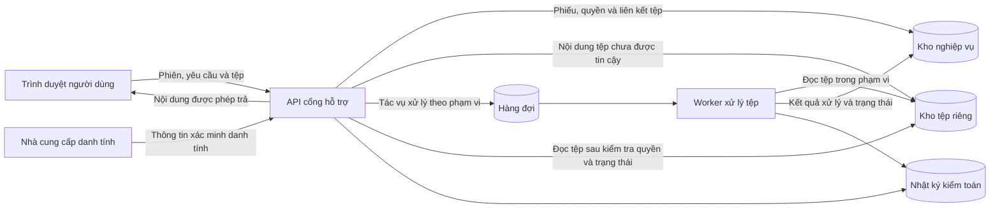

# Threat modeling là gì

## 1. Khái niệm và mục tiêu

**Threat modeling — mô hình hóa đe dọa** là hoạt động có cấu trúc để hiểu một hệ thống, xác định điều gì có thể đi sai về an toàn thông tin, phân tích hậu quả và lựa chọn cách xử lý. Hoạt động này sử dụng mô hình của tài sản, chủ thể, luồng dữ liệu, quyền và ranh giới tin cậy để đưa ra các kịch bản cụ thể.

Ví dụ, một cổng hỗ trợ khách hàng cho phép đăng nhập, tạo phiếu và tải tệp đính kèm. Câu hỏi bảo mật không dừng ở “đã có đăng nhập chưa”, mà còn gồm:

- Người dùng của tổ chức A có thể đọc phiếu hoặc tệp của B bằng cách đổi tham chiếu không?
- Dịch vụ xử lý tệp có thể bị lừa làm việc trên đối tượng khác phạm vi được giao không?
- Một tệp hoặc chuỗi yêu cầu có thể làm cạn tài nguyên của những khách hàng khác không?
- Khi quyền bị thu hồi hoặc hệ thống phục hồi từ bản sao, quyết định truy cập có còn đúng không?
- Khi có sự cố, hệ thống có đủ bằng chứng để biết ai đã làm gì mà không làm lộ thêm dữ liệu không?

Mục tiêu của threat modeling là hỗ trợ **quyết định thiết kế và yêu cầu có thể kiểm chứng**. Một sơ đồ đẹp hoặc danh sách tên kiểu tấn công chưa đủ nếu không chỉ ra tài sản bị ảnh hưởng, điều kiện xảy ra, cách xử lý và bằng chứng cần có.

Trong module yêu cầu bảo mật, đầu ra quan trọng là chuỗi truy vết:

```text
Mục tiêu an toàn → tài sản và luồng xử lý → kịch bản đe dọa
→ đánh giá rủi ro → yêu cầu bảo mật → quyết định kiến trúc
→ tiêu chí kiểm thử và bằng chứng vận hành
```

Threat modeling được thực hiện sớm để phát hiện vấn đề thiết kế và tiếp tục cập nhật khi hệ thống thay đổi. Nó cũng có thể áp dụng cho hệ thống đã vận hành nhằm kiểm tra các giả định và những đường xử lý trước đây chưa được xem xét.

## 2. Phân biệt đe dọa, điểm yếu, rủi ro và kiểm soát

| Khái niệm | Ý nghĩa | Ví dụ trong cổng hỗ trợ |
|---|---|---|
| Tài sản | Thứ có giá trị cần bảo vệ, gồm dữ liệu, quyền, chức năng và bằng chứng | Nội dung phiếu, tệp đính kèm, quyền nhân viên hỗ trợ, nhật ký |
| Mục tiêu an toàn | Thuộc tính cần giữ để hệ thống đáp ứng mục đích | Chỉ chủ thể đúng quyền được đọc phiếu và tệp |
| Tác nhân đe dọa | Chủ thể có thể thực hiện hành vi trái mục tiêu | Người ngoài, người dùng hợp lệ lạm dụng quyền, tài khoản bị chiếm quyền |
| Đe dọa hoặc kịch bản đe dọa | Sự kiện hay chuỗi hành động có thể gây hại tới tài sản | Đổi mã tệp để lấy tệp của khách thuê khác |
| Điểm yếu | Điều kiện cho phép kịch bản thành hiện thực | Đường tải chỉ kiểm tra tồn tại tệp, không kiểm tra quan hệ sở hữu |
| Rủi ro | Khả năng và hậu quả của kịch bản đối với mục tiêu, cùng bất định đánh giá | Có thể tiết lộ tài liệu của nhiều khách hàng qua đường tải |
| Kiểm soát | Biện pháp làm giảm khả năng, tác động hoặc hỗ trợ xử lý | Phân quyền theo đối tượng, giới hạn phạm vi dịch vụ, logging và thu hồi |
| Bằng chứng | Thông tin giúp xác nhận kiểm soát có hiệu lực trong phạm vi nào | Kiểm thử chéo khách thuê, cấu hình kho tệp, sự kiện truy cập |

Một đe dọa có thể được nhận diện trước khi biết chắc có điểm yếu trong mã. Nhóm có thể dự đoán đường tải bị bỏ sót kiểm tra quyền từ thiết kế rồi đặt yêu cầu ngăn chặn ngay từ đầu.

Một điểm yếu cũng có thể tham gia nhiều kịch bản. Tài khoản dịch vụ có quyền quá rộng có thể gây tiết lộ, sửa hoặc xóa dữ liệu tùy cách bị lạm dụng. Vì vậy, không nên dùng danh sách lỗ hổng để thay hoàn toàn việc phân tích mục tiêu và hậu quả.

Sai sót vận hành và sự kiện ngoài ý muốn cũng có thể làm mất thuộc tính an toàn, chẳng hạn phục hồi một bản quyền cũ hoặc xóa nhầm khóa cần giải mã. Khi đưa vào mô hình, cần nêu rõ nguồn sự kiện thay vì mô tả mọi sai hỏng như hành vi có chủ đích của một kẻ tấn công.

## 3. Những câu hỏi dẫn dắt hoạt động

### 3.1. Hệ thống đang làm gì và cần bảo vệ điều gì?

Xác định mục đích, tài sản, chủ thể, chức năng và giới hạn phạm vi. Một mô hình cho luồng tải tệp cần biết tệp thuộc phiếu nào, khách thuê nào, ai được đọc, dữ liệu nằm ở đâu và đường nào đưa nội dung tới người nhận.

Các mục tiêu nên đủ rõ để nhận ra vi phạm. “Hệ thống an toàn” quá rộng; “người dùng A không đọc được nội dung của B khi không có quyền” cung cấp cơ sở tốt hơn để phân tích và kiểm thử.

### 3.2. Điều gì có thể đi sai?

Xem xét hành vi của người ngoài, người đã đăng nhập nhưng không đủ quyền, quản trị viên, dịch vụ và các phụ thuộc. Thử thay đổi thứ tự, giá trị, trạng thái, danh tính và thời điểm của luồng hợp lệ.

Ví dụ, không chỉ hỏi ai tải được tệp ngay sau khi tạo, mà còn hỏi quyền có thay đổi trong lúc tác vụ xử lý không, tệp còn truy cập qua liên kết cũ không và bộ nhớ đệm có trả nội dung cho chủ thể khác không.

### 3.3. Sẽ xử lý các kịch bản bằng cách nào?

Với mỗi kịch bản cần xử lý, chọn phương án phù hợp: thay thiết kế để tránh đường nguy hiểm, thêm kiểm soát, giảm phạm vi hoặc quyết định về rủi ro còn lại theo đúng thẩm quyền. Cần nói rõ biện pháp tác động vào phần nào của kịch bản.

Thêm logging có thể giúp điều tra nhưng không tự ngăn tệp bị trả sai quyền. Mã hóa đường truyền bảo vệ dữ liệu trên đường đi nhưng không tự xác minh người nhận được phép đọc nội dung. Mối liên hệ giữa đe dọa và kiểm soát phải được diễn giải cụ thể.

### 3.4. Có đủ căn cứ để tin phương án đáp ứng mục tiêu chưa?

Xác định bằng chứng cần có: rà soát thiết kế, kiểm thử dương và phủ định, kiểm tra cấu hình, thử lỗi phụ thuộc hoặc diễn tập phục hồi. Nêu khoảng trống và giới hạn của kết luận.

Không phát hiện lỗi trong một lần kiểm thử không chứng minh không có mọi đe dọa. Kết luận phải gắn với phạm vi, phiên bản, giả định và độ sâu kiểm chứng.

## 4. Mô hình cần mô tả những thành phần nào?

### 4.1. Tài sản và phân loại dữ liệu

Không chỉ liệt kê bảng dữ liệu. Cần xác định nội dung, quyền và quan hệ có giá trị, ví dụ:

- Nội dung phiếu và tệp đính kèm có thể chứa thông tin ngoài phạm vi công khai.
- Quan hệ tài khoản–khách thuê–vai trò quyết định ai được đọc hoặc thay đổi.
- Thông tin xác thực của người dùng và dịch vụ có thể mở quyền truy cập gián tiếp.
- Trạng thái xử lý tệp quyết định nội dung nào được phục vụ.
- Nhật ký và bản sao phục hồi giúp điều tra hoặc khôi phục hoạt động.

Phân loại dữ liệu cho biết yêu cầu bí mật và các điều kiện xử lý. Cần đánh giá riêng toàn vẹn và sẵn sàng: một trường cấu hình không bí mật vẫn có thể gây tác động lớn nếu bị sửa.

### 4.2. Chủ thể, tiến trình, kho và luồng

Một mô hình luồng dữ liệu thường dùng các thành phần sau:

| Thành phần | Nội dung thể hiện |
|---|---|
| Chủ thể hoặc hệ thống bên ngoài | Trình duyệt, đối tác, nhà cung cấp danh tính hoặc người vận hành |
| Tiến trình xử lý | API, dịch vụ nghiệp vụ, worker xử lý nền và dịch vụ quản trị |
| Kho dữ liệu | Cơ sở dữ liệu, kho tệp, hàng đợi, bộ nhớ đệm, log và bản sao |
| Luồng dữ liệu | Yêu cầu, phản hồi, thông điệp, tệp, sự kiện và dữ liệu phục hồi |
| Ranh giới tin cậy | Điểm thay đổi căn cứ tin cậy, quyền kiểm soát, danh tính hoặc miền sở hữu |

Mỗi luồng nên có hướng, loại dữ liệu và điều kiện bảo vệ cần xét. Mũi tên “API gọi dịch vụ nội bộ” chưa cho biết danh tính nào được sử dụng, dữ liệu nào do người gọi kiểm soát và quyền nào được thực thi.

### 4.3. Ranh giới tin cậy không chỉ là đường mạng

Một ranh giới có thể nằm giữa trình duyệt và API, giữa hai tài khoản dịch vụ, giữa khách thuê A và B trong cùng cơ sở dữ liệu, hoặc giữa dữ liệu do người dùng cung cấp và bộ phân tích tệp.

Ở mỗi ranh giới cần hỏi:

1. Danh tính nào đang được tin và được xác minh bằng gì?
2. Trường nào do bên ít tin cậy hơn kiểm soát?
3. Quyền được kiểm tra ở đâu và trên đối tượng nào?
4. Nếu dữ liệu sai, bị phát lại, đến muộn hoặc thiếu thì hành vi là gì?
5. Nếu một thành phần bị chiếm quyền, phạm vi ảnh hưởng tới đâu?

Việc một thành phần nằm trong mạng nội bộ không đủ để tin mọi dữ liệu nó gửi. Thông điệp nội bộ có thể bắt nguồn từ đầu vào chưa xác minh hoặc được gửi bởi danh tính có quyền quá rộng.

## 5. Ví dụ mô hình cho cổng hỗ trợ nhiều khách thuê

### 5.1. Phạm vi và luồng hợp lệ

Phạm vi minh họa gồm tạo phiếu, tải tệp lên, xử lý tệp và tải xuống. Người dùng chỉ được truy cập tài nguyên theo quyền trong khách thuê của mình; nhân viên hỗ trợ có phạm vi riêng được cấp. Chi tiết thanh toán và những chức năng không liên quan nằm ngoài ví dụ.



Sơ đồ là mô hình chức năng, không tự chứng minh kiểm soát đã tồn tại. Chẳng hạn, mũi tên “sau kiểm tra quyền” biểu diễn một điều kiện cần được triển khai và kiểm chứng.

Các ranh giới quan trọng gồm trình duyệt–API, nhà cung cấp danh tính–ứng dụng, API–worker, kho tệp–người tải, và ranh giới logic giữa các khách thuê. Đầu vào tệp vẫn chưa đáng tin dù đến từ người đã đăng nhập.

### 5.2. Ghi rõ các giả định phải xác minh

| Giả định thiết kế | Bằng chứng cần có hoặc câu hỏi còn mở |
|---|---|
| Danh tính được xác minh đúng trước xử lý nghiệp vụ | Kiểm tra cơ chế xác minh, thời hạn, ngữ cảnh sử dụng và hành vi khi thiếu bằng chứng |
| Không thể tải tệp trực tiếp ngoài luồng được phép | Kiểm tra quyền kho, URL, API cũ và các đường phân phối |
| Worker chỉ xử lý tài nguyên được giao | Kiểm tra danh tính dịch vụ, nguồn gốc tác vụ, tham chiếu và quyền kho |
| Quyền khách thuê có thể thay đổi trong vòng đời phiếu | Xác định thời điểm kiểm tra lại và hiệu lực đối với tác vụ đang chờ |
| Trạng thái xử lý không bị bên tải lên tự sửa | Kiểm tra quyền cập nhật, nguồn kết quả và chuyển trạng thái |
| Nhật ký và bản sao không tạo thêm đường đọc dữ liệu | Kiểm tra tập trường, quyền và lưu giữ của các kho phụ |

Một giả định có ảnh hưởng lớn nhưng chưa được xác minh phải được lưu như khoảng trống, không được tính như kiểm soát đã có hiệu lực. Nếu phạm vi này chưa đủ rõ, có thể mô hình hóa chi tiết thêm đúng luồng liên quan thay vì mở rộng toàn bộ hệ thống cùng lúc.

## 6. Nhận diện đe dọa có cấu trúc

### 6.1. Đi theo luồng và chuyển trạng thái

Với mỗi bước, có thể lần lượt thử các câu hỏi:

- Nếu người gửi chưa xác thực, dùng danh tính khác hoặc chỉ có quyền thấp thì sao?
- Nếu mã đối tượng, khách thuê, đường dẫn hoặc tham chiếu bị thay thì sao?
- Nếu yêu cầu bị phát lại, xử lý hai lần hoặc đến sai thứ tự thì sao?
- Nếu quyền thay đổi giữa lúc tạo, xử lý và tải thì sao?
- Nếu đầu vào quá lớn, sai định dạng hoặc làm bộ xử lý tốn nhiều tài nguyên thì sao?
- Nếu phụ thuộc không trả lời, dữ liệu thiếu hoặc việc ghi bằng chứng thất bại thì sao?
- Nếu một người vận hành hoặc dịch vụ có quyền rộng bị chiếm quyền thì sao?

Các câu hỏi này giúp phát hiện đe dọa ở giao điểm giữa thành phần, nơi dễ có giả định rằng “bước trước đã kiểm tra rồi”. Chúng cũng giúp xem các luồng hiếm như khôi phục tài khoản, hỗ trợ khách hàng, hủy tác vụ và phục hồi từ bản sao.

### 6.2. Dùng STRIDE như bộ câu hỏi hỗ trợ

STRIDE là một cách phân nhóm để gợi ý đe dọa. Các nhóm dưới đây hỗ trợ rà soát có cấu trúc, không phải danh sách bảo đảm bao phủ mọi vấn đề.

| Nhóm | Câu hỏi gợi ý | Ví dụ trong mô hình |
|---|---|---|
| **Spoofing — giả mạo danh tính** | Chủ thể có thể khiến hệ thống tin mình là người hoặc dịch vụ khác không? | Dùng bằng chứng danh tính không đúng ngữ cảnh hoặc giả kết quả từ worker |
| **Tampering — sửa đổi trái phép** | Dữ liệu, thông điệp hoặc trạng thái có thể bị thay ngoài quyền không? | Sửa mã khách thuê trong tác vụ hoặc tự đổi trạng thái tệp |
| **Repudiation — chối bỏ hành động** | Có đủ bằng chứng đáng tin để quy hành động về chủ thể và kết quả không? | Thay quyền nhưng không có sự kiện, hoặc người thực hiện sửa được log |
| **Information disclosure — tiết lộ thông tin** | Dữ liệu có đi tới người hoặc nơi ngoài phạm vi được phép không? | Tải tệp khách thuê khác hoặc ghi nội dung phiếu vào công cụ giám sát |
| **Denial of service — từ chối dịch vụ** | Có thể làm cạn tài nguyên hoặc ngăn người hợp lệ dùng chức năng không? | Tệp nhỏ nhưng xử lý đắt, nhiều tác vụ hoặc phụ thuộc chung bị gián đoạn |
| **Elevation of privilege — nâng quyền** | Chủ thể có thể thực hiện hành động vượt quyền ban đầu không? | Người dùng thường tự gán vai trò hỗ trợ hoặc worker có quyền sửa toàn bộ hồ sơ |

Một kịch bản có thể thuộc nhiều nhóm. Giả danh dịch vụ rồi sửa trạng thái tệp có thể liên quan cả giả mạo lẫn sửa đổi. Mục tiêu là hiểu đường gây hại, không phải ép mỗi kịch bản vào đúng một ô.

Đối với chối bỏ, nhật ký chỉ có giá trị trong giới hạn độ tin cậy của nguồn, danh tính, thời gian và khả năng bảo vệ bằng chứng. Có log không tự chứng minh mọi hành động đều có thể quy trách nhiệm tuyệt đối.

STRIDE cũng không thay việc xem xét mục đích xử lý dữ liệu, khả năng liên kết hành vi hoặc lạm dụng quy trình nghiệp vụ. Một chức năng thu thập quá nhiều dữ liệu có thể gây tác động dù mọi yêu cầu kỹ thuật đều đi theo luồng hợp lệ.

### 6.3. Có thể phân rã mục tiêu của tác nhân

Với một kịch bản lớn, nhóm có thể phân rã những cách đạt cùng mục tiêu. Ví dụ, để đọc tệp ngoài quyền, tác nhân có thể tìm đường tải thiếu kiểm tra, lấy được thông tin xác thực hoặc lạm dụng một dịch vụ được cấp quyền quá rộng.

Khi sử dụng cây tấn công, cần phân biệt nhánh **OR** — chỉ cần một đường thành công, với nhánh **AND** — phải có đủ những điều kiện cùng nhau. Việc vẽ cây không cung cấp xác suất cho các nhánh; không nên cộng hoặc nhân các ước lượng tùy ý khi chưa xét quan hệ phụ thuộc.

Không bắt buộc dùng nhiều kỹ thuật trong một mô hình nhỏ. Nên chọn cách giúp nhóm hiểu và đưa ra quyết định, rồi bổ sung chi tiết ở những kịch bản có tác động hoặc bất định lớn.

## 7. Ghi nhận kịch bản đe dọa đủ cụ thể

### 7.1. Thành phần của một hồ sơ đe dọa

Một hồ sơ nên có mã, tài sản, chủ thể, điều kiện ban đầu, đường xử lý, hành vi trái mục tiêu, hậu quả, kiểm soát hiện tại và phần chưa biết. Sau khi quyết định xử lý, bổ sung yêu cầu, chủ sở hữu và bằng chứng chấp nhận.

Ví dụ minh họa:

```yaml
threat_id: TM-01
title: cross_tenant_attachment_download
asset: ticket_attachment_content
actor: authenticated_user_from_another_tenant
precondition:
  - actor_can_call_attachment_download_api
  - actor_has_an_attachment_reference
scenario: server_returns_file_without_checking_ticket_and_tenant_authorization
impact:
  - disclosure_of_customer_documents
  - loss_of_confidence_in_tenant_isolation
current_control_status: requires_validation
required_behavior:
  - verify_current_access_to_parent_ticket
  - verify_attachment_belongs_to_authorized_ticket
  - prevent_uncontrolled_direct_storage_download
requirements:
  - TMR-02
  - TMR-03
acceptance_evidence:
  - cross_tenant_negative_tests
  - parent_ticket_and_attachment_mismatch_tests
  - storage_access_configuration_review
owner_role: ticket_platform_owner
```

Đây là nội dung hồ sơ mẫu, không phải bằng chứng rằng hệ thống thật đã có hoặc chưa có lỗi. Trạng thái kiểm soát cần được xác minh giúp tách giả thuyết đe dọa khỏi phát hiện đã được chứng minh.

Tham chiếu khó đoán có thể giảm một số cách dò tìm, nhưng không được dùng để bỏ qua kiểm tra quyền nếu yêu cầu là chỉ người đúng quyền được tải. Cần giả định tham chiếu có thể xuất hiện trong lịch sử, liên kết được chia sẻ hoặc đường vận hành phù hợp với mô hình đang xét.

### 7.2. Danh sách đe dọa ban đầu của ví dụ

| Mã | Kịch bản | Hậu quả trọng tâm | Hướng xử lý |
|---|---|---|---|
| TM-01 | Người dùng tráo tham chiếu để tải tệp khác khách thuê hoặc khác phiếu | Tiết lộ nội dung | Quyền theo đối tượng và quan hệ, kiểm soát kho và đường tải |
| TM-02 | API chấp nhận bằng chứng danh tính sai ngữ cảnh hoặc không hợp lệ | Giả mạo và truy cập ngoài quyền | Xác minh danh tính theo hợp đồng và từ chối khi thiếu căn cứ |
| TM-03 | Tác vụ hoặc kết quả worker bị giả mạo, sửa tham chiếu | Đọc sai tệp, sửa sai trạng thái hoặc mở đường phân phối | Xác minh danh tính dịch vụ, nguồn tác vụ, phạm vi và chuyển trạng thái |
| TM-04 | Tệp hoặc nhiều yêu cầu làm cạn tài nguyên xử lý | Gián đoạn và ảnh hưởng khách thuê khác | Giới hạn theo byte thực, ngân sách xử lý, đồng thời và hành vi khi lỗi |
| TM-05 | Thay quyền hoặc xử lý tệp không có bằng chứng, bằng chứng bị sửa | Không điều tra được hoặc kết luận sai | Sự kiện có nguồn gốc, liên kết và kho bảo vệ toàn vẹn |
| TM-06 | Nhân viên hỗ trợ hoặc tài khoản bị chiếm quyền tự mở rộng phạm vi | Nâng quyền và truy cập nhiều khách hàng | Giới hạn hành động đặc quyền, xác minh phù hợp và kiểm tra phạm vi |
| TM-07 | Phục hồi bản sao cũ làm sống lại quyền hoặc tệp đã bị thu hồi | Cấp lại quyền, phục vụ dữ liệu sai điều kiện | Phục hồi cả trạng thái và áp dụng lại quyết định có hiệu lực |

Danh sách này là điểm bắt đầu theo phạm vi ví dụ. Với thiết kế thật, cần thêm các kịch bản phát sinh từ loại nội dung, bên thứ ba, cơ chế chia sẻ, trình bày dữ liệu và hoạt động quản trị thực tế.

## 8. Đánh giá rủi ro và chọn cách xử lý

Không phải mọi đe dọa đều có cùng mức ưu tiên. Cần xét:

1. **Tác động:** loại dữ liệu, số khách thuê, quyền bị mở và khả năng khắc phục.
2. **Khả năng:** ai tiếp cận được, cần quyền gì, điều kiện khai thác và kiểm soát hiện có.
3. **Bất định:** giả định nào chưa xác minh, đường nào chưa có mô hình hoặc bằng chứng.
4. **Giới hạn quyết định:** điều kiện bắt buộc, khẩu vị và thẩm quyền chấp nhận.

Ví dụ, TM-01 có thể chỉ cần một tài khoản thường nhưng ảnh hưởng dữ liệu khách thuê khác; đây là căn cứ quan trọng hơn việc đường tải nằm sau màn hình đăng nhập. TM-04 có thể có phạm vi lớn nếu nhiều khách thuê cùng dùng một hàng đợi và không có cơ chế giới hạn công bằng.

Có thể dùng thang định tính hoặc mô hình định lượng nếu có dữ liệu phù hợp. Phải giữ ý nghĩa của thang đo và không biến điểm thứ bậc thành xác suất hay giá trị tổn thất thực. Một trường hợp có tác động vượt giới hạn không nên bị che bởi điểm trung bình của nhiều thuộc tính.

Các cách xử lý gồm thay thiết kế để tránh đường rủi ro, giảm khả năng hoặc tác động bằng kiểm soát, giảm phạm vi phơi nhiễm, hoặc chấp nhận phần còn lại đúng thẩm quyền. Dùng bên cung cấp khác có thể thay đổi cách phân bổ công việc và một phần tác động nhưng vẫn cần đánh giá rủi ro phụ thuộc đối với hệ thống.

Phải tách rủi ro hiện tại khỏi rủi ro mục tiêu sau một kế hoạch chưa hoàn tất. Không nên đóng đe dọa chỉ vì đã giao một đầu việc sửa mã hoặc đã chọn một công cụ.

## 9. Chuyển đe dọa thành yêu cầu bảo mật

Một yêu cầu kiểm chứng được cần nêu rõ chủ thể, tài sản, hành vi bắt buộc, điều kiện, giới hạn và kết quả khi thất bại. Các ngưỡng sau thuộc **dự án giả định** để minh họa cách đo, không phải giá trị áp dụng chung.

| Mã | Yêu cầu | Liên kết đe dọa và bằng chứng chấp nhận |
|---|---|---|
| TMR-01 | Trước truy cập nghiệp vụ, API phải xác minh bằng chứng danh tính theo nguồn, thời hạn và ngữ cảnh sử dụng được phê duyệt; bằng chứng không hợp lệ hoặc không xác minh được không được cấp quyền. | TM-02: thử thiếu bằng chứng, sai ngữ cảnh, hết hạn và phụ thuộc xác minh bị lỗi; không trả dữ liệu ngoài quyền. |
| TMR-02 | Mỗi lần tải phải kiểm tra quyền hiện tại đối với phiếu, khách thuê và quan hệ tệp–phiếu; trường tham chiếu do bên gọi gửi không tự xác lập quyền. | TM-01: tráo người dùng, khách thuê, phiếu và tệp; không trả nội dung sai quyền, không sửa trạng thái trái phép. |
| TMR-03 | Kho và các đường phân phối tệp phải ngăn tải ngoài chính sách; URL trực tiếp, API cũ hoặc tệp đính kèm phụ không được bỏ qua điều kiện đã chọn. | TM-01: kiểm tra quyền kho, đường tải và cơ chế liên kết; biết tham chiếu không đủ để đọc nội dung. |
| TMR-04 | Worker chỉ nhận tác vụ từ chủ thể được phép và phải kiểm tra phạm vi tài nguyên; thay tham chiếu không được mở quyền đọc hoặc ghi ngoài tác vụ được giao. | TM-03: thử tác vụ sai nguồn, sai khách thuê và sai đối tượng; không xử lý hoặc cập nhật tài nguyên ngoài phạm vi. |
| TMR-05 | Chỉ dịch vụ xử lý được ủy quyền mới được cập nhật kết quả tương ứng; kết quả phải gắn với đúng tệp và phiên bản, không cho phép chuyển trạng thái trái quy tắc. | TM-03: giả kết quả, dùng kết quả cũ, tráo phiên bản và gửi đồng thời; không mở trạng thái phục vụ ngoài điều kiện. |
| TMR-06 | Luồng minh họa giới hạn tệp ở 20 MiB theo byte thực nhận; mỗi tác vụ xử lý tối đa 30 giây và 256 MiB bộ nhớ theo cơ chế cưỡng chế được thiết kế; vượt giới hạn phải kết thúc có kiểm soát. | TM-04: thử quá giới hạn, khai sai kích thước và đầu vào xử lý đắt; không phục vụ tệp khi chưa đủ điều kiện, không làm dừng worker khác ngoài phạm vi dự kiến. |
| TMR-07 | Thay quyền, hành động hỗ trợ đặc quyền và thay trạng thái tệp phải có sự kiện kiểm toán ghi chủ thể, phạm vi, hành động, kết quả, thời gian và mã tương quan; tới kho kiểm toán trong 5 phút. | TM-05, TM-06: đối chiếu thao tác với sự kiện, đo độ trễ, thử lỗi thu thập và kiểm tra quyền sửa/xóa bằng chứng. |
| TMR-08 | Nhật ký, trace và thông báo lỗi không được chứa thông tin xác thực, vật liệu khóa hoặc bản rõ nội dung phiếu và tệp; quyền đọc kho vận hành phải theo mục đích. | TM-05 và rủi ro tiết lộ phụ: dùng dữ liệu thử có dấu nhận diện trên đường thành công, từ chối và lỗi phụ thuộc. |
| TMR-09 | Hành động hỗ trợ đặc quyền phải kiểm tra cả vai trò, phạm vi khách thuê và mức xác minh đã duyệt; người dùng không được tự mở rộng vai trò qua trường cập nhật thông thường. | TM-06: thử sửa trường vai trò, gọi API trực tiếp và dùng vai trò đúng nhưng sai khách thuê; không mở quyền ngoài phạm vi. |
| TMR-10 | Trong kịch bản mất kho phục vụ đã duyệt, phải phục hồi chức năng trong 60 phút với mốc mất dữ liệu tối đa 15 phút; trạng thái thu hồi sau bản sao phải được áp dụng trước khi phục vụ tài nguyên liên quan. | TM-07: diễn tập phục hồi, kiểm tra dữ liệu, quyền, khóa và tệp đã thu hồi; không chỉ đo lúc cơ sở dữ liệu khởi động. |
| TMR-11 | Hạn mức lưu trữ, số tác vụ đồng thời và chính sách giảm tải phải được xác định theo khách thuê và toàn hệ thống; chạm giới hạn không được tự mở quyền hoặc bỏ qua bước xử lý cần thiết. | TM-04: tạo tải trong phạm vi thử được duyệt, kiểm tra giới hạn và khả năng phục vụ khách thuê khác theo mục tiêu đã chọn. |

MiB là đơn vị bằng 1.048.576 byte. Các giới hạn xử lý ở TMR-06 chỉ có ý nghĩa nếu nêu rõ điểm đo, cách cưỡng chế, xử lý tác vụ bị dừng và giới hạn trên toàn cụm. Nhiều tác vụ nhỏ vẫn có thể gây quá tải, nên giới hạn từng tệp cần đi cùng TMR-11.

Mục tiêu 60 phút ở TMR-10 là **RTO**, thời gian phục hồi chức năng theo kịch bản. Mốc mất dữ liệu tối đa 15 phút là **RPO**, mục tiêu điểm phục hồi. Lịch sao lưu không tự chứng minh đáp ứng nếu chưa khôi phục được dữ liệu và các phụ thuộc cần dùng.

Tệp đã qua kiểm tra định dạng hoặc một công cụ phân tích vẫn không được coi là an toàn tuyệt đối. Mô hình phải xét nơi nội dung được mở, phân tích hoặc hiển thị, cùng những kiểm soát tương ứng. Trạng thái xử lý chỉ có ý nghĩa trong các điều kiện đã được đặc tả.

## 10. Kiểm chứng từ kịch bản đến bằng chứng

### 10.1. Xây dựng trường hợp dương và phủ định

Với TM-01, chỉ thử rằng người dùng tải được tệp của mình là chưa đủ. Cần kiểm tra cả những tổ hợp không được phép và trạng thái thay đổi.

| Trường hợp | Kỳ vọng |
|---|---|
| Người dùng có quyền đọc phiếu và tệp gắn đúng phiếu | Nhận đúng nội dung trong điều kiện trạng thái cho phép |
| Người dùng A gửi mã tệp thuộc khách thuê B | Không nhận nội dung B; phản hồi không tiết lộ ngoài hợp đồng lỗi |
| Người dùng được đọc phiếu P nhưng gắn tham chiếu tệp của phiếu Q ngoài quyền | Không nhận nội dung Q dù từng tham chiếu riêng lẻ đều có định dạng hợp lệ |
| Quyền bị thu hồi trước lần tải tiếp theo | Thực thi chính sách quyền hiện tại theo thời hạn và cơ chế cập nhật đã định |
| Tệp bị thay phiên bản sau khi có kết quả xử lý | Không dùng kết quả của phiên bản cũ để mở phục vụ phiên bản mới |
| Người dùng gọi trực tiếp kho hoặc API cũ | Không có đường tải ngoài chính sách đã chọn |
| Dịch vụ quyền lỗi hoặc thiếu quan hệ tệp–phiếu | Từ chối hoặc chờ theo hành vi đã đặc tả, không mặc định cho phép |

Nếu chính sách cho phép liên kết tải có thời hạn, cần mô hình hóa quyền năng của liên kết: ai có liên kết được làm gì, có thể chia sẻ không, khi quyền gốc bị thu hồi thì hiệu lực thế nào. Không được mặc định liên kết vừa đóng vai trò quyền truy cập độc lập vừa luôn phản ánh quyền hiện tại nếu thiết kế chưa có cơ chế đáp ứng.

Kiểm thử cần xem nội dung và tác dụng phụ, không chỉ mã phản hồi. Một yêu cầu trả lỗi sau khi đã ghi sai trạng thái hoặc đã tạo tệp ngoài phạm vi vẫn có thể vi phạm mục tiêu.

### 10.2. Bằng chứng không chỉ nằm ở mã ứng dụng

Một mô hình cho thấy API kiểm tra đúng nhưng kho tệp mở đọc trực tiếp vẫn còn đường tiết lộ. Vì vậy, bằng chứng có thể cần gồm:

- Kết quả kiểm thử các đường truy cập và chuyển trạng thái.
- Rà soát quyền của người dùng, worker, tài khoản vận hành và danh tính phục hồi.
- Cấu hình kho, hàng đợi, bộ nhớ đệm và kênh phân phối.
- Thử lỗi phụ thuộc, thử đồng thời và diễn tập phục hồi theo kịch bản.
- Đối chiếu sự kiện nghiệp vụ với bằng chứng kiểm toán và khả năng phát hiện thiếu sự kiện.

Mỗi bằng chứng cần có phạm vi, phiên bản, cấu hình và giới hạn. Nếu mô hình mô tả kiến trúc mục tiêu nhưng triển khai thật chưa có điểm kiểm tra tương ứng, phải ghi rõ khoảng cách đó.

### 10.3. Xác định khi nào một đe dọa đã được xử lý

Một trạng thái theo dõi hữu ích có thể phân biệt:

1. **Đã nhận diện:** kịch bản được ghi, chưa đủ đánh giá hoặc bằng chứng.
2. **Đã có phương án:** yêu cầu, chủ sở hữu và kế hoạch đã rõ, kiểm soát có thể chưa triển khai.
3. **Đã triển khai:** cơ chế đã có trên phạm vi xác định, cần hoặc đang kiểm chứng.
4. **Đã kiểm chứng:** có bằng chứng đáp ứng điều kiện trong phạm vi đã nêu.
5. **Rủi ro còn lại đã có quyết định:** người có thẩm quyền xác nhận xử lý hoặc chấp nhận, kèm điều kiện và thời hạn nếu cần.

Tên trạng thái có thể khác theo quy trình dự án. Điều quan trọng là không đồng nhất “đã có đầu việc” với “đã có hiệu lực”, hoặc “kiểm thử đạt” với “không còn mọi rủi ro”.

Nếu chấp nhận phần rủi ro còn lại, hồ sơ phải có lý do, phạm vi, người quyết định, kiểm soát bù nếu có và tác nhân cần xem lại. Tác giả mô hình hoặc lập trình viên không mặc nhiên có thẩm quyền chấp nhận mọi tác động cho tổ chức.

## 11. Threat modeling khác gì các hoạt động bảo mật khác?

| Hoạt động | Câu hỏi chính | Quan hệ với threat modeling |
|---|---|---|
| Phân loại tài sản và dữ liệu | Thứ gì có giá trị, cần bảo vệ thuộc tính nào? | Cung cấp đầu vào để hiểu tác động và ưu tiên |
| Đánh giá rủi ro | Khả năng, hậu quả và mức chấp nhận của kịch bản là gì? | Giúp ưu tiên và quyết định cách xử lý những đe dọa đã nhận diện |
| Rà soát mã | Cách triển khai có sai điều kiện hoặc thiếu kiểm tra không? | Kiểm tra cơ chế cụ thể và bổ sung đe dọa mới từ mã |
| Quét tự động | Có dấu hiệu lỗi hoặc cấu hình đã được công cụ nhận biết không? | Cung cấp bằng chứng và phát hiện, nhưng không tự hiểu đầy đủ nghiệp vụ |
| Kiểm thử bảo mật và kiểm thử xâm nhập | Có thể tạo hành vi trái mục tiêu trong phạm vi thử không? | Kiểm chứng giả thuyết, tìm đường chưa được mô hình và cập nhật đánh giá |
| Giám sát và ứng phó | Điều gì đang xảy ra, có thể phát hiện và khoanh vùng thế nào? | Cung cấp dữ liệu thực tế về hiệu lực và các giả định của mô hình |

Threat modeling không đòi hỏi đợi có toàn bộ mã để bắt đầu. Có thể nhận ra rằng worker có quyền quá rộng hoặc đường tải thiếu ranh giới quyền ngay từ thiết kế.

Ngược lại, mô hình thiết kế không thay thế việc kiểm tra triển khai. Một điều kiện đúng trên sơ đồ vẫn có thể bị bỏ sót trong API, bị cấu hình sai hoặc mất hiệu lực trong trạng thái lỗi.

Các hoạt động bổ sung cho nhau qua chuỗi truy vết. Phát hiện kiểm thử có thể chỉ ra đe dọa mới; mô hình đã cập nhật lại giúp mở rộng phạm vi kiểm thử và yêu cầu.

## 12. Thực hiện trong vòng đời phát triển

### 12.1. Bắt đầu với phạm vi đủ để đưa ra quyết định

Một phiên làm việc có thể tập trung vào một tính năng hoặc thay đổi có ranh giới rõ. Trước buổi trao đổi, cần chuẩn bị mục tiêu, sơ đồ đủ mức chi tiết, tài sản, chủ thể và các câu hỏi còn mở.

Trong phiên, nhóm đi qua luồng hợp lệ, xác định ranh giới và giả định, tìm hành vi trái mục tiêu, rồi ghi quyết định hoặc câu hỏi cần xác minh. Kết quả cần có người chịu trách nhiệm và tiêu chí hoàn tất cho từng vấn đề quan trọng.

Không cần mô hình hóa mọi dòng mã trên cùng một sơ đồ. Có thể có sơ đồ ngữ cảnh để thấy quan hệ lớn và mô hình chi tiết cho đường có tác động lớn như quản trị, tải dữ liệu hoặc phục hồi.

### 12.2. Phối hợp vai trò

| Vai trò | Đóng góp chính |
|---|---|
| Chủ sở hữu sản phẩm hoặc nghiệp vụ | Mục tiêu, hậu quả, giới hạn và thẩm quyền quyết định rủi ro |
| Kiến trúc sư và người phát triển | Luồng thực tế, cơ chế quyền, trạng thái, phụ thuộc và phương án thiết kế |
| Người kiểm thử | Trường hợp phủ định, ranh giới, bằng chứng và khoảng trống có thể kiểm chứng |
| Người vận hành | Cấu hình, tài khoản dịch vụ, log, kho phụ, sự cố và khả năng phục hồi |
| Người làm bảo mật | Câu hỏi đe dọa, phương pháp phân tích, hiệu lực kiểm soát và độ sâu đánh giá |

Không có một vai trò duy nhất biết hết cách hệ thống được dùng và vận hành. Sự tham gia của các bên giúp phát hiện đường hỗ trợ hoặc tác vụ nền mà sơ đồ thiết kế ban đầu có thể bỏ sót.

### 12.3. Cập nhật theo tác nhân thay đổi

Cần xem lại mô hình khi:

- Thêm API, bên tích hợp, luồng tải trực tiếp hoặc tác vụ nền.
- Thay loại dữ liệu, khối lượng, thời gian giữ hoặc khả năng liên kết.
- Đổi cơ chế xác thực, phân quyền, chia sẻ và mô hình nhiều khách thuê.
- Thay quyền dịch vụ, nơi giữ khóa, kho tệp, bộ nhớ đệm hoặc phương án phục hồi.
- Có sự cố, phát hiện kiểm thử hoặc bằng chứng cho thấy một giả định không đúng.
- Mở rộng phạm vi phục vụ làm tác động của cùng một lỗi tăng đáng kể.

Một thay đổi nhỏ về giao diện có thể không làm mô hình đổi nhiều. Một thay đổi trông nhỏ như thêm URL tải trực tiếp có thể tạo ranh giới quyền mới. Mức cập nhật cần theo tác động tới mô hình, không chỉ số dòng mã thay đổi.

## 13. Những sai lầm thường gặp

| Sai lầm | Hệ quả | Cách làm rõ |
|---|---|---|
| Chỉ vẽ sơ đồ thành phần | Không biết điều gì có thể đi sai hoặc phải xử lý thế nào | Gắn tài sản, luồng, ranh giới, kịch bản và quyết định |
| Chỉ liệt kê tên kiểu tấn công | Không chỉ ra tài nguyên, điều kiện và hậu quả | Viết hành vi cụ thể của chủ thể trên một luồng hoặc trạng thái |
| Chỉ xét người ngoài chưa đăng nhập | Bỏ sót lạm dụng tài khoản hợp lệ, nội gián và dịch vụ bị chiếm quyền | Xét cả chủ thể đã xác thực nhưng không đủ quyền |
| Tin mọi thứ ở mạng nội bộ | Đầu vào hoặc quyền rộng đi qua nhiều bước không kiểm soát | Xác định căn cứ tin cậy và kiểm tra tại từng ranh giới liên quan |
| Một câu “đã có xác thực” xử lý mọi đe dọa | Người hợp lệ vẫn có thể đọc sai đối tượng hoặc nâng quyền | Tách xác thực, phân quyền, trạng thái và giới hạn tài nguyên |
| Dùng logging thay cho mọi kiểm soát ngăn chặn | Có thể điều tra sau khi dữ liệu đã lộ | Nêu đúng tác dụng của phòng ngừa, phát hiện, ứng phó và phục hồi |
| Mô hình chỉ phản ánh kiến trúc mong muốn | Rủi ro hiện tại bị đánh giá thấp | Tách kiểm soát đã có bằng chứng với kế hoạch mục tiêu |
| Đóng đe dọa khi đã tạo việc sửa | Không biết kiểm soát có chạy và còn rủi ro gì | Theo dõi tới bằng chứng và quyết định đúng thẩm quyền |
| Không cập nhật sau thay đổi | Những giả định và đường truy cập mới không còn được xem xét | Gắn tác nhân rà soát với quy trình thay đổi và phát hành |

## 14. Bộ đầu ra tối thiểu có thể chuyển giao

Sau một hoạt động threat modeling có phạm vi rõ, nhóm cần có:

1. **Phạm vi và mục tiêu:** chức năng, tài sản, thuộc tính cần bảo vệ và phần ngoài phạm vi.
2. **Mô hình hệ thống:** chủ thể, tiến trình, kho, luồng dữ liệu và ranh giới tin cậy.
3. **Giả định và khoảng trống:** điều đã xác minh, điều chưa biết và người chịu trách nhiệm làm rõ.
4. **Danh sách kịch bản:** tác nhân, điều kiện, đường gây hại, hậu quả và đánh giá rủi ro.
5. **Quyết định xử lý:** kiểm soát, thay đổi thiết kế, giới hạn phạm vi hoặc quyết định rủi ro còn lại.
6. **Yêu cầu và bằng chứng:** tiêu chí chấp nhận, phạm vi kiểm thử, cấu hình cần kiểm tra và dữ liệu vận hành cần quan sát.
7. **Cơ chế duy trì:** chủ sở hữu, phiên bản, trạng thái xử lý và tác nhân cần rà soát lại.

Threat modeling biến những lo ngại chung về an toàn thông tin thành các kịch bản có tài sản, điều kiện và hậu quả cụ thể. Khi từng kịch bản được nối với yêu cầu, kiến trúc và bằng chứng, nhóm phát triển có thể kiểm tra thiết kế và triển khai dựa trên mục tiêu rõ ràng trong suốt vòng đời của hệ thống.
