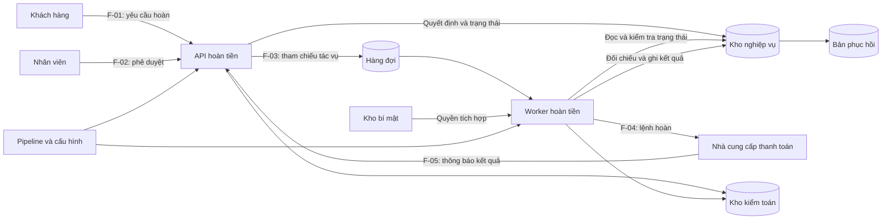

# Asset-based threat modeling

## 1. Mục tiêu bài học

**Asset-based threat modeling** là cách tiếp cận mô hình hóa đe dọa bắt đầu từ những tài sản có giá trị cần được bảo vệ. Nhóm thiết kế xác định tài sản, hậu quả khi tài sản bị xâm phạm, các thành phần có thể tác động tới tài sản và những kịch bản đe dọa tương ứng.

Trong module về yêu cầu bảo mật, kết quả cần tạo ra không dừng ở một danh sách đe dọa. Mỗi kịch bản quan trọng phải dẫn tới yêu cầu cụ thể, quyết định kiến trúc và tiêu chí kiểm chứng.

Sau bài học, người học có thể:

- Xác định tài sản nghiệp vụ và tài sản hỗ trợ trong một phạm vi rõ ràng.
- Ghi nhu cầu bảo vệ và các điều kiện bất biến của tài sản.
- Theo dõi đường truy cập, bản sao, phụ thuộc và ranh giới tin cậy.
- Viết kịch bản đe dọa có chủ thể, điều kiện, đường tác động và hậu quả.
- Chuyển kịch bản thành yêu cầu xác thực, phân quyền, bảo vệ dữ liệu, logging và phục hồi.
- Duy trì truy vết khi hệ thống thay đổi trong vòng đời phát triển.

“Dựa trên tài sản” mô tả điểm xuất phát và góc nhìn phân tích. Bài học không giả định có một mẫu biểu hoặc thang điểm duy nhất áp dụng cho mọi tổ chức. Các mã định danh, ngưỡng và thời hạn bên dưới đều là ví dụ học tập.

## 2. Bắt đầu từ giá trị cần bảo vệ

Thay vì hỏi ngay “hệ thống có thể bị tấn công bằng kỹ thuật nào?”, nhóm bắt đầu với:

> Hệ thống đang giữ hoặc thực hiện điều gì có giá trị, và điều gì không được phép xảy ra với giá trị đó?

Ví dụ:

- Hồ sơ khách hàng cần giới hạn người được đọc.
- Quyết định hoàn tiền phải đúng thẩm quyền và đúng số tiền.
- Khóa truy cập nhà cung cấp không được rơi vào tay chủ thể ngoài phạm vi.
- Dấu vết phê duyệt phải còn đủ để điều tra.
- Khả năng phục hồi phải hoạt động khi mất kho dữ liệu chính.

Sau đó mới tìm các đường mà con người, phần mềm hoặc sự cố có thể làm tổn hại những tài sản này.

### 2.1. Tài sản nghiệp vụ và tài sản hỗ trợ

**Tài sản nghiệp vụ** trực tiếp gắn với giá trị hoặc mục tiêu của hoạt động: dữ liệu khách hàng, quyết định giao dịch, hồ sơ phê duyệt hoặc khả năng cung cấp một chức năng.

**Tài sản hỗ trợ** giúp tạo, xử lý, lưu, truyền hoặc bảo vệ tài sản nghiệp vụ: mã nguồn, dịch vụ, danh tính, khóa, pipeline, kho dữ liệu, hàng đợi và bản phục hồi.

Hai cách gọi giúp phân tích quan hệ, không phải ranh giới cứng. Một thành phần có thể đóng vai trò hỗ trợ trong hệ thống này nhưng là sản phẩm chính của một hệ thống khác.

Ví dụ, hàng đợi không phải số tiền hoàn lại cho khách, nhưng sửa thông điệp trong hàng đợi có thể làm thay đổi lệnh hoàn tiền. Vì vậy, phải xem quyền và tính toàn vẹn của hàng đợi trong mô hình.

### 2.2. Phân biệt những khái niệm dễ lẫn

| Khái niệm | Câu hỏi | Ví dụ |
| --- | --- | --- |
| Tài sản | Giá trị nào cần được bảo vệ? | Tính đúng đắn của quyết định hoàn tiền |
| Chủ thể đe dọa | Ai có thể gây tác động không mong muốn? | Người dùng có tài khoản nhưng muốn hoàn tiền cho đơn của người khác |
| Sự kiện đe dọa | Điều gì có thể gây tổn hại? | Kho dữ liệu chính bị mất hoặc thông điệp bị thay đổi |
| Đường tác động | Chủ thể hoặc sự kiện chạm tới tài sản bằng cách nào? | API, tác vụ nền, truy cập kho trực tiếp |
| Điểm yếu hoặc điều kiện | Điều gì có thể cho phép kịch bản xảy ra? | Thiếu kiểm tra quyền theo đơn hàng |
| Rủi ro | Khả năng và hậu quả của kịch bản trong ngữ cảnh xét | Hoàn tiền sai gây thất thoát và tranh chấp |
| Yêu cầu bảo mật | Hệ thống phải làm gì để xử lý kịch bản? | Chỉ xử lý đơn thuộc phạm vi được cấp và kiểm tra giới hạn hoàn |
| Bằng chứng | Dựa vào đâu biết yêu cầu đã đạt? | Kết quả kiểm thử bị từ chối và đối chiếu trạng thái giao dịch |

Một điểm yếu trong mô hình có thể là giả thuyết cần xác minh. Không ghi nó thành lỗi đã phát hiện nếu chưa có bằng chứng.

### 2.3. Không dừng ở danh sách máy chủ

Tên máy, dịch vụ và cơ sở dữ liệu cho biết tài sản nằm ở đâu, nhưng chưa giải thích cần bảo vệ điều gì.

“Cơ sở dữ liệu refund-db” cần được bổ sung bằng thông tin như:

- Chứa quyết định và trạng thái hoàn tiền.
- Thay đổi trái phép có thể gây hoàn sai hoặc làm mất khả năng đối chiếu.
- Người vận hành không được tự ý sửa dữ liệu đã xác nhận.
- Sau phục hồi phải ngăn hoàn lại một giao dịch đã thực hiện.

Tương tự, uy tín hoặc thiệt hại kinh doanh là hậu quả cần hiểu. Để viết yêu cầu kỹ thuật, phải nối hậu quả đó với dữ liệu, hành vi hoặc khả năng cụ thể của hệ thống.

## 3. Xác định phạm vi trước khi phân tích

Một mô hình có ích cần nêu:

- Chức năng và trường hợp sử dụng được xét.
- Tổ chức, người dùng và danh tính dịch vụ liên quan.
- Môi trường và phiên bản kiến trúc.
- Thành phần do nhóm kiểm soát và thành phần bên ngoài.
- Dữ liệu đi vào, được tạo, được sao chép và đi ra.
- Giả định, phần ngoài phạm vi và người xác nhận.

Không thể kết luận một đường an toàn chỉ vì phần chứa nó được ghi “ngoài phạm vi”. Nếu đường đó ảnh hưởng trực tiếp tới tài sản đang bảo vệ, cần ít nhất mô tả phụ thuộc, giả định và bên chịu trách nhiệm.

### 3.1. Phạm vi ví dụ xuyên suốt

Bài học xét một dịch vụ hoàn tiền của nền tảng bán hàng:

1. Khách hàng gửi yêu cầu cho một đơn hàng.
2. Nhân viên đủ quyền xem xét và phê duyệt.
3. Tác vụ nền gửi lệnh tới nhà cung cấp thanh toán.
4. Hệ thống nhận hoặc truy vấn kết quả.
5. Quyết định, trạng thái và dấu vết được lưu.
6. Dữ liệu được sao lưu và có quy trình phục hồi.

Dịch vụ phục vụ nhiều tổ chức bán hàng, nên quyền phải gắn với tổ chức và đơn hàng. Nhà cung cấp thanh toán là hệ thống bên ngoài.

Trong ví dụ, khả năng tra cứu trạng thái giao dịch và cách nhận diện một yêu cầu logic tại nhà cung cấp là **giả định phải xác nhận**. Không mặc định nhà cung cấp nào cũng có cùng giao thức hoặc bảo đảm chống trùng.

### 3.2. Tách điều đã biết khỏi giả định

Một bảng đơn giản:

| Mã | Nội dung | Trạng thái và cách xác nhận |
| --- | --- | --- |
| AS-01 | Một danh tính chỉ có quyền trên các tổ chức được cấp | Cần đối chiếu mô hình quyền và cấu hình |
| AS-02 | Nhà cung cấp cho phép liên kết, tra cứu một yêu cầu hoàn tiền logic | Cần xác minh hợp đồng tích hợp và thử trong môi trường phù hợp |
| AS-03 | Bản phục hồi không cùng miền sự cố với kho chính | Cần đối chiếu triển khai và diễn tập |
| AS-04 | Log không chứa khóa truy cập hoặc dữ liệu khách hàng đầy đủ | Cần kiểm tra cả đường thành công và lỗi |

Nếu một giả định quan trọng chưa được xác minh, kết luận dựa trên nó phải thể hiện sự chưa chắc chắn.

## 4. Lập danh mục tài sản và nhu cầu bảo vệ

### 4.1. Danh mục tài sản của ví dụ

| Mã | Tài sản | Giá trị cần bảo vệ | Chủ sở hữu hoặc vai trò chịu trách nhiệm |
| --- | --- | --- | --- |
| A-01 | Quyết định, lệnh và trạng thái hoàn tiền | Đúng đơn, đúng quyền, đúng số tiền và không thực hiện trùng một yêu cầu logic | Chủ sở hữu nghiệp vụ hoàn tiền |
| A-02 | Dữ liệu đơn hàng và khách hàng | Chỉ được đọc, dùng và chia sẻ trong phạm vi được cấp | Chủ sở hữu dữ liệu đơn hàng |
| A-03 | Danh tính dịch vụ và khóa truy cập thanh toán | Không bị sử dụng ngoài tác vụ và quyền đã xác định | Chủ sở hữu tích hợp thanh toán |
| A-04 | Hồ sơ phê duyệt và dấu vết kiểm toán | Truy được ai làm gì, với nội dung nào và kết quả gì | Chủ sở hữu quy trình và kiểm toán vận hành |
| A-05 | Khả năng tiếp nhận, xử lý và đối chiếu hoàn tiền | Không bị một nguồn sử dụng làm cạn tài nguyên chung | Chủ sở hữu dịch vụ |
| A-06 | Mã, cấu hình và quyền phát hành | Chỉ thay đổi đã được chấp thuận đi vào môi trường chạy | Chủ sở hữu phát triển và phát hành |
| A-07 | Dữ liệu, khóa và cấu hình phục hồi | Khôi phục được trạng thái đúng, đọc được và vẫn áp dụng quyền | Chủ sở hữu phục hồi dịch vụ |

Các vai trò minh họa có thể do nhiều nhóm phối hợp thực hiện. Với từng rủi ro, vẫn phải có đầu mối quản lý rủi ro và đường quyết định rõ ràng.

### 4.2. Ghi nhu cầu bảo vệ theo từng chiều

Có thể bắt đầu với:

- **Bí mật:** hậu quả nếu tài sản hoặc nội dung liên quan bị tiết lộ.
- **Toàn vẹn:** hậu quả nếu bị thay đổi, thay thế hoặc xử lý sai.
- **Sẵn sàng:** hậu quả nếu không sử dụng hoặc phục hồi được khi cần.

Ngoài ra, cần hỏi về tính xác thực của nguồn và khả năng truy trách nhiệm.

Không gán mọi chiều ở mức cao chỉ vì tài sản liên quan tới tiền. Với A-01, toàn vẹn là trọng tâm rõ ràng; với A-03, việc lộ khóa có thể tạo quyền thực hiện hành động; với A-05, thời gian gián đoạn và công bằng sử dụng tài nguyên là vấn đề chính.

Mức định tính phải đi cùng hậu quả cụ thể. “Toàn vẹn cao vì thay đổi số tiền có thể gây hoàn vượt giá trị cho phép” có ích hơn “cao vì đây là dữ liệu quan trọng”.

### 4.3. Xác định điều kiện bất biến

**Điều kiện bất biến** là điều phải luôn đúng trong phạm vi nghiệp vụ được xét. Chúng giúp biến giá trị tài sản thành tiêu chí kiểm chứng.

Ví dụ với A-01:

1. Mỗi quyết định phải gắn với đúng đơn hàng và tổ chức.
2. Người phê duyệt phải có quyền tại thời điểm cần quyết định.
3. Số tiền và đơn vị tiền tệ phải phù hợp với giao dịch nguồn và quy tắc được chấp thuận.
4. Tổng giá trị đã hoàn cộng giá trị đang được giữ chỗ cho các yêu cầu có thể thực hiện không vượt phần còn được phép hoàn.
5. Một yêu cầu hoàn tiền logic không tạo thêm lần chuyển tiền chỉ vì gửi lại hoặc xử lý đồng thời.
6. Trạng thái “hoàn tất” phải có căn cứ từ kết quả giao dịch được xác minh.
7. Sau phục hồi, giao dịch đã thực hiện không bị coi là chưa từng xảy ra.

Các điều kiện này cần được thống nhất với nghiệp vụ. Ví dụ, cách tính phần được phép hoàn có thể phụ thuộc giao dịch, hủy, điều chỉnh hoặc khoản đã giữ chỗ; không suy ra chỉ từ giá trị hiển thị trên giao diện.

## 5. Theo dõi tài sản qua kiến trúc và ranh giới tin cậy

Một tài sản có thể xuất hiện ở nhiều nơi. A-01 không chỉ nằm trong bảng dữ liệu: nội dung của nó có thể đi qua yêu cầu API, hồ sơ phê duyệt, thông điệp hàng đợi, lệnh gửi nhà cung cấp, log và bản phục hồi.

### 5.1. Sơ đồ luồng của ví dụ



Sơ đồ được đơn giản hóa để phân tích. Luồng truy vấn trạng thái nhà cung cấp, danh tính và cấu hình chi tiết cần được bổ sung khi đặc tả tích hợp. Nếu worker truy vấn kết quả, quyền và bằng chứng của luồng đó cũng phải nằm trong mô hình.

### 5.2. Các ranh giới cần đặt câu hỏi

| Ranh giới | Vì sao không thể tin mặc định? | Điều cần kiểm tra |
| --- | --- | --- |
| Người dùng tới API | Người đã đăng nhập vẫn có thể đổi mã đơn, số tiền hoặc tổ chức | Danh tính, quyền theo đối tượng, đầu vào và trạng thái nghiệp vụ |
| API tới hàng đợi và worker | Danh tính, thời điểm và quyền thực thi khác nhau; thông điệp có thể cũ hoặc bị tạo sai | Quyền gửi, nguồn thông điệp, đối chiếu hồ sơ gốc và quyền hiện tại |
| Worker tới nhà cung cấp | Khác tổ chức và giao thức; lỗi mạng có thể làm kết quả không rõ | Danh tính hai phía, nội dung lệnh, định danh giao dịch và đối soát |
| Thông báo từ nhà cung cấp tới API | Một thông báo tự nhận là thành công chưa chứng minh giao dịch thực sự thành công | Xác thực nguồn, liên kết đơn, số tiền, tiền tệ và chống xử lý trùng |
| Dịch vụ tới kho kiểm toán | Người ghi dữ liệu nghiệp vụ không nhất thiết được sửa bằng chứng | Quyền ghi, sửa, xóa, tính bền vững và dữ liệu nhạy cảm |
| Kho nghiệp vụ tới bản phục hồi | Bản sao có vòng đời và nhóm truy cập khác | Toàn vẹn, quyền, khóa, phiên bản và khả năng phục hồi |
| Pipeline tới môi trường chạy | Quyền thay mã có thể thay mọi quyết định bảo mật trong dịch vụ | Phê duyệt, nguồn gốc bản dựng và quyền triển khai |

Ranh giới tin cậy không chỉ là ranh giới mạng. Hai thành phần cùng mạng nhưng dùng danh tính và đặc quyền khác nhau vẫn có thể cần kiểm tra riêng. Ranh giới giữa hai tổ chức khách hàng tồn tại ngay cả khi dữ liệu được lưu trong cùng một cơ sở dữ liệu.

### 5.3. Tìm các đường truy cập ít được nhìn thấy

Với mỗi tài sản, cần hỏi thêm:

- Có đường quản trị hoặc script sửa trực tiếp không?
- Có bản xuất, cache, chỉ mục tìm kiếm hoặc báo cáo không?
- Có log, tệp lỗi hoặc dữ liệu gửi tới công cụ hỗ trợ không?
- Có dữ liệu production được đưa sang môi trường thử nghiệm không?
- Ai có thể đổi cấu hình, quyền hoặc bản phát hành?
- Khi phục hồi, dữ liệu và quyền được lấy từ nguồn nào?

Nếu chỉ phân tích API công khai, một lệnh quản trị ghi trực tiếp vào A-01 có thể bỏ qua toàn bộ quy trình phê duyệt.

## 6. Xây dựng kịch bản từ từng tài sản

### 6.1. Bộ câu hỏi theo thuộc tính cần bảo vệ

| Thuộc tính | Câu hỏi gợi mở |
| --- | --- |
| Bí mật | Ai có thể đọc tài sản ở từng nơi tồn tại? Có thể suy ra dữ liệu qua log, lỗi hoặc kết quả tổng hợp không? |
| Toàn vẹn | Ai có thể tạo, sửa, thay thế hoặc chuyển trạng thái? Có đường ghi nào bỏ qua quy tắc nghiệp vụ không? |
| Sẵn sàng | Điều gì có thể làm cạn tài nguyên, chặn xử lý hoặc ngăn phục hồi? |
| Xác thực nguồn | Hệ thống dựa vào đâu để biết người gửi, thông điệp hoặc kết quả là thật? |
| Truy trách nhiệm | Có liên kết được chủ thể, nội dung, thời điểm và kết quả không? Ai có thể sửa bằng chứng? |

Cần xét cả chủ thể bên ngoài, người có tài khoản, người có quyền nội bộ và danh tính dịch vụ bị chiếm. Cũng cần xét lỗi vận hành, mất dữ liệu hoặc phụ thuộc không sẵn sàng khi chúng có thể làm vi phạm mục tiêu bảo vệ.

Không bắt buộc mọi tài sản đều có kịch bản ở mọi ô. Nếu kết luận một thuộc tính không đáng kể, nên có lý do thay vì bỏ trống không giải thích.

### 6.2. Mẫu viết kịch bản

> **Chủ thể hoặc sự kiện + điều kiện cần có + đường tác động + tài sản bị ảnh hưởng + hậu quả.**

Ví dụ đầy đủ:

> Hai yêu cầu hoàn tiền hợp lệ cùng đọc một phần tiền còn được phép hoàn trước khi hệ thống giữ chỗ giá trị. Nếu cả hai tiếp tục xử lý dựa trên kết quả cũ, tổng lệnh gửi nhà cung cấp có thể vượt giới hạn, làm vi phạm toàn vẹn của A-01 và gây thất thoát.

Kịch bản này không cần giả định người dùng phá được xác thực. Hai hành động riêng lẻ có thể hợp lệ nhưng kết hợp đồng thời tạo ra kết quả sai.

### 6.3. Danh sách kịch bản minh họa

Các điều kiện bên dưới là giả thuyết phân tích, không phải kết luận đã phát hiện lỗi trong một hệ thống thực tế.

| Mã | Tài sản | Kịch bản và đường tác động | Hậu quả |
| --- | --- | --- | --- |
| T-01 | A-01, A-02 | Người có tài khoản đổi mã đơn hoặc tổ chức trên F-01 nếu API chỉ kiểm tra đăng nhập | Đọc thông tin hoặc tạo yêu cầu hoàn cho đơn ngoài phạm vi |
| T-02 | A-01, A-04 | Nhân viên có quyền xem dùng đường quản trị để tự phê duyệt nếu quyền và chuyển trạng thái không được kiểm tra nhất quán | Hoàn tiền không đúng thẩm quyền, thiếu căn cứ phê duyệt |
| T-03 | A-01 | Hai tác vụ hoặc lần gửi lại cùng vượt qua kiểm tra giới hạn dựa trên trạng thái cũ | Hoàn vượt phần được phép hoặc thực hiện lặp một yêu cầu logic |
| T-04 | A-01, A-03 | Chủ thể có quyền gửi thông điệp tạo tác vụ sai; worker tin toàn bộ số tiền trong F-03 | Lệnh gửi nhà cung cấp khác nội dung đã phê duyệt |
| T-05 | A-03, A-02 | Khóa hoặc dữ liệu khách hàng lọt vào log, tệp lỗi hay môi trường xây dựng có quyền đọc rộng | Người ngoài phạm vi lấy dữ liệu hoặc dùng quyền tích hợp |
| T-06 | A-04 | Người có quyền sửa nghiệp vụ cũng sửa hoặc xóa dấu vết phê duyệt | Khó xác định hành động và kết quả, che giấu thay đổi trái phép |
| T-07 | A-05 | Một tổ chức tạo nhiều yêu cầu hoặc tác vụ nặng mà không có giới hạn và cách ly phù hợp | Hết tài nguyên chung, tổ chức khác bị chậm hoặc ngừng phục vụ |
| T-08 | A-01, A-07 | Phục hồi từ bản cũ rồi cho gửi lệnh mới trước khi đối soát với nhà cung cấp | Giao dịch đã thực hiện có thể bị thực hiện lại |
| T-09 | A-01, A-06 | Người có quyền phát hành đưa phiên bản bỏ kiểm tra quyền hoặc đổi cấu hình tới production | Vô hiệu hóa kiểm soát của nhiều đường hoàn tiền |
| T-10 | A-01 | API chấp nhận F-05 giả hoặc không khớp giao dịch | Đánh dấu hoàn tất sai, làm sai đối soát và quyết định tiếp theo |

Những kịch bản có chung nguyên nhân có thể dùng một kiểm soát hỗ trợ, nhưng không nên gộp tới mức mất khác biệt về đường tác động và cách kiểm thử.

Ví dụ, phân quyền API có thể xử lý T-01 nhưng chưa giải quyết việc worker tin thông điệp ở T-04 hoặc phiên bản bị thay ở T-09.

### 6.4. Xem cả hành vi được cấp quyền nhưng bị lạm dụng

Một chủ thể có quyền đọc không có nghĩa được xuất toàn bộ dữ liệu. Một nhân viên có quyền phê duyệt trong tổ chức A không có nghĩa được phê duyệt trong B.

Vì vậy, cần ghi phạm vi quyền theo:

- Hành động và đối tượng.
- Tổ chức hoặc quan hệ sở hữu.
- Trạng thái nghiệp vụ.
- Giới hạn giá trị, số lượng hoặc tần suất khi có căn cứ.
- Thời điểm quyền cần được kiểm tra lại.

Các điều kiện này đặc biệt quan trọng khi có hàng đợi, tác vụ kéo dài hoặc phê duyệt xảy ra trước lúc thực thi.

## 7. Đánh giá rủi ro và chọn độ sâu xác minh

### 7.1. Đánh giá theo kịch bản, không chỉ theo tên tài sản

Một tài sản có toàn vẹn cao không có nghĩa mọi kịch bản liên quan đều có cùng mức rủi ro. Cần xét:

- Hậu quả nếu kịch bản xảy ra.
- Khả năng tiếp cận và điều kiện cần có.
- Năng lực hoặc quyền của chủ thể.
- Kiểm soát hiện có và bằng chứng hiệu quả.
- Phạm vi ảnh hưởng và khả năng phát hiện, phục hồi.
- Điểm chưa chắc chắn.

Ví dụ, T-03 liên quan trực tiếp tới tiền và có thể phát sinh từ gửi lại hợp lệ. Nó đáng được ưu tiên làm rõ ngay cả khi hệ thống không có nhiều người dùng.

Không dùng điểm lỗ hổng kỹ thuật hoặc một phép cộng các mức định tính để thay thế toàn bộ đánh giá nghiệp vụ.

### 7.2. Ghi rõ những gì chưa biết

| Kịch bản | Thông tin còn cần | Quyết định tiếp theo có thể có |
| --- | --- | --- |
| T-03 | Cách giữ chỗ, xử lý đồng thời và cơ chế chống trùng của nhà cung cấp | Rà soát thiết kế và thử gửi lại, đồng thời, mất phản hồi |
| T-05 | Những đường log thực sự nhận payload và quyền đọc log | Kiểm tra cấu hình và dùng dữ liệu giả để thử đường lỗi |
| T-08 | Điểm dữ liệu khôi phục và nguồn đối chiếu giao dịch | Diễn tập mất kho chính, phục hồi và đối soát |
| T-09 | Ai được triển khai và bằng chứng nguồn gốc bản phát hành | Rà soát quyền, quy trình phê duyệt và đường triển khai |

“Chưa đủ thông tin” cần dẫn tới công việc xác minh có người phụ trách. Không tự đánh giá thấp vì chưa nhìn thấy bằng chứng khai thác.

### 7.3. Chọn mức đảm bảo tương xứng

Các kịch bản ảnh hưởng số tiền, phạm vi tổ chức và quyền tích hợp có thể cần:

- Rà soát thiết kế và điều kiện bất biến.
- Kiểm thử đường hợp lệ, bị cấm, lỗi và đồng thời.
- Đối chiếu cấu hình triển khai với thiết kế.
- Xác minh bởi người không trực tiếp triển khai khi chính sách yêu cầu.
- Diễn tập phục hồi và tích hợp theo phạm vi cụ thể.

Mức đảm bảo thể hiện độ tin cậy có căn cứ đối với kết luận, không phải lời khẳng định hệ thống không còn mọi đe dọa.

## 8. Chuyển kịch bản thành yêu cầu bảo mật

Một mẫu đặc tả:

> **Trong điều kiện nào, thành phần nào phải thực hiện hành vi gì, với kết quả hoặc giới hạn nào, và dùng bằng chứng gì để xác nhận?**

### 8.1. Bộ yêu cầu minh họa

Các mốc định lượng bên dưới là giả định của ví dụ, cần được xác nhận theo năng lực và nhu cầu thực tế.

| Mã | Kịch bản liên quan | Yêu cầu | Tiêu chí chấp nhận |
| --- | --- | --- | --- |
| SR-AM-01 | T-01, T-02 | Mọi yêu cầu tạo, xem hoặc phê duyệt hoàn tiền phải xác thực chủ thể và kiểm tra quyền phía máy chủ theo đơn hàng, tổ chức và hành động | Thay mã đơn, tổ chức hoặc gọi đường quản trị không cho phép thao tác ngoài phạm vi |
| SR-AM-02 | T-02 | Người phê duyệt phải đáp ứng xác thực đa yếu tố theo chính sách vai trò, đồng thời có quyền phê duyệt tại thời điểm quyết định | Người chỉ có quyền xem, thiếu điều kiện xác thực hoặc đã bị thu hồi quyền không phê duyệt được |
| SR-AM-03 | T-03 | Kiểm tra và giữ chỗ giá trị hoàn phải bảo đảm tổng đã hoàn cộng phần đang được giữ chỗ không vượt phần được phép, kể cả khi xử lý đồng thời | Hai yêu cầu cùng tranh phần còn lại không thể cùng làm vượt giới hạn; trạng thái và số tiền vẫn nhất quán |
| SR-AM-04 | T-03, T-08 | Mỗi yêu cầu hoàn logic phải có định danh ổn định gắn với nội dung; gửi lại hoặc mất phản hồi không tự tạo lệnh hoàn mới | Thử gửi lặp, gửi cùng định danh với nội dung khác và mất phản hồi sau khi nhà cung cấp tiếp nhận; không tạo thêm yêu cầu logic |
| SR-AM-05 | T-04 | Worker phải đối chiếu tác vụ với hồ sơ và phiên bản đã được phê duyệt; quyền gửi thông điệp phải giới hạn theo nguồn được phép | Thông điệp sai nguồn, sai tổ chức, sai số tiền, sai trạng thái hoặc sai phiên bản bị từ chối |
| SR-AM-06 | T-05 | Quyền tích hợp chỉ được cấp cho danh tính dịch vụ cần dùng; khóa và nội dung khách hàng không được đưa vào log ngoài phạm vi cho phép | Danh tính không liên quan không lấy hoặc dùng được khóa; giá trị giả có dấu nhận diện không xuất hiện ở các đầu ra bị cấm đã kiểm tra |
| SR-AM-07 | T-06 | Trước khi gửi lệnh phải có bản ghi ý định bền vững; kết quả phải liên kết với ý định và giao dịch nhà cung cấp; danh tính nghiệp vụ không được sửa hoặc xóa dấu vết | Thử lỗi ghi ý định thì không gửi lệnh; kết quả đối chiếu được; thử sửa hoặc xóa bằng danh tính nghiệp vụ bị từ chối |
| SR-AM-08 | T-07 | Mỗi tổ chức trong ví dụ không vượt 20 tác vụ đang xử lý và 100 tác vụ chờ; yêu cầu vượt giới hạn nhận trạng thái có thể xử lý được | Nguồn gây tải không làm vượt giới hạn; không báo đã nhận thành công cho tác vụ thực tế bị từ chối; thử cả hai tổ chức |
| SR-AM-09 | T-08 | Sau phục hồi, đơn hàng có trạng thái giao dịch chưa được đối soát không được gửi lệnh hoàn mới; diễn tập kịch bản mất kho chính phải hoàn tất phục hồi và kiểm tra trong 4 giờ | Khôi phục bản cũ chứa giao dịch đã thực hiện; hệ thống xác minh hoặc cách ly đơn liên quan trước khi mở đường gửi lệnh |
| SR-AM-10 | T-09 | Production chỉ chạy bản phát hành được phê duyệt, nhận dạng bằng nội dung và nguồn gốc theo chính sách; danh tính runtime không có quyền phát hành | Bản không được duyệt hoặc bị thay bị từ chối; danh tính runtime không ghi được vào đường phát hành |
| SR-AM-11 | T-10 | Kết quả từ nhà cung cấp chỉ được áp dụng sau khi xác minh nguồn và liên kết đúng yêu cầu, số tiền, tiền tệ, trạng thái theo giao thức đã xác nhận | Thông báo giả, không khớp hoặc lặp không tạo kết quả nghiệp vụ mới; trường hợp chưa rõ được chuyển đối soát |

SR-AM-04 cần được thiết kế cùng khả năng thực tế của nhà cung cấp. Nếu nhà cung cấp đã nhận lệnh nhưng phản hồi bị mất, việc gửi một lệnh mới với định danh khác có thể gây trùng. Cần tra cứu hoặc đối soát theo định danh ổn định, không tuyên bố bảo đảm chỉ từ cơ chế chống lặp trong cơ sở dữ liệu nội bộ.

SR-AM-08 là giới hạn tài nguyên minh họa, chưa tự chứng minh một thời gian đáp ứng cho mọi tải. Muốn có cam kết sẵn sàng, phải đặt thêm điều kiện tải, thời gian và năng lực được kiểm chứng.

SR-AM-09 phải nêu rõ phạm vi sự cố, nguồn dữ liệu, khóa và quyền còn khả dụng. Giữ được dữ liệu nhưng không còn khóa hoặc không đối chiếu được giao dịch vẫn chưa đạt mục tiêu phục hồi.

### 8.2. Ví dụ truy vết cho xử lý đồng thời

Chuỗi truy vết:

> **Tài sản:** A-01 — quyết định và lệnh hoàn tiền.  
> **Điều kiện cần bảo vệ:** tổng đã hoàn và giữ chỗ không vượt phần được phép.  
> **Kịch bản:** T-03 — hai tác vụ dựa trên cùng trạng thái cũ.  
> **Rủi ro:** R-AM-03 — hoàn vượt giới hạn hoặc tạo lệnh trùng.  
> **Quyết định kiến trúc:** phối hợp kiểm tra với giữ chỗ; dùng định danh yêu cầu logic và quản lý trạng thái không rõ.  
> **Yêu cầu:** SR-AM-03, SR-AM-04.  
> **Kiểm thử:** TC-AM-CONCURRENCY, TC-AM-RETRY-UNKNOWN.

Dùng dữ liệu giả theo một đơn vị tiền tệ cố định:

- Giá trị tối đa được phép hoàn cho đơn là 100.
- Đã hoàn 20 và chưa có phần giữ chỗ.
- Hai yêu cầu đồng thời đều muốn hoàn 60.
- Tối đa một yêu cầu được giữ chỗ 60 thành công.
- Yêu cầu còn lại không được tiếp tục với 60 vì chỉ còn 20 theo trạng thái mới.
- Hệ thống không tự sửa số tiền yêu cầu nếu quy trình nghiệp vụ không cho phép.

Sau khi gửi nhà cung cấp, timeout không có nghĩa giao dịch thất bại. Không được giải phóng giữ chỗ chỉ vì mất phản hồi rồi cho tạo một lệnh khác. Trạng thái chưa rõ cần được đối soát.

Một cách nhìn trạng thái:

| Kết quả đã biết | Hành vi cần bảo vệ |
| --- | --- |
| Chưa gửi lệnh | Có thể hủy và giải phóng theo quy tắc, với điều kiện không có tiến trình khác đã gửi |
| Đã gửi, chưa biết kết quả | Giữ hoặc cách ly phần liên quan; không tự tạo giao dịch thay thế |
| Nhà cung cấp xác nhận thành công | Ghi nhận phần đã hoàn, liên kết giao dịch và ngăn xử lý trùng |
| Nhà cung cấp xác nhận không thực hiện | Chuyển trạng thái và giải phóng theo quy tắc đã được kiểm chứng |

Chính sách giữ chỗ, hết hạn và đối soát phải xử lý cả trường hợp hai tiến trình cạnh tranh nhau. Một bộ đếm kiểm tra ở giao diện không bảo vệ được điều kiện này.

### 8.3. Kết hợp với các yêu cầu chung về dữ liệu

Tập yêu cầu ở mục 8.1 tập trung vào các kịch bản đã nêu. Khi theo dõi A-02 và A-03 qua đường truyền, kho chính và backup, cần kiểm tra thêm nguy cơ đọc dữ liệu ngoài đường nghiệp vụ.

Ví dụ một yêu cầu bổ sung:

> **SR-AM-12:** Dữ liệu khách hàng, bí mật tích hợp và các bản sao thuộc phạm vi phải được bảo vệ trên đường truyền và trong lưu trữ theo chính sách đã được chấp thuận; quyền đọc bản lưu không mặc nhiên bao gồm quyền giải mã.

Tiêu chí chấp nhận cần gồm đối chiếu cấu hình, từ chối kênh không đáp ứng chính sách, kiểm tra danh tính đầu bên kia và thử quyền đọc, giải mã của các vai trò đã xác định. Việc mã hóa không thay thế SR-AM-01: ứng dụng vẫn có thể giải mã rồi trả dữ liệu cho sai người nếu phân quyền không đúng.

Đây cũng là cách mở rộng mô hình: nếu phát hiện một nơi tài sản tồn tại nhưng chưa có kịch bản hoặc yêu cầu tương ứng, phải đưa khoảng trống đó vào quyết định phân tích tiếp.

## 9. Ví dụ hồ sơ kịch bản có truy vết

Đoạn YAML sau là dữ liệu minh họa cho **một giả thuyết cần đánh giá**, không phải kết quả kiểm thử của một hệ thống thực:

```yaml
modelId: TM-REFUND-DEMO
modelVersion: 1
scenarioId: T-03
analysisStatus: hypothesis-to-verify

assetReferences:
  primary:
    - A-01
  supporting:
    - A-03
    - A-04

scenario:
  initiatingCondition: "Hai yêu cầu hoặc lần gửi lại được xử lý đồng thời."
  pathReferences:
    - F-01
    - F-03
    - F-04
  enablingCondition: "Kiểm tra giới hạn, giữ chỗ và chống trùng chưa được chứng minh."
  consequence: "Tổng giá trị hoàn vượt giới hạn hoặc một yêu cầu logic bị thực hiện lặp."

securityInvariant:
  - "Đã hoàn cộng giữ chỗ không vượt phần được phép."
  - "Một yêu cầu logic không tạo thêm lần chuyển tiền khi gửi lại."

assumptionReferences:
  - AS-02

risk:
  riskId: R-AM-03
  ownerRole: refund-business-owner
  assessmentStatus: pending-evidence
  consequenceConcern: high
  likelihoodAssessment: not-yet-established

treatment:
  approach: mitigate
  requirementReferences:
    - SR-AM-03
    - SR-AM-04
  controlOwnerRole: refund-service-owner

verification:
  requiredEvidenceReferences:
    - TC-AM-CONCURRENCY
    - TC-AM-RETRY-UNKNOWN
  deploymentConfigurationReviewRequired: true

reviewTriggers:
  - refund-limit-rule-change
  - provider-integration-change
  - worker-state-machine-change
  - recovery-flow-change
```

`consequenceConcern: high` chỉ thể hiện mối quan tâm về hậu quả trong ví dụ. Nó không phải mức rủi ro tổng hợp đã được xác nhận. Phần khả năng xảy ra và hiệu quả kiểm soát vẫn đang chờ bằng chứng.

Sau khi kiểm chứng, hồ sơ cần cập nhật kết quả, phạm vi, phiên bản, rủi ro còn lại và quyết định đúng thẩm quyền. Không thay trạng thái chỉ vì công việc triển khai đã đóng.

## 10. Kiểm tra độ bao phủ và thiết kế bằng chứng

### 10.1. Nhìn từ tài sản tới yêu cầu

| Tài sản | Kịch bản hoặc câu hỏi trọng tâm | Yêu cầu minh họa |
| --- | --- | --- |
| A-01 | Sai quyền, sai số tiền, trùng giao dịch, sai kết quả | SR-AM-01 tới SR-AM-05, SR-AM-09, SR-AM-11 |
| A-02 | Đọc ngoài tổ chức, dữ liệu lọt qua log và bản sao | SR-AM-01, SR-AM-06, SR-AM-12 |
| A-03 | Khóa bị lộ hoặc bị dùng ngoài tác vụ | SR-AM-05, SR-AM-06, SR-AM-12 |
| A-04 | Mất hoặc sửa dấu vết | SR-AM-07 |
| A-05 | Cạn tài nguyên và tác vụ chờ quá nhiều | SR-AM-08 cùng yêu cầu năng lực, thời gian nếu được đặt ra |
| A-06 | Mã hoặc cấu hình không được chấp thuận đi vào production | SR-AM-10 |
| A-07 | Không đọc được bản phục hồi hoặc làm sai trạng thái sau phục hồi | SR-AM-09, SR-AM-12 |

Bảng giúp phát hiện tài sản không có kịch bản, kịch bản không có quyết định hoặc yêu cầu không có người thực hiện. Nó không chứng minh mọi đe dọa có thể có đều đã được tìm ra.

### 10.2. Nhìn từ yêu cầu tới kiểm thử

| Phép thử | Tài sản và kịch bản được xét | Bằng chứng cần quan sát |
| --- | --- | --- |
| Đổi mã đơn hoặc tổ chức bằng tài khoản hợp lệ | A-01, A-02; T-01 | Không có dữ liệu hoặc thay đổi ngoài phạm vi |
| Dùng người chỉ có quyền xem để phê duyệt | A-01, A-04; T-02 | Hành động bị từ chối, không đổi trạng thái |
| Chạy hai yêu cầu tranh cùng phần còn được phép | A-01; T-03 | Không vượt giới hạn; giữ chỗ và trạng thái nhất quán |
| Gửi lại sau khi nhà cung cấp tiếp nhận nhưng phản hồi bị mất | A-01; T-03 | Giữ định danh logic, chuyển đối soát, không tạo lệnh mới tùy tiện |
| Đưa thông điệp sai nội dung vào hàng đợi thử nghiệm | A-01, A-03; T-04 | Worker đối chiếu và từ chối |
| Tạo lỗi với giá trị bí mật giả có dấu nhận diện | A-02, A-03; T-05 | Không thấy giá trị trong các đầu ra bị cấm thuộc phạm vi thử |
| Dùng danh tính nghiệp vụ sửa sự kiện kiểm toán | A-04; T-06 | Bị từ chối, bằng chứng gốc vẫn còn |
| Một tổ chức tạo nhiều tác vụ, tổ chức khác tiếp tục dùng dịch vụ | A-05; T-07 | Giới hạn và hành vi từ chối đúng; ghi nhận tác động tới tổ chức khác |
| Khôi phục bản cũ có giao dịch đã thực hiện | A-01, A-07; T-08 | Chặn hoặc đối soát đúng trước lệnh mới |
| Triển khai bản không được duyệt | A-06; T-09 | Bị chặn theo đường triển khai thực tế |
| Gửi thông báo kết quả sai nguồn hoặc sai tiền tệ | A-01; T-10 | Không đánh dấu hoàn tất sai |
| Dùng quyền chỉ đọc backup để tiếp cận nội dung được bảo vệ | A-02, A-03, A-07 | Không tự có quyền giải mã; kiểm soát đúng cấu hình |

Các phép thử phải được thực hiện trong môi trường và phạm vi được cho phép với dữ liệu giả phù hợp. Báo cáo bằng chứng không cần chứa khóa thật hoặc toàn bộ dữ liệu khách hàng.

### 10.3. Những câu hỏi rà soát mô hình

Trước khi dùng mô hình để quyết định, nhóm cần tự kiểm tra:

1. Tài sản có mô tả giá trị và hậu quả, hay chỉ có tên thành phần?
2. Có chủ sở hữu và phạm vi rõ cho các tài sản quan trọng không?
3. Đã theo dõi bản sao, đường quản trị và quyền phát hành chưa?
4. Ranh giới tổ chức, danh tính và thời điểm thực thi có được thể hiện không?
5. Kịch bản có điều kiện và đường tác động cụ thể không?
6. Giả định quan trọng có người xác minh không?
7. Yêu cầu có xử lý đúng kịch bản, hay chỉ thêm kiểm soát quen thuộc?
8. Có kiểm thử đường bị cấm, đồng thời, lỗi và phục hồi không?
9. Có rủi ro còn lại, điểm chưa biết hoặc phần cần chuyển cấp không?

Đây là các tiêu chí người học sử dụng khi áp dụng phương pháp, không phải kết luận rằng một bản mô hình đã được kiểm chứng chỉ vì có đủ mục.

### 10.4. Diễn giải đúng chỉ số bao phủ

Ví dụ:

> Tỷ lệ kịch bản có quyết định xử lý = số kịch bản trong phạm vi có phương án, người chịu trách nhiệm và trạng thái quyết định rõ / tổng số kịch bản đã được ghi nhận trong cùng phiên bản mô hình.

Chỉ số này phản ánh việc quản lý những kịch bản đã biết. Nó không cho biết còn bao nhiêu kịch bản chưa được nhận diện.

Tương tự, tỷ lệ yêu cầu có kiểm thử không thay thế việc xem xét chất lượng kiểm thử. Một phép thử đường hợp lệ không đủ chứng minh hành động ngoài phạm vi bị chặn.

## 11. Duy trì mô hình trong vòng đời phát triển

### 11.1. Thời điểm cập nhật

Cần xem xét lại khi:

- Thêm tài sản hoặc mục đích sử dụng dữ liệu.
- Thêm tổ chức khách hàng hoặc thay cơ chế cách ly.
- Đổi quy tắc giới hạn hoàn tiền, phê duyệt hoặc giữ chỗ.
- Thêm API, worker, hàng đợi, đường nhập hoặc đường quản trị.
- Đổi giao thức, quyền hoặc nhà cung cấp thanh toán.
- Thay khóa, nơi lưu log, bản phục hồi hoặc quyền phát hành.
- Có kết quả kiểm thử hoặc sự cố trái với giả định.
- Hết hiệu lực quyết định chấp nhận hoặc ngoại lệ.

Mô hình cần gắn với phiên bản kiến trúc và tập yêu cầu. Một sơ đồ đúng trước khi có worker mới có thể không còn bao phủ đường thực thi hiện tại.

### 11.2. Trách nhiệm phối hợp

| Vai trò | Đóng góp chính |
| --- | --- |
| Chủ sở hữu nghiệp vụ hoặc dữ liệu | Xác nhận giá trị, hậu quả và điều kiện nghiệp vụ |
| Kiến trúc sư và nhóm phát triển | Mô tả luồng, phụ thuộc, trạng thái và cách thực thi |
| Nhóm vận hành | Làm rõ quyền, cấu hình, log, giới hạn tài nguyên và phục hồi |
| Nhóm bảo mật | Hỗ trợ đặt câu hỏi đe dọa, đánh giá kiểm soát và mức bằng chứng |
| Người kiểm thử, xác minh | Chuyển yêu cầu thành phép thử và đánh giá kết quả |
| Risk owner | Điều phối quyết định xử lý, nguồn lực và rủi ro còn lại theo thẩm quyền |

Không yêu cầu một người tự hiểu mọi lớp. Cần có người điều phối để những khoảng trống giữa các lớp không bị bỏ quên.

### 11.3. Quản lý rủi ro còn lại

Sau khi triển khai và có bằng chứng, cần đánh giá lại:

- Kịch bản nào được ngăn, giảm hoặc phát hiện tốt hơn.
- Điều kiện nào vẫn có thể gây tổn hại.
- Phụ thuộc nào chưa được kiểm chứng đủ.
- Giới hạn nào của phép thử ảnh hưởng kết luận.
- Ai có thẩm quyền quyết định và khi nào phải xem xét lại.

Rủi ro mục tiêu trong kế hoạch khác với rủi ro còn lại đã được đánh giá. Không đổi mô hình thành trạng thái “đã xử lý” chỉ vì các ticket liên quan đã hoàn thành.

Nếu còn thiếu thông tin về nhà cung cấp cho SR-AM-04 hoặc SR-AM-11, cần giải quyết trước khi tuyên bố đáp ứng yêu cầu phụ thuộc vào thông tin đó.

## 12. Những sai lầm thường gặp

| Sai lầm | Hệ quả | Cách sửa |
| --- | --- | --- |
| Chỉ liệt kê máy và phần mềm | Không biết giá trị hoặc hậu quả cần bảo vệ | Gắn thành phần với tài sản nghiệp vụ và nhu cầu bảo vệ |
| Chỉ xem dữ liệu bí mật là tài sản | Bỏ sót logic giao dịch, khả năng phục hồi và quyền phát hành | Xét dữ liệu, hành vi, danh tính và khả năng vận hành |
| Viết “có thể bị hack” | Không suy ra được kiểm soát hoặc kiểm thử | Nêu chủ thể, điều kiện, đường tác động và hậu quả |
| Coi mọi thành phần nội bộ là đáng tin | Hàng đợi, quản trị hoặc worker bỏ qua kiểm tra | Phân tích ranh giới quyền và danh tính |
| Tin thông tin tổ chức từ phía khách | Có thể vượt phạm vi dữ liệu | Đối chiếu với danh tính và quyền phía máy chủ |
| Chỉ kiểm tra trước khi xếp hàng | Quyền và trạng thái thay đổi trước lúc chạy | Xác định bước kiểm tra lại phù hợp |
| Coi timeout là thất bại chắc chắn | Giải phóng giữ chỗ hoặc gửi lệnh khác gây trùng | Quản lý trạng thái chưa rõ và đối soát |
| Dùng mã hóa để thay phân quyền | Ứng dụng vẫn trả dữ liệu cho sai người | Giữ các yêu cầu theo từng đường đe dọa |
| Cho rằng có backup là phục hồi được | Thiếu khóa, định dạng, quyền hoặc dữ liệu đối chiếu | Diễn tập toàn bộ phụ thuộc cần thiết |
| Gán mức rủi ro thấp cho phần chưa biết | Quyết định thiếu căn cứ | Ghi giả định và công việc xác minh |
| Hoàn thành sơ đồ rồi dừng | Đe dọa không trở thành thay đổi sản phẩm | Liên kết yêu cầu, chủ sở hữu, kiểm thử và quyết định |

## 13. Bài tập vận dụng

Một hệ thống cho phép hoàn tiền qua API và tác vụ nền. Người dùng gửi mã đơn, mã tổ chức và số tiền. API kiểm tra đăng nhập rồi tạo thông điệp chứa các trường này.

Worker lấy số tiền trực tiếp từ thông điệp. Khi nhà cung cấp không trả lời trong thời gian chờ, hệ thống đánh dấu thất bại và cho gửi yêu cầu mới. Backup được tạo mỗi ngày nhưng chưa diễn tập đối soát sau phục hồi. Log lỗi có thể chứa toàn bộ thông điệp.

Hãy thực hiện:

1. Xác định ít nhất năm tài sản và giá trị cần bảo vệ.
2. Chọn ba điều kiện bất biến cho tài sản hoàn tiền.
3. Vẽ hoặc mô tả các ranh giới tin cậy liên quan.
4. Viết bốn kịch bản đe dọa theo mẫu của bài.
5. Chuyển hai kịch bản thành yêu cầu có tiêu chí chấp nhận.
6. Nêu một giả định phải xác minh với nhà cung cấp và bằng chứng cần có.

### Gợi ý tự đối chiếu

- Tài sản có thể gồm quyết định hoàn tiền, dữ liệu đơn hàng, quyền tích hợp, thông điệp tác vụ, dấu vết và bản phục hồi.
- Điều kiện cần bảo vệ gồm đúng phạm vi đơn hàng, không vượt phần được phép và không tạo giao dịch mới chỉ vì gửi lại.
- Ranh giới gồm người dùng tới API, API tới worker, worker tới nhà cung cấp và dịch vụ tới log hoặc backup.
- Kịch bản có thể là thay mã tổ chức, sửa nội dung thông điệp, hoàn trùng sau timeout và lộ dữ liệu qua log.
- Một yêu cầu cần buộc worker đối chiếu hồ sơ đã phê duyệt thay vì tin thông điệp. Kiểm thử thay số tiền hoặc tổ chức phải bị từ chối.
- Yêu cầu khác cần quản lý định danh logic và trạng thái chưa rõ. Kiểm thử nhà cung cấp đã nhận lệnh nhưng mất phản hồi không được tạo một lệnh logic khác tùy tiện.
- Cần xác minh cách nhà cung cấp nhận diện, chống trùng hoặc tra cứu giao dịch. Bằng chứng có thể gồm hợp đồng tích hợp đã xác nhận và phép thử mô phỏng mất phản hồi.
- Backup hằng ngày chưa chứng minh khả năng phục hồi đúng trạng thái giao dịch. Phải kiểm tra nguồn đối chiếu trước khi cho gửi lệnh mới.

## 14. Sản phẩm đầu ra của bài học

Với một phạm vi cụ thể, người học cần tạo được:

1. Danh mục tài sản, chủ sở hữu, giá trị và nhu cầu bảo vệ.
2. Điều kiện bất biến của những tài sản trọng yếu.
3. Sơ đồ hoặc bảng luồng thể hiện đường truy cập và ranh giới tin cậy.
4. Kịch bản đe dọa và giả định cần xác minh.
5. Đánh giá rủi ro có căn cứ và người chịu trách nhiệm.
6. Yêu cầu bảo mật liên kết với quyết định kiến trúc, kiểm thử và bằng chứng.
7. Quy tắc cập nhật mô hình khi tài sản, quyền, luồng hoặc phụ thuộc thay đổi.

Kết quả phải trả lời được: **tài sản nào có giá trị, điều gì có thể làm tổn hại nó, qua đường nào, hệ thống phải bảo vệ ra sao và dùng bằng chứng gì để xác nhận việc bảo vệ có hiệu lực trong phạm vi đã xét**.
