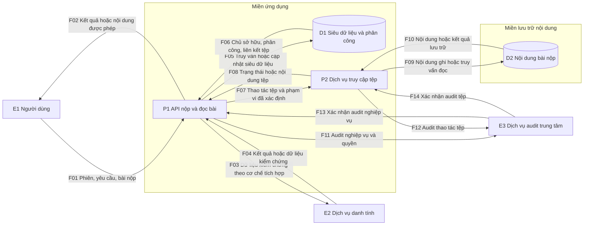
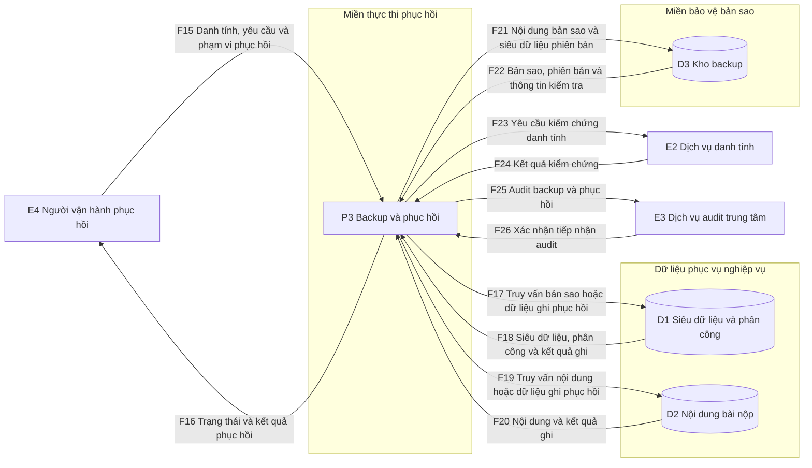

# Data flow diagram

## 1. Mục tiêu và phạm vi bài học

**Data flow diagram**, viết tắt **DFD**, là sơ đồ mô tả dữ liệu đi từ đâu, qua thành phần xử lý nào, được lưu ở đâu và được cung cấp cho ai. Trong threat modeling, DFD giúp nhóm phát triển nhìn thấy những đường mà dữ liệu, danh tính và quyền có thể đi qua để xác định điều gì có thể gây hại.

Một DFD phục vụ bảo mật cần trả lời:

- Dữ liệu nào được gửi, nhận, biến đổi và lưu?
- Thành phần nào kiểm tra danh tính, quyền và tính hợp lệ?
- Luồng nào đi qua nơi thay đổi mức tin cậy hoặc quyền kiểm soát?
- Ngoài đường nghiệp vụ chính, còn đường tải, xuất, audit, quản trị và phục hồi nào?
- Từ mỗi đường dữ liệu, cần đặt yêu cầu bảo mật và phép kiểm chứng nào?

Trong chương **Threat modeling** của module yêu cầu bảo mật, DFD là đầu vào để biến mục tiêu an toàn thông tin thành yêu cầu về xác thực, phân quyền, bảo vệ dữ liệu, logging và phục hồi.

Sau bài học, bạn có thể xây dựng một DFD có phạm vi rõ ràng, đọc sơ đồ theo góc nhìn đe dọa, lập bảng luồng dữ liệu và liên kết các luồng với kiến trúc cùng tiêu chí kiểm thử.

Ví dụ trong bài là một thiết kế giả định. Các giới hạn thời gian và dung lượng là **giá trị minh họa**, cần được xác nhận theo bối cảnh hệ thống.

## 2. Những thành phần cơ bản của DFD

### 2.1. Bốn loại phần tử chính

| Phần tử | Ý nghĩa | Ví dụ | Câu hỏi bảo mật |
| --- | --- | --- | --- |
| External entity — thực thể ngoài phạm vi | Người hoặc hệ thống giao tiếp với phần đang được mô hình hóa | Học viên, nhà cung cấp danh tính | Vì sao tin dữ liệu hoặc danh tính từ bên này? |
| Process — tiến trình xử lý | Chức năng nhận dữ liệu, kiểm tra, biến đổi hoặc tạo đầu ra | API nhận bài, dịch vụ truy cập tệp | Có kiểm tra đúng trước khi sử dụng dữ liệu không? |
| Data store — nơi lưu dữ liệu | Dữ liệu được giữ lại để dùng sau | Kho bài nộp, cơ sở dữ liệu phân công | Ai có thể đọc, sửa, xóa hoặc phục hồi? |
| Data flow — luồng dữ liệu | Dữ liệu di chuyển theo một hướng | Nội dung bài nộp, quyết định quyền, audit | Dữ liệu có bị giả mạo, đọc hoặc đưa sai đích không? |

“Tiến trình” trong DFD là đơn vị xử lý logic. Nó không bắt buộc tương ứng với một tiến trình hệ điều hành, một container hoặc một microservice riêng.

“Thực thể ngoài” được xác định theo phạm vi sơ đồ, không theo quan hệ tổ chức. Một dịch vụ danh tính cùng công ty vẫn là thực thể ngoài nếu phần đang mô hình hóa chỉ là ứng dụng nhận bài.

Một kho dữ liệu không tự giải thích cách cấp quyền. Nếu hệ thống có API lưu trữ riêng, có thể cần biểu diễn API đó như một tiến trình và kho phía sau như một nơi lưu dữ liệu.

### 2.2. Ranh giới tin cậy là thông tin bổ sung quan trọng

**Trust boundary — ranh giới tin cậy** biểu diễn nơi các giả định về danh tính, quyền, nguồn dữ liệu hoặc bên kiểm soát thay đổi.

Ví dụ:

- Từ thiết bị người dùng sang API.
- Từ ứng dụng sang dịch vụ danh tính.
- Từ tài khoản chạy ứng dụng sang miền quản trị backup.
- Từ hệ thống sang kho audit do nhóm khác quản lý.
- Giữa dữ liệu của hai nhóm khách hàng dù cùng dùng một dịch vụ.

Ranh giới này không chỉ là firewall hay subnet. Hai thành phần cùng mạng vẫn có thể thuộc miền quyền khác nhau. Ngược lại, đi qua hai subnet không tự chứng minh hai bên có mức tin cậy khác nhau.

### 2.3. Quy ước hình vẽ phải được giải thích

Có nhiều hệ ký hiệu DFD. Trong bài, sơ đồ dùng Mermaid để thể hiện quy ước:

- Hình chữ nhật cho thực thể hoặc tiến trình, được phân biệt bằng mã E hoặc P.
- Hình trụ cho nơi lưu dữ liệu, có mã D.
- Mũi tên một chiều cho dữ liệu, có mã F.
- Khung nhóm để gợi ý miền kiểm soát; bảng ranh giới giải thích ý nghĩa bảo mật.

Cú pháp Mermaid dùng để trình bày sơ đồ, không tự kiểm tra tính đúng của một DFD hoặc chứng minh có kiểm soát tại ranh giới.

## 3. DFD khác các sơ đồ quen thuộc như thế nào?

| Loại sơ đồ | Trọng tâm | Điều không nên suy ra |
| --- | --- | --- |
| DFD | Nội dung và đường di chuyển của dữ liệu | Không tự thể hiện đầy đủ thứ tự thực thi |
| Sequence diagram | Thứ tự thông điệp trong một kịch bản | Không tự bao phủ mọi nơi dữ liệu được lưu hoặc xuất |
| Flowchart | Các bước xử lý và điều kiện rẽ nhánh | Không tự mô tả miền tin cậy và quyền dữ liệu |
| Deployment diagram | Thành phần chạy ở máy, cụm hoặc mạng nào | Vị trí triển khai không đủ giải thích nội dung luồng |
| Class diagram | Kiểu dữ liệu và quan hệ trong thiết kế mã | Không đủ mô tả đường truy cập từ bên ngoài |

Một mũi tên “gọi HTTPS” mới nêu cách giao tiếp. DFD cần nói rõ đang truyền token, nội dung bài, mã tài nguyên, kết quả hay audit.

Mũi tên không chỉ là đường điều khiển. Ví dụ “cho phép đọc” có thể biểu diễn dữ liệu quyết định quyền, nhưng không nên dùng các mũi tên rẽ nhánh chỉ để biến DFD thành flowchart.

DFD có thể kết hợp với các sơ đồ khác. Khi cần biết quyền được kiểm tra trước hay sau khi trả tệp, sequence diagram hoặc mô tả xử lý sẽ bổ sung điều DFD chưa thể hiện rõ.

## 4. Chọn phạm vi và mức chi tiết

### 4.1. Bắt đầu từ mục tiêu nghiệp vụ

Không bắt đầu bằng cách vẽ mọi máy chủ. Hãy chọn chức năng cần bảo vệ, chẳng hạn:

> Học viên nộp và đọc bài của mình; người chấm đọc bài được phân công; người vận hành có thể phục hồi khi mất dữ liệu.

Xác định tài sản liên quan:

- Nội dung bài và tệp đính kèm.
- Danh tính, phiên và dữ liệu kiểm chứng.
- Quan hệ người sở hữu, lớp học và phân công.
- Audit và bằng chứng thay đổi.
- Backup cùng thông tin cần cho phục hồi.

Sau đó xác định những người và hệ thống giao tiếp với phạm vi này.

### 4.2. Đi từ ngữ cảnh đến phân rã

Có thể tổ chức hai mức:

1. **Mức ngữ cảnh:** xem phần hệ thống đang xét như một tiến trình, liệt kê đầu vào và đầu ra với các thực thể ngoài.
2. **Mức phân rã:** tách tiến trình đó thành chức năng xử lý và kho dữ liệu đủ để phân tích.

Cách đánh số mức khác nhau giữa các nhóm; điều quan trọng là thống nhất quy ước và giữ nhất quán.

Khi phân rã, các đầu vào và đầu ra ở mức cha phải được giải thích ở mức con. Nếu mức con xuất hiện một nhà cung cấp hoặc đường xuất mới, cần cập nhật phạm vi mức cha hoặc ghi rõ đây là phần mở rộng.

Không làm biến mất một đường dữ liệu chỉ vì nó bất tiện cho sơ đồ.

### 4.3. Dừng ở mức đủ để đặt câu hỏi bảo mật

Nên tách thành phần khi có khác biệt đáng kể về:

- Danh tính hoặc quyền thực thi.
- Dữ liệu được tiếp cận.
- Bên quản trị.
- Cơ chế kiểm tra.
- Nơi lưu trữ hoặc điều kiện phục hồi.
- Khả năng cung cấp dữ liệu trực tiếp cho người dùng.

Không cần một nút cho mọi hàm. Ngược lại, một nút “backend” duy nhất thường quá rộng nếu che giấu API công khai, worker quyền cao và kho bí mật.

### 4.4. Ghi điều chưa biết thay vì vẽ như đã xác nhận

Nếu chưa biết đường tải tệp có đi qua kiểm tra quyền không, ghi đó là câu hỏi cần xác minh. Có thể phân biệt:

- Thiết kế dự kiến.
- Kiến trúc đã được xác nhận.
- Giả định.
- Phần chưa nằm trong phạm vi.

Không dùng sơ đồ kiến trúc dự kiến làm bằng chứng rằng môi trường đang chạy đã có cùng hành vi.

## 5. Ví dụ: cổng nhận và đọc bài nộp

### 5.1. Phạm vi

Ví dụ gồm luồng nộp, đọc bài và luồng backup, phục hồi. Chấm bài tự động và thanh toán không thuộc thiết kế đang mô tả.

Chính sách nghiệp vụ giả định:

- Học viên đọc được bài của mình.
- Người chấm đọc được bài trong phạm vi phân công.
- Danh tính người dùng được kiểm chứng qua dịch vụ danh tính.
- Quyền trên từng bài được quyết định từ dữ liệu phân công của ứng dụng.
- Quản trị phục hồi có vai trò riêng và cần được audit.

### 5.2. Từ điển phần tử

| Mã | Phần tử | Loại và trách nhiệm |
| --- | --- | --- |
| E1 | Người dùng: học viên hoặc người chấm | Thực thể ngoài; gửi bài và yêu cầu đọc theo vai trò |
| E2 | Dịch vụ danh tính | Thực thể ngoài; cung cấp kết quả hoặc dữ liệu kiểm chứng danh tính |
| E3 | Dịch vụ audit trung tâm | Thực thể ngoài; nhận và lưu sự kiện theo giao diện đã xác định |
| E4 | Người vận hành phục hồi | Thực thể ngoài; yêu cầu phục hồi trong thẩm quyền |
| P1 | API nộp và đọc bài | Xác thực, kiểm tra quyền và điều phối nghiệp vụ |
| P2 | Dịch vụ truy cập tệp | Đọc, ghi nội dung theo yêu cầu nội bộ có kiểm soát |
| P3 | Chức năng backup và phục hồi | Tạo bản sao, khôi phục và kiểm tra trước khi mở dịch vụ |
| D1 | Kho siêu dữ liệu và phân công | Lưu chủ sở hữu, liên kết bài–tệp, phân công và phiên bản |
| D2 | Kho nội dung bài nộp | Lưu nội dung và tệp |
| D3 | Kho backup | Lưu bản sao dữ liệu và siêu dữ liệu phục hồi |

E3 là một dịch vụ ngoài phạm vi, nên được biểu diễn như thực thể ngoài. Nội bộ của dịch vụ audit có thể được phân rã bằng một DFD riêng nếu cần phân tích sâu.

### 5.3. Đầu vào và đầu ra ở mức ngữ cảnh

| Thực thể ngoài | Dữ liệu đi vào phần hệ thống đang xét | Dữ liệu đi ra |
| --- | --- | --- |
| E1 | Token hoặc thông tin phiên, yêu cầu, nội dung bài | Kết quả nộp, nội dung được phép đọc, thông báo từ chối |
| E2 | Dữ liệu kiểm chứng hoặc kết quả xác thực | Yêu cầu kiểm chứng phù hợp với cơ chế tích hợp |
| E3 | Xác nhận tiếp nhận nếu giao diện có hỗ trợ | Sự kiện audit được phép ghi |
| E4 | Yêu cầu phục hồi, tham chiếu phê duyệt và phạm vi | Trạng thái, kết quả và bằng chứng phục hồi |

Đây là bảng ngữ cảnh của phạm vi ví dụ. Luồng nghiệp vụ và hỗ trợ được vẽ tách bên dưới để sơ đồ dễ đọc, nhưng cùng dùng một từ điển mã.

## 6. DFD của luồng nghiệp vụ

### 6.1. Đọc sơ đồ theo dữ liệu

**F01 không chỉ là một yêu cầu HTTP.** Nó có thể chứa thông tin phiên, mã bài và nội dung do người dùng kiểm soát. Từng loại có yêu cầu khác nhau: token là bí mật trong nhiều cơ chế, mã bài là tham chiếu cần kiểm tra quyền, còn tệp là nội dung không tin cậy.

**F04 không tự quyết định quyền trên bài.** Dịch vụ danh tính giúp kiểm chứng chủ thể. Quyền đọc bài còn phụ thuộc D1 và chính sách nghiệp vụ.

**F07 là một giao diện có quyền thực hiện thao tác tệp.** P2 cần phân biệt yêu cầu nội bộ hợp lệ với dữ liệu do người dùng tự tạo. Không mặc định một yêu cầu từ mạng nội bộ luôn được tin cậy.

**F11 và F12 là đường dữ liệu riêng.** Audit không nên nhận toàn bộ F01 hoặc F08 vì có thể sao chép token và nội dung bài vào hệ thống quan sát.

### 6.2. Mũi tên thể hiện thiết kế, không chứng minh kiểm soát

Tên F07 có cụm “phạm vi đã xác định” để mô tả hợp đồng mong muốn. Vẫn cần xác minh P1 thực sự kiểm tra quyền, P2 thực sự giới hạn thao tác và không có đường tải trực tiếp bỏ qua chúng.

Sơ đồ cũng chưa biểu diễn đầy đủ thứ tự giữa việc ghi D1 và D2. Nếu tính nhất quán của hai nơi lưu ảnh hưởng bảo mật hoặc nghiệp vụ, cần mô tả thêm trạng thái, phiên bản và cách xử lý khi một thao tác thất bại.

## 7. DFD của backup và phục hồi

### 7.1. Luồng hai chiều phải được giải thích

F17 và F18 mô tả cả lấy dữ liệu để tạo bản sao và ghi dữ liệu khi phục hồi. Khi hai hoạt động có quyền, danh tính hoặc kiểm soát khác nhau, nên tách tiếp thành các luồng riêng ở mức chi tiết hơn.

Tương tự, chiều D3 đến P3 không chỉ là “kết nối backup”. Nó mang dữ liệu cũ trở lại miền đang phục vụ. Đây là nơi cần hỏi:

- Bản sao nào được chọn và ai quyết định?
- Nội dung và siêu dữ liệu có cùng phiên bản nhất quán không?
- Dữ liệu có bị sửa trước khi phục hồi không?
- Quyền, phiên hoặc phân công đã thay đổi sau điểm backup được xử lý thế nào?
- Có phải mở quyền quản trị rộng hơn để khôi phục không?

### 7.2. Những phụ thuộc chưa được vẽ chi tiết

Sơ đồ chưa phân rã cơ chế quản lý khóa, nguồn thời gian và việc duy trì thay đổi quyền mới hơn bản sao. Cần ghi các mục này trong danh sách phụ thuộc hoặc câu hỏi thiết kế.

Nếu dữ liệu được mã hóa, phải xác định P3 nhận quyền sử dụng khóa từ đâu và cách tiếp cận khi hệ thống chính hỏng. Nếu chưa thể xác minh quyền hiện hành sau phục hồi, không được tự coi quyền cũ trong backup là đúng.

Một phương án có thể dùng nguồn thay đổi quyền được bảo vệ riêng; phương án khác có thể vô hiệu hóa quyền chưa xác minh và yêu cầu xác nhận lại trước khi mở dịch vụ. DFD cần được cập nhật theo phương án đã chọn.

Việc nêu khoảng trống là một kết quả hữu ích của threat modeling. Nó chưa phải bằng chứng hệ thống đã có lỗ hổng khai thác được, nhưng là đầu vào cần giải quyết để đặc tả yêu cầu phục hồi.

## 8. Lập bảng mô tả luồng dữ liệu

Mũi tên cần được bổ sung bằng thông tin đủ để phân tích. Trong ví dụ, giả định P1 và P3 sử dụng cơ chế hỏi E2 về trạng thái thông tin xác thực do E2 quản lý. Một thiết kế kiểm chứng cục bộ bằng khóa sẽ có nội dung F03, F04, F23 và F24 khác, cần được mô tả lại.

| Luồng | Nguồn → đích | Dữ liệu chính | Điều cần làm rõ |
| --- | --- | --- | --- |
| F01 | E1 → P1 | Thông tin phiên, mã bài, hành động, nội dung nộp | Trường nào do người dùng kiểm soát; giới hạn kích thước; nguồn danh tính |
| F02 | P1 → E1 | Kết quả hoặc bài được phép đọc | Quyền trước khi trả; nội dung lỗi; cache và tải xuống |
| F03 | P1 → E2 | Thông tin cần kiểm tra và danh tính của P1 | Đúng đầu nhận; bảo vệ bí mật; quyền gọi dịch vụ |
| F04 | E2 → P1 | Trạng thái, định danh và điều kiện xác thực | Tính xác thực của phản hồi, thời hạn và đúng mục đích |
| F05 | P1 → D1 | Truy vấn hoặc cập nhật bài, chủ sở hữu và liên kết tệp | Danh tính cơ sở dữ liệu, phạm vi truy vấn, nguồn giá trị cập nhật |
| F06 | D1 → P1 | Phân công, quyền nghiệp vụ và mã tệp | Phiên bản, tính toàn vẹn và cách xử lý dữ liệu thiếu |
| F07 | P1 → P2 | Thao tác, mã tệp, nội dung khi ghi và phạm vi yêu cầu | P2 xác thực P1 thế nào; ngăn thay phạm vi hoặc gọi bỏ qua P1 |
| F08 | P2 → P1 | Nội dung hoặc kết quả thao tác | Tương ứng đúng yêu cầu; không trả dữ liệu thừa |
| F09 | P2 → D2 | Dữ liệu ghi hoặc truy vấn nội dung | Quyền đọc, ghi, xóa của P2; cách ánh xạ bài sang đối tượng |
| F10 | D2 → P2 | Nội dung và kết quả lưu trữ | Phiên bản, kích thước và tính toàn vẹn cần kiểm tra |
| F11, F12 | P1, P2 → E3 | Sự kiện nghiệp vụ và thao tác tệp | Chọn trường, bảo vệ khi truyền, giới hạn độ trễ |
| F13, F14 | E3 → P1, P2 | Xác nhận tiếp nhận theo hợp đồng audit | Đã nhận ở đâu, có bền vững không và cách gửi lại |
| F15 | E4 → P3 | Danh tính, yêu cầu, bản sao đích và tham chiếu phê duyệt | Thẩm quyền phục hồi; ngăn sửa phạm vi yêu cầu |
| F16 | P3 → E4 | Tiến độ, kết quả và tham chiếu bằng chứng | Không trả khóa, token hoặc nội dung ngoài quyền |
| F17, F18 | P3 ↔ D1 | Truy vấn, bản sao, dữ liệu phục hồi và trạng thái | Nhất quán phiên bản; xử lý quyền cũ |
| F19, F20 | P3 ↔ D2 | Truy vấn, nội dung phục hồi và trạng thái | Dữ liệu đích, quyền ghi và tính toàn vẹn |
| F21 | P3 → D3 | Bản sao nội dung, siêu dữ liệu, phiên bản | Bảo vệ bản sao; chính sách giữ; không để P3 có quyền phá mọi nguồn |
| F22 | D3 → P3 | Bản sao được chọn và thông tin kiểm tra | Nguồn gốc, đúng phiên bản, khóa cần dùng và trạng thái dữ liệu |
| F23, F24 | P3 ↔ E2 | Dữ liệu và kết quả kiểm chứng người vận hành | Không nhầm xác thực với quyền cho phép phục hồi |
| F25, F26 | P3 ↔ E3 | Audit và xác nhận tiếp nhận | Ghi ai phục hồi gì, kết quả, xử lý khi audit không sẵn sàng |

Trong bảng này, ký hiệu hai chiều là cách viết gọn cho hai luồng riêng đã có mã trên sơ đồ. Khi một chiều có chính sách khác, phải mô tả riêng thay vì mặc định áp dụng giống nhau.

Bảng thực tế có thể thêm phân loại dữ liệu, giao thức, chủ sở hữu, thời hạn lưu và trạng thái xác nhận. Không cần ghi giá trị token, mật khẩu hoặc khóa thật để phân tích.

## 9. Xác định ranh giới tin cậy

| Mã | Ranh giới | Giả định thay đổi | Câu hỏi thiết kế |
| --- | --- | --- | --- |
| B1 | E1 và P1 | Đầu vào đến từ thiết bị, phiên và dữ liệu do người dùng kiểm soát | Danh tính được kiểm chứng thế nào; quyền và dữ liệu được kiểm tra ở đâu? |
| B2 | P1, P3 và E2 | Ứng dụng dựa vào một nguồn danh tính | Đúng nguồn, đúng đầu nhận, đúng mục đích và trạng thái hiện hành không? |
| B3 | P1 và P2 | Một thành phần yêu cầu thao tác tệp qua danh tính dịch vụ | P2 có phân biệt yêu cầu hợp lệ với yêu cầu giả hoặc ngoài phạm vi không? |
| B4 | P2 và D2 | Quyền logic được chuyển thành quyền truy cập đối tượng lưu trữ | Có đường kho hoặc liên kết trực tiếp vượt kiểm tra không? |
| B5 | E4 và P3 | Người vận hành yêu cầu quyền có tác động lớn | Ai được phục hồi, với phê duyệt và phạm vi nào? |
| B6 | P3 và D3 | Dữ liệu đi vào hoặc ra khỏi miền bản sao được bảo vệ | Ai có thể đọc, sửa, xóa và vô hiệu hóa nguồn phục hồi? |
| B7 | P1, P2, P3 và E3 | Dữ liệu vận hành đi tới miền lưu audit | Có lộ bí mật, mất sự kiện hoặc bị sửa ngoài quyền không? |
| B8 | Các chủ sở hữu bài hoặc nhóm lớp | Một dịch vụ dùng chung xử lý tài nguyên của nhiều đối tượng | Kiểm tra quyền có gắn với từng bài và phân công không? |

B3 hoặc B8 có thể tồn tại dù các thành phần chạy trong cùng cụm. B4 có thể nằm sau một mạng riêng nhưng vẫn cần chính sách quyền. Các khung trong sơ đồ chỉ gợi ý miền; bảng này giải thích ranh giới logic cần xem xét.

Không vẽ một đường bao quanh “hệ thống tin cậy” rồi bỏ qua mọi luồng bên trong. Một dịch vụ bị chiếm có thể dùng các quyền nội bộ để tác động tới kho dữ liệu hoặc thành phần khác.

## 10. Từ DFD đến kịch bản đe dọa

Một mẫu mô tả:

> Tại [luồng hoặc thành phần], [nguồn đe dọa] có thể thực hiện [hành động] khi [điều kiện], tác động tới [tài sản] và dẫn đến [hậu quả].

| Mã | Luồng hoặc ranh giới | Kịch bản cần đánh giá |
| --- | --- | --- |
| T01 | F01, F03, F04; B1, B2 | Phiên giả, hết hạn hoặc sai mục đích được chấp nhận, dẫn đến giả mạo danh tính |
| T02 | F01, F05 đến F10; B3, B8 | Người có phiên hợp lệ đổi mã bài hoặc mã tệp để nhận nội dung ngoài quyền |
| T03 | F01, F07, F09 | Tệp hoặc yêu cầu quá lớn làm cạn tài nguyên nhận và lưu, ảnh hưởng khả năng nộp bài |
| T04 | F07 đến F10; B3, B4 | Thành phần không có thẩm quyền gọi P2 hoặc truy cập D2 trực tiếp, bỏ qua quyền nghiệp vụ |
| T05 | F11, F12, F25; B7 | Token hoặc nội dung bài bị sao chép vào log, hoặc sự kiện quan trọng không tới được nơi điều tra |
| T06 | F17 đến F24; B5, B6 | Bản sao cũ làm sống lại quyền đã thu hồi hoặc khôi phục nội dung sai phiên bản |
| T07 | F15, F21, F22; B5, B6 | Một danh tính có quyền quá rộng phá cả dữ liệu đang chạy và nguồn phục hồi |
| T08 | F02, F08, F10 | Nội dung trả về bị lẫn giữa yêu cầu hoặc người dùng do ánh xạ hay cache sai |

Đây là **kịch bản cần phân tích**, không phải danh sách lỗ hổng đã được xác nhận. Cần kiểm tra thiết kế, cấu hình hoặc hành vi để biết điều kiện yếu có thực sự tồn tại không.

### 10.1. Đi theo cả chiều ghi và chiều đọc

Khi ghi bài, cần hỏi ai được gán chủ sở hữu, ai quyết định mã tệp và làm thế nào xử lý ghi dở dang.

Khi đọc, cần hỏi quyền có còn hiệu lực, liên kết bài–tệp có đúng và có đường trực tiếp nào không qua kiểm tra.

Chỉ xem F01 mà bỏ F02 sẽ bỏ sót việc trả nhầm dữ liệu. Chỉ xem D2 mà bỏ D1 sẽ bỏ sót tính toàn vẹn của liên kết quyền và đối tượng.

### 10.2. Xem cả đường hỗ trợ

Luồng audit có thể trở thành đường tiết lộ dữ liệu. Luồng backup có thể đưa dữ liệu cũ trở lại. Người vận hành có thể là nguồn sai sót hoặc danh tính bị chiếm.

Một DFD phục vụ bảo mật cần bao phủ các đường này trong phạm vi phù hợp, dù chúng ít xuất hiện trong kịch bản người dùng hằng ngày.

## 11. Chuyển luồng dữ liệu thành yêu cầu bảo mật

### 11.1. Mẫu yêu cầu

Một yêu cầu có thể viết:

> Với [luồng, dữ liệu và môi trường], [thành phần] phải [hành vi hoặc giới hạn] khi [điều kiện], đạt [kết quả]. Kiểm chứng bằng [phương pháp] và lưu [bằng chứng].

Mã F giúp chỉ đúng luồng. Mã P giúp chỉ nơi thực hiện. Mã T giải thích vì sao yêu cầu tồn tại. Không chỉ ghi “bảo mật kết nối giữa các dịch vụ” mà bỏ qua nội dung và quyền đi trên kết nối.

### 11.2. SEC-DFD-01 — Xác thực đúng chủ thể và trạng thái

P1 và P3 phải kiểm chứng danh tính trên các yêu cầu ngoài phạm vi công khai, xác nhận thông tin xác thực còn hiệu lực và đúng mục đích sử dụng. Dữ liệu từ E2 chỉ được chấp nhận qua nguồn và kênh đã được xác định là có thẩm quyền.

Trong ví dụ, khi phiên bị thu hồi tại nguồn có thẩm quyền, các điểm tiếp nhận phải ngừng chấp nhận trong tối đa 5 phút. Yêu cầu không dùng vai trò do người dùng tự khai làm bằng chứng quyền.

- Liên quan: F01, F03, F04, F15, F23, F24; T01.
- Kiểm chứng: phiên không hợp lệ, hết hạn, bị thu hồi hoặc không phù hợp mục đích bị từ chối; phiên hợp lệ hoạt động đúng.
- Bằng chứng: cấu hình nguồn danh tính, mốc thu hồi và kết quả tại các điểm tiếp nhận.
- Nhóm thực hiện: nhóm danh tính và ứng dụng.

Giới hạn thu hồi được đo từ mốc ghi nhận thu hồi, không phải từ lúc một vụ chiếm tài khoản bắt đầu. Thời gian phát hiện cần được đánh giá riêng.

### 11.3. SEC-DFD-02 — Phân quyền theo bài và liên kết tệp

P1 phải kiểm tra quyền đối với hành động và bài đích dựa trên D1 trước khi yêu cầu P2 cung cấp hoặc thay đổi nội dung. Mã tệp sử dụng phải liên kết đúng với bài đã được kiểm tra, không được lấy trực tiếp từ trường do người gọi tự khai để bỏ qua quan hệ này.

P2 phải giới hạn thao tác theo danh tính dịch vụ và phạm vi hợp lệ của F07. Tài khoản đã xác thực nhưng ngoài chủ sở hữu hoặc phân công không được nhận nội dung.

- Liên quan: F01, F05 đến F10; T02, T04, T08.
- Kiểm chứng: thay mã bài, thay mã tệp, dùng người chấm ngoài phân công và gọi P2 từ danh tính không được phép.
- Kết quả đạt: không đọc hoặc sửa được dữ liệu ngoài quyền; luồng đúng quyền vẫn thành công.
- Bằng chứng: chính sách quyền, ánh xạ bài–tệp và kết quả thử.
- Nhóm thực hiện: nhóm API, dịch vụ tệp và dữ liệu.

Nếu quyền hoặc liên kết có thể thay đổi đồng thời với thao tác, cần xác định cách ràng buộc quyết định quyền với đối tượng và phiên bản thật sự được sử dụng.

### 11.4. SEC-DFD-03 — Giới hạn danh tính và đường truy cập

P1 chỉ được gọi giao diện tệp cần thiết; P2 chỉ có quyền lưu trữ phù hợp với chức năng đọc, ghi đã thiết kế. Danh tính dùng cho nghiệp vụ không được có quyền phá toàn bộ nguồn phục hồi ở D3.

Người dùng không được truy cập D2 bằng một đường công khai hoặc đường tải khác vượt qua chính sách quyền. Danh tính của hoạt động tạo bản sao và hoạt động phục hồi phải có phạm vi được xác định, không mặc định một quyền chung cho mọi thao tác của P3.

- Liên quan: F07 đến F10, F17 đến F22; T04, T07.
- Kiểm chứng: thử truy cập trực tiếp, dùng danh tính dịch vụ sai và thử thao tác ngoài quyền trong môi trường kiểm thử.
- Kết quả đạt: mọi đường và danh tính ngoài phạm vi bị từ chối.
- Bằng chứng: ma trận danh tính–quyền, chính sách hiệu lực và kết quả thử.
- Nhóm thực hiện: nhóm nền tảng, lưu trữ và phục hồi.

Tên một nút P3 không có nghĩa mọi chức năng bên trong phải dùng cùng danh tính. Khi cần, phân rã P3 để thể hiện sự tách biệt này.

### 11.5. SEC-DFD-04 — Giới hạn dữ liệu đầu vào

Trong ví dụ, tổng nội dung tệp của một yêu cầu nộp bài không được vượt 20 MiB. P1 hoặc thành phần tiếp nhận được phân công phải thực thi giới hạn trên dữ liệu thực nhận, không chỉ tin giá trị kích thước do máy khách khai báo.

Yêu cầu vượt giới hạn phải bị dừng theo cách không tạo bài hợp lệ hoặc tệp có thể đọc ngoài chính sách. Các phần dữ liệu đã ghi phải được xử lý theo quy trình dọn dữ liệu tạm.

- Liên quan: F01, F07, F09; T03.
- Kiểm chứng: dữ liệu ngay dưới, đúng và ngay trên giới hạn; yêu cầu không khai kích thước; ngắt kết nối giữa chừng.
- Kết quả đạt: chỉ trường hợp phù hợp được tiếp nhận đầy đủ; dữ liệu dở dang không trở thành bài hợp lệ.
- Bằng chứng: kết quả thử, trạng thái D1, D2 và số liệu tài nguyên phù hợp.
- Nhóm thực hiện: nhóm tiếp nhận và lưu trữ.

Giới hạn một yêu cầu chưa kiểm soát tổng tải đồng thời hoặc tổng dung lượng một tài khoản. Các giới hạn đó cần được đặc tả thêm theo mô hình sử dụng và đe dọa.

### 11.6. SEC-DFD-05 — Bảo vệ dữ liệu khi truyền và lưu

Các luồng mang thông tin phiên, nội dung bài và backup phải được bảo vệ khi truyền theo chính sách đã xác nhận và phải xác thực đúng đầu nhận. D1, D2 và D3 phải áp dụng bảo vệ dữ liệu lưu tương ứng với phân loại.

Không đưa token hoặc bí mật vào URL, tên đối tượng hay trường siêu dữ liệu không được thiết kế để giữ bí mật. Bản sao và dữ liệu tạm trong phạm vi cũng phải được quản lý.

- Liên quan: F01 đến F10, F17 đến F24; T01, T04, T07.
- Kiểm chứng: kiểm tra từng kết nối và nơi lưu, thử đầu nhận không hợp lệ và đường truy cập không đáp ứng chính sách.
- Kết quả đạt: không chấp nhận đầu nhận hoặc đường truyền ngoài điều kiện; cấu hình thực tế phù hợp.
- Bằng chứng: danh sách kết nối, kho dữ liệu, chính sách và kết quả.
- Nhóm thực hiện: nhóm ứng dụng, nền tảng và quản lý khóa.

Mã hóa không thay thế SEC-DFD-02. Một thành phần có quyền giải mã vẫn có thể trả dữ liệu cho người sai quyền nếu logic nghiệp vụ thiếu kiểm tra.

### 11.7. SEC-DFD-06 — Audit đủ dùng và không sao chép bí mật

F11, F12 và F25 phải tạo sự kiện chứa danh tính tham chiếu, hành động, mã tài sản, thời điểm, kết quả và mã tương quan. Không ghi token đầy đủ, mật khẩu hoặc nội dung bài.

Trong ví dụ, sự kiện phải có tại E3 trong tối đa 5 phút. Hợp đồng F13, F14 và F26 phải xác định rõ ý nghĩa xác nhận tiếp nhận, cách thử lại và phát hiện sự kiện thiếu hoặc trùng.

- Liên quan: T05.
- Kiểm chứng: tạo thao tác thành công, bị từ chối và lỗi giữa đường; đo độ trễ; dùng dữ liệu tổng hợp có dấu nhận biết để tìm bản sao không được phép trong log.
- Thử E3 không sẵn sàng để xác nhận hành vi đệm, cảnh báo và xử lý sự kiện theo yêu cầu đã chọn.
- Bằng chứng: sự kiện đã lọc dữ liệu, mốc thời gian và bảng đối chiếu.
- Nhóm thực hiện: nhóm ứng dụng, audit và vận hành.

Phải quyết định loại thao tác nào được tiếp tục khi audit không sẵn sàng, với giới hạn nào. Một phản hồi thành công ở giao diện gửi log chưa đủ chứng minh sự kiện đã được lưu bền vững.

### 11.8. SEC-DFD-07 — Phục hồi đúng nội dung và quyền

Trong kịch bản mất kho dữ liệu chính của ví dụ, P3 phải khôi phục dịch vụ với RPO không quá 15 phút và RTO không quá 60 phút theo mốc đo đã thống nhất.

RPO là mục tiêu về khoảng dữ liệu có thể mất trước sự cố. RTO là mục tiêu về thời gian khôi phục; ở đây đo từ lúc công bố sự cố đến khi chức năng nộp và đọc hoạt động với dữ liệu cùng quyền đã được kiểm tra.

Quyền hoặc phiên không xác minh được sau phục hồi không được tự kích hoạt chỉ vì có trong backup. Bản sao nội dung và siêu dữ liệu phải có quan hệ phiên bản được kiểm tra, đồng thời phải tiếp cận được khóa cần dùng theo quyền đã duyệt.

- Liên quan: F15 đến F26; T06, T07.
- Kiểm chứng: tạo dữ liệu tổng hợp có mốc, thay quyền sau khi tạo backup, phục hồi từ bản sao cũ và kiểm tra.
- Kết quả đạt: nội dung, liên kết tệp và quyền đúng; người ngoài quyền bị từ chối; mục tiêu thời gian và dữ liệu được đáp ứng trong kịch bản.
- Bằng chứng: biên bản, mốc thời gian, kiểm tra phiên bản, khóa và ma trận quyền sau phục hồi.
- Nhóm thực hiện: nhóm phục hồi, dữ liệu, danh tính và chủ sở hữu nghiệp vụ.

Không mở quyền quá rộng chỉ để đạt mục tiêu thời gian. Nếu chưa có cơ chế giữ hoặc xác nhận quyền hiện hành, đó là phần thiết kế còn phải hoàn tất trước khi kết luận đạt.

## 12. Bảng truy vết từ DFD đến kiểm thử

| Đe dọa | Luồng trọng tâm | Yêu cầu | Bằng chứng cần có |
| --- | --- | --- | --- |
| T01 Giả mạo hoặc dùng phiên không hợp lệ | F01, F03, F04, F15, F23, F24 | SEC-DFD-01, SEC-DFD-05 | Ma trận thông tin xác thực và kiểm tra nguồn |
| T02 Đọc ngoài quyền | F01, F05 đến F10 | SEC-DFD-02 | Kiểm thử theo người gọi, bài và mã tệp |
| T03 Cạn tài nguyên tiếp nhận | F01, F07, F09 | SEC-DFD-04 | Thử ranh giới kích thước và xử lý ghi dở |
| T04 Gọi bỏ qua API | F07 đến F10 | SEC-DFD-02, SEC-DFD-03 | Thử danh tính dịch vụ và đường lưu trữ trực tiếp |
| T05 Lộ dữ liệu hoặc mất audit | F11 đến F14, F25, F26 | SEC-DFD-06 | Kiểm tra trường log, độ trễ và đối chiếu sự kiện |
| T06 Phục hồi quyền cũ hoặc sai phiên bản | F17 đến F24 | SEC-DFD-07 | Diễn tập với thay đổi quyền sau điểm backup |
| T07 Phá nguồn phục hồi | F15, F21, F22 | SEC-DFD-03, SEC-DFD-05, SEC-DFD-07 | Thử quyền phá hủy và kiểm tra phụ thuộc khóa |
| T08 Trả lẫn dữ liệu | F02, F08, F10 | SEC-DFD-02 | Thử đồng thời nhiều người và đối chiếu nội dung |

Bảng này là kế hoạch bằng chứng, không phải báo cáo rằng các phép thử đã được chạy. Khi thực hiện, cần ghi phiên bản, môi trường, điều kiện, dữ liệu tổng hợp và kết quả thực tế.

Một trường hợp bị từ chối cần kiểm tra cả dữ liệu chính lẫn thông tin phụ. Không chỉ xem mã phản hồi mà bỏ qua tiêu đề tệp, bản xem trước hoặc nội dung được trả kèm.

## 13. Duy trì DFD khi kiến trúc thay đổi

### 13.1. Thêm tải trực tiếp bằng liên kết

Giả sử hệ thống cho người dùng tải từ dịch vụ lưu trữ bằng một liên kết được cấp sẵn. Luồng E1 không còn chỉ đi qua P1 và P2.

Cần mô tả giao diện cung cấp tệp của dịch vụ lưu trữ như một tiến trình hoặc thực thể dịch vụ phù hợp với phạm vi, rồi nối tới D2. Không dùng hình kho dữ liệu logic để che giấu trách nhiệm xác thực của giao diện đó.

Các câu hỏi mới:

- Ai cấp liên kết và căn cứ quyền ở thời điểm nào?
- Bên sở hữu liên kết có thể tải không cần danh tính khác không?
- Liên kết có thời hạn, phạm vi và cách thu hồi nào?
- Link có thể xuất hiện trong log, lịch sử hoặc nơi chia sẻ nào?
- Sau thu hồi quyền, đường tải có còn hoạt động không?
- Audit được tạo ở đâu?

Không thể giữ nguyên DFD cũ và kết luận SEC-DFD-01, SEC-DFD-02 vẫn đạt cho đường mới.

### 13.2. Thêm xử lý bất đồng bộ

Nếu bổ sung hàng đợi và worker xem trước hoặc chấm bài, cần thêm:

- Dữ liệu công việc được gửi vào hàng đợi.
- Danh tính của bên gửi và bên xử lý.
- Dữ liệu cần đọc, đầu ra cần ghi.
- Cách ràng buộc tác vụ với bài và phạm vi quyền.
- Cách xử lý công việc lặp, hết hạn hoặc quyền thay đổi trong lúc chờ.
- Quyền mạng và bí mật mà worker có thể tiếp cận.

Nội dung bài do học viên gửi không trở thành dữ liệu tin cậy chỉ vì đã qua hàng đợi. Nếu worker phân tích hoặc thực thi nội dung đó, cần xem xét thêm ranh giới cách ly và giới hạn tài nguyên.

### 13.3. Các thay đổi khác cần cập nhật

- Thêm nhóm người dùng hoặc khách hàng dùng chung.
- Chuyển dữ liệu sang vùng, dịch vụ hoặc bên quản trị khác.
- Đổi cơ chế danh tính, cache quyền hoặc nguồn phân công.
- Thêm bản xuất, công cụ hỗ trợ hoặc nơi thu thập lỗi.
- Đổi backup, khóa hoặc phương án phục hồi.
- Phát hiện một đường truy cập có thật nhưng chưa có trên sơ đồ.

DFD nên có phạm vi, phiên bản, người chịu trách nhiệm và danh sách câu hỏi còn mở. Khi thay đổi quan trọng, cập nhật cả luồng, đe dọa, yêu cầu và phép kiểm chứng liên quan.

## 14. Các sai lầm thường gặp

| Sai lầm | Vấn đề | Cách sửa |
| --- | --- | --- |
| Mũi tên chỉ ghi tên giao thức | Không biết dữ liệu và quyền nào đi qua | Ghi nội dung chính, nguồn và đích |
| Vẽ một mũi tên hai chiều không giải thích | Đầu vào và đầu ra có thể khác độ nhạy, kiểm soát | Tách chiều hoặc mô tả rõ từng luồng |
| Đồng nhất ranh giới với subnet | Bỏ qua khác biệt danh tính và quyền cùng mạng | Ghi giả định tin cậy và miền quản trị |
| Chỉ vẽ luồng người dùng thành công | Bỏ audit, lỗi, quản trị và phục hồi | Mô tả thêm các đường dữ liệu hỗ trợ |
| Xem token hợp lệ là quyền đọc mọi dữ liệu | Nhầm xác thực với phân quyền | Liên kết danh tính với tài nguyên và hành động |
| Cho rằng tên mũi tên đã chứng minh kiểm soát | Sơ đồ mới mô tả mong muốn | Kiểm tra thiết kế, cấu hình và hành vi |
| Bỏ đường tải trực tiếp cho sơ đồ đơn giản | Che giấu đường vượt kiểm soát | Biểu diễn giao diện thật sự cung cấp nội dung |
| Vẽ quá chi tiết ngay từ đầu | Khó thấy ranh giới và thiếu tính nhất quán | Bắt đầu từ ngữ cảnh, phân rã theo nhu cầu phân tích |
| Gắn đe dọa vào DFD rồi coi là lỗ hổng đã xác nhận | Kết luận vượt bằng chứng | Tách kịch bản, giả định và phát hiện thực tế |
| Dùng DFD cũ cho phiên bản mới | Yêu cầu và thử nghiệm bỏ sót luồng mới | Quản lý phiên bản và cập nhật truy vết |

## 15. Bài tập tự thực hành

Một dịch vụ cho phép nhân viên tải tài liệu lên, tìm kiếm, xem trước và chia sẻ trong nhóm. Dịch vụ dùng nhà cung cấp danh tính, object storage, worker tạo bản xem trước và kho audit. Dữ liệu được backup hằng ngày.

Thực hiện:

1. Xác định phạm vi, tài sản và các thực thể ngoài.
2. Vẽ mức ngữ cảnh với đầu vào, đầu ra có tên dữ liệu.
3. Phân rã API, kiểm tra quyền, dịch vụ tệp và worker.
4. Đặt mã cho thành phần, nơi lưu và từng chiều luồng.
5. Ghi những ranh giới thay đổi danh tính, quyền hoặc bên quản trị.
6. Bổ sung tìm kiếm, bản xem trước, audit và phục hồi.
7. Chọn ba kịch bản đe dọa gắn với mã luồng.
8. Viết một yêu cầu xác thực, một yêu cầu phân quyền, một yêu cầu audit và một yêu cầu phục hồi.
9. Nêu phép thử và bằng chứng cho từng yêu cầu.
10. Cập nhật DFD khi bổ sung liên kết tải trực tiếp có thời hạn.

Tự kiểm tra:

- Mỗi mũi tên đã nói rõ dữ liệu gì, thay vì chỉ nói “gọi API” chưa?
- Kho dữ liệu có đường đọc hoặc ghi nào chưa được giải thích không?
- Có nguồn quyền nào chỉ được giả định mà chưa được xác minh không?
- Worker dùng quyền của ai và tiếp cận bí mật nào?
- Người ngoài quyền có thể thấy tiêu đề hoặc bản xem trước không?
- Luồng audit có thể chứa bí mật hoặc nội dung tài liệu không?
- Phục hồi có mở lại quyền đã thu hồi không?
- Mức con có giải thích các đầu vào, đầu ra của mức cha không?
- Đe dọa nào là giả định và đe dọa nào đã có bằng chứng về điểm yếu?
- Sơ đồ có đại diện cho phiên bản đang được đánh giá không?

## 16. Những điểm cần ghi nhớ

DFD giúp nhìn hệ thống theo dữ liệu: nguồn, xử lý, nơi lưu, đầu ra và ranh giới tin cậy. Giá trị của sơ đồ nằm ở những câu hỏi nó làm rõ, không ở số lượng hình và mũi tên.

Một DFD phục vụ yêu cầu bảo mật cần được nối với bảng luồng, kịch bản đe dọa, yêu cầu đo được và bằng chứng kiểm chứng. Các đường tải, xuất, audit, quản trị và phục hồi phải được xem xét cùng luồng nghiệp vụ; khi kiến trúc thay đổi, các liên kết đó cũng cần được cập nhật.
