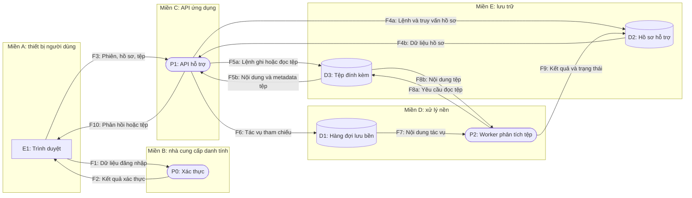

# Trust boundary trong DFD

## 1. Trust boundary giúp đặt đúng câu hỏi bảo mật

**Trust boundary — ranh giới tin cậy** là vị trí mà dữ liệu, yêu cầu hoặc quyền thực hiện đi qua sự thay đổi về giả định tin cậy, danh tính, quyền hạn hay trách nhiệm kiểm soát.

Trong **DFD — Data Flow Diagram, sơ đồ luồng dữ liệu**, trust boundary giúp nhóm thiết kế nhận ra những chỗ không được tiếp tục tin dữ liệu hoặc quyền chỉ vì chúng đã được chấp nhận ở bước trước.

Ví dụ, trình duyệt gửi mã khách hàng và mã tenant đến API. API không được coi các giá trị đó là bằng chứng rằng người gọi có quyền trên khách hàng hoặc tenant tương ứng. Khi API tạo tác vụ cho worker, quyền kỹ thuật của worker cũng không tự cho phép thực hiện mọi việc mà người dùng yêu cầu.

Trong thiết kế yêu cầu bảo mật, chuỗi phân tích cần có là:

**Luồng dữ liệu → thay đổi giả định tin cậy → đe dọa → yêu cầu bảo mật → điểm thực thi → tiêu chí kiểm chứng.**

Bài học giúp bạn:

- Nhận diện các phần tử DFD cần cho threat modeling.
- Xác định trust boundary vật lý, quản trị và logic.
- Phân tích danh tính, quyền và nguồn dữ liệu khi đi qua ranh giới.
- Chuyển kết quả thành yêu cầu về xác thực, phân quyền, dữ liệu, logging và phục hồi.
- Duy trì mô hình khi kiến trúc và quyền thay đổi.

Các hệ thống, mã luồng và mốc thời gian trong bài là ví dụ giả định.

## 2. Những phần tử cần có trong DFD

DFD mô tả dữ liệu được tạo, xử lý, lưu và chuyển đi thế nào. Nó có thể được bổ sung trust boundary để phục vụ phân tích bảo mật.

| Phần tử | Vai trò trong mô hình | Ví dụ |
|---|---|---|
| External entity — thực thể bên ngoài phạm vi đang phân tích | Nguồn hoặc đích tương tác với hệ thống | Người dùng, đối tác, nhà cung cấp danh tính |
| Process — tiến trình xử lý | Biến đổi dữ liệu hoặc đưa ra quyết định | API, dịch vụ nghiệp vụ, worker |
| Data store — kho dữ liệu | Lưu dữ liệu để truy cập sau | Cơ sở dữ liệu, kho tệp, hàng đợi có lưu bền |
| Data flow — luồng dữ liệu | Biểu diễn dữ liệu di chuyển theo hướng xác định | Yêu cầu, phản hồi, token, tệp, tác vụ |
| Trust boundary | Đánh dấu thay đổi về tin cậy hoặc quyền kiểm soát | Thiết bị người dùng sang backend; người dùng sang danh tính dịch vụ |

Ký hiệu có thể khác giữa công cụ. Điều quan trọng là chú giải nhất quán, tên có ý nghĩa và hướng luồng đúng.

### 2.1. “Bên ngoài” phụ thuộc phạm vi mô hình

Một nhà cung cấp danh tính có thể là thực thể bên ngoài trong DFD tổng quan của ứng dụng. Khi phân tích chi tiết quy trình đăng nhập, nó có thể được mô hình hóa thành nhiều tiến trình và kho dữ liệu riêng.

Tương tự, một dịch vụ nội bộ có thể là external entity đối với phạm vi đang xét. “Bên ngoài” trong DFD không tự có nghĩa không an toàn, và “nội bộ” không tự có nghĩa được tin hoàn toàn.

Cần ghi rõ phạm vi để người đọc biết thành phần nào được phân rã và thành phần nào đang được dùng qua hợp đồng hoặc giả định.

### 2.2. Luồng cần mô tả dữ liệu có ý nghĩa bảo mật

Những tên như “request” hoặc “data” thường quá chung. Nên ghi được dữ liệu và ý nghĩa chính:

- Danh tính hoặc thông tin phiên.
- Mã tenant, mã đối tượng, hành động và bộ lọc.
- Tệp do người dùng tải lên.
- Tác vụ chứa tham chiếu dữ liệu và mục đích xử lý.
- Kết quả nghiệp vụ, đường tải hoặc trạng thái.
- Log, thông tin lỗi và dữ liệu phục hồi.

Yêu cầu và phản hồi có thể có giả định tin cậy khác nhau. Khi chúng ảnh hưởng đến phân tích, nên vẽ riêng hai hướng thay vì một mũi tên chung “giao tiếp”.

### 2.3. DFD khác sơ đồ triển khai

Sơ đồ triển khai có thể cho biết dịch vụ chạy ở máy, vùng mạng hoặc tài khoản nào. DFD cho biết dữ liệu nào đi qua những thành phần xử lý và lưu trữ nào.

Hai loại sơ đồ bổ sung cho nhau. Một đường mạng nội bộ vẫn có thể mang dữ liệu do người dùng kiểm soát. Hai thành phần ở khác máy chưa chắc tạo một ranh giới quyền mới; một tiến trình duy nhất lại có thể xử lý dữ liệu của nhiều tenant với các ranh giới logic quan trọng.

Không nên chỉ vẽ subnet, firewall và máy chủ rồi coi như đã mô hình hóa đủ luồng dữ liệu.

## 3. Khi nào có một trust boundary?

Một ranh giới đáng chú ý xuất hiện khi một hoặc nhiều câu trả lời sau thay đổi:

| Khía cạnh | Câu hỏi |
|---|---|
| Nguồn dữ liệu | Ai có thể tạo hoặc sửa dữ liệu trước khi bên nhận dùng nó? |
| Danh tính | Ai được xác thực, bằng cơ chế và nguồn thẩm quyền nào? |
| Quyền | Bên nhận có quyền rộng hơn hoặc khác với bên gửi không? |
| Chủ thể quyết định | Ai có quyền phê duyệt hành động hoặc chính sách? |
| Quản trị | Nhóm, tổ chức hoặc nhà cung cấp nào kiểm soát thành phần? |
| Phạm vi dữ liệu | Dữ liệu thuộc tenant, người dùng, môi trường hoặc mức phân loại nào? |
| Cách diễn giải | Dữ liệu được dùng như văn bản, lệnh, truy vấn, đường dẫn hay nội dung thực thi? |
| Thời gian | Quyền và điều kiện hiện tại có còn giống lúc tạo yêu cầu không? |

Không cần mỗi thay đổi đều được vẽ thành một vùng riêng nếu làm sơ đồ khó đọc. Có thể dùng mã ranh giới và bảng giải thích. Nhưng thay đổi quan trọng phải được ghi nhận và có người chịu trách nhiệm xử lý.

### 3.1. Ranh giới thiết bị và người dùng

Thiết bị người dùng có thể bị điều khiển bởi chính người dùng hoặc phần mềm khác. Dữ liệu ẩn trên giao diện, trường chỉ đọc và logic JavaScript không phải căn cứ đủ để backend tin vào quyền, tenant hay trạng thái nghiệp vụ.

Máy chủ cần xác định danh tính từ nguồn được kiểm chứng và kiểm tra quyền trên hành động, đối tượng và dữ liệu cụ thể.

### 3.2. Ranh giới giữa các danh tính dịch vụ

API và worker có thể thuộc cùng nhóm phát triển nhưng sử dụng các quyền khác nhau. Worker có quyền đọc nhiều dữ liệu để phục vụ nhiều tác vụ; người yêu cầu chỉ có quyền trên một phần.

Khi yêu cầu đi sang worker, cần phân biệt:

- Worker là dịch vụ nào?
- Tác vụ được tạo bởi ai?
- Tác vụ được phép thực hiện trên dữ liệu nào?
- Có cần kiểm tra lại quyền khi thực hiện không?

Xác thực worker chỉ trả lời một phần về bên thực hiện. Nó không tự chứng minh người yêu cầu có quyền hưởng kết quả.

### 3.3. Ranh giới tenant và đối tượng

Trong hệ thống nhiều tenant, dữ liệu có thể nằm trong cùng cơ sở dữ liệu hoặc cùng tiến trình. Ranh giới tenant vẫn tồn tại về logic.

Mã tenant do máy khách gửi không tự chứng minh tư cách thành viên. Một khóa đối tượng khó đoán cũng không thay cho kiểm tra quyền. Cần mô hình hóa cách hệ thống liên kết danh tính với tenant và đối tượng.

### 3.4. Ranh giới diễn giải dữ liệu

Một tệp đã đi qua API và được lưu trong kho nội bộ vẫn có thể chứa nội dung do người dùng kiểm soát. Khi worker phân tích hoặc trình duyệt hiển thị tệp, dữ liệu bước sang một ngữ cảnh diễn giải mới.

Cần xem xét nội dung có thể trở thành:

- Tham số truy vấn hoặc lệnh.
- Đường dẫn hoặc tên tài nguyên.
- Mẫu tài liệu hoặc nội dung chủ động.
- Đầu vào cho bộ phân tích có quyền truy cập tài nguyên khác.

Việc tải tệp từ một kho đã xác thực không chứng minh nội dung tệp an toàn cho mọi cách sử dụng.

### 3.5. Ranh giới quản trị và môi trường

Ứng dụng, dịch vụ lưu trữ và hệ thống quản trị có thể do các nhóm khác nhau kiểm soát. Dữ liệu sao chép sang kiểm thử, công cụ hỗ trợ hoặc nhà cung cấp mới có thể gặp chính sách quyền, lưu giữ và quan sát khác.

Cần xác định trách nhiệm của mỗi bên, nguồn cấu hình tin cậy và bằng chứng về phần kiểm soát được kế thừa.

## 4. Trust boundary không phải nhãn “an toàn” hoặc “nguy hiểm”

### 4.1. Tin cậy cần gắn với thuộc tính

Có thể tin rằng một thông điệp đến từ worker đã được xác thực, nhưng chưa có căn cứ tin rằng nội dung tác vụ được phép hoặc còn hiệu lực.

Có thể tin tính toàn vẹn của một tệp trong kho, nhưng không tin rằng nội dung của nó phù hợp để hiển thị trực tiếp trong trình duyệt.

Một ghi nhận hữu ích nên nói rõ:

> Tin thuộc tính nào, do nguồn nào xác nhận, trong phạm vi nào, và vẫn phải kiểm tra điều gì?

### 4.2. Mã hóa không xóa ranh giới

Mã hóa đường truyền và xác thực hai đầu giúp bảo vệ kênh cùng danh tính theo thiết kế. Bên nhận vẫn cần kiểm tra quyền, nội dung, trạng thái và mục đích.

Hai dịch vụ kết nối qua kênh đã bảo vệ vẫn có thể gửi yêu cầu vượt quyền, dữ liệu sai tenant hoặc thông điệp cũ. Trust boundary vẫn cần được phân tích.

### 4.3. Vẽ ranh giới không tạo ra kiểm soát

Đường bao trên DFD là một công cụ nhận diện và trao đổi. Hiệu lực bảo vệ đến từ yêu cầu và cơ chế được thực thi tại đúng vị trí.

Với mỗi ranh giới, nhóm cần ghi:

1. Dữ liệu đi qua.
2. Thuộc tính đã biết và chưa biết.
3. Đe dọa có thể xảy ra.
4. Yêu cầu phải thực hiện.
5. Điểm thực thi, người chịu trách nhiệm và cách kiểm chứng.

Nếu chỉ có sơ đồ mà không có các đầu ra này, mô hình chưa đủ để hỗ trợ triển khai yêu cầu bảo mật.

## 5. DFD minh họa: cổng hỗ trợ có tệp đính kèm

### 5.1. Phạm vi và giả định

Xét một cổng hỗ trợ phục vụ nhiều doanh nghiệp. Mỗi doanh nghiệp là một tenant. Người dùng đăng nhập, tạo hồ sơ hỗ trợ và tải tệp đính kèm. Worker xử lý tệp bất đồng bộ.

Phạm vi minh họa gồm:

- Trình duyệt và kết quả xác thực từ nhà cung cấp danh tính.
- API hỗ trợ, hàng đợi và worker.
- Kho hồ sơ và kho tệp.
- Quyền trên hồ sơ, tệp và tác vụ theo tenant.

Các giả định kiến trúc được chọn:

- API và worker dùng danh tính dịch vụ khác nhau.
- Kho dữ liệu có chính sách truy cập riêng và được quản trị theo phân công.
- Người dùng tải tệp qua API; không có đường tải công khai trực tiếp từ kho trong thiết kế này.
- Nội dung tệp bắt nguồn từ người dùng và vẫn phải được xem là đầu vào chưa tin cậy khi worker đọc lại.
- Nguồn khóa, cấu hình xác thực, log, sao lưu và đường quản trị cần được phân rã bổ sung; chúng được ghi nhận ở phần sau.

Các vùng trên sơ đồ biểu diễn các miền tin cậy cần phân tích trong tình huống này. Chúng không phải sơ đồ subnet và không khẳng định mọi tổ chức đều có cách chia miền tương tự.

### 5.2. Sơ đồ luồng



P0 được biểu diễn như một tiến trình để thấy luồng xác thực. Giao thức thực tế có thể có nhiều bước; mô hình chi tiết phải thể hiện các bước ảnh hưởng bảo mật, nguồn cấu hình và cách kiểm chứng kết quả.

Sơ đồ tập trung vào nội dung dữ liệu chính. Các thông điệp xác nhận kỹ thuật chưa được vẽ hết; hành vi thử lại, nhận lặp và lỗi vẫn phải được phân tích nếu ảnh hưởng quyền hoặc trạng thái.

### 5.3. Bảng luồng và giả định cần kiểm tra

| Luồng | Dữ liệu hoặc ý nghĩa | Điều bên nhận phải xác minh |
|---|---|---|
| F1 | Dữ liệu phục vụ đăng nhập | P0 xác minh theo giao thức được chọn; không ghi bí mật vào log |
| F2 | Kết quả xác thực qua thiết bị người dùng | Ứng dụng phải kiểm chứng kết quả theo giao thức; việc đi qua trình duyệt không làm dữ liệu tự đáng tin |
| F3 | Phiên, nội dung hồ sơ, mã tenant, mã đối tượng, tệp | P1 xác minh danh tính, tenant, quyền, cấu trúc và giới hạn đầu vào |
| F4a | Lệnh và truy vấn hồ sơ | Dữ liệu dùng trong lệnh không được làm thay đổi cấu trúc thao tác ngoài thiết kế; quyền và phạm vi tenant phải được thực thi |
| F4b | Hồ sơ và metadata từ kho | P1 giới hạn trường và đối tượng trước khi trả cho người gọi; dữ liệu lưu không tự là nội dung an toàn để hiển thị |
| F5a | Yêu cầu lưu hoặc lấy tệp | Ràng buộc tệp với hồ sơ, tenant, chủ thể và thao tác được phép; không dùng tên tệp làm quyền |
| F5b | Nội dung và metadata tệp | P1 kiểm tra quyền trước trả dữ liệu; metadata liên quan quyền phải đến từ nguồn có thẩm quyền |
| F6, F7 | Tác vụ chứa tham chiếu và ngữ cảnh xử lý | Kiểm soát bên tạo, tính toàn vẹn, phạm vi ủy quyền, hiệu lực và hành vi nhận lặp |
| F8a, F8b | Worker lấy tệp theo tham chiếu | Worker chỉ lấy đúng đối tượng được phép; parser coi nội dung là đầu vào chưa tin cậy |
| F9 | Kết quả phân tích hoặc trạng thái | Chỉ cập nhật đúng hồ sơ, tenant và phiên bản tác vụ; không cho kết quả cũ ghi đè trạng thái mới trái quy tắc |
| F10 | Nội dung cho trình duyệt hoặc tệp tải | Giới hạn đầu ra, cách hiển thị, kiểu nội dung và quyền tải; không tự thực thi nội dung do người dùng gửi |

### 5.4. Danh mục ranh giới

| Mã | Ranh giới | Thay đổi quan trọng |
|---|---|---|
| TB-01 | Thiết bị người dùng ↔ nguồn xác thực | Dữ liệu do thiết bị gửi trở thành đầu vào cho quyết định xác thực |
| TB-02 | Trình duyệt → API | Yêu cầu do người gọi kiểm soát đi vào tiến trình có quyền nghiệp vụ |
| TB-03 | API → hàng đợi → worker | Yêu cầu chuyển sang xử lý nền bằng danh tính dịch vụ, có độ trễ và quyền khác |
| TB-04 | Tiến trình → kho dữ liệu | Bên xử lý sử dụng quyền lưu trữ; cần giới hạn tenant, đối tượng và lệnh |
| TB-05 | Nội dung tệp → parser hoặc trình duyệt | Dữ liệu được diễn giải trong ngữ cảnh có thể gây hành vi ngoài dự kiến |
| TB-06 | Tenant A ↔ tenant B trong dữ liệu dùng chung | Cách ly logic tồn tại dù không có đường mạng riêng giữa các tenant |

TB-05 và TB-06 có thể không trùng một đường bao riêng trên sơ đồ. Bảng giải thích bổ sung giúp người đọc không bỏ sót ranh giới logic bên trong tiến trình và kho.

## 6. Phân tích một luồng đi qua trust boundary

### 6.1. Xác định nguồn thẩm quyền cho từng thuộc tính

Với F3, yêu cầu có thể chứa:

```json
{
  "tenant_id": "tenant_demo_A",
  "case_id": "case_demo_104",
  "attachment_name": "attachment_demo.txt",
  "requested_action": "analyze"
}
```

Đây là dữ liệu giả định. Các trường trên biểu đạt yêu cầu; chúng chưa chứng minh quyền.

Cần xác định riêng:

- Danh tính người gọi đến từ phiên hoặc kết quả xác thực được kiểm chứng.
- Tenant được phép của người gọi đến từ nguồn quyền phía máy chủ.
- Tenant thực sự của hồ sơ đến từ dữ liệu được quản lý có thẩm quyền.
- Quan hệ tệp với hồ sơ do hệ thống ràng buộc.
- Hành động được phép do chính sách hiện hành quyết định.
- Tên tệp chỉ là dữ liệu hiển thị hoặc đầu vào đã giới hạn, không tự trở thành đường dẫn thực thi.

Một thuộc tính đã được kiểm chứng có thể dùng làm căn cứ cho bước sau trong phạm vi phù hợp. Không nên gộp mọi trường thành một trạng thái chung “request đã trusted”.

### 6.2. Phân biệt xác thực nguồn và cấp quyền hành động

Ở TB-03, hàng đợi có thể chỉ nhận thông điệp từ API đã xác thực. Điều đó chưa đủ chứng minh:

- Thông điệp được tạo sau một phê duyệt quyền đúng.
- Tham chiếu trong thông điệp thuộc tenant hợp lệ.
- Quyền người dùng chưa bị thu hồi.
- Tác vụ chưa hết hạn hoặc chưa được xử lý.
- Worker được phép cập nhật kết quả vào đối tượng được nêu.

Cần ràng buộc danh tính dịch vụ, người khởi tạo, phạm vi dữ liệu và thời điểm quyết định. Hệ thống không được để quyền rộng của worker biến mọi tham chiếu trong thông điệp thành quyền thực hiện.

### 6.3. Kiểm tra lại ở thời điểm phù hợp

Luồng bất đồng bộ có khoảng cách giữa lúc yêu cầu được chấp nhận và lúc hành động xảy ra. Có thể phát sinh:

- Người dùng bị thu hồi quyền.
- Hồ sơ đổi tenant theo một quy trình hợp lệ.
- Tệp bị thay thế bằng phiên bản khác.
- Tác vụ hết hạn, bị hủy hoặc đã hoàn thành.
- Chính sách thay đổi.

Thiết kế phải nêu kiểm tra nào thực hiện khi xếp hàng, khi chạy và trước khi trả kết quả. Có thể dùng phiên bản, tham chiếu bất biến, trạng thái hoặc cơ chế đồng bộ thích hợp; phải bảo đảm kết quả đáp ứng yêu cầu đã chọn.

Không chỉ dựa vào một lần kiểm tra đầu luồng để suy ra quyền còn đúng sau một thời gian không xác định.

### 6.4. Phân tích cả dữ liệu trả về

Trust boundary có hai chiều. Dữ liệu từ kho hoặc dịch vụ khác có thể chứa văn bản do người dùng nhập trước đó, metadata sai hoặc nội dung không phù hợp với đích hiển thị.

Ví dụ, dữ liệu trong F4b là bản ghi thật của hệ thống nhưng trường mô tả vẫn do người dùng kiểm soát. Trước F10, ứng dụng cần giới hạn trường, xử lý đúng ngữ cảnh hiển thị và không để nội dung biến thành hành vi ngoài dự kiến.

Với tệp, cần đặc tả nó được tải như tệp, hiển thị theo cách nào, có nội dung chủ động không và dùng phạm vi thực thi nào. Một bước kiểm tra tệp không thay cho mọi giới hạn diễn giải phía sau.

### 6.5. Đường lỗi, quản trị và phục hồi

Mô hình chi tiết cần bổ sung các luồng có thể bỏ qua đường chính:

| Luồng bổ sung | Câu hỏi cần phân tích |
|---|---|
| Cấu hình xác thực và khóa kiểm chứng | Ai được đổi nguồn thẩm quyền, chính sách và khóa; thay đổi được xác nhận thế nào? |
| Quyền quản trị | Ai có thể đọc trực tiếp, đổi tenant hoặc mở quyền lưu trữ? |
| Log và trace | Dữ liệu nào được chuyển sang hệ thống quan sát, ai đọc được? |
| Tệp tạm, bản sao và chỉ mục | Có giữ nguyên phạm vi bảo vệ không? |
| Sao lưu và phục hồi | Quyền cũ, dữ liệu đã xóa hoặc tác vụ cũ có quay lại không? |
| Tích hợp và công cụ hỗ trợ | Có bản sao hoặc đầu mối xử lý ngoài mô hình ban đầu không? |
| Môi trường thử nghiệm | Dữ liệu thật có đi sang môi trường có chính sách khác không? |

Nếu loại một luồng khỏi phạm vi, cần ghi lý do, giả định và người chịu trách nhiệm đánh giá phần đó. “Không có trong sơ đồ” không đồng nghĩa không có rủi ro.

## 7. Từ ranh giới đến kịch bản đe dọa

Một kịch bản nên nêu tác nhân, đường đi, điều kiện, sự kiện không mong muốn và hậu quả.

Ví dụ:

> Một người dùng tenant A thay mã hồ sơ trong F3. Nếu P1 chỉ xác thực phiên mà không kiểm tra tenant của hồ sơ, người dùng có thể đọc hoặc gắn tệp vào hồ sơ tenant B, làm lộ dữ liệu hoặc sai lệch nghiệp vụ.

Bảng dưới đây minh họa cách đi từ ranh giới đến mục tiêu kiểm soát:

| Ranh giới | Kịch bản | Mục tiêu kiểm soát |
|---|---|---|
| TB-02, TB-06 | Thay mã tenant hoặc hồ sơ để đọc dữ liệu khác phạm vi | Kiểm tra quyền theo hành động, tenant và đối tượng |
| TB-03 | Tác vụ chứa tham chiếu ngoài quyền người khởi tạo | Ràng buộc phạm vi ủy quyền và xác minh khi thực hiện |
| TB-03 | Nhận lặp tác vụ làm ghi đè kết quả mới hoặc xử lý sai trạng thái | Kiểm tra hiệu lực, phiên bản và quy tắc nhận lặp |
| TB-04 | Quyền kho rộng tạo đường đọc bỏ qua API | Giới hạn danh tính lưu trữ và kiểm tra đường trực tiếp |
| TB-05 | Tệp khiến parser tiêu thụ quá nhiều tài nguyên hoặc thực hiện hành vi ngoài thiết kế | Giới hạn đầu vào, tài nguyên, quyền và môi trường xử lý |
| TB-05 | Nội dung từ hồ sơ được trình duyệt diễn giải như nội dung chủ động trái thiết kế | Tạo đầu ra theo ngữ cảnh và giới hạn cách hiển thị |
| Luồng quan sát | Log sao chép dữ liệu hoặc bí mật sang kho quyền rộng hơn | Chỉ ghi sự kiện cần thiết và bảo vệ log |
| Luồng phục hồi | Trạng thái cũ làm sống lại quyền hoặc tác vụ đã hủy | Áp dụng chính sách hiện hành trước mở dịch vụ |

Không phải mọi luồng qua boundary đều có cùng mức rủi ro. Cần xét dữ liệu, khả năng tiếp cận, quyền bên nhận, phạm vi hậu quả và bằng chứng về kiểm soát hiện có.

Một luồng cũng có thể liên quan nhiều đe dọa. Việc có xác thực, phân quyền, kiểm tra dữ liệu và giới hạn tài nguyên cần được phân tích theo từng mục tiêu.

## 8. Đặc tả yêu cầu bảo mật theo trust boundary

Một yêu cầu nên nêu:

> Với [luồng và ranh giới], khi [điều kiện], [thành phần] phải [hành vi]. Phạm vi hoặc giới hạn là [đối tượng, dữ liệu, thời gian, tài nguyên]. Bằng chứng gồm [đầu ra]. Đạt khi [kết quả quan sát].

Các yêu cầu dưới đây minh họa cách chuyển DFD thành đặc tả. Các ngưỡng là lựa chọn giả định, cần được đánh giá theo nghiệp vụ và năng lực hệ thống.

### 8.1. Xác thực và phân quyền

**TB-AUTH-01 — Kiểm chứng danh tính tại API.** Trước khi xử lý F3, P1 phải kiểm chứng phiên hoặc kết quả xác thực theo giao thức được chọn, bao gồm nguồn có thẩm quyền, đối tượng nhận, hiệu lực và tính xác thực phù hợp. Trường vai trò hoặc tenant tự khai từ máy khách không được dùng làm căn cứ cấp quyền duy nhất.

**Kiểm chứng:** thử phiên không hợp lệ, hết hiệu lực, sai nguồn hoặc sai đối tượng nhận; sửa tenant hoặc vai trò trong yêu cầu. Các trường hợp không đáp ứng phải bị từ chối trước khi trả dữ liệu hoặc tạo tác vụ.

**TB-ACC-01 — Quyền trên đối tượng và tenant.** Mỗi thao tác đọc, sửa, gắn tệp và tạo tác vụ phải kiểm tra danh tính, hành động, tenant và đối tượng từ nguồn có thẩm quyền. API theo lô, tìm kiếm, phân trang và mở rộng quan hệ không được trả dữ liệu ngoài phạm vi.

**Kiểm chứng:** dùng các tenant và tài khoản giả định, thay mã đối tượng, trộn đối tượng khác tenant trong một yêu cầu và thử quyền đọc thay cho quyền sửa. Kiểm tra nội dung phản hồi cùng thông tin phụ có thể làm lộ dữ liệu ngoài quyền.

### 8.2. Ủy quyền sang worker

**TB-JOB-01 — Ràng buộc tác vụ với phạm vi được phép.** F6 và F7 phải chứa mã tác vụ, người khởi tạo, tenant, hành động, tham chiếu tài nguyên, phiên bản cần xử lý và thời hạn. Quyền tạo hoặc sửa thông điệp phải giới hạn ở danh tính được chỉ định. P2 phải xác minh nguồn, cấu trúc, hiệu lực, quan hệ tài nguyên và phạm vi hành động trước khi thực hiện.

Quyền kỹ thuật của P2 không được thay cho kiểm tra quyền nghiệp vụ. Nội dung không đủ căn cứ phải bị từ chối hoặc giữ ở trạng thái chưa thực hiện theo quy trình đã định nghĩa.

**Kiểm chứng:** thử thông điệp từ nguồn không được phép, sai tenant, tham chiếu ngoài phạm vi, phiên bản tệp không đúng, hết hạn và thiếu trường. Kiểm tra việc nhận lặp theo mã tác vụ và quy tắc trạng thái, tránh tạo kết quả trùng hoặc ghi đè trái phép.

**TB-TIME-01 — Áp dụng thay đổi quyền trong luồng bất đồng bộ.** Trong tối đa 5 phút từ khi hệ thống quản lý quyền tiếp nhận quyết định thu hồi hợp lệ, P1 và P2 không được tiếp tục tạo hoặc cung cấp kết quả trái quyền tương ứng. Quy định phải áp dụng cho tác vụ chờ, đang xử lý và phiên đã tồn tại.

**Kiểm chứng:** thu hồi ở từng thời điểm, dùng phiên cũ và thông tin quyền lưu đệm; ghi mốc tiếp nhận, quyết định tại worker và kết quả cuối. Quy trình gửi quyết định đến hệ thống quản lý quyền cần mục tiêu riêng nếu muốn kiểm soát toàn bộ thời gian từ sự kiện nghiệp vụ.

### 8.3. Dữ liệu và môi trường phân tích tệp

**TB-FILE-01 — Giới hạn diễn giải đầu vào.** P2 chỉ xử lý loại tệp và tính năng cần cho nghiệp vụ đã duyệt. Trong tình huống này, giới hạn tệp đầu vào là 10 MiB; nếu có giải nén hoặc trích xuất, tổng dữ liệu đầu ra tối đa 100 MiB; một tác vụ dùng tối đa 256 MiB bộ nhớ và 60 giây xử lý.

Vượt giới hạn phải dừng hoặc từ chối với trạng thái rõ ràng, không đánh dấu thành công. Nội dung tệp không được tự chỉ định lệnh, đích mạng hoặc tài nguyên ngoài phạm vi được cấp cho môi trường xử lý.

**Kiểm chứng:** dùng tệp giả định đúng loại, sai loại, quá kích thước, tạo đầu ra vượt giới hạn và xử lý quá thời gian. Quan sát giới hạn thực thi tại môi trường worker, quyền tài nguyên và kết quả lỗi. Kiểm tra đầu vào hợp lệ điển hình vẫn đáp ứng nhu cầu.

Các ngưỡng không tự chứng minh parser an toàn. Cần kết hợp lựa chọn tính năng, quyền tối thiểu, quản lý thành phần và quan sát lỗi theo thiết kế.

### 8.4. Lưu trữ và đầu ra

**TB-STORE-01 — Không có đường lưu trữ vượt quyền.** P1 và P2 dùng danh tính riêng với các thao tác lưu trữ cần thiết. Người dùng không được truy cập kho tệp bằng một đường công khai hoặc đường trực tiếp bỏ qua kiểm tra quyền của thiết kế. Quyền quản trị và trường hợp hỗ trợ đặc biệt phải có phạm vi, phê duyệt và dấu vết riêng.

**Kiểm chứng:** thử danh tính người dùng, API và worker trên từng thao tác; kiểm tra đường trực tiếp, bản sao đọc và quyền cấu hình. Không suy ra mọi kho đã đúng từ một kết quả trên cơ sở dữ liệu chính.

**TB-OUT-01 — Tạo đầu ra theo quyền và ngữ cảnh.** F10 chỉ chứa trường và đối tượng được phép. Tệp và nội dung từ người dùng phải được trả hoặc hiển thị theo cách đã thiết kế, không tự trở thành nội dung thực thi ngoài mục đích. Trường mới trong mô hình lưu không tự xuất hiện trong phản hồi.

**Kiểm chứng:** đối chiếu hợp đồng phản hồi, trường lồng nhau, thông báo lỗi và đường tải; thử nội dung đánh dấu giả định ở các ngữ cảnh hiển thị. Kiểm tra dữ liệu thực sự đến trình duyệt, không chỉ hình thức che trên giao diện.

### 8.5. Logging và phục hồi

**TB-LOG-01 — Truy vết quyết định qua ranh giới.** Các sự kiện chấp nhận hoặc từ chối yêu cầu, tạo hoặc thực hiện tác vụ và trả kết quả phải có mã liên kết, danh tính, tenant theo nguồn tin cậy, hành động, đối tượng phù hợp, thời điểm và kết quả. Log không chứa token, toàn bộ nội dung tệp hoặc dữ liệu riêng tư không cần thiết.

Nguồn gửi log phải được kiểm soát; quyền đọc, sửa và xóa log phải được phân công. Các giá trị do người dùng nhập không được làm giả cấu trúc hoặc danh tính của sự kiện.

**Kiểm chứng:** tạo chuỗi sự kiện giả định thành công, từ chối và lỗi; đối chiếu liên kết qua API và worker, thử đầu vào có dấu phân cách hoặc nội dung không hợp lệ, kiểm tra quyền kho log.

**TB-REC-01 — Giữ ranh giới khi phục hồi.** Trước khi mở lại dữ liệu hoặc chạy tác vụ từ trạng thái phục hồi, hệ thống phải đối chiếu nguồn chính sách hợp lệ về tenant, quyền, quyết định thu hồi, trạng thái hủy và dữ liệu đã có quyết định xóa. Nếu chưa đủ căn cứ về quyền hiện hành, không được tự mở truy cập theo bản sao cũ.

**Kiểm chứng:** phục hồi bản sao trước thời điểm thu hồi hoặc hủy, dùng danh tính thử và quan sát tác vụ cũ. Ghi nguồn chính sách được dùng, các bước đối chiếu và điều kiện mở lại dịch vụ.

Sao lưu bảo vệ một số nhu cầu về toàn vẹn và sẵn sàng. Nó không tự phục hồi đúng ranh giới tin cậy nếu chính sách hoặc trạng thái quyền đã thay đổi.

## 9. Kiểm chứng và truy vết mô hình

### 9.1. Ma trận truy vết

Một ma trận hữu ích cần nối ranh giới với dữ liệu và hành vi thực tế:

| Ranh giới hoặc luồng | Yêu cầu chính | Bằng chứng phù hợp |
|---|---|---|
| F2, F3 qua TB-01, TB-02 | TB-AUTH-01 | Thiết kế xác thực, cấu hình thẩm quyền và thử phiên không hợp lệ |
| F3, F4, F5 qua TB-02, TB-04, TB-06 | TB-ACC-01, TB-STORE-01 | Chính sách quyền, thử đối tượng và tenant, kiểm tra đường trực tiếp |
| F6, F7 qua TB-03 | TB-JOB-01, TB-TIME-01 | Hợp đồng thông điệp, quyền hàng đợi, thử thu hồi và nhận lặp |
| F8 qua TB-05 | TB-FILE-01 | Quyền môi trường xử lý, kiểm thử giới hạn và đầu vào không phù hợp |
| F10 qua TB-05 | TB-OUT-01 | Phản hồi thực tế và kiểm tra ngữ cảnh hiển thị |
| Luồng quan sát | TB-LOG-01 | Chuỗi sự kiện, cấu trúc và quyền kho log |
| Luồng phục hồi | TB-REC-01 | Biên bản phục hồi, trạng thái hiện hành và kiểm tra quyền sau phục hồi |

Các dòng này là kế hoạch minh họa, không phải báo cáo rằng kiểm thử đã được chạy.

### 9.2. Kiểm tra tính đầy đủ theo phạm vi

Để đánh giá DFD, cần đối chiếu với các nguồn thực tế được phép trong công việc của nhóm triển khai, chẳng hạn danh mục API, cấu hình, kho dữ liệu và luồng nghiệp vụ. Mục tiêu là tìm sai khác giữa mô hình và hệ thống, không chỉ làm sơ đồ đẹp.

Những câu hỏi hữu ích:

- Có process nào đọc hoặc ghi mà chưa có luồng tương ứng?
- Có dữ liệu nào đi qua log, tệp xuất hoặc công cụ hỗ trợ nhưng chưa được ghi nhận?
- Có trường hợp một bên nhận có quyền rộng hơn bên gửi?
- Có quyết định quyền nào dựa trên dữ liệu do người gọi tự khai?
- Có phản hồi hoặc lỗi làm lộ thông tin ngoài mục đích?
- Có quyền hoặc bản sao tạo ra một đường khác với đường chính?
- Có giả định nào chưa có người xác nhận?

Khi phát hiện đường mới, cần cập nhật mô hình, ranh giới và yêu cầu. Không loại đường đó chỉ để giữ mô hình ban đầu.

### 9.3. Bằng chứng cần phù hợp phiên bản

Hồ sơ nên ghi:

- Phiên bản DFD và phạm vi phân tích.
- Phiên bản yêu cầu, chính sách và triển khai.
- Môi trường, cấu hình và khác biệt liên quan.
- Dữ liệu, danh tính và điều kiện kiểm thử.
- Kết quả mong đợi, kết quả quan sát và sai lệch.
- Người thực hiện, người xem xét và quyết định tiếp theo.

Với ranh giới có hậu quả lớn, có thể cần xem xét độc lập và kiểm thử sâu hơn theo đe dọa. Một hình vẽ không phải bằng chứng rằng ranh giới đã được thực thi; kết quả trên một phiên bản không tự bao phủ phiên bản khác.

## 10. Duy trì DFD trong vòng đời phát triển

DFD và danh mục trust boundary cần được cập nhật khi có:

- Thành phần, API, kho hoặc luồng dữ liệu mới.
- Thay đổi danh tính, quyền và nguồn chính sách.
- Thêm tenant, đối tác hoặc nhà cung cấp.
- Xử lý bất đồng bộ, bộ nhớ đệm hoặc đường tải mới.
- Thêm trường nhạy cảm, bản sao hoặc môi trường sử dụng.
- Thay cách hiển thị, parser hoặc tính năng xử lý nội dung.
- Thay cơ chế logging, sao lưu hoặc phục hồi.
- Sự cố hoặc kiểm thử cho thấy giả định cũ không đúng.

Có thể gắn mỗi thay đổi với câu hỏi:

> Thay đổi này có làm bên nào nhận dữ liệu mới, có quyền mới, phải tin một thuộc tính mới hoặc diễn giải dữ liệu theo cách mới không?

Nếu có, cần xem lại ranh giới, đe dọa, yêu cầu và bằng chứng. Ví dụ, cho trình duyệt tải thẳng từ kho tạo một đường dữ liệu mới; cần mô hình hóa quyền tải, thời hạn, thu hồi và quan hệ với tenant của đường đó.

Không cần mọi thay đổi đều dẫn đến làm lại toàn bộ mô hình. Phân tích tác động phải xác định phần còn phù hợp và phần cần cập nhật.

## 11. Những sai lầm thường gặp

| Sai lầm | Hậu quả | Cách điều chỉnh |
|---|---|---|
| Chỉ vẽ trust boundary ở Internet | Bỏ sót tenant, dịch vụ, quản trị và ngữ cảnh xử lý | Xét thay đổi nguồn, quyền, trách nhiệm và cách diễn giải |
| Mỗi microservice tự có một boundary giống nhau | Sơ đồ nhiều đường nhưng không rõ ý nghĩa | Ghi giả định cụ thể thay đổi ở mỗi ranh giới |
| Cùng mạng nội bộ thì tin mọi dữ liệu | Dữ liệu từ người dùng được dùng vượt phạm vi | Theo dõi nguồn gốc và kiểm tra tại điểm sử dụng |
| Có kênh mã hóa thì không còn boundary | Bỏ kiểm tra quyền và nội dung | Tách bảo vệ kênh khỏi quyết định nghiệp vụ |
| Xác thực worker là đủ | Worker thực hiện yêu cầu vượt quyền người khởi tạo | Ràng buộc tác vụ và phạm vi ủy quyền |
| Tenant trong request là tenant được phép | Người gọi có thể thay giá trị | Dùng nguồn quyền có thẩm quyền phía máy chủ |
| Tệp trong kho nội bộ là an toàn | Parser hoặc trình duyệt diễn giải nội dung không phù hợp | Giữ nhận thức về nguồn đầu vào và giới hạn ngữ cảnh |
| Kiểm tra quyền một lần cho cả tác vụ dài | Quyền cũ còn được dùng sau thu hồi | Đặc tả các thời điểm kiểm tra và thời gian áp dụng thay đổi |
| Không vẽ phản hồi | Bỏ sót trường thừa, lỗi và nội dung trả về | Mô hình hóa hai hướng có ý nghĩa bảo mật |
| Bỏ log, sao lưu và quản trị khỏi phân tích | Đường thay thế có quyền rộng hơn đường chính | Bổ sung hoặc phân công mô hình chi tiết tương ứng |
| Gắn nhãn “trusted” cho cả đối tượng | Một thuộc tính đúng bị dùng để suy ra mọi thuộc tính khác | Ghi tin điều gì và còn phải kiểm tra gì |
| Sơ đồ xong là threat modeling xong | Không có yêu cầu và kiểm chứng | Nối ranh giới với kịch bản, yêu cầu, chủ sở hữu và bằng chứng |

## 12. Bài tập thực hành

Một dịch vụ cho người dùng tải bảng dữ liệu lên. API tạo tác vụ, worker đọc tệp và ghi kết quả vào cơ sở dữ liệu. Người dùng có thể xem kết quả và tải một báo cáo. Hệ thống phục vụ nhiều tenant.

Thực hiện:

1. Vẽ DFD với thực thể bên ngoài, process, data store và các luồng có hướng.
2. Ghi dữ liệu chính của từng luồng, gồm danh tính, tenant, tham chiếu, nội dung và kết quả.
3. Xác định ranh giới thiết bị, dịch vụ, tenant, lưu trữ và diễn giải dữ liệu.
4. Với mỗi boundary, chỉ ra thuộc tính có thể tin và thuộc tính phải kiểm tra lại.
5. Viết ba kịch bản: khác tenant, quyền bị thu hồi khi tác vụ chờ và nội dung tệp vượt giới hạn xử lý.
6. Viết yêu cầu có tiêu chí kiểm chứng cho ba kịch bản đó.
7. Bổ sung luồng log, quản trị và phục hồi; tìm một đường có thể bỏ qua kiểm soát chính.
8. Mô tả thay đổi khi cho phép tải báo cáo trực tiếp từ kho và bằng chứng mới cần có.

Tự đối chiếu:

- Mỗi quyền được dùng có nguồn thẩm quyền rõ không?
- Nội dung người dùng có đang được coi là đáng tin sau khi lưu không?
- Worker có dùng quyền dịch vụ để thay quyền nghiệp vụ không?
- Các luồng phản hồi, lỗi và đường thay thế đã được xét chưa?
- Có thể nối mỗi yêu cầu với ranh giới, điểm thực thi và cách quan sát kết quả không?

Trust boundary giúp làm rõ những giả định cần được kiểm chứng. Giá trị của nó xuất hiện khi mỗi thay đổi về tin cậy hoặc quyền được chuyển thành yêu cầu cụ thể và được thực thi xuyên suốt luồng dữ liệu.
