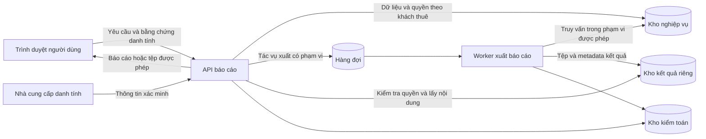

# STRIDE

## 1. STRIDE dùng để làm gì?

**STRIDE** là cách phân nhóm đe dọa để hỗ trợ mô hình hóa an toàn thông tin. Tên gọi được ghép từ sáu nhóm: **Spoofing, Tampering, Repudiation, Information disclosure, Denial of service và Elevation of privilege**.

Khi áp dụng STRIDE, nhóm phát triển xem xét hệ thống, luồng dữ liệu và ranh giới tin cậy rồi đặt những câu hỏi tương ứng: ai có thể giả danh, sửa đổi trái phép, chối bỏ hành động, làm lộ dữ liệu, gây gián đoạn hoặc vượt quyền?

Đầu ra cần đạt là các **kịch bản cụ thể**, không chỉ sáu nhãn trên một bảng. Ví dụ “có nguy cơ Information disclosure” chưa chỉ rõ phải sửa gì. Một mô tả hữu ích hơn là:

> Người dùng của khách thuê A có thể đổi mã kết quả xuất báo cáo để tải tệp của B nếu đường tải chỉ kiểm tra sự tồn tại của tệp mà không kiểm tra quan hệ sở hữu và quyền hiện tại.

Từ kịch bản này, nhóm có thể đặc tả kiểm tra quyền theo đối tượng, ràng buộc khách thuê, kiểm soát kho kết quả và kiểm thử tải chéo khách thuê. Đó là vai trò của STRIDE trong xây dựng yêu cầu bảo mật: chuyển câu hỏi đe dọa thành yêu cầu có phạm vi, điều kiện và bằng chứng chấp nhận.

STRIDE không tự chấm điểm rủi ro, không quyết định mọi kiểm soát cần dùng và không chứng minh hệ thống đã an toàn. Kết quả còn phụ thuộc vào độ đúng của mô hình, giả định, mức hiểu nghiệp vụ và việc kiểm chứng triển khai.

## 2. Sáu nhóm và thuộc tính cần bảo vệ

| Nhóm | Ý nghĩa | Thuộc tính trọng tâm | Câu hỏi gợi ý |
|---|---|---|---|
| **S — Spoofing** | Giả mạo danh tính của người, dịch vụ hoặc nguồn | Tính xác thực của danh tính và nguồn | Hệ thống có thể tin nhầm ai đang gửi yêu cầu hoặc kết quả không? |
| **T — Tampering** | Sửa đổi dữ liệu, thông điệp, cấu hình hoặc trạng thái trái phép | Tính toàn vẹn | Ai có thể thay nội dung hoặc quan hệ làm hệ thống xử lý sai? |
| **R — Repudiation** | Chối bỏ hành động khi không có bằng chứng đủ đáng tin | Khả năng truy vết và quy trách nhiệm trong phạm vi bằng chứng | Có thể xác định ai làm gì, trên tài nguyên nào, với kết quả gì không? |
| **I — Information disclosure** | Tiết lộ thông tin ngoài phạm vi cho phép | Tính bí mật | Dữ liệu có đến sai người, sai hệ thống hoặc xuất hiện ở đầu ra phụ không? |
| **D — Denial of service** | Ngăn chủ thể hợp lệ sử dụng chức năng hoặc làm cạn tài nguyên | Tính sẵn sàng | Đầu vào, lưu lượng hoặc phụ thuộc nào có thể làm dịch vụ không đáp ứng? |
| **E — Elevation of privilege** | Thực hiện hành động vượt quyền được cấp | Thực thi phân quyền và giới hạn đặc quyền | Chủ thể có thể làm việc mà vai trò, phạm vi hoặc trạng thái không cho phép không? |

Các thuộc tính trên giúp đặt câu hỏi, không tạo các ngăn tách biệt tuyệt đối. Một tác nhân có thể giả danh dịch vụ, sửa thông điệp rồi làm lộ dữ liệu. Cùng một kịch bản có thể mang nhiều nhãn để diễn tả nguyên nhân và hậu quả.

Phải phân biệt **đe dọa**, **điểm yếu** và **rủi ro**. Đe dọa là hành vi hoặc sự kiện có thể gây hại; điểm yếu là điều kiện giúp nó xảy ra; rủi ro xét khả năng và hậu quả đối với mục tiêu. Một nhãn STRIDE không tự cho biết mức ưu tiên nghiệp vụ.

## 3. Chuẩn bị mô hình trước khi đặt câu hỏi

### 3.1. Tài sản, chủ thể và ranh giới

Trước khi rà soát sáu nhóm, cần xác định:

- Tài sản: dữ liệu báo cáo, quan hệ khách thuê, vai trò, thông tin xác thực, kết quả xuất và bằng chứng kiểm toán.
- Chủ thể: người dùng, quản trị viên, người vận hành, dịch vụ nền và bên cung cấp danh tính.
- Thành phần: API, cơ sở dữ liệu, hàng đợi, worker, kho tệp và kho nhật ký.
- Luồng: yêu cầu, bằng chứng danh tính, thông điệp tác vụ, truy vấn, tệp kết quả và sự kiện.
- Ranh giới tin cậy: nơi thay đổi quyền kiểm soát, danh tính, phạm vi sở hữu hoặc căn cứ để tin dữ liệu.

Ranh giới không chỉ là đường mạng. Hai khách thuê trong cùng một cơ sở dữ liệu vẫn có ranh giới dữ liệu. Một API và worker trong cùng mạng vẫn có thể dùng danh tính và quyền khác nhau. Dữ liệu từ người đã đăng nhập vẫn có thể chứa giá trị không được phép.

### 3.2. Mô hình ví dụ xuyên suốt

Xét một cổng báo cáo nhiều khách thuê. Người dùng xem báo cáo, tạo tác vụ xuất và tải tệp kết quả. Quản trị viên quản lý quyền trong phạm vi được cấp.



Các mô tả trên mũi tên là ý định thiết kế cần kiểm chứng. Sơ đồ không chứng minh API đã kiểm tra quyền hoặc kho đã được cấu hình riêng tư.

Để mô hình có ích, phải hỏi thêm: khách thuê lấy từ đâu, ai được tạo thông điệp, worker dùng quyền gì, đường tải có bỏ qua API không, và log có chứa bản rõ hay thông tin xác thực không?

### 3.3. Dùng thành phần làm điểm đặt câu hỏi

Có thể rà soát theo luồng hoặc thành phần, tùy thiết kế. Với mỗi tiến trình, xem dữ liệu vào, danh tính, quyền, trạng thái, dữ liệu ra và lỗi phụ thuộc. Với mỗi kho, xem ai đọc, ai ghi, ai xóa và cách phục hồi. Với mỗi luồng, xem nguồn, đích, toàn vẹn, bí mật, phát lại và chi phí xử lý.

Không cần ép mọi thành phần vào sáu câu trả lời có nội dung giống nhau. Nếu một nhóm không phát sinh kịch bản đáng kể trong phạm vi đang xét, nên ghi căn cứ và giả định. Điều này khác với bỏ trống vì chưa xem xét.

## 4. S — Spoofing: hệ thống đang tin ai?

### 4.1. Nhận diện kịch bản

Spoofing xảy ra khi hệ thống chấp nhận sai danh tính hoặc nguồn. Tác nhân có thể mạo danh người dùng, một dịch vụ nền, bên gửi webhook hoặc nguồn phát hành thông tin xác minh.

Trong ví dụ, API có thể chấp nhận bằng chứng danh tính hợp lệ về hình thức nhưng không dành cho cổng báo cáo. Worker cũng có thể bị mạo danh nếu API nhận trạng thái “xuất thành công” chỉ dựa trên một trường tên dịch vụ do người gọi gửi.

Các câu hỏi cần đặt:

- Danh tính được xác minh bằng cơ chế nào và dựa trên nguồn tin cậy nào?
- Bằng chứng có đúng thời hạn, đối tượng sử dụng và ngữ cảnh không?
- Tài khoản hoặc thông tin xác thực có bị dùng chung khiến không phân biệt được chủ thể không?
- Dịch vụ có chứng minh được danh tính hay chỉ gửi một chuỗi tên?
- Luồng cấp lại thông tin xác thực có cho phép đạt cùng danh tính bằng điều kiện yếu hơn không?

### 4.2. Chuyển thành yêu cầu

Yêu cầu phải quy định các điều kiện chấp nhận bằng chứng và hành vi khi không xác minh được. Ví dụ: trước khi tạo tác vụ xuất, API phải xác minh danh tính theo nguồn, thời hạn và ngữ cảnh đã duyệt; không suy danh tính chỉ từ `userId` hoặc `serviceName` trong nội dung yêu cầu.

Danh tính dịch vụ cần được gắn với quyền được cấp cho dịch vụ đó. Xác minh đúng worker không tự cho worker quyền đọc mọi khách thuê. Đây là điểm nối giữa Spoofing và Elevation of privilege.

Kiểm thử nên gồm thiếu bằng chứng, hết hạn, sai ngữ cảnh, sai nguồn và gọi bằng danh tính dịch vụ không được cấp quyền cho hành động. Đường lỗi xác minh không được chuyển sang tin giá trị tự khai.

### 4.3. Giới hạn của kiểm soát

Bảo vệ đường truyền giúp giảm một số đường nghe lén hoặc sửa dữ liệu trên mạng, nhưng không làm mọi trường do bên gọi gửi trở thành sự thật. Tương tự, một tài khoản đã được xác thực có thể bị chiếm quyền hoặc bị chính người giữ lạm dụng. Mô hình phải xét quyền, phạm vi và hành vi sau xác thực.

## 5. T — Tampering: dữ liệu nào có thể bị thay trái phép?

### 5.1. Theo dõi cả nội dung lẫn quan hệ

Tampering bao gồm thay dữ liệu lưu trữ, thông điệp, cấu hình, chính sách, tham chiếu và trạng thái. Thay một trường nhỏ có thể làm đổi ý nghĩa toàn bộ thao tác.

Ví dụ, tác vụ hợp lệ chứa phạm vi khách thuê A. Nếu trường khách thuê hoặc tham chiếu dữ liệu bị sửa trước khi worker chạy, worker có thể tạo tệp của B. Nếu metadata chủ sở hữu tệp bị đổi, một tệp đúng nội dung ban đầu vẫn có thể được giao sai người.

Các điểm cần xem gồm:

- Ai được ghi thông điệp và ai được sửa đối tượng sau khi đã duyệt?
- Worker có kiểm tra nguồn gốc, phạm vi và liên hệ giữa các tham chiếu không?
- Quyền sửa metadata có được giới hạn như quyền sửa nội dung không?
- Có thể dùng lại một kết quả hoặc phê duyệt cũ cho phiên bản mới không?
- Hai yêu cầu đồng thời có thể vượt qua điều kiện chuyển trạng thái không?

### 5.2. Kiểm soát phải gắn với ranh giới thay đổi

Có thể cần quyền ghi theo đối tượng, kiểm tra đầu vào, bảo vệ toàn vẹn thông điệp, ràng buộc phiên bản và cập nhật trạng thái có điều kiện. Cơ chế cụ thể phải phù hợp với nguồn tấn công.

Ví dụ, phê duyệt một thay đổi quyền cần gắn với người nhận, tập quyền và phạm vi. Nếu một trường thay đổi sau duyệt, phê duyệt cũ không được tiếp tục áp dụng. Nếu giới hạn chỉ cho phép một lần thực hiện, việc kiểm tra và tiêu thụ quyền thực hiện phải xử lý được yêu cầu đồng thời.

Mã xác thực thông điệp hoặc chữ ký có thể hỗ trợ kiểm tra toàn vẹn và nguồn trong một thiết kế cụ thể, nhưng không chứng minh nội dung đã được phép về nghiệp vụ. Nếu bên có quyền ký gửi sai khách thuê, dữ liệu vẫn có thể gây hại dù kiểm tra mật mã thành công.

### 5.3. Bằng chứng kiểm chứng

Thử thay khách thuê, mã tác vụ, tập bộ lọc, chủ sở hữu kết quả và phiên bản. Thử gửi lại kết quả cũ, sửa dữ liệu sau phê duyệt và cập nhật đồng thời. Kỳ vọng là không tạo hoặc sửa tài nguyên ngoài phạm vi, không chuyển sang trạng thái phục vụ sai và có bằng chứng về thao tác bị từ chối.

Chỉ kiểm tra cú pháp là chưa đủ. Hai mã đối tượng cùng đúng định dạng vẫn có thể thuộc hai khách thuê khác nhau; quan hệ giữa chúng phải được xác minh.

## 6. R — Repudiation: bằng chứng có đủ đáng tin không?

### 6.1. Mất bằng chứng hoặc không quy được chủ thể

Repudiation liên quan tới khả năng một bên chối bỏ hành động trong bối cảnh hệ thống thiếu bằng chứng đủ đáng tin để xác định chủ thể, nội dung và kết quả. Vấn đề có thể xuất phát từ không ghi sự kiện, dùng tài khoản chung, thiếu liên kết giữa các bước hoặc cho phép người thực hiện sửa bằng chứng.

Ví dụ, tệp báo cáo đã được tải nhưng chỉ có log “download success”, không có danh tính, khách thuê hay mã tệp. Hoặc có sự kiện cấp quyền nhưng không phân biệt người đề nghị, người phê duyệt và dịch vụ thực thi. Những bản ghi đó có thể chưa đủ để điều tra câu hỏi cần trả lời.

Các câu hỏi trọng tâm:

- Có biết chủ thể nào được xác thực, hành động gì, trên đối tượng và phạm vi nào không?
- Sự kiện mô tả yêu cầu, quyết định cho phép hay kết quả thực hiện?
- Có nối được các giai đoạn API–hàng đợi–worker–tải kết quả không?
- Thời gian và nguồn sự kiện có đủ tin cậy để đối chiếu không?
- Ai có thể sửa, xóa hoặc làm mất sự kiện?
- Nếu ghi sự kiện thất bại hoặc dịch vụ dừng giữa chừng, khoảng trống được phát hiện thế nào?

### 6.2. Yêu cầu về nội dung và toàn vẹn bằng chứng

Một sự kiện có thể cần danh tính chủ thể hoặc tham chiếu được kiểm soát, khách thuê, hành động, tài nguyên, kết quả, thời gian và mã tương quan. Nguồn xác định danh tính phải đến từ ngữ cảnh đã xác minh, không chỉ từ trường tự khai.

Mã tương quan giúp nối sự kiện nhưng không thay mã sự kiện hoặc số lần thử. Một yêu cầu có thể được thử lại, còn một thao tác nghiệp vụ có thể tạo nhiều sự kiện. Thiết kế cần đủ thông tin để không đếm nhầm hoặc bỏ sót.

Đối với hành động trọng yếu, có thể cần ghi sự kiện bền vững cùng thay đổi trạng thái hoặc trước khi bắt đầu trả nội dung, sau đó ghi hay đối soát kết quả. Đây là lựa chọn theo rủi ro, phải nêu hành vi khi không thể ghi. Chỉ gọi hàm log sau thao tác không tự bảo đảm có bằng chứng nếu tiến trình dừng ngay trước đó.

Quyền thay đổi bằng chứng cần tách và hạn chế phù hợp. Cần có cách nhận biết thiếu thu thập, bảo vệ thời hạn lưu và kiểm tra quyền sửa hoặc xóa, thay vì chỉ có một tệp log trên máy ứng dụng.

### 6.3. Không đồng nhất log với chứng minh tuyệt đối

Một sự kiện ghi tài khoản A thực hiện hành động cho biết điều gì hệ thống quan sát trong phạm vi cơ chế danh tính. Nó chưa tự chứng minh người thật đang cầm thông tin xác thực là A, hoặc hành động phản ánh ý định của người đó.

Chữ ký và các cơ chế bảo vệ bằng chứng cũng có giả định về giữ khóa, nguồn thời gian, danh tính và quyền kiểm soát hệ thống. Không nên suy ra khả năng quy trách nhiệm tuyệt đối chỉ từ việc “có chữ ký” hoặc “có log”.

Kiểm thử nên đối chiếu thao tác biết trước với sự kiện, thử đường thất bại, gián đoạn thu thập và quyền sửa/xóa. Đồng thời phải kiểm tra log không chứa bí mật hoặc bản rõ báo cáo ngoài mục đích.

## 7. I — Information disclosure: thông tin đi tới đâu?

### 7.1. Xem cả luồng chính và đầu ra phụ

Information disclosure xảy ra khi thông tin được tiết lộ cho chủ thể hoặc nơi nhận ngoài phạm vi cho phép. Đường tiết lộ có thể nằm ở phản hồi nghiệp vụ, tệp xuất, metadata, lỗi, bộ nhớ đệm, log, bản sao và công cụ hỗ trợ.

Trong cổng báo cáo, các ví dụ gồm:

- Thay mã kết quả để lấy tệp của khách thuê khác.
- API trả trường nội bộ dù giao diện không hiển thị.
- Bộ nhớ đệm dùng chung trả phản hồi đã cá nhân hóa cho người khác.
- Thông báo lỗi tiết lộ truy vấn, thông tin xác thực hoặc chi tiết tài nguyên ngoài quyền.
- Một đường tải trực tiếp hoặc bản sao có quyền rộng hơn API chính.
- Tên tệp, số lượng đối tượng hoặc trạng thái phản hồi tiết lộ thông tin ngoài chính sách.

Mức nhạy cảm phải được đánh giá theo dữ liệu và ngữ cảnh. Dữ liệu đã công khai vẫn có thể tạo thông tin nhạy cảm mới khi liên kết với tài khoản, vị trí hoặc lịch sử hoạt động.

### 7.2. Chọn yêu cầu phù hợp đường tiết lộ

Yêu cầu có thể gồm phân quyền theo tài nguyên, giới hạn trường đầu ra, bảo vệ dữ liệu khi truyền và lưu, quản lý khóa, cấu hình kho, cách phân vùng bộ nhớ đệm và tối thiểu hóa log.

Ví dụ, đường tải phải kiểm tra quyền đối với đúng tệp, khách thuê và trạng thái hiện tại theo chính sách. Không được mặc định chỉ cần tệp tồn tại hoặc tham chiếu khó đoán là đủ. Nếu liên kết tải tự mang quyền, phải đặc tả người cầm liên kết được làm gì, thời hạn, khả năng chia sẻ và cách thu hồi.

Thời hạn truy cập và thời hạn giữ bản sao là hai yêu cầu khác nhau. Chặn tải sau một thời điểm không tự xóa tệp khỏi kho, log, bản sao hoặc thiết bị người đã tải.

### 7.3. Giới hạn của mã hóa và che dữ liệu

Mã hóa tại nơi lưu không ngăn ứng dụng đã được cấp quyền giải mã rồi trả dữ liệu sai người. Mã hóa đường truyền không ngăn người nhận trái quyền đọc nội dung mà máy chủ đã gửi.

Che một phần mã định danh hoặc băm cố định cũng không tự loại bỏ khả năng liên kết. Phải xét ai có bảng ánh xạ, nguồn dữ liệu khác và khả năng suy luận từ đầu ra.

Kiểm thử nên dùng dữ liệu thử có dấu nhận diện để kiểm tra phản hồi, tệp, lỗi, trace và log. Với bộ nhớ đệm, cần luân phiên người dùng và khách thuê qua cùng lớp phân phối. Không chỉ kiểm tra màn hình vì dữ liệu có thể đã đến trình duyệt mà chưa được hiển thị.

## 8. D — Denial of service: tài nguyên nào có thể cạn?

### 8.1. Xác định chi phí và phụ thuộc chung

Denial of service có thể bắt nguồn từ nhiều yêu cầu, một yêu cầu tốn kém, truy vấn rộng, tệp kết quả lớn, xử lý lặp lại hoặc phụ thuộc ngừng đáp ứng. Không phải mọi kịch bản đều cần lưu lượng rất lớn.

Trong ví dụ, một người có quyền xuất có thể tạo nhiều tác vụ hoặc yêu cầu tập dữ liệu khiến worker dùng nhiều bộ nhớ. Nếu mọi khách thuê dùng chung hàng đợi và nguồn dữ liệu mà không giới hạn phù hợp, hành vi của một bên có thể ảnh hưởng những bên khác.

Cần hỏi:

- Hành động tiêu tốn CPU, bộ nhớ, kết nối, băng thông, dung lượng hay chi phí dịch vụ nào?
- Giới hạn đặt ở số yêu cầu hay cả chi phí của từng yêu cầu?
- Có giới hạn theo chủ thể, khách thuê và toàn hệ thống không?
- Thử lại, gọi dây chuyền hoặc tác vụ bị kẹt có khuếch đại tải không?
- Khi giới hạn bị chạm, hệ thống từ chối, xếp hàng hay giảm chức năng như thế nào?
- Người vận hành có thể phát hiện, dừng và phục hồi trong thời gian nào?

### 8.2. Kiểm soát theo ngân sách tài nguyên

Có thể cần giới hạn số bản ghi xuất, thời gian xử lý, bộ nhớ, số tác vụ đồng thời, dung lượng giữ kết quả và số lần thử lại. Các giá trị phải dựa trên dữ liệu và năng lực của thiết kế.

Giới hạn tốc độ theo địa chỉ IP chỉ xử lý một phần vấn đề. Nhiều người hợp lệ có thể dùng chung IP, và một tác nhân có thể xuất hiện từ nhiều nguồn. Một số đường cần giới hạn theo danh tính, khách thuê hoặc hành động, đồng thời có ngân sách toàn hệ thống.

Khi từ chối hoặc giảm tải, không được tự bỏ phân quyền, bỏ kiểm tra trạng thái hoặc lưu bản rõ để né lỗi. Thông báo và hành vi phải được đặc tả để tránh biến kiểm soát sẵn sàng thành đường tiết lộ hay nâng quyền.

### 8.3. Kiểm chứng cả giới hạn lẫn phục hồi

Kiểm thử trong môi trường được kiểm soát cần đo hành vi khi chạm giới hạn, tác vụ quá hạn, phụ thuộc lỗi và thử lại nhiều lần. Cần xác minh người dùng hoặc khách thuê khác vẫn được phục vụ theo mục tiêu đã chọn.

Khả năng phục hồi cần xét dữ liệu, cấu hình, quyền, khóa và nguồn lực phụ thuộc. Một bản sao không sử dụng được hoặc phục hồi lại quyền cũ có thể giải quyết việc khởi động dịch vụ nhưng làm sai mục tiêu an toàn.

## 9. E — Elevation of privilege: chủ thể có thể vượt quyền thế nào?

### 9.1. Xác định quyền ban đầu và quyền đạt được

Elevation of privilege liên quan tới việc chủ thể thực hiện hành động vượt quá quyền được cấp. Kịch bản cần chỉ ra chủ thể ban đầu có gì và điều kiện nào giúp họ vượt ranh giới đó.

Ví dụ:

- Người dùng thường gửi trường vai trò trong yêu cầu cập nhật hồ sơ rồi được cấp quyền quản trị.
- Quản trị viên của A có thể cấp quyền trên B vì API chỉ kiểm tra tên vai trò.
- Worker bị chiếm quyền có thể sử dụng tài khoản cơ sở dữ liệu toàn quyền để sửa cấu hình hoặc truy cập mọi khách thuê.
- Luồng cấp lại quyền hoặc thao tác hỗ trợ bỏ qua điều kiện áp dụng ở luồng chính.

Vượt từ vai trò thấp lên vai trò cao thường được gọi là vượt quyền theo chiều dọc. Truy cập tài nguyên của chủ thể khác cùng cấp có thể vi phạm ranh giới ngang. Với đọc dữ liệu trái quyền, nhóm có thể gắn cả nhãn vượt quyền và tiết lộ để mô tả nguyên nhân và hậu quả.

### 9.2. Yêu cầu phải kiểm tra quyền trên hành động và phạm vi

Xác thực trả lời danh tính nào đang được chấp nhận; phân quyền quyết định danh tính đó được làm gì trên tài nguyên nào. Đăng nhập thành công không đủ để cấp quyền quản trị hoặc truy cập mọi khách thuê.

Yêu cầu nên nêu vai trò, hành động, đối tượng, khách thuê, trạng thái và điều kiện bổ sung khi cần. Ngữ cảnh tin cậy phải được xác lập ở máy chủ; trường `role`, `tenantId` hoặc `isAdmin` do bên gọi gửi không tự có giá trị cấp quyền.

Đối với hành động tác động lớn, có thể cần xác minh tăng cường, phê duyệt độc lập, giới hạn quyền được cấp và thời hạn hiệu lực. Những biện pháp này phải gắn với kịch bản thực tế; không áp dụng máy móc cho mọi thao tác.

Quyền của dịch vụ cũng cần tối thiểu theo chức năng và phạm vi. Nếu worker cần đọc dữ liệu để xuất, điều đó không tự cho phép sửa vai trò, đổi chính sách hoặc xóa bản sao.

### 9.3. Kiểm tra các đường vòng và thay đổi trạng thái

Kiểm thử bằng tài khoản đúng danh tính nhưng thiếu quyền, đúng vai trò nhưng sai phạm vi, quyền vừa bị thu hồi và danh tính dịch vụ có quyền khác mục đích. Thử cả API trực tiếp, tác vụ nền, công cụ hỗ trợ và luồng khôi phục.

Phải kiểm tra trạng thái không bị thay đổi sau yêu cầu bị từ chối, không chỉ nhìn mã lỗi. Với quyền bị thu hồi, cần xác định thời gian hiệu lực trên bộ nhớ đệm, phiên và tác vụ đang chạy.

Xác minh tăng cường có thể giảm một số đường chiếm quyền tài khoản, nhưng không sửa được chính sách phân quyền sai. Một người đã xác minh rất mạnh vẫn có thể không được phép cấp quyền cho khách thuê khác.

## 10. Quy trình áp dụng STRIDE vào một tính năng

### 10.1. Đi từ phạm vi tới quyết định

Một trình tự thực hiện có thể gồm:

1. **Chốt mục tiêu và phạm vi:** tính năng nào, dữ liệu nào, ai sử dụng, điều gì nằm ngoài mô hình.
2. **Mô tả luồng hợp lệ:** chủ thể, tiến trình, kho, thông điệp, trạng thái và các đường quản trị hoặc phục hồi liên quan.
3. **Đánh dấu ranh giới và giả định:** giá trị nào chưa tin cậy, danh tính nào được chấp nhận, quyền được kiểm tra tại đâu.
4. **Đặt câu hỏi STRIDE:** đi theo từng luồng hoặc thành phần và ghi kịch bản có điều kiện, hành vi, tài sản, hậu quả.
5. **Đánh giá rủi ro:** xét khả năng, tác động, phạm vi ảnh hưởng, kiểm soát hiện hữu và phần chưa biết.
6. **Chọn cách xử lý:** thay thiết kế, bổ sung kiểm soát, giảm phạm vi hoặc quyết định rủi ro còn lại theo thẩm quyền.
7. **Viết yêu cầu và kiểm chứng:** gắn kịch bản với tiêu chí chấp nhận, bằng chứng, chủ sở hữu và trạng thái.
8. **Duy trì mô hình:** cập nhật khi dữ liệu, quyền, luồng hoặc giả định thay đổi.

Không cần chờ mô hình hoàn hảo mới xử lý một kịch bản rõ ràng. Tuy nhiên, cần ghi phần chưa biết và không suy rằng phần chưa mô tả đã được bảo vệ.

### 10.2. Ma trận kịch bản của ví dụ

| Mã kịch bản | Kịch bản cụ thể | Nhãn hỗ trợ | Yêu cầu liên quan |
|---|---|---|---|
| ST-01 | API chấp nhận bằng chứng danh tính không đúng ngữ cảnh sử dụng | S | SR-01 |
| ST-02 | Thông điệp tác vụ bị thay khách thuê hoặc tham chiếu để worker xuất sai dữ liệu | T, có thể dẫn tới E và I | SR-02, SR-03 |
| ST-03 | Thay quyền hoặc tải báo cáo không có bằng chứng đủ truy vết | R | SR-05, SR-06 |
| ST-04 | Đường tải, bộ nhớ đệm hoặc đầu ra phụ làm lộ báo cáo ngoài quyền | I, có thể liên quan E | SR-03, SR-06, SR-07 |
| ST-05 | Tác vụ lớn, nhiều tác vụ và thử lại làm cạn tài nguyên chung | D | SR-08, SR-09, SR-11 |
| ST-06 | Người có quyền thấp tự cấp quyền cao hoặc cấp vượt phạm vi khách thuê | E, có thể liên quan T | SR-04, SR-10 |

Nhãn hỗ trợ tìm và thảo luận kịch bản. Quyết định triển khai phải dựa vào nội dung kịch bản và yêu cầu, không chỉ nhãn.

## 11. Bộ yêu cầu có thể kiểm chứng từ STRIDE

Các giới hạn thời gian, khối lượng và số lượng sau là **giá trị minh họa của một dự án giả định**. Dự án thật cần lựa chọn theo tác động, dữ liệu, năng lực và chính sách áp dụng.

| Mã | Yêu cầu | Bằng chứng chấp nhận |
|---|---|---|
| SR-01 | API và đầu nhận kết quả phải xác minh danh tính theo nguồn tin cậy, thời hạn và ngữ cảnh đã duyệt; không dùng tên người dùng hoặc tên dịch vụ tự khai làm bằng chứng. | Thử thiếu bằng chứng, sai nguồn, sai ngữ cảnh, hết hạn và danh tính dịch vụ khác; không cấp quyền hay nhận kết quả trái điều kiện. |
| SR-02 | Tác vụ xuất phải có nguồn được phép, phạm vi tài nguyên được máy chủ xác lập và tính toàn vẹn được bảo vệ; worker phải từ chối tác vụ có tham chiếu hoặc quan hệ ngoài phạm vi. | Sửa thông điệp, khách thuê, mã dữ liệu và tham chiếu kết quả; không tạo hoặc cập nhật dữ liệu ngoài phạm vi ủy quyền. |
| SR-03 | Mọi đường đọc và tải phải kiểm tra quyền theo chủ thể, hành động, đối tượng và khách thuê; quyền tại thời điểm tải được xử lý theo chính sách hiện hành, kể cả đường trực tiếp và API cũ. | Tráo tài khoản, khách thuê, đối tượng và liên kết; thử quyền đã thay đổi; không trả nội dung ngoài quyền. |
| SR-04 | Với hành động yêu cầu phê duyệt độc lập, phê duyệt phải ràng buộc người nhận, quyền, khách thuê và phiên bản; thay nội dung phải duyệt lại, không được phát lại để thực hiện ngoài giới hạn. | Thử tự duyệt khi bị cấm, sửa sau duyệt, dùng lại và gửi đồng thời; không cấp quyền ngoài nội dung hợp lệ. |
| SR-05 | Thay quyền phải có sự kiện bền vững gắn với thay đổi; trước khi bắt đầu trả tệp xuất phải ghi được sự kiện yêu cầu, rồi ghi hoặc đối soát kết quả. Sự kiện phải tới kho kiểm toán trong 5 phút. | Gây lỗi ghi trước hành động, dừng giữa các bước và gián đoạn thu thập; không mất thay đổi quyền không thể đối soát, không trả tệp khi chưa ghi được sự kiện bắt buộc; đo độ trễ. |
| SR-06 | Log, trace và thông báo lỗi không được chứa thông tin xác thực, vật liệu khóa hoặc bản rõ báo cáo; kho kiểm toán phải giới hạn quyền đọc, sửa và xóa theo vai trò đã duyệt. | Dùng dữ liệu thử có dấu nhận diện trên đường thành công và lỗi; thử quyền đọc, sửa/xóa của các vai trò không được phép. |
| SR-07 | Mô hình đầu ra báo cáo phải giới hạn trường được công bố cho vai trò và mục đích; phản hồi riêng không được đưa vào bộ nhớ đệm dùng chung ngoài phạm vi. | Thêm trường nội bộ vào nguồn, luân phiên chủ thể/khách thuê qua lớp phân phối; không có trường hoặc phản hồi ngoài quyền. |
| SR-08 | Mỗi tác vụ xuất của luồng minh họa tối đa 50.000 bản ghi và 60 giây xử lý; tối đa 2 tác vụ đang chạy cho mỗi khách thuê và 20 tác vụ toàn hệ thống. Vượt giới hạn phải thực hiện hành vi từ chối hoặc xếp hàng đã định. | Thử các mốc biên, nhiều tác vụ và truy vấn tốn kém; đo từ các điểm đã quy định, xác minh không vượt giới hạn thực thi hoặc bỏ kiểm soát quyền. |
| SR-09 | Mỗi tác vụ có tối đa 3 lần thực hiện trong vòng đời, tính cả lần đầu; lỗi không được tạo vòng thử lại vô hạn hoặc tự đặt lại bộ đếm nội bộ. | Gây lỗi lặp lại, khởi động lại worker và thử gửi lại thông điệp; tổng lần thực hiện tuân thủ giới hạn, không phát sinh kết quả trùng trái quy tắc. |
| SR-10 | Hành động cấp quyền cao phải yêu cầu mức xác minh tăng cường đã duyệt với độ mới tối đa 5 phút; sau thu hồi quyền, các điểm thực thi liên quan phải ngừng chấp nhận trong 60 giây. | Thử phiên chưa đủ mức, quá hạn, quyền vừa thu hồi, bộ nhớ đệm và tác vụ nền; không hoàn tất hành động ngoài chính sách. |
| SR-11 | Trong kịch bản mất kho phục vụ đã duyệt, phải khôi phục chức năng trong 45 phút và đạt mốc dữ liệu mất tối đa 10 phút; áp dụng lại quyết định thu hồi có hiệu lực trước phục vụ tài nguyên liên quan. | Diễn tập với dữ liệu, quyền, khóa và phụ thuộc; kiểm tra mốc dữ liệu cùng quyền sau phục hồi, không chỉ đo lúc dịch vụ khởi động. |

Mục tiêu 45 phút ở SR-11 là **RTO**, thời gian phục hồi chức năng theo kịch bản. Mốc mất dữ liệu tối đa 10 phút là **RPO**, mục tiêu điểm phục hồi. Cần bằng chứng phục hồi thực tế; lịch sao lưu đơn thuần chưa đủ.

SR-08 cần định nghĩa thời điểm bắt đầu và kết thúc đo xử lý, cách hủy tác vụ quá hạn và việc dọn tài nguyên. Nếu giới hạn 60 giây chỉ áp dụng riêng một lời gọi nhưng chuỗi lời gọi vẫn chạy không giới hạn, yêu cầu chưa được thực thi đúng ý nghĩa đã chọn.

SR-09 giới hạn một tác vụ, không ngăn tác nhân tạo nhiều tác vụ mới. Cần xem cùng hạn mức theo chủ thể, khách thuê và tài nguyên trong SR-08, cũng như chính sách phân bổ khả năng phục vụ khi có nhiều bên tranh chấp tài nguyên.

### 11.1. Ví dụ đặc tả chi tiết cho một yêu cầu

```text
Yêu cầu: SR-03 — kiểm soát tải kết quả báo cáo.
Tài sản: nội dung tệp và quan hệ tệp–tác vụ–khách thuê.
Chủ thể: người dùng hoặc dịch vụ được ủy quyền tải.
Điều kiện: danh tính hợp lệ, hành động được phép, đúng phạm vi,
           kết quả còn trong trạng thái và thời hạn phục vụ.
Thực thi: kiểm tra ở máy chủ tại mọi đường phân phối thuộc phạm vi quản lý.
Khi thiếu căn cứ quyền: từ chối hoặc chờ theo hợp đồng lỗi; không trả nội dung.
Kiểm chứng: tráo tài khoản/khách thuê/tệp, thử đường trực tiếp,
            thay quyền và thử lỗi phụ thuộc quyền.
Kết luận: chỉ trong phạm vi đường xử lý, phiên bản và cấu hình đã kiểm tra.
```

Mức bảo vệ phù hợp còn phụ thuộc quyền năng của cơ chế tải. Nếu dùng liên kết mang quyền độc lập, yêu cầu và kiểm thử phải mô tả đúng thiết kế đó thay vì mặc định luôn kiểm tra được quyền hiện tại từ mọi nơi tải.

## 12. Xử lý kịch bản có nhiều nhãn và ưu tiên rủi ro

### 12.1. Không đếm trùng cùng một đường gây hại

Giả sử một bên gửi giả danh worker, sửa tham chiếu tác vụ và lợi dụng quyền quá rộng để đọc báo cáo khác khách thuê. Kịch bản có thể liên quan S, T, E và I. Nếu nguồn bằng chứng không đầy đủ, còn phát sinh vấn đề R.

Không nên biến các nhãn đó thành năm sự kiện độc lập rồi cộng điểm hoặc tổn thất tùy ý. Có thể giữ một kịch bản chính, ghi các bước và hậu quả, rồi nối với nhiều yêu cầu kiểm soát. Chỉ tách thành kịch bản riêng khi giúp làm rõ điều kiện, tác động hoặc quyết định khác nhau.

Ngược lại, không cần cố gắn đủ sáu nhãn cho mọi kịch bản. Làm cạn hàng đợi là đường có thể cần phân tích riêng, với điều kiện và mục tiêu khác việc đọc sai tệp.

### 12.2. Ưu tiên theo hậu quả và khả năng thực tế

Cần xem dữ liệu, số chủ thể hoặc khách thuê bị ảnh hưởng, quyền ban đầu, mức tiếp cận, hiệu lực kiểm soát và độ bất định. Một lỗi có nhiều nhãn không tự nghiêm trọng hơn lỗi có một nhãn.

Ví dụ, tiết lộ qua một đường tải dễ tiếp cận có thể cần xử lý trước một giả thuyết giả mạo cần chiếm quyền quản trị ở tầng đã được kiểm soát mạnh. Tuy nhiên, một sự kiện ít khả năng nhưng hậu quả vượt khả năng chịu đựng vẫn cần quyết định riêng.

Thang điểm định tính là cách hỗ trợ sắp xếp, không tự là xác suất hoặc số tiền. Cần giữ kịch bản và lập luận. Nếu chưa đủ thông tin về quyền kho hoặc phạm vi worker, hãy ghi phần chưa biết và yêu cầu bằng chứng thay vì mặc định rủi ro thấp.

### 12.3. Biết giới hạn của STRIDE

STRIDE không thay thế đánh giá quyền riêng tư, mục đích sử dụng dữ liệu, rủi ro nghiệp vụ hoặc nghĩa vụ áp dụng. Một luồng hợp lệ về kỹ thuật vẫn có thể thu thập quá nhiều dữ liệu, giữ quá lâu hoặc cho phép hành vi nghiệp vụ không phù hợp.

Phương pháp cũng phụ thuộc phạm vi mô hình. Nếu sơ đồ bỏ qua công cụ hỗ trợ, bản sao, tài khoản vận hành hoặc đường phục hồi, các nhóm STRIDE không tự làm những thành phần đó xuất hiện.

Cần bổ sung câu hỏi nghiệp vụ và dữ liệu, đồng thời dùng rà soát mã, kiểm thử bảo mật và quan sát vận hành để xác minh hoặc tìm kịch bản mới. Mô hình ở thiết kế không tự chứng minh cấu hình đang chạy là đúng.

## 13. Kiểm chứng và duy trì kết quả

### 13.1. Từ câu hỏi đến bằng chứng

Mỗi kịch bản quan trọng nên có ít nhất một đường truy vết tới yêu cầu và bằng chứng. Có thể kiểm tra theo các góc sau:

| Góc kiểm chứng | Điều cần xác nhận |
|---|---|
| Dương | Chủ thể đủ điều kiện vẫn hoàn thành đúng chức năng |
| Phủ định | Chủ thể hợp lệ nhưng thiếu quyền, sai khách thuê hoặc sai mục đích không thực hiện được |
| Trạng thái | Hết hạn, thu hồi, thay phiên bản, thử lại và yêu cầu đồng thời giữ đúng quy tắc |
| Đường thay thế | API cũ, URL trực tiếp, công cụ hỗ trợ và tác vụ nền không bỏ điều kiện |
| Lỗi phụ thuộc | Thiếu kết quả xác minh, mất kho sự kiện hoặc lỗi hàng đợi không tự mở quyền |
| Vận hành | Quyền và cấu hình thật phù hợp mô hình; có thể phát hiện khoảng trống và xử lý |
| Phục hồi | Dữ liệu, quyền, khóa và trạng thái thu hồi được khôi phục đúng trước khi phục vụ |

Kiểm thử phải xem nội dung và tác dụng phụ chứ không chỉ mã phản hồi. Một yêu cầu trả lỗi nhưng đã tạo tệp ngoài phạm vi hoặc cấp quyền sai vẫn vi phạm mục tiêu.

Bằng chứng cần gắn với phiên bản, môi trường, cấu hình và phạm vi. Không nên dùng một kết quả cũ để kết luận về đường tải hoặc danh tính dịch vụ vừa thay đổi.

### 13.2. Theo dõi tới quyết định rủi ro còn lại

Có thể phân biệt các trạng thái: đã nhận diện, đã có phương án, đã triển khai, đã kiểm chứng và đã có quyết định về phần còn lại. Việc tạo đầu việc hoặc viết yêu cầu chưa đồng nghĩa kiểm soát đã có hiệu lực.

Nếu chấp nhận rủi ro còn lại, cần đúng người có thẩm quyền, phạm vi, lý do, chủ sở hữu, thời hạn nếu cần và điều kiện rà soát. Không đóng kịch bản chỉ vì chưa thấy sự cố.

Cập nhật mô hình khi thêm bên tích hợp, loại dữ liệu, đường phân phối, chức năng quản trị, quyền dịch vụ hoặc phương án phục hồi. Phát hiện kiểm thử và sự cố cũng phải quay lại cập nhật giả định và yêu cầu.

## 14. Sai lầm thường gặp

| Sai lầm | Vấn đề | Cách làm rõ |
|---|---|---|
| Chỉ điền đủ sáu ô | Có nhãn nhưng không có đường gây hại hay quyết định | Viết chủ thể, điều kiện, hành vi, tài sản và hậu quả |
| Coi STRIDE là thang điểm rủi ro | Nhầm loại đe dọa với mức ưu tiên | Đánh giá khả năng, tác động và bất định riêng |
| Một kiểm soát được coi là xử lý mọi nhóm | Không xét giới hạn của xác thực, mã hóa hoặc logging | Gắn kiểm soát với phần cụ thể của kịch bản |
| Chỉ xem người ngoài chưa đăng nhập | Bỏ sót lạm dụng tài khoản hợp lệ và dịch vụ | Xét danh tính đã xác thực nhưng thiếu quyền hoặc bị chiếm quyền |
| Tin dữ liệu trong mạng nội bộ | Thông điệp và tham chiếu sai vẫn đi qua nhiều tầng | Xác định nguồn, quyền và tính toàn vẹn tại ranh giới liên quan |
| Dùng log như chứng minh tuyệt đối | Bỏ qua tài khoản chung, giả nguồn và quyền sửa bằng chứng | Nêu giới hạn quy trách nhiệm và bảo vệ nguồn, nội dung, thời gian |
| Một kịch bản nhiều nhãn được cộng nhiều lần | Đánh giá phơi nhiễm bị sai hoặc ưu tiên lệch | Theo dõi một đường gây hại và các bước, chỉ tách khi có căn cứ |
| Đóng mô hình trước khi kiểm tra triển khai | Sơ đồ đúng nhưng quyền hoặc cấu hình thật vẫn sai | Gắn kết quả với kiểm thử, vận hành và quyết định rủi ro còn lại |

## 15. Đầu ra cần có sau khi áp dụng

Một kết quả STRIDE có thể chuyển giao cho kiến trúc, phát triển, kiểm thử và vận hành cần gồm:

1. **Phạm vi và mô hình:** tài sản, chủ thể, tiến trình, kho, luồng và ranh giới tin cậy.
2. **Giả định:** điều đã xác minh, điều chưa biết và người chịu trách nhiệm làm rõ.
3. **Kịch bản:** mã, điều kiện, hành vi, hậu quả và nhãn STRIDE hỗ trợ.
4. **Đánh giá rủi ro:** khả năng, tác động, kiểm soát hiện có, bất định và ưu tiên.
5. **Yêu cầu bảo mật:** hành vi, phạm vi, giới hạn và cách xử lý khi thất bại.
6. **Bằng chứng và quyết định:** tiêu chí kiểm thử, cấu hình cần xác minh, chủ sở hữu và phần rủi ro còn lại.
7. **Điều kiện duy trì:** phiên bản, trạng thái xử lý và tác nhân cần rà soát lại.

STRIDE giúp nhóm đặt câu hỏi nhất quán về những cách hệ thống có thể bị sử dụng trái mục tiêu. Giá trị thực tế xuất hiện khi các câu hỏi được chuyển thành kịch bản rõ ràng, yêu cầu có thể kiểm chứng và bằng chứng về hiệu lực kiểm soát trong suốt vòng đời phát triển.
