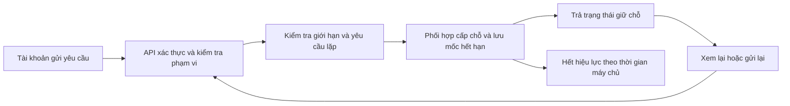

# Abuse case

## 1. Mục tiêu bài học

**Abuse case** là kịch bản mô tả cách một chủ thể cố ý sử dụng, kết hợp hoặc làm sai lệch chức năng của hệ thống để đạt một kết quả không được phép. Chủ thể đó có thể chưa đăng nhập, có tài khoản hợp lệ, có quyền nội bộ hoặc kiểm soát một danh tính dịch vụ.

Trong **threat modeling**, abuse case giúp nối hành vi cụ thể với tài sản bị ảnh hưởng và hậu quả nghiệp vụ. Trong thiết kế yêu cầu bảo mật, nó phải dẫn tới câu trả lời rõ ràng: hệ thống cần ngăn, giới hạn, phát hiện hoặc xử lý hành vi đó như thế nào, và kiểm chứng bằng cách nào?

Sau bài học, người học có thể:

- Phân biệt luồng sử dụng hợp lệ với mục tiêu lạm dụng.
- Viết abuse case có phạm vi, chủ thể, điều kiện, bước đi và hậu quả.
- Nhận diện lạm dụng logic nghiệp vụ, quyền, dữ liệu và tài nguyên.
- Chuyển abuse case thành yêu cầu bảo mật đo được.
- Thiết kế kiểm thử cả hành vi bị cấm lẫn hành vi hợp lệ cần được giữ.
- Gắn kịch bản với risk owner, chủ sở hữu kiểm soát, bằng chứng và sự kiện rà soát lại.

Các chức năng, ngưỡng và thời hạn trong bài thuộc một hệ thống giả định. Chúng không phải quy tắc dùng chung cho mọi sản phẩm.

## 2. Nhận diện một abuse case hữu ích

### 2.1. Điểm xuất phát là mục tiêu lạm dụng

Một mô tả như “API có lỗ hổng” chưa nói rõ chủ thể muốn đạt điều gì hoặc tài sản nào bị hại.

Một abuse case rõ hơn:

> Người có tài khoản hợp lệ muốn giữ phần lớn chỗ của một khóa học mà không mua, bằng cách tạo và gia hạn giữ chỗ liên tục, khiến người khác không thể đăng ký.

Kịch bản này có:

- Chủ thể và năng lực ban đầu: tài khoản có thể gọi chức năng giữ chỗ.
- Mục tiêu: chiếm dụng tài nguyên để cản trở người khác.
- Chức năng bị sử dụng: tạo và duy trì giữ chỗ.
- Hậu quả: chỗ không được phân bổ công bằng và khả năng đăng ký bị giảm.
- Các điều kiện cần xác minh: giới hạn số giữ chỗ, thời hạn và cách gia hạn.

Không phải abuse case nào cũng cần một lỗi cú pháp hoặc lỗi thư viện. Từng yêu cầu có thể hợp lệ về định dạng nhưng chuỗi hành vi vẫn gây hậu quả không được phép.

### 2.2. Những khái niệm gần nhau

Trong bài, các khái niệm được sử dụng theo cách sau:

| Khái niệm | Trọng tâm | Ví dụ |
| --- | --- | --- |
| Use case | Mục tiêu và luồng sử dụng được cho phép | Học viên đăng ký, thanh toán và nhận chỗ |
| Luồng lỗi | Hệ thống xử lý một điều kiện không thành công | Thanh toán bị từ chối hoặc khóa đã hết chỗ |
| Abuse case | Mục tiêu lạm dụng và cách cố ý đạt kết quả không được phép | Chiếm giữ chỗ hoặc dùng quyền xem để sửa dữ liệu |
| Kịch bản đe dọa | Điều kiện có thể làm hại tài sản, có thể gồm cả sự kiện không do chủ ý | Kho dữ liệu mất hoặc thông điệp kết quả bị giả |
| Kiểm thử âm | Phép thử một điều kiện bị cấm hoặc không hợp lệ | Tài khoản A yêu cầu hồ sơ của B và bị từ chối |
| Cây tấn công | Phân rã một mục tiêu thành nhiều đường có thể đạt mục tiêu | Chiếm chỗ qua một tài khoản, nhiều tài khoản hoặc quyền quản trị |

Một abuse case có thể tạo ra nhiều kiểm thử âm. Một kiểm thử đổi mã bản ghi không thay thế toàn bộ kịch bản nếu còn đường xuất tệp, tác vụ nền hoặc quyền quản trị.

Thuật ngữ và biểu mẫu có thể khác giữa các nhóm. Điều cần thống nhất là nội dung kịch bản và cách nó liên kết với yêu cầu, không phải chỉ tên gọi.

### 2.3. Không đồng nhất hành vi bất thường với lạm dụng

Một học viên gửi lại vì mạng yếu không nhất thiết đang gây hại. Một đơn vị tổ chức tạo nhiều đăng ký có thể đang thực hiện công việc được cho phép.

Abuse case mô tả mục tiêu không được phép để thiết kế và kiểm chứng. Khi vận hành, hệ thống cần dựa vào chính sách, tín hiệu và quy trình phù hợp để phản ứng, thay vì kết luận ý đồ chỉ từ một lần thao tác lỗi hoặc một con số bất thường.

Yêu cầu bảo mật phải bảo vệ cả người dùng hợp lệ. Ví dụ, giới hạn giữ chỗ cần cho phép người dùng xem lại trạng thái và nhận thông báo rõ ràng khi yêu cầu bị từ chối.

## 3. Xác định use case và quy tắc nghiệp vụ trước

Bài học dùng một cổng đăng ký khóa học trả phí, phục vụ nhiều đơn vị tổ chức. Mỗi khóa có số chỗ giới hạn. Ví dụ chỉ xét đăng ký cá nhân, không xét mua chỗ theo nhóm.

### 3.1. Use case hợp lệ: đăng ký một chỗ

**UC-01 — Đăng ký khóa học**

- Học viên đăng nhập và chọn khóa đang mở.
- Hệ thống kiểm tra điều kiện tham gia và số chỗ.
- Một chỗ được giữ tạm trong 5 phút.
- Học viên thực hiện thanh toán theo thông tin do máy chủ xác định.
- Hệ thống xác minh kết quả thanh toán và quyền sử dụng giữ chỗ.
- Khi các điều kiện đều đạt, đăng ký chuyển sang trạng thái được xác nhận.
- Học viên chỉ xem được hồ sơ đăng ký của mình.

Nhân viên của đơn vị tổ chức có thể xử lý dữ liệu theo quyền được cấp, nhưng quyền phải giới hạn theo chức năng và đơn vị. Quyền hỗ trợ không mặc nhiên gồm quyền sửa trạng thái thanh toán.

### 3.2. Các quy tắc giả định đã được thống nhất

| Mã | Quy tắc nghiệp vụ của ví dụ |
| --- | --- |
| BR-01 | Tổng chỗ đã xác nhận và giữ chỗ còn hiệu lực không vượt sức chứa khóa |
| BR-02 | Một tài khoản có tối đa một giữ chỗ còn hiệu lực cho cùng một khóa và tối đa hai giữ chỗ trên toàn hệ thống |
| BR-03 | Giữ chỗ thông thường hết hiệu lực sau 5 phút tính từ lúc tạo phía máy chủ; xem lại hoặc gửi lại cùng yêu cầu không kéo dài mốc |
| BR-04 | Mã giảm giá thuộc chương trình ví dụ chỉ được một lần sử dụng thành công cho mỗi tài khoản và phải tuân thủ giới hạn toàn chương trình |
| BR-05 | Trạng thái đã thanh toán chỉ được ghi từ kết quả giao dịch đã được xác minh và khớp đăng ký |
| BR-06 | Người học chỉ đọc được đăng ký của mình; nhân viên chỉ thao tác trong phạm vi đơn vị và quyền được cấp |
| BR-07 | Nếu thanh toán thành công đến sau khi giữ chỗ hết hạn, không được tự xác nhận thêm chỗ khi đã hết sức chứa; phải chuyển quy trình đối soát hoặc xử lý đã được phê duyệt |

Quy tắc về một tài khoản không chứng minh một cá nhân không thể dùng nhiều tài khoản. Đây là giới hạn cần phản ánh trong rủi ro còn lại.

BR-07 cần được thiết kế cùng luồng thanh toán. Không được bỏ qua giao dịch đã thu tiền chỉ vì giữ chỗ hết hạn. Trạng thái, người chịu trách nhiệm và phương án xử lý người mua phải được xác định.

### 3.3. Tài sản và điều kiện cần bảo vệ

| Tài sản | Điều cần bảo vệ |
| --- | --- |
| Chỗ của khóa học | Không vượt sức chứa và không bị giữ vô hạn qua thao tác thông thường |
| Đăng ký của học viên | Đúng chủ thể, đúng khóa, đúng trạng thái |
| Giá và ưu đãi | Do máy chủ xác định theo phiên bản, điều kiện và giới hạn đã chấp thuận |
| Trạng thái thanh toán | Không được giả, áp dụng nhầm hoặc xử lý lặp |
| Dữ liệu học viên | Không đọc hoặc xuất ngoài phạm vi |
| Quyền nhân viên và dịch vụ | Không vượt chức năng hoặc đơn vị được giao |
| Dấu vết nghiệp vụ | Truy được yêu cầu, chuyển trạng thái, chủ thể và kết quả |
| Dữ liệu phục hồi | Không đưa đăng ký hoặc thanh toán về trạng thái gây xử lý sai |

Nêu rõ tài sản giúp tránh viết một danh sách hành vi xấu không biết cần ưu tiên hoặc kiểm chứng ở đâu.

## 4. Cấu trúc một abuse case

Không bắt buộc dùng một công cụ hoặc ký pháp riêng. Một mẫu đủ dùng có thể gồm:

| Trường | Nội dung |
| --- | --- |
| Định danh, tên | Mã ổn định và mục tiêu lạm dụng ngắn gọn |
| Use case liên quan | Chức năng hoặc luồng hợp lệ bị tác động |
| Tài sản, quy tắc | Giá trị và điều kiện bị đe dọa |
| Chủ thể | Quyền, khả năng tiếp cận và tài nguyên ban đầu |
| Mục tiêu lạm dụng | Kết quả không được phép mà chủ thể muốn đạt |
| Tiền điều kiện | Điều phải tồn tại để bắt đầu, có đánh dấu giả định |
| Luồng lạm dụng | Các bước qua thành phần hoặc ranh giới tin cậy |
| Biến thể | Gửi lại, đồng thời, tác vụ nền, nhiều danh tính hoặc đường quản trị |
| Kết quả thành công của chủ thể | Dấu hiệu mục tiêu lạm dụng đã đạt |
| Hành vi phòng vệ mong đợi | Điểm ngăn, giới hạn, phát hiện và ứng phó |
| Rủi ro và người chịu trách nhiệm | Căn cứ ưu tiên, risk owner và control owner |
| Yêu cầu, kiểm thử, bằng chứng | Liên kết từ kịch bản tới xác nhận kết quả |
| Điểm chưa biết, rà soát | Giả định cần xác minh và sự kiện phải cập nhật |

### 4.1. Phân biệt tiền điều kiện với điểm yếu giả định

“Người dùng có tài khoản” có thể là tiền điều kiện đã biết. “Hệ thống cho gia hạn vô hạn” có thể chỉ là giả thuyết cần kiểm tra.

Nếu gộp hai loại thông tin, nhóm có thể vô tình ghi một giả thuyết thành lỗi đã được xác nhận.

Ví dụ:

> Tiền điều kiện: chủ thể có tài khoản được phép giữ chỗ.  
> Giả thuyết cần xác minh: gọi lại chức năng giữ chỗ có làm đặt lại mốc hết hạn không?

Khi chưa có bằng chứng, phải giữ trạng thái cần xác minh và chỉ định người phụ trách.

### 4.2. Viết luồng ở mức đủ để tìm điểm kiểm soát

Luồng cần nêu hành động, thành phần, trạng thái và dữ liệu liên quan. Không cần biến bài mô tả thành mã tự động hóa lạm dụng.

Mục tiêu là để người thiết kế chỉ ra được:

- Quyết định nào đang tin dữ liệu không đúng nguồn.
- Quyền nào cần được kiểm tra.
- Thời điểm nào có thể xuất hiện tranh chấp.
- Trạng thái nào không được chuyển.
- Bằng chứng nào cần tồn tại sau khi ngăn hoặc xử lý.

## 5. Abuse case đầy đủ: chiếm dụng giữ chỗ

### 5.1. Hồ sơ AB-01

**Tên:** duy trì chỗ không mua để cản trở đăng ký.

**Use case liên quan:** UC-01.

**Tài sản:** sức chứa khóa học, khả năng đăng ký và sự công bằng phân bổ tài nguyên.

**Chủ thể:** người có một hoặc nhiều tài khoản, có quyền gọi chức năng giữ chỗ thông thường. Không giả định người này có quyền quản trị.

**Mục tiêu lạm dụng:** làm nhiều chỗ liên tục không thể mua bởi người dùng khác mà không hoàn tất giao dịch.

**Tiền điều kiện:** khóa đang mở, còn chỗ và tài khoản đủ điều kiện gửi yêu cầu.

**Giả thuyết cần xác minh:**

- Gửi lại yêu cầu có thể tạo thêm giữ chỗ.
- Xem lại hoặc cập nhật có thể đặt lại mốc hết hạn.
- Giới hạn được kiểm tra riêng ở mỗi tiến trình nên có thể bị vượt khi đồng thời.
- Giới hạn chỉ theo tài khoản có thể không đủ trước nhiều tài khoản.

**Luồng lạm dụng chính:**

1. Chủ thể tạo một giữ chỗ hợp lệ.
2. Chủ thể gửi lại hoặc tạo yêu cầu liên quan trước lúc hết hạn.
3. Nếu hệ thống đặt lại mốc hoặc cấp thêm chỗ, chủ thể duy trì phần tài nguyên đó.
4. Chủ thể lặp lại mà không hoàn tất thanh toán.
5. Người dùng hợp lệ khác không thấy chỗ hoặc không thể giữ chỗ.

**Biến thể:**

- Nhiều yêu cầu đồng thời vượt qua cùng một lần kiểm tra số lượng.
- Đổi kênh giao diện nhưng cùng gọi các đường máy chủ khác nhau.
- Hủy rồi tạo lại để tránh chính sách giới hạn.
- Dùng nhiều tài khoản để phân tán hành vi.
- Tận dụng trường hợp thanh toán không rõ kết quả để giữ tài nguyên lâu hơn.

**Điều kiện chủ thể đạt mục tiêu:** chiếm dụng tài nguyên vượt giới hạn được chấp thuận hoặc duy trì tác động kéo dài làm giảm khả năng đăng ký của người khác.

**Kết quả phòng vệ mong đợi:** gửi lại không tạo thêm chỗ hoặc gia hạn; giới hạn và sức chứa được kiểm tra nhất quán; giữ chỗ hết hiệu lực đúng quy tắc; hành vi tổng hợp bất thường có tín hiệu để xem xét.

### 5.2. Điểm kiểm soát trong luồng



Vòng quay lại không được tự đặt lại thời hạn. Trạng thái đọc lại phải phản ánh cùng giữ chỗ hoặc quyết định mới theo chính sách, không tạo lợi ích chỉ vì lặp yêu cầu.

### 5.3. Giới hạn của biện pháp và rủi ro còn lại

Giới hạn một giữ chỗ mỗi tài khoản cho cùng khóa ngăn một số biến thể. Nó không tự chứng minh chống được việc một người tạo nhiều tài khoản.

Tương tự:

- Giới hạn theo địa chỉ mạng có thể ảnh hưởng nhiều người dùng hợp lệ dùng chung mạng.
- Chỉ giới hạn ở giao diện không bao phủ API.
- Thêm một bước xác nhận không thay thế kiểm tra sức chứa và trạng thái.
- Cảnh báo chỉ có giá trị vận hành khi có người tiếp nhận và cách xử lý.

Risk owner cần quyết định mức lạm dụng còn chấp nhận được, điều kiện xem xét thêm và tác động tới người dùng hợp lệ. Không tuyên bố đã loại bỏ toàn bộ lạm dụng chỉ vì một phép thử trên một tài khoản bị chặn.

## 6. Các abuse case liên quan

| Mã | Mục tiêu lạm dụng | Chủ thể và điều kiện cần xét | Tài sản hoặc quy tắc bị ảnh hưởng |
| --- | --- | --- | --- |
| AB-01 | Chiếm giữ chỗ không mua | Tài khoản thường; có thể gửi lặp hoặc phân tán hành vi | Sức chứa, BR-01 tới BR-03 |
| AB-02 | Dùng ưu đãi nhiều lần | Tài khoản đủ điều kiện tạo nhiều đăng ký hoặc xử lý đồng thời | Giá, hạn mức ưu đãi, BR-04 |
| AB-03 | Đọc hoặc tải hồ sơ người khác | Người đăng nhập biết hoặc đoán được mã đăng ký | Dữ liệu học viên, BR-06 |
| AB-04 | Nhận chỗ mà chưa trả đúng tiền | Người dùng sửa giá, trạng thái phía khách hoặc giả thông báo kết quả | Thanh toán, BR-05 và BR-07 |
| AB-05 | Dùng quyền hỗ trợ để sửa trạng thái ngoài nhiệm vụ | Nhân viên có quyền hạn chế hoặc quyền cũ chưa được xử lý đúng | Phân quyền, trạng thái đăng ký, dấu vết |
| AB-06 | Che giấu thay đổi hoặc thu thập dữ liệu qua đường phụ | Người có quyền xem log, tải bản xuất hoặc dùng công cụ quản trị | Dữ liệu và tính toàn vẹn bằng chứng |

### 6.1. AB-02: dùng ưu đãi lặp qua xử lý đồng thời

Luồng cần xét:

1. Hai đăng ký cùng kiểm tra rằng tài khoản chưa sử dụng mã.
2. Cả hai tính giá ưu đãi.
3. Cả hai tiếp tục tới thanh toán.
4. Nếu việc kiểm tra và ghi nhận quyền sử dụng không được phối hợp, tài khoản có thể hưởng ưu đãi vượt chính sách.

Điểm kiểm soát không chỉ nằm ở câu lệnh “mã còn hiệu lực”. Cần định nghĩa giữ quyền sử dụng, chốt sử dụng, hủy và đối soát khi kết quả thanh toán chưa rõ.

Không tự giải phóng quyền ưu đãi chỉ vì một phản hồi bị mất. Nhà cung cấp có thể đã nhận thanh toán.

### 6.2. AB-03: truy cập ngoài phạm vi

Người dùng có thể gọi API trực tiếp hoặc lấy liên kết tải từ một nguồn khác. Quyền xem giao diện không thay thế quyền trên từng bản ghi và tệp.

Mã khó đoán làm giảm một số cách tìm bản ghi nhưng không thay thế kiểm tra quyền. Hệ thống vẫn phải xử lý đúng khi chủ thể đã có mã hợp lệ của hồ sơ người khác.

### 6.3. AB-04: lạm dụng trạng thái thanh toán

Kịch bản có thể gồm:

- Gửi một giá thấp hơn từ phía khách.
- Gửi trường tự nhận đã thanh toán.
- Gửi thông báo không đến từ nhà cung cấp.
- Dùng kết quả của giao dịch khác.
- Gửi lại cùng sự kiện để nhận thêm chỗ.
- Thanh toán thành công đến muộn sau khi giữ chỗ đã hết hiệu lực.

Yêu cầu phải phân biệt **đã nhận thông báo**, **đã xác minh thanh toán** và **đã xác nhận đăng ký**. Ba trạng thái này không tự động đồng nghĩa với nhau.

## 7. Chuyển abuse case thành yêu cầu bảo mật

### 7.1. Xác định điều kiện không được vi phạm

Mỗi abuse case cần nối tới điều kiện cần bảo vệ.

Ví dụ:

| Abuse case | Điều kiện cần giữ |
| --- | --- |
| AB-01 | Gửi lại không tăng chỗ hoặc kéo dài thời hạn trái quy tắc |
| AB-02 | Không vượt số lần sử dụng của tài khoản hoặc hạn mức chương trình |
| AB-03 | Chỉ chủ thể được cấp quyền nhận dữ liệu |
| AB-04 | Chỉ kết quả đã xác minh, đúng giao dịch mới ảnh hưởng trạng thái; không vượt sức chứa |
| AB-05 | Quyền được kiểm tra theo hành động, đơn vị và trạng thái ở mọi đường ghi |
| AB-06 | Dấu vết không bị chủ thể thực hiện sửa tùy ý; đường phụ không lộ dữ liệu |

Sau đó mới lựa chọn kiểm soát. Không chọn sẵn một công cụ rồi cố gắn mọi kịch bản vào công cụ đó.

### 7.2. Bộ yêu cầu minh họa

Các giới hạn ở bảng là chính sách giả định của ví dụ, cần được xác nhận trước khi dùng thực tế.

| Mã | Yêu cầu bảo mật | Tiêu chí chấp nhận |
| --- | --- | --- |
| SR-AB-01 | Mọi lượt đọc, tải hoặc sửa đăng ký phải xác thực chủ thể và kiểm tra quyền phía máy chủ theo đối tượng, đơn vị và hành động | Tài khoản A dùng mã hoặc URL hồ sơ B không nhận nội dung; nhân viên không thao tác ngoài đơn vị hoặc quyền được cấp |
| SR-AB-02 | Mốc hết hiệu lực của giữ chỗ thông thường phải được máy chủ ghi khi tạo; đọc lại và gửi lại cùng yêu cầu không đặt lại mốc 5 phút | Thử nhiều lượt đọc và gửi lại; tại hoặc sau mốc hết hạn, giữ chỗ không còn được coi là còn hiệu lực |
| SR-AB-03 | Việc cấp chỗ phải bảo đảm BR-01 và BR-02 cả khi xử lý đồng thời, qua API hoặc tác vụ nền | Nhiều yêu cầu tranh chỗ cuối không tạo tổng đã xác nhận và giữ chỗ còn hiệu lực vượt sức chứa; không cấp hai giữ chỗ trái BR-02 |
| SR-AB-04 | Một tài khoản trong ví dụ không tạo thành công quá 5 giữ chỗ mới trong 10 phút trượt; đọc hoặc gửi lại cùng định danh logic không tính thành giữ chỗ mới | Thử tại biên cửa sổ, gửi đồng thời và đổi kênh; yêu cầu vượt giới hạn bị từ chối có thông báo rõ, không làm mất giữ chỗ hợp lệ |
| SR-AB-05 | Quyền dùng mã giảm giá phải được giữ và chốt nhất quán theo tài khoản và toàn chương trình; trạng thái chưa rõ phải được đối soát | Hai đăng ký đồng thời không nhận lợi ích vượt giới hạn; thử mất phản hồi thanh toán không làm giải phóng sai quyền sử dụng |
| SR-AB-06 | Giá phải được máy chủ tính từ điều kiện và phiên bản đã chấp thuận; kết quả thanh toán phải xác minh nguồn, định danh, số tiền và tiền tệ | Sửa giá hoặc trạng thái phía khách không tạo đăng ký đã trả tiền; thông báo giả, sai giao dịch hoặc sai số tiền không được áp dụng |
| SR-AB-07 | Mỗi giao dịch và sự kiện thanh toán chỉ có một hiệu lực nghiệp vụ tương ứng; kết quả đến muộn không tự vượt sức chứa | Gửi lại, đảo thứ tự và chạy đồng thời không tạo thêm chỗ; khi giữ chỗ đã hết và khóa hết chỗ, giao dịch được chuyển xử lý theo BR-07 |
| SR-AB-08 | Nhân viên thực hiện thay đổi trạng thái được bảo vệ phải có quyền hiện tại và đáp ứng xác thực đa yếu tố theo vai trò; đường quản trị và nhập nội bộ phải áp dụng cùng quy tắc | Người chỉ có quyền hỗ trợ, sai đơn vị, thiếu điều kiện xác thực hoặc quyền đã bị thu hồi không sửa được trạng thái |
| SR-AB-09 | Thao tác giữ chỗ, ưu đãi, thanh toán và thay đổi đặc quyền phải tạo sự kiện liên kết; không ghi thông tin xác thực hoặc toàn bộ dữ liệu học viên không cần thiết | Đối chiếu chủ thể, thời gian, đối tượng, hành động, kết quả và mã liên kết; giá trị giả bị cấm không xuất hiện trong log thuộc phạm vi thử |
| SR-AB-10 | Người dùng nghiệp vụ và danh tính tác vụ không được sửa hoặc xóa bằng chứng kiểm toán ngoài quyền đã định; log, bản xuất và backup phải có quyền, bảo vệ truyền và lưu phù hợp | Thử sửa dấu vết hoặc đọc dữ liệu bằng vai trò ngoài phạm vi bị từ chối; kiểm tra cấu hình và quyền sử dụng khóa |
| SR-AB-11 | Sau phục hồi, phải đối chiếu trạng thái giữ chỗ, sử dụng ưu đãi và thanh toán trước khi mở lại các đường có thể gây cấp trùng; diễn tập mất kho chính hoàn tất trong 4 giờ theo phạm vi đã xác nhận | Khôi phục dữ liệu cũ có giao dịch đã thực hiện; không cấp thêm chỗ hoặc ưu đãi sai và không bỏ qua giao dịch chưa rõ |
| SR-AB-12 | Nếu trong 10 phút một khóa có ít nhất 20 giữ chỗ kết thúc và từ 80% trong số đó hết hạn không thanh toán, phải phát tín hiệu xem xét trong 60 giây sau khi đủ điều kiện | Dùng chuỗi sự kiện giả để kiểm tra biên và thời gian; có người tiếp nhận; tín hiệu không tự xóa đăng ký đã xác nhận |

SR-AB-04 chỉ giới hạn theo tài khoản. SR-AB-12 bổ sung quan sát ở mức khóa để tìm một số hành vi phân tán. Hai yêu cầu vẫn không chứng minh đã nhận diện mọi trường hợp nhiều tài khoản cùng một chủ thể.

Ở SR-AB-02, hiệu lực logic được xác định bằng mốc thời gian, không phụ thuộc việc tác vụ dọn dữ liệu đã chạy hay chưa. Một hàng còn trong kho không đồng nghĩa còn được phép chiếm chỗ.

Ở SR-AB-06 và SR-AB-07, giao thức xác minh và khả năng nhận diện giao dịch của nhà cung cấp là đầu vào phải được xác nhận. Không dùng một trường `status` do phía khách gửi làm bằng chứng.

### 7.3. Yêu cầu cần có chủ sở hữu và đường quyết định

Risk owner theo dõi rủi ro đối với hoạt động đăng ký và tác động tới người học. Chủ sở hữu kiểm soát có thể khác nhau:

- Nhóm dịch vụ quản lý cấp chỗ, quyền và trạng thái.
- Nhóm thanh toán quản lý tích hợp và đối soát.
- Nhóm danh tính quản lý tài khoản, nhân viên và xác thực.
- Nhóm vận hành quản lý log, cảnh báo và phục hồi.
- Người kiểm thử hoặc xác minh thu thập bằng chứng theo phạm vi.

Một abuse case có thể cần nhiều nhóm thực hiện. Cần có đầu mối điều phối để các yêu cầu không rơi vào khoảng trống giữa các nhóm.

### 7.4. Kiểm soát phòng ngừa, phát hiện và phục hồi

Ví dụ với AB-01:

- **Phòng ngừa và giới hạn:** giữ đúng thời hạn, chống tạo trùng, giới hạn cấp chỗ.
- **Phát hiện:** quan sát tỷ lệ giữ chỗ hết hạn và tín hiệu phân tán.
- **Ứng phó:** người vận hành xem xét, áp dụng hành động trong thẩm quyền và hỗ trợ người dùng bị ảnh hưởng.
- **Phục hồi:** khôi phục trạng thái đúng nếu có lỗi dữ liệu hoặc triển khai sai.

Một cảnh báo sau khi hết chỗ không tương đương ngăn được việc cấp vượt sức chứa. Các nhóm kiểm soát có mục đích khác nhau và cần được đặc tả riêng.

## 8. Từ abuse case tới kiểm thử

### 8.1. Kiểm thử phải thể hiện hành vi và trạng thái

Một kiểm thử nên nêu:

- Danh tính, quyền và dữ liệu giả ban đầu.
- Trạng thái hệ thống và thời gian kiểm soát được.
- Chuỗi hành động của chủ thể.
- Điểm cần xen kẽ khi thử đồng thời.
- Kết quả bị cấm không được xuất hiện.
- Hành vi hợp lệ vẫn phải hoạt động.
- Dấu vết và trạng thái cần đối chiếu.

Không chỉ kiểm tra mã phản hồi. Một yêu cầu có thể trả lỗi nhưng đã cấp thêm chỗ hoặc ghi nhận ưu đãi sai trước đó.

### 8.2. Ma trận kiểm thử minh họa

| Tình huống | Kết quả mong đợi | Yêu cầu liên quan |
| --- | --- | --- |
| Học viên đủ điều kiện giữ một chỗ hợp lệ | Nhận đúng một giữ chỗ và mốc hết hạn cố định | SR-AB-02, SR-AB-03 |
| Gửi lại cùng định danh logic do mạng yếu | Không tạo thêm chỗ, không đặt lại thời hạn | SR-AB-02 tới SR-AB-04 |
| Đọc trạng thái nhiều lần trước hết hạn | Cùng mốc hết hạn; không có gia hạn ngầm | SR-AB-02 |
| Yêu cầu tại đúng mốc hết hạn | Không coi giữ chỗ cũ là còn hiệu lực | SR-AB-02 |
| Hai yêu cầu tranh chỗ cuối cùng | Không cấp vượt sức chứa | SR-AB-03 |
| Một tài khoản tạo nhiều giữ chỗ qua các đường khác nhau | Không vượt BR-02 và giới hạn tạo mới | SR-AB-03, SR-AB-04 |
| Người dùng hợp lệ dùng chung mạng với người khác | Không bị kết luận cùng một chủ thể chỉ vì chung địa chỉ mạng | Thiết kế phản ứng của AB-01 |
| Hai đăng ký đồng thời dùng cùng quyền ưu đãi | Không hưởng lợi vượt số lần hoặc hạn mức | SR-AB-05 |
| Người A đọc API hoặc tải tệp của B | Không nhận nội dung ngoài quyền | SR-AB-01 |
| Phía khách sửa giá hoặc tự gửi trạng thái đã trả tiền | Không xác nhận đăng ký từ dữ liệu đó | SR-AB-06 |
| Gửi thông báo thanh toán giả, sai giao dịch hoặc lặp | Không cập nhật sai và không cấp thêm chỗ | SR-AB-06, SR-AB-07 |
| Thanh toán hợp lệ đến muộn khi chỗ đã được cấp cho người khác | Không vượt sức chứa; tạo trạng thái xử lý theo BR-07 | SR-AB-07 |
| Nhân viên hỗ trợ thử sửa trạng thái thanh toán | Bị từ chối nếu không có quyền tương ứng | SR-AB-08 |
| Đường lỗi chứa giá trị nhạy cảm giả có dấu nhận diện | Không xuất hiện tại đầu ra log bị cấm trong phạm vi thử | SR-AB-09 |
| Danh tính nghiệp vụ sửa hoặc xóa dấu vết | Bị từ chối theo quyền đã định | SR-AB-10 |
| Phục hồi bản cũ có giao dịch và ưu đãi đã được sử dụng | Không cấp lại sai, đối soát các trạng thái liên quan trước mở đường ghi | SR-AB-11 |
| Đủ ngưỡng cảnh báo giữ chỗ hết hạn | Tạo tín hiệu đúng thời gian, có người nhận và không tự kết luận ý đồ | SR-AB-12 |

Với SR-AB-12, cần quy định cách tính cửa sổ theo thời điểm sự kiện và xử lý sự kiện đến muộn. Trong phép thử minh họa, thời hạn 60 giây được đo từ khi hệ thống đã nhận đủ sự kiện để xác định điều kiện. Không yêu cầu hệ thống biết những sự kiện chưa được tiếp nhận.

Cần thử cả biên không đạt và đạt: 19 giữ chỗ kết thúc chưa đạt điều kiện số lượng; 20 giữ chỗ kết thúc với 16 trường hợp hết hạn không thanh toán đạt ngưỡng 80%.

### 8.3. Ví dụ chuỗi thời gian quan trọng

Một phép thử cho AB-04 và BR-07:

1. Tại thời điểm T0, học viên A giữ chỗ cuối cùng, có hạn đến T0 cộng 5 phút.
2. Đến mốc hết hạn, giữ chỗ không còn được coi là còn hiệu lực.
3. Học viên B giữ chỗ và đăng ký thành công theo chính sách.
4. Hệ thống nhận kết quả thanh toán hợp lệ cho A sau đó.
5. Hệ thống xác minh giao dịch, nhưng không tự tạo thêm chỗ vượt sức chứa.
6. Trường hợp của A được đưa vào trạng thái đối soát hoặc xử lý đã được chấp thuận, có thông tin để người phụ trách thực hiện.

Phép thử phải kiểm tra cả dữ liệu đăng ký, giao dịch, sức chứa, thông báo người dùng và dấu vết. Chỉ kiểm tra “callback đã được nhận” không đủ.

Tình huống đến muộn có thể xảy ra không do chủ ý. Abuse case giúp nhìn thấy cách một chủ thể có thể tận dụng nó, còn yêu cầu được thiết kế đúng sẽ bảo vệ cả trường hợp lỗi thông thường.

### 8.4. Tránh kết luận vượt quá bằng chứng

Nếu mới kiểm thử một tài khoản, không khẳng định đã xử lý xong biến thể nhiều tài khoản. Nếu mới thử một API, không suy ra bản xuất hoặc đường quản trị cũng an toàn.

Một gói bằng chứng cần có:

- Mã abuse case, yêu cầu và kiểm thử.
- Phiên bản phần mềm, cấu hình, chính sách và môi trường.
- Dữ liệu giả, quyền và điều kiện thời gian.
- Kết quả thực tế và đối chiếu trạng thái.
- Những phần chưa thử hoặc còn giả định.
- Người thực hiện và người rà soát theo mức đảm bảo được yêu cầu.

Các kịch bản có hậu quả lớn có thể cần rà soát thiết kế, kiểm thử tích hợp, lỗi, đồng thời và xác minh độc lập theo chính sách. Số lượng kiểm thử đơn lẻ không tự tạo ra độ tin cậy cần thiết.

## 9. Ví dụ hồ sơ abuse case có truy vết

Đoạn YAML dưới đây là mẫu học tập cho một kịch bản đang được phân tích. Nó không khẳng định một sản phẩm đã có điểm yếu hoặc đã đạt yêu cầu:

```yaml
abuseCaseId: AB-01
title: reservation-hoarding
analysisStatus: proposed-for-assessment
relatedUseCase: UC-01

actor:
  initialAccess: authenticated-user
  assumedPrivileges:
    - create-own-reservation
  variants:
    - repeated-requests
    - concurrent-requests
    - multiple-accounts

abuseGoal: "Giữ chỗ mà không mua để cản trở người khác đăng ký."

assetReferences:
  - course-capacity
  - registration-availability

businessRuleReferences:
  - BR-01
  - BR-02
  - BR-03

preconditions:
  - "Khóa đang mở và còn chỗ."
  - "Tài khoản đủ điều kiện gửi yêu cầu giữ chỗ."

hypothesesToVerify:
  - "Gửi lại có thể đặt lại mốc hết hạn."
  - "Giới hạn có thể không nhất quán khi xử lý đồng thời."

desiredDefensiveOutcome:
  - "Gửi lại không tạo thêm chỗ hoặc kéo dài thời hạn."
  - "Giới hạn và sức chứa giữ đúng qua mọi đường cấp chỗ."
  - "Có tín hiệu để xem xét một số hành vi phân tán."

risk:
  riskId: R-REG-HOARDING
  riskOwnerRole: course-registration-business-owner
  assessmentStatus: pending-evidence

requirementReferences:
  - SR-AB-02
  - SR-AB-03
  - SR-AB-04
  - SR-AB-12

verificationReferences:
  - TC-REG-REPLAY
  - TC-REG-EXPIRY
  - TC-REG-CONCURRENCY
  - TC-REG-AGGREGATE-SIGNAL

residualConcerns:
  - "Giới hạn theo tài khoản không chứng minh giới hạn theo cá nhân."
  - "Tín hiệu giữ chỗ hết hạn có thể xuất hiện khi thanh toán gặp sự cố."

reviewTriggers:
  - reservation-policy-change
  - new-registration-channel
  - identity-model-change
  - payment-flow-change
```

Hồ sơ cần được cập nhật bằng kết quả đánh giá, người thực hiện, bằng chứng và quyết định. Một mã tham chiếu kiểm thử chưa có kết quả không được coi là bằng chứng đã đạt.

Không lưu thông tin xác thực hoặc dữ liệu học viên thật trong hồ sơ nếu không có nhu cầu và quyền phù hợp. Bản thân hồ sơ có thể chứa chi tiết hệ thống cần được hạn chế truy cập.

## 10. Ưu tiên, quyết định và duy trì abuse case

### 10.1. Ưu tiên theo hậu quả và điều kiện xảy ra

Không xếp hạng chỉ theo mức độ dễ viết hoặc số lượng bước.

Cần xem:

- Tài sản và số người có thể bị ảnh hưởng.
- Thiệt hại tài chính, tiết lộ dữ liệu hoặc gián đoạn.
- Quyền và nguồn lực chủ thể cần có.
- Mức tiếp xúc và khả năng lặp, tự động hóa hoặc phân tán.
- Kiểm soát hiện có cùng bằng chứng.
- Khả năng phát hiện, giới hạn và phục hồi.
- Những giả định hoặc thông tin còn thiếu.

AB-03 có thể nghiêm trọng ngay cả khi chỉ cần một yêu cầu. AB-01 có thể tạo ảnh hưởng lớn qua nhiều thao tác riêng lẻ hợp lệ. Không dùng số bước làm đại diện cho rủi ro.

### 10.2. Chọn kết quả xử lý rõ ràng

Với mỗi abuse case, cần quyết định:

- Bổ sung hoặc sửa yêu cầu.
- Giảm phạm vi, tạm dừng hoặc thay luồng có nguy cơ.
- Xác minh thêm trước khi kết luận.
- Chấp nhận rủi ro còn lại trong đúng thẩm quyền, điều kiện và thời hạn.
- Chuyển cấp khi vượt phạm vi quyết định.

“Đã có giới hạn” là mô tả một kiểm soát, chưa phải quyết định đủ. Phải biết giới hạn xử lý biến thể nào, bằng chứng gì và phần còn lại được quản lý ra sao.

Nếu một yêu cầu bắt buộc chưa đạt, cần xử lý theo nguồn yêu cầu và thẩm quyền cho phép. Không dùng việc chấp nhận một abuse case làm cách tự miễn mọi yêu cầu.

### 10.3. Những thay đổi buộc phải xem xét lại

| Thay đổi | Abuse case hoặc giả định cần rà soát |
| --- | --- |
| Thêm đăng ký theo nhóm | Giới hạn theo tài khoản, số chỗ mỗi yêu cầu và phân biệt sử dụng hợp lệ |
| Thêm ứng dụng di động hoặc API đối tác | Bao phủ đường giữ chỗ, quyền và giới hạn |
| Thay chính sách thời hạn | Mốc hết hiệu lực, tính chỗ còn lại và xử lý thanh toán muộn |
| Thêm ưu đãi hoặc ghép nhiều ưu đãi | Số lần dùng, hạn mức, giá và trạng thái giữ quyền |
| Thay nhà cung cấp thanh toán | Xác minh nguồn, nhận diện giao dịch, trùng lặp và đối soát |
| Thay mô hình nhân viên hoặc đơn vị | Quyền theo chức năng, đối tượng và tổ chức |
| Đổi nơi lưu log, bản xuất hoặc backup | Quyền đọc, thời hạn, bảo vệ dữ liệu và phục hồi |
| Phát hiện sự cố hoặc kiểm thử trái giả định | Hiệu quả kiểm soát và rủi ro còn lại |

Abuse case nên gắn với phiên bản kiến trúc, use case và tập quy tắc nghiệp vụ. Khi use case hợp lệ thay đổi, giới hạn cũ có thể cản trở công việc hoặc không còn đủ bảo vệ.

### 10.4. Những chỉ số có thể hỗ trợ

Ví dụ:

> Tỷ lệ abuse case có quyết định xử lý = số abuse case trong phạm vi có phương án, người chịu trách nhiệm và trạng thái quyết định rõ / tổng số abuse case đã ghi nhận trong cùng phiên bản.

Có thể theo dõi thêm:

- Yêu cầu phát sinh chưa có người phụ trách.
- Kịch bản chưa có bằng chứng kiểm thử.
- Giả định chưa xác minh quá hạn.
- Ngoại lệ hoặc quyết định đã hết hiệu lực.
- Biến thể mới xuất hiện qua vận hành.

Những chỉ số này phản ánh quản lý các kịch bản đã biết. Chúng không chứng minh hệ thống đã nhận diện mọi cách lạm dụng.

## 11. Những sai lầm thường gặp

| Sai lầm | Hệ quả | Cách sửa |
| --- | --- | --- |
| Viết abuse case như một tên lỗi | Không biết mục tiêu và hậu quả | Nêu chủ thể, mục tiêu, điều kiện, luồng và tài sản |
| Chỉ xét người chưa đăng nhập | Bỏ sót lạm dụng tài khoản và quyền hợp lệ | Xét người dùng, nhân viên, đối tác và danh tính dịch vụ |
| Coi mọi lỗi người dùng là lạm dụng | Gây phản ứng quá mức với người dùng hợp lệ | Phân biệt tín hiệu, ý đồ giả định và hành vi cần xử lý |
| Chỉ kiểm tra từng yêu cầu riêng lẻ | Bỏ sót gửi lại, đồng thời và chuỗi nhiều bước | Kiểm thử trạng thái và thứ tự hành động |
| Chỉ đặt giới hạn trên giao diện | API hoặc tác vụ khác bỏ qua kiểm soát | Thực thi ở phía máy chủ trên mọi đường liên quan |
| Dùng một địa chỉ mạng làm một người | Có thể chặn nhầm hoặc bỏ sót phân tán | Đánh giá nguồn tín hiệu và giới hạn của phép suy luận |
| Chỉ kiểm tra quyền theo vai trò | Có thể đọc sai hồ sơ hoặc đơn vị | Kiểm tra thêm đối tượng, quan hệ và trạng thái |
| Tin trạng thái do phía khách gửi | Có thể xác nhận thanh toán giả | Xác minh bằng nguồn và nội dung giao dịch |
| Hết hạn giữ chỗ thì bỏ qua thanh toán đến muộn | Mất dấu tiền và gây tranh chấp | Có trạng thái đối soát và quy trình xử lý |
| Phát hiện bất thường rồi tự xóa đăng ký hợp lệ | Gây thiệt hại cho người dùng | Quy định phản ứng theo thẩm quyền và bằng chứng |
| Kiểm thử trả lỗi nhưng không xem dữ liệu | Bỏ sót thay đổi đã xảy ra | Đối chiếu trạng thái, tài nguyên và dấu vết |
| Đóng kịch bản khi ticket hoàn tất | Chưa biết kiểm soát có hiệu quả | Chờ bằng chứng và quyết định rủi ro còn lại |

## 12. Bài tập vận dụng

Một chương trình giảm giá cho phép mỗi tài khoản hưởng ưu đãi một lần. Người dùng có thể mở hai đăng ký ở hai cửa sổ.

Hệ thống hiện kiểm tra “chưa dùng mã” khi hiển thị giá. Khi thanh toán hoàn tất mới ghi nhận đã dùng. Thông báo thanh toán có thể được gửi lại. Nếu mất phản hồi trong thời gian chờ, hệ thống cho tạo một giao dịch mới và log toàn bộ thông tin đăng ký.

Hãy thực hiện:

1. Viết một use case hợp lệ và hai abuse case liên quan.
2. Nêu tài sản, mục tiêu chủ thể, tiền điều kiện và giả thuyết cần xác minh.
3. Xác định ba điều kiện không được vi phạm.
4. Viết ba yêu cầu bảo mật có tiêu chí chấp nhận.
5. Đề xuất phép thử đồng thời, gửi lại và mất phản hồi.
6. Nêu một rủi ro còn lại mà giới hạn theo tài khoản chưa xử lý được.

### Gợi ý tự đối chiếu

- Use case hợp lệ là dùng ưu đãi theo đúng điều kiện rồi thanh toán cho một đăng ký.
- Một abuse case là tạo hai đăng ký cùng được áp dụng ưu đãi trước khi quyền sử dụng được chốt. Abuse case khác là tận dụng xử lý kết quả trùng hoặc chưa rõ để nhận thêm lợi ích.
- Cần bảo vệ số lần hưởng ưu đãi, hạn mức chương trình, tính đúng đắn thanh toán và dữ liệu đăng ký.
- Việc giữ và chốt quyền sử dụng phải được phối hợp ở phía máy chủ. Hai đăng ký đồng thời không cùng nhận lợi ích vượt quy tắc.
- Mỗi giao dịch và sự kiện cần nhận diện ổn định, liên kết đúng đăng ký và có một hiệu lực nghiệp vụ tương ứng.
- Mất phản hồi không chứng minh thanh toán chưa xảy ra. Cần đối soát trước khi quyết định giải phóng quyền hoặc tạo giao dịch thay thế.
- Log cần đủ liên kết để điều tra nhưng không chứa toàn bộ dữ liệu hoặc thông tin xác thực không cần thiết.
- Một người có nhiều tài khoản là biến thể khác. Chỉ thực thi quy tắc “mỗi tài khoản” không chứng minh đã giới hạn “mỗi cá nhân”.

## 13. Sản phẩm đầu ra của bài học

Với một chức năng cụ thể, người học cần tạo được:

1. Use case hợp lệ và các quy tắc nghiệp vụ được xác nhận.
2. Abuse case có mục tiêu, chủ thể, điều kiện, luồng, biến thể và hậu quả.
3. Liên kết từ abuse case tới tài sản và rủi ro.
4. Yêu cầu bảo mật có chủ sở hữu và tiêu chí chấp nhận.
5. Ma trận kiểm thử gồm đường bị cấm, đồng thời, lỗi và hành vi hợp lệ.
6. Hồ sơ bằng chứng, rủi ro còn lại, quyết định và điều kiện rà soát.

Kết quả phải trả lời được: **ai có thể lạm dụng chức năng để đạt điều gì, điều kiện nào cho phép điều đó xảy ra, hệ thống phải phản ứng ra sao và dùng bằng chứng gì để xác nhận phản ứng đúng mà vẫn phục vụ người dùng hợp lệ**.
