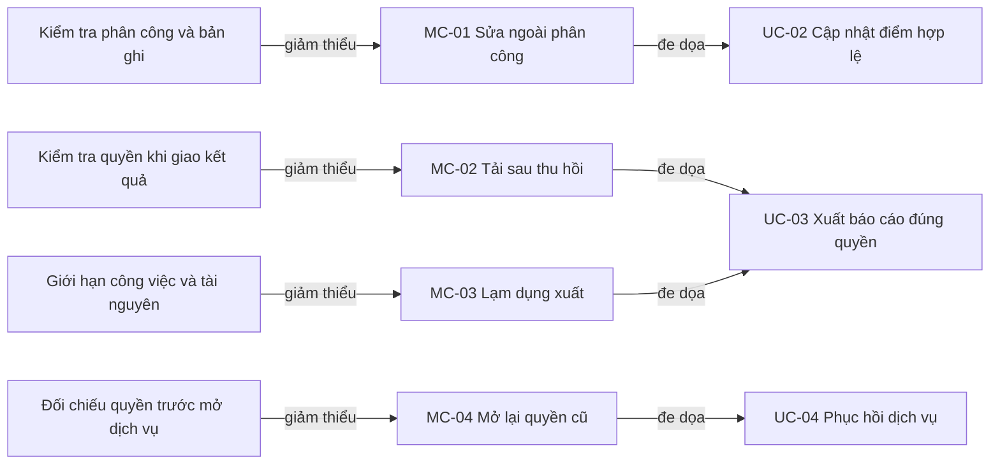

# Misuse case

## 1. Mục tiêu và phạm vi bài học

**Misuse case** là mô tả có cấu trúc về một cách sử dụng hoặc lạm dụng hệ thống có thể làm tổn hại tài sản, vi phạm quy tắc bảo mật hoặc cản trở mục tiêu nghiệp vụ hợp lệ.

Ví dụ, use case thông thường là “người chấm cập nhật điểm trong lớp được phân công”. Misuse case tương ứng có thể là “người chấm dùng quyền hợp lệ để sửa điểm của lớp ngoài phân công”.

Trong chương **Threat modeling** của module yêu cầu bảo mật, misuse case giúp nhóm chuyển câu hỏi “điều gì có thể bị làm sai?” thành:

- Kịch bản gây hại có tác nhân, điều kiện, đường đi và hậu quả rõ ràng.
- Yêu cầu về xác thực, phân quyền, dữ liệu, logging và phục hồi.
- Quyết định kiến trúc để thực thi yêu cầu.
- Tiêu chí kiểm thử và bằng chứng cho hành vi được phép hoặc bị cấm.

Sau bài học, bạn có thể viết một misuse case tự chứa, liên kết với chức năng hợp lệ và luồng dữ liệu, rồi tạo yêu cầu có thể kiểm chứng mà không nhầm kịch bản giả định với lỗ hổng đã được xác nhận.

Các giới hạn thời gian, dung lượng và số lượng trong bài là **giả định minh họa**, cần được chủ sở hữu nghiệp vụ và vận hành xác nhận trước khi áp dụng.

## 2. Phân biệt misuse case với các tài liệu gần nhau

### 2.1. Use case và misuse case nhìn cùng một chức năng từ hai phía

| Khía cạnh | Use case | Misuse case |
| --- | --- | --- |
| Mục tiêu | Hoàn thành chức năng nghiệp vụ hợp lệ | Tạo hậu quả bất lợi hoặc sử dụng ngoài phạm vi được phép |
| Tác nhân | Người hoặc dịch vụ có nhu cầu hợp lệ | Người ngoài, người dùng hợp lệ lạm dụng quyền, danh tính bị chiếm hoặc người thao tác nhầm |
| Kết quả quan tâm | Giá trị mà hệ thống cung cấp | Tài sản, quy tắc hoặc khả năng phục vụ bị ảnh hưởng |
| Câu hỏi chính | Hệ thống cần làm gì? | Chức năng có thể bị dùng để gây hại như thế nào? |
| Đầu ra thiết kế | Luồng xử lý và tiêu chí chức năng | Yêu cầu kiểm soát, giới hạn và bằng chứng bảo mật |

Một người dùng hợp lệ có thể là tác nhân của misuse case. Có tài khoản hoặc vai trò không đồng nghĩa mọi hành động của người đó đều được phép.

### 2.2. Misuse case không phải báo cáo lỗ hổng

Một misuse case có thể được viết trước khi có mã nguồn:

> Nếu API chỉ kiểm tra vai trò người chấm mà không kiểm tra phân công lớp, người chấm có thể sửa điểm ngoài phạm vi.

Đây là giả thuyết cần xử lý trong thiết kế. Nó chưa chứng minh một hệ thống đang chạy có lỗi đó.

Báo cáo lỗ hổng đã xác nhận cần bằng chứng về phiên bản, môi trường, điều kiện và hành vi quan sát được. Khi một misuse case dẫn tới phép thử xác nhận lỗi, liên kết hai tài liệu thay vì coi mọi misuse case đều là một phát hiện.

### 2.3. Misuse case, abuse case và failure case

Các nhóm có thể dùng “misuse case” và “abuse case” theo những quy ước khác nhau. Cần thống nhất cách dùng trước khi lập tài liệu.

Trong bài này:

- Misuse case bao gồm hành vi cố ý gây hại và việc sử dụng sai có hậu quả bảo mật do nhầm lẫn.
- Khi nhấn mạnh mục đích đối kháng, có thể gọi là tình huống lạm dụng.
- Lỗi chức năng thuần túy không ảnh hưởng mục tiêu bảo mật không cần bị ép thành misuse case.

Ví dụ, người vận hành phục hồi bản sao cũ làm sống lại quyền đã thu hồi là một tình huống sử dụng sai cần xem xét về bảo mật. Một nút hiển thị lệch vị trí chưa tự tạo thành misuse case.

### 2.4. Quan hệ với các mô hình khác

| Tài liệu | Đóng góp cho misuse case |
| --- | --- |
| Danh mục tài sản và phân loại dữ liệu | Cho biết giá trị, độ nhạy và hậu quả cần quan tâm |
| Quy tắc nghiệp vụ | Cho biết ai được làm gì, khi nào và với dữ liệu nào |
| DFD — sơ đồ luồng dữ liệu | Chỉ ra đường đi, nơi xử lý, nơi lưu và ranh giới tin cậy |
| Kịch bản đe dọa | Giúp xác định tác nhân, hành động và điều kiện gây hại |
| Yêu cầu bảo mật | Quy định hành vi hệ thống phải bảo đảm |
| Kế hoạch kiểm thử | Xác định dữ liệu, thao tác, kết quả đạt và bằng chứng |

Misuse case không thay thế toàn bộ threat model. Nó là cách diễn đạt một số đường gây hại sao cho nhóm nghiệp vụ, phát triển, kiểm thử và vận hành cùng thảo luận được.

## 3. Bắt đầu từ quy tắc nghiệp vụ và tài sản

### 3.1. Chọn chức năng hợp lệ

Ví dụ một nền tảng học tập có các use case:

| Mã | Chức năng hợp lệ | Quy tắc bảo mật liên quan |
| --- | --- | --- |
| UC-01 | Học viên xem kết quả | Chỉ xem kết quả của mình theo chính sách công bố |
| UC-02 | Người chấm cập nhật điểm | Chỉ cập nhật trong phân công và kỳ đánh giá được phép |
| UC-03 | Nhân viên đào tạo xuất báo cáo | Chỉ xuất nhóm dữ liệu và trường đã được cấp quyền |
| UC-04 | Người vận hành phục hồi | Chỉ phục hồi trong thẩm quyền, không mở lại quyền cũ trái phép |

Một câu “chỉ người có quyền được sửa” chưa đủ. Cần nêu quyền gắn với lớp, học viên, kỳ đánh giá, trạng thái và hành động nào.

### 3.2. Xác định tài sản và hậu quả

Các tài sản cần xem xét:

- Kết quả học tập và lịch sử thay đổi.
- Dữ liệu cá nhân trong báo cáo.
- Phiên, token và danh tính dịch vụ.
- Phân công, nhóm quyền và chính sách công bố.
- Audit và bằng chứng phê duyệt.
- Dữ liệu cùng quyền dùng khi phục hồi.

Tác động có thể thuộc:

- **Bí mật:** báo cáo bị đưa cho người ngoài phạm vi.
- **Toàn vẹn:** điểm số hoặc phân công bị sửa trái phép.
- **Sẵn sàng:** yêu cầu xuất làm cạn tài nguyên, ảnh hưởng chức năng chính.
- **Trách nhiệm giải trình:** không xác định được ai đã thay đổi dữ liệu và vì sao.

Không chỉ hỏi dữ liệu có bị lấy không. Một kết quả học tập bị sửa đúng định dạng nhưng sai thẩm quyền vẫn gây tổn hại.

### 3.3. Nêu khả năng tác nhân có thật

Một tác nhân nên có quyền và điều kiện rõ:

- Người ngoài chưa đăng nhập.
- Học viên có phiên hợp lệ.
- Người chấm có phân công cho một số lớp.
- Người có phiên bị chiếm hoặc chia sẻ.
- Dịch vụ có quyền tạo báo cáo.
- Người vận hành có quyền khởi động phục hồi.

Không mặc định mọi tác nhân có quyền quản trị toàn bộ hệ thống. Nếu cần một bước chiếm quyền trước, hãy ghi điều kiện đó hoặc liên kết tới misuse case khác.

## 4. Cấu trúc một misuse case có thể sử dụng

| Trường | Nội dung cần ghi |
| --- | --- |
| Mã và tên | Ngắn gọn, nêu mục tiêu gây hại hoặc hành vi ngoài quyền |
| Use case bị ảnh hưởng | Chức năng hợp lệ đang bị lạm dụng |
| Tài sản và quy tắc | Điều cần bảo vệ, chủ sở hữu và giới hạn nghiệp vụ |
| Tác nhân | Vai trò, ý định nếu có và quyền sẵn có |
| Tiền điều kiện | Điều kiện để bắt đầu, gồm giả định chưa xác minh |
| Điểm kích hoạt | Hành động hoặc sự kiện mở đầu |
| Luồng gây hại | Các bước từ đầu vào đến hậu quả, với điều kiện cần ở mỗi bước |
| Biến thể | Đường khác, thao tác lặp, bất đồng bộ hoặc thay đổi quyền |
| Hậu quả | Tác động kỹ thuật và nghiệp vụ, phạm vi có căn cứ |
| Hành vi an toàn mong đợi | Hệ thống phải từ chối, giới hạn, ghi nhận hoặc phục hồi ra sao |
| Yêu cầu liên quan | Mã yêu cầu và điểm thực hiện trong kiến trúc |
| Kiểm chứng | Phép thử, dữ liệu tổng hợp, kết quả và bằng chứng |
| Rủi ro còn lại | Điều chưa giải quyết, giới hạn kiểm soát và độ tin cậy |
| Trách nhiệm và cập nhật | Người xử lý, trạng thái, phiên bản và điều kiện rà soát |

Không cần mọi trường đều dài. Một tình huống đơn giản có thể trình bày ngắn, nhưng không được thiếu mối liên hệ giữa hành động, điều kiện và hậu quả.

### 4.1. Tách luồng gây hại và hành vi an toàn

Trong luồng gây hại, mô tả điều có thể xảy ra nếu điều kiện yếu tồn tại. Đánh dấu các bước giả định thay vì khẳng định hệ thống đã thực hiện chúng.

Sau đó viết riêng hành vi an toàn mong đợi. Không trộn hai cách nhìn thành một chuỗi như:

> Kẻ tấn công gửi yêu cầu → hệ thống từ chối → dữ liệu bị lộ.

Nếu đã bị từ chối và không có đường khác, hậu quả lộ dữ liệu chưa được giải thích. Cần chỉ ra đường bỏ qua hoặc kết thúc tình huống bằng việc kiểm soát đã ngăn hành vi.

### 4.2. Không chỉ ghi tên kỹ thuật tấn công

“Đoán mã”, “tiêm lệnh” hoặc “chiếm phiên” chưa đủ thành misuse case. Cần bổ sung:

- Mã hoặc phiên nào.
- Được gửi tới giao diện nào.
- Thành phần nào có thể tin nhầm.
- Quy tắc nào bị vượt.
- Tài sản và mục tiêu nghiệp vụ nào chịu tác động.

Không cần đưa hướng dẫn khai thác chi tiết mới có thể đặt yêu cầu. Mức chi tiết cần đủ để thiết kế kiểm soát và phép thử trong môi trường được phép.

## 5. Quy trình xây dựng misuse case

1. **Chọn use case hợp lệ và phạm vi.** Ghi môi trường, nhóm người dùng và dữ liệu.
2. **Viết quy tắc cần giữ.** Xác định hành động được phép và điều kiện.
3. **Đổi góc nhìn tác nhân.** Xem người không có quyền, người có quyền hạn chế, danh tính bị chiếm và sai sót.
4. **Đi theo luồng dữ liệu.** Xét API, kho tệp, hàng đợi, tác vụ nền, bản xuất, audit và phục hồi.
5. **Mô tả một đường gây hại.** Nêu điều kiện và kết quả, không chỉ dùng nhãn rủi ro.
6. **Bổ sung biến thể.** Thay tài nguyên, phát lại, dùng phiên cũ, thay quyền trong lúc chờ hoặc xử lý đồng thời.
7. **Đặt hành vi an toàn mong đợi.** Ngăn, giới hạn, phát hiện hoặc phục hồi theo mục tiêu.
8. **Tạo yêu cầu và phép kiểm chứng.** Nêu nơi thực hiện và bằng chứng cần có.
9. **Đánh giá ưu tiên và phần còn lại.** Dựa trên tác động, khả năng, kiểm soát hiện hành và điều chưa biết.
10. **Duy trì liên kết khi thay đổi.** Cập nhật use case, DFD, yêu cầu và thử nghiệm liên quan.

Misuse case có thể được lập ngay khi thiết kế và tiếp tục cập nhật trong phát triển. Không cần chờ một sự cố thật mới mô tả điều có thể gây hại.

## 6. Ví dụ MC-01: sửa điểm ngoài phân công

### 6.1. Hồ sơ ngắn

| Trường | Nội dung minh họa |
| --- | --- |
| Mã | MC-01 |
| Tên | Người chấm sửa điểm của lớp ngoài phân công |
| Use case liên quan | UC-02 — cập nhật điểm |
| Tài sản | Điểm, lịch sử thay đổi, phân công và tính công bằng đánh giá |
| Tác nhân | Người chấm có phiên hợp lệ và chỉ được phân công lớp A |
| Tiền điều kiện | Có giao diện cập nhật điểm; điểm của lớp B thuộc phạm vi bảo vệ khác |
| Giả định cần xác minh | Có thể có đường chỉ kiểm tra vai trò người chấm, chưa kiểm tra phân công đối với bản ghi đích |
| Mục tiêu gây hại | Làm thay đổi điểm lớp B mà không có thẩm quyền |
| Chủ sở hữu nghiệp vụ | Bên chịu trách nhiệm quy trình đánh giá |

Tên lớp và vai trò trong ví dụ chỉ là dữ liệu mô hình. Chưa có kết luận rằng một ứng dụng cụ thể cho phép hành vi này.

### 6.2. Luồng gây hại giả định

1. Tác nhân mở chức năng cập nhật điểm vốn được phép sử dụng cho lớp A.
2. Tác nhân gửi yêu cầu tham chiếu bản ghi của lớp B hoặc một kỳ đánh giá ngoài phân công.
3. Nếu hệ thống chỉ kiểm tra vai trò chung, yêu cầu có thể qua bước kiểm tra ban đầu.
4. Nếu thao tác ghi dùng trực tiếp mã bản ghi mà không ràng buộc phân công, điểm ngoài quyền có thể bị thay đổi.
5. Điểm bị sửa được cung cấp cho học viên hoặc báo cáo đánh giá.
6. Nếu lịch sử và audit không đủ, việc xác định và khôi phục giá trị đúng có thể bị chậm.

Bước 3 và 4 là điều kiện yếu cần kiểm tra, không phải hành vi đã được xác nhận.

### 6.3. Biến thể

- Cập nhật từng điểm qua API.
- Nhập nhiều dòng từ tệp, trong đó chỉ một số dòng ngoài quyền.
- Gọi một đường cập nhật cũ còn được sử dụng.
- Dùng tác vụ nền có danh tính dịch vụ rộng hơn người khởi tạo.
- Gửi lại yêu cầu cũ sau khi phân công đã thay đổi.
- Ghi đè một phiên bản điểm mới hơn bằng bản sửa cũ.

Mỗi biến thể có thể cần yêu cầu và phép thử riêng. Việc sửa một nút trên giao diện chưa chứng minh các đường khác đã được bảo vệ.

### 6.4. Hành vi an toàn mong đợi

Hệ thống phải quyết định quyền dựa trên chủ thể đã xác thực, hành động, lớp, học viên, kỳ đánh giá, phân công và trạng thái nghiệp vụ phù hợp.

Yêu cầu ngoài quyền không làm thay đổi bản ghi đích. Đối với nhập hàng loạt, không dòng ngoài quyền nào được thay đổi; chính sách xử lý phần hợp lệ phải được mô tả rõ.

Lịch sử thay đổi phải cho phép đối chiếu phiên bản. Audit ghi nhận được chủ thể, bản ghi, loại thay đổi, kết quả và mối liên hệ với tác vụ, trong phạm vi dữ liệu được phép ghi.

### 6.5. Rủi ro còn lại

Kiểm tra phân công không ngăn mọi hành vi sai trong chính lớp được phân công. Một người có quyền vẫn có thể nhập điểm không chính xác hoặc cố ý sai.

Nếu hậu quả đòi hỏi kiểm soát thêm, cần xem xét quy trình duyệt, đối chiếu hoặc phát hiện bất thường. Đó là một đường rủi ro cần mô tả riêng, không tuyên bố MC-01 đã xử lý mọi rủi ro về điểm.

## 7. Ví dụ MC-02: tải báo cáo sau khi bị thu hồi quyền

### 7.1. Hồ sơ ngắn

| Trường | Nội dung minh họa |
| --- | --- |
| Mã | MC-02 |
| Tên | Người đã mất quyền nhận được kết quả xuất đang chờ |
| Use case liên quan | UC-03 — xuất báo cáo |
| Tài sản | Kết quả học tập, dữ liệu cá nhân và tệp xuất |
| Tác nhân | Nhân viên từng có quyền, vẫn giữ phiên hoặc liên kết cũ |
| Tiền điều kiện | Tác vụ xuất đã được tạo khi còn quyền; quyền bị thu hồi trước khi nhận kết quả |
| Giả định cần xác minh | Worker hoặc đường tải chỉ tin quyết định quyền tại thời điểm tạo tác vụ |
| Mục tiêu gây hại | Nhận dữ liệu sau khi quyền không còn hiệu lực |

### 7.2. Luồng gây hại giả định

1. Người dùng tạo tác vụ xuất khi đang có quyền với một nhóm dữ liệu.
2. Hệ thống đưa công việc vào hàng đợi, kèm phạm vi yêu cầu.
3. Nguồn quyền có thẩm quyền thu hồi quyền của người đó.
4. Worker dùng danh tính dịch vụ để đọc dữ liệu, nhưng có thể không đối chiếu lại quyền của người khởi tạo.
5. Hệ thống tạo tệp và tiếp tục cung cấp qua phiên hoặc liên kết cũ.
6. Người đã mất quyền nhận được báo cáo.

Điểm quan trọng không chỉ là token còn hạn bao lâu. Cần phân tích quyết định quyền ở thời điểm tạo, thực hiện và giao kết quả.

### 7.3. Những đường cần kiểm tra

- Giao diện danh sách tác vụ và API lấy trạng thái.
- Worker đọc dữ liệu bằng danh tính dịch vụ.
- Kho lưu tệp xuất.
- Đường tải trực tiếp hoặc liên kết cấp sẵn.
- Cache quyền và phiên cũ.
- Tác vụ đang chạy khi quyền thay đổi.
- Thử lại sau khi hệ thống gặp lỗi.

Một trường hợp giao diện đã ẩn nút tải nhưng đường tải cũ vẫn hoạt động chưa đáp ứng mục tiêu.

### 7.4. Hành vi an toàn mong đợi

Quyền của người khởi tạo và phạm vi dữ liệu phải được kiểm tra ở các điểm cần thiết để đạt mục tiêu thu hồi đầu cuối. Danh tính dịch vụ có quyền kỹ thuật không được biến mọi yêu cầu từ hàng đợi thành yêu cầu được phép.

Tệp xuất chỉ được cung cấp cho danh tính còn quyền đối với dữ liệu tương ứng. Nếu quyền bị thu hồi trong khi tác vụ đang chạy, kết quả không được giao trái với quyết định thu hồi và giới hạn thời gian đã xác nhận.

Người dùng không được tự khai danh tính người khởi tạo hoặc phạm vi đã duyệt để worker tin mà bỏ kiểm tra.

### 7.5. Giới hạn của kiểm soát

Thu hồi trên máy chủ thường không thu hồi được bản đã tải trước đó. Tài liệu cần tách:

- Dữ liệu còn do hệ thống quản lý.
- Liên kết và phiên có thể bị vô hiệu.
- Bản sao đã được đưa ra thiết bị hoặc bên nhận.

Nếu rủi ro từ bản tải hợp lệ rồi chia sẻ lại là đáng kể, cần có misuse case và quyết định xử lý riêng. Không đặt tiêu chí “thu hồi mọi bản sao” khi kiến trúc không có khả năng đó.

## 8. Các misuse case bổ sung

### 8.1. MC-03 — lạm dụng chức năng xuất làm cạn tài nguyên

Một tài khoản hợp lệ liên tục tạo báo cáo nặng hoặc yêu cầu phạm vi quá lớn. Hàng đợi, bộ nhớ, dung lượng và kết nối dữ liệu bị sử dụng đến mức chức năng xem hoặc cập nhật kết quả bị ảnh hưởng.

Điều kiện cần xem xét:

- Tạo công việc có kiểm tra quyền trước khi thực hiện xử lý tốn kém không?
- Có giới hạn theo người dùng và toàn hệ thống không?
- Một yêu cầu lặp có tạo thêm công việc không?
- Công việc vượt giới hạn bị từ chối, xếp hàng hay trả lại công việc cũ?
- Có thể dùng nhiều phiên để vượt giới hạn cùng một danh tính không?

Hành vi an toàn là giới hạn tài nguyên theo chính sách cụ thể và bảo vệ các luồng nghiệp vụ ưu tiên. Chỉ kiểm tra kích thước tệp đầu ra chưa kiểm soát chi phí tạo báo cáo.

Các giới hạn không tự giải quyết mọi dạng từ chối dịch vụ. Cần ghi phạm vi chúng xử lý và các đường tải còn lại.

### 8.2. MC-04 — phục hồi làm sống lại quyền đã thu hồi

Người vận hành phục hồi đúng bản sao về mặt kỹ thuật nhưng đưa cả phân công, trạng thái tài khoản hoặc liên kết cũ trở lại. Người đã mất quyền có thể tiếp cận dữ liệu sau khi dịch vụ mở.

Tác nhân ở đây có thể không có ý đồ xấu. Mục tiêu sử dụng là khôi phục dịch vụ, nhưng cách thực hiện có hậu quả bảo mật.

Hành vi an toàn cần:

- Chọn đúng dữ liệu và phiên bản.
- Đối chiếu với nguồn trạng thái quyền hiện hành được bảo vệ hoặc xác nhận lại theo quy trình.
- Không tự kích hoạt phiên hay quyền chưa xác minh.
- Kiểm tra quyền trước khi mở chức năng.
- Ghi audit về người thực hiện, phạm vi và kết quả phục hồi.

RPO của dữ liệu nghiệp vụ không phải lý do chấp nhận khôi phục nguyên trạng thông tin xác thực đã bị vô hiệu.

### 8.3. MC-05 — che giấu thay đổi bằng cách can thiệp audit

Một danh tính có quyền trên ứng dụng cố sửa, xóa hoặc ngăn gửi audit sau thao tác thay đổi điểm hay xuất dữ liệu.

Điều kiện cần xác minh là danh tính đó có tiếp cận kho audit, cấu hình chuyển tiếp hoặc quyền thay đổi chính sách ghi nhận hay không.

Biện pháp có thể gồm tách quyền, bảo vệ sự kiện đã thu thập, phát hiện mất luồng và kiểm tra tính đầy đủ. Không coi việc “có ghi log” là đã ngăn được hành vi che giấu.

## 9. Liên kết misuse case với chức năng và kiểm soát



Sơ đồ dùng quan hệ có nhãn để giải thích, không phải một đặc tả ký hiệu bắt buộc. Mũi tên giảm thiểu chỉ thể hiện liên kết thiết kế; chưa chứng minh kiểm soát đã được triển khai hoặc đủ hiệu lực.

Để tìm nơi thực hiện, bổ sung liên kết với DFD hoặc thành phần:

| Đường nghiệp vụ | Thành phần cần xem xét | Câu hỏi bảo mật |
| --- | --- | --- |
| Người chấm → API → kho điểm | Xác thực, chính sách phân công, thao tác ghi | Quyền được gắn với bản ghi và phiên bản nào? |
| Người dùng → hàng đợi → worker | API tạo tác vụ, nội dung công việc, danh tính dịch vụ | Worker dựa vào quyền của ai và thời điểm nào? |
| Worker → kho xuất → người nhận | Kho tệp, API tải, liên kết và cache | Ai được nhận kết quả khi quyền đã đổi? |
| Ứng dụng → audit | Nguồn sự kiện, bộ chuyển tiếp, kho lưu | Có lộ dữ liệu hoặc bị che giấu không? |
| Backup → môi trường phục hồi | Nguồn bản sao, khóa, quyền và thao tác mở | Trạng thái cũ có tạo lại quyền không hợp lệ không? |

## 10. Ưu tiên theo rủi ro và độ chắc chắn

Misuse case mô tả đường gây hại, chưa tự quyết định mức ưu tiên. Cần xét:

- Hậu quả và phạm vi dữ liệu hoặc người dùng.
- Điều kiện tiếp cận và quyền cần có.
- Khả năng thực hiện hoặc lặp lại trong bối cảnh cụ thể.
- Kiểm soát đang có hiệu lực và bằng chứng.
- Tính nhạy cảm về thời điểm, chẳng hạn trước công bố kết quả.
- Khả năng phát hiện, sửa sai và phục hồi.
- Điều chưa biết và mức tin cậy của đánh giá.

Ví dụ, MC-01 có thể có tác động toàn vẹn cao vì liên quan kết quả đánh giá. MC-02 có thể có tác động bí mật cao nếu tệp gồm nhiều học viên. Kết luận cụ thể vẫn cần chủ sở hữu xác nhận theo dữ liệu thật.

Không gán một tỷ lệ phần trăm tùy ý cho khả năng xảy ra. Nếu dùng thang định tính hoặc điểm thứ bậc, cần ghi tiêu chí và lý do.

Phân biệt:

- Misuse case đã được xem xét và chưa thấy điều kiện yếu trong phạm vi thử.
- Misuse case có giả định chưa xác minh.
- Misuse case dẫn đến phát hiện đã xác nhận.
- Misuse case có kiểm soát, còn rủi ro được theo dõi hoặc chấp nhận.

“Không tái hiện được trong một phép thử” chưa đồng nghĩa “không còn mọi đường gây hại”.

## 11. Chuyển misuse case thành yêu cầu bảo mật

### 11.1. Mẫu viết yêu cầu

Có thể dùng cấu trúc:

> Với [phạm vi dữ liệu và môi trường], [thành phần] phải [hành vi hoặc giới hạn] khi [điều kiện], đạt [kết quả hoặc ngưỡng]. Kiểm chứng bằng [phép thử] và lưu [bằng chứng].

Mỗi yêu cầu cần liên kết với misuse case, nơi thực hiện, nhóm chịu trách nhiệm và người chấp nhận kết quả. Những từ “đủ mạnh”, “kịp thời” hoặc “an toàn” cần được thay bằng điều kiện rõ.

### 11.2. SEC-MC-01 — Xác thực và thu hồi đầu cuối

Mọi đường cập nhật điểm và cung cấp báo cáo phải có danh tính đã được kiểm chứng, thông tin xác thực còn được chấp nhận và đúng mục đích. Danh tính người khởi tạo công việc không được quyết định từ trường do máy khách tự khai mà không được kiểm chứng.

Trong ví dụ, sau khi phiên bị thu hồi tại nguồn có thẩm quyền, mọi điểm cung cấp dữ liệu phải ngừng chấp nhận trong tối đa 5 phút.

- Liên quan: MC-01, MC-02.
- Điểm thực hiện: dịch vụ danh tính, API, tải tệp và các điểm tiếp nhận.
- Kiểm chứng: phiên không hợp lệ, hết hạn, bị thu hồi; phiên cũ trên nhiều điểm truy cập.
- Kết quả đạt: không thực hiện hành động hoặc nhận dữ liệu ngoài điều kiện.
- Bằng chứng: cấu hình, mốc thu hồi và kết quả đầu cuối.

Đây là giới hạn từ mốc thu hồi, không phải cam kết phát hiện mọi vụ chiếm phiên trong 5 phút. Cửa sổ trước phát hiện vẫn cần được đánh giá.

### 11.3. SEC-MC-02 — Phân quyền đối với thay đổi điểm

Mọi thao tác ghi điểm phải kiểm tra quyền của chủ thể đối với hành động, lớp, học viên và kỳ đánh giá đích theo phân công có hiệu lực. Chỉ có vai trò “người chấm” là chưa đủ.

Dữ liệu được ghi phải tương ứng với đối tượng đã được kiểm tra. Yêu cầu ngoài quyền không được thay đổi bản ghi đích. Chính sách xử lý phiên bản cũ và thao tác nhập nhiều dòng phải được xác định để tránh ghi đè hoặc thay đổi ngoài phạm vi.

- Liên quan: MC-01.
- Điểm thực hiện: API ghi điểm, nhập tệp và tác vụ cập nhật nền.
- Kiểm chứng: người chấm lớp A sửa lớp B; thay mã kỳ đánh giá; lô có dòng ngoài quyền; cập nhật từ phiên bản cũ.
- Kết quả đạt: không có bản ghi ngoài quyền bị thay đổi; luồng hợp lệ tuân theo chính sách phiên bản.
- Bằng chứng: ma trận quyền, trạng thái trước–sau và lịch sử phiên bản.

Quyết định quyền phải được ràng buộc với thao tác ghi thực tế. Nếu phân công có thể thay đổi đồng thời, thiết kế phải nêu mốc hiệu lực và cách xử lý nhất quán.

### 11.4. SEC-MC-03 — Bảo toàn quyền qua tác vụ bất đồng bộ

Tác vụ xuất phải giữ được tham chiếu đáng tin cậy tới người khởi tạo, dữ liệu yêu cầu và mục đích. Worker phải giới hạn dữ liệu theo quyền được phép, không dùng quyền kỹ thuật rộng của mình để tự mở rộng phạm vi.

Quyền phải được kiểm tra ở các điểm tạo, thực hiện và giao kết quả phù hợp để đáp ứng giới hạn thu hồi. Nếu quyền thay đổi trong lúc chờ hoặc chạy, kết quả không được cung cấp trái quyết định có hiệu lực.

- Liên quan: MC-02.
- Điểm thực hiện: API tạo tác vụ, hàng đợi, worker, kho xuất và API tải.
- Kiểm chứng: thu hồi trước khi worker bắt đầu, trong lúc xử lý và sau khi tạo tệp nhưng trước khi tải.
- Kết quả đạt: dữ liệu ngoài quyền không được cung cấp; mọi đường giao kết quả đạt giới hạn 5 phút từ mốc thu hồi.
- Bằng chứng: mốc tác vụ, quyết định quyền và kết quả tải.

Tác vụ đã chạy có thể cần hủy, bỏ kết quả hoặc giữ trong trạng thái không được cung cấp. Phương án phải được mô tả và thử, thay vì chỉ ẩn tác vụ khỏi giao diện.

### 11.5. SEC-MC-04 — Giới hạn lạm dụng tài nguyên xuất

Trong tình huống minh họa, một người dùng chỉ được có tối đa một công việc xuất đang chờ hoặc đang chạy. Toàn hệ thống chỉ chạy tối đa bốn công việc xuất đồng thời trong phạm vi dịch vụ được xét.

Giới hạn phải được áp dụng trước khi khởi tạo công việc tốn kém và phải nhất quán qua nhiều phiên, nhiều bản sao API. Yêu cầu vượt giới hạn được từ chối hoặc trả lại công việc hiện có theo chính sách đã xác định, không âm thầm tạo thêm việc.

- Liên quan: MC-03.
- Điểm thực hiện: tiếp nhận công việc, hàng đợi và điều phối worker.
- Kiểm chứng: gửi đồng thời từ nhiều phiên cùng người dùng và từ nhiều người dùng qua các điểm tiếp nhận.
- Kết quả đạt: không vượt giới hạn công việc tương ứng; trạng thái được trả nhất quán.
- Bằng chứng: số công việc thực tế, số worker đang chạy và kết quả phản hồi.

Các giới hạn này chưa tự kiểm soát mọi chi phí trước khi tạo công việc, thời gian chạy quá dài hoặc dung lượng đầu ra. Cần bổ sung giới hạn theo những đường lạm dụng thực tế.

### 11.6. SEC-MC-05 — Audit và bảo vệ bằng chứng

Các thao tác cập nhật điểm, xuất hoặc tải báo cáo, thay quyền và phục hồi phải tạo sự kiện gồm danh tính tham chiếu, hành động, mã tài nguyên hoặc tác vụ, thời điểm và kết quả. Sự kiện thay đổi điểm phải liên kết được với phiên bản lịch sử tương ứng.

Trong ví dụ, sự kiện phải có tại kho audit trung tâm trong tối đa 5 phút. Danh tính quản trị ứng dụng thông thường không được sửa hoặc xóa sự kiện đã thu thập. Mất luồng audit phải được phát hiện và cảnh báo theo ngưỡng được xác nhận; ví dụ là 10 phút từ mốc tín hiệu kiểm tra dự kiến đầu tiên bị thiếu.

- Liên quan: MC-01, MC-02, MC-04, MC-05.
- Kiểm chứng: thao tác thành công, bị từ chối, thử sửa log và ngừng chuyển tiếp.
- Kết quả đạt: có sự kiện đúng, đúng độ trễ và cảnh báo; thao tác audit ngoài quyền bị từ chối.
- Bằng chứng: mẫu sự kiện đã lọc dữ liệu, kết quả đo và chính sách kho audit.

Không ghi token, mật khẩu hoặc toàn bộ báo cáo. Những trường nhạy cảm cần cho điều tra phải có mục đích, quyền và thời hạn lưu rõ ràng. Audit hỗ trợ phát hiện, điều tra; không thay thế việc từ chối thao tác ngoài quyền.

### 11.7. SEC-MC-06 — Bảo vệ dữ liệu báo cáo và bản xuất

Báo cáo và tệp xuất phải được lưu trong hệ thống được phê duyệt, có bảo vệ khi lưu và khi truyền theo chính sách đã xác nhận. Truy cập phải gắn với danh tính và quyền trên dữ liệu, không chỉ dựa vào việc biết đường dẫn.

Tệp xuất phải có thời hạn giữ được xác định theo mục đích. Cache, bản tạm và đường tải trực tiếp phải tuân theo cùng phạm vi bảo vệ; liên kết hết hạn không thay thế cơ chế thu hồi theo SEC-MC-01.

- Liên quan: MC-02.
- Điểm thực hiện: worker, kho tệp, API tải và cache.
- Kiểm chứng: người không có quyền dùng URL cũ; truy cập kho trực tiếp; kiểm tra cấu hình bảo vệ và xử lý tệp quá hạn.
- Kết quả đạt: không cung cấp tệp ngoài quyền, các bản do hệ thống quản lý được xử lý theo vòng đời.
- Bằng chứng: danh sách nơi lưu, chính sách hiệu lực và kết quả thử.

Mã hóa không ngăn ứng dụng trả dữ liệu cho người sai quyền. Cần kiểm chứng riêng bảo vệ lưu trữ và phân quyền.

### 11.8. SEC-MC-07 — Phục hồi không mở lại quyền cũ

Trong kịch bản mất kho dữ liệu đã thống nhất của ví dụ, dịch vụ phải đạt RPO không quá 15 phút và RTO không quá 60 phút, đồng thời kiểm tra quyền hiện hành trước khi mở lại chức năng.

RPO là mục tiêu về khoảng dữ liệu có thể mất trước sự cố. RTO ở đây được đo từ lúc công bố sự cố đến khi chức năng xem và cập nhật hợp lệ hoạt động với dữ liệu cùng quyền đã được xác nhận.

Phiên, tài khoản hoặc phân công đã thu hồi không được tự kích hoạt từ backup. Nếu chưa thể xác minh một quyền, hệ thống phải áp dụng phương án hạn chế hoặc xác nhận lại đã được phê duyệt.

- Liên quan: MC-04.
- Điểm thực hiện: backup, môi trường phục hồi và nguồn quản trị quyền hiện hành.
- Kiểm chứng: tạo bản sao, thu hồi phân công và phiên, thay dữ liệu thử rồi phục hồi từ bản sao cũ.
- Kết quả đạt: dữ liệu phục hồi đúng phạm vi, quyền đã thu hồi không hoạt động, mục tiêu được đáp ứng trong kịch bản.
- Bằng chứng: biên bản, mốc thời gian, kiểm tra nội dung, phiên bản và ma trận quyền sau phục hồi.

Có backup không chứng minh đạt RPO hoặc RTO. Mở quyền rộng để dịch vụ hoạt động nhanh hơn cũng không đáp ứng yêu cầu kết hợp.

## 12. Bảng truy vết

| Misuse case | Quy tắc cần giữ | Yêu cầu | Nơi thực hiện chính | Bằng chứng chấp nhận |
| --- | --- | --- | --- | --- |
| MC-01 | Chỉ thay đổi điểm trong phân công | SEC-MC-01, SEC-MC-02, SEC-MC-05 | API, nhập tệp, ghi điểm, audit | Thử quyền, trạng thái trước–sau và phiên bản |
| MC-02 | Chỉ giao báo cáo cho danh tính còn quyền | SEC-MC-01, SEC-MC-03, SEC-MC-06 | Hàng đợi, worker, kho xuất, đường tải | Thu hồi ở nhiều thời điểm và thử mọi đường tải |
| MC-03 | Xuất không vượt giới hạn công việc | SEC-MC-04 | API tạo tác vụ, hàng đợi, worker | Thử đồng thời và đối chiếu số việc thực tế |
| MC-04 | Phục hồi không mở lại quyền cũ | SEC-MC-05, SEC-MC-07 | Backup, phục hồi, nguồn quyền | Diễn tập với thay đổi sau điểm backup |
| MC-05 | Người đổi dữ liệu không xóa được bằng chứng ngoài quyền | SEC-MC-05 | Nguồn sự kiện và kho audit | Thử quyền sửa, xóa và cảnh báo mất luồng |

Bảng là kế hoạch liên kết, không phải tuyên bố các phép thử đã được thực hiện. Khi kiểm chứng, phải ghi phiên bản, môi trường, điều kiện và kết quả thật.

Một misuse case có thể tạo nhiều yêu cầu. Một yêu cầu dùng chung như audit có thể hỗ trợ nhiều misuse case, nhưng phải nói rõ nó ngăn, phát hiện hay giúp phục hồi phần nào.

## 13. Thiết kế kiểm thử từ misuse case

### 13.1. Thử cả đường hợp lệ và đường gây hại

Ma trận tối thiểu cho cập nhật điểm có thể gồm:

| Chủ thể và điều kiện | Thao tác | Kết quả mong đợi |
| --- | --- | --- |
| Chưa xác thực | Cập nhật một bản ghi | Từ chối, không thay đổi |
| Người chấm đúng phân công | Cập nhật bản ghi hợp lệ | Cho phép theo chính sách phiên bản |
| Người chấm lớp A | Cập nhật lớp B | Từ chối, bản ghi lớp B không đổi |
| Người đã mất phân công | Gửi yêu cầu mới | Từ chối theo mốc hiệu lực đã đặc tả |
| Danh tính dịch vụ ngoài tác vụ | Ghi kết quả không được giao | Từ chối |
| Người đúng quyền nhưng phiên bản cũ | Ghi đè bản mới | Xử lý theo chính sách xung đột đã xác nhận |

Cần thử các đường nhập tệp, cập nhật hàng loạt và tác vụ nền nếu chúng tồn tại. Kiểm tra một endpoint không chứng minh các đường còn lại dùng cùng kiểm soát.

### 13.2. Ví dụ kiểm thử hành vi

```gherkin
Given người chấm A chỉ được phân công lớp A
And bản ghi thử của lớp B có giá trị và phiên bản đã biết
When người chấm A gửi yêu cầu cập nhật bản ghi đó
Then hệ thống từ chối thao tác
And giá trị cùng phiên bản của bản ghi lớp B không thay đổi
And audit ghi nhận danh tính, tài nguyên và kết quả phù hợp
And phản hồi không chứa dữ liệu ngoài quyền
```

Đối với tác vụ bất đồng bộ:

```gherkin
Given một tác vụ xuất được tạo khi người dùng còn quyền
And tác vụ chưa giao kết quả
When quyền của người dùng bị thu hồi tại nguồn có thẩm quyền
And người dùng tiếp tục dùng phiên cùng liên kết cũ để tải
Then mọi đường cung cấp kết quả ngừng chấp nhận trong giới hạn 5 phút
And worker không tự mở rộng phạm vi bằng quyền kỹ thuật của mình
And hệ thống giữ bằng chứng xử lý mà không ghi token hoặc nội dung báo cáo
```

Các ví dụ là đặc tả phép thử. Dữ liệu cần là dữ liệu tổng hợp; báo cáo không nên chứa thông tin xác thực thật.

### 13.3. Kiểm tra hậu quả, không chỉ mã phản hồi

Nếu yêu cầu bị từ chối, cần xác minh:

- Dữ liệu không bị thay đổi trước khi trả lỗi.
- Không có tác vụ nền tiếp tục ghi ngoài quyền.
- Không lộ dữ liệu qua nội dung lỗi hoặc trường phụ.
- Không có tệp xuất được đặt ở một đường khác vẫn truy cập được.
- Audit không tạo thêm bản sao bí mật.
- Trường hợp hợp lệ vẫn hoạt động.

Một phản hồi lỗi có thể xuất hiện sau khi thao tác gây hại đã xảy ra. Vì vậy, quan sát trạng thái và tác vụ liên quan là phần quan trọng của bằng chứng.

## 14. Duy trì misuse case trong vòng đời phát triển

### 14.1. Khi thiết kế

Dùng misuse case để phát hiện chỗ quy tắc còn mơ hồ: ai được sửa, phạm vi nào, thời điểm nào và quyền của công việc nền lấy từ đâu.

Nếu chưa biết nguồn xác định quyền hiện hành sau phục hồi, cần ghi câu hỏi thiết kế và người xử lý. Không coi một bước “kiểm tra quyền” trên sơ đồ là đã có giải pháp.

### 14.2. Khi xây dựng và phát hành

Liên kết mã misuse case với yêu cầu và các điểm thực hiện. Khi thêm một API hoặc đường nhập tệp mới, xem nó có tạo biến thể của tình huống cũ không.

Trước phát hành, phân biệt:

- Yêu cầu đã được kiểm chứng trong phạm vi nào.
- Phát hiện còn mở.
- Giả định chưa xác minh.
- Kiểm soát mới dự kiến.
- Rủi ro còn lại và quyết định xử lý.

Không hạ mức rủi ro hiện tại chỉ vì việc khắc phục đã có trong kế hoạch. Cũng không đánh dấu yêu cầu đạt chỉ vì rủi ro được chấp nhận theo một cơ chế quản trị.

### 14.3. Khi vận hành

Rà soát khi có:

- Thêm vai trò, nhóm khách hàng hoặc dữ liệu nhạy cảm.
- Mở rộng quyền của người dùng hoặc danh tính dịch vụ.
- Bổ sung xuất hàng loạt, liên kết tải hoặc cache.
- Thêm worker, hàng đợi, nhập dữ liệu hay tích hợp.
- Thay đổi mốc thu hồi, chính sách phiên hoặc nguồn phân công.
- Đổi backup và quy trình phục hồi.
- Sự cố hoặc kết quả thử cho thấy đường gây hại chưa được mô tả.

Ví dụ, chuyển từ xuất trực tiếp sang xuất qua worker không chỉ thay hiệu năng. Nó thêm thời điểm quyền có thể thay đổi, danh tính kỹ thuật và nơi lưu kết quả, nên cần cập nhật MC-02.

### 14.4. Quản lý trạng thái và giới hạn kết luận

Một misuse case có thể được ghi nhận là đang phân tích, chờ xác minh, có yêu cầu xử lý hoặc đã có kiểm soát được kiểm chứng trong phạm vi xác định.

Không cần xóa tình huống khỏi tài liệu sau khi một phép thử đạt. Nó vẫn là lý do tồn tại của kiểm soát và giúp phát hiện việc bỏ sót khi thay đổi.

Khi không còn chức năng hoặc tài sản liên quan, có thể kết thúc phạm vi theo bằng chứng. Cần xem cả bản xuất, liên kết, tác vụ chờ và dữ liệu còn giữ, không chỉ giao diện chính.

## 15. Những sai lầm thường gặp

| Sai lầm | Vấn đề | Cách cải thiện |
| --- | --- | --- |
| Chỉ viết “hacker tấn công hệ thống” | Không có hành động, điều kiện hoặc tài sản rõ | Gắn tác nhân với use case và đường dữ liệu |
| Chỉ liệt kê tên kỹ thuật tấn công | Chưa biết quy tắc nào bị vượt | Mô tả luồng gây hại và hậu quả nghiệp vụ |
| Cho mọi tác nhân quyền quản trị | Bỏ qua các bước và điều kiện quan trọng | Ghi đúng quyền sẵn có, liên kết tình huống trước nếu cần |
| Bỏ người dùng hợp lệ khỏi mô hình | Không thấy lạm dụng quyền hoặc danh tính bị chiếm | Xem cả hành vi trong và ngoài phạm vi công việc |
| Coi misuse case là lỗ hổng đã xác nhận | Kết luận vượt bằng chứng | Tách giả định, kiểm tra và phát hiện thực tế |
| Trộn luồng gây hại với luồng từ chối an toàn | Không giải thích được vì sao hậu quả xảy ra | Viết hành vi an toàn mong đợi ở phần riêng |
| Chỉ kiểm tra giao diện | API, nhập tệp hoặc worker có thể bỏ qua | Lập danh sách mọi đường thực hiện cùng hành động |
| Kiểm tra quyền một lần cho công việc dài | Quyền có thể thay đổi trước khi giao kết quả | Xác định các điểm kiểm tra theo mục tiêu thu hồi |
| Dùng logging thay cho phân quyền | Chỉ có bằng chứng sau hành vi gây hại | Phân biệt ngăn ngừa, phát hiện và phục hồi |
| Chỉ xem mã phản hồi | Dữ liệu có thể đã bị ghi hoặc giao trước lỗi | Kiểm tra trạng thái, tác vụ và đường tải liên quan |
| Bỏ misuse case sau khi sửa một lỗi | Mất lý do và phép thử cho lần thay đổi sau | Giữ truy vết theo phiên bản và phạm vi |
| Đưa bí mật thật vào ví dụ hoặc báo cáo | Tạo thêm nơi rò rỉ | Dùng dữ liệu tổng hợp và tham chiếu đã lọc |

## 16. Bài tập thực hành

Một dịch vụ cho phép nhân viên tạo tài liệu, chia sẻ theo nhóm, xuất bản sao và phục hồi từ backup. Công việc xuất chạy qua hàng đợi bằng một danh tính dịch vụ. Người dùng có thể bị chuyển nhóm khi công việc đang chờ.

Hãy thực hiện:

1. Viết ba use case hợp lệ và quy tắc quyền tương ứng.
2. Xác định tài sản và tác nhân cho từng use case.
3. Viết misuse case về đọc tài liệu của nhóm khác.
4. Viết misuse case về nhận bản xuất sau khi chuyển nhóm.
5. Viết misuse case về phục hồi liên kết chia sẻ đã thu hồi.
6. Với mỗi tình huống, tách điều kiện đã biết khỏi giả định cần xác minh.
7. Chọn yêu cầu xác thực, phân quyền, dữ liệu, audit hoặc phục hồi phù hợp.
8. Viết phép thử có cả đường hợp lệ và bị cấm.
9. Nêu rủi ro còn lại ngoài khả năng kiểm soát của hệ thống nguồn.
10. Mô tả thay đổi kiến trúc khiến bạn phải cập nhật tình huống.

Một misuse case ngắn có thể bắt đầu:

> MC-DOC-02: Người đã chuyển khỏi nhóm nhận được tệp xuất tạo trước đó. Tác vụ được khởi tạo khi người dùng còn quyền, nhưng việc thực hiện và giao kết quả diễn ra sau thay đổi nhóm. Nếu worker hoặc đường tải chỉ dựa vào quyền lúc khởi tạo, dữ liệu có thể được cung cấp ngoài phạm vi hiện hành. Hệ thống cần kiểm tra lại quyền ở những điểm đủ để đáp ứng giới hạn thu hồi và ngăn tải qua phiên hoặc liên kết cũ.

Tự kiểm tra:

- Tình huống có gắn với chức năng và quy tắc cụ thể không?
- Quyền của tác nhân và tiền điều kiện đã rõ chưa?
- Mỗi bước có nối được đến hậu quả không?
- Có bước nào đang được giả định như một lỗ hổng có thật không?
- Hành vi an toàn đã được viết riêng và đo được chưa?
- Các đường nền, nhập lô, tải trực tiếp và phục hồi đã được xem xét chưa?
- Phép thử có quan sát trạng thái sau thao tác không?
- Bằng chứng có đúng phiên bản, môi trường và dữ liệu tổng hợp không?

## 17. Những điểm cần ghi nhớ

Misuse case mô tả một đường sử dụng gây hại đối với chức năng hợp lệ, với tác nhân, điều kiện, luồng, tài sản và hậu quả rõ ràng. Nó giúp phát hiện yêu cầu còn thiếu trước khi có sự cố, nhưng không tự chứng minh một lỗ hổng đã tồn tại.

Giá trị của misuse case nằm ở truy vết tới yêu cầu đo được, nơi thực hiện và bằng chứng kiểm thử. Các tình huống cần bao phủ quyền hạn chế, tác vụ bất đồng bộ, thay đổi quyền, audit và phục hồi, rồi tiếp tục được cập nhật khi hệ thống thay đổi.
