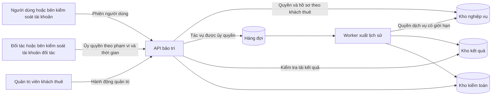

# Threat actor

## 1. Tác nhân đe dọa là gì?

**Threat actor — tác nhân đe dọa** là cá nhân, nhóm hoặc tổ chức có thể khởi xướng hay thực hiện hành vi đe dọa tài sản và mục tiêu an toàn của hệ thống. Trong mô hình hóa đe dọa, điều cần biết không chỉ là tên của tác nhân, mà là **họ muốn đạt điều gì, có khả năng gì, đang có quyền gì và có thể tiếp cận hệ thống qua đâu**.

Ví dụ, một người đã có tài khoản hợp lệ của khách thuê A có thể muốn xem hồ sơ của B. Người đó không cần phá cơ chế đăng nhập nếu đường đọc hồ sơ thiếu kiểm tra quyền theo đối tượng. Tài sản, mục tiêu và quyền ban đầu giúp nhóm nhận ra yêu cầu phân quyền mà một mô tả chung như “chống hacker” không cung cấp.

Một tác nhân khác có thể không có tài khoản nhưng đủ khả năng tự động hóa nhiều yêu cầu. Với họ, luồng đăng ký, khôi phục tài khoản hoặc chức năng công khai có thể là điểm tiếp cận. Cơ chế cần chọn khác với cơ chế ngăn một dịch vụ nền đã bị chiếm thông tin xác thực truy cập quá phạm vi.

Trong bài học này, tác nhân được mô hình hóa theo hành vi và khả năng liên quan tới hệ thống. Sai sót của người dùng, thao tác nhầm và lỗi phụ thuộc cũng cần phân tích như nguồn sự kiện gây hại, nhưng không được tự gán động cơ xấu cho mọi sai sót.

Mục tiêu cuối cùng là chuyển hiểu biết về tác nhân thành yêu cầu cụ thể về xác thực, phân quyền, bảo vệ dữ liệu, logging, ứng phó và phục hồi, cùng bằng chứng kiểm chứng trong vòng đời phát triển.

## 2. Phân biệt tác nhân với các khái niệm gần nhau

| Khái niệm | Ý nghĩa | Ví dụ |
|---|---|---|
| Tác nhân đe dọa | Bên khởi xướng hoặc thực hiện hành vi trái mục tiêu an toàn | Người lạm dụng tài khoản hợp lệ để đọc hồ sơ ngoài quyền |
| Vai trò nghiệp vụ | Tập trách nhiệm hoặc quyền dự kiến trong hệ thống | Người yêu cầu bảo trì, kỹ thuật viên, quản trị viên khách thuê |
| Danh tính kỹ thuật | Chủ thể mà hệ thống xác thực và gán quyền, thường gọi là principal | Tài khoản người dùng, danh tính dịch vụ hoặc tài khoản đối tác |
| Phương tiện thực thi | Thành phần được dùng để gửi yêu cầu hoặc chạy hành vi | Trình duyệt, chương trình tự động, tiến trình hoặc workload bị chiếm quyền |
| Mục tiêu của tác nhân | Kết quả tác nhân muốn đạt | Đọc dữ liệu, sửa lịch sử, mở quyền hoặc gây gián đoạn |
| Kỹ thuật hoặc hành vi | Cách tác nhân thực hiện mục tiêu trong một kịch bản | Tráo tham chiếu hồ sơ, phát lại yêu cầu, lạm dụng quyền xuất |
| Đe dọa | Kịch bản có thể gây hại cho tài sản | Người dùng A dùng tham chiếu của B để tải hồ sơ B |
| Điểm yếu | Điều kiện giúp kịch bản xảy ra | API chỉ kiểm tra đăng nhập, không kiểm tra quan hệ khách thuê |
| Rủi ro | Khả năng và hậu quả của kịch bản đối với mục tiêu | Lộ dữ liệu nhiều khách hàng và mất niềm tin vào khả năng cô lập |

### 2.1. Một danh tính không đồng nhất với một người thật

Nếu tài khoản của một kỹ thuật viên bị chiếm quyền, hệ thống có thể quan sát yêu cầu mang danh tính kỹ thuật của kỹ thuật viên trong khi tác nhân thực tế là bên khác. Hồ sơ tác nhân cần phân biệt **người được cấp tài khoản** với **người đang kiểm soát thông tin xác thực hoặc phiên**.

Tương tự, nhật ký ghi danh tính `export-worker` không đủ để kết luận một tiến trình hợp lệ đã thực hiện đúng mục đích. Có thể thông tin xác thực bị lấy cắp, tiến trình bị điều khiển hoặc dữ liệu đầu vào làm dịch vụ thực hiện hành động sai.

Chương trình tự động hay bot có thể là phương tiện của tác nhân. Mô hình có thể mô tả hành vi tự động hóa khi chưa biết ai đứng sau, nhưng không nên suy ra ý định hay danh tính con người chỉ từ một địa chỉ IP hoặc mẫu yêu cầu.

### 2.2. Vai trò hợp lệ vẫn có thể tham gia kịch bản đe dọa

Một quản trị viên khách thuê có quyền cấp vai trò trong A không tự được phép cấp quyền ở B. Một đối tác được đọc phiếu được giao không tự được đọc toàn bộ lịch sử khách hàng. Một người dùng có quyền xuất dữ liệu vẫn có thể lạm dụng quy mô hoặc mục đích xuất.

Do đó, việc tác nhân đã đăng nhập hoặc có tên vai trò đúng không kết thúc phân tích. Cần mô tả hành động, tài nguyên, phạm vi, trạng thái và điều kiện sử dụng quyền.

## 3. Nhận diện các nhóm tác nhân theo quan hệ với hệ thống

Các nhóm dưới đây là điểm bắt đầu, không phải danh sách luôn đầy đủ cho mọi dự án.

| Nhóm tình huống | Quyền hoặc điểm tiếp cận ban đầu | Điều cần xem xét |
|---|---|---|
| Bên ngoài chưa xác thực | Chức năng công khai, luồng đăng nhập hoặc thông điệp tới giao diện mở | Dò tìm, giả danh, lạm dụng tài nguyên, thông tin từ lỗi và đầu ra công khai |
| Người dùng hợp lệ lạm dụng quyền | Tài khoản thường của một miền hoặc khách thuê | Truy cập đối tượng khác, vượt phạm vi, tự mở quyền và lạm dụng luồng nghiệp vụ |
| Bên chiếm quyền tài khoản | Phiên hoặc thông tin xác thực của người dùng | Hành động được phép dưới danh tính bị chiếm, xuất hàng loạt và duy trì truy cập |
| Người nội bộ có quyền vận hành | Công cụ hỗ trợ, máy chủ, kho dữ liệu hoặc quyền cấu hình theo vai trò | Quyền rộng, truy cập trực tiếp, sửa bằng chứng và khả năng bỏ qua luồng ứng dụng |
| Người có đặc quyền trong một phạm vi | Quyền quản trị của một khách thuê hoặc chức năng | Cấp quyền vượt phạm vi, lạm dụng chuyển giao và đường khôi phục |
| Bên kiểm soát danh tính dịch vụ hoặc workload | Thông tin xác thực dịch vụ hoặc khả năng chạy trong một tiến trình | Phạm vi tài nguyên có thể đọc/ghi, đường gọi nội bộ và quyền lan truyền |
| Bên thứ ba hoặc bên chiếm quyền bên thứ ba | Tích hợp, tài khoản đối tác, tác nhân hỗ trợ hoặc chuỗi cung cấp | Phạm vi ủy quyền, thời hạn, quyền truy cập gián tiếp và quy trình chấm dứt |

Không nên mặc định người ngoài có kỹ năng thấp hoặc người nội bộ có kỹ năng cao. Hai tác nhân có cùng mục tiêu có thể rất khác về kiến thức, quyền và quy mô hoạt động.

Người nội bộ cũng không nhất thiết có ý đồ xấu. Mô hình cần tách kịch bản lạm dụng có chủ đích, tài khoản bị chiếm và thao tác nhầm. Các kịch bản có thể dùng chung một số kiểm soát nhưng khác giả định và cách đánh giá.

## 4. Xây dựng hồ sơ tác nhân đủ để ra quyết định

### 4.1. Các thuộc tính cần ghi

| Thuộc tính | Câu hỏi cần trả lời | Giá trị đối với yêu cầu |
|---|---|---|
| Mục tiêu | Tác nhân muốn lấy, sửa, làm mất hoặc kiểm soát điều gì? | Xác định tài sản và hậu quả cần ngăn |
| Quyền ban đầu | Chưa có tài khoản, tài khoản thường, quản trị cục bộ hay quyền dịch vụ? | Chọn trường hợp phủ định đúng mức quyền |
| Khả năng tiếp cận | Gọi API, dùng công cụ hỗ trợ, đọc kho hay chạy trong workload? | Xác định bề mặt và ranh giới cần thực thi |
| Kiến thức | Biết cấu trúc API, mã tài nguyên, cấu hình hoặc quy trình nội bộ ở mức nào? | Tránh dựa vào việc che giấu thông tin không đáng tin |
| Năng lực và nguồn lực | Có thể tự động hóa, giữ truy cập, kiểm soát nhiều tài khoản hoặc phối hợp không? | Đặt giới hạn quy mô và xem các đường kết hợp |
| Quyền kiểm soát đầu vào | Sửa tham số, tệp, thông điệp, phiên, cấu hình hoặc dữ liệu nào? | Chỉ ra dữ liệu chưa đáng tin và cách xác minh |
| Ràng buộc | Điều gì chưa nằm trong khả năng ở kịch bản này? | Giữ mô hình đủ cụ thể và nhận diện phạm vi chưa xét |
| Dấu hiệu và bằng chứng | Điều gì đã biết, điều gì là giả định, điều gì chỉ là tín hiệu? | Không nhầm giả thuyết với khả năng đã được xác nhận |

Có thể chưa biết động cơ thật của một bên. Để đặt yêu cầu phân quyền, thường chỉ cần mô hình một chủ thể có khả năng và mục tiêu giả định rõ, chẳng hạn “tài khoản thường cố đọc hồ sơ ngoài quyền”. Không cần xác định danh tính thật của người đó.

### 4.2. Tách khả năng thay vì gắn một nhãn tổng quát

Hai tình huống thường bị gộp cần tách:

- **Lộ thông tin xác thực dịch vụ:** tác nhân có thể gọi các giao diện chấp nhận thông tin đó, trong giới hạn mạng và quyền thực tế.
- **Kiểm soát tiến trình dịch vụ:** tác nhân có thể tác động tới việc thực thi, đọc dữ liệu trong bộ nhớ hoặc dùng những quyền mà tiến trình nắm giữ theo mô hình cụ thể.

Tình huống thứ hai có thể mở thêm đường mà tình huống thứ nhất không có. Nếu chỉ ghi “dịch vụ bị tấn công”, nhóm khó biết phải kiểm tra quyền gọi API, quyền máy chủ hay cả hai.

Tương tự, khả năng gửi nhiều yêu cầu không đồng nghĩa có quyền sửa cơ sở dữ liệu. Có thể mô tả mỗi quyền riêng, rồi xét kịch bản kết hợp khi có căn cứ.

### 4.3. Ghi giả định và giới hạn có thể thay đổi

Một hồ sơ có thể giả định tác nhân biết định dạng API và có một tài khoản hợp lệ, nhưng không sửa được chính sách ở máy chủ. Giới hạn đó giúp phân tích một đường cụ thể; không có nghĩa việc chiếm quyền chính sách bị loại khỏi toàn bộ mô hình.

Các giả định ảnh hưởng quyết định cần có căn cứ hoặc được đánh dấu chờ xác minh. Không nên dùng “tác nhân không biết mã đối tượng” để bỏ kiểm tra quyền nếu mã có thể bị chia sẻ, ghi lại hoặc suy ra trong hoạt động bình thường.

## 5. Hồ sơ minh họa cho tài khoản thường

Xét một hệ thống quản lý bảo trì nhiều khách thuê. Người dùng tạo phiếu, kỹ thuật viên xem phiếu được giao, đối tác hỗ trợ trong phạm vi được ủy quyền, quản trị viên quản lý vai trò và worker xuất lịch sử.

Hồ sơ sau là mẫu phân tích, không mô tả một cá nhân thật hay phát hiện đã được xác nhận:

```yaml
actor_profile_id: ACT-01
description: authenticated_user_attempting_cross_tenant_access
initial_access:
  account_role: ordinary_user
  tenant_scope: tenant_A
objectives:
  - read_maintenance_records_outside_authorized_scope
  - obtain_exported_attachments_from_another_tenant
capabilities_assumed:
  - call_documented_and_observable_application_apis
  - modify_client_controlled_parameters
  - replay_requests_within_available_access
  - automate_requests_within_accessible_interfaces
knowledge_assumed:
  - API_formats_can_be_known
  - some_resource_references_may_be_observed
not_assumed_in_this_scenario:
  - database_administrative_access
  - ability_to_modify_server_authorization_policy
  - control_of_the_identity_provider
questions_to_validate:
  - whether_direct_file_download_bypasses_application_checks
  - whether_background_exports_preserve_tenant_scope
```

Hồ sơ này giúp thiết kế kiểm thử bằng một tài khoản thực sự đã đăng nhập, thay vì chỉ kiểm tra người chưa đăng nhập bị chặn. Nó cũng cho thấy phải xem cả API, tệp và tác vụ nền.

Nếu phát hiện tài khoản thường còn có thể sử dụng công cụ hỗ trợ hoặc một khóa tích hợp, cần cập nhật khả năng và đường tiếp cận. Hồ sơ không nên bị giữ nguyên chỉ để kết luận cũ tiếp tục đúng.

## 6. Đặt tác nhân lên mô hình hệ thống

### 6.1. Tách tác nhân, danh tính và đường thực thi



Sơ đồ diễn tả đường cần phân tích, không chứng minh những quyền và kiểm tra đã được triển khai. Một bên chiếm thông tin xác thực worker có thể đi vào đường dịch vụ; quyền thực tế và mạng tiếp cận quyết định họ làm được gì.

Ranh giới cần xem gồm tài khoản–tài nguyên, khách thuê–khách thuê, đối tác–phiếu được giao, người đề nghị–người phê duyệt và API–worker. Mỗi ranh giới phải có căn cứ quyền rõ, không chỉ vị trí trên sơ đồ mạng.

### 6.2. So sánh quyền dự kiến với khả năng thực tế

| Chủ thể theo thiết kế | Quyền dự kiến | Hành vi trái mục tiêu cần mô hình |
|---|---|---|
| Người dùng thường | Đọc, tạo hoặc cập nhật hồ sơ trong phạm vi được cấp | Tráo tham chiếu, tự đổi vai trò, truy cập tệp hoặc kết quả khác phạm vi |
| Kỹ thuật viên | Làm việc với phiếu được giao theo quy trình | Đọc phiếu chưa được giao, sửa kết quả sau thời điểm được phép |
| Đối tác | Truy cập đúng khách thuê, công việc và thời hạn được ủy quyền | Giữ truy cập sau chấm dứt, mở phạm vi, xuất lịch sử không liên quan |
| Quản trị viên khách thuê | Cấp quyền trong phạm vi cho phép | Cấp quyền ở khách thuê khác, vượt tập quyền được cấp lại hoặc tự phê duyệt khi bị cấm |
| Worker xuất lịch sử | Đọc dữ liệu và ghi kết quả cho tác vụ được giao | Đọc mọi khách thuê, thay vai trò, ghi sai chủ sở hữu kết quả hoặc sử dụng đầu vào giả |

Quyền dự kiến phải được đối chiếu với cấu hình thật và đường gọi thực tế. Một worker được mô tả là “chỉ đọc” nhưng dùng thông tin xác thực có quyền sửa vai trò vẫn tạo phạm vi ảnh hưởng lớn hơn giả định.

### 6.3. Không để dịch vụ thực hiện thay ngoài phạm vi

Một tác nhân có quyền thấp có thể không trực tiếp đọc kho nhưng có thể khiến dịch vụ nhiều quyền làm thay. Ví dụ, API nhận khách thuê từ ngữ cảnh đúng nhưng worker lại lấy khách thuê từ trường tự khai trong tác vụ. Khi đó, quyền rộng của worker có thể trở thành cầu nối qua ranh giới dữ liệu.

Yêu cầu cần kiểm soát đồng thời danh tính dịch vụ, nguồn gốc tác vụ, phạm vi được ủy quyền và quyền của chủ thể khởi tạo theo chính sách. Chỉ xác thực worker không giải quyết được nội dung tác vụ sai; chỉ kiểm tra người dùng lúc tạo cũng chưa tự chứng minh các bước sau giữ đúng phạm vi.

## 7. Từ mục tiêu tác nhân đến kịch bản và rủi ro

### 7.1. Viết kịch bản có điều kiện ban đầu

Có thể dùng cấu trúc:

> Tác nhân có quyền và khả năng X, qua đường tiếp cận Y, có thể thực hiện hành vi Z do điều kiện yếu W, làm ảnh hưởng tài sản A và gây hậu quả B.

Ví dụ:

> Bên kiểm soát tài khoản đối tác có quyền xem các phiếu được giao có thể dùng chức năng xuất để lấy toàn bộ lịch sử khách thuê nếu tác vụ xuất chỉ kiểm tra vai trò đối tác mà không ràng buộc tập phiếu và thời hạn ủy quyền.

Kịch bản này có mục tiêu, quyền ban đầu, đường đi và điều kiện yếu. Nó dẫn đến yêu cầu kiểm tra quyền theo phạm vi và vòng đời, thay vì chỉ thêm một lớp đăng nhập.

### 7.2. Những kịch bản cần xét trong ví dụ

| Mã | Tác nhân và quyền ban đầu | Mục tiêu hoặc hành vi | Hậu quả và yêu cầu liên quan |
|---|---|---|---|
| TAC-01 | Người dùng hợp lệ của A | Đọc hồ sơ hoặc tệp của B bằng cách đổi tham chiếu | Tiết lộ chéo khách thuê; TA-02, TA-03 |
| TAC-02 | Bên kiểm soát tài khoản người dùng | Gọi hành động đặc quyền hoặc xuất ngoài phạm vi | Nâng quyền và mở rộng tác động; TA-01, TA-02, TA-05, TA-07 |
| TAC-03 | Đối tác có một ủy quyền hữu hạn | Đọc ngoài phiếu được giao hoặc tiếp tục sau kết thúc | Lạm dụng quyền liên tổ chức; TA-04, TA-10 |
| TAC-04 | Bên giữ thông tin xác thực worker | Dùng quyền dịch vụ để đọc rộng, đổi quyền hoặc sửa kết quả | Lan truyền tác động từ danh tính dịch vụ; TA-06, TA-08, TA-10 |
| TAC-05 | Quản trị viên có phạm vi A | Cấp quyền trên B hoặc sửa nội dung sau phê duyệt | Vượt miền quyền; TA-03, TA-05 |
| TAC-06 | Bên có khả năng tự động hóa yêu cầu trong phạm vi tiếp cận | Làm nhiều tác vụ hoặc truy vấn tốn tài nguyên | Gián đoạn và ảnh hưởng bên khác; TA-07 |
| TAC-07 | Bên từng kiểm soát tài khoản đã thu hồi | Dùng trạng thái cũ sau phục hồi để quay lại | Tái cấp truy cập ngoài ý muốn; TA-10, TA-11 |

Kịch bản không chứng minh điểm yếu đã tồn tại. Cần ghi kiểm soát hiện tại và bằng chứng để phân biệt giả thuyết cần phòng ngừa với phát hiện đã xác nhận.

### 7.3. Động cơ không thay cho bằng chứng năng lực

Động cơ có thể là thu lợi, lấy thông tin, sửa kết quả, gây gián đoạn, che giấu hành động hoặc sử dụng quyền ngoài mục đích. Nó giúp hiểu mục tiêu và hậu quả, nhưng không tự cho biết tác nhân có thể thực hiện một đường tấn công.

Một bên có động cơ mạnh nhưng không có đường tiếp cận khác với bên đã có thông tin xác thực hoạt động. Cần đánh giá những điều kiện cụ thể, tránh gán mức rủi ro chỉ từ nhãn “nội bộ”, “đối tác” hoặc “tác nhân tinh vi”.

Không nên dùng đặc điểm nhân khẩu học hoặc suy đoán về danh tính thật làm thay thế cho quyền, khả năng và hành vi. Với mục tiêu đặc tả yêu cầu, mô tả năng lực liên quan thường rõ và kiểm chứng được hơn.

## 8. Chuyển hồ sơ tác nhân thành yêu cầu bảo mật

### 8.1. Nguyên tắc chuyển đổi

Với mỗi khả năng giả định, hỏi hệ thống cần giữ điều kiện nào dù tác nhân sử dụng khả năng đó. Ví dụ:

- Nếu tác nhân sửa mọi trường từ trình duyệt, quyền phải lấy từ ngữ cảnh đã xác thực và kiểm tra trên tài nguyên.
- Nếu tác nhân biết tham chiếu của tài nguyên khác, biết mã vẫn không đủ để đọc hoặc sửa.
- Nếu tác nhân có phiên hợp lệ bị chiếm, hành động tác động lớn có thể cần xác minh bổ sung và giới hạn phạm vi.
- Nếu tác nhân giữ thông tin xác thực dịch vụ, quyền của dịch vụ phải giới hạn tác động và có thể thu hồi.
- Nếu tác nhân tự động hóa, cần kiểm soát ngân sách tài nguyên thay vì chỉ dựa vào giao diện thao tác thủ công.

Mỗi yêu cầu nên nêu chủ thể, hành động, tài nguyên, phạm vi, điều kiện thất bại và bằng chứng chấp nhận. Không nên chỉ ghi “chặn tác nhân bên ngoài” hay “tin người nội bộ”.

### 8.2. Bộ yêu cầu minh họa

Các thời hạn và hạn mức dưới đây thuộc **một dự án giả định**, dùng để minh họa cách đo. Dự án thật phải lựa chọn theo tác động, năng lực vận hành và chính sách áp dụng.

| Mã | Yêu cầu | Tiêu chí chấp nhận |
|---|---|---|
| TA-01 | Mọi đường nghiệp vụ yêu cầu nhận diện phải xác minh danh tính theo nguồn, thời hạn và ngữ cảnh được phê duyệt; tên tài khoản hoặc dịch vụ do bên gọi gửi không tự là bằng chứng. | Thử thiếu bằng chứng, hết hạn, sai ngữ cảnh, sai nguồn và giả tên dịch vụ; không cấp quyền trái điều kiện. |
| TA-02 | Mọi lần đọc, sửa và tải phải kiểm tra quyền theo hành động, đối tượng, khách thuê và quan hệ liên quan; áp dụng cả API, tác vụ nền và đường tệp. | Dùng tài khoản đã đăng nhập để tráo tài nguyên, khách thuê, hành động và đường truy cập; không đọc hoặc thay đổi ngoài quyền. |
| TA-03 | Trường vai trò, chủ sở hữu và khách thuê không được thay đổi qua cập nhật thông thường; thay đổi các trường này phải qua hành động có quyền và quy tắc riêng. | Thêm trường bảo vệ vào yêu cầu cập nhật, sửa tham chiếu và gọi API trực tiếp; quan hệ và quyền không thay đổi ngoài quy trình. |
| TA-04 | Quyền đối tác phải ràng buộc khách thuê, tập công việc, hành động và thời điểm kết thúc; hết thời hạn không được tiếp tục truy cập theo ủy quyền đó. | Thử đúng vai trò nhưng sai khách thuê, sai công việc hoặc quá hạn; kiểm tra API, tải tệp và tác vụ đang chờ theo chính sách. |
| TA-05 | Cấp quyền quản trị rộng phải yêu cầu mức xác minh tăng cường đã duyệt với độ mới không quá 5 phút và phê duyệt độc lập theo chính sách; phê duyệt gắn với người nhận, quyền và phạm vi. | Thử phiên chưa đủ mức, hết hạn, tự duyệt khi bị cấm, sửa nội dung sau duyệt và dùng lại phê duyệt; không cấp quyền ngoài điều kiện. |
| TA-06 | Danh tính worker chỉ được đọc và ghi tài nguyên cần cho tác vụ được ủy quyền; không có quyền quản trị vai trò hoặc xóa bản sao. Tham chiếu trong tác vụ phải được kiểm tra với phạm vi tin cậy. | Dùng danh tính dịch vụ trong môi trường thử để gọi thao tác ngoài mục đích và tráo tác vụ; thao tác bị từ chối, không có dữ liệu ngoài phạm vi. |
| TA-07 | Luồng xuất minh họa giới hạn 2 tác vụ đang chạy mỗi khách thuê, 20 tác vụ toàn hệ thống và tối đa 60 giây xử lý mỗi tác vụ; chính sách tiếp nhận và xếp hàng phải xác định trước. | Thử nhiều tác vụ, yêu cầu xử lý đắt và các mốc biên; giới hạn được cưỡng chế, không bỏ phân quyền hoặc gây tác dụng ngoài mục tiêu phục vụ đã chọn. |
| TA-08 | Sự kiện quản trị, ủy quyền, xuất và thu hồi phải ghi danh tính kỹ thuật đã xác minh, phạm vi, hành động, kết quả, thời gian và mã tương quan; phân biệt bên khởi tạo với dịch vụ thực thi. | Đối chiếu thao tác thử qua nhiều giai đoạn; không lấy danh tính tự khai làm danh tính đã xác minh, không mất quan hệ truy vết cần thiết. |
| TA-09 | Log, trace, báo lỗi và công cụ hỗ trợ không được chứa thông tin xác thực, vật liệu khóa hoặc bản rõ hồ sơ ngoài mục đích đã duyệt; các tham chiếu còn lại có quyền đọc và thời hạn lưu riêng. | Dùng dữ liệu thử có dấu nhận diện qua đường thành công, từ chối và lỗi; kiểm tra tập trường, quyền và thời hạn của các kho phụ. |
| TA-10 | Sau khi thu hồi một phiên, quyền hoặc thông tin xác thực theo quy trình sự cố, các đường phụ thuộc được chỉ định phải ngừng chấp nhận trong 60 giây, gồm bộ nhớ đệm và tác vụ liên quan. | Thử thông tin cũ qua API, tải tệp và worker sau thu hồi; kiểm tra hiệu lực thực tế tại nhiều điểm thực thi, không chỉ trạng thái giao diện. |
| TA-11 | Phục hồi phải áp dụng lại quyết định thu hồi và chấm dứt ủy quyền có hiệu lực sau bản sao trước khi phục vụ tài nguyên liên quan; không tự kích hoạt lại thông tin xác thực đã bị loại bỏ. | Khôi phục bản sao khi danh tính còn hoạt động rồi áp dụng lịch sử quyết định; danh tính và quan hệ đã thu hồi không trở lại đường phục vụ trái chính sách. |

TA-05 chỉ có hiệu lực chống những kịch bản mà điều kiện bổ sung thực sự làm thay đổi khả năng của tác nhân. Nếu cùng một bên kiểm soát cả tài khoản thực hiện và tài khoản phê duyệt, tính độc lập có thể không như giả định. Mô hình phải nêu rủi ro thông đồng hoặc chiếm nhiều danh tính khi điều đó liên quan.

TA-06 cần được chứng minh bằng quyền thực tế và cơ chế ràng buộc tài nguyên. Nếu quyền dữ liệu của worker vẫn rộng, một kiểm tra trong mã có thể chưa đủ cho kịch bản tác nhân kiểm soát toàn bộ tiến trình. Khi đó cần thu hẹp quyền ở ranh giới phù hợp hoặc ghi và xử lý rủi ro còn lại.

TA-10 không mặc định thu hồi một loại thông tin sẽ thu hồi mọi loại khác. Phiên người dùng, token tích hợp, khóa dịch vụ và tệp đã phát hành có thể có cơ chế khác nhau. Phạm vi và điểm thực thi phải được liệt kê để kiểm chứng.

## 9. Ưu tiên theo tác nhân mà không suy đoán quá mức

Mức ưu tiên cần xét khả năng tiếp cận, quyền ban đầu, tài sản, quy mô và hậu quả. Một tác nhân dùng tài khoản thường có thể gây tác động lớn nếu thiếu cô lập khách thuê; không nên coi rủi ro thấp chỉ vì họ không có quyền quản trị.

Ngược lại, không nên giả định mọi tác nhân đều đồng thời kiểm soát danh tính, cơ sở dữ liệu, log và bản sao. Giả định quá rộng có thể làm mất khả năng chọn kiểm soát hoặc xác định điều gì thực sự được bảo vệ.

Nên bắt đầu từ các hồ sơ có căn cứ, chỉ rõ quyền và khả năng, rồi phân tích các kịch bản kết hợp phù hợp. Nếu việc lấy được một quyền mở đường tới quyền khác, mô hình cần ghi chuỗi đó và điểm kiểm soát có thể ngăn lan truyền.

Nếu dùng điểm khả năng–tác động, phải nêu định nghĩa và thời gian đánh giá. Nhãn tác nhân hoặc mức kỹ năng không tự là xác suất. Không có sự cố đã phát hiện cũng không chứng minh không có tác nhân quan tâm hoặc kiểm soát đã hiệu quả.

Tăng quy mô khách thuê, thêm dữ liệu nhạy cảm hoặc cấp quyền mới cho đối tác có thể làm thay đổi hậu quả của cùng một hồ sơ tác nhân. Quyết định cũ không nên được tự áp dụng cho phạm vi mới.

## 10. Kiểm thử bằng quyền và khả năng của từng hồ sơ

### 10.1. Chọn chủ thể thử đúng kịch bản

Chỉ kiểm tra yêu cầu chưa đăng nhập bị từ chối sẽ bỏ sót nhiều đe dọa từ chủ thể có tài khoản hợp lệ. Một kế hoạch cần dựng các danh tính thử có phạm vi khác nhau và dữ liệu tổng hợp tương ứng.

| Chủ thể thử | Hành động và điều kiện | Kỳ vọng |
|---|---|---|
| Chưa xác thực | Gọi tài nguyên nghiệp vụ yêu cầu nhận diện | Không nhận dữ liệu hoặc quyền được bảo vệ |
| Người dùng A đủ quyền | Đọc hồ sơ thuộc phạm vi A của mình | Nhận đúng nội dung, không bị chặn toàn bộ vì kiểm soát quá rộng |
| Người dùng A biết mã hồ sơ B | Thay tham chiếu qua API, tệp và đường xuất | Không đọc hoặc sửa nội dung B; không tạo tác dụng phụ ngoài quyền |
| Đối tác có ủy quyền còn hiệu lực | Làm việc với phiếu đúng phạm vi | Hoàn thành đúng hành động được cấp, không tự mở rộng phạm vi |
| Cùng tài khoản đối tác | Truy cập công việc khác hoặc dùng lại quyền sau thời hạn | Bị từ chối theo chính sách tại các điểm liên quan |
| Quản trị viên A | Cấp quyền ở B hoặc thay nội dung sau duyệt | Không được cấp quyền trái phạm vi hay ngoài nội dung đã duyệt |
| Danh tính worker | Thực hiện tác vụ đúng phạm vi rồi thử quản trị vai trò | Tác vụ hợp lệ hoạt động; hành động ngoài quyền bị từ chối |
| Thông tin xác thực đã thu hồi | Gọi lại qua API, worker và đường tải sau thời hạn hiệu lực | Không được tiếp tục hành động dựa vào thông tin cũ |

Kiểm thử cần xem cả phản hồi, dữ liệu trả về và trạng thái lưu. Một yêu cầu trả lỗi sau khi đã thay chủ sở hữu hoặc tạo kết quả ngoài phạm vi vẫn vi phạm mục tiêu.

Nếu dùng danh tính hợp lệ để mô phỏng bên đã lấy được thông tin xác thực, hệ thống có thể vẫn cho phép hành động trong quyền của danh tính đó. Không nên đặt tiêu chí rằng cơ chế xác thực phải tự biết người giữ thông tin là kẻ tấn công. Những phần rủi ro này cần được giảm bằng phạm vi hẹp, điều kiện cho hành động nhạy cảm, giới hạn quy mô, phát hiện và thu hồi phù hợp.

### 10.2. Kiểm tra quan hệ và thời điểm

Nhiều lỗi chỉ xuất hiện khi quyền, nhiệm vụ hoặc chủ sở hữu đổi giữa các bước. Cần xét ít nhất các tình huống liên quan:

- Người dùng còn quyền lúc tạo tác vụ nhưng đã bị thu hồi trước lúc chạy hoặc tải kết quả.
- Đối tác kết thúc hợp đồng hoặc hết ủy quyền trong khi tác vụ còn chờ.
- Nội dung cấp quyền bị thay sau khi đã phê duyệt.
- Hai yêu cầu cùng sử dụng một điều kiện chỉ được dùng một lần.
- Một phiên hoặc bộ nhớ đệm chưa nhận thay đổi quyền.
- Dữ liệu phục hồi chứa quan hệ từng hợp lệ nhưng hiện đã chấm dứt.

Chính sách phải xác định quyền được kiểm tra ở thời điểm nào và tác vụ đang chạy được xử lý ra sao. Không nên để mỗi thành phần tự chọn một cách hiểu khác nhau.

### 10.3. Bằng chứng tương ứng với mức tác động

Với kịch bản có tác động lớn, có thể cần thêm rà soát ranh giới, kiểm thử đối kháng, kiểm tra quyền thực tế và người đánh giá có mức độc lập phù hợp. Bằng chứng phải gắn với phiên bản, cấu hình và các đường đã xem xét.

Thử API không tự chứng minh quyền kho tệp đúng; thử quyền dịch vụ không tự chứng minh mã giữ đúng khách thuê; thử giao diện không tự bao phủ công cụ hỗ trợ. Cần xác định các lớp bằng chứng dựa vào khả năng đã ghi trong hồ sơ tác nhân.

## 11. Quan sát hành vi và quy trách nhiệm trong giới hạn bằng chứng

### 11.1. Ghi điều hệ thống biết được

Sự kiện nên phân biệt danh tính đã xác minh, chủ thể khởi tạo được xác nhận qua cơ chế ủy quyền và dịch vụ thực thi. Nếu một giá trị chỉ do bên gọi khai báo, không được trình bày nó như danh tính đã được kiểm chứng.

Ví dụ minh họa:

```json
{
  "event_type": "maintenance_export_started",
  "initiating_principal": "account-demo-21",
  "executing_principal": "maintenance-export-service",
  "identity_context_source": "validated_delegation",
  "tenant_ref": "tenant-demo-A",
  "authorization_scope_ref": "scope-demo-09",
  "job_ref": "job-demo-18",
  "result": "accepted",
  "timestamp": "2026-11-20T09:00:00Z",
  "correlation_id": "request-demo-44"
}
```

Các giá trị đều là dữ liệu ví dụ. Sự kiện chỉ nên ghi `validated_delegation` khi hệ thống thực sự đã kiểm chứng ngữ cảnh ủy quyền. Một trường đặt tên có vẻ đáng tin không tạo ra bằng chứng nếu nguồn vẫn là dữ liệu tự khai.

Tham chiếu trong log vẫn có thể liên kết hành vi. Kho kiểm toán cần quyền truy cập, bảo vệ toàn vẹn và thời hạn lưu tương ứng; không tự trở thành công khai chỉ vì không chứa họ tên hay số sê-ri.

### 11.2. Tín hiệu bất thường không phải kết luận về người thật

Số lượng tải tăng, thay đổi nguồn mạng hoặc hành động ngoài thời gian thường thấy có thể là tín hiệu để kiểm tra. Cần đánh giá cùng ngữ cảnh và chất lượng dữ liệu, tránh tự coi một tín hiệu là bằng chứng chắc chắn về tác nhân.

Một địa chỉ IP có thể được nhiều thiết bị hoặc người dùng dùng chung; cùng một tài khoản có thể xuất hiện qua nhiều đường mạng. Một dấu vết giống nhau không tự chứng minh cùng người điều khiển. Ngược lại, sự khác biệt không tự chứng minh có hai tác nhân độc lập.

Khi điều tra, nên ghi mức kết luận đúng với bằng chứng: “hệ thống chấp nhận hành động dưới danh tính X” khác với “cá nhân X chắc chắn có chủ đích thực hiện”. Khả năng quy trách nhiệm còn phụ thuộc cơ chế danh tính, tài khoản dùng chung, thời gian, tính toàn vẹn log và tình trạng chiếm quyền.

Yêu cầu logging cần hỗ trợ câu hỏi điều tra cụ thể mà vẫn giảm dữ liệu không cần thiết. Không nên mở rộng theo dõi vô hạn chỉ vì chưa biết ai đứng sau hành vi.

## 12. Ví dụ xử lý khi danh tính dịch vụ bị chiếm quyền

Giả sử phát hiện thông tin xác thực của worker xuất lịch sử có thể đã bị lấy cắp. Mô hình cần phân biệt tình huống chỉ lộ thông tin xác thực với việc tiến trình hoặc máy chủ cũng bị kiểm soát.

1. **Xác định khả năng:** thông tin đó gọi được giao diện nào, từ đâu, đọc hoặc ghi phạm vi nào; có truy cập được quyền quản trị, log hoặc bản sao không?
2. **Khoanh vùng:** thu hồi thông tin liên quan, chặn tác vụ hoặc đường truy cập cần thiết theo quy trình, đồng thời giữ bằng chứng phù hợp.
3. **Đánh giá tác động:** đối chiếu tác vụ, tệp kết quả, phạm vi dữ liệu và các sự kiện đã biết; ghi cả khoảng thời gian hoặc đường chưa quan sát được.
4. **Khôi phục điều kiện an toàn:** cấp lại thông tin theo quy trình tin cậy, sửa nguyên nhân làm lộ và xác minh quyền mới đúng phạm vi.
5. **Kiểm tra các bản sao trạng thái:** bảo đảm cấu hình, bộ nhớ đệm, tác vụ chờ và phục hồi không đưa thông tin cũ trở lại hiệu lực.
6. **Cập nhật mô hình:** điều chỉnh năng lực tác nhân, kiểm soát, yêu cầu và bằng chứng theo điều đã học.

Thay thông tin xác thực không lấy lại được dữ liệu đã bị đọc, cũng không tự xóa các kết quả đã phát hành. Cần xem từng tài sản và hành động để xác định phạm vi xử lý còn lại.

Nếu chỉ có bằng chứng lộ thông tin xác thực, không nên tự kết luận mọi máy chủ đã bị chiếm; nếu chưa kiểm tra tiến trình, cũng không được mặc định tiến trình còn tin cậy. Phần chưa biết cần được ghi và xử lý theo tác động.

## 13. Duy trì hồ sơ tác nhân trong vòng đời phát triển

Hồ sơ là đầu vào cho thiết kế và kiểm chứng, không phải danh sách viết một lần. Các tác nhân cần được xem lại khi:

- Thêm đối tác, bên tích hợp, công cụ hỗ trợ hoặc nhóm người dùng mới.
- Mở chức năng công khai, API, tệp trực tiếp hoặc tác vụ nền mới.
- Cấp thêm quyền cho người dùng, quản trị viên hoặc danh tính dịch vụ.
- Thay loại dữ liệu, quy mô, thời gian giữ hoặc khả năng liên kết dữ liệu.
- Có phát hiện kiểm thử, sự cố hoặc bằng chứng bác bỏ giả định về khả năng tác nhân.
- Thay đổi cơ chế thu hồi, khôi phục tài khoản hoặc phục hồi hệ thống.

Chủ sở hữu nghiệp vụ giúp xác định mục tiêu và hậu quả. Kiến trúc sư, người phát triển và vận hành cung cấp quyền, luồng và cấu hình thực tế. Người kiểm thử chuyển khả năng giả định thành trường hợp kiểm chứng. Người làm bảo mật hỗ trợ phân tích đe dọa và giới hạn của kiểm soát.

Quyết định chấp nhận rủi ro còn lại phải thuộc người có thẩm quyền trong phạm vi liên quan. Việc có một hồ sơ tác nhân hoặc một bộ kiểm thử không tự là quyết định chấp nhận cho mọi dữ liệu và chức năng.

## 14. Những sai lầm thường gặp

| Sai lầm | Hệ quả | Cách làm rõ |
|---|---|---|
| Ghi chung “hacker” | Không biết quyền, điểm tiếp cận và yêu cầu nào cần kiểm thử | Mô tả mục tiêu, năng lực, quyền ban đầu và phạm vi |
| Chỉ xét người chưa đăng nhập | Bỏ sót lạm dụng tài khoản, đối tác và dịch vụ | Thêm hồ sơ đã xác thực nhưng thiếu quyền hoặc bị chiếm quyền |
| Đồng nhất vai trò với độ tin cậy tuyệt đối | Người có tên vai trò đúng được làm ngoài phạm vi | Kiểm tra hành động, tài nguyên, khách thuê và điều kiện |
| Gộp lộ thông tin xác thực với kiểm soát toàn bộ máy | Lựa chọn kiểm soát và kết luận tác động sai | Tách từng năng lực và bằng chứng hiện có |
| Giả định tác nhân không biết tham chiếu hoặc API | Phụ thuộc vào việc che giấu thông tin có thể quan sát | Kiểm thử khi định dạng và tham chiếu đã được biết |
| Giả định tác nhân làm được mọi việc cùng lúc | Không còn phân biệt được phạm vi và tác dụng kiểm soát | Ghi khả năng cụ thể, giới hạn và kịch bản kết hợp |
| Coi danh tính trong log là kết luận chắc chắn về người thật | Quy trách nhiệm vượt bằng chứng | Phân biệt chủ thể kỹ thuật, nguồn ngữ cảnh và bên kiểm soát thực tế |
| Coi xác thực mạnh là đủ cho mọi hành động | Vẫn có thể truy cập sai tài nguyên hoặc mở quyền sai | Tách xác thực, phân quyền, quy mô và vòng đời |
| Hồ sơ không đổi sau mở rộng quyền | Rủi ro mới tiếp tục dựa trên giả định cũ | Gắn tác nhân rà soát với thay đổi và phát hiện thực tế |

## 15. Đầu ra cần có để sử dụng được hồ sơ tác nhân

Sau khi phân tích, nhóm cần tạo được:

1. **Tập hồ sơ có phạm vi:** mô tả theo mục tiêu và quan hệ truy cập, đủ để phân biệt các kịch bản quan trọng.
2. **Khả năng và quyền ban đầu:** điều tác nhân có thể điều khiển, nguồn lực, kiến thức và các giới hạn của từng kịch bản.
3. **Giả định và bằng chứng:** điều đã biết, điều cần xác minh và phần không thể kết luận từ dữ liệu hiện có.
4. **Kịch bản đe dọa:** đường tiếp cận, hành vi, tài sản, hậu quả và đánh giá rủi ro.
5. **Yêu cầu và kiểm thử:** cơ chế thực thi ở đúng ranh giới, trường hợp dương/phủ định, trạng thái và đường thay thế.
6. **Quyết định và cơ chế duy trì:** chủ sở hữu, thẩm quyền, rủi ro còn lại và tác nhân cần rà soát.

Mô hình tác nhân có giá trị khi giúp nhóm giải thích hệ thống phải giữ điều kiện an toàn nào trước những khả năng cụ thể. Khi quyền và mục tiêu của tác nhân được nối với yêu cầu, kiến trúc và bằng chứng, việc bảo vệ hệ thống trở nên có căn cứ và kiểm chứng được trong suốt vòng đời phát triển.
