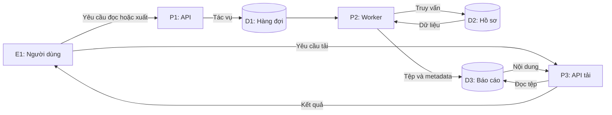
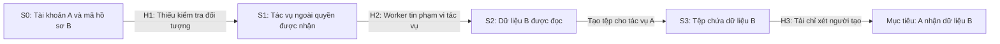

# Attack path

## 1. Attack path là gì?

**Attack path — đường đi tấn công** là chuỗi hành động, điều kiện và thay đổi trạng thái mà một tác nhân có thể sử dụng để đi từ năng lực ban đầu đến một hậu quả không mong muốn.

Ví dụ, một người dùng có quyền thấp tạo yêu cầu xuất dữ liệu; API không kiểm tra quyền trên đối tượng; worker dùng quyền dịch vụ để đọc dữ liệu ngoài phạm vi; hệ thống sau đó trả tệp cho người yêu cầu. Hậu quả có thể xuất hiện dù mỗi thành phần đều có cơ chế xác thực riêng.

Trong threat modeling, attack path giúp trả lời:

> Từ vị trí hiện tại, tác nhân cần có gì, làm gì và vượt qua kiểm soát nào để gây hậu quả?

Mục tiêu là chuyển câu trả lời thành yêu cầu bảo mật và bằng chứng kiểm chứng:

**Tài sản và hậu quả → năng lực ban đầu → chuỗi điều kiện → điểm chặn → yêu cầu → kiểm chứng.**

Bài học giúp bạn:

- Phân biệt attack path với bề mặt tấn công, luồng dữ liệu và danh sách điểm yếu.
- Mô hình hóa điều kiện tiên quyết, quyền có được và các nhánh thay thế.
- Đánh giá tính khả thi cùng những giả định còn thiếu bằng chứng.
- Chọn điểm chặn và viết yêu cầu về xác thực, phân quyền, dữ liệu, logging và phục hồi.
- Duy trì mô hình khi hệ thống hoặc quyền thay đổi.

Các tên hệ thống, tài khoản, mã đối tượng và thời hạn trong bài là giả định. Những tình huống kiểm chứng được mô tả nhằm lập kế hoạch bảo vệ, không phải báo cáo rằng kiểm thử đã được thực hiện.

## 2. Phân biệt các khái niệm gần nhau

| Khái niệm | Ý nghĩa | Ví dụ |
|---|---|---|
| Attack surface — bề mặt tấn công | Các giao diện và điểm tương tác có thể bị tác động | API, luồng tải tệp, hàng đợi, đường quản trị |
| Attack vector — cách tiếp cận | Cách tác nhân tiếp cận hoặc kích hoạt một điểm | Gửi yêu cầu bằng tài khoản có quyền thấp |
| Điểm yếu | Điều kiện thiết kế, triển khai hoặc vận hành tạo khả năng vi phạm | API chỉ kiểm tra đăng nhập, thiếu quyền trên đối tượng |
| Threat scenario — kịch bản đe dọa | Mô tả tác nhân, đường xảy ra, sự kiện và hậu quả trong phạm vi | Người dùng tenant A đọc hồ sơ tenant B qua chức năng xuất |
| Attack path | Chuỗi điều kiện và hành động cụ thể dẫn đến mục tiêu | Yêu cầu ngoài quyền → worker đọc rộng → tệp được trả sai người |
| Attack tree — cây tấn công | Phân rã mục tiêu thành điều kiện hoặc mục tiêu con | Đạt mục tiêu qua nhánh đọc API hoặc nhánh xuất dữ liệu |
| Attack graph — đồ thị tấn công | Biểu diễn trạng thái, năng lực và nhiều cách chuyển tiếp | Một năng lực trung gian được dùng cho nhiều đường khác nhau |
| DFD — sơ đồ luồng dữ liệu | Mô tả dữ liệu đi qua process, kho và thực thể nào | Người dùng → API → hàng đợi → worker → kho |

Một DFD cung cấp bối cảnh kiến trúc. Attack path mô tả cách tác nhân có thể làm các thành phần và quyền kết hợp thành hậu quả. Một mũi tên dữ liệu trong DFD chưa tự là một bước tấn công.

### 2.1. Một điểm yếu không phải toàn bộ đường đi

“Worker có quyền đọc nhiều tenant” chưa đủ để kết luận người dùng sẽ lấy được dữ liệu tenant khác. Cần biết:

- Người dùng có điều khiển được tham chiếu mà worker dùng không?
- Yêu cầu có được kiểm tra trước khi xếp hàng không?
- Worker có kiểm tra phạm vi nghiệp vụ không?
- Kết quả có đi đến người dùng không?
- Có kiểm soát nào chặn chuỗi trước khi hậu quả xảy ra không?

Quyền dịch vụ rộng có thể cần thiết cho chức năng. Rủi ro xuất hiện khi quyền đó được dùng cho yêu cầu ngoài phạm vi mà không có kiểm soát thích hợp.

### 2.2. Không cần có lỗi kỹ thuật kiểu bộ nhớ mới có attack path

Đường đi có thể hình thành từ:

- Cách cấp và sử dụng quyền.
- Thứ tự kiểm tra trong nghiệp vụ.
- Giả định giữa các dịch vụ.
- Trạng thái cũ, tác vụ nhận lặp hoặc quyền đã thay đổi.
- Bản sao dữ liệu, đường tải và cấu hình lưu trữ.
- Quy trình hỗ trợ hoặc phục hồi.

Một hệ thống không có phát hiện từ công cụ quét vẫn có thể có đường tấn công nghiệp vụ.

## 3. Các thành phần của một attack path

### 3.1. Mục tiêu và hậu quả

Bắt đầu bằng một hậu quả cụ thể:

- Đọc dữ liệu ngoài quyền.
- Thay đổi trạng thái hoặc nội dung trái phép.
- Giành một quyền không được cấp.
- Làm nghiệp vụ không đáp ứng.
- Xóa dấu vết hoặc làm sai thông tin kiểm toán.

Cần xác định tài sản, phạm vi và tiêu chí xảy ra. “Làm hệ thống bị hack” quá rộng để thiết kế kiểm soát hoặc kiểm chứng.

Ví dụ tốt hơn:

> Người dùng tenant A nhận được nội dung hồ sơ khách hàng thuộc tenant B qua luồng xuất báo cáo, dù không có quyền đọc hồ sơ đó.

### 3.2. Năng lực ban đầu

Ghi rõ tác nhân bắt đầu với gì:

| Thuộc tính | Câu hỏi |
|---|---|
| Danh tính | Chưa xác thực, người dùng thông thường hay tài khoản đặc quyền? |
| Quyền | Có thể gọi chức năng nào và trên dữ liệu nào? |
| Kiến thức | Biết mã đối tượng, cấu trúc yêu cầu hoặc địa chỉ tài nguyên nào? |
| Khả năng tác động | Sửa tham số, nội dung tệp, tác vụ hay cấu hình nào? |
| Môi trường | Tiếp cận Internet, mạng nội bộ hoặc công cụ vận hành nào? |
| Điều kiện khác | Cần tài khoản bị chiếm, một đường chia sẻ hoặc quyền từ hệ thống khác không? |

Không bắt đầu với người dùng thông thường rồi âm thầm dùng năng lực quản trị ở giữa đường. Nếu một bước cần quyền mới, phải giải thích cách có được quyền đó hoặc ghi nó là điều kiện tiên quyết riêng.

### 3.3. Điều kiện tiên quyết, hành động và trạng thái đạt được

Mỗi bước có thể mô tả bằng ba phần:

> Với [điều kiện và năng lực hiện có], tác nhân thực hiện [hành động]. Nếu [kiểm soát thiếu hoặc không hiệu lực], hệ thống chuyển sang [trạng thái hoặc năng lực mới].

Ví dụ:

| Phần | Nội dung |
|---|---|
| Điều kiện | Người dùng đã đăng nhập và biết một mã hồ sơ của tenant khác |
| Hành động | Gửi yêu cầu xuất có tham chiếu hồ sơ đó |
| Giả định về sai lệch | API không kiểm tra quyền trên hồ sơ trước khi tạo tác vụ |
| Trạng thái mới | Tác vụ chứa tham chiếu ngoài phạm vi được chấp nhận |
| Bằng chứng cần có | Kiểm thử có kiểm soát với dữ liệu giả định và xem xét điểm kiểm tra quyền |

Một tác vụ đã được chấp nhận chưa đồng nghĩa dữ liệu đã bị lộ. Các bước tiếp theo vẫn có thể chặn hoặc làm thay đổi kết quả.

### 3.4. Ranh giới tin cậy và quyền được sử dụng

Với mỗi bước, xác định:

- Dữ liệu đi qua ranh giới nào?
- Bên nhận tin thuộc tính nào của bên gửi?
- Quyền kỹ thuật và quyền nghiệp vụ có khác nhau không?
- Quyết định tại thời điểm trước có còn hiệu lực không?
- Dữ liệu trả về có đi đến đúng chủ thể không?

Ví dụ, worker được xác thực như một dịch vụ hợp lệ nhưng vẫn cần biết yêu cầu của người khởi tạo có được phép thực hiện trên dữ liệu đó hay không.

### 3.5. Tình trạng bằng chứng

Nên phân biệt ít nhất:

| Tình trạng | Ý nghĩa |
|---|---|
| Giả thuyết | Có đường lập luận hợp lý nhưng chưa xác minh điều kiện quan trọng |
| Đã xác minh một phần | Một số bước có bằng chứng, phần còn lại vẫn là giả định |
| Đã tái hiện trong phạm vi | Chuỗi đã xảy ra trong điều kiện kiểm thử được nêu rõ |
| Bị chặn tại bước xác định | Có bằng chứng kiểm soát ngăn điều kiện cần trong phạm vi đã kiểm tra |
| Không còn phù hợp | Kiến trúc, quyền hoặc giả định đã thay đổi và cần cập nhật |

Không gọi một đường là khả thi đã được chứng minh chỉ vì từng điểm yếu riêng lẻ có vẻ hợp lý. Cũng không loại bỏ một giả thuyết chỉ vì chưa có dữ liệu quan sát.

## 4. Quan hệ AND, OR và yếu tố thời gian

### 4.1. Các điều kiện AND

Một đường có thể cần tất cả điều kiện sau:

- Có tài khoản thông thường.
- Biết một tham chiếu đối tượng ngoài quyền.
- API chấp nhận yêu cầu ngoài phạm vi.
- Worker không kiểm tra lại quyền.
- Kết quả được cung cấp cho người yêu cầu.

Nếu một điều kiện cần bị chặn thật sự, đường đó không hoàn thành theo mô hình đã nêu. Cần kiểm tra xem tác nhân có cách thay thế để đạt cùng trạng thái trung gian hay không.

### 4.2. Các nhánh OR

Cùng mục tiêu có thể đạt qua:

- Đọc trực tiếp bằng API.
- Tạo tác vụ nền rồi nhận tệp.
- Đọc bản sao qua một đường lưu trữ khác.

Chặn nhánh API chưa chứng minh mục tiêu đã được bảo vệ nếu hai nhánh còn lại vẫn tồn tại. Cây hoặc đồ thị giúp thể hiện lựa chọn thay thế và các bước dùng chung.

### 4.3. Thứ tự và thời điểm

Không chỉ cần biết các điều kiện có tồn tại; đôi khi chúng phải xuất hiện đúng thứ tự hoặc trong cùng một khoảng thời gian.

Ví dụ:

- Quyền hợp lệ lúc tạo yêu cầu nhưng đã bị thu hồi khi worker chạy.
- Tham chiếu tệp vẫn đúng nhưng nội dung đã được thay bằng phiên bản khác.
- Một tác vụ đã hủy được nhận lại từ hàng đợi.
- Phục hồi trạng thái cũ làm tệp hết hạn có thể truy cập trở lại.

Attack path cần ghi các chuyển trạng thái này, không coi một lần kiểm tra ban đầu là đủ cho mọi bước sau.

### 4.4. Không nhân xác suất tùy ý

Một đường nhiều bước không tự có likelihood thấp. Các bước có thể dễ thực hiện, dùng chung một sai lệch hoặc phụ thuộc nhau.

Với hai sự kiện A và B:

**P(A và B) = P(A) × P(B | A).**

Không thay P(B | A) bằng P(B) nếu chưa có căn cứ độc lập. Không nhân các điểm thứ bậc của từng bước rồi diễn giải thành xác suất thành công.

Khi thiếu dữ liệu, hãy ghi điều kiện, mức khó, bằng chứng và bất định. Tính khả thi của một đường và tần suất sự cố trong thực tế là hai nhận định khác nhau.

## 5. Tình huống minh họa: luồng xuất báo cáo nhiều tenant

### 5.1. Kiến trúc và phạm vi

Một nền tảng quản lý hồ sơ khách hàng phục vụ nhiều doanh nghiệp. Mỗi doanh nghiệp là một tenant. Người dùng có thể đọc hồ sơ hoặc yêu cầu xuất báo cáo. Tác vụ xuất được xử lý nền.

Các thành phần chính:

| Mã | Thành phần | Vai trò |
|---|---|---|
| E1 | Người dùng tenant A | Có tài khoản hợp lệ, chỉ được dùng dữ liệu thuộc phạm vi đã cấp |
| P1 | API hồ sơ và yêu cầu xuất | Xác thực, kiểm tra quyền và tạo tác vụ |
| D1 | Hàng đợi | Lưu tác vụ chờ xử lý |
| P2 | Worker xuất báo cáo | Dùng danh tính dịch vụ để lấy dữ liệu và tạo tệp |
| D2 | Kho hồ sơ | Chứa dữ liệu của nhiều tenant |
| D3 | Kho báo cáo | Lưu tệp và metadata liên quan |
| P3 | API tải báo cáo | Quyết định ai được nhận nội dung tệp |

Thiết kế chọn đường tải qua P3. Quyền truy cập trực tiếp từ người dùng đến D3 không thuộc chức năng được phép; đây vẫn là đường cần kiểm tra vì cấu hình có thể sai.



Sơ đồ tập trung vào luồng xuất và tải. Khi đánh giá đầy đủ, cần bổ sung các đường quản trị, log, sao lưu và các bước xác thực liên quan.

### 5.2. Mục tiêu và điểm bắt đầu

Mục tiêu không mong muốn:

> Nội dung hồ sơ tenant B đến được người dùng tenant A mà người đó không có quyền đọc.

Điều kiện ban đầu của đường đang xét:

- Người dùng có tài khoản tenant A và quyền yêu cầu xuất trong phạm vi của mình.
- Người dùng biết một mã hồ sơ thử thuộc tenant B.
- Không có quyền quản trị, quyền sửa hàng đợi hoặc quyền đọc trực tiếp kho.
- Các mã và dữ liệu dùng cho kiểm chứng được chuẩn bị trước trong môi trường được phép.

Việc biết mã hồ sơ B là điều kiện được nêu rõ, không phải kết luận rằng mọi mã đều dễ tìm. Mã khó đoán có thể ảnh hưởng khả năng tiếp cận, nhưng không được dùng thay cho phân quyền.

### 5.3. Đường AP-02 qua tác vụ nền

Giả thuyết gồm các điều kiện:

- **H1:** P1 kiểm tra đăng nhập nhưng không kiểm tra quyền trên toàn bộ đối tượng yêu cầu xuất.
- **H2:** P2 coi tác vụ từ hàng đợi là đủ thẩm quyền, dùng quyền dịch vụ đọc tham chiếu mà không kiểm tra phạm vi người khởi tạo.
- **H3:** P3 chỉ kiểm tra người tải là người tạo tác vụ, không kiểm tra quyền đối với dữ liệu mà tệp chứa.

Chuỗi trạng thái:



Điểm đáng chú ý là các bước có thể dùng danh tính hợp lệ. Không cần chiếm worker nếu ứng dụng khiến worker thực hiện yêu cầu ngoài quyền.

H1, H2 và H3 là giả thuyết phục vụ phân tích, chưa phải kết luận về một hệ thống thực.

### 5.4. Phân tích từng bước

| Bước | Điều kiện và hành động | Quyền hoặc giả định bị sử dụng | Bằng chứng cần có |
|---|---|---|---|
| S0 → S1 | A gửi yêu cầu chứa tham chiếu hồ sơ B | P1 có thể nhầm quyền gọi chức năng với quyền trên dữ liệu | Hợp đồng API, chính sách quyền và kiểm thử đối tượng |
| S1 → S2 | Worker nhận tác vụ và truy vấn B | Quyền dịch vụ rộng bị dùng thay phạm vi người khởi tạo | Cách tạo ngữ cảnh tác vụ, kiểm tra tại worker và kết quả truy vấn |
| S2 → S3 | Worker tạo báo cáo và gắn với người tạo tác vụ | Metadata chủ tác vụ có thể không phản ánh quyền trên nội dung | Quy tắc tạo tệp, tập dữ liệu nguồn và metadata |
| S3 → mục tiêu | A tải tệp mình đã yêu cầu | P3 tin quyền sở hữu tác vụ là đủ quyền đọc mọi dữ liệu trong tệp | Hành vi tải, chính sách dữ liệu và đường truy cập kho |

Sửa H1 có thể chặn AP-02 theo các giả định trên. Tuy nhiên, vẫn cần kiểm tra cách khác tạo tác vụ, sửa tham chiếu sau kiểm tra hoặc tái sử dụng trạng thái cũ.

### 5.5. Các nhánh thay thế

| Đường | Năng lực hoặc điều kiện bổ sung | Điều kiện dẫn tới hậu quả |
|---|---|---|
| AP-01: đọc API | Có tham chiếu hồ sơ ngoài quyền | API đọc không kiểm tra đúng tenant và đối tượng |
| AP-02: xuất qua worker | Có quyền gọi chức năng xuất và tham chiếu ngoài quyền | Chuỗi H1–H3 cho phép dữ liệu đi đến người yêu cầu |
| AP-03: đọc kho báo cáo | Biết vị trí một tệp ngoài quyền hoặc có một đường truy cập liên quan | Chính sách kho hoặc đường tải cho phép đọc mà không đáp ứng quyền của thiết kế |

AP-03 có điều kiện đầu vào khác AP-02. Không được mặc định người dùng có sẵn vị trí tệp hoặc quyền kho. Cần xác minh điều kiện đó hoặc giữ đường ở trạng thái giả thuyết.

Nếu thiết kế thực tế dùng đường dẫn mang quyền tải tạm thời, cần mô hình hóa chính quyền đó: ai được cấp, phạm vi, thời hạn, khả năng chuyển tiếp và cách thu hồi. Không tự coi mọi đường tải dạng này là tương đương với thiết kế qua P3.

## 6. Cách xây dựng và xác minh attack path

### 6.1. Đi ngược từ hậu quả

Bắt đầu từ “A nhận dữ liệu B”, rồi hỏi:

1. Dữ liệu có thể đi đến A qua những đầu ra nào?
2. Thành phần nào có thể tạo hoặc trả đầu ra đó?
3. Nó sử dụng quyền gì để lấy dữ liệu?
4. Dữ liệu hoặc tham chiếu nào do A có thể tác động?
5. Điều kiện nào cần bị vi phạm để chuỗi hoàn thành?

Cách đi ngược giúp tìm cả đường trực tiếp và đường qua bản sao, báo cáo hoặc tác vụ nền.

### 6.2. Đi xuôi từ năng lực ban đầu

Từ tài khoản A, hỏi:

- Gọi được giao diện nào?
- Điều khiển được trường hoặc hành động nào?
- Thay đổi đó được bên nhận tin ở đâu?
- Sau mỗi bước, có năng lực hoặc dữ liệu mới nào?
- Có đang dùng một quyền chưa có căn cứ không?

Kết hợp hai hướng giúp tránh đường có vẻ hợp lý trên giấy nhưng không nối được từ điểm bắt đầu đến hậu quả.

### 6.3. Ghi giả định cùng bằng chứng

Một bảng làm việc có thể gồm:

| Mã | Giả định | Trạng thái | Việc cần xác minh |
|---|---|---|---|
| A1 | A biết mã một hồ sơ B | Điều kiện đầu vào của tình huống | Xác định nguồn hoặc dùng tham chiếu giả định được chuẩn bị |
| H1 | API nhận phạm vi xuất ngoài quyền | Chưa xác minh | Kiểm tra điểm thực thi quyền và hành vi từ chối |
| H2 | Worker chỉ tin nguồn hàng đợi | Chưa xác minh | Đối chiếu hợp đồng tác vụ và kiểm tra phạm vi khi chạy |
| H3 | API tải chỉ xét người tạo tác vụ | Chưa xác minh | Đối chiếu chính sách quyền nội dung và hành vi tải |
| A2 | Không có đường sửa tác vụ sau kiểm tra | Chưa xác minh | Kiểm tra quyền hàng đợi, metadata và tính ràng buộc tham chiếu |

Không ghép bằng chứng từ các phiên bản, môi trường hoặc cấu hình khác nhau thành một đường đã được tái hiện. Điều kiện phải cùng phù hợp trong phạm vi được kết luận.

### 6.4. Tái hiện toàn chuỗi và kiểm tra điểm chặn

Khi được phép kiểm chứng, cần dùng dữ liệu và danh tính thử có kết quả mong đợi rõ ràng:

- Tạo đối tượng thuộc A và B, với trường đánh dấu khác nhau.
- Kiểm tra hành vi hợp lệ để xác nhận luồng hoạt động.
- Kiểm tra các bước trái quyền và quan sát điểm bị từ chối.
- Đối chiếu nội dung đầu ra, không chỉ mã trạng thái.
- Xác nhận log và mã liên kết để biết điều gì thực sự xảy ra.

Một bước bị chặn giúp kết luận cho bước và đường liên quan trong điều kiện đã thử. Nó không chứng minh mọi nhánh hoặc mọi trạng thái khác đều an toàn.

### 6.5. Đánh giá ưu tiên

Với mỗi đường, xem:

- Điều kiện ban đầu có dễ đạt không?
- Có cần nhiều quyền độc lập hay chỉ một tài khoản thông thường?
- Có thể lặp lại hoặc mở rộng phạm vi không?
- Tác động đến loại dữ liệu, số tenant và nghiệp vụ nào?
- Có thể phát hiện và phản ứng trước khi hậu quả mở rộng không?
- Mức bất định ảnh hưởng quyết định thế nào?

Một đường ít bước nhưng cần quyền rất cao có thể khác đáng kể với đường nhiều bước dễ thực hiện. Độ dài đường không phải thước đo rủi ro độc lập.

Nếu các đường có chung điểm yếu hoặc cùng phụ thuộc, cần tránh coi chúng là sự kiện độc lập rồi cộng xác suất hoặc tác động một cách tùy ý.

## 7. Chọn điểm chặn và kiểm soát

### 7.1. Chặn một điều kiện cần

Một **điểm chặn** là nơi có thể ngăn một chuyển trạng thái cần thiết của đường.

Với AP-02:

- P1 kiểm tra quyền trên phạm vi xuất trước khi xếp hàng.
- P2 xác minh phạm vi ủy quyền và quyền hiện hành trước khi đọc.
- P3 kiểm tra quyền nhận nội dung theo chính sách.
- D3 giới hạn đường truy cập theo thiết kế.

Các điểm này bổ sung cho nhau. Cần tránh dùng nhiều kiểm tra cùng dựa trên một metadata không đáng tin rồi coi chúng là nhiều lớp độc lập.

### 7.2. Bao phủ các nhánh OR

Muốn ngăn mục tiêu theo các đường đã mô hình hóa, cần một tập kiểm soát làm đứt ít nhất một điều kiện cần của từng đường khả thi.

Ví dụ:

| Đường | Điểm chặn chính | Khoảng trống cần tiếp tục xét |
|---|---|---|
| AP-01 | Kiểm tra tenant và đối tượng tại mọi API đọc | Theo lô, tìm kiếm, trường mở rộng, bản sao đọc |
| AP-02 | Ràng buộc phạm vi tại API và worker, kiểm tra quyền tải | Thay quyền, sửa tham chiếu, tác vụ nhận lặp, bộ nhớ đệm |
| AP-03 | Chính sách kho và đường tải đúng thiết kế | Cấu hình thay đổi, bản sao, quyền quản trị và phục hồi |

Kết luận bao phủ chỉ áp dụng cho mục tiêu, phạm vi và các đường đã được xem xét. Không tuyên bố không còn attack path nếu danh mục đầu ra hoặc giả định chưa đầy đủ.

### 7.3. Phòng ngừa, phát hiện và hạn chế hậu quả

| Loại kiểm soát | Tác dụng có thể có | Giới hạn |
|---|---|---|
| Phân quyền | Ngăn chuyển trạng thái trái phép | Phải được thực thi trên đúng đối tượng và mọi đường liên quan |
| Giới hạn dữ liệu | Giảm lượng hoặc loại dữ liệu trong đầu ra | Không tự sửa lỗi người không có quyền vẫn nhận được dữ liệu |
| Giới hạn tốc độ, tài nguyên | Hạn chế tốc độ mở rộng hoặc tác động đến sẵn sàng | Không thay cho kiểm tra quyền |
| Logging, cảnh báo | Hỗ trợ nhận biết và điều tra đường đang diễn ra | Cần độ bao phủ và phản ứng thực tế |
| Thu hồi quyền, hết hạn | Giảm thời gian khả năng cũ còn dùng được | Phải xét phiên, token, tệp và tác vụ đã tồn tại |
| Phục hồi | Khắc phục một số hậu quả về toàn vẹn, sẵn sàng | Không thu hồi dữ liệu đã bị tiết lộ |

Giảm impact khác với cắt đứt đường. Nếu một kiểm soát chỉ làm hậu quả nhỏ hơn, cần giữ lại đường và đánh giá phần rủi ro còn lại.

## 8. Chuyển attack path thành yêu cầu bảo mật

Một yêu cầu có thể dùng cấu trúc:

> Với [đường, bước và dữ liệu], khi [điều kiện], [thành phần] phải [hành vi]. Phạm vi hoặc giới hạn là [đối tượng, trường, thời gian]. Bằng chứng gồm [đầu ra]. Đạt khi [kết quả quan sát].

Các yêu cầu dưới đây dùng cho tình huống minh họa. Các mốc thời gian cần được đánh giá trước khi áp dụng thực tế.

### 8.1. Danh tính và quyền trên dữ liệu

**AP-ID-01 — Danh tính từ nguồn được kiểm chứng.** P1 và P3 phải xác minh phiên hoặc thông tin xác thực theo giao thức đã chọn. Tenant, vai trò và quyền được dùng để quyết định phải được xác nhận từ nguồn có thẩm quyền phía máy chủ; tham số do người gọi gửi không là căn cứ cấp quyền duy nhất.

**Kiểm chứng:** thử không có phiên, phiên hết hiệu lực, sai đối tượng nhận và thay tenant hoặc vai trò trong yêu cầu. Không được tạo tác vụ hoặc trả dữ liệu khi thiếu điều kiện.

**AP-OBJ-01 — Quyền theo hành động và đối tượng.** Mỗi API đọc hoặc tạo yêu cầu xuất phải kiểm tra quyền trên tenant, tập đối tượng và hành động. Quyền gọi chức năng xuất không tự bao gồm quyền đọc mọi dữ liệu được đưa vào bộ lọc.

**Kiểm chứng:** dùng tài khoản A với đối tượng A, đối tượng B và tập trộn A–B; kiểm tra API đơn lẻ, theo lô, tìm kiếm và trường mở rộng. Hợp đồng phải quy định cách xử lý yêu cầu có đối tượng ngoài quyền và không trả dữ liệu ngoài phạm vi.

### 8.2. Phạm vi của tác vụ và nội dung tệp

**AP-JOB-01 — Ngữ cảnh ủy quyền của worker.** Tác vụ phải ràng buộc người khởi tạo, tenant, hành động, tập đối tượng, tập trường, phiên bản cần thiết, mã tác vụ và thời hạn. Chỉ danh tính được chỉ định mới được tạo hoặc sửa tác vụ. P2 phải xác minh ngữ cảnh và quyền phù hợp tại thời điểm thực hiện.

Quyền dịch vụ không được dùng để mở rộng phạm vi nghiệp vụ. Tham chiếu không hợp lệ, hết hạn hoặc không còn đủ quyền phải bị từ chối theo trạng thái được định nghĩa.

**Kiểm chứng:** thử sai tenant, mở rộng bộ lọc sau kiểm tra, sửa tham chiếu, nguồn thông điệp không được phép và tác vụ nhận lặp. Xác nhận không có đầu ra ngoài phạm vi hoặc ghi đè sai trạng thái.

**AP-DATA-01 — Ràng buộc đầu ra với dữ liệu thực được phép.** P2 chỉ đưa vào tệp các trường và đối tượng được duyệt. Metadata phạm vi của tệp phải phản ánh dữ liệu thực sự được tạo, gồm các quan hệ hoặc phép kết hợp liên quan, thay vì sao chép nguyên phạm vi tự khai của người yêu cầu. Chỉ thành phần được cấp quyền mới được sửa metadata này.

**Kiểm chứng:** đối chiếu nội dung tệp với quyền và metadata; thử trường mới, dữ liệu quan hệ khác tenant và thay đổi cấu trúc lưu trữ. Trường chưa có trong chính sách đầu ra không được tự thêm vào tệp.

### 8.3. Quyền tải và đường lưu trữ

**AP-DOWN-01 — Quyền trên nội dung khi tải.** P3 phải kiểm tra danh tính, tenant, hiệu lực tác vụ và quyền nhận phạm vi dữ liệu của tệp theo chính sách hiện hành. Là người tạo tác vụ không đủ làm căn cứ. Nếu tệp chứa phần ngoài quyền, thiết kế này từ chối tải tệp đó; việc tạo phiên bản thu hẹp cần một quy trình hợp lệ riêng.

**Kiểm chứng:** thử tải bằng người khác, khác tenant, quyền đã thay đổi và metadata không hợp lệ. Kiểm tra nội dung trả về, không chỉ trạng thái giao diện.

**AP-STORE-01 — Kho không tạo đường đi vòng.** D3 phải từ chối truy cập trực tiếp của người dùng và truy cập công khai theo thiết kế đã chọn. Danh tính của P2 và P3 chỉ có quyền cần thiết; quyền quản trị được quản lý riêng và có dấu vết.

**Kiểm chứng:** thử các danh tính được chuẩn bị cho người dùng, worker và API tải; đối chiếu chính sách kho, bản sao và quyền quản trị. Kết quả trên P3 chưa đủ để kết luận AP-03 bị chặn.

### 8.4. Thay đổi quyền và bằng chứng quan sát

**AP-REV-01 — Giới hạn quyền cũ cho hành động mới.** Trong tối đa 5 phút kể từ khi hệ thống quản lý quyền nhận quyết định thu hồi hợp lệ, hệ thống không được bắt đầu tác vụ mới hoặc chấp nhận lần tải mới theo quyền đã thu hồi, kể cả dùng phiên, token hoặc quyền lưu đệm cũ.

Tình huống này cho phép một lần tải đã được chấp nhận hoàn tất trong phạm vi ban đầu; phần rủi ro của dữ liệu đang truyền phải được ghi vào quyết định tồn dư. Yêu cầu trên không được dùng để tuyên bố có thể thu hồi bản người nhận đã nhận.

**Kiểm chứng:** thu hồi khi tác vụ còn chờ và sau khi tệp được tạo; thử lần tải mới bằng phiên cũ sau mốc 5 phút. Ghi rõ mốc nhận quyết định, thời hạn bộ nhớ đệm và hành vi của lần tải đã bắt đầu.

**AP-LOG-01 — Truy vết các bước có ý nghĩa bảo mật.** Việc chấp nhận hoặc từ chối yêu cầu, tạo hoặc từ chối tác vụ, tạo tệp và tải phải có sự kiện chứa mã liên kết, danh tính, tenant theo nguồn tin cậy, hành động, đối tượng phù hợp, thời điểm, kết quả và phiên bản chính sách khi liên quan.

Không ghi token, toàn bộ hồ sơ hoặc tệp báo cáo vào log. Quyền ghi, đọc, sửa và xóa log phải được kiểm soát theo phân công.

**Kiểm chứng:** sinh chuỗi sự kiện giả định hợp lệ, trái quyền và lỗi; đối chiếu khả năng nối các bước. Kiểm tra dữ liệu nhạy cảm không bị sao chép và tài khoản vận hành không có quyền sửa log ngoài nhiệm vụ.

### 8.5. Phục hồi không tái tạo đường cũ

**AP-REC-01 — Đối chiếu trạng thái hiện hành khi phục hồi.** Trước khi mở lại báo cáo hoặc chạy tác vụ từ bản sao cũ, phải đối chiếu nguồn chính sách hợp lệ về tenant, quyền, thu hồi, hủy và hết hạn. Khi chưa đủ căn cứ, hệ thống không tự mở truy cập hoặc chạy lại theo trạng thái cũ.

**Kiểm chứng:** phục hồi bản sao trước thời điểm thu hồi hoặc hủy; kiểm tra phiên cũ, tác vụ cũ và đường tải cũ bằng dữ liệu giả định. Ghi nguồn trạng thái dùng để đối chiếu và điều kiện mở dịch vụ.

## 9. Lập kế hoạch kiểm chứng và bằng chứng

### 9.1. Ma trận đường–yêu cầu–kiểm chứng

| Đường hoặc biến thể | Yêu cầu liên quan | Kết quả cần quan sát |
|---|---|---|
| AP-01: đọc trực tiếp hồ sơ B bằng tài khoản A | AP-ID-01, AP-OBJ-01 | Không có dữ liệu ngoài quyền qua các API trong phạm vi |
| AP-02: yêu cầu xuất chứa đối tượng B | AP-OBJ-01, AP-JOB-01 | Bị chặn theo hợp đồng trước khi có đầu ra trái quyền |
| AP-02: thay tham chiếu sau kiểm tra | AP-JOB-01, AP-DATA-01 | Worker không dùng phạm vi đã bị mở rộng hoặc không còn hợp lệ |
| AP-02: nội dung tệp khác metadata | AP-DATA-01, AP-DOWN-01 | Không dùng metadata sai để cho phép tải dữ liệu ngoài quyền |
| AP-02: thu hồi khi tác vụ chờ hoặc trước lần tải mới | AP-REV-01 | Hành động mới bị chặn trong giới hạn đã định nghĩa |
| AP-03: truy cập trực tiếp kho | AP-STORE-01 | Người dùng không đọc được tệp qua đường không thuộc thiết kế |
| Chuỗi qua API, worker và tải | AP-LOG-01 | Có sự kiện liên kết và không có nội dung gốc không cần thiết |
| Đường xuất hiện lại sau phục hồi | AP-REC-01 | Trạng thái cũ không khôi phục quyền hoặc tác vụ trái chính sách hiện hành |

Bảng là kế hoạch, không phải bằng chứng đã đạt. Cần bổ sung điều kiện ban đầu, dữ liệu thử, kết quả thực tế và giới hạn sau khi thực hiện.

### 9.2. Kiểm chứng cả hành vi hợp lệ và từ chối

Một cơ chế từ chối mọi yêu cầu có thể chặn đường trái phép nhưng không đáp ứng nghiệp vụ. Vì vậy, cần kiểm tra:

- Người có quyền lấy được đúng dữ liệu của mình.
- Người không có quyền bị từ chối đúng điểm.
- Dữ liệu ngoài phạm vi không xuất hiện trong lỗi hoặc thông tin phụ.
- Thay đổi quyền và lỗi phụ thuộc không tạo nhánh mặc định cho phép.
- Kết quả vẫn đúng với các đường và trạng thái đã cam kết.

Kiểm thử đơn vị hỗ trợ kiểm tra logic cục bộ. Đường qua nhiều dịch vụ thường cần bằng chứng tích hợp và cấu hình thực tế. Với hậu quả lớn, có thể cần xem xét độc lập và thử nghiệm sâu hơn theo mô hình đe dọa.

### 9.3. Ghi kết luận đúng phạm vi

Bằng chứng nên chỉ rõ:

- Mã đường và phiên bản mô hình.
- Điểm bắt đầu, dữ liệu, vai trò và tenant thử.
- Phiên bản ứng dụng, chính sách, cấu hình và môi trường.
- Các bước đã thử và điểm chặn quan sát được.
- Sai lệch, giả định chưa xác minh và đường chưa xét.
- Người thực hiện, người xem xét và quyết định tiếp theo.

“Tái hiện được AP-02” chứng minh chuỗi trong điều kiện đã thử. “AP-02 bị chặn tại worker” không tự chứng minh AP-01 và AP-03 cũng bị chặn.

Không chuyển một tỷ lệ số ca kiểm thử thành cam kết không còn đường tấn công. Độ đầy đủ của phạm vi và chất lượng giả định cần được lập luận riêng.

## 10. Quản lý đường tấn công và rủi ro tồn dư

### 10.1. Hồ sơ tối thiểu

Một hồ sơ attack path có thể gồm:

```text
Mã đường:
Mục tiêu và tài sản:
Phạm vi, phiên bản và khoảng đánh giá:
Tác nhân cùng năng lực ban đầu:
Điều kiện tiên quyết:
Chuỗi hành động và trạng thái:
Ranh giới tin cậy:
Giả định và bằng chứng từng bước:
Đường thay thế hoặc bước dùng chung:
Điểm chặn và yêu cầu:
Kế hoạch kiểm chứng:
Kết quả, giới hạn và rủi ro còn lại:
Chủ sở hữu, người xử lý và thời điểm rà soát:
```

Hồ sơ có thể mô tả điểm yếu hoặc quyền nhạy cảm, nên cần kiểm soát truy cập và không chứa bí mật đang hoạt động.

### 10.2. Phân biệt chặn đường với chấp nhận rủi ro

Nếu một đường vẫn khả thi nhưng cấp có thẩm quyền quyết định chấp nhận trong điều kiện và thời hạn xác định, cần giữ nguyên kết luận kỹ thuật về đường đó.

Chấp nhận rủi ro không biến một kiểm thử thất bại thành đạt. Tương tự, giao vận hành cho nhà cung cấp không tự cắt đứt đường nếu dữ liệu và quyền vẫn kết hợp theo cách cũ.

Sau xử lý, cần đánh giá lại tác dụng của kiểm soát:

- Đường nào không còn khả thi trong phạm vi đã kiểm chứng?
- Đường nào chỉ bị làm khó hoặc bị giảm hậu quả?
- Đường nào còn thiếu bằng chứng?
- Hậu quả nào vẫn cần cấp có thẩm quyền quyết định?

### 10.3. Khi nào cần cập nhật?

Cần xem xét lại khi:

- Có API, trường dữ liệu, đầu ra hoặc bản sao mới.
- Thay đổi vai trò, tenant, danh tính hoặc quyền dịch vụ.
- Thay đổi hàng đợi, cơ chế thử lại hoặc xử lý đồng thời.
- Thêm đường tải, chia sẻ hoặc công cụ quản trị.
- Thay đổi chính sách thu hồi, lưu đệm hoặc thời hạn.
- Đổi nhà cung cấp, cấu hình kho hoặc phương án phục hồi.
- Có sự cố hoặc bằng chứng làm sai một giả định trước đây.

Một kiểm soát bị loại bỏ hoặc một đường mới có thể nối lại các trạng thái từng bị ngăn. Mô hình cần gắn với quản lý thay đổi và kiểm tra phát hành liên quan.

## 11. Những sai lầm thường gặp

| Sai lầm | Hậu quả | Cách điều chỉnh |
|---|---|---|
| Liệt kê điểm yếu rồi gọi là attack path | Không biết chuỗi có nối đến hậu quả không | Ghi điều kiện, hành động và trạng thái sau mỗi bước |
| Bỏ qua năng lực ban đầu | Đường dùng quyền tác nhân chưa có | Nêu rõ hoặc mô hình hóa cách đạt năng lực |
| Biết mã đối tượng đồng nghĩa có quyền | Bỏ kiểm tra truy cập nghiệp vụ | Tách tham chiếu khỏi thẩm quyền |
| Có xác thực là chặn được mọi đường | Tài khoản hợp lệ vẫn vượt phạm vi | Kiểm tra quyền trên hành động và dữ liệu |
| Worker có quyền rộng nên mọi tác vụ hợp lệ | Dịch vụ thực hiện thay người yêu cầu ngoài quyền | Ràng buộc ngữ cảnh và kiểm tra khi chạy |
| Chặn một nhánh rồi đóng toàn bộ mục tiêu | Các nhánh OR còn khả thi | Đánh giá mọi đầu ra và đường thay thế trong phạm vi |
| Nhiều bước thì chắc likelihood thấp | Bỏ qua tính dễ thực hiện và phụ thuộc | Đánh giá điều kiện thực tế, không chỉ độ dài |
| Nhân điểm từng bước thành xác suất | Kết quả không có căn cứ | Dùng mô hình phù hợp hoặc ghi định tính, bất định |
| Giới hạn tốc độ thay cho phân quyền | Vẫn có thể lộ dữ liệu với ít yêu cầu | Giữ kiểm tra quyền làm điểm chặn chính |
| Log là đã ngăn được hậu quả | Không có hành động phòng ngừa hoặc ứng phó đủ sớm | Ghi đúng vai trò phát hiện và thời gian phản ứng |
| Chỉ thử mã trạng thái | Có thể bỏ sót dữ liệu trong phản hồi hoặc tệp | Đối chiếu nội dung và các trường liên quan |
| Sao lưu làm hết hậu quả lộ dữ liệu | Nhầm khôi phục với thu hồi thông tin | Đánh giá bí mật, toàn vẹn và sẵn sàng riêng |
| Dùng kết quả cũ cho kiến trúc mới | Đường từng bị chặn có thể xuất hiện lại | Phân tích tác động và kiểm chứng lại |
| Chấp nhận rủi ro là đường đã được sửa | Hồ sơ kỹ thuật sai thực tế | Giữ kết luận về tính khả thi và quyết định riêng biệt |

## 12. Bài tập thực hành

Một cổng hỗ trợ có API đọc hồ sơ, chức năng tải tệp và worker tạo báo cáo. Mỗi hồ sơ thuộc một tenant. Người dùng có thể bị đổi nhóm phụ trách trong khi báo cáo đang chờ tạo.

Thực hiện:

1. Chọn một hậu quả cụ thể về đọc dữ liệu ngoài quyền.
2. Xác định năng lực ban đầu, gồm những tham chiếu tác nhân biết và những quyền chưa có.
3. Vẽ một đường qua API và một đường qua worker, ghi điều kiện của từng bước.
4. Chỉ ra quan hệ AND trong mỗi đường và quan hệ OR giữa các đường.
5. Ghi giả định nào chưa có bằng chứng; không tự coi chúng là đã xảy ra.
6. Chọn điểm chặn cho mỗi đường và giải thích những bước dùng chung.
7. Viết yêu cầu về quyền đối tượng, ngữ cảnh tác vụ, tải tệp và logging có tiêu chí kiểm chứng.
8. Thêm biến thể thu hồi quyền, tác vụ nhận lặp hoặc phục hồi trạng thái cũ.
9. Lập ma trận đường–yêu cầu–bằng chứng và ghi phần rủi ro còn lại.

Tự đối chiếu:

- Có bước nào dùng quyền mà tác nhân chưa có không?
- Điều kiện biết mã hoặc có đường tải đã được ghi rõ chưa?
- Kiểm soát có thật sự ngăn một điều kiện cần hay chỉ giảm hậu quả?
- Một nhánh bị chặn có còn đường thay thế đạt cùng mục tiêu không?
- Kết luận có rộng hơn bằng chứng và phạm vi đã xét không?

Attack path giúp nhìn thấy hậu quả hình thành từ sự kết hợp của dữ liệu, quyền và trạng thái. Khi chuỗi được mô hình hóa rõ, nhóm có thể đặt kiểm soát đúng chỗ, viết yêu cầu cụ thể và chứng minh phần nào của đường đã được ngăn.
