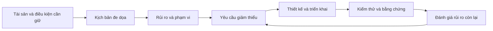

# Mitigation requirement

## 1. Mục tiêu bài học

Trong **threat modeling**, một kịch bản đe dọa cho biết tài sản có thể bị tổn hại như thế nào. Để thay đổi hành vi của hệ thống, cần chuyển kịch bản đó thành **mitigation requirement** — yêu cầu giảm thiểu đe dọa hoặc rủi ro.

Một yêu cầu giảm thiểu hữu ích phải nêu rõ hệ thống cần ngăn, giới hạn, phát hiện hoặc phục hồi điều gì; áp dụng ở đâu; khi có lỗi phải làm gì; và dựa vào bằng chứng nào để xác nhận kết quả.

Sau bài học, người học có thể:

- Phân biệt yêu cầu giảm thiểu với mục tiêu chung, giải pháp và công việc triển khai.
- Chuyển tài sản, đe dọa và rủi ro thành hành vi bảo mật quan sát được.
- Đặc tả phạm vi, thời điểm kiểm tra, ngưỡng và điều kiện lỗi.
- Liên kết yêu cầu với xác thực, phân quyền, dữ liệu, logging và phục hồi.
- Chọn tiêu chí chấp nhận và bằng chứng phù hợp với hậu quả.
- Đánh giá rủi ro còn lại và duy trì yêu cầu khi hệ thống thay đổi.

Các mã, ngưỡng và thời hạn trong bài thuộc hệ thống giả định. Chúng không phải một bộ tiêu chuẩn hoặc cam kết áp dụng chung.

## 2. Mitigation requirement là gì?

**Yêu cầu giảm thiểu** là phát biểu bắt buộc về hành vi hoặc điều kiện mà hệ thống, quy trình hay thành phần phải đáp ứng để xử lý một kịch bản đe dọa đã xác định.

Ví dụ:

> Token khôi phục mật khẩu chỉ được sử dụng cho tài khoản và mục đích đã gắn khi phát hành; sau một lần đổi mật khẩu thành công, mọi token khôi phục còn lại của tài khoản phải mất hiệu lực.

Yêu cầu này thể hiện tài sản, phạm vi tác động và kết quả cần đạt. Nó có thể được kiểm chứng bằng cách thử token với tài khoản khác, dùng lại sau thành công và thử một token khác đã phát hành trước đó.

### 2.1. Giảm thiểu không đồng nghĩa loại bỏ mọi rủi ro

Một kiểm soát có thể:

- Ngăn một đường tác động.
- Giảm khả năng hoặc phạm vi hậu quả.
- Phát hiện hành vi đủ sớm để xử lý.
- Hạn chế tác động khi một lớp khác thất bại.
- Khôi phục trạng thái an toàn sau sự cố.

Ví dụ, giới hạn yêu cầu khôi phục làm giảm một số hình thức gây ngập thông báo. Nó không tự chứng minh chủ thể không thể dùng nhiều nguồn gửi khác nhau.

Yêu cầu phải diễn đạt đúng mục tiêu. “Phát cảnh báo” không tương đương “ngăn hành động”; “có backup” không tương đương “phục hồi được trong thời gian cần thiết”.

### 2.2. Phân biệt các loại phát biểu

| Loại | Ví dụ | Điều còn thiếu nếu dùng làm yêu cầu |
| --- | --- | --- |
| Mục tiêu | Ngăn chiếm đoạt tài khoản qua khôi phục mật khẩu | Hành vi, phạm vi và bằng chứng |
| Quyết định xử lý | Giảm rủi ro bằng token có thời hạn và kiểm soát phiên | Các điều kiện cụ thể phải thực thi |
| Yêu cầu | Token hết hiệu lực sau 15 phút và không dùng lại sau thành công | Cần gắn nguồn, phạm vi và tiêu chí đầy đủ |
| Quyết định kiến trúc | Lưu dấu kiểm tra token và phiên bản bảo mật của tài khoản | Cần chứng minh thiết kế đáp ứng yêu cầu |
| Công việc | Thêm cột phiên bản bảo mật và cập nhật API | Công việc xong chưa chứng minh hành vi đúng |
| Kiểm thử | Dùng token lần thứ hai và xác nhận không đổi được mật khẩu | Chỉ là một phần bằng chứng của yêu cầu |
| Quyết định rủi ro | Chấp nhận phần rủi ro còn lại trong phạm vi được duyệt | Không thay thế triển khai hoặc bằng chứng |

Yêu cầu có thể buộc dùng một cơ chế cụ thể khi có lý do ràng buộc. Tuy nhiên, cần giữ rõ kết quả bảo vệ để người rà soát hiểu cơ chế đó xử lý kịch bản nào.

### 2.3. Không phải mọi phương án xử lý rủi ro đều là một mitigation requirement

Dừng một chức năng, thay nhà cung cấp hoặc chấp nhận rủi ro có thể là quyết định xử lý. Chúng cần phạm vi và người có thẩm quyền riêng.

Nếu quyết định có điều kiện, điều kiện đó phải được đặc tả. Ví dụ, “chỉ mở lại chức năng khi đạt các yêu cầu kiểm chứng” cần chỉ rõ yêu cầu nào, ai xác nhận và bằng chứng gì.

Không biến câu “đã chấp nhận” thành kết luận rằng một kiểm soát chưa triển khai đã có hiệu quả.

## 3. Đầu vào để viết yêu cầu giảm thiểu

Trước khi viết, cần có tối thiểu:

| Đầu vào | Câu hỏi cần trả lời |
| --- | --- |
| Tài sản | Giá trị nào cần bảo vệ? |
| Mục tiêu hoặc điều kiện bất biến | Điều gì phải luôn đúng? |
| Kịch bản đe dọa | Chủ thể hoặc sự kiện gây hại bằng đường nào? |
| Phạm vi và ranh giới tin cậy | Hành vi đi qua API, tác vụ, dữ liệu, quyền hay hệ thống nào? |
| Hậu quả | Mất gì nếu kịch bản thành công? |
| Kiểm soát hiện tại | Đã có gì và có bằng chứng gì? |
| Giả định | Điều gì chưa được xác minh? |
| Người chịu trách nhiệm | Ai quản lý rủi ro, ai duy trì kiểm soát và ai được quyết định? |

Nếu chưa biết một điều kiện quan trọng, nên ghi công việc xác minh. Không tự chọn một giải pháp rồi coi các giả định của giải pháp đã đúng.

### 3.1. Mẫu diễn đạt

Một mẫu thực hành:

> **Đối tượng + điều kiện áp dụng + hành vi bắt buộc + kết quả hoặc ngưỡng + hành vi lỗi + cách kiểm chứng.**

Ví dụ:

> Khi nhận yêu cầu đổi mật khẩu bằng token, dịch vụ phải xác minh token còn hiệu lực, đúng tài khoản, đúng mục đích và đúng phiên bản bảo mật; nếu không xác minh được thì từ chối thay đổi. Kiểm thử phải chứng minh token sai phạm vi, hết hạn và đã sử dụng không làm đổi thông tin xác thực.

Không nhất thiết nhét mọi chi tiết vào một câu. Có thể tách nội dung, tiêu chí chấp nhận và ghi chú thiết kế, nhưng phải liên kết rõ.

### 3.2. Chọn đơn vị yêu cầu đủ nhỏ

Một yêu cầu như “khôi phục tài khoản an toàn” chứa quá nhiều mục tiêu. Nên tách thành các yêu cầu về:

- Phát hành và thời hạn token.
- Phạm vi tài khoản và mục đích.
- Tính dùng một lần.
- Bảo vệ đường truyền và dữ liệu token.
- Thu hồi phiên.
- Chống dò tài khoản và gây ngập.
- Dấu vết và phục hồi.

Tách đủ để mỗi phần có chủ sở hữu và kiểm chứng được. Không tách quá nhỏ đến mức các phần mất quan hệ, chẳng hạn kiểm tra token và cập nhật mật khẩu được xem độc lập trong khi chúng phải nhất quán.

## 4. Ví dụ xuyên suốt: khôi phục mật khẩu

### 4.1. Phạm vi và luồng hợp lệ

Hệ thống giả định tự quản lý tài khoản, mật khẩu, token khôi phục và phiên bản bảo mật của tài khoản. Người dùng có thể yêu cầu khôi phục qua địa chỉ đã được xác minh trước đó.

Luồng dự kiến:

1. Người dùng gửi định danh tài khoản.
2. Dịch vụ trả thông báo chung, không tiết lộ tài khoản có tồn tại hay không.
3. Với trường hợp đủ điều kiện, dịch vụ phát hành token và gửi hướng dẫn qua kênh khôi phục đã đăng ký.
4. Người nhận dùng token để đề nghị đổi mật khẩu.
5. Dịch vụ kiểm tra token và chính sách mật khẩu đã được chấp thuận.
6. Khi thành công, mật khẩu được thay đổi, token liên quan mất hiệu lực và phiên cũ bị thu hồi theo yêu cầu.
7. Dấu vết cần thiết được ghi mà không chứa mật khẩu hoặc token thô.

Quy trình xác minh địa chỉ ban đầu và thay đổi địa chỉ khôi phục là phụ thuộc phải được quản lý. Nếu kênh khôi phục đã bị chiếm, token hợp lệ gửi tới kênh đó có thể không bảo vệ được tài khoản. Rủi ro này cần được đánh giá, không thể suy ra đã xử lý chỉ từ tính dùng một lần của token.

Các đường quản trị tác động cùng thông tin xác thực cũng phải được xem xét để không bỏ qua yêu cầu cốt lõi.

### 4.2. Tài sản và điều kiện cần bảo vệ

| Tài sản | Điều kiện cần bảo vệ |
| --- | --- |
| Quyền kiểm soát tài khoản | Chỉ quy trình được cho phép mới đổi thông tin xác thực |
| Token khôi phục | Không đoán được trong phạm vi thiết kế, không lộ, đúng mục đích, thời hạn và tài khoản |
| Mật khẩu và phiên | Thay đổi nhất quán; phiên không được tiếp tục dùng quá giới hạn thu hồi |
| Thông tin tồn tại tài khoản | Không tiết lộ qua phản hồi công khai ngoài chính sách |
| Kênh gửi hướng dẫn | Không bị dùng làm đường gây ngập hoặc gửi token sai bên |
| Dấu vết | Truy được phát hành, từ chối, sử dụng và kết quả mà không sao chép bí mật |
| Trạng thái phục hồi | Không làm token hoặc thông tin xác thực cũ đã bị thu hồi có hiệu lực trở lại |

### 4.3. Kịch bản đe dọa

| Mã | Kịch bản | Hậu quả |
| --- | --- | --- |
| T-MR-01 | Chủ thể có token đã dùng tiếp tục dùng lại, hoặc hai yêu cầu cùng vượt qua kiểm tra | Đổi mật khẩu trái phép hoặc tạo trạng thái không nhất quán |
| T-MR-02 | Token được áp dụng cho tài khoản, mục đích hoặc trạng thái bảo mật khác | Chiếm tài khoản qua nhầm phạm vi |
| T-MR-03 | Token xuất hiện trong log, nơi lưu, liên kết hoặc đích chuyển hướng ngoài phạm vi | Người có token nhận quyền khôi phục ngoài ý muốn |
| T-MR-04 | Phiên đã bị lộ vẫn dùng được sau khi người dùng khôi phục | Chủ thể tiếp tục truy cập dù thông tin xác thực đã thay đổi |
| T-MR-05 | Phản hồi khác nhau cho tài khoản có và không tồn tại | Hỗ trợ thu thập danh sách tài khoản |
| T-MR-06 | Nhiều yêu cầu khôi phục gây ngập kênh gửi hoặc cản trở người dùng | Gián đoạn, tốn tài nguyên hoặc gây khó khôi phục thật |
| T-MR-07 | Người có quyền hỗ trợ dùng đường quản trị bỏ qua kiểm soát | Đổi thông tin xác thực ngoài nhiệm vụ |
| T-MR-08 | Phục hồi bản cũ làm token, phiên hoặc trạng thái bảo mật đã thu hồi quay lại | Tái tạo quyền truy cập không được phép |

Đây là các kịch bản giả định để đặc tả. Chưa có bằng chứng thì không gọi chúng là lỗi đã phát hiện của một hệ thống thực.

## 5. Từ kịch bản tới quyết định kiến trúc



Ví dụ với T-MR-01:

- Mục tiêu là một token không tạo nhiều lần đổi mật khẩu có hiệu lực.
- Yêu cầu phải nêu tính dùng một lần và nhất quán với thay đổi thông tin xác thực.
- Thiết kế có thể dùng chuyển trạng thái có điều kiện và phiên bản bảo mật tài khoản.
- Kiểm thử phải có gửi lại, đồng thời và lỗi giữa các bước.
- Kết luận phải dựa vào trạng thái mật khẩu, token, phiên và bằng chứng, không chỉ mã phản hồi.

Câu “kiểm tra token rồi đánh dấu đã dùng” chưa đủ. Hai tiến trình có thể cùng thấy token chưa dùng trước khi một tiến trình kịp cập nhật. Kiểm tra và chuyển trạng thái phải được phối hợp theo thiết kế nhất quán.

## 6. Bộ yêu cầu giảm thiểu của ví dụ

### 6.1. Token, phạm vi và chuyển trạng thái

Các giá trị 128 bit, 15 phút và 60 giây là tham số của chính sách giả định trong bài.

| Mã | Yêu cầu | Tiêu chí chấp nhận |
| --- | --- | --- |
| MR-01 | Token phải được tạo từ nguồn ngẫu nhiên dùng cho bảo mật với ít nhất 128 bit ngẫu nhiên; có thời hạn 15 phút do máy chủ xác định | Rà soát nguồn sinh và cách mã hóa; độ dài chuỗi không được dùng thay bằng chứng về nguồn ngẫu nhiên; thử token trước, đúng và sau mốc hết hạn |
| MR-02 | Token phải gắn với tài khoản, mục đích khôi phục mật khẩu và phiên bản bảo mật khi phát hành; không chấp nhận phạm vi do phía khách tự thay | Token của A không đổi mật khẩu B; token cho mục đích khác hoặc phiên bản đã mất hiệu lực bị từ chối |
| MR-03 | Quyết định dùng token, cập nhật mật khẩu và làm mất hiệu lực token phải nhất quán; một token chỉ tạo một lần đổi mật khẩu thành công | Hai yêu cầu đồng thời không cùng tạo hai kết quả đổi có hiệu lực; thử lỗi giữa các bước không để token tiếp tục dùng trong trạng thái sai |
| MR-04 | Sau đổi mật khẩu thành công, mọi token khôi phục đã phát hành trước đó của tài khoản phải không còn hiệu lực | Phát hành hai token, dùng một token thành công rồi thử token còn lại; không thay đổi được mật khẩu |
| MR-05 | Kho dùng để kiểm chứng token chỉ lưu dấu kiểm tra phù hợp, không lưu token thô; ứng dụng không đưa mật khẩu hoặc token thô vào log và dữ liệu chẩn đoán | Kiểm tra nơi lưu và các đường thành công, lỗi, retry; dùng giá trị giả có dấu nhận diện để đối chiếu đầu ra |

128 bit trong MR-01 mô tả lượng ngẫu nhiên được tạo, không có nghĩa chỉ cần chuỗi dài 128 ký tự. Chuỗi dài nhưng dựa trên thời gian hoặc giá trị dễ suy ra không đáp ứng yêu cầu này.

Trong ví dụ, token hợp lệ theo thời gian khi thời điểm quyết định phía máy chủ **nhỏ hơn** mốc hết hạn. Tại đúng mốc hết hạn, token bị từ chối. Kiểm tra này phải gắn với bước quyết định đổi, không chỉ với lúc mở trang.

Một dấu kiểm tra có thể được tạo từ token ngẫu nhiên để đối chiếu khi sử dụng. Nó không thay thế yêu cầu token đủ khó đoán hoặc quyền bảo vệ kho kiểm chứng.

Nếu hàng đợi gửi hướng dẫn cần chứa token để gửi, đó là một bản sao bí mật có phạm vi, quyền và thời hạn riêng. Không thể kết luận đã bảo vệ token chỉ vì bảng kiểm chứng không chứa giá trị thô.

### 6.2. Kênh, phản hồi và giới hạn

| Mã | Yêu cầu | Tiêu chí chấp nhận |
| --- | --- | --- |
| MR-06 | Liên kết khôi phục phải được tạo từ địa chỉ gốc tin cậy của dịch vụ; luồng truyền do ứng dụng kiểm soát phải dùng kênh được bảo vệ và không gửi token tới đích ngoài phạm vi | Sửa header hoặc tham số địa chỉ không làm đổi đích nhận token; kiểm tra chuyển hướng, phân tích và tài nguyên do ứng dụng tải không làm lộ token |
| MR-07 | Với yêu cầu đúng định dạng, phản hồi công khai không phân biệt tài khoản có tồn tại bằng mã trạng thái, cấu trúc hoặc nội dung thông báo | So sánh tài khoản có, không có, không đủ điều kiện; không trả địa chỉ khôi phục hoặc dấu hiệu tồn tại; rà soát riêng tín hiệu thời gian |
| MR-08 | Trong ví dụ, tối đa 3 yêu cầu phát hành được chấp nhận cho một định danh trong 15 phút trượt và 20 cho một nguồn gửi trong 5 phút trượt; giới hạn không được tự khóa đăng nhập tài khoản | Thử biên và đồng thời; chính sách áp dụng nhất quán cho định danh có và không tồn tại; vượt giới hạn không làm mất quyền đăng nhập hợp lệ |
| MR-09 | Mật khẩu mới phải được kiểm tra theo chính sách đã chấp thuận và lưu bằng cơ chế bảo vệ dành cho mật khẩu; không lưu hoặc ghi log dạng rõ | Mật khẩu không đạt bị từ chối trước khi thay đổi có hiệu lực; đối chiếu mã và cấu hình lưu trữ, log và bản sao liên quan |

MR-07 không tự chứng minh đã loại bỏ mọi kênh dò tài khoản. Chênh lệch thời gian, giới hạn hoặc hành vi khác cũng có thể tạo tín hiệu. Cần xác định và kiểm chứng phạm vi đó theo đánh giá rủi ro, thay vì tuyên bố thời gian phản hồi tuyệt đối giống nhau mà chưa có căn cứ.

Một phản hồi minh họa có thể dùng cùng mã `202` và nội dung chung:

> Nếu yêu cầu đáp ứng điều kiện, hướng dẫn sẽ được gửi qua kênh đã đăng ký.

Phản hồi này không khẳng định thông báo đã được giao thành công. Lỗi định dạng và giới hạn có thể có phản hồi riêng theo chính sách, nhưng không được làm khác chỉ vì một định danh thực sự tồn tại.

Giới hạn theo nguồn gửi cần dựa trên nguồn đã xác định đáng tin cậy trong kiến trúc, không tin tùy ý header do phía khách đưa vào. Một địa chỉ mạng cũng không đồng nghĩa một cá nhân: cần đánh giá cả khả năng phân tán và người dùng chung mạng.

### 6.3. Phiên, đặc quyền, kiểm toán và phục hồi

| Mã | Yêu cầu | Tiêu chí chấp nhận |
| --- | --- | --- |
| MR-10 | Sau đổi mật khẩu thành công, các phiên cũ phải bị từ chối trên mọi yêu cầu xác thực mới trong tối đa 60 giây | Ghi mốc thành công, thử các loại phiên và đường API trong phạm vi; sau giới hạn không tiếp tục chấp nhận phiên cũ |
| MR-11 | Đường quản trị thay đổi thông tin xác thực phải kiểm tra quyền hiện tại, xác thực đa yếu tố theo vai trò và ghi rõ chủ thể, tài khoản đích, lý do | Người hỗ trợ không có quyền, người sai phạm vi hoặc thiếu điều kiện xác thực không đổi được thông tin; không có đường bỏ qua các bất biến cốt lõi |
| MR-12 | Phát hành, từ chối và sử dụng token, đổi mật khẩu, thu hồi phiên và thao tác đặc quyền phải có dấu vết được bảo vệ; thay đổi thông tin xác thực phải gắn với bản ghi bền vững trước xác nhận hoàn tất | Có liên kết sự kiện và kết quả; danh tính nghiệp vụ không sửa hoặc xóa được bằng chứng; lỗi ghi nhận không tạo xác nhận sai |
| MR-13 | Phục hồi phải ngăn token, phiên và trạng thái thông tin xác thực đã thu hồi được mở lại từ bản cũ; diễn tập kịch bản mất kho chính phải đạt điều kiện mở dịch vụ trong 4 giờ | Dùng bản cũ có trạng thái đã bị thay đổi sau đó; đối chiếu nguồn trạng thái bảo mật cần thiết trước mở; token và phiên cũ vẫn bị từ chối |
| MR-14 | Khi không xác minh được token, phiên bản bảo mật hoặc quyền cần thiết, dịch vụ không được đổi thông tin xác thực bằng một giá trị mặc định cho phép | Mô phỏng phụ thuộc không sẵn sàng, dữ liệu thiếu và kết quả không rõ; không có thay đổi trái điều kiện, có trạng thái lỗi và cảnh báo phù hợp |

MR-10 áp dụng cho yêu cầu mới được xử lý sau đó, không có nghĩa thu hồi được nội dung đã tải xuống trước khi đổi mật khẩu. Những kết nối hoặc tác vụ kéo dài cần quy tắc riêng nếu thuộc phạm vi rủi ro.

Khoảng 60 giây là giới hạn được chọn rõ, không phải thu hồi tức thời. Nếu nghiệp vụ không chấp nhận khoảng này, phải sửa yêu cầu và thiết kế tương ứng.

Ở MR-12, lưu bền vững một sự kiện gắn với thay đổi trong cùng cơ chế nhất quán có thể khác với gửi thành công tới kho kiểm toán trung tâm ngay lập tức. Nếu dùng chuyển tiếp bất đồng bộ, phải có cách chống mất, đối chiếu, bảo vệ và theo dõi tồn đọng đã được chấp thuận.

Ở MR-13, backup cũ một mình không thể biết mọi lần thu hồi xảy ra sau lúc backup. Thiết kế cần nguồn trạng thái hoặc kế hoạch tái lập bảo mật đủ bền vững. Nếu không xác định được trạng thái đúng, không mở lại dịch vụ với giả định rằng dữ liệu cũ là an toàn.

## 7. Thiết kế nhất quán và hành vi lỗi

### 7.1. Một mô hình trạng thái để diễn giải

Để minh họa MR-02 tới MR-04, hồ sơ kiểm chứng token có thể chứa:

- Tham chiếu tài khoản.
- Dấu kiểm tra của token.
- Mục đích.
- Mốc phát hành và hết hạn.
- Phiên bản bảo mật lúc phát hành.
- Trạng thái đã sử dụng.

Tài khoản có phiên bản bảo mật hiện tại. Khi đổi mật khẩu thành công, phiên bản tăng hoặc thay đổi theo cơ chế thiết kế. Token và phiên gắn với phiên bản cũ sẽ bị kiểm tra là không còn hợp lệ theo quy tắc tương ứng.

Phiên bản không phải một bí mật thay token. Nó là thông tin trạng thái phải được quản lý đáng tin cậy.

Mã giả khái niệm:

```text
completePasswordReset(presentedToken, proposedPassword):
    validateProposedPassword(proposedPassword)

    withinOneConsistencyBoundary:
        record = findAndProtectTokenRecord(presentedToken)
        account = findAndProtectAccount(record.accountReference)

        require tokenMatches(record, presentedToken)
        require record.purpose == PASSWORD_RESET
        require decisionTime < record.expiresAt
        require record.securityVersion == account.securityVersion
        require record.isUnused

        replaceProtectedPassword(account, proposedPassword)
        changeSecurityVersion(account)
        markTokenConsumed(record)
        persistLinkedAuditEvent(account, record)

    return committedResult
```

Đây không phải mã triển khai hoàn chỉnh. “Một ranh giới nhất quán” phải được hiện thực hóa bằng cơ chế phù hợp với hệ thống, bao gồm kiểm soát đồng thời và rollback khi thao tác chưa được chốt.

Nếu mật khẩu được quản lý ở nhà cung cấp danh tính khác, không được giả định các cập nhật thuộc cùng một giao dịch cục bộ. Phải thiết kế lại giao thức, trạng thái trung gian, đối chiếu và hành vi lỗi để đáp ứng cùng yêu cầu.

### 7.2. Không dùng lỗi phản hồi để suy ra trạng thái nghiệp vụ

Một kết nối có thể đứt sau khi thay đổi đã được chốt nhưng trước lúc phía khách nhận được phản hồi. “Không nhận thành công” không chứng minh mật khẩu chưa đổi.

Hệ thống cần tránh:

- Tự khôi phục token thành chưa dùng khi chưa xác định được kết quả.
- Tự thực hiện thêm một thay đổi khác với cùng quyền đã sử dụng.
- Ghi nhận thành công khi chỉ một phần trạng thái bắt buộc được cập nhật.
- Trả thông tin nhạy cảm trong quá trình giải thích lỗi.

Kiểm thử phải xét trạng thái đã chốt và chưa chốt, không chỉ các lỗi được ném trước khi ghi dữ liệu.

### 7.3. Bảng hành vi lỗi

| Điều kiện | Hành vi cần đặc tả |
| --- | --- |
| Token không hợp lệ, hết hạn hoặc đã dùng | Không đổi mật khẩu; phản hồi không tiết lộ phạm vi tài khoản ngoài chính sách |
| Kho kiểm chứng không sẵn sàng | Không bỏ qua bước kiểm chứng; ghi lỗi và hướng xử lý |
| Không gửi được hướng dẫn | Không đổi sang kênh chưa xác minh; phản hồi chung vẫn không tiết lộ tài khoản |
| Lỗi trước khi chốt thay đổi | Không để một phần cập nhật làm token hoặc mật khẩu ở trạng thái trái quy tắc |
| Mất phản hồi sau khi chốt | Giữ kết quả đã chốt; xử lý gửi lại mà không tái sử dụng quyền |
| Thu hồi phiên không đạt giới hạn | Cảnh báo, giới hạn tác động theo phương án đã duyệt; không âm thầm tiếp tục như đã đạt |
| Kho kiểm toán trung tâm gián đoạn | Thực hiện đúng cơ chế ghi bền vững và chuyển tiếp được duyệt; nếu không đáp ứng thì không xác nhận hoàn tất |
| Không đủ trạng thái bảo mật sau phục hồi | Chưa mở lại đường có thể dùng trạng thái cũ; thực hiện đối chiếu hoặc tái lập theo phương án |

Lỗi gửi hướng dẫn có thể cần thử lại có kiểm soát. Phải xét cả thời hạn token, giới hạn gửi và nguy cơ tạo nhiều bản thông báo, không chỉ thêm retry vô hạn.

## 8. Chọn mức bằng chứng

Yêu cầu có hậu quả chiếm tài khoản cần bằng chứng phù hợp với các đường có thể làm sai quyết định:

- Rà soát thiết kế token, phạm vi và phiên bản bảo mật.
- Kiểm thử quyền và điều kiện từ chối.
- Kiểm thử gửi lại, hai token, đồng thời và lỗi giữa các bước.
- Đối chiếu cấu hình phiên, cache và nơi token có thể đi qua.
- Kiểm tra dữ liệu ở log, thông báo lỗi và hàng đợi gửi.
- Diễn tập phục hồi với các thay đổi bảo mật xảy ra sau thời điểm backup.
- Xác minh độc lập khi chính sách hoặc mức rủi ro yêu cầu.

Một lần quét hoặc kiểm thử đường thành công không chứng minh được tính dùng một lần, phạm vi tài khoản hay việc trạng thái cũ không quay lại sau phục hồi.

Bằng chứng cần gắn với phiên bản, môi trường, cấu hình, dữ liệu giả và giới hạn thử. Nếu kết luận dựa trên giả định chưa xác minh, phải ghi rõ và xử lý trước quyết định vượt quá phạm vi đó.

## 9. Ma trận kiểm thử và tiêu chí bằng chứng

### 9.1. Kiểm tra cả hành vi hợp lệ và bị cấm

| Phép thử | Kết quả mong đợi | Yêu cầu liên quan |
| --- | --- | --- |
| Dùng token hợp lệ đúng tài khoản, mục đích và thời hạn | Đổi mật khẩu theo chính sách, cập nhật trạng thái và dấu vết | MR-01 tới MR-04, MR-09, MR-12 |
| Dùng token của A để đề nghị đổi tài khoản B | Không đổi mật khẩu B hoặc bất kỳ tài khoản ngoài phạm vi | MR-02 |
| Dùng token cho một mục đích khác | Bị từ chối, không có thay đổi thông tin xác thực | MR-02 |
| Dùng token ngay trước, đúng và sau mốc hết hạn | Chỉ trường hợp còn hiệu lực theo thời gian được xem xét tiếp | MR-01 |
| Gửi lại token sau một lần thành công | Không tạo thêm lần đổi có hiệu lực | MR-03 |
| Hai yêu cầu đồng thời dùng một token | Tối đa một lần đổi có hiệu lực; dữ liệu và bằng chứng nhất quán | MR-03 |
| Phát hành hai token rồi dùng một token thành công | Token còn lại không đổi tiếp được mật khẩu | MR-04 |
| Phát sinh lỗi trước và sau điểm chốt | Không có trạng thái nửa chừng hoặc tái kích hoạt token sai | MR-03, MR-12, MR-14 |
| Sửa địa chỉ gốc hoặc chuyển hướng bằng dữ liệu phía khách | Không đưa token tới đích ngoài phạm vi | MR-06 |
| So sánh tài khoản có, không có và không đủ điều kiện | Phản hồi công khai đáp ứng chính sách không tiết lộ | MR-07 |
| Thử giới hạn với định danh có và không tồn tại | Cùng quy tắc giới hạn; không tự khóa đăng nhập | MR-08 |
| Đổi mật khẩu rồi dùng phiên cũ qua các đường API | Sau tối đa 60 giây không còn được chấp nhận | MR-10 |
| Nhân viên không đủ quyền dùng đường quản trị | Không đổi thông tin xác thực | MR-11 |
| Gây lỗi với token và mật khẩu giả có dấu nhận diện | Không xuất hiện tại log, chẩn đoán hoặc đầu ra bị cấm trong phạm vi | MR-05, MR-09 |
| Dùng danh tính nghiệp vụ sửa hoặc xóa bằng chứng | Bị từ chối | MR-12 |
| Phục hồi bản cũ có token và phiên sau đó đã bị thu hồi | Không mở lại quyền cũ; thực hiện đối chiếu hoặc tái lập đúng | MR-13 |
| Không truy cập được phụ thuộc kiểm chứng | Không mặc định cho phép đổi mật khẩu | MR-14 |

Kiểm thử chống lộ token phải phân biệt đầu ra bị cấm với kênh gửi hướng dẫn đã được chấp thuận, nơi token có thể cần xuất hiện theo thiết kế. Cả kênh được chấp thuận vẫn cần quyền và vòng đời phù hợp.

Kiểm thử mật khẩu nên dùng dữ liệu giả. Báo cáo không cần lưu mật khẩu rõ chỉ để chứng minh đã thay đổi; có thể xác nhận hành vi đăng nhập và trạng thái liên quan trong môi trường thử nghiệm.

### 9.2. Kết quả cần đối chiếu sau kiểm thử đồng thời

Với hai yêu cầu dùng cùng token, cần kiểm tra:

- Chỉ một thay đổi hợp lệ được chốt.
- Token không thể dùng tiếp.
- Phiên bản bảo mật của tài khoản đúng.
- Không có cập nhật mật khẩu không gắn với token hợp lệ.
- Bằng chứng phản ánh đúng kết quả từng yêu cầu.
- Phiên cũ không được tiếp tục quá giới hạn.
- Không có tiến trình xử lý lại làm đảo ngược kết quả.

Không đủ để chỉ thấy một yêu cầu trả thành công và một yêu cầu trả lỗi. Lỗi có thể xảy ra sau khi tiến trình thứ hai đã tạo một thay đổi ngoài ý muốn.

### 9.3. Đo các ngưỡng đúng cách

| Ngưỡng | Mốc bắt đầu và kết thúc cần ghi |
| --- | --- |
| Token 15 phút | Từ thời điểm phát hành đáng tin cậy tới thời điểm quyết định dùng token |
| Thu hồi phiên 60 giây | Từ lúc đổi mật khẩu thành công tới lúc mọi đường yêu cầu mới trong phạm vi từ chối phiên cũ |
| Giới hạn cửa sổ trượt | Dựa trên các sự kiện được tính, định danh chuẩn hóa và thời gian phía máy chủ |
| Phục hồi 4 giờ | Từ lúc tuyên bố bắt đầu phục hồi tới khi dữ liệu, quyền và kiểm tra bảo mật bắt buộc đạt điều kiện mở |

Cần quy định điều kiện môi trường và kịch bản. Một phép đo trên một phiên không đại diện cho mọi loại phiên; một diễn tập mất kho chính không chứng minh chịu được mọi thảm họa.

### 9.4. Phạm vi bằng chứng phải rõ

Một báo cáo nên trả lời:

1. Đã kiểm chứng yêu cầu nào và phiên bản nào?
2. Những đường truy cập, cấu hình và loại phiên nào nằm trong phạm vi?
3. Trường hợp nào đạt, không đạt hoặc chưa thử?
4. Giả định nào đã được xác nhận?
5. Có sai khác nào giữa môi trường thử và triển khai không?
6. Người xác minh có đáp ứng yêu cầu độc lập nếu được đặt ra không?
7. Thay đổi nào sau phép thử có thể làm kết luận mất hiệu lực?

Bằng chứng phải đủ để xem xét lại quyết định, đồng thời được bảo vệ khỏi sửa trái phép và tiết lộ nội dung nhạy cảm.

## 10. Ví dụ hồ sơ yêu cầu có truy vết

Đoạn YAML dưới đây minh họa yêu cầu đang được đặc tả, không phải kết quả triển khai thực tế:

```yaml
requirementId: MR-03
title: consistent-single-use-password-reset
requirementStatus: specified
implementationStatus: not-yet-verified

source:
  threatModelReference: TM-RESET-DEMO-V1
  threatReferences:
    - T-MR-01
  riskReference: R-RESET-REPLAY

securityObjective: "Một token không tạo nhiều lần đổi mật khẩu có hiệu lực."

scope:
  operation: complete-password-reset
  components:
    - reset-api
    - token-verification-store
    - credential-store
    - account-security-version
    - linked-audit-record

statement: >
  Quyết định dùng token, cập nhật mật khẩu và làm mất hiệu lực quyền
  khôi phục phải nhất quán. Một token chỉ được tạo một lần đổi mật khẩu
  thành công, kể cả khi gửi lại hoặc xử lý đồng thời.

failureBehavior:
  - "Không cho phép thay đổi khi không xác minh được điều kiện."
  - "Không tự đưa token về chưa dùng khi kết quả chốt chưa rõ."
  - "Không xác nhận hoàn tất khi thiếu trạng thái bắt buộc."

dependencies:
  - MR-02
  - MR-04
  - MR-09
  - MR-12

acceptanceCriteria:
  - "Token dùng thành công không thể dùng lại."
  - "Hai yêu cầu đồng thời không tạo hai thay đổi có hiệu lực."
  - "Lỗi giữa các bước không để trạng thái trái điều kiện."
  - "Kết quả có bằng chứng liên kết và không chứa bí mật thô."

verificationPlan:
  - TC-RESET-REPLAY
  - TC-RESET-CONCURRENCY
  - TC-RESET-PARTIAL-FAILURE

responsibility:
  riskOwnerRole: account-service-business-owner
  controlOwnerRole: identity-service-owner
  verifierRole: assigned-security-verifier

reviewTriggers:
  - token-storage-change
  - credential-provider-change
  - transaction-boundary-change
  - account-security-version-change
```

Các mã kiểm thử trong kế hoạch chưa phải bằng chứng đã đạt. Khi triển khai xong, cần bổ sung kết quả, phiên bản, môi trường, người xác minh và những giới hạn còn lại.

Không ghi một yêu cầu là “đã kiểm chứng” chỉ vì trường bằng chứng có một đường dẫn. Nội dung và phạm vi của bằng chứng phải phù hợp với yêu cầu.

### 10.1. Truy vết hai chiều

Cần xem được cả hai hướng:

- Từ T-MR-01 tới MR-03, MR-04, thiết kế nhất quán và các phép thử.
- Từ MR-03 trở lại tài sản, mục tiêu và kịch bản khiến yêu cầu cần có.

Một yêu cầu có thể xử lý nhiều kịch bản, và một kịch bản có thể cần nhiều yêu cầu. Không ép quan hệ một đối một nếu làm mất các phụ thuộc quan trọng.

Nếu một yêu cầu đến từ đường cơ sở hoặc nguồn bắt buộc mà chưa có kịch bản cụ thể, vẫn giữ nguồn đó và đánh giá phạm vi. Mô hình đe dọa không phải lý do tự loại bỏ yêu cầu đã được xác nhận.

## 11. Quyết định rủi ro còn lại và vòng đời yêu cầu

### 11.1. Tách mục tiêu dự kiến khỏi kết quả đã đánh giá

Trước triển khai, nhóm có thể dự kiến token dùng một lần làm giảm rủi ro dùng lại. Sau triển khai, phải dựa vào bằng chứng để đánh giá:

- Cơ chế có hoạt động trên mọi đường trong phạm vi không?
- Đường quản trị hoặc phụ thuộc có thể bỏ qua nó không?
- Lỗi đồng thời và phục hồi có làm quyền cũ quay lại không?
- Rủi ro nào còn tồn tại do kênh khôi phục hoặc phiên chưa thu hồi ngay?
- Mức chưa chắc chắn có đủ để quyết định không?

Không lấy rủi ro mục tiêu trong kế hoạch làm rủi ro còn lại thực tế.

### 11.2. Chọn quyết định đúng thẩm quyền

Các khả năng gồm:

- Yêu cầu thêm bằng chứng.
- Tiếp tục giảm thiểu.
- Dừng hoặc thu hẹp chức năng.
- Chấp nhận rủi ro còn lại với điều kiện và thời hạn.
- Chuyển cấp vì hậu quả, xung đột hoặc yêu cầu vượt quyền.

Một yêu cầu bắt buộc chưa đạt phải được xử lý theo nguồn và cơ chế ngoại lệ được phép. Risk owner không tự có quyền miễn mọi yêu cầu.

Ví dụ, nếu chưa xác minh việc thu hồi phiên qua một API cũ, không thể khẳng định MR-10 đã đạt. Có thể đóng đường đó, bổ sung kiểm soát hoặc xin quyết định phù hợp; không chỉ ghi “đã chấp nhận” rồi đánh dấu yêu cầu đạt.

### 11.3. Sự kiện cần cập nhật yêu cầu

| Thay đổi | Phần cần xem xét lại |
| --- | --- |
| Thay nguồn sinh hoặc cách biểu diễn token | Độ khó đoán, cách đối chiếu và dữ liệu đi qua các lớp |
| Đổi thời hạn hoặc chính sách phát hành | Mốc thời gian, giới hạn, gửi lại và tác động người dùng |
| Chuyển sang nhà cung cấp danh tính | Ranh giới nhất quán, lỗi, thu hồi và đối chiếu |
| Thêm loại phiên hoặc API mới | Bao phủ thu hồi và hành vi khi không kiểm chứng được |
| Đổi địa chỉ gốc, trang khôi phục hoặc công cụ phân tích | Nguy cơ lộ token qua liên kết và đầu ra |
| Đổi log, hàng đợi thông báo hoặc nơi lưu | Quyền, nội dung, bản sao, thời hạn và dữ liệu chẩn đoán |
| Đổi backup và phương án phục hồi | Khả năng tái lập trạng thái bảo mật mới nhất |
| Phát hiện sự cố hoặc kết quả thử trái giả định | Hiệu quả kiểm soát và rủi ro còn lại |

Mỗi thay đổi cần xác định yêu cầu, thiết kế và bằng chứng bị ảnh hưởng. Không phải lúc nào cũng thử lại toàn hệ thống, nhưng phải có căn cứ cho phạm vi kiểm chứng lại.

### 11.4. Những chỉ số hỗ trợ theo dõi

Có thể dùng:

> Tỷ lệ yêu cầu giảm thiểu có bằng chứng đạt = số yêu cầu áp dụng có kết quả đạt trong phạm vi xét / tổng số yêu cầu giảm thiểu áp dụng trong cùng phiên bản.

Cần theo dõi riêng:

- Yêu cầu chưa có chủ sở hữu.
- Tiêu chí chưa đủ rõ để kiểm chứng.
- Giả định chưa xác minh.
- Kết quả không đạt hoặc chưa thử.
- Bằng chứng bị ảnh hưởng bởi thay đổi.
- Ngoại lệ, quyết định sắp hết hoặc đã hết hiệu lực.

Tỷ lệ đạt cao không thay thế việc xem từng yêu cầu bắt buộc. Nếu phần chưa đạt là tính dùng một lần hoặc phục hồi trạng thái thu hồi, quyết định phải phản ánh đúng hậu quả đó.

## 12. Những sai lầm thường gặp

| Sai lầm | Hệ quả | Cách sửa |
| --- | --- | --- |
| Viết “cần an toàn hơn” | Không có hành vi để triển khai hoặc kiểm chứng | Nêu điều kiện, đối tượng, kết quả và bằng chứng |
| Chỉ ghi tên giải pháp hoặc sản phẩm | Không biết nó xử lý kịch bản nào | Gắn với tài sản, đe dọa và mục tiêu bảo vệ |
| Dùng “phải dùng một lần” nhưng bỏ qua đồng thời | Hai yêu cầu có thể cùng thành công | Đặc tả ranh giới nhất quán và phép thử tranh chấp |
| Chỉ kiểm tra token ở lúc mở trang | Token có thể hết hạn hoặc mất quyền trước khi chốt | Kiểm tra ở bước quyết định cần bảo vệ |
| Coi chuỗi dài là token khó đoán | Giá trị vẫn có thể dự đoán | Xác định nguồn và lượng ngẫu nhiên, không chỉ định dạng |
| Bảo vệ bảng token nhưng bỏ qua hàng đợi gửi | Token vẫn tồn tại ở bản sao ít được quản lý | Theo dõi toàn bộ đường đi và vòng đời |
| Trả phản hồi giống nhau rồi tuyên bố không thể dò | Có thể còn tín hiệu thời gian hoặc giới hạn | Đánh giá và kiểm chứng các kênh trong phạm vi |
| Giới hạn khôi phục bằng cách khóa đăng nhập | Chủ thể ngoài có thể gây gián đoạn cho người thật | Tách giới hạn phát hành với quyền đăng nhập |
| Đặt mốc thu hồi nhưng bỏ qua phiên cũ hoặc API khác | Rủi ro tiếp tục qua đường chưa bao phủ | Liệt kê mọi loại phiên và đường xác thực |
| Gọi logger rồi coi là bằng chứng bền vững | Lỗi giữa các bước có thể mất hoặc sai dấu vết | Thiết kế ghi nhận nhất quán và đối chiếu |
| Phục hồi backup rồi mở dịch vụ ngay | Token hoặc phiên bị thu hồi có thể quay lại | Khôi phục trạng thái bảo mật và kiểm tra trước mở |
| Đóng yêu cầu khi ticket hoàn tất | Chưa chứng minh kết quả bảo vệ | Tách triển khai, kiểm chứng và quyết định rủi ro |

## 13. Bài tập vận dụng

Một dịch vụ khôi phục mật khẩu có thiết kế:

- Token được tạo từ định danh tài khoản và thời điểm yêu cầu.
- Token có thời hạn 30 phút nhưng chưa có căn cứ lựa chọn thời hạn.
- Token dùng lại được cho tới khi hết hạn.
- API trả thông báo khác nhau khi tài khoản có và không tồn tại.
- Sau đổi mật khẩu, phiên cũ vẫn được dùng theo hạn phiên ban đầu.
- Log lỗi ghi cả token.
- Backup được tạo mỗi ngày, chưa diễn tập tình huống token đã dùng xuất hiện lại sau phục hồi.

Hãy thực hiện:

1. Viết ba kịch bản đe dọa gắn với tài sản.
2. Chọn bốn yêu cầu giảm thiểu, mỗi yêu cầu có tiêu chí chấp nhận.
3. Phân biệt phần đã có bằng chứng điểm yếu với phần cần xác minh chính sách.
4. Đề xuất phép thử gửi lại, đồng thời, thu hồi phiên và phục hồi.
5. Nêu một rủi ro còn lại mà token dùng một lần chưa xử lý được.
6. Chỉ ra ai cần xác nhận ngưỡng, ai triển khai và ai quyết định rủi ro còn lại.

### Gợi ý tự đối chiếu

- Kịch bản có thể gồm dự đoán token, dùng lại để đổi mật khẩu lần nữa, lấy token từ log và dùng phiên cũ sau khôi phục.
- Token cần nguồn ngẫu nhiên phù hợp, phạm vi rõ, thời hạn được chấp thuận và tính dùng một lần nhất quán.
- Yêu cầu về phiên phải nêu loại phiên, giới hạn có hiệu lực và cách kiểm thử. Không chỉ ghi “đăng xuất người dùng”.
- Log không cần token thô để liên kết sự kiện. Dùng tham chiếu được quản lý và quyền truy cập phù hợp.
- Giá trị 30 phút có phù hợp hay không cần đối chiếu chính sách và rủi ro; không kết luận mọi giá trị khác ví dụ 15 phút đều sai.
- Cách sinh từ thông tin có thể suy ra và cho dùng lại là điều cần đánh giá trực tiếp bằng thiết kế và bằng chứng, không được che bằng việc thời hạn có vẻ ngắn.
- Phục hồi cần nguồn hoặc phương án tái lập trạng thái thu hồi. Backup hằng ngày một mình chưa chứng minh điều đó.
- Kênh khôi phục đã bị chiếm là rủi ro chưa tự được xử lý bởi token dùng một lần.
- Chủ sở hữu nghiệp vụ và risk owner xác nhận hậu quả, ngưỡng và phương án; control owner triển khai, người xác minh đánh giá bằng chứng, người đủ thẩm quyền quyết định chấp nhận.

## 14. Sản phẩm đầu ra của bài học

Với một kịch bản cụ thể, người học cần tạo được:

1. Tài sản, điều kiện cần bảo vệ, đe dọa và rủi ro có phạm vi rõ.
2. Yêu cầu giảm thiểu có hành vi, ngưỡng, thời điểm và điều kiện lỗi.
3. Liên kết tới quyết định kiến trúc, phụ thuộc và người chịu trách nhiệm.
4. Tiêu chí chấp nhận và kiểm thử cho đường hợp lệ, bị cấm, đồng thời và lỗi.
5. Gói bằng chứng gắn với phiên bản, cấu hình và giới hạn.
6. Đánh giá rủi ro còn lại, quyết định và điều kiện rà soát sau thay đổi.

Kết quả phải trả lời được: **yêu cầu đang giảm kịch bản nào, hệ thống phải làm gì, ở đâu và khi nào, nếu không làm được thì xử lý ra sao, và bằng chứng nào xác nhận kết quả bảo vệ đã đạt trong phạm vi đã xét**.
