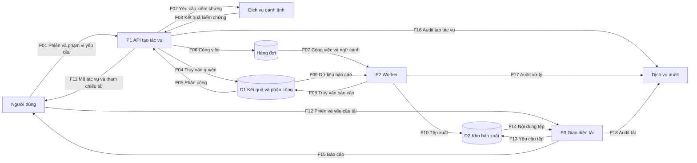

# Threat model review

## 1. Mục tiêu và phạm vi bài học

**Threat model review** là hoạt động rà soát một mô hình đe dọa để xác định mô hình có phản ánh đúng phần hệ thống đang xét, đã xem xét các đường gây hại quan trọng và đã liên kết chúng với biện pháp xử lý cùng bằng chứng phù hợp hay chưa.

Một sơ đồ đẹp hoặc một danh sách đe dọa dài chưa đủ để kết luận mô hình có ích. Người rà soát cần hiểu các giả định, đường dữ liệu, quyền và giới hạn của kết luận.

Trong chương **Threat modeling** của module yêu cầu bảo mật, hoạt động này giúp nối:

- Mục tiêu bảo vệ với tài sản và hậu quả nghiệp vụ.
- Kiến trúc với nguồn đe dọa, điều kiện và đường gây hại.
- Đe dọa với yêu cầu bảo mật cụ thể, đo được.
- Yêu cầu với cấu hình, phép kiểm thử và bằng chứng.
- Rủi ro còn lại với trách nhiệm và quyết định xử lý.

Sau bài học, bạn có thể chuẩn bị một gói rà soát, dẫn dắt việc xem xét có cấu trúc, ghi phát hiện đúng phạm vi và xác định điều kiện xác minh lại. Bài cũng làm rõ vì sao “đã review threat model” chưa đồng nghĩa “hệ thống đã an toàn”.

Các vai trò, mức xử lý và ngưỡng thời gian trong ví dụ là **quy ước minh họa**, cần được tổ chức xác nhận trước khi áp dụng.

## 2. Rà soát điều gì và kết luận đến đâu?

### 2.1. Bốn nhóm câu hỏi

Một cách tổ chức việc rà soát:

| Nhóm | Câu hỏi chính | Kết quả mong muốn |
| --- | --- | --- |
| Đúng đối tượng | Mô hình có mô tả đúng hệ thống, phiên bản và phạm vi không? | Phạm vi, thành phần, luồng và giả định rõ |
| Đủ đường gây hại | Có bỏ sót tác nhân, tài sản, quyền hoặc luồng quan trọng không? | Kịch bản đe dọa có căn cứ và khoảng trống được ghi nhận |
| Xử lý phù hợp | Kiểm soát có giải quyết đúng cơ chế gây hại không? | Yêu cầu, nơi thực hiện và giới hạn rõ |
| Đủ bằng chứng | Dựa vào đâu để tin yêu cầu đã được đáp ứng? | Phép kiểm chứng, bằng chứng và phần chưa xác minh |

Đây là cách nhóm câu hỏi thực hành trong bài, không phải một quy trình chứng nhận bắt buộc.

### 2.2. Phân biệt review với các hoạt động khác

| Hoạt động | Trọng tâm | Giới hạn |
| --- | --- | --- |
| Threat model review | Độ phù hợp và tính đầy đủ có căn cứ của mô hình cùng cách xử lý đe dọa | Không tự chứng minh mọi kiểm soát đã chạy đúng |
| Code review | Thiết kế và hành vi thể hiện trong mã | Có thể chưa thấy cấu hình, dữ liệu và đường vận hành thực tế |
| Kiểm thử bảo mật | Hành vi quan sát được trong điều kiện thử | Không tự bao phủ mọi đường hoặc phiên bản |
| Kiểm tra cấu hình | Trạng thái của cơ chế đã triển khai | Chưa đủ chứng minh logic nghiệp vụ hoặc tính bao phủ |
| Diễn tập vận hành | Phát hiện, ứng phó, phục hồi trong kịch bản | Kết luận cần giữ đúng điều kiện và loại sự cố |
| Quyết định phát hành | Có cho phép triển khai trong điều kiện đã định không | Phụ thuộc thẩm quyền và cơ chế quản trị của dự án |

Các hoạt động hỗ trợ nhau. Một review có thể yêu cầu bổ sung kiểm thử hoặc kiểm tra cấu hình, nhưng không được ghi rằng đã có kết quả khi công việc đó chưa thực hiện.

### 2.3. Tách ba mức kết luận

1. **Mô hình có cơ sở về thiết kế:** các đường và yêu cầu đã được giải thích trong phạm vi.
2. **Kiểm soát có bằng chứng thực hiện:** đã có cấu hình hoặc triển khai liên quan.
3. **Hành vi được xác minh:** các phép thử và diễn tập có kết quả trong điều kiện nêu rõ.

Ví dụ, sơ đồ có nút “kiểm tra quyền” hỗ trợ hiểu thiết kế. Nó chưa chứng minh mọi endpoint đều gọi cơ chế đó.

Kết luận review phải nêu đang ở mức nào, bằng chứng nào đã xem và phần nào chưa được xác minh.

## 3. Khi nào cần rà soát?

Có thể thực hiện tại những thời điểm:

- Khi có thiết kế ban đầu đủ để phân tích.
- Trước thay đổi về danh tính, quyền hoặc dữ liệu nhạy cảm.
- Khi thêm API, đường tải, xuất, worker hoặc tích hợp.
- Khi thay đổi miền quản trị, mạng, lưu trữ hay nhà cung cấp.
- Khi đổi phương án backup và phục hồi.
- Trước một mốc phát hành theo cơ chế của dự án.
- Sau sự cố hoặc phát hiện cho thấy mô hình đã bỏ sót đường gây hại.
- Theo chu kỳ phù hợp với mức thay đổi và hậu quả.

Không cần chờ hệ thống hoàn thiện mới review. Review sớm có thể tìm ra yêu cầu còn thiếu trước khi kiến trúc khó thay đổi.

Ngược lại, kết quả review của thiết kế cũ không tự áp dụng cho một đường dữ liệu mới. Cần xác định thay đổi nào làm kết luận phải được xem xét lại.

## 4. Chuẩn bị gói đầu vào

### 4.1. Những thông tin cần có

| Đầu vào | Nội dung tối thiểu | Vì sao cần |
| --- | --- | --- |
| Phạm vi và phiên bản | Chức năng, môi trường, dữ liệu, phần nằm ngoài phạm vi | Ngăn kết luận vượt đối tượng đã xem |
| Use case và quy tắc nghiệp vụ | Ai được làm gì, với tài nguyên nào, trong trạng thái nào | Xác định hành vi hợp lệ và hành vi ngoài quyền |
| Tài sản và phân loại | Dữ liệu, danh tính, cấu hình, log, backup và chủ sở hữu | Xác định hậu quả và nhu cầu bảo vệ |
| DFD hoặc mô tả tương đương | Thành phần, kho, luồng và ranh giới tin cậy | Tìm đường vào, đường ra và nơi đổi quyền |
| Danh sách đe dọa | Nguồn, sự kiện, điều kiện, tài sản và tác động | Tránh chỉ có tên kỹ thuật tấn công |
| Kiểm soát và yêu cầu | Mã, phạm vi, nơi thực hiện, tiêu chí | Đánh giá tính phù hợp và khả năng kiểm chứng |
| Giả định và phụ thuộc | Danh tính, khóa, thời gian, dịch vụ dùng chung, vận hành | Nhận diện điều kiện làm mô hình mất hiệu lực |
| Bằng chứng hiện có | Cấu hình, kết quả thử, diễn tập, giới hạn | Phân biệt thiết kế với trạng thái đã xác minh |
| Thay đổi từ lần trước | Luồng mới, quyền mới, dữ liệu mới, phát hiện đã sửa | Tập trung vào phần có thể thay đổi rủi ro |
| Công việc và quyết định còn mở | Chủ sở hữu, thời hạn, ngoại lệ và chấp nhận rủi ro | Biết điều gì chưa được giải quyết |

Không cần mọi tài liệu đều dài. Cần đủ thông tin để trả lời các câu hỏi trọng tâm và liên kết được với nhau.

### 4.2. Xử lý đầu vào thiếu

Nếu thiếu nguồn quyền hoặc đường tải chưa được mô tả, có thể tiếp tục các phần độc lập, đồng thời ghi giới hạn và công việc cần bổ sung.

Không ép toàn bộ review thành một kết luận đạt chỉ để hoàn thành cuộc họp. Cũng không cần dừng mọi phân tích chỉ vì một thông tin phụ chưa rõ.

Phần thiếu ảnh hưởng trực tiếp đến kết luận phải được nêu trong báo cáo. Ví dụ:

> Chưa thể kết luận về thu hồi quyền đầu cuối vì chưa có mô tả giao diện cung cấp tệp từ kho xuất.

### 4.3. Bảo vệ tài liệu review

Threat model và phát hiện có thể tiết lộ cấu trúc hệ thống, điểm yếu và phạm vi quyền. Cần phân quyền người xem, giữ phiên bản và không đưa giá trị bí mật thật vào hồ sơ.

Bằng chứng nên dùng dữ liệu tổng hợp hoặc tham chiếu đã lọc. Token, mật khẩu và khóa riêng không cần xuất hiện trong tài liệu để chứng minh một điểm thiết kế.

## 5. Phân công vai trò và trách nhiệm

| Vai trò | Đóng góp chính |
| --- | --- |
| Chủ sở hữu nghiệp vụ hoặc dữ liệu | Xác nhận tài sản, hậu quả và quy tắc sử dụng |
| Người thiết kế, phát triển | Giải thích luồng, ràng buộc và nơi thực hiện kiểm soát |
| Vận hành, nền tảng | Làm rõ cấu hình, quyền thực tế, giám sát và phục hồi |
| Kiểm thử | Đề xuất phép thử, dữ liệu và bằng chứng |
| Người rà soát bảo mật | Đặt câu hỏi về giả định, đường gây hại và độ phù hợp kiểm soát |
| Người chịu trách nhiệm xử lý rủi ro | Theo dõi hành động và đề xuất quyết định |
| Vai trò có thẩm quyền quyết định | Chấp nhận phạm vi, rủi ro hoặc điều kiện theo quy chế dự án |

Không nhất thiết mỗi vai trò là một người riêng ở mọi nhóm. Tuy nhiên, phần có hậu quả lớn cần mức kiểm tra độc lập phù hợp với cơ chế quản trị đã xác định.

Người review không tự trở thành chủ sở hữu mọi rủi ro. Người phát triển cũng không mặc nhiên có thẩm quyền chấp nhận mọi hậu quả nghiệp vụ.

Mỗi phát hiện cần biết ai xử lý, ai xác minh và ai quyết định nếu còn rủi ro chưa giải quyết.

## 6. Thực hiện review theo các bước có cấu trúc

### 6.1. Xác nhận phạm vi trước

Nêu rõ đang review thiết kế hay môi trường đã triển khai, phiên bản nào và thay đổi nào đang xét.

Kiểm tra mục tiêu bảo vệ và quy tắc. Nếu “người chấm được xem kết quả” chưa nêu lớp, kỳ đánh giá hoặc phân công, cần làm rõ trước khi kết luận cơ chế quyền đủ.

### 6.2. Đi theo luồng dữ liệu

Đi từ đầu vào tới xử lý, lưu, đầu ra và các luồng hỗ trợ:

- Ai cung cấp dữ liệu và có thể sửa trường nào?
- Danh tính được kiểm chứng ở đâu?
- Quyền gắn với hành động và tài nguyên nào?
- Thành phần nào có thể gọi trực tiếp, bỏ qua lớp trước?
- Dữ liệu được lưu thêm ở cache, bản tạm, log hoặc bản xuất nào?
- Có đường nào không được vẽ nhưng vẫn tồn tại?
- Khi dữ liệu được phục hồi, điều gì trở lại từ quá khứ?

DFD là đầu vào hữu ích, nhưng tên mũi tên không phải bằng chứng kiểm soát. “Yêu cầu đã được xác thực” cần được giải thích bằng cơ chế và nguồn đáng tin cậy.

### 6.3. Xem xét tác nhân và điều kiện

Không chỉ xem người ngoài chưa đăng nhập. Cần cân nhắc người dùng đúng vai trò nhưng ngoài phạm vi, phiên bị chiếm, danh tính dịch vụ, người vận hành thao tác nhầm và phụ thuộc hỏng.

Với mỗi kịch bản, hỏi tác nhân cần quyền gì và có thể tiếp cận đường nào. Không mặc định mọi tác nhân có quyền quản trị hoặc mọi thành phần nội bộ đều đáng tin.

### 6.4. Đánh giá cách xử lý

Mỗi biện pháp cần gắn với cơ chế gây hại:

- Ngăn điều gì?
- Giới hạn phạm vi nào?
- Phát hiện hoặc phục hồi phần nào?
- Phụ thuộc gì để có hiệu lực?
- Hành vi nào vẫn còn khả thi?

Mã hóa không sửa phân quyền sai. Audit không tự chặn lần truy cập đầu tiên. Backup không thu hồi dữ liệu đã lộ. Review cần chỉ ra các giới hạn này trong lập luận xử lý.

### 6.5. Kết thúc bằng công việc và giới hạn rõ

Không chỉ kết thúc bằng “mọi người đồng ý”. Cần tổng hợp:

- Phạm vi đã xem và phần chưa xem.
- Phát hiện, giả định và câu hỏi còn mở.
- Yêu cầu hoặc thay đổi cần thực hiện.
- Người xử lý và tiêu chí xác minh.
- Rủi ro còn lại và nơi quyết định.
- Phiên bản mô hình cần cập nhật.

## 7. Bộ câu hỏi rà soát theo chủ đề

| Chủ đề | Câu hỏi cần hỏi | Dấu hiệu cần phân tích thêm |
| --- | --- | --- |
| Tài sản và dữ liệu | Có thông tin xác thực, dữ liệu cá nhân, cấu hình hoặc bản sao nào bị bỏ sót? | Chỉ liệt kê cơ sở dữ liệu chính |
| Danh tính | Ai cấp, kiểm chứng và thu hồi; các điểm tiếp nhận có cùng ý nghĩa không? | Chỉ ghi “dùng đăng nhập tập trung” |
| Phân quyền | Quyền theo tài nguyên, hành động và thời điểm nào? | Chỉ kiểm tra vai trò chung hoặc chỉ ở giao diện |
| Danh tính dịch vụ | Quyền kỹ thuật có mở rộng yêu cầu của người khởi tạo không? | Worker có quyền rộng nhưng không có phạm vi tác vụ |
| Luồng bất đồng bộ | Điều gì xảy ra khi quyền đổi lúc công việc đang chờ hoặc chạy? | Chỉ kiểm tra lúc tạo tác vụ |
| Dữ liệu đầu ra | Có tiêu đề, bản xem trước, cache, tệp xuất hoặc đường tải trực tiếp không? | DFD kết thúc ở API mà không mô tả nơi cung cấp tệp |
| Audit | Sự kiện gì được ghi, ở đâu, trong bao lâu và ai sửa được? | “Log đầy đủ” nhưng không có danh sách trường |
| Giới hạn tài nguyên | Có giới hạn theo yêu cầu, người dùng, tác vụ và toàn hệ thống không? | Chỉ giới hạn kích thước đầu ra |
| Phục hồi | Dữ liệu, khóa và quyền có trở lại đúng trạng thái không? | Chỉ xác nhận có backup |
| Phụ thuộc | Một lỗi chung có làm mất cả phòng ngừa và phục hồi không? | Cùng danh tính có thể phá dữ liệu chính và mọi bản sao |
| Bằng chứng | Kết quả có đúng phiên bản, môi trường và đường đang xét không? | Dùng kết quả cũ cho luồng mới |
| Rủi ro còn lại | Phần nào vẫn gây hại và ai quyết định? | Chỉ có nhãn “thấp”, không có lý do hoặc điều kiện |

Bảng này hỗ trợ đặt câu hỏi, không thay thế phân tích theo hệ thống cụ thể. Không cần tạo một phát hiện cho mọi dòng nếu đã có câu trả lời và bằng chứng phù hợp.

### 7.1. Xem lại cách đánh giá rủi ro

Với mỗi kịch bản, kiểm tra:

- Tác động có gắn với nghiệp vụ và phân loại dữ liệu không?
- Khả năng xảy ra có nêu điều kiện tiếp cận và kiểm soát hiện có không?
- Đã tách trạng thái hiện tại khỏi mức dự kiến sau sửa chưa?
- Có tính một kiểm soát hai lần cho cùng tác dụng không?
- Mức thấp có dựa trên bằng chứng hay chỉ vì chưa biết?
- Kết luận có tính đến phụ thuộc và rủi ro kết hợp không?

Nếu dùng điểm thứ bậc, cần giữ đúng quy ước. Không diễn giải điểm như xác suất thực hoặc tỷ lệ giảm rủi ro khi chưa có mô hình phù hợp.

### 7.2. Xem lại giả định

Một giả định nên có:

- Nội dung cụ thể.
- Vì sao quan trọng.
- Bằng chứng hoặc cách xác minh.
- Người chịu trách nhiệm.
- Điều gì xảy ra nếu giả định sai.

Ví dụ, “worker chỉ đọc dữ liệu được giao” cần được giải thích bằng cơ chế cấp phạm vi và kiểm tra. Không chấp nhận nó chỉ vì worker nằm trong mạng nội bộ.

## 8. Ví dụ xuyên suốt: review thay đổi chức năng xuất báo cáo

### 8.1. Bối cảnh

Một nền tảng học tập có chức năng xuất kết quả. Phiên bản thiết kế mới chuyển từ xử lý trực tiếp sang:

1. API tạo tác vụ.
2. Hàng đợi.
3. Worker tạo tệp.
4. Kho lưu bản xuất.
5. Giao diện tải kết quả.

Tập báo cáo có kết quả học tập và một số thông tin nhận diện học viên. Nhân viên chỉ được xuất dữ liệu trong phạm vi được phân công.

Mọi mô tả, mã tài liệu và phát hiện trong ví dụ là **giả định phục vụ bài học**, không phải kết quả rà soát một hệ thống thực tế.

Gói đầu vào giả định gồm:

- Mô hình cũ chỉ mô tả API trả báo cáo trực tiếp.
- Thiết kế mới bổ sung hàng đợi, worker và đường tải.
- Yêu cầu quyền hiện tại chủ yếu nói đến thời điểm tạo tác vụ.
- Định dạng công việc chưa giải thích đầy đủ nguồn người khởi tạo và phạm vi.
- Một mô tả logging dùng cụm “ghi toàn bộ yêu cầu để gỡ lỗi”.
- Mục tiêu phục hồi đã được nêu, nhưng nguồn quyền hiện hành sau phục hồi chưa rõ.

Như vậy, review không chỉ xem nội dung mô hình cũ. Cần đối chiếu với thay đổi và xác định phần cần mô hình hóa lại.

### 8.2. Sơ đồ cần dùng để đặt câu hỏi

Sơ đồ tập trung vào chuỗi xuất. Quản trị, giữ dữ liệu và phục hồi cần mô tả bổ sung trong phạm vi review tương ứng.

Không có mũi tên kiểm tra quyền từ P3 trong hình không tự chứng minh P3 bỏ kiểm tra khi chạy. Nó cho thấy mô hình chưa giải thích nguồn và cơ chế đó. Người review phải hỏi, xác nhận rồi cập nhật mô hình hoặc ghi phát hiện.

Tên F07 có “ngữ cảnh” nhưng chưa nói ai tạo, có thể bị sửa không và được kiểm chứng thế nào. Đây là câu hỏi quan trọng khi worker có quyền kỹ thuật để đọc dữ liệu rộng hơn người khởi tạo.

### 8.3. Đi qua các thời điểm thay đổi quyền

Người dùng có thể mất quyền:

- Trước khi tác vụ được đưa vào hàng đợi.
- Trong lúc công việc đang chờ.
- Trong lúc worker đọc và tạo báo cáo.
- Sau khi tệp đã được lưu nhưng trước khi tải.
- Khi vẫn giữ phiên hoặc tham chiếu tải cũ.

Review cần xác định quyền được kiểm tra ở đâu và giới hạn thu hồi có hiệu lực tại điểm thật sự cung cấp dữ liệu hay không.

Câu “đã kiểm tra quyền ở API tạo tác vụ” chưa trả lời các giai đoạn sau.

### 8.4. Những phát hiện có thể ghi nhận

| Mã | Quan sát giả định | Loại phát hiện | Vì sao quan trọng |
| --- | --- | --- | --- |
| RV-01 | Mô hình cũ không có F06 đến F15 | Mô hình chưa phản ánh thay đổi | Có thể bỏ sót quyền, bản sao và đường cung cấp kết quả |
| RV-02 | Yêu cầu chỉ kiểm tra quyền khi tạo tác vụ | Thiếu đặc tả theo thời điểm | Người mất quyền có thể vẫn nhận báo cáo nếu các điểm sau không kiểm tra |
| RV-03 | Nguồn người khởi tạo và phạm vi trong F07 chưa được định nghĩa | Giả định thiết kế cần giải quyết | Worker có thể tin dữ liệu không có thẩm quyền hoặc mở rộng phạm vi |
| RV-04 | Logging chưa giới hạn trường được thu thập | Thiếu yêu cầu bảo vệ dữ liệu audit | Có thể sao chép phiên, token hoặc nội dung vào log |
| RV-05 | Chưa có phương án áp dụng quyền hiện hành sau phục hồi | Khoảng trống thiết kế và kiểm chứng | Bản sao cũ có thể làm sống lại quyền đã thu hồi |

Bảng này không khẳng định đã có rò rỉ, worker đang tin dữ liệu giả hoặc P3 chắc chắn không kiểm tra quyền. Các kết luận đó cần bằng chứng triển khai hoặc thử nghiệm.

RV-01 có thể được xử lý bằng cập nhật mô hình, nhưng việc đó chưa tự đóng RV-02 và RV-03. Mỗi phát hiện có nguyên nhân và điều kiện xác minh riêng.

## 9. Ghi phát hiện để người khác xử lý được

### 9.1. Cấu trúc một phát hiện

| Trường | Nội dung |
| --- | --- |
| Mã và tiêu đề | Vấn đề cụ thể, tránh chỉ ghi “chưa an toàn” |
| Phạm vi | Thành phần, luồng, phiên bản và môi trường |
| Quan sát | Điều đã thấy trong tài liệu, cấu hình hoặc thử nghiệm |
| Bằng chứng | Tham chiếu, điều kiện và giới hạn |
| Kịch bản và tác động | Điều có thể xảy ra và hậu quả |
| Phần chưa biết | Những điều chưa thể khẳng định |
| Yêu cầu hoặc thay đổi | Hành vi cần bảo đảm |
| Mức xử lý | Theo tiêu chí dự án, có lý do |
| Chủ sở hữu | Người hoặc nhóm xử lý |
| Điều kiện xác minh | Bằng chứng đủ để kết luận đã xử lý |
| Trạng thái | Mới, đang xử lý, chờ xác minh hoặc đã kết thúc theo lý do |

Cần phân biệt “tài liệu chưa mô tả” với “chức năng đã xác nhận không thực hiện”. Hai loại có thể liên quan nhưng không cùng bằng chứng.

### 9.2. Ví dụ phát hiện RV-02

> **Quan sát:** yêu cầu của chức năng xuất chỉ nêu kiểm tra quyền khi tạo công việc. Chưa có điều kiện cho F07, F12 đến F15 khi quyền thay đổi sau thời điểm đó.
>
> **Rủi ro:** một người từng có quyền có thể nhận kết quả sau khi bị thu hồi nếu worker hoặc giao diện tải chỉ dựa vào quyết định cũ.
>
> **Giới hạn:** chưa có kết quả thử hoặc cấu hình chứng minh hành vi thực tế.
>
> **Yêu cầu xử lý:** xác định nguồn quyền, các điểm kiểm tra và giới hạn thu hồi đầu cuối; bổ sung yêu cầu cùng thiết kế cho tác vụ và đường tải.
>
> **Xác minh:** thử thu hồi ở các giai đoạn chờ, chạy và sau khi tạo tệp; dùng cả phiên, tham chiếu tải cũ; đối chiếu kết quả tại mọi điểm cung cấp dữ liệu.

Cách ghi này làm rõ công việc cần làm mà không khẳng định quá mức.

### 9.3. Ưu tiên xử lý

Có thể phân nhóm theo cơ chế của dự án:

- Vấn đề phải giải quyết trước khi kết luận phạm vi liên quan đáp ứng điều kiện.
- Vấn đề cần xác minh thêm để đánh giá tác động hoặc khả năng.
- Cải tiến tài liệu giúp mô hình rõ và dễ duy trì hơn.

Không dùng cách nhóm này như một thang chuẩn áp dụng cho mọi tổ chức. Quyết định phát hành và thẩm quyền chấp nhận cần theo quy chế đã xác định.

Một thiếu sót tài liệu có thể che giấu hậu quả lớn. Ngược lại, không phải mọi lỗi trình bày đều mang cùng mức rủi ro với một đường truy cập ngoài quyền.

## 10. Biến phát hiện thành yêu cầu bảo mật có thể kiểm chứng

### 10.1. Tiêu chí của một yêu cầu tốt

Yêu cầu cần có:

- Phạm vi dữ liệu, chức năng và môi trường.
- Chủ thể hoặc thành phần chịu trách nhiệm.
- Hành vi phải thực hiện hoặc phải ngăn.
- Điều kiện và kết quả có thể quan sát.
- Ngưỡng nếu liên quan thời gian, dung lượng hoặc số lượng.
- Phương pháp kiểm chứng và bằng chứng.
- Liên kết tới đe dọa hoặc phát hiện.

Một mẫu:

> Với [phạm vi], [thành phần] phải [hành vi] khi [điều kiện], đạt [kết quả hoặc ngưỡng]. Kiểm chứng bằng [phép thử] và lưu [bằng chứng].

Người review không cần áp đặt mọi chi tiết triển khai. Nhưng phải bảo đảm mục tiêu và điều kiện đạt đủ rõ để các phương án có thể được đánh giá.

### 10.2. REQ-TR-01 — Xác thực và thu hồi tại mọi điểm cung cấp dữ liệu

P1 và P3 phải kiểm chứng danh tính, trạng thái và mục đích sử dụng thông tin xác thực trên mọi đường không được phê duyệt công khai.

Trong ví dụ, sau khi phiên bị thu hồi tại nguồn có thẩm quyền, mọi đường cung cấp báo cáo phải ngừng chấp nhận phiên trong tối đa 5 phút. Thời gian được đo từ mốc thu hồi đó tới hành vi thực tế tại điểm tiếp nhận.

- Liên quan: RV-01, RV-02.
- Kiểm chứng: phiên không hợp lệ, hết hạn, bị thu hồi; phiên cũ và tham chiếu tải cũ ở P3.
- Kết quả đạt: không có điểm nào cung cấp dữ liệu sau giới hạn.
- Bằng chứng: danh sách điểm tiếp nhận, cấu hình, mốc thu hồi và kết quả thử.

Thời hạn token hoặc cache riêng lẻ chưa chứng minh đạt giới hạn đầu cuối. Khoảng từ khi phiên bị chiếm tới khi phát hiện cũng không nằm trong giới hạn 5 phút nếu chưa có yêu cầu riêng.

### 10.3. REQ-TR-02 — Giữ đúng quyền qua tác vụ và giao kết quả

P1 phải xác định người khởi tạo từ danh tính đã kiểm chứng. Phạm vi công việc phải được ràng buộc với quyền trên dữ liệu và trường báo cáo được phép, từ nguồn có thẩm quyền.

P2 phải dùng danh tính dịch vụ để thực hiện đúng phạm vi được phép, không tự mở rộng yêu cầu bằng quyền kỹ thuật của mình. P3 phải xác nhận người nhận còn quyền với dữ liệu tương ứng trước khi cung cấp kết quả, theo giới hạn thu hồi đã xác định.

- Liên quan: RV-02, RV-03.
- Kiểm chứng: sửa trường người khởi tạo, yêu cầu dữ liệu ngoài phân công, thay quyền lúc công việc chờ hoặc chạy và trước lúc tải.
- Kết quả đạt: dữ liệu, trường hoặc người nhận ngoài quyền không được cung cấp; tác vụ hợp lệ vẫn hoàn tất theo chính sách.
- Bằng chứng: hợp đồng công việc, nguồn quyền, ma trận thử và trạng thái kết quả.

Nếu quyền đổi trong lúc tạo tệp, phải xác định cách hủy, bỏ hoặc giới hạn kết quả. Chỉ xóa tác vụ khỏi danh sách giao diện chưa đủ nếu đường tải vẫn hoạt động.

### 10.4. REQ-TR-03 — Bảo vệ bản xuất và vòng đời dữ liệu

Tệp ở D2 phải được lưu trong hệ thống được phê duyệt, bảo vệ khi lưu và khi truyền theo chính sách đã xác nhận. Truy cập phải gắn với danh tính và quyền phù hợp; không có đường công khai trái phạm vi sử dụng.

Thời hạn giữ, cách xử lý bản tạm, cache và tệp quá hạn phải được xác định theo mục đích dữ liệu. Tham chiếu tải không được làm lộ token hoặc bí mật không cần thiết.

- Liên quan: RV-01, RV-02.
- Kiểm chứng: truy cập trực tiếp ngoài quyền, dùng tham chiếu từ người khác, thử cache và kiểm tra cấu hình tại nơi lưu.
- Kết quả đạt: không cung cấp bản xuất ngoài chính sách; vòng đời thực tế khớp yêu cầu.
- Bằng chứng: danh mục nơi lưu, chính sách hiệu lực và kết quả.

Review cần phân biệt bảo vệ lưu trữ với phân quyền nghiệp vụ. Bật mã hóa không chứng minh người ngoài phân công không nhận được báo cáo.

### 10.5. REQ-TR-04 — Audit chọn lọc và đủ bằng chứng

F16, F17 và F18 phải tạo sự kiện chứa danh tính tham chiếu, mã tác vụ hoặc tài nguyên, hành động, thời điểm và kết quả. Không ghi token đầy đủ, mật khẩu hoặc toàn bộ nội dung báo cáo.

Trong ví dụ, sự kiện phải có ở kho trung tâm trong tối đa 5 phút. Các quyền sửa, xóa audit phải tách khỏi danh tính vận hành ứng dụng thông thường theo chính sách được xác nhận.

- Liên quan: RV-04.
- Kiểm chứng: thao tác thành công, bị từ chối và lỗi giữa đường; dùng dữ liệu tổng hợp có dấu nhận biết để tìm nội dung không được phép trong log.
- Thử ngừng chuyển tiếp để xác nhận cơ chế đệm, cảnh báo và hành vi của thao tác liên quan theo yêu cầu đã chọn.
- Bằng chứng: danh sách trường, kết quả đo, kiểm tra quyền và kết quả xử lý lỗi.

Cụm “ghi toàn bộ yêu cầu” cần được thay bằng hợp đồng sự kiện có mục đích. Đồng thời phải xét proxy, trace và công cụ báo lỗi, không chỉ log của ứng dụng.

### 10.6. REQ-TR-05 — Phục hồi đúng dữ liệu và trạng thái quyền

Với kịch bản mất kho dữ liệu chính đã thống nhất trong ví dụ, dịch vụ phải đạt RPO không quá 15 phút và RTO không quá 60 phút, đồng thời áp dụng quyền hiện hành trước khi mở lại đường cung cấp dữ liệu.

RPO là mục tiêu về khoảng dữ liệu có thể mất trước sự cố. RTO ở đây đo từ lúc công bố sự cố đến khi chức năng hợp lệ hoạt động với dữ liệu và quyền đã được kiểm tra.

Nguồn xác định tài khoản, phân công, phiên và tham chiếu tải còn hợp lệ phải được mô tả. Không tự coi quyền cũ trong backup là đúng khi chưa xác minh.

- Liên quan: RV-05.
- Kiểm chứng: tạo bản sao, thu hồi quyền, vô hiệu phiên và thay dữ liệu thử rồi phục hồi từ bản sao cũ.
- Kết quả đạt: quyền đã thu hồi không hoạt động; dữ liệu đúng phạm vi; thời gian và khoảng mất dữ liệu nằm trong mục tiêu của kịch bản.
- Bằng chứng: thiết kế nguồn quyền, phụ thuộc khóa, biên bản diễn tập, mốc thời gian và ma trận quyền sau phục hồi.

Nếu chưa có nguồn trạng thái đáng tin cậy, cần chọn phương án xác nhận lại hoặc hạn chế phù hợp. Không mở quyền rộng chỉ để đạt mục tiêu thời gian.

## 11. Xác định bằng chứng cần có

### 11.1. Các lớp bằng chứng

| Lớp | Ví dụ trong chức năng xuất | Điều cần tránh |
| --- | --- | --- |
| Thiết kế | DFD mới, nguồn người khởi tạo, điểm kiểm tra quyền | Coi mũi tên “đã kiểm tra” là bằng chứng thực thi |
| Triển khai | Các điểm tiếp nhận và xử lý có cơ chế cần thiết | Chỉ xem một đường mà bỏ đường tải khác |
| Cấu hình | Quyền kho xuất, danh tính worker, cache và thời hạn | Dùng cấu hình dự kiến thay cấu hình đang chạy |
| Hành vi | Thử quyền ở lúc tạo, chạy và tải | Chỉ thử trường hợp hợp lệ |
| Vận hành | Thu hồi, mất luồng audit, phục hồi | Suy rộng một lần diễn tập cho mọi sự cố |

Bằng chứng có thể dùng chung cho nhiều phát hiện, nhưng phải nói rõ phần nào được hỗ trợ. Một kết quả thử P3 không tự xác minh nguồn phạm vi trong F07.

### 11.2. Ma trận kiểm chứng cho thay đổi quyền

| Tình huống | Điểm cần quan sát | Kết quả mong đợi |
| --- | --- | --- |
| Người ngoài phân công tạo yêu cầu | P1 và dữ liệu công việc | Không tạo công việc ngoài quyền |
| Người dùng sửa trường người khởi tạo | P1, F06 và F07 | Không được giả mạo chủ thể |
| Quyền mất khi công việc đang chờ | P2 và P3 | Không cung cấp dữ liệu ngoài quyết định hiện hành |
| Quyền mất khi worker đang chạy | Tệp tạo, trạng thái và P3 | Xử lý kết quả theo chính sách; không giao trái quyền |
| Quyền mất sau khi tệp đã có | P3, tham chiếu và cache cũ | Thu hồi đạt giới hạn đầu cuối |
| Người có quyền hợp lệ tải | P3 và nội dung trả về | Nhận đúng dữ liệu, không bị mở rộng phạm vi |
| Phục hồi từ backup cũ | Nguồn quyền, phiên và P3 | Không kích hoạt lại quyền đã thu hồi |

Các phép thử phải dùng dữ liệu tổng hợp và môi trường được phép. Hồ sơ cần giữ mốc thời gian, phiên bản và điều kiện để người khác hiểu kết quả.

### 11.3. Bằng chứng còn thiếu phải được ghi rõ

Có thể kết luận một phát hiện đã được giải quyết về **tài liệu thiết kế**, trong khi phần hành vi vẫn chờ kiểm thử.

Ví dụ:

> RV-01 đã có DFD mới bao phủ worker, kho xuất và giao diện tải. RV-02 còn chờ xác minh thu hồi quyền trên đường tải; chưa có cơ sở kết luận REQ-TR-01 đạt trong môi trường phát hành.

Không ghép hai trạng thái thành “tất cả đã đạt”. Cần giữ điều kiện chấp nhận của từng yêu cầu.

### 11.4. Khi có ý kiến khác nhau

Nếu một bên cho rằng quyền của worker là đủ, còn bên khác lo ngại người khởi tạo bị giả mạo, hãy tách:

- Quan sát đã xác nhận.
- Giả định khác nhau.
- Hậu quả nếu giả định sai.
- Phép kiểm tra hoặc thay đổi cần để giải quyết.

Không dùng biểu quyết thay cho bằng chứng về hành vi. Cũng không cần chờ mọi người đồng ý về mọi chi tiết mới ghi được công việc còn mở.

## 12. Tổng hợp kết quả review

### 12.1. Báo cáo nên có những gì?

Một báo cáo ngắn nhưng đủ gồm:

1. Mã, phiên bản và ngày rà soát.
2. Phạm vi, môi trường và thay đổi.
3. Thành phần tham gia và vai trò.
4. Tài liệu, cấu hình hoặc kết quả đã xem.
5. Giả định quan trọng và phần ngoài phạm vi.
6. Phát hiện, công việc, chủ sở hữu và điều kiện xác minh.
7. Yêu cầu đã có bằng chứng và yêu cầu chưa đủ bằng chứng.
8. Rủi ro còn lại, ngoại lệ hoặc quyết định cần thực hiện theo thẩm quyền.
9. Kết luận đúng giới hạn cùng điều kiện phải rà soát lại.

Không cần chép toàn bộ threat model vào báo cáo. Cần tham chiếu đúng phiên bản để tránh người đọc dùng kết luận với mô hình khác.

### 12.2. Các cách kết luận có thể dùng

Tùy cơ chế dự án, có thể ghi:

| Kết luận minh họa | Ý nghĩa |
| --- | --- |
| Đã rà soát trong phạm vi, có bằng chứng đáp ứng các điều kiện đã xác định | Nêu rõ điều kiện, bằng chứng và rủi ro còn lại |
| Đã rà soát, còn công việc ảnh hưởng kết luận | Liệt kê chính xác yêu cầu, phạm vi và xác minh còn thiếu |
| Chỉ rà soát được một phần | Chưa đủ đầu vào để kết luận phần quan trọng còn lại |
| Cần sửa đáng kể mô hình rồi rà soát tiếp | Mô hình hiện tại không giải thích được hệ thống hoặc thay đổi |

Đây không phải các trạng thái chứng nhận dùng chung. Một dự án có thể dùng tên khác, nhưng phải giữ rõ mức độ và giới hạn.

### 12.3. Ví dụ kết luận phù hợp

> Đã rà soát thay đổi xuất bất đồng bộ ở mức thiết kế, gồm API tạo công việc, worker, kho xuất và giao diện tải. Mô hình cần bổ sung nguồn người khởi tạo, các điểm kiểm tra quyền khi quyền thay đổi và chính sách audit. Chưa có bằng chứng hành vi để kết luận giới hạn thu hồi đầu cuối đã đạt. Phục hồi quyền hiện hành còn là câu hỏi thiết kế mở. Các yêu cầu REQ-TR-01 đến REQ-TR-05 và điều kiện xác minh được dùng để theo dõi xử lý.

Kết luận này không nói đã phát hiện một vụ rò rỉ hoặc đã xác nhận mọi điểm yếu có thể khai thác. Nó nêu đúng phần đã xem và công việc tiếp theo.

### 12.4. Rủi ro còn lại và ngoại lệ

Một số đường gây hại vẫn có thể tồn tại sau kiểm soát. Cần nêu rõ:

- Đường nào còn khả thi.
- Hậu quả và điều kiện.
- Bằng chứng cùng độ tin cậy.
- Ai chịu trách nhiệm và ai có thẩm quyền quyết định.
- Điều kiện theo dõi và thời hạn rà soát.

Chấp nhận rủi ro không làm kiểm thử chưa đạt thành đạt. Ngoại lệ có thời hạn, nếu cơ chế dự án cho phép, phải được liên kết riêng với yêu cầu, phạm vi và điều kiện.

Người review cung cấp nhận định và bằng chứng, không tự miễn một điều kiện vượt thẩm quyền.

## 13. Theo dõi xử lý và rà soát lại

### 13.1. Xác minh theo điều kiện của từng phát hiện

Một chu trình xử lý:

1. Nhóm được giao cập nhật thiết kế, yêu cầu, mã hoặc cấu hình.
2. Ghi phiên bản và phần thay đổi.
3. Cung cấp bằng chứng theo điều kiện xác minh.
4. Người được phân công xem lại đúng phạm vi.
5. Cập nhật trạng thái, giới hạn và rủi ro còn lại.

Không đóng phát hiện chỉ vì công việc phát triển đã hoàn thành. Cũng không cần lặp lại toàn bộ review nếu một thay đổi nhỏ không ảnh hưởng phần khác và không có mối quan ngại chưa giải quyết.

Phạm vi xác minh lại cần theo thay đổi và phụ thuộc. Nếu sửa nguồn quyền làm thay đổi cả API lẫn worker, phải xem cả hai thay vì chỉ kiểm tra đường tải.

### 13.2. Ví dụ truy vết việc đóng

| Phát hiện | Công việc | Bằng chứng để xác minh | Kết luận phải giữ giới hạn |
| --- | --- | --- | --- |
| RV-01 | Cập nhật mô hình và bảng luồng | DFD đúng phiên bản, bao phủ đường mới | Xử lý khoảng trống mô hình, chưa chứng minh hành vi |
| RV-02 | Đặc tả và thực thi kiểm tra theo thời điểm | Ma trận thu hồi ở giai đoạn chờ, chạy và tải | Chỉ kết luận cho các điểm và điều kiện đã thử |
| RV-03 | Xác định nguồn chủ thể và phạm vi tác vụ | Hợp đồng, nguồn quyền, thử giả mạo và vượt phạm vi | Không coi quyền dịch vụ rộng là quyền của mọi người dùng |
| RV-04 | Thay chính sách logging | Danh sách trường, thử lỗi, kiểm tra các tầng thu thập | Không chỉ xem log ứng dụng |
| RV-05 | Hoàn thiện phục hồi quyền | Nguồn trạng thái, diễn tập và ma trận quyền | Không suy rộng một kịch bản cho mọi thảm họa |

Nếu bằng chứng không đủ, ghi lý do cụ thể và công việc còn thiếu. Tránh trạng thái mơ hồ như “gần xong” hoặc “đã xử lý phần lớn”.

### 13.3. Khi nào cần mở lại review?

- Một đường cung cấp dữ liệu mới xuất hiện.
- Quyền dịch vụ hoặc nhóm người dùng được mở rộng.
- Dữ liệu hoặc hậu quả nghiệp vụ thay đổi.
- Cơ chế danh tính, cache hoặc thu hồi khác thiết kế.
- Nhà cung cấp, miền quản trị hoặc phụ thuộc dùng chung thay đổi.
- Có sai lệch giữa mô hình và cấu hình thực tế.
- Có sự cố, kết quả thử hoặc phát hiện mới làm giả định cũ không còn đúng.
- Điều kiện ngoại lệ hoặc chấp nhận rủi ro hết hiệu lực.

Bằng chứng có thể vẫn đúng về lịch sử nhưng không còn đại diện cho trạng thái mới. Không có một thời hạn cố định làm mọi bằng chứng đồng loạt mất giá trị; cần xét loại thay đổi và điều kiện.

## 14. Đánh giá chất lượng hoạt động review

Các chỉ báo có thể hữu ích:

| Chỉ báo | Giá trị sử dụng | Không tự chứng minh |
| --- | --- | --- |
| Luồng có tài sản, quyền và yêu cầu liên kết trong phạm vi đã liệt kê | Phát hiện chỗ thiếu truy vết | Đã biết mọi luồng có thể tồn tại |
| Giả định có người và cách xác minh | Giảm việc bỏ quên điều chưa biết | Giả định đã đúng |
| Phát hiện có điều kiện đóng | Giúp giao việc và xác minh | Đã xử lý hiệu quả |
| Yêu cầu có bằng chứng đúng phiên bản | Đánh giá độ tin cậy của kết luận | Không còn mọi đường gây hại |
| Mô hình được cập nhật sau thay đổi quan trọng | Giảm sai lệch theo thời gian | Cấu hình luôn đúng thiết kế |
| Phát hiện lặp lại ở đường mới | Nhận diện cơ chế dùng chung cần cải thiện | Chỉ cần tăng số lượng review |

Số lượng đe dọa không phải mục tiêu chất lượng. Một danh sách dài có nhiều mục chung chung có thể kém hữu ích hơn vài kịch bản được liên kết đúng với yêu cầu và bằng chứng.

Không đặt mục tiêu “không còn phát hiện” theo cách khuyến khích giấu vấn đề hoặc hạ mức. Mục tiêu là các kết luận có căn cứ và công việc quan trọng được xử lý đúng.

## 15. Những sai lầm thường gặp

| Sai lầm | Hậu quả | Cách cải thiện |
| --- | --- | --- |
| Chỉ xem sơ đồ trình bày | Bỏ quy tắc, giả định và trạng thái thực tế | Đi theo dữ liệu, quyền, kiểm soát và bằng chứng |
| Dùng mô hình cũ cho luồng mới | Bỏ đường tải, worker hoặc bản sao | Đối chiếu thay đổi trước khi review |
| Chỉ nghĩ tới người ngoài | Bỏ lạm dụng quyền và danh tính bị chiếm | Xem các mức quyền và tác nhân nội bộ |
| Biến mọi câu hỏi thành lỗ hổng đã xác nhận | Kết luận sai mức bằng chứng | Tách câu hỏi, thiếu sót thiết kế và phát hiện thực tế |
| Có tên kiểm soát là coi đã xử lý | Không biết kiểm soát giải quyết đường nào | Gắn tác dụng, nơi thực hiện và giới hạn |
| Chỉ thử trường hợp hợp lệ | Không biết hành vi ngoài quyền có bị chặn | Thử cả bị cấm, phiên cũ và thay đổi trạng thái |
| Đánh giá mức còn lại dựa vào kế hoạch | Hạ rủi ro hiện tại khi chưa có hiệu lực | Tách hiện tại và dự kiến |
| Gộp đóng tài liệu với đóng lỗi kỹ thuật | Đánh mất phần xác minh hành vi | Giữ điều kiện của từng phát hiện |
| Review xong nhưng không có chủ sở hữu | Công việc không được xử lý | Giao người, thời hạn và người xác minh |
| Đồng thuận được coi như bằng chứng | Ý kiến thay thế kết quả kiểm tra | Nêu điều khác nhau và cách xác minh |
| Kết luận “an toàn” không giới hạn | Người khác áp dụng cho mọi phiên bản, môi trường | Ghi rõ phạm vi, điều kiện và phần chưa xem |
| Đưa bí mật thật vào hồ sơ | Tạo thêm nơi rò rỉ | Dùng dữ liệu tổng hợp và tham chiếu đã lọc |

## 16. Bài tập tự thực hành

Một ứng dụng quản lý tài liệu chuyển sang tạo bản xuất bằng worker. Gói review có các thông tin:

- DFD chỉ thể hiện người dùng, API và cơ sở dữ liệu.
- Worker có quyền kỹ thuật đọc nhiều nhóm dữ liệu.
- API kiểm tra quyền khi tạo tác vụ.
- Đường tải dùng tham chiếu có hiệu lực 30 phút.
- Yêu cầu thu hồi quyền là 5 phút.
- Log lỗi có thể thu thập toàn bộ yêu cầu.
- Có backup, nhưng chưa có kết quả phục hồi quyền.

Hãy thực hiện:

1. Xác định thông tin còn thiếu để hiểu phạm vi.
2. Vẽ các luồng mới cần bổ sung và ranh giới liên quan.
3. Viết ít nhất ba kịch bản đe dọa có điều kiện và hậu quả.
4. Ghi ba phát hiện theo cấu trúc quan sát, rủi ro, giới hạn và công việc.
5. Phân biệt điều đã biết với giả định cần xác minh.
6. Viết yêu cầu cho quyền của worker, thu hồi ở đường tải và logging.
7. Xây dựng ma trận kiểm chứng ở các giai đoạn của tác vụ.
8. Viết kết luận review không vượt bằng chứng.
9. Nêu điều kiện đóng từng phát hiện.
10. Nêu thay đổi khiến phải mở lại review.

Một phát hiện có thể diễn đạt:

> Chưa có mô tả cách đường tải kiểm tra quyền hiện hành và tương tác với giới hạn thu hồi 5 phút. Tham chiếu có hiệu lực 30 phút tạo câu hỏi về khả năng tiếp tục truy cập, nhưng chưa đủ để khẳng định vượt quyền thực tế. Cần xác định cơ chế kiểm tra và thử bằng người đã bị thu hồi quyền, trên mọi đường tải và cache liên quan.

Tự kiểm tra:

- Tôi có đang review đúng phiên bản và môi trường không?
- Mô hình có phản ánh những luồng đang được phát triển hoặc sử dụng không?
- Mỗi phát hiện có quan sát và giới hạn rõ không?
- Có nhận định nào biến việc chưa mô tả thành lỗi đã được chứng minh không?
- Kiểm soát có giải quyết đúng cơ chế gây hại không?
- Yêu cầu có kết quả đo được và người chịu trách nhiệm không?
- Bằng chứng có đủ cho kết luận, hay vẫn là công việc dự kiến?
- Rủi ro còn lại có người quyết định và điều kiện rà soát không?
- Kết luận có phân biệt sửa mô hình, triển khai kiểm soát và xác minh hành vi không?

## 17. Những điểm cần ghi nhớ

Threat model review kiểm tra mối liên hệ giữa hệ thống, tài sản, đe dọa, kiểm soát, yêu cầu và bằng chứng. Nó có giá trị khi làm rõ giả định, tìm đường bị bỏ sót và tạo công việc có thể xác minh.

Một kết luận tốt nêu đúng phạm vi và mức bằng chứng, phân biệt thiếu mô tả với lỗi đã xác nhận, đồng thời giữ trách nhiệm xử lý và quyết định rủi ro rõ ràng. Review cần được nối với thay đổi của hệ thống và kết quả xác minh, thay vì trở thành một dấu hoàn thành tách khỏi phát triển và vận hành.
