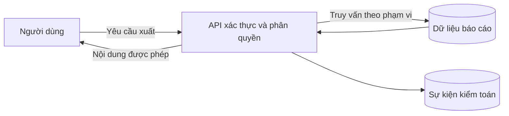
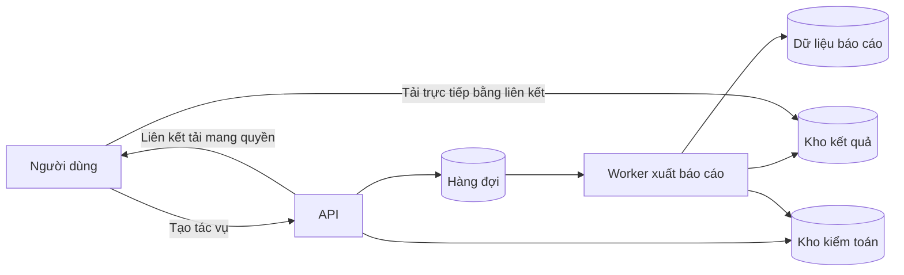
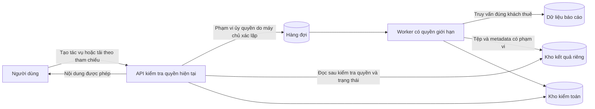

# Cập nhật threat model khi thay đổi thiết kế

## 1. Vì sao thay đổi thiết kế làm thay đổi threat model?

**Threat model — mô hình đe dọa** mô tả tài sản, chủ thể, luồng dữ liệu, ranh giới tin cậy, giả định, kịch bản gây hại và cách xử lý của một hệ thống trong phạm vi xác định. Kết luận của mô hình chỉ có ý nghĩa đối với thiết kế và những điều kiện mà nó đang mô tả.

Khi thiết kế đổi, đường gây hại có thể thay đổi dù mục tiêu nghiệp vụ vẫn giữ nguyên. Một chức năng xuất báo cáo trước đây đọc dữ liệu và trả trực tiếp qua API có thể được chuyển sang worker chạy nền, ghi tệp vào kho rồi gửi liên kết tải. Chức năng vẫn là “xuất báo cáo”, nhưng xuất hiện thêm danh tính dịch vụ, thông điệp tác vụ, bản sao dữ liệu, khoảng chờ và đường phân phối.

Vì vậy, cập nhật threat model không chỉ là vẽ thêm một ô trên sơ đồ. Cần xác định:

- Tài sản, quyền và khả năng của tác nhân nào thay đổi?
- Kiểm soát nào được thêm, chuyển vị trí, giảm hiệu lực hoặc bỏ đi?
- Giả định và kịch bản cũ nào còn đúng, phải mở lại hoặc có thể ngừng áp dụng?
- Yêu cầu và tiêu chí kiểm thử nào cần thay đổi?
- Bằng chứng trước đây còn bao phủ được phần nào của thiết kế mới?
- Trong quá trình chuyển đổi và rollback, trạng thái nào thực sự được vận hành?

Đầu ra phải giúp nhóm chuyển thay đổi thiết kế thành yêu cầu bảo mật cụ thể, đo được và kiểm chứng được. Một mô hình mới đúng về mặt dự định nhưng không khớp với cấu hình đang chạy vẫn để lại khoảng trống trong quyết định rủi ro.

## 2. Những thay đổi cần kích hoạt rà soát

Không nên dùng số dòng mã hoặc mức thay đổi giao diện làm căn cứ duy nhất. Một thay đổi nhỏ ở cách tải tệp có thể bỏ qua điểm kiểm tra quyền quan trọng.

| Loại thay đổi | Câu hỏi tác động cần đặt ra |
|---|---|
| Thêm API, webhook hoặc tích hợp | Ai tiếp cận được, dữ liệu nào chưa tin cậy, xác minh nguồn và quyền ở đâu? |
| Đổi xác thực hoặc cấp lại thông tin xác thực | Nguồn tin cậy, mức xác minh, phiên và đường khôi phục thay đổi thế nào? |
| Đổi vai trò, ủy quyền hoặc mô hình khách thuê | Quyền nào mở rộng, ranh giới nào được thêm hoặc có thể bị vượt qua? |
| Chuyển đồng bộ sang bất đồng bộ | Quyền có thể thay đổi trong thời gian chờ không; thông điệp và worker giữ phạm vi bằng cách nào? |
| Thêm kho, cache, chỉ mục hoặc bản xuất | Có bản sao mới, quyền đọc mới, thời hạn lưu mới hay đường tiết lộ mới không? |
| Đổi cách phân phối tệp | Có đường trực tiếp hoặc liên kết mang quyền nào bỏ qua chính sách hiện tại không? |
| Thu thập dữ liệu mới hoặc tăng độ chi tiết | Mức nhạy cảm, khả năng liên kết và hậu quả tiết lộ có tăng không? |
| Đổi danh tính, quyền dịch vụ hoặc cấu hình hạ tầng | Một thành phần bị chiếm quyền có tác động tới phạm vi nào? |
| Đổi nhà cung cấp hoặc vị trí xử lý | Quyền kiểm soát, phụ thuộc, bên nhận dữ liệu và bằng chứng có thay đổi không? |
| Đổi logging, giám sát hoặc phục hồi | Có mất khả năng phát hiện, truy vết hoặc khôi phục đúng trạng thái quyền không? |
| Tăng quy mô hoặc khối lượng | Cùng một điểm yếu có thể gây ảnh hưởng rộng hơn hay làm cạn tài nguyên không? |
| Sửa lỗi hoặc phát hiện sự cố | Giả định nào đã sai; cách sửa có tạo đường mới hoặc chỉ chuyển điểm yếu sang chỗ khác không? |

Thay đổi cấu hình, quyền và cờ tính năng cũng có thể làm thiết kế bảo mật đổi mà không cần sửa mã ứng dụng. Ví dụ, chuyển quyền kho tệp từ riêng tư sang cho phép đọc rộng làm thay đổi đường truy cập thực tế.

## 3. Xác định mốc thiết kế và phạm vi đánh giá

### 3.1. Phân biệt hiện tại, mục tiêu và giai đoạn chuyển đổi

Trước khi cập nhật, cần biết mô hình cũ tương ứng với phiên bản nào, cấu hình nào và tập chức năng đang bật nào. Sau đó tách ba trạng thái:

1. **Hiện tại:** thiết kế và kiểm soát thực sự đang được sử dụng, cùng bằng chứng hiện có.
2. **Mục tiêu:** thiết kế dự kiến sau khi thay đổi hoàn tất.
3. **Chuyển đổi:** các trạng thái tạm thời khi phiên bản cũ và mới cùng chạy, dữ liệu đang chuyển hoặc tác vụ cũ chưa kết thúc.

Không được dùng kiểm soát dự kiến của trạng thái mục tiêu để hạ rủi ro hiện tại. Cũng không nên chỉ mô hình hai đầu rồi mặc định quá trình chuyển giữa chúng an toàn.

### 3.2. Ghi những điều phải luôn giữ đúng

Các điều kiện an toàn cần được diễn đạt độc lập với cách triển khai. Ví dụ:

- Người dùng chỉ được đọc tài nguyên theo quyền và phạm vi khách thuê đã xác minh.
- Một thông điệp hoặc tham chiếu do bên gọi kiểm soát không tự cấp quyền cho worker.
- Hành động đặc quyền phải có căn cứ danh tính, quyền và bằng chứng tương ứng.
- Dữ liệu không được đưa vào log hoặc bản sao ngoài mục đích đã duyệt.
- Phục hồi không làm sống lại quyền hoặc ủy quyền đã bị thu hồi.

Nhờ giữ các điều kiện này rõ, nhóm có thể đánh giá việc chuyển kiểm soát từ API sang dịch vụ khác có thực sự bảo vệ cùng mục tiêu không.

Nếu muốn thay đổi một điều kiện, chẳng hạn chuyển từ kiểm tra quyền hiện tại sang cho phép liên kết mang quyền độc lập trong một khoảng thời gian, đó là thay đổi quyết định bảo mật. Cần đánh giá hậu quả và thẩm quyền, không chỉ ghi là tối ưu kỹ thuật.

### 3.3. Chọn phạm vi theo đường phụ thuộc

Thay đổi một điểm thường kéo theo nhiều nơi khác. Đổi trường khách thuê trong tác vụ có thể tác động tới API tạo, hàng đợi, worker, truy vấn, metadata kết quả, tải, log và xóa dữ liệu.

Phạm vi nên bao gồm phần thay đổi và những thành phần có thể bị ảnh hưởng qua dữ liệu, quyền hoặc trạng thái. Không cần làm lại toàn bộ mô hình nếu có thể chứng minh phần khác giữ nguyên điều kiện; cũng không nên chỉ xem tệp mã vừa sửa mà bỏ các điểm nối.

## 4. Phân tích phần thay đổi một cách có cấu trúc

### 4.1. Lập bảng trước–sau

| Thành phần đánh giá | Trước thay đổi | Sau thay đổi | Tác động cần xác minh |
|---|---|---|---|
| Tài sản và dữ liệu | Nội dung nào, có bản sao nào? | Có trường, bản sao hoặc mức liên kết mới không? | Phân loại, phạm vi đọc, lưu giữ và xóa |
| Chủ thể và danh tính | Ai gọi, ai thực thi? | Có dịch vụ, đối tác hoặc vai trò mới không? | Cấp phát, quyền, thu hồi và quy trách nhiệm |
| Luồng và giao diện | Yêu cầu đi qua đâu? | Có hàng đợi, URL trực tiếp hoặc kênh phụ không? | Xác minh nguồn, toàn vẹn, bí mật và giới hạn |
| Ranh giới tin cậy | Căn cứ tin cậy thay đổi ở đâu? | Điểm kiểm tra được chuyển hoặc bỏ không? | Kiểm soát có còn bao phủ đường gây hại? |
| Trạng thái và thời gian | Khi nào kiểm tra quyền, hết hạn, hủy? | Có khoảng chờ, thử lại hoặc nhiều phiên bản không? | Phát lại, đua trạng thái và quyền thay đổi |
| Vận hành và phục hồi | Log, giám sát và bản sao hoạt động thế nào? | Có phụ thuộc hoặc nguồn trạng thái mới không? | Phát hiện, đối soát, phục hồi đúng dữ liệu và quyền |

Nên giữ mô tả thay đổi đủ cụ thể để người khác kiểm tra. “Bảo mật không đổi” không thay thế việc chỉ ra vì sao các điểm kiểm tra, phạm vi dữ liệu và giả định vẫn giữ nguyên.

### 4.2. Rà soát giả định và khả năng tác nhân

Một thay đổi có thể làm giả định cũ sai. Ví dụ:

- Trước đây chỉ API đọc kho; nay trình duyệt có liên kết trực tiếp.
- Trước đây quyền kiểm tra và sử dụng diễn ra gần nhau; nay worker chạy sau nhiều phút.
- Trước đây không lưu tệp xuất; nay có dữ liệu tồn tại độc lập với yêu cầu.
- Trước đây một danh tính chỉ đọc một miền dữ liệu; nay dịch vụ dùng chung đọc nhiều khách thuê.

Với mỗi giả định, ghi trạng thái còn đúng, đã thay đổi hoặc cần xác minh. Xem tác nhân có thêm điểm tiếp cận, quyền hoặc khả năng phát lại nào không. Phần chưa biết không nên được tính như kiểm soát đang có hiệu lực.

### 4.3. Xử lý kịch bản cũ và mới

| Trạng thái kịch bản | Cách cập nhật |
|---|---|
| Vẫn áp dụng, kiểm soát giữ nguyên | Giữ liên kết và chỉ rõ bằng chứng còn bao phủ được gì |
| Vẫn áp dụng nhưng kiểm soát đổi vị trí | Đánh giá lại điều kiện, quyền và bằng chứng tại điểm mới |
| Trước đây đã xử lý nhưng giả định mất hiệu lực | Mở lại để đánh giá, không giữ trạng thái đạt chỉ vì lịch sử cũ |
| Phát sinh từ thành phần hoặc luồng mới | Tạo kịch bản và yêu cầu mới, có chủ sở hữu |
| Trùng một đường gây hại đã có | Liên kết hoặc hợp nhất có căn cứ, tránh đếm trùng rủi ro |
| Không còn áp dụng | Ghi điều kiện ngừng áp dụng và bằng chứng đường cũ thực sự không còn hoạt động |

Không nên xóa lịch sử của kịch bản cũ chỉ để mô hình trông gọn. Lý do từng kiểm soát tồn tại có thể rất quan trọng khi cần rollback hoặc hỗ trợ phiên bản cũ.

## 5. Quy trình cập nhật từ đề xuất tới vận hành

1. **Nhận diện thay đổi:** ghi mục tiêu, phạm vi, chủ sở hữu, mốc hiện tại và thiết kế mục tiêu.
2. **Phân tích tác động:** cập nhật tài sản, luồng, quyền, ranh giới, trạng thái và giả định.
3. **Rà soát đe dọa:** đi qua phần thay đổi và các điểm nối, xem cả giai đoạn chuyển đổi, lỗi và rollback.
4. **Cập nhật yêu cầu:** giữ mục tiêu, sửa hoặc thêm hành vi bắt buộc, ngưỡng, điều kiện lỗi và tiêu chí chấp nhận.
5. **Chọn bằng chứng:** xác định kiểm thử, cấu hình, diễn tập và độ sâu đánh giá phù hợp rủi ro.
6. **Quyết định trước mở phơi nhiễm:** xác nhận điều kiện bắt buộc, bằng chứng và phần rủi ro còn lại theo thẩm quyền.
7. **Đối chiếu sau triển khai:** kiểm tra thiết kế thực tế, cờ tính năng, quyền dịch vụ và các đường đang hoạt động.
8. **Kết thúc chuyển đổi có căn cứ:** xử lý dữ liệu và tác vụ cũ, lưu lịch sử quyết định và điều kiện cần đánh giá lại.

Quy trình có thể gọn hoặc sâu tùy tác động. Điều cần giữ là khả năng truy vết từ thay đổi đến kịch bản, yêu cầu và bằng chứng, thay vì coi cập nhật tài liệu là một bước hành chính tách khỏi thiết kế.

## 6. Ví dụ: chuyển xuất báo cáo sang xử lý nền

### 6.1. Thiết kế hiện tại

Trong hệ thống nhiều khách thuê, người dùng gọi API xuất. API xác thực, kiểm tra quyền và truy vấn đúng phạm vi, sau đó trả nội dung trong cùng luồng. Không có bản xuất được lưu độc lập sau yêu cầu theo thiết kế minh họa.



Một yêu cầu hiện có của dự án là: sau thu hồi quyền, các lần tải hoặc xuất tiếp theo không được tiếp tục được chấp nhận quá 60 giây tại những điểm thực thi thuộc phạm vi quản lý. Ngưỡng này là quyết định của ví dụ, không phải giá trị chung.

### 6.2. Thay đổi được đề xuất

Để giảm thời gian chờ, nhóm đề xuất tạo tác vụ chạy nền, ghi kết quả vào kho riêng rồi cung cấp liên kết mang quyền tải có hiệu lực 15 phút.



Giả sử liên kết này tiếp tục được chấp nhận tới hết hạn mà không kiểm tra lại quyền ứng dụng và không có cơ chế thu hồi sớm tương ứng. Khi đó, người đã mất quyền vẫn có thể tải trong khoảng còn lại của 15 phút. Thiết kế mới không đáp ứng yêu cầu thu hồi 60 giây đang có.

Đây không chỉ là vấn đề đổi thời hạn một tham số. Quyền năng đã chuyển từ phiên và quyết định ở API sang việc giữ liên kết. Mô hình phải ghi người cầm liên kết được làm gì, có thể chia sẻ không, nơi nào xác minh và cách thu hồi.

Các phương án có thể gồm giữ tải qua điểm kiểm tra quyền hiện tại, dùng một cơ chế phân phối có kiểm tra và thu hồi đáp ứng điều kiện, hoặc đề nghị thay đổi chính sách theo đúng thẩm quyền. Rút ngắn thời hạn liên kết chỉ có giá trị nếu tổng độ trễ cấp, lưu đệm, hết hạn và thu hồi thực sự nằm trong giới hạn; không thể kết luận chỉ từ tên cấu hình.

### 6.3. Thiết kế mục tiêu được chọn trong ví dụ

Giả sử nhóm giữ yêu cầu thu hồi hiện tại và chọn trả tham chiếu kết quả cho người dùng. Việc tải vẫn qua điểm kiểm tra quyền ở ứng dụng; kho kết quả không cung cấp một đường đọc độc lập cho công chúng.



Sơ đồ này vẫn cần bằng chứng về quyền kho, mã thực thi, bộ nhớ đệm và hiệu lực thu hồi. Việc đổi mũi tên chưa chứng minh đường tải trực tiếp cũ đã biến mất hoặc mọi bản sao dịch vụ đều dùng chính sách mới.

### 6.4. Những tài sản và trạng thái mới

Mô hình phải bổ sung danh tính worker, hợp đồng thông điệp, quan hệ tác vụ–người khởi tạo–khách thuê, nội dung kết quả, metadata và quy tắc lưu giữ. Đồng thời phải định nghĩa các trạng thái như chờ chạy, đang chạy, hoàn tất, thất bại, hủy, hết hạn và không còn được phục vụ.

Quyền của người khởi tạo có thể thay đổi trong các trạng thái này. Tác vụ có thể được thử lại hoặc tiếp tục sau khi dịch vụ khởi động lại. Vì vậy, không thể coi quyền lúc tạo tác vụ là quyền tồn tại vô thời hạn cho mọi bước sau.

## 7. Cập nhật danh sách đe dọa và chuỗi truy vết

| Kịch bản | Tình trạng so với mô hình cũ | Nội dung phải cập nhật | Yêu cầu liên quan |
|---|---|---|---|
| Tác vụ bị tráo khách thuê hoặc tham chiếu | Mới | Nguồn tác vụ, tính toàn vẹn và quyền worker | CH-01, CH-02 |
| Quyền thay đổi trong thời gian chờ | Mới hoặc được mở rộng | Thời điểm kiểm tra lại, hủy và quyền tải | CH-03, CH-04 |
| Liên kết mang quyền còn dùng sau thu hồi | Giả định cũ bị mất hiệu lực | Đường phân phối và ngân sách độ trễ thu hồi | CH-04, CH-05 |
| Tệp hoặc metadata kết quả lộ sai phạm vi | Mới | Quan hệ sở hữu, quyền kho, thời hạn truy cập và giữ dữ liệu | CH-02, CH-05, CH-06 |
| Hàng đợi, thử lại hoặc kết quả làm cạn tài nguyên | Mới | Giới hạn tác vụ, thời gian, dung lượng và hành vi khi chạm giới hạn | CH-08 |
| Không nối được yêu cầu với worker và lần tải | Kiểm soát cũ cần điều chỉnh | Mã sự kiện, mã tương quan, danh tính khởi tạo và thực thi | CH-07 |
| Thông điệp phiên bản cũ thiếu trường phạm vi | Chỉ xuất hiện trong chuyển đổi | Tương thích, kiểm chứng nguồn gốc và xử lý thông điệp không đủ điều kiện | CH-09 |
| Rollback làm sống lại đường tải hoặc trạng thái quyền cũ | Chỉ xuất hiện trong vận hành chuyển đổi | Phương án dừng, xử lý tác vụ, kết quả và phục hồi chính sách | CH-10, CH-11 |

Một kịch bản có thể liên quan nhiều nhóm như giả mạo, sửa đổi, tiết lộ hoặc vượt quyền. Cần theo dõi đường gây hại và hậu quả, tránh cộng cùng một sự kiện nhiều lần chỉ vì gắn nhiều nhãn.

Khi điểm kiểm tra đổi vị trí, giữ mã yêu cầu cũ hay tạo mã mới tùy quy ước quản lý của dự án. Điều quan trọng là có lịch sử về nội dung, lý do và bằng chứng; không để một mã giữ nguyên nhưng ý nghĩa âm thầm thay đổi.

## 8. Yêu cầu bảo mật dẫn xuất cho thiết kế mới

Các thời hạn và hạn mức trong bảng là **giá trị minh họa của dự án giả định**, cần được phê duyệt theo tác động và khả năng triển khai.

| Mã | Yêu cầu | Tiêu chí chấp nhận |
|---|---|---|
| CH-01 | Tác vụ phải có nguồn được phép và phạm vi do máy chủ xác lập từ ngữ cảnh đã xác minh; worker không dùng trường tự khai để mở rộng quyền. | Thử thông điệp sai nguồn, tráo khách thuê, chủ thể hoặc tham chiếu; không tạo kết quả ngoài phạm vi ủy quyền. |
| CH-02 | Worker chỉ có quyền cần để đọc dữ liệu và ghi kết quả cho luồng đã duyệt; metadata phải ràng buộc đúng tác vụ, khách thuê và nội dung phiên bản tương ứng. | Kiểm tra quyền thực tế, thử thao tác quản trị ngoài mục đích, tráo quan hệ metadata và dùng kết quả cũ cho phiên bản khác. |
| CH-03 | Phải kiểm tra quyền còn hiệu lực khi bắt đầu tác vụ và tại mỗi lần tải; nếu không xác định được quyền, hành động tương ứng phải bị từ chối hoặc chờ theo hợp đồng lỗi. | Thu hồi quyền khi tác vụ đang chờ, thay phạm vi trước tải và gây lỗi phụ thuộc quyền; không mặc định cho phép hoặc trả nội dung ngoài quyền. |
| CH-04 | Các lần tải và xuất tiếp theo dựa vào quyền đã thu hồi phải ngừng được chấp nhận trong 60 giây tại mọi điểm thực thi thuộc phạm vi quản lý, kể cả đường cũ và bộ nhớ đệm. | Thử nhiều phiên bản dịch vụ, tham chiếu cũ và trạng thái bộ nhớ đệm sau thu hồi; không điểm kiểm tra nào tiếp tục chấp nhận ngoài giới hạn. |
| CH-05 | Kho và đường phân phối không được cho người ngoài tải kết quả chỉ bằng tham chiếu hoặc liên kết độc lập với chính sách đã chọn; API tải phải kiểm tra đúng chủ thể, đối tượng và trạng thái. | Thử URL kho, đường cũ, khác tài khoản và khác khách thuê; biết mã kết quả không đủ để tải. |
| CH-06 | Kết quả chỉ được phục vụ trong 2 giờ từ lúc hoàn tất; sau hết hạn phải bị chặn tải và được loại khỏi kho hoạt động trong 15 phút, theo phạm vi bản sao được quản lý. | Tạo kết quả ở các mốc biên, kiểm tra API, kho, chỉ mục và bản sao hoạt động; phân biệt thời điểm chặn với thời điểm xóa. |
| CH-07 | Sự kiện phải nối được tạo tác vụ, thực thi và tải qua tham chiếu tin cậy; phân biệt người khởi tạo với dịch vụ thực thi, không ghi thông tin xác thực hoặc bản rõ báo cáo. | Đối chiếu thao tác thành công, bị từ chối, thử lại và lỗi; truy vết đúng mà không có bí mật trong đầu ra vận hành. |
| CH-08 | Luồng mới tối đa 2 tác vụ đang chạy mỗi khách thuê, 20 tác vụ toàn hệ thống và 60 giây xử lý mỗi lần thực hiện; mỗi tác vụ tối đa 3 lần thực hiện tính cả lần đầu. | Thử các mốc biên, lỗi lặp lại, khởi động lại worker và nhiều khách thuê; giới hạn được cưỡng chế, không tạo vòng thử vô hạn hoặc bỏ kiểm soát quyền. |
| CH-09 | Thông điệp cũ hoặc thiếu trường bắt buộc chỉ được xử lý khi có cách xác lập phạm vi tin cậy theo hợp đồng chuyển đổi; không được gán khách thuê mặc định để tiếp tục. | Đưa thông điệp cũ, thiếu hoặc mâu thuẫn thông tin vào môi trường thử; tác vụ được chuyển đổi có kiểm chứng hoặc từ chối có lý do, không chạy với quyền rộng. |
| CH-10 | Phục hồi phải áp dụng lại thu hồi quyền, hủy tác vụ và hết hạn kết quả có hiệu lực sau bản sao trước khi phục vụ tài nguyên liên quan. | Phục hồi bản sao cũ có quyền và kết quả từng hợp lệ; không làm sống lại truy cập hoặc tệp đã hết điều kiện phục vụ. |
| CH-11 | Kế hoạch dừng hoặc rollback phải xử lý tiếp nhận mới, tác vụ đang chờ/chạy, kết quả đã tạo, đường tải và tương thích dữ liệu; tắt cờ tính năng không tự được coi là đã thu hồi mọi khả năng truy cập. | Diễn tập rollback ở từng trạng thái, kiểm tra các đường và dữ liệu còn lại; không có đường bỏ qua yêu cầu đã giữ nguyên. |

CH-03 xác định thời điểm kiểm tra lại, còn chính sách cần nêu rõ tác vụ đang chạy được dừng, hoàn tất nhưng chặn tải hay xử lý theo phương án nào khi quyền đổi. Quyết định đó phải nhất quán với CH-04 và các mục tiêu liên quan, không được để mỗi worker tự suy diễn.

CH-06 không cam kết thu hồi nội dung đã được người dùng tải về hoặc bản sao ngoài quyền kiểm soát. Những hạn giữ của bản sao lưu và việc phục hồi phải được đặc tả riêng, gắn với CH-10.

CH-08 phân biệt thời gian một lần thực hiện với vòng đời tác vụ. Nếu còn thời gian chờ tối đa, hạn giữ kết quả hoặc ngân sách tổng tài nguyên, phải xác định thêm thay vì coi giới hạn một lần xử lý là đủ.

### 8.1. Ví dụ chuỗi truy vết cho yêu cầu thu hồi

```text
Thay đổi: trả nội dung đồng bộ → tạo tệp nền và đổi đường tải.
Tài sản: dữ liệu báo cáo và quyền tải hiện hành.
Giả định bị ảnh hưởng: mọi lần tải đều đi qua điểm kiểm tra quyền hiện tại.
Kịch bản: người đã mất quyền vẫn tải bằng đường độc lập còn hiệu lực.
Rủi ro: tiếp tục tiết lộ dữ liệu sau khi đã quyết định thu hồi.
Yêu cầu: CH-03, CH-04, CH-05.
Thiết kế chọn: tải qua điểm thực thi quyền; kho không mở đường đọc độc lập.
Bằng chứng: thử quyền đổi, đường cũ, nhiều phiên bản, bộ nhớ đệm và cấu hình kho.
Phần còn lại: dữ liệu đã được tải hoặc sao chép trước khi thu hồi.
```

Chuỗi này giúp người đánh giá hiểu vì sao thay đổi đường tải đòi hỏi kiểm chứng lại, dù mã kiểm tra vai trò ở API tạo tác vụ không đổi.

## 9. Mô hình hóa giai đoạn chuyển đổi và rollback

### 9.1. Khi phiên bản cũ và mới cùng hoạt động

Trong triển khai từng phần, người dùng có thể gọi API cũ trong khi worker mới xử lý, hoặc API mới tạo thông điệp mà worker cũ nhận. Các kết hợp này phải nằm trong mô hình chuyển đổi nếu có thể xảy ra.

| Kết hợp hoặc trạng thái | Câu hỏi cần kiểm tra |
|---|---|
| API cũ với worker mới | Có đủ thông tin tin cậy để xác lập chủ thể và phạm vi không? |
| API mới với worker cũ | Worker có bỏ qua trường kiểm soát mới hoặc diễn giải sai hợp đồng không? |
| Tác vụ cũ còn trong hàng đợi | Quyền và thời hạn của người khởi tạo có còn hiệu lực không? |
| Kết quả từ nhiều phiên bản cùng tồn tại | Tải, hết hạn, xóa và metadata có được áp dụng nhất quán không? |
| Đường tải cũ còn được định tuyến | Có bỏ qua điểm kiểm tra mới hoặc yêu cầu thu hồi đang giữ không? |
| Bộ nhớ đệm chưa nhận thay đổi | Khoảng trễ thực tế có nằm trong giới hạn không? |

Tác nhân có thể tìm đường yếu nhất còn hoạt động. Vì vậy, không thể đánh giá thiết kế chuyển đổi chỉ bằng kiểm soát mạnh nhất của phiên bản mới.

Thông điệp thiếu dữ liệu không được tự động gán phạm vi rộng hoặc khách thuê mặc định để tăng tương thích. Có thể chuyển đổi bằng dữ liệu máy chủ đã được kiểm chứng, tách hàng đợi theo hợp đồng hoặc dừng và tạo lại tác vụ theo kế hoạch. Phương án phải có bằng chứng về nguồn gốc và quyền.

### 9.2. Tắt cờ tính năng không xóa mọi trạng thái đã tạo

Một cờ có thể chỉ ẩn giao diện hoặc ngừng nhận yêu cầu mới. Tác vụ đang chờ, worker, URL đã phát hành, tệp và bản sao có thể vẫn tồn tại.

Kế hoạch dừng cần xác định hiệu lực tại từng điểm: nơi nhận, nơi chạy, nơi ghi, nơi tải và nơi dọn dữ liệu. Với mỗi trạng thái, quyết định cho phép hoàn tất, hủy, cách ly, chặn phục vụ hoặc xóa theo điều kiện đã duyệt.

Không được mặc định rằng mọi dữ liệu sau khi tắt đều phải xóa ngay. Có thể cần giữ bằng chứng hoặc trạng thái điều tra trong kho hạn chế. Phải phân biệt dừng phục vụ, giữ điều tra và xóa dữ liệu, cùng quyền và thời hạn tương ứng.

### 9.3. Rollback cũng là một thay đổi thiết kế

Rollback mã không tự rollback cấu trúc dữ liệu, quyền dịch vụ, tệp, phiên hoặc trạng thái hàng đợi. Phiên bản cũ có thể không hiểu dữ liệu mới, hoặc có thể mở lại một đường từng bị đóng để đáp ứng yêu cầu bảo mật.

Cần xác định trước:

- Trạng thái nào là điểm quay lại hợp lệ và còn đáp ứng các điều kiện an toàn hiện hành?
- Các tác vụ đang chạy hoặc đã hoàn tất sẽ được xử lý ra sao?
- Cấu hình và quyền nào phải đổi cùng mã, theo thứ tự nào?
- Có phải giữ cơ chế kiểm tra mới trong khi quay lại một phần chức năng cũ không?
- Cách đối soát dữ liệu, log và quyết định thu hồi sau rollback là gì?
- Nếu không có đường quay lại an toàn, phương án giữ, dừng hoặc tiến tiếp có kiểm soát là gì?

Không nên quay lại một phiên bản có điểm yếu đã được xác nhận mà không có phương án xử lý đáp ứng điều kiện bắt buộc. Lịch sử mô hình giúp biết vì sao một đường cũ không còn phù hợp, thay vì coi phiên bản cũ luôn đáng tin vì từng vận hành.

## 10. Cập nhật bằng chứng và kế hoạch kiểm chứng

### 10.1. Xác định bằng chứng nào còn hiệu lực

Bằng chứng cần được nối với phiên bản, cấu hình, giả định và phạm vi đã kiểm tra. Khi thiết kế đổi, có thể phân loại như sau:

| Tình trạng bằng chứng | Cách xử lý |
|---|---|
| Còn đúng phạm vi và điều kiện | Giữ tham chiếu, ghi căn cứ không bị ảnh hưởng |
| Chỉ bao phủ một phần | Giữ phần có ích và bổ sung đúng các điểm nối hoặc đường mới |
| Phụ thuộc giả định đã thay đổi | Yêu cầu xác minh lại trước khi dùng để kết luận |
| Thuộc thành phần đã ngừng hoạt động | Lưu lịch sử, không dùng như bằng chứng cho thành phần thay thế |
| Chưa có cho thiết kế mới | Ghi khoảng trống, chủ sở hữu và điều kiện cần đạt trước mở phạm vi liên quan |

Ví dụ, kiểm thử phân quyền API tạo yêu cầu có thể vẫn đúng nhưng chưa bao phủ nguồn thông điệp, quyền worker và tải kết quả. Kiểm tra tải cũ không chứng minh cấu hình kho mới không cho đọc trực tiếp.

Không cần chạy lại mọi kiểm tra vì mọi thay đổi nhỏ. Cần chọn dựa trên quan hệ phụ thuộc, độ bất định và tác động. Nếu chưa chứng minh được phần nào không ảnh hưởng, phải ghi rõ thay vì bỏ qua chỉ vì mã của phần đó không đổi.

### 10.2. Ma trận kiểm chứng cho thay đổi ví dụ

| Nhóm kiểm chứng | Trường hợp trọng tâm | Bằng chứng cần thu |
|---|---|---|
| Chức năng hợp lệ | Người đủ quyền tạo, chạy và tải đúng báo cáo | Kết quả đúng nội dung và phạm vi qua từng giai đoạn |
| Phân quyền phủ định | Tráo tài khoản, khách thuê, tác vụ, kết quả và chủ sở hữu | Không có nội dung hoặc tác dụng phụ ngoài quyền |
| Quyền thay đổi | Thu hồi trước chạy, trước tải và khi có bộ nhớ đệm | Thời gian hiệu lực thực tế, không chỉ trạng thái quản trị |
| Tính toàn vẹn | Thông điệp sai nguồn, tham chiếu bị đổi và kết quả cũ | Từ chối hoặc xử lý đúng phạm vi, không đổi quan hệ sai |
| Tương thích | Các tổ hợp API, thông điệp và worker còn được hỗ trợ | Không có cơ chế mặc định mở quyền để duy trì tương thích |
| Lỗi phụ thuộc | Lỗi quyền, kho, hàng đợi hoặc ghi sự kiện | Hành vi lỗi đúng hợp đồng, không tự bỏ kiểm soát |
| Tài nguyên | Nhiều tác vụ, quá hạn, thử lại và đầy dung lượng | Giới hạn và hành vi giảm tải theo các điểm đo đã chọn |
| Dữ liệu tồn tại | Hết hạn truy cập, xóa kho hoạt động và bản sao | Phân biệt rõ các mốc, quyền và phạm vi đã xử lý |
| Chuyển đổi và rollback | Dừng ở lúc chờ, đang chạy, hoàn tất và có đường cũ | Các đường còn lại không làm mất điều kiện an toàn |
| Phục hồi | Khôi phục bản sao trước thu hồi hoặc trước hết hạn | Áp dụng lại quyết định hiện hành trước phục vụ |

Kiểm thử phải kiểm tra trạng thái lưu và nội dung, không chỉ mã lỗi. Một yêu cầu trả lỗi sau khi đã tạo tệp sai khách thuê vẫn là vi phạm. Cần đối chiếu danh tính dịch vụ và cấu hình thật, vì một mô hình đúng không tự bảo đảm quyền triển khai đúng.

### 10.3. Đặt điều kiện trước mở chức năng

Đối với phần có tác động lớn, cần xác định điều kiện bắt buộc, bằng chứng và người xác nhận trước khi mở phơi nhiễm tương ứng. Việc mã đã được tích hợp nhưng luồng còn bị giới hạn không đồng nghĩa đã được phép phục vụ dữ liệu thật qua mọi đường.

Có thể cần rà soát độc lập, kiểm thử đối kháng hoặc diễn tập lỗi tùy rủi ro. Phạm vi phải cụ thể: ai đánh giá, trên phiên bản và cấu hình nào, còn khoảng trống gì.

Nếu thiếu bằng chứng, có thể tiếp tục công việc độc lập, thử với dữ liệu tổng hợp hoặc phạm vi hẹp được duyệt. Không nên mặc định rủi ro thấp vì thiết kế mới chưa có sự cố.

## 11. Lưu lịch sử thay đổi và trạng thái thực tế

Một hồ sơ cập nhật nên giúp người khác xác định mô hình nào đang mô tả hệ thống đang chạy, mô hình nào còn là đề xuất và kịch bản nào cần kiểm chứng lại.

Ví dụ nội dung hồ sơ, không phải tệp cấu hình hay phê duyệt thực tế:

```yaml
change_id: CHANGE-REPORT-ASYNC-01
status: proposed
current_model_revision: model-r4
target_model_revision: model-r5-proposed
scope:
  - report_export_creation
  - job_execution
  - result_storage_and_download
  - retirement_and_rollback_paths
security_conditions_retained:
  - tenant_isolation
  - permission_revocation_within_60_seconds
  - no_uncontrolled_result_download
changed_assumptions:
  - export_result_now_persists_after_request
  - requester_permissions_may_change_before_execution
  - worker_introduces_a_separate_service_identity
required_evidence:
  - scoped_job_authorization_tests
  - permission_change_and_download_tests
  - deployed_storage_and_service_permissions_review
  - mixed_version_and_rollback_exercise
decision_state: evidence_and_authorized_review_required
owners:
  design: reporting_architecture_owner
  implementation: reporting_team
  operations: platform_operations
  risk: product_risk_owner
```

Các mã và phiên bản chỉ để minh họa cách ghi nhận. Chúng không khẳng định có hồ sơ hoặc kết quả tương ứng trong một hệ thống thật.

Khi triển khai, cần gắn bản phát hành và cấu hình thực tế với mô hình phù hợp. Nếu một phần đã mở trong khi phần khác còn chuyển đổi, hồ sơ cần thể hiện trạng thái hỗn hợp thay vì đánh dấu toàn bộ đã hoàn tất.

Điều kiện kết thúc chuyển đổi có thể gồm không còn phiên bản cũ phục vụ, tác vụ cũ đã xử lý theo kế hoạch, đường cũ đã đóng, kết quả và bản sao còn lại có chính sách rõ, bằng chứng mới đã có và rủi ro còn lại đã được quyết định. Mỗi điều kiện phải dựa trên quan sát hoặc kiểm tra có căn cứ.

## 12. Phân công trách nhiệm và giữ công việc tương xứng

Chủ sở hữu sản phẩm hoặc nghiệp vụ xác định mục tiêu và hậu quả chấp nhận được. Người thiết kế và phát triển làm rõ luồng, quyền, hợp đồng và phương án. Người kiểm thử xác định trường hợp phủ định, trạng thái và bằng chứng. Người vận hành cung cấp cấu hình, quyền thực tế, giám sát, chuyển đổi và phục hồi. Người làm bảo mật hỗ trợ phân tích ranh giới và mức đảm bảo.

Quyết định chấp nhận rủi ro còn lại cần đúng thẩm quyền. Người sửa sơ đồ hoặc người viết mã không mặc nhiên có quyền thay đổi yêu cầu thu hồi hay chấp nhận tiết lộ chéo khách thuê.

Mức rà soát nên tương xứng với tác động:

- Với thay đổi đã chứng minh không đổi tài sản, quyền, luồng hay giả định an toàn, có thể ghi căn cứ ngắn và giữ các liên kết còn hiệu lực.
- Với thay đổi cục bộ có ranh giới rõ, cập nhật phần liên quan và kiểm tra các điểm nối.
- Với thay đổi làm tăng phơi nhiễm, mở đặc quyền, thêm bản sao nhạy cảm hoặc đổi mô hình tin cậy, cần phân tích sâu hơn và bằng chứng tương ứng.

Không nên coi mọi thay đổi đều cần một tài liệu hoàn toàn mới. Cũng không nên miễn rà soát chỉ vì thay đổi được gọi là refactor, tối ưu hoặc cấu hình. Cần nhìn tác động thực tế tới điều kiện an toàn.

Một số dấu hiệu cần chú ý là kịch bản mở lại chưa có chủ sở hữu, giả định quan trọng chưa xác minh, bằng chứng không khớp phiên bản và đường cũ tồn tại lâu hơn kế hoạch. Chúng giúp nhận ra khoảng trống cần xử lý, không tự tạo thành một điểm số chứng minh hệ thống an toàn.

## 13. Sai lầm thường gặp

| Sai lầm | Hậu quả | Cách làm rõ |
|---|---|---|
| Chỉ sửa sơ đồ thành phần | Yêu cầu, đe dọa và bằng chứng vẫn theo thiết kế cũ | Cập nhật cả chuỗi truy vết và trạng thái quyết định |
| Chỉ xem phần mã vừa thay | Bỏ điểm nối về quyền, dữ liệu và vận hành | Mở phạm vi theo đường phụ thuộc có thể bị ảnh hưởng |
| Tính kiểm soát mục tiêu như đã có | Rủi ro hiện tại bị trình bày thấp hơn thực tế | Tách hiện tại, mục tiêu và giai đoạn chuyển đổi |
| Giữ trạng thái đã xử lý cho kịch bản có giả định sai | Điểm yếu cũ có thể quay lại mà không được nhận ra | Mở lại theo điều kiện và bằng chứng mới |
| Dùng tương thích làm lý do gán phạm vi mặc định | Thông điệp cũ có thể chạy với quyền quá rộng | Chuyển đổi bằng nguồn tin cậy hoặc từ chối có kiểm soát |
| Coi tắt cờ là thu hồi mọi kết quả | Tác vụ, tệp và liên kết vẫn hoạt động | Xác định hiệu lực tại từng điểm và từng trạng thái |
| Coi rollback chỉ là đổi mã | Dữ liệu, quyền và đường tải có thể không quay lại an toàn | Diễn tập toàn trạng thái và kiểm tra điều kiện hiện hành |
| Dùng kiểm thử cũ cho mọi phần mới | Bỏ sót kho, worker, đường tải và trạng thái lỗi | Xác định phần bằng chứng còn hiệu lực và phần phải bổ sung |
| Xóa lịch sử kịch bản không còn áp dụng | Mất lý do kiểm soát và khó đánh giá rollback | Lưu điều kiện ngừng áp dụng cùng bằng chứng |

## 14. Đầu ra cần có sau một lần cập nhật

Nhóm cần bàn giao được:

1. **Mốc và phạm vi:** thiết kế hiện tại, mục tiêu, trạng thái chuyển đổi và phần bị ảnh hưởng.
2. **Phân tích trước–sau:** tài sản, dữ liệu, danh tính, quyền, luồng, ranh giới và giả định.
3. **Kịch bản được cập nhật:** mới, giữ nguyên, mở lại, hợp nhất hoặc ngừng áp dụng có căn cứ.
4. **Yêu cầu và kiến trúc:** hành vi bắt buộc, điều kiện lỗi, ngưỡng và điểm thực thi phù hợp thiết kế mới.
5. **Bằng chứng:** phần còn hiệu lực, khoảng trống, kiểm thử và diễn tập phải bổ sung.
6. **Kế hoạch chuyển đổi:** phiên bản song song, dữ liệu tồn tại, dừng, rollback và phục hồi.
7. **Quyết định và trách nhiệm:** chủ sở hữu, người có thẩm quyền, phần rủi ro còn lại và tác nhân cần xem lại.

Cập nhật threat model giúp giữ mối liên hệ giữa mục tiêu an toàn và hệ thống thực sự đang được xây dựng, triển khai, vận hành. Khi thay đổi được nối với đe dọa, yêu cầu và bằng chứng, nhóm có thể xác định điều gì vẫn đúng, điều gì phải kiểm chứng lại và điều kiện nào cần giữ vững trong suốt quá trình chuyển đổi.
