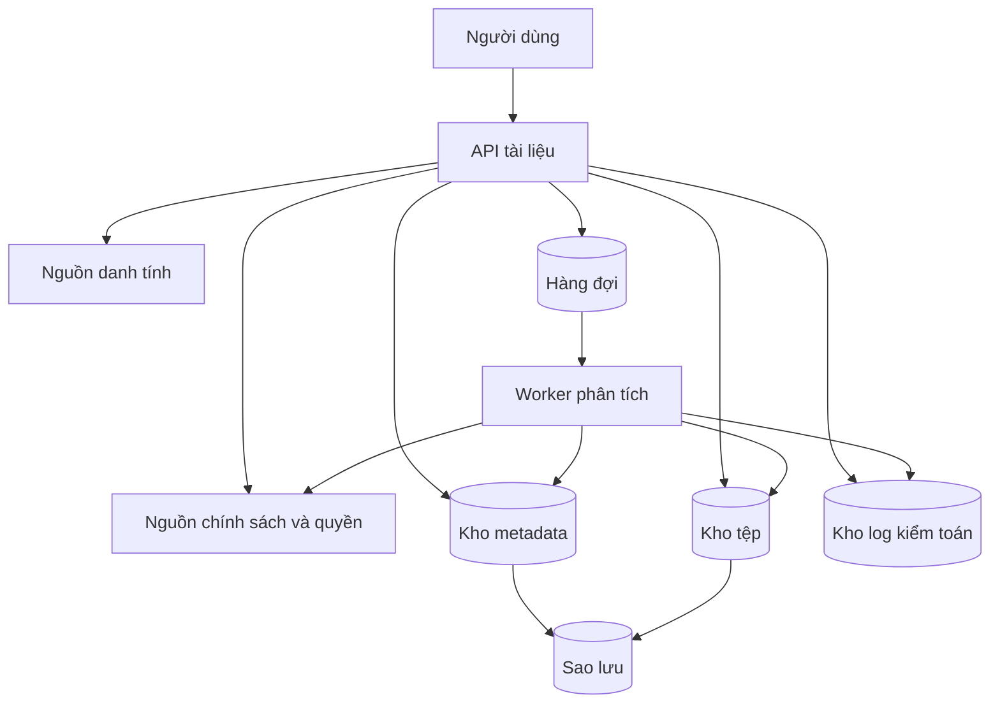

# Security architecture requirement

## 1. Yêu cầu kiến trúc bảo mật là gì?

**Security architecture requirement — yêu cầu kiến trúc bảo mật** là yêu cầu xác định những thuộc tính, ràng buộc và trách nhiệm bảo vệ mà cấu trúc hệ thống phải đáp ứng. Nó ảnh hưởng đến cách phân chia thành phần, bố trí điểm kiểm soát, cấp quyền, quản lý dữ liệu và vận hành hệ thống.

Ví dụ:

> Mọi đường đọc tài liệu phải kiểm tra quyền trên tenant và đối tượng trước khi trả nội dung; trình duyệt không được có đường truy cập kho bỏ qua quyết định này.

Yêu cầu trên ảnh hưởng đồng thời API, dịch vụ nghiệp vụ, kho tệp, danh tính dịch vụ và cấu hình truy cập. Một kiểm tra ở giao diện không đủ đáp ứng.

Trong thiết kế bảo mật, chuỗi công việc cần có là:

**Mục tiêu và tài sản → kịch bản đe dọa → yêu cầu kiến trúc → quyết định thiết kế → phân bổ kiểm soát → bằng chứng kiểm chứng.**

Bài học giúp bạn:

- Nhận diện những yêu cầu bảo mật có ảnh hưởng đến kiến trúc.
- Phân biệt yêu cầu với cơ chế, quyết định thiết kế và cấu hình triển khai.
- Viết yêu cầu có phạm vi, điều kiện lỗi và tiêu chí đo rõ ràng.
- Phân bổ trách nhiệm giữa các thành phần mà vẫn giữ thuộc tính bảo vệ đầu cuối.
- Liên kết yêu cầu với rủi ro, kiến trúc, kiểm thử và vận hành.

Các mã, tình huống và mốc thời gian trong bài là giả định để minh họa. Chúng cần được đánh giá theo nghiệp vụ trước khi áp dụng.

## 2. Phân biệt mục tiêu, yêu cầu, quyết định và cấu hình

| Thành phần | Câu hỏi | Ví dụ |
|---|---|---|
| Mục tiêu bảo mật | Cần bảo vệ điều gì? | Không để doanh nghiệp này đọc tài liệu doanh nghiệp khác |
| Kịch bản đe dọa | Điều gì có thể phá vỡ mục tiêu? | Người dùng đổi mã tài liệu hoặc dùng một đường tải trực tiếp |
| Yêu cầu bảo mật | Hệ thống phải làm gì và khi nào được coi là đạt? | Kiểm tra danh tính, tenant và quyền đối tượng trước mọi lần đọc |
| Yêu cầu có ý nghĩa kiến trúc | Cấu trúc và sự phối hợp phải bảo đảm thuộc tính nào? | Mọi đường truy cập, kể cả tác vụ nền và phục hồi, phải giữ cùng phạm vi quyền |
| Quyết định kiến trúc | Chọn cách tổ chức nào để đáp ứng? | Chính sách có nguồn có thẩm quyền, được thực thi tại API và worker |
| Cơ chế | Thực hiện quyết định bằng phương pháp nào? | Kiểm tra quyền theo vai trò, thuộc tính và phạm vi đối tượng |
| Cấu hình hoặc mã | Biểu diễn cụ thể trong triển khai ra sao? | Quyền danh tính dịch vụ, quy tắc kho và các điểm kiểm tra trong mã |
| Bằng chứng | Vì sao tin yêu cầu được đáp ứng? | Kiểm thử hành vi, đối chiếu cấu hình và xem xét đường thay thế |

Không phải mọi yêu cầu kiến trúc đều là một câu “phi chức năng”. Quy tắc chức năng như “chỉ người được phân công mới được phê duyệt” có thể tác động đến danh tính, trạng thái, lưu trữ và giao dịch giữa nhiều thành phần.

Ngược lại, tên một sản phẩm hoặc một cơ chế không tự là yêu cầu đầy đủ. “Dùng gateway”, “bật mã hóa” hoặc “có log” vẫn cần giải thích phạm vi, hành vi, nguồn thẩm quyền và cách kiểm chứng.

### 2.1. Khi nào một yêu cầu có ý nghĩa kiến trúc?

Một yêu cầu thường cần được xử lý ở cấp kiến trúc nếu:

- Ảnh hưởng nhiều thành phần hoặc nhiều nhóm.
- Đi qua ranh giới tin cậy, tenant hoặc tổ chức.
- Thay đổi cách phân chia quyền và dữ liệu.
- Cần phối hợp trạng thái, thời gian hoặc lỗi phụ thuộc.
- Tạo ràng buộc lớn về vận hành, phục hồi hoặc triển khai.
- Nếu phát hiện muộn sẽ cần thay đổi cấu trúc đáng kể.
- Có hậu quả lớn hoặc cần mức bằng chứng cao.

Ví dụ, thu hồi quyền trong 5 phút có thể tác động đến bộ nhớ đệm, token, tác vụ đang chờ, API tải và quá trình phát hành chính sách. Không thể giao riêng cho màn hình quản trị quyền rồi coi như đã hoàn thành.

### 2.2. Tránh mô tả quá mơ hồ hoặc chốt công nghệ quá sớm

Một yêu cầu tốt cần đủ rõ để kiểm chứng, đồng thời cho phép cân nhắc phương án phù hợp.

| Cách viết chưa đủ | Cách làm rõ |
|---|---|
| Hệ thống phải an toàn | Nêu tài sản, hành vi trái phép và thuộc tính phải giữ |
| Phải dùng firewall | Nêu đường kết nối được phép, danh tính và thao tác phải bị chặn |
| Phải dùng mã hóa | Nêu dữ liệu, đường truyền, bản lưu, quyền dùng khóa và hồ sơ cơ chế áp dụng |
| Phải dùng một dịch vụ phân quyền | Nêu tính nhất quán, nguồn chính sách, điểm thực thi và xử lý khi không có quyết định |
| Phải có dự phòng | Nêu kịch bản lỗi, mục tiêu phục hồi và tiêu chí nghiệp vụ hoạt động trở lại |

Một công nghệ có thể là ràng buộc hợp lệ nếu tổ chức đã có căn cứ bắt buộc. Khi đó cần ghi nguồn ràng buộc, lý do và ảnh hưởng, thay vì trình bày nó như mục tiêu bảo mật tự thân.

## 3. Đầu vào để hình thành yêu cầu kiến trúc

### 3.1. Tài sản và phân loại dữ liệu

Cần biết dữ liệu nào được bảo vệ, ai sở hữu và nó đi đâu:

- Dữ liệu chính, metadata và dữ liệu suy ra.
- Log, tệp xuất, bản sao và môi trường thử nghiệm.
- Danh tính, thông tin xác thực và khóa.
- Cấu hình, chính sách quyền và thông tin phục hồi.

Mức nhạy cảm khi tiết lộ không thay cho đánh giá toàn vẹn và sẵn sàng. Tài liệu công khai có thể vẫn cần kiểm soát chặt người sửa và khả năng phục hồi phiên bản đúng.

### 3.2. Luồng dữ liệu, danh tính và ranh giới tin cậy

Một mô hình kiến trúc cần trả lời:

- Ai gửi yêu cầu và nguồn nào xác nhận danh tính?
- Thành phần nào dùng quyền của người dùng, thành phần nào dùng quyền dịch vụ?
- Dữ liệu thuộc tenant và đối tượng nào?
- Ở đâu dữ liệu được diễn giải, sao chép hoặc đưa sang quyền rộng hơn?
- Thành phần nào có thể thay đổi chính sách hoặc đọc trực tiếp?
- Có đường đi vòng qua kho, công cụ hỗ trợ hoặc phục hồi không?

Cùng một mạng nội bộ không tự tạo cùng mức tin cậy. Một tệp trong kho nội bộ vẫn có thể là đầu vào chưa tin cậy nếu bắt nguồn từ người dùng.

### 3.3. Đe dọa và đường dẫn đến hậu quả

Yêu cầu cần nối với kịch bản có ý nghĩa:

> Người dùng tenant A thay mã đối tượng; nếu API chỉ kiểm tra đăng nhập, dữ liệu tenant B có thể được trả về.

Từ kịch bản đó, yêu cầu không chỉ là “cần xác thực”. Cần phân quyền trên hành động, tenant, đối tượng và đầu ra, tại các đường thực sự có thể cung cấp dữ liệu.

Tương tự, nếu worker có thể phân tích tệp do người dùng gửi, kiến trúc cần xét quyền tài nguyên, giới hạn xử lý, khả năng kết nối và tác động khi parser gặp lỗi.

### 3.4. Mục tiêu nghiệp vụ, vận hành và nghĩa vụ áp dụng

Các đầu vào khác gồm:

- Mức gián đoạn và mất dữ liệu được chấp nhận.
- Thời gian thu hồi quyền, phản ứng và xử lý sự cố.
- Yêu cầu lưu giữ, xóa và phạm vi chia sẻ.
- Cam kết với khách hàng và các nghĩa vụ thực tế.
- Khả năng vận hành, năng lực đội ngũ và nguồn lực.
- Mức đảm bảo cần có trước quyết định phát hành.

Một kiến trúc chỉ đáp ứng trong điều kiện mọi phụ thuộc đều hoạt động chưa đủ. Cần xét cả lỗi, thay đổi, sự cố và phục hồi.

## 4. Cách đặc tả một yêu cầu kiến trúc bảo mật

### 4.1. Thành phần tối thiểu

| Thành phần | Nội dung |
|---|---|
| Mã và mục đích | Định danh yêu cầu và rủi ro cần xử lý |
| Phạm vi | Dữ liệu, hành động, thành phần, môi trường và người dùng |
| Điều kiện | Sự kiện hoặc trạng thái làm yêu cầu có hiệu lực |
| Hành vi bắt buộc | Điều phải xảy ra hoặc phải bị ngăn |
| Ràng buộc | Giới hạn quyền, đường đi, thời gian, dữ liệu hoặc tài nguyên |
| Xử lý lỗi | Điều xảy ra khi thiếu danh tính, chính sách, log hoặc phụ thuộc |
| Trách nhiệm | Ai triển khai, vận hành, phê duyệt và kiểm chứng |
| Tiêu chí đạt | Kết quả có thể quan sát để kết luận |
| Bằng chứng | Thiết kế, cấu hình, kiểm thử hoặc diễn tập cần lưu |
| Giả định và giới hạn | Điều kiện cần đúng và phần chưa được yêu cầu bao phủ |

Một khuôn diễn đạt:

> Với [tài sản và phạm vi], khi [điều kiện], [hệ thống hoặc vai trò] phải [hành vi]. Giới hạn là [quyền, đường đi, thời gian hoặc ngưỡng]. Khi [lỗi], phải [phản ứng]. Kiểm chứng bằng [phương pháp], đạt khi [kết quả].

### 4.2. Mô tả theo tình huống chất lượng

Cách viết theo tình huống giúp làm rõ thuộc tính kiến trúc:

| Thành phần | Ví dụ |
|---|---|
| Nguồn kích thích | Người dùng có phiên hợp lệ nhưng đã bị thu hồi quyền |
| Kích thích | Gửi yêu cầu đọc tài liệu bằng phiên cũ |
| Điều kiện môi trường | Dịch vụ đang hoạt động, có bộ nhớ đệm quyền |
| Phạm vi chịu tác động | API đọc, API tải và các điểm thực thi liên quan |
| Phản ứng | Không cấp lần đọc mới theo quyền đã thu hồi |
| Mức đo | Trong tối đa 5 phút từ khi hệ thống quản lý quyền tiếp nhận quyết định hợp lệ |

Khoảng 5 phút là ví dụ. Cần đo toàn bộ đường truyền quyết định, cập nhật chính sách, bộ nhớ đệm và thực thi. Đặt thời hạn bộ nhớ đệm nhỏ hơn 5 phút chưa tự chứng minh yêu cầu đầu cuối đạt.

### 4.3. Phân biệt yêu cầu bắt buộc và quyết định điều chỉnh

Các yêu cầu bắt buộc cần có nguồn và tiêu chí rõ. Nếu cần điều chỉnh, phải ghi sai lệch, rủi ro, phương án và người có thẩm quyền.

Chấp nhận rủi ro không làm yêu cầu chưa đạt trở thành đã đạt. Mức mục tiêu sau triển khai cũng phải được phân biệt với kết quả đã kiểm chứng.

## 5. Tình huống minh họa: quản lý tài liệu nhiều tenant

### 5.1. Bối cảnh và mục tiêu

Hệ thống cho nhiều doanh nghiệp lưu, đọc và xử lý tài liệu. Mỗi doanh nghiệp là một **tenant**. Người dùng có thể tải tệp, xem metadata và yêu cầu tác vụ phân tích nền.

Tập tài liệu **DOC-ARCH-001** có thể chứa thông tin nhạy cảm. Chủ sở hữu dữ liệu xác nhận mục đích, người được sử dụng và phạm vi đầu ra. Nhóm ứng dụng, nền tảng và vận hành có trách nhiệm kỹ thuật theo phân công.

Mục tiêu bảo vệ:

- Người dùng chỉ đọc hoặc thay đổi tài liệu trong phạm vi được cấp.
- Tác vụ nền không dùng quyền dịch vụ để vượt quyền nghiệp vụ.
- Nội dung tệp không làm worker có hành vi ngoài thiết kế.
- Log, bản sao và phục hồi không tạo đường truy cập rộng hơn.
- Khi có lỗi, hệ thống giữ giới hạn quyền và phục hồi trong mục tiêu đã duyệt.

### 5.2. Sơ đồ quan hệ thành phần



Mũi tên biểu diễn quan hệ sử dụng hoặc chuyển dữ liệu chính. Sơ đồ không thay cho DFD chi tiết, sơ đồ triển khai hoặc mô hình đường quản trị; các tài liệu đó cần bổ sung hướng phản hồi, danh tính, dữ liệu và ranh giới tương ứng.

Thiết kế minh họa chọn truy cập tệp qua API có kiểm tra quyền. Nếu dùng cơ chế tải khác, chẳng hạn một đường dẫn mang quyền tải tạm thời, phải đặc tả lại phạm vi, thời hạn, khả năng chuyển tiếp và thu hồi của đường đó.

### 5.3. Phân biệt các mặt hoạt động

| Mặt hoạt động | Nội dung | Rủi ro cần chú ý |
|---|---|---|
| Xử lý dữ liệu | Đọc, ghi, tải tệp, tìm kiếm và tác vụ nền | Trả sai tenant, trường thừa, xử lý đầu vào không phù hợp |
| Điều khiển bảo vệ | Danh tính, chính sách, quyền, khóa và cấu hình bảo mật | Thay nguồn thẩm quyền, mở quyền hoặc làm vô hiệu kiểm soát |
| Quản trị và vận hành | Triển khai, hỗ trợ, sao lưu, phục hồi và xử lý sự cố | Đường truy cập đặc quyền bỏ qua giới hạn thông thường |

Một tài khoản chỉ cần vận hành worker không mặc nhiên cần sửa chính sách, quản trị khóa hoặc xóa log. Các mặt hoạt động có thể nằm trên cùng nền tảng, nhưng trách nhiệm và quyền vẫn cần phân biệt.

## 6. Bộ yêu cầu kiến trúc minh họa

### 6.1. Danh tính và phân quyền

**AR-ID-01 — Danh tính riêng cho người và dịch vụ.** Mọi thao tác được bảo vệ phải gắn với danh tính được kiểm chứng. API, worker và thành phần quản trị sử dụng danh tính với phạm vi riêng; không dùng một thông tin xác thực quản trị chung cho mọi thành phần. Thao tác quản trị quyền phải dùng danh tính cá nhân và xác thực đa yếu tố theo chính sách tình huống.

**Điểm phân bổ:** nguồn danh tính, API, worker, cấu hình nền tảng và đường quản trị.

**Kiểm chứng:** thử phiên thiếu điều kiện, danh tính sai phạm vi và quyền dịch vụ trên các tài nguyên không được phép. Đối chiếu cả quyền trong cấu hình, không chỉ luồng giao diện.

**AR-AUTHZ-01 — Kiểm soát mọi đường truy cập trong phạm vi.** Mỗi thao tác đọc, sửa, tìm kiếm, tải hoặc tạo tác vụ phải kiểm tra chủ thể, hành động, tenant, đối tượng và tập dữ liệu liên quan từ nguồn có thẩm quyền. Quyền gọi chức năng không tự bao gồm quyền trên mọi đối tượng.

**Điểm phân bổ:** API, dịch vụ nghiệp vụ, worker, chính sách kho và các đường truy cập thay thế.

**Kiểm chứng:** dùng tài khoản và tenant giả định; đổi mã đối tượng, trộn tenant trong yêu cầu theo lô, thử quan hệ mở rộng và đường trực tiếp. Không có dữ liệu ngoài phạm vi được trả hoặc bị thay đổi.

### 6.2. Chính sách và thay đổi quyền

**AR-POLICY-01 — Nguồn chính sách nhất quán và có phiên bản.** Các điểm thực thi phải dùng chính sách được phát hành từ nguồn có thẩm quyền, có phiên bản và phạm vi. Quyền hoặc tenant tự khai từ máy khách không được dùng làm căn cứ duy nhất.

Khi không thể xác minh một quyết định hợp lệ, không được mặc định cho phép. Tình huống cho phép dùng chính sách lưu đệm tối đa 60 giây từ lần xác nhận hợp lệ; bộ nhớ đệm quá hạn không được tự gia hạn bằng trạng thái cũ.

**Kiểm chứng:** làm mất kết nối nguồn chính sách trong môi trường thử, dùng bản quá hạn và phiên bản không đúng. Đối chiếu quyết định thực tế tại từng điểm thực thi.

**AR-REVOKE-01 — Thu hồi có giới hạn đầu cuối.** Trong tối đa 5 phút từ khi hệ thống quản lý quyền tiếp nhận quyết định thu hồi hợp lệ, mọi yêu cầu mới và tác vụ mới bắt đầu trong phạm vi phải không còn được cấp theo quyền cũ, kể cả dùng phiên hoặc token đã tồn tại.

**Kiểm chứng:** đo từ mốc tiếp nhận đến hành vi tại API, worker và đường tải; thử bộ nhớ đệm, tác vụ chờ và lỗi truyền cập nhật.

Chính sách cho tác vụ đang thực hiện hoặc luồng tải đã bắt đầu phải được đặc tả riêng theo nghiệp vụ. Yêu cầu này không được diễn giải thành khả năng thu hồi dữ liệu đã đến người nhận.

### 6.3. Cách ly thành phần và giới hạn tài nguyên

**AR-ISOLATE-01 — Giới hạn quyền và tác động của worker.** Worker chỉ có quyền đọc, ghi và kết nối cần thiết cho tác vụ đã được ủy quyền; không có quyền thay chính sách, quản trị kho log hoặc đọc bí mật ngoài phạm vi. Nội dung tệp không được tự chỉ định lệnh hoặc đích tài nguyên ngoài thiết kế.

Trong tình huống, mỗi tác vụ phân tích được giới hạn 60 giây xử lý và 256 MiB bộ nhớ. Vượt giới hạn phải dừng hoặc từ chối với trạng thái rõ ràng, không làm tác vụ khác tự được nâng quyền.

**Kiểm chứng:** dùng đầu vào giả định vượt giới hạn, thử truy cập tài nguyên không được cấp và quan sát phạm vi ảnh hưởng. Đồng thời kiểm tra đầu vào hợp lệ điển hình vẫn xử lý được.

Giới hạn tài nguyên không tự chứng minh parser an toàn. Cần kết hợp quyền tối thiểu, tính năng thực sự cần dùng và quản lý thành phần.

**AR-NET-01 — Chỉ có các đường truy cập được phép.** Kho tệp và kho metadata chỉ nhận thao tác từ danh tính và đường kết nối đã được thiết kế. Người dùng không có đường truy cập trực tiếp bỏ qua kiểm tra quyền. Quyền quản trị không được cấp chỉ vì một thành phần nằm trong mạng nội bộ.

**Kiểm chứng:** thử đường từ thiết bị người dùng, API, worker và công cụ quản trị; đối chiếu cấu hình kết nối cùng quyền danh tính. Một lớp mạng đúng không thay cho kiểm tra quyền dữ liệu.

### 6.4. Dữ liệu, khóa và các bản sao

**AR-DATA-01 — Giới hạn đầu ra và bảo vệ toàn bộ phạm vi.** API và worker chỉ tạo đầu ra theo tập trường được phép. Trường mới trong mô hình lưu không tự xuất hiện trong phản hồi, báo cáo hoặc log. Tệp tạm, chỉ mục, bản sao đọc, tệp xuất và sao lưu phải có phân loại, người quản lý và yêu cầu xử lý tương ứng.

**Kiểm chứng:** thêm trường giả định chưa được duyệt đầu ra, kiểm tra dữ liệu quan hệ và các đích nhận. Đối chiếu danh mục luồng với cấu hình thực tế.

**AR-CRYPTO-01 — Bảo vệ dữ liệu cùng quyền sử dụng khóa.** Đường truyền, bản lưu và sao lưu trong phạm vi phải dùng cơ chế mã hóa theo hồ sơ thiết kế đã duyệt. Hồ sơ phải xác định cơ chế, cấu hình, cách xác minh đích, nơi quản lý khóa, danh tính sử dụng và phương án phục hồi.

Quyền quản trị lưu trữ không tự kèm quyền đọc dữ liệu gốc nếu chưa được cấp. Vật liệu bí mật không được ghi vào mã nguồn công khai, log hoặc hồ sơ tài sản.

**Kiểm chứng:** đối chiếu cấu hình và quyền, thử danh tính không được giải mã hoặc không đáp ứng điều kiện kết nối; kiểm tra cả các bản sao.

### 6.5. Logging và thay đổi đặc quyền

**AR-AUDIT-01 — Dấu vết xuyên thành phần.** Quyết định truy cập, tác vụ và thay đổi đặc quyền phải có mã liên kết, danh tính, tenant theo nguồn tin cậy, hành động, đối tượng phù hợp, thời điểm, kết quả và phiên bản chính sách khi liên quan. Không ghi token, toàn bộ tệp hoặc dữ liệu riêng tư không cần thiết.

Quyền đọc, ghi, sửa và xóa log phải được phân công. Thao tác mở rộng đặc quyền không được xác nhận thành công trước khi có dấu vết bền vững. Nếu đích thu thập từ xa không hoạt động, phải dùng phương án đã duyệt hoặc từ chối mở rộng quyền; luồng thu hồi khẩn cấp phải có phương án không phụ thuộc hoàn toàn vào đích log từ xa.

**Kiểm chứng:** sinh sự kiện hợp lệ, từ chối và lỗi; kiểm tra dữ liệu bị cấm, quyền kho log và hành vi khi thu thập log không sẵn sàng. Thử riêng mở rộng quyền và thu hồi.

### 6.6. Phục hồi giữ nguyên thuộc tính bảo vệ

**AR-RECOVER-01 — Phục hồi nghiệp vụ và chính sách đúng.** Trong kịch bản đã duyệt, mục tiêu RPO là không quá 15 phút và RTO không quá 4 giờ. Thực hiện kiểm chứng theo quý và sau thay đổi lớn ảnh hưởng phục hồi.

Trước khi mở truy cập, phải kiểm tra toàn vẹn, nguồn chính sách hợp lệ, quyền hiện hành, quyết định thu hồi, trạng thái hủy và dữ liệu đã có quyết định xóa. Nếu chưa đủ căn cứ, không tự mở theo trạng thái cũ.

**Kiểm chứng:** phục hồi trong môi trường cô lập, đo dữ liệu và thời gian đầu cuối, thử quyền đã thu hồi cùng tác vụ cũ; ghi kết quả và phụ thuộc.

RPO là mức lùi dữ liệu được chấp nhận. RTO được đo từ lúc sự cố làm nghiệp vụ đã chọn không đáp ứng đến khi nghiệp vụ đó hoạt động và qua kiểm tra chấp nhận.

Thiết kế cần xác định cách khởi động các phụ thuộc như khóa, danh tính và cấu hình. Không để việc phục hồi dữ liệu chỉ có thể thực hiện bằng một bí mật nằm trong chính dữ liệu chưa giải mã được.

## 7. Phân bổ yêu cầu mà vẫn giữ thuộc tính đầu cuối

Một yêu cầu kiến trúc có thể được phân rã thành nhiều yêu cầu thành phần. Cần bảo đảm tổng hợp của chúng thực sự đáp ứng yêu cầu gốc.

| Yêu cầu đầu cuối | Phần việc tại thành phần | Điều cần kiểm tra khi kết hợp |
|---|---|---|
| Không đọc sai tenant | API xác định chủ thể; chính sách xác định phạm vi; dịch vụ lọc đối tượng; kho giới hạn đường đọc | Không có đường khác trả dữ liệu trước hoặc ngoài quyết định |
| Thu hồi trong 5 phút | Phát hành quyết định, truyền cập nhật, hết hạn bộ nhớ đệm, kiểm tra tại API và worker | Tổng thời gian và nhánh lỗi đáp ứng giới hạn |
| Worker không vượt phạm vi | API ràng buộc tác vụ; hàng đợi giới hạn bên tạo; worker kiểm tra; kho áp dụng quyền | Metadata không thể bị sửa để mở rộng quyền |
| Có dấu vết đúng | Các thành phần phát sự kiện; hệ thống thu thập bảo vệ; người vận hành có đầu mối | Liên kết được chuỗi và xử lý khi mất log |
| Phục hồi an toàn | Sao lưu dữ liệu; khôi phục phụ thuộc; đối chiếu chính sách; kiểm tra nghiệp vụ | Không tái kích hoạt quyền, tệp hoặc tác vụ trái trạng thái hiện hành |

Mỗi phần việc cần người sở hữu, giao diện và bằng chứng. Không chỉ ghi “API và nền tảng cùng chịu trách nhiệm” mà thiếu ranh giới công việc.

Một cơ chế dùng chung cũng cần đánh giá tác động tập trung. Nguồn chính sách bị lỗi có thể ảnh hưởng nhiều chức năng; kiến trúc cần có khả năng phục hồi, giám sát và hành vi suy giảm đã quy định.

## 8. Đánh giá phương án và ghi quyết định kiến trúc

### 8.1. Một yêu cầu có thể có nhiều phương án

Ví dụ, AR-AUTHZ-01 không tự bắt buộc một sản phẩm hoặc một dịch vụ duy nhất. Có thể cân nhắc:

| Phương án | Điểm cần đánh giá | Bằng chứng cần có |
|---|---|---|
| Logic quyền trong từng thành phần | Độ trễ thấp, nhưng có nguy cơ lệch chính sách và bỏ sót đường | Tính nhất quán, quản lý phiên bản và độ bao phủ điểm thực thi |
| Dịch vụ quyết định quyền tập trung | Dễ quản lý nguồn chính sách, nhưng tạo phụ thuộc thời gian chạy | Sẵn sàng, độ trễ, hành vi lỗi, lưu đệm và thu hồi |
| Nguồn chính sách tập trung, thực thi phân tán | Cân bằng việc quản lý và điểm thực thi, nhưng cần kiểm soát phân phối | Tính xác thực, phiên bản, độ trễ cập nhật và xử lý bản cũ |
| Giới hạn bổ sung tại kho dữ liệu | Tăng khả năng ngăn đường đi vòng, nhưng phụ thuộc mô hình dữ liệu và danh tính | Phạm vi bảo vệ, quyền đặc biệt và tương tác với logic ứng dụng |

Các phương án có thể kết hợp. Chỉ kiểm tra ở gateway thường chưa đủ nếu gateway không có căn cứ xác định quyền trên đối tượng hoặc nếu có đường khác đến dữ liệu.

Tương tự, dữ liệu nhiều tenant có thể được tổ chức trong kho dùng chung hoặc tách theo các mức khác nhau. Quyết định cần xét rủi ro cách ly, vận hành, phục hồi, quyền quản trị và khả năng chứng minh, thay vì chỉ dựa trên một khẩu hiệu về tách biệt.

### 8.2. Cân bằng bảo mật với sẵn sàng và vận hành

Một số đánh đổi cần được nêu rõ:

- Kiểm tra quyền qua mạng ở mỗi yêu cầu làm tăng phụ thuộc và độ trễ.
- Lưu đệm quyền hỗ trợ sẵn sàng nhưng tạo khoảng quyền cũ còn hiệu lực.
- Cách ly mạnh có thể làm tăng số danh tính, cấu hình và đầu việc vận hành.
- Log chi tiết hỗ trợ điều tra nhưng có thể tạo bản sao dữ liệu nhạy cảm.
- Kiểm soát lỗi quá rộng có thể làm dừng những chức năng không liên quan.

Thiết kế cần giữ yêu cầu bắt buộc và chọn hành vi có giới hạn. Ví dụ, khi nguồn quyền không hoạt động, chỉ các quyết định lưu đệm còn hợp lệ mới được dùng theo chính sách đã duyệt; không mở toàn bộ dữ liệu để giữ dịch vụ hoạt động.

Với nội dung công khai đã duyệt, có thể có chính sách phục vụ bản lưu đệm riêng. Không suy từ trường hợp đó thành quyền trả dữ liệu được bảo vệ khi thiếu căn cứ.

### 8.3. Hồ sơ quyết định kiến trúc

Có thể dùng một bản ghi quyết định ngắn:

```text
Mã quyết định: ADR-SEC-001
Vấn đề:
    Giữ quyền đọc tài liệu nhất quán qua API, worker và kho.

Yêu cầu liên quan:
    AR-AUTHZ-01, AR-POLICY-01, AR-REVOKE-01, AR-NET-01.

Phương án được chọn:
    Chính sách có nguồn có thẩm quyền và phiên bản;
    thực thi tại các điểm truy cập dữ liệu liên quan;
    lưu đệm theo thời hạn đã nêu;
    kho không mở đường trực tiếp cho người dùng.

Lý do:
    Cần quyết định theo đối tượng và tenant,
    đồng thời kiểm soát phụ thuộc và thời gian thu hồi.

Phương án đã cân nhắc:
    Chỉ kiểm tra tại gateway;
    logic quyền độc lập không có cơ chế giữ nhất quán.

Hệ quả:
    Cần quản lý phiên bản chính sách,
    kiểm chứng đường thay thế, lỗi và thời gian cập nhật.

Giả định:
    Danh mục đường truy cập và nguồn quyền được duy trì.

Bằng chứng cần có:
    Kiểm thử quyền, lỗi, lưu đệm và thu hồi;
    đối chiếu cấu hình kho và xem xét thiết kế.

Điều kiện xem lại:
    Có đường tải mới, thay mô hình tenant,
    thay nguồn chính sách hoặc cơ chế lưu đệm.
```

Đây là ví dụ về nội dung hồ sơ, không phải kết luận rằng phương án đã được triển khai hoặc đạt kiểm chứng.

## 9. Kiểm chứng yêu cầu kiến trúc

### 9.1. Bảng truy vết

| Rủi ro hoặc mục tiêu | Yêu cầu | Điểm thực thi | Bằng chứng chính |
|---|---|---|---|
| Người dùng đọc tài liệu khác tenant | AR-ID-01, AR-AUTHZ-01 | API, dịch vụ, kho và đường tải | Kiểm thử danh tính, đối tượng, tenant và cấu hình |
| Quyền cũ tồn tại quá lâu | AR-POLICY-01, AR-REVOKE-01 | Nguồn quyền, phân phối, bộ nhớ đệm, API, worker | Mốc thời gian và hành vi sau thu hồi, kể cả khi có lỗi |
| Worker dùng quyền rộng hoặc ảnh hưởng tác vụ khác | AR-ISOLATE-01 | Danh tính, môi trường xử lý và tài nguyên | Thử quyền ngoài phạm vi, đầu vào vượt giới hạn |
| Truy cập kho bỏ qua API | AR-NET-01 | Kết nối, chính sách kho và danh tính | Thử đường trực tiếp, quyền dịch vụ, quyền quản trị |
| Dữ liệu xuất hiện ở đầu ra ngoài ý muốn | AR-DATA-01 | Hợp đồng phản hồi, worker, log và bản sao | Đối chiếu trường, dữ liệu quan hệ và đích nhận |
| Bản lưu bị đọc ngoài quyền | AR-CRYPTO-01 | Lưu trữ, đường truyền và quyền dùng khóa | Cấu hình, kiểm thử danh tính không được giải mã |
| Thiếu dấu vết hoặc thay đặc quyền không truy vết | AR-AUDIT-01 | Thành phần phát log, kho log, luồng quản trị | Chuỗi sự kiện, quyền log và tình huống mất đích thu thập |
| Phục hồi làm sống lại quyền hoặc dữ liệu cũ | AR-RECOVER-01 | Sao lưu, phụ thuộc, chính sách và quy trình mở dịch vụ | Diễn tập đầu cuối, dữ liệu, thời gian và quyền hiện hành |

Ma trận này giúp phát hiện yêu cầu chưa có nơi thực thi hoặc chưa có bằng chứng. Nó không tự thay thế hoạt động kiểm chứng.

### 9.2. Chọn phương pháp theo thuộc tính

- **Xem xét thiết kế:** kiểm tra ranh giới, giả định, đường thay thế và phân bổ trách nhiệm.
- **Kiểm tra cấu hình:** xác nhận quyền, đường kết nối, thời hạn, khóa và cơ chế bảo vệ.
- **Kiểm thử hành vi:** xác nhận các trường hợp hợp lệ, trái quyền, lỗi và thay đổi trạng thái.
- **Kiểm thử tích hợp:** kiểm tra các thành phần kết hợp đúng, đặc biệt quyền và thời gian đầu cuối.
- **Diễn tập:** kiểm tra phục hồi, phối hợp và điều kiện mở lại dịch vụ.
- **Quan sát vận hành:** phát hiện sai lệch cấu hình, đầu việc quá hạn và giả định không còn đúng.

Một kiểm thử đơn vị có thể chứng minh một hàm xử lý theo đầu vào đã chọn. Nó không tự chứng minh cấu hình sản xuất, danh tính dịch vụ và đường đi vòng đều đáp ứng yêu cầu.

### 9.3. Các trường hợp cần thử

Với tình huống tài liệu, kế hoạch cần bao gồm:

1. Người có quyền đọc, sửa và xử lý đúng tài liệu của mình.
2. Người khác tenant, chỉ có quyền đọc hoặc đã bị thu hồi.
3. API theo lô, tìm kiếm, đường tải và đường kho trực tiếp.
4. Tác vụ chờ, đang xử lý, nhận lặp và có tham chiếu bị thay đổi.
5. Chính sách không sẵn sàng, bản lưu đệm quá hạn và phiên bản không hợp lệ.
6. Đích log không hoạt động khi mở rộng hoặc thu hồi quyền.
7. Worker vượt tài nguyên hoặc muốn dùng quyền không được cấp.
8. Phục hồi từ trạng thái trước thu hồi, hủy hoặc xóa.

Mọi kiểm chứng phải có phạm vi được phép, dữ liệu thử và kết quả mong đợi. Dùng dữ liệu giả định phù hợp thay vì đưa dữ liệu nhạy cảm thật vào báo cáo.

### 9.4. Kết luận và mức đảm bảo

Kết luận nên phân biệt:

| Kết quả | Ý nghĩa |
|---|---|
| Có căn cứ đáp ứng trong phạm vi | Bằng chứng hỗ trợ yêu cầu trên phiên bản, môi trường và giả định đã nêu |
| Chưa đủ bằng chứng | Chưa thể kết luận, dù chưa quan sát thấy vi phạm |
| Không đáp ứng | Có sai lệch với tiêu chí bắt buộc |
| Cần đánh giá lại | Có thay đổi làm mất tính phù hợp của bằng chứng |

Ranh giới có hậu quả lớn thường cần độ bao phủ, chiều sâu và xem xét độc lập cao hơn. Nếu dùng tên low, medium, high assurance, tổ chức phải định nghĩa bằng chứng tương ứng; nhãn mức đảm bảo không tự thay cho hồ sơ.

Không dùng kết quả một đường hoặc một công cụ để kết luận toàn bộ kiến trúc an toàn. Các giới hạn phải đi vào quyết định phát hành và rủi ro tồn dư.

## 10. Duy trì yêu cầu qua vòng đời phát triển

### 10.1. Quản lý phiên bản và trách nhiệm

Cần giữ quan hệ giữa:

- Yêu cầu và nguồn hình thành.
- Mô hình đe dọa, dữ liệu và ranh giới.
- Quyết định kiến trúc.
- Thành phần, cấu hình và nhóm thực hiện.
- Kế hoạch, kết quả kiểm chứng và sai lệch.
- Quyết định chấp nhận cùng điều kiện hiệu lực.

Chủ sở hữu nghiệp vụ xác nhận mục tiêu và tác động. Kiến trúc sư và nhóm kỹ thuật phân tích phương án. Người phụ trách kiểm soát vận hành duy trì điều kiện thực tế. Người có thẩm quyền quyết định rủi ro còn lại.

### 10.2. Phân tích tác động thay đổi

Các thay đổi cần xem xét lại gồm:

- Thêm API, kho, chỉ mục, đầu ra hoặc nhà cung cấp.
- Đổi mô hình tenant, danh tính hoặc cơ chế quyền.
- Đổi thời hạn bộ nhớ đệm, token hoặc thu hồi.
- Thêm xử lý bất đồng bộ, parser hoặc quyền worker.
- Thay cấu hình log, khóa, sao lưu hoặc phục hồi.
- Thay đường tải hoặc cấp quyền quản trị hỗ trợ.
- Có sự cố hoặc bằng chứng làm sai giả định.

Một đường tải mới có thể làm AR-AUTHZ-01 và AR-NET-01 không còn đủ bằng chứng. Một thay đổi khóa có thể ảnh hưởng cả AR-CRYPTO-01 và AR-RECOVER-01.

Phân tích tác động cần xác định phần bằng chứng còn dùng được và phần phải làm lại. Không cần lặp mọi hoạt động nếu không có căn cứ, nhưng không giữ kết luận cũ cho phần đã thay đổi.

### 10.3. Quan sát sai lệch trong vận hành

Các chỉ báo có thể theo dõi:

| Chỉ báo | Ý nghĩa cần làm rõ |
|---|---|
| Đường truy cập chưa có trong mô hình | Có thể thiếu yêu cầu hoặc điểm thực thi |
| Quyền thực tế khác thiết kế | Cần xác nhận thay đổi hợp lệ hay sai lệch |
| Thời gian thu hồi vượt mục tiêu | Cần xem toàn bộ chuỗi cập nhật và bộ nhớ đệm |
| Log thiếu hoặc không liên kết được | Bằng chứng điều tra và giả định về quan sát bị ảnh hưởng |
| Phục hồi không đạt tiêu chí | Yêu cầu, phương án hoặc phụ thuộc cần điều chỉnh |
| Ngoại lệ hết hạn | Quyết định không còn được dùng làm căn cứ tiếp tục |

Chỉ số cần có phạm vi, mẫu số, nguồn đo và người xử lý. Số lượng yêu cầu đã viết không tự thể hiện mức đáp ứng của kiến trúc.

## 11. Những sai lầm thường gặp

| Sai lầm | Hậu quả | Cách điều chỉnh |
|---|---|---|
| Ghi tên công cụ thay cho yêu cầu | Không biết công cụ cần bảo vệ điều gì | Viết hành vi, phạm vi, lỗi và tiêu chí đạt |
| Chỉ yêu cầu cho từng thành phần | Thuộc tính đầu cuối bị bỏ sót | Phân rã và kiểm tra sự kết hợp |
| Gateway xử lý mọi phân quyền | Bỏ sót dữ liệu hoặc đường không qua gateway | Đặt kiểm soát tại các điểm có đủ căn cứ và bao phủ đường đi |
| Nội bộ thì không cần xác minh | Dịch vụ hoặc tài khoản hợp lệ vượt phạm vi | Tách danh tính khỏi quyền hành động |
| Một danh tính quản trị dùng chung | Khó giới hạn quyền và truy vết | Cấp danh tính, phạm vi và trách nhiệm riêng |
| TTL bộ nhớ đệm bằng mục tiêu thu hồi | Không tính thời gian truyền và xử lý | Đo đầu cuối, thử lỗi và bản cũ |
| Mã hóa là đủ | Người có quyền quá rộng vẫn đọc được dữ liệu gốc | Kết hợp quyền dữ liệu, khóa và giới hạn đầu ra |
| Log càng nhiều càng tốt | Tạo bản sao dữ liệu nhạy cảm | Ghi sự kiện có cấu trúc và lượng dữ liệu cần thiết |
| Lỗi phụ thuộc thì mặc định cho phép | Mất giới hạn bảo vệ khi có sự cố | Quy định hành vi lỗi và suy giảm theo chức năng |
| Sao lưu là đã đáp ứng phục hồi | Thiếu khóa, chính sách hoặc nghiệp vụ sau khôi phục | Diễn tập có đo dữ liệu, thời gian và quyền |
| Phê duyệt thiết kế là đã đạt yêu cầu | Không có bằng chứng triển khai thực tế | Truy vết đến cấu hình, kiểm thử và vận hành |
| Chấp nhận rủi ro là đánh dấu đạt | Hồ sơ đáp ứng sai thực tế | Giữ riêng sai lệch, ngoại lệ và quyết định |
| Thay kiến trúc nhưng giữ nguyên bằng chứng | Kết luận không còn phù hợp | Phân tích tác động và kiểm chứng lại |

## 12. Bài tập thực hành

Một hệ thống cho nhân viên tải hồ sơ, tìm kiếm tài liệu và yêu cầu worker tạo bản xem trước. Dữ liệu thuộc nhiều đơn vị, có phần được công bố và phần chỉ dành cho nhóm được cấp quyền.

Thực hiện:

1. Xác định tài sản, chủ sở hữu, luồng dữ liệu và các ranh giới tin cậy.
2. Viết ba kịch bản về đọc ngoài phạm vi, worker vượt quyền và phục hồi chính sách cũ.
3. Đặc tả ít nhất một yêu cầu cho danh tính, phân quyền, dữ liệu, logging và phục hồi.
4. Với mỗi yêu cầu, ghi điều kiện lỗi và tiêu chí đạt.
5. Phân bổ yêu cầu cho thành phần cùng người chịu trách nhiệm.
6. So sánh hai phương án thực thi quyền, nêu phụ thuộc và đánh đổi.
7. Viết một hồ sơ quyết định kiến trúc ngắn với giả định và điều kiện xem lại.
8. Lập bảng truy vết từ rủi ro đến yêu cầu, quyết định, điểm thực thi và bằng chứng.
9. Mô tả ảnh hưởng khi bổ sung đường tải trực tiếp từ kho.

Tự đối chiếu:

- Yêu cầu có thể được kiểm chứng mà không cần đoán ý người viết không?
- Có thành phần nào dùng quyền rộng hơn mà thiếu ràng buộc nghiệp vụ không?
- Mọi đường dữ liệu và trạng thái phục hồi liên quan đã được xét chưa?
- Hành vi khi chính sách, log hoặc khóa không sẵn sàng có rõ không?
- Kết luận có giới hạn theo phiên bản, môi trường và bằng chứng không?

Yêu cầu kiến trúc bảo mật tạo cơ sở để các quyết định kỹ thuật cùng bảo vệ một mục tiêu. Khi phạm vi, trách nhiệm, hành vi lỗi và bằng chứng được nối rõ, nhóm có thể triển khai, kiểm chứng và duy trì thuộc tính bảo mật xuyên suốt hệ thống.
