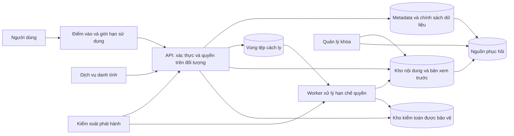

# Defense in depth

## 1. Mục tiêu bài học

**Defense in depth**, hay **phòng thủ theo nhiều lớp**, là cách thiết kế các biện pháp bảo vệ phối hợp để một sai sót hoặc một kiểm soát bị vượt qua không lập tức dẫn tới toàn bộ hậu quả cần tránh.

Các lớp có thể ngăn truy cập, giới hạn quyền, cách ly xử lý, phát hiện hành vi, hỗ trợ ứng phó và phục hồi. Giá trị của kiến trúc nằm ở cách các lớp xử lý kịch bản và phụ thuộc lẫn nhau, không nằm ở số lượng công cụ được triển khai.

Trong module về yêu cầu bảo mật, mục tiêu là chuyển nguyên tắc này thành hành vi cụ thể và có thể kiểm chứng.

Sau bài học, người học có thể:

- Chọn các lớp bảo vệ từ tài sản, ranh giới tin cậy và mô hình đe dọa.
- Phân biệt các lớp bổ trợ với kiểm soát trùng lặp cùng điểm yếu.
- Phân tích phạm vi tác động khi một lớp thất bại.
- Viết yêu cầu về xác thực, phân quyền, dữ liệu, logging và phục hồi.
- Thiết kế phép thử kiểm soát bị vượt qua, phụ thuộc gián đoạn và phục hồi.
- Đánh giá rủi ro còn lại, chi phí vận hành và các điều kiện phải xem xét lại.

Các vai trò, giới hạn và thời hạn trong bài là quy ước minh họa. Chúng không phải cấu hình hoặc mức chứng nhận áp dụng chung.

## 2. Hiểu đúng về “nhiều lớp”

Một hệ thống có thể có tường lửa, kiểm tra tại API và quyền cơ sở dữ liệu. Đó là ba nơi có kiểm soát, nhưng cần hỏi chúng bảo vệ điều gì và có thể cùng thất bại như thế nào.

Ví dụ:

- Lọc yêu cầu tại biên có thể chặn một số đầu vào hoặc mức sử dụng trái chính sách.
- Kiểm tra quyền tại API quyết định chủ thể có được đọc hợp đồng cụ thể không.
- Quyền dữ liệu giới hạn những gì danh tính ứng dụng có thể đọc hoặc sửa.
- Kiểm toán hỗ trợ xác định thao tác và ứng phó.
- Phục hồi giúp đưa dữ liệu, quyền và cấu hình về trạng thái đúng.

Một lớp không thay nhiệm vụ của lớp khác. Mã hóa dữ liệu lưu trữ không tự ngăn API giải mã rồi trả hợp đồng cho sai người.

### 2.1. Thiết kế theo các chức năng bảo vệ

| Chức năng | Mục tiêu | Ví dụ |
| --- | --- | --- |
| Phòng ngừa | Chặn hành vi không được phép | Xác thực và phân quyền trên đối tượng |
| Giới hạn tác động | Giảm tài sản và quyền bị ảnh hưởng khi một thành phần thất bại | Danh tính worker chỉ đọc tệp được giao |
| Phát hiện | Tạo tín hiệu khi hành vi hoặc trạng thái trái chính sách | Sự kiện truy cập bất thường, phát hiện cấu hình sai |
| Ứng phó | Thực hiện hành động có thẩm quyền để hạn chế hậu quả | Vô hiệu hóa danh tính bị lộ và dừng tác vụ |
| Phục hồi | Khôi phục dữ liệu và khả năng hoạt động đúng | Phục hồi từ nguồn được bảo vệ và xác minh quyền |

Một cảnh báo sau khi dữ liệu đã bị tải không hoàn tác được việc tiết lộ. Nó có thể hỗ trợ giảm tiếp diễn và điều tra. Yêu cầu cần diễn đạt đúng giá trị này.

### 2.2. Mỗi lớp cần có mục tiêu và phạm vi

Với một lớp bảo vệ, cần biết:

1. Nó xử lý kịch bản hoặc giai đoạn nào?
2. Nó tin nguồn thông tin nào?
3. Nó dùng danh tính và quyền gì?
4. Chủ thể có thể đi vòng qua đâu?
5. Nếu nó không hoạt động, lớp nào còn có ích?
6. Nếu nó gây từ chối sai, người dùng hợp lệ được xử lý thế nào?
7. Ai theo dõi và kiểm chứng nó?

Một kiểm tra chỉ nằm trên giao diện không bảo vệ đường gọi API trực tiếp. Một quyền dữ liệu chỉ có trên kho chính không tự bảo vệ bản xuất hoặc backup.

### 2.3. Nhiều lớp không đồng nghĩa độc lập tuyệt đối

Các kiểm soát thường có phụ thuộc chung: dịch vụ danh tính, hệ điều hành, cấu hình, pipeline hoặc quyền quản trị.

Cần đánh giá **mức độc lập đối với kịch bản đang xét**.

Ví dụ:

- Kiểm soát dữ liệu có thể chặn một truy vấn quên điều kiện tổ chức.
- Nhưng nếu cùng danh tính ứng dụng được tự đặt phạm vi tổ chức tùy ý và đọc mọi dữ liệu, kiểm soát đó có thể không giới hạn được ứng dụng đã bị chiếm.
- Kho kiểm toán tách biệt có thể ngăn danh tính runtime sửa bằng chứng.
- Nhưng nếu một tài khoản quản trị chung có thể xóa cả ứng dụng và kho kiểm toán, vẫn tồn tại nguyên nhân thất bại chung.

Không lấy các xác suất thất bại rồi nhân với nhau khi chưa có căn cứ về tính độc lập. Một lỗi cấu hình chung có thể vô hiệu hóa nhiều lớp cùng lúc.

## 3. Bắt đầu từ tài sản và kịch bản

Bài học dùng một cổng quản lý hợp đồng phục vụ nhiều tổ chức. Người dùng tải tài liệu lên, xem hoặc tải tài liệu trong phạm vi được cấp. Worker tạo bản xem trước. Người quản trị vận hành hệ thống qua đường đặc quyền.

### 3.1. Tài sản cần bảo vệ

| Mã | Tài sản | Nhu cầu chính |
| --- | --- | --- |
| A-DD-01 | Nội dung hợp đồng và bản xem trước | Không bị đọc ngoài phạm vi, không bị thay trái phép |
| A-DD-02 | Danh tính, phiên và quyền | Đúng chủ thể, đúng tổ chức, thu hồi đúng thời hạn |
| A-DD-03 | Dữ liệu và quyền thực thi của worker | Không biến một tệp thành quyền truy cập toàn hệ thống |
| A-DD-04 | Dấu vết truy cập và thay đổi | Có tính toàn vẹn, đủ liên kết và giới hạn người đọc |
| A-DD-05 | Mã, cấu hình và quyền phát hành | Chỉ thay đổi được chấp thuận đi vào môi trường chạy |
| A-DD-06 | Bản phục hồi, khóa và cấu hình cần thiết | Khôi phục được dữ liệu đúng và quyền đúng |
| A-DD-07 | Khả năng cung cấp dịch vụ | Không bị một nguồn sử dụng làm cạn tài nguyên chung |

### 3.2. Những kịch bản phải xét

| Mã | Kịch bản | Hậu quả cần hạn chế |
| --- | --- | --- |
| T-DD-01 | Mật khẩu hoặc phiên của người dùng bị lấy | Đọc hoặc thay đổi tài liệu bằng quyền của nạn nhân |
| T-DD-02 | API thiếu kiểm tra phạm vi trên một đường đọc hoặc tải | Lộ hợp đồng giữa các tổ chức |
| T-DD-03 | Tệp được xử lý làm worker thực thi hành vi ngoài nhiệm vụ | Đọc thêm dữ liệu, dùng bí mật hoặc lan sang thành phần khác |
| T-DD-04 | Danh tính dịch vụ bị lộ hoặc được cấp quyền quá rộng | Tác động vượt một tác vụ hoặc một tập tài liệu |
| T-DD-05 | Người có quyền vận hành sửa hoặc xóa dữ liệu và bằng chứng | Mất khả năng điều tra hoặc phục hồi |
| T-DD-06 | Kho chính, khóa hoặc phụ thuộc bị mất khả dụng | Không phục vụ hoặc không phục hồi được dữ liệu |
| T-DD-07 | Bản phát hành hoặc cấu hình không được chấp thuận được triển khai | Bỏ qua các kiểm tra bảo mật trong ứng dụng |

Đây là các kịch bản thiết kế giả định, không phải lỗi được xác nhận của một sản phẩm thực tế.

### 3.3. Sơ đồ các điểm thực thi



Sơ đồ thể hiện các điểm cần quyết định, không mặc định mọi mũi tên đã có cơ chế bảo vệ phù hợp. Phải đặc tả danh tính, quyền, loại dữ liệu và hành vi lỗi cho từng luồng.

Các bản xuất, đường quản trị và pipeline chi tiết cần được thêm vào mô hình khi chúng có thể ảnh hưởng các tài sản trong phạm vi.

## 4. Thiết kế các lớp theo đường tác động

### 4.1. Đường đọc hợp đồng

Một đường đọc có thể cần:

1. Kênh truyền được bảo vệ và xác minh đích kết nối.
2. Xác thực phiên hoặc thông tin xác thực của chủ thể.
3. Kiểm tra quyền đọc hành động, tài liệu và tổ chức phía máy chủ.
4. Ánh xạ yêu cầu tới đối tượng lưu trữ bằng nguồn đáng tin cậy.
5. Giới hạn quyền kho dữ liệu và quyền giải mã.
6. Ghi sự kiện truy cập phù hợp, không sao chép nội dung hợp đồng vào log.
7. Phát hiện, xử lý khi một danh tính có dấu hiệu bị sử dụng sai.

Không được bỏ bước 3 chỉ vì yêu cầu đã qua điểm vào hoặc có kết nối được bảo vệ. Người dùng hợp lệ vẫn có thể yêu cầu tài liệu của người khác.

Liên kết tải trực tiếp cũng là một đường truy cập. Nếu thiết kế cho phép liên kết tự mang quyền tải, phải đánh giá người có liên kết, phạm vi, thời hạn và khả năng thu hồi. Không giả định nó giống đường luôn kiểm tra lại quyền hiện tại.

Trong ví dụ này, chức năng tải tài liệu bí mật được chọn phải xác thực và kiểm tra quyền tại lượt tải, thay vì chỉ dựa vào việc có URL.

### 4.2. Đường xử lý tệp

Một tệp có thể qua kiểm tra định dạng nhưng vẫn gây lỗi cho thành phần xử lý. Vì vậy, cần phân tích cả sau bước tiếp nhận:

- Tệp mới nằm trong vùng cách ly, chưa được coi là nội dung có thể công bố.
- Kiểm tra nội dung và chính sách xử lý trước khi chuyển trạng thái.
- Worker chạy bằng danh tính hạn chế, có giới hạn tài nguyên.
- Worker chỉ nhận dữ liệu và quyền cần cho tác vụ.
- Truy cập mạng ra ngoài và bí mật không phục vụ nhiệm vụ bị giới hạn.
- Kết quả được liên kết với đúng tệp và tổ chức.
- Lỗi hoặc timeout không tự làm tệp được coi là đã an toàn.

Các lớp này có nhiệm vụ khác nhau. Kiểm tra tệp giảm một số đầu vào nguy hiểm; cách ly và giới hạn quyền giảm hậu quả nếu bước kiểm tra hoặc bộ xử lý vẫn thất bại.

### 4.3. Đường vận hành và phục hồi

Đường quản trị có thể tác động nhiều lớp, nên cần được đưa vào thiết kế:

- Danh tính quản trị khác với danh tính runtime.
- Quyền sửa ứng dụng không mặc nhiên bao gồm quyền xóa bằng chứng và backup.
- Thay đổi đặc quyền được xác thực, giới hạn và kiểm toán.
- Nguồn phục hồi không chỉ là một bản sao dễ bị cùng thao tác xóa.
- Khóa, công cụ đọc và quyền cần cho phục hồi được quản lý trong cùng kế hoạch.
- Sau phục hồi phải kiểm tra quyền, trạng thái cách ly và phiên bản dữ liệu trước khi mở lại dịch vụ.

Nếu người có cùng quyền quản trị có thể phá hủy cả dữ liệu, khóa và mọi bản phục hồi, việc có nhiều bản sao không xử lý đầy đủ kịch bản T-DD-05.

## 5. Phân tích thất bại của từng lớp

### 5.1. Khi một lớp bị vượt qua, lớp nào còn có ích?

| Lớp hoặc giả định thất bại | Lớp khác có thể hỗ trợ | Giới hạn phải ghi rõ |
| --- | --- | --- |
| Bộ lọc ở điểm vào không chặn yêu cầu | Xác thực, quyền trên đối tượng và điều kiện nghiệp vụ ở dịch vụ | Không được xem bộ lọc là nơi quyết định quyền duy nhất |
| Mật khẩu bị lấy | Xác thực đa yếu tố theo phạm vi, giới hạn quyền và thu hồi | Không tự xử lý được mọi trường hợp phiên hợp lệ đã bị lấy |
| API quên điều kiện tổ chức trong truy vấn | Chính sách dữ liệu dựa trên phạm vi được cung cấp đáng tin cậy | Không hữu ích nếu ứng dụng có quyền tùy ý đổi phạm vi hoặc bỏ qua chính sách |
| Bộ xử lý tệp bị khai thác trong một tác vụ | Cách ly, giới hạn quyền, tài nguyên và kết nối | Không mặc định chống được việc máy chủ hoặc lớp cách ly cũng bị chiếm |
| Danh tính runtime bị lộ | Quyền dữ liệu tối thiểu, cấm quản trị, kiểm toán và thu hồi | Mã hóa không che dữ liệu mà chính danh tính đó được phép giải mã |
| Kho chính bị xóa hoặc hỏng | Nguồn phục hồi, khóa và quy trình độc lập phù hợp | Bản sao cùng quyền xóa hoặc cùng miền sự cố có thể cùng mất |
| Pipeline bị dùng sai | Phê duyệt, kiểm soát tiếp nhận bản phát hành, quyền dữ liệu và bằng chứng tách biệt | Nếu nguồn ký và nơi tiếp nhận đều bị kiểm soát chung, nhiều lớp có thể cùng mất hiệu lực |

Mỗi hàng là một giả định để thiết kế và kiểm chứng. Không phải mọi kiểm soát được nêu đều độc lập chỉ vì nằm trên thành phần khác.

### 5.2. Lập danh sách phụ thuộc chung

Nên ghi tối thiểu:

| Phụ thuộc | Những lớp có thể bị ảnh hưởng | Câu hỏi cần xử lý |
| --- | --- | --- |
| Dịch vụ danh tính | Đăng nhập, dịch vụ nội bộ, quản trị | Nếu lỗi hoặc cấu hình sai, quyền được quyết định thế nào? |
| Pipeline cấu hình | API, worker, mạng, chính sách dữ liệu | Một thay đổi có thể cùng bỏ nhiều kiểm soát không? |
| Quyền quản trị nền tảng | Ứng dụng, kho, log, backup | Ai có thể tác động nhiều lớp và phải qua quy trình nào? |
| Quản lý khóa | Kho chính và bản phục hồi | Mất hoặc hủy khóa có làm mọi bản sao không đọc được không? |
| Nguồn xác định tổ chức | Quyền API, truy vấn và kho tệp | Có lấy từ dữ liệu phía khách chưa được xác minh không? |
| Máy chủ hoặc môi trường thực thi | Các tiến trình cùng chạy | Một lỗi nền tảng có phá vỡ cách ly đang giả định không? |

Một hệ thống dự phòng có thể xử lý mất một máy, nhưng nếu dùng cùng cấu hình sai thì không giải quyết được lỗi cấu hình chung. Cần mô tả đúng loại sự cố mà phương án chịu được.

### 5.3. Ví dụ về “hai lớp” cùng tin một dữ liệu sai

Giả sử API lấy mã tổ chức trực tiếp từ tham số phía khách, rồi:

- Dùng mã đó làm điều kiện truy vấn.
- Dùng cùng mã đó làm ngữ cảnh cho chính sách dữ liệu.

Nếu mã không được đối chiếu với danh tính và quyền, cả hai lớp có thể cùng trả dữ liệu của tổ chức khác.

Yêu cầu cần bảo vệ nguồn xác định phạm vi trước. Sau đó mới đánh giá chính sách dữ liệu có chặn được loại lỗi nào.

Nếu muốn giới hạn cả ứng dụng đã bị chiếm, phải xem quyền thật của danh tính ứng dụng và cơ chế cấp phạm vi. Một kiểm tra trong cùng tiến trình bị chiếm không tự tạo ranh giới độc lập đối với chủ thể đang điều khiển tiến trình đó.

## 6. Quy định hành vi khi phụ thuộc lỗi

Phòng thủ nhiều lớp có thể làm tăng số phụ thuộc. Cần xác định cách hệ thống xử lý khi không đủ căn cứ để cho phép một hành động.

| Điều kiện | Hành vi cần đặc tả trong ví dụ |
| --- | --- |
| Không xác minh được danh tính hoặc quyền đọc | Không trả tài liệu bằng một giá trị mặc định cho phép |
| Dịch vụ quyền không khả dụng | Chỉ dùng bản quyết định cache nếu có chính sách cho phép, phạm vi và tuổi tối đa rõ |
| Bộ kiểm tra tệp lỗi hoặc timeout | Tệp tiếp tục cách ly, không tự coi là đã đạt |
| Worker vượt giới hạn tài nguyên | Dừng hoặc cách ly tác vụ theo thiết kế; không ảnh hưởng dữ liệu khác |
| Không ghi được bằng chứng bắt buộc cho thay đổi đặc quyền | Không xác nhận hoàn tất khi chưa đáp ứng cơ chế ghi nhận được chấp thuận |
| Không lấy được khóa cần thiết | Không chuyển sang bản rõ hoặc kênh yếu hơn để tiếp tục phục vụ |
| Không xác định được quyền đúng sau phục hồi | Chưa mở đường truy cập có nguy cơ trả dữ liệu sai |
| Phát hiện bản phát hành không được chấp thuận | Không triển khai chỉ để tránh gián đoạn, trừ quy trình khẩn cấp đúng thẩm quyền nếu có |

### 6.1. Cache quyền phải là quyết định có giới hạn

Nếu cho phép cache quyết định quyền, cần gắn với:

- Đúng chủ thể, tổ chức, hành động và đối tượng.
- Phiên bản chính sách hoặc trạng thái bảo mật liên quan.
- Nguồn quyết định đáng tin cậy.
- Thời điểm tạo và tuổi tối đa.
- Điều kiện dùng lại và điều kiện phải từ chối.

Trong ví dụ, tổ chức giả định chỉ cho phép cache quyền đọc thông thường tối đa 60 giây; thay đổi đặc quyền phải có quyết định hiện tại. Khoảng này phải phù hợp với yêu cầu thu hồi đã được chấp thuận.

Cache không được lấy quyền từ trường do phía khách tự khai. Việc phụ thuộc quyền gặp lỗi cũng không làm một bản cache quá hạn trở thành hợp lệ.

### 6.2. Phân biệt từ chối an toàn và gây gián đoạn không kiểm soát

Không cho phép hành động khi thiếu căn cứ là cần thiết, nhưng vẫn phải thiết kế năng lực và phương án vận hành:

- Xác định lỗi có thể được thử lại và giới hạn thử lại.
- Trả trạng thái rõ, không tiết lộ dữ liệu ngoài phạm vi.
- Có cảnh báo, người tiếp nhận và phương án khắc phục.
- Duy trì những chức năng không phụ thuộc vào điều kiện bị lỗi nếu vẫn đáp ứng yêu cầu.
- Kiểm thử tác động của lỗi phụ thuộc đối với người dùng hợp lệ.

Một hệ thống luôn từ chối mọi yêu cầu vì không đủ năng lực cũng chưa đạt mục tiêu sẵn sàng đã được cam kết.

## 7. Bộ yêu cầu bảo mật minh họa

Các ngưỡng 60 giây, 60 giây xử lý tệp, 256 MiB, 4 giờ và 15 phút dưới đây thuộc hồ sơ hệ thống giả định. Nhóm phải xác nhận tính phù hợp và khả thi trước khi sử dụng thực tế.

| Mã | Yêu cầu | Tiêu chí chấp nhận |
| --- | --- | --- |
| DD-01 | Mọi đường tài liệu riêng tư phải xác thực chủ thể; vai trò quản trị và xuất hàng loạt phải đáp ứng xác thực đa yếu tố theo chính sách | Gọi trực tiếp API hoặc tải tệp không bỏ qua xác thực; người thiếu điều kiện không dùng được chức năng được bảo vệ |
| DD-02 | API, tác vụ và lượt tải phải kiểm tra quyền theo tài liệu, tổ chức và hành động; thu hồi quyền có hiệu lực trên yêu cầu mới trong tối đa 60 giây | Đổi mã tài liệu hoặc tổ chức, chuyển URL cho chủ thể khác và dùng quyền đã thu hồi không trả nội dung trái phạm vi |
| DD-03 | Danh tính truy cập dữ liệu chỉ có quyền cần thiết; phạm vi tổ chức phải được cấp từ nguồn đã xác minh và không được mặc định tin tham số phía khách | Thử truy cập ngoài phạm vi và bỏ điều kiện truy vấn; ghi rõ loại lỗi được chính sách dữ liệu chặn và quyền có thể bỏ qua |
| DD-04 | Tệp chưa đạt chính sách xử lý phải ở trạng thái cách ly; lỗi kiểm tra không được chuyển sang trạng thái có thể công bố | Thử lỗi, timeout và dữ liệu không đạt; các đường đọc, tải và xử lý tiếp đều không công bố tệp đó |
| DD-05 | Tiến trình xử lý một tác vụ chỉ được đọc đầu vào và ghi đầu ra được giao, không tự nhận quyền cho tác vụ khác; giới hạn ví dụ là 60 giây và 256 MiB cho tiến trình xử lý | Trong phép thử kiểm soát tiến trình, không đọc được tệp khác, không lấy bí mật quản trị và không xóa log hoặc backup; vượt giới hạn bị xử lý đúng |
| DD-06 | Kênh giữa các thành phần phải bảo vệ dữ liệu và xác minh đích theo giao thức được chấp thuận; kết nối ra của worker chỉ tới các dịch vụ cần thiết | Thử đích không được phép và thông tin xác thực không hợp lệ; không có chuyển sang kênh yếu hơn |
| DD-07 | Kho tài liệu và bản phục hồi phải được mã hóa theo chính sách; quyền đọc đối tượng lưu không tự bao gồm quyền giải mã | Danh tính chỉ có quyền lấy bản lưu không giải mã được; cấu hình và quyền khóa được đối chiếu |
| DD-08 | Truy cập và thay đổi bảo mật phải có sự kiện liên kết; hành động thay đổi đặc quyền hoặc công bố cần bản ghi bền vững được bảo vệ trước xác nhận thành công | Danh tính thực hiện không sửa, xóa được bằng chứng; lỗi ghi nhận không tạo xác nhận sai; log không chứa nội dung tài liệu hoặc bí mật không cần thiết |
| DD-09 | Hành vi worker bị từ chối khi truy cập ngoài tài sản được giao phải tạo tín hiệu ứng phó trong 60 giây từ lúc hệ thống nhận sự kiện | Mô phỏng sự kiện, kiểm tra thời gian, người tiếp nhận, mã tác vụ và hướng xử lý; không chỉ có một bản log không ai theo dõi |
| DD-10 | Production chỉ tiếp nhận bản phát hành đã được phê duyệt và khớp định danh nội dung, nguồn gốc theo chính sách; runtime không có quyền tự phát hành | Bản không được duyệt hoặc bị thay bị chặn; danh tính runtime không thay được cấu hình tiếp nhận hoặc quyền phát hành |
| DD-11 | Trong kịch bản mất kho chính đã xác định, phải phục hồi trong 4 giờ và mất dữ liệu không quá 15 phút theo điểm dữ liệu nghiệp vụ đã thỏa thuận; quyền và trạng thái cách ly phải đúng trước mở lại | Diễn tập đối chiếu dữ liệu, khóa, công cụ đọc, quyền và tệp cách ly; không dùng mục tiêu mất dữ liệu làm lý do mở lại quyền đã bị thu hồi |
| DD-12 | Quyền vận hành thông thường không được tự phá hủy đồng thời mọi bằng chứng và nguồn phục hồi; thao tác phá hủy vượt phạm vi phải theo cơ chế phê duyệt riêng | Thử các danh tính vận hành đã xác định; đối chiếu quyền xóa, khóa, backup và bằng chứng; ghi rõ quyền đặc biệt còn có thể tác động chung |

DD-05 có điều kiện quan trọng: cơ chế cấp quyền tác vụ phải ở ngoài quyền tự điều chỉnh của tiến trình worker đang được giới hạn. Nếu cùng một tiến trình bị chiếm có thể lấy toàn bộ tác vụ và tự cấp quyền rộng hơn, phải sửa thiết kế hoặc ghi rõ không đạt phạm vi giới hạn đã yêu cầu.

Các giới hạn tài nguyên cũng phải tương thích với loại tài liệu được chấp nhận. Tài liệu không thể xử lý trong hồ sơ giới hạn cần luồng được chấp thuận, không được tự bỏ cách ly để hoàn tất.

DD-07 chủ yếu bảo vệ những kịch bản như lấy bản lưu ngoài đường ứng dụng. Nó không che nội dung khỏi một danh tính đang được phép yêu cầu giải mã. Phạm vi quyền và khả năng ứng phó của DD-02, DD-03 và DD-09 vẫn cần thiết.

DD-12 không khẳng định không ai trên toàn bộ nền tảng có thể phá hủy dữ liệu. Cần nhận diện quyền cấp cao, chủ thể kiểm soát chúng và rủi ro nguyên nhân chung còn lại.

### 7.1. Gắn yêu cầu với chủ sở hữu

Có thể phân công:

- Nhóm dịch vụ chịu trách nhiệm quyền tài liệu và trạng thái công bố.
- Nhóm danh tính chịu trách nhiệm xác thực và hiệu lực thu hồi.
- Nhóm xử lý chịu trách nhiệm giới hạn worker.
- Nhóm nền tảng chịu trách nhiệm mạng, kho và quyền runtime.
- Nhóm vận hành chịu trách nhiệm kiểm toán, cảnh báo và phục hồi.
- Risk owner điều phối rủi ro và quyết định trong phạm vi thẩm quyền.

Một yêu cầu có nhiều phụ thuộc vẫn cần đầu mối chịu trách nhiệm. Không để các nhóm cùng cho rằng phần còn thiếu thuộc nhóm khác.

## 8. Truy vết từ đe dọa tới các lớp

| Kịch bản | Lớp phòng ngừa hoặc giới hạn | Phát hiện, ứng phó hoặc phục hồi | Giới hạn cần giữ |
| --- | --- | --- | --- |
| T-DD-01 | DD-01, DD-02, DD-03 | DD-08, thu hồi và quy trình ứng phó | Phiên hợp lệ bị lấy có thể vẫn sử dụng quyền trong thời gian chưa bị thu hồi |
| T-DD-02 | DD-02, DD-03 | DD-08 và đánh giá phạm vi dữ liệu | Không coi phạm vi do ứng dụng tự khai là độc lập với ứng dụng |
| T-DD-03 | DD-04, DD-05, DD-06 | DD-08, DD-09, xử lý lại từ nguồn an toàn | Giả định giới hạn ở tiến trình cần được nêu; lỗi lớp cách ly là kịch bản khác |
| T-DD-04 | DD-03, DD-05, DD-06, DD-07 theo phạm vi | DD-08, DD-09 và thu hồi danh tính | Dữ liệu đã đọc không tự thu hồi được |
| T-DD-05 | DD-08, DD-12 | DD-11 và điều tra | Quyền quản trị chung vẫn có thể là nguyên nhân thất bại chung |
| T-DD-06 | Năng lực, dự phòng và bảo vệ khóa đã được thiết kế | DD-11 | Chỉ kết luận theo kịch bản sự cố và điều kiện thử |
| T-DD-07 | DD-10 cùng giới hạn quyền dữ liệu | DD-08, DD-12, phục hồi | Bản được ký hoặc được duyệt vẫn cần kiểm chứng nội dung và hành vi |

Bảng không thay cho phân tích chi tiết. Nó giúp phát hiện chỗ chỉ có phòng ngừa mà không có phát hiện, chỉ có cảnh báo mà không hạn chế được hậu quả, hoặc nhiều lớp cùng dựa vào một nguồn tin chưa được xác minh.

## 9. Kiểm chứng phòng thủ nhiều lớp

### 9.1. Kiểm thử theo kịch bản thất bại có kiểm soát

Cần kiểm tra một lớp khác còn có giá trị khi lớp trước không làm được nhiệm vụ. Các phép thử được thiết kế trong môi trường đại diện, với dữ liệu giả và phạm vi được cho phép.

Không cần dùng một khai thác thực tế để kiểm tra mọi hậu quả. Có thể mô phỏng một tiến trình có đúng quyền của worker, một quyết định quyền cũ hoặc một truy vấn thiếu điều kiện.

| Phép thử | Điều đang giả lập | Kết quả cần thấy |
| --- | --- | --- |
| Đi vòng bộ lọc biên trong môi trường thử rồi gọi API trực tiếp | Lớp lọc không chặn được yêu cầu | API vẫn xác thực và kiểm tra quyền tài liệu |
| Dùng phiên hợp lệ đã được đánh dấu thu hồi | Phiên đã bị lấy hoặc cần vô hiệu hóa | Yêu cầu mới bị từ chối trong giới hạn 60 giây |
| Chạy truy vấn thiếu điều kiện tổ chức bằng danh tính dịch vụ | Lỗi lập trình ở đường truy vấn | Kiểm soát dữ liệu chặn theo phạm vi thực sự được cấp, nếu thiết kế tuyên bố bảo vệ loại lỗi này |
| Thử đặt phạm vi tổ chức ngoài quyền được cấp | Nguồn ngữ cảnh có thể bị lạm dụng | Không tự mở quyền chỉ từ tham số hoặc ngữ cảnh do tiến trình tự đổi |
| Chạy các thao tác ngoài nhiệm vụ bằng quyền worker của một tác vụ | Tiến trình worker bị kiểm soát trong phạm vi giả định | Không đọc tệp khác, lấy bí mật quản trị, nhận quyền tác vụ khác hoặc xóa backup |
| Làm bộ kiểm tra tệp không khả dụng | Lớp tiếp nhận không đưa ra kết quả | Tệp vẫn cách ly và không bị công bố |
| Làm tác vụ vượt thời gian hoặc bộ nhớ | Một đầu vào tiêu tốn tài nguyên | Giới hạn được thực thi, dữ liệu khác không bị sửa và có trạng thái xử lý rõ |
| Dùng danh tính runtime sửa hoặc xóa sự kiện | Ứng dụng bị chiếm muốn che hành động | Bằng chứng đã được bảo vệ không bị sửa hoặc xóa |
| Dùng quyền chỉ đọc bản lưu để tiếp cận dữ liệu | Lấy được đối tượng lưu nhưng không có quyền giải mã | Không tự giải mã được nội dung |
| Làm dịch vụ quyền gián đoạn | Phụ thuộc dùng chung không khả dụng | Quy tắc cache và từ chối đúng; cache quá hạn không tiếp tục cho phép |
| Làm kho bằng chứng bắt buộc lỗi | Mất khả năng chứng minh hành động được bảo vệ | Không trả xác nhận thành công trái điều kiện |
| Xóa kho chính trong diễn tập rồi phục hồi | Mất dữ liệu trong kịch bản đã định | Đạt dữ liệu, thời gian, khóa, quyền và trạng thái cách ly trước mở |
| Dùng quyền vận hành thông thường xóa log và mọi nguồn phục hồi | Một chủ thể tìm cách phá nhiều lớp | Không có quyền tự hoàn tất toàn bộ đường phá hủy đã xác định |
| Đưa bản không được duyệt tới cổng triển khai | Kiểm soát thay đổi bị bỏ qua trước đó | Lớp tiếp nhận độc lập theo thiết kế vẫn từ chối |

Mỗi phép thử phải ghi nhận trạng thái thực tế, không chỉ mã trả về. Một thao tác có thể báo lỗi nhưng vẫn đã công bố tệp hoặc sửa dữ liệu trước khi lỗi xảy ra.

### 9.2. Xác định đúng giả định “bị chiếm”

Cụm “worker bị chiếm” quá rộng nếu không nêu quyền mà chủ thể có.

Có thể tách:

- Điều khiển hành vi trong một tiến trình tác vụ.
- Có quyền của tài khoản hệ điều hành chạy worker.
- Điều khiển môi trường cách ly hoặc máy chủ.
- Có quyền quản trị nền tảng hoặc cơ chế cấp quyền.

Một phép thử ở mức tiến trình không chứng minh chống được chủ thể có quyền quản trị máy chủ. Ngược lại, có giá trị chứng minh tiến trình bị điều khiển không mặc nhiên có quyền lấy mọi hợp đồng nếu ranh giới thực thi đúng.

Hồ sơ phải ghi phạm vi thành công và phần chưa kiểm chứng, tránh dùng một kết quả hẹp làm kết luận cho toàn kiến trúc.

### 9.3. Kiểm thử tổ hợp và nguyên nhân chung

Sau các lỗi đơn lẻ, nên xem tổ hợp có hậu quả đáng kể:

- API thiếu điều kiện tổ chức và phạm vi dữ liệu cũng được lấy từ nguồn sai.
- Danh tính runtime bị lộ và cùng danh tính đó có quyền giải mã nhiều tổ chức.
- Pipeline cấu hình sai đồng thời làm tệp công khai và tắt kiểm toán.
- Người quản trị sửa được cả chính sách backup và quyền hủy khóa.
- Phục hồi bản cũ cùng với cache quyền cũ làm quyền đã thu hồi quay lại.

Không cần thử mọi tổ hợp có thể tưởng tượng. Chọn theo đường gây hại, hậu quả và điểm phụ thuộc trong mô hình, rồi ghi căn cứ phạm vi.

### 9.4. Kiểm tra cả đường hợp lệ và năng lực vận hành

Phòng thủ nhiều lớp phải vẫn đáp ứng các yêu cầu được chấp thuận:

- Người có quyền đọc được đúng hợp đồng.
- Một tài liệu hợp lệ xử lý được trong hồ sơ tài nguyên đã chọn.
- Thu hồi quyền không làm tác động ngoài phạm vi dự kiến.
- Cảnh báo có người nhận và đủ thông tin để hành động.
- Lỗi phụ thuộc không gây vòng thử lại làm cạn tài nguyên.
- Phục hồi không bỏ sót khóa, định dạng, cấu hình hoặc bản xem trước.

Các phép đo độ trễ, tải và tài nguyên cần có điều kiện thử cụ thể. Chỉ thêm các lớp rồi quan sát dịch vụ chậm hơn chưa cho biết thiết kế đã đáp ứng yêu cầu sẵn sàng.

## 10. Hồ sơ quyết định kiến trúc minh họa

Ví dụ dưới đây mô tả quyết định **cách ly xử lý tệp theo tác vụ** đang cần kiểm chứng. Đây là dữ liệu thiết kế trong bài, không phải kết quả triển khai thực tế:

```yaml
decisionId: DD-DEC-012
title: task-scoped-document-processing
decisionStatus: selected-for-verification

scope:
  operation: generate-document-preview
  primaryAsset: A-DD-01
  supportingAsset: A-DD-03
  threatReference: T-DD-03

failureModel:
  assumedCapability: "Chủ thể điều khiển hành vi tiến trình xử lý của một tác vụ."
  notClaimedByThisDecision:
    - "Điều khiển máy chủ hoặc lớp cách ly."
    - "Chiếm cơ chế cấp quyền tác vụ."

selectedLayers:
  - layer: quarantine-before-publication
    requirementReference: DD-04
  - layer: task-scoped-authority
    requirementReference: DD-05
  - layer: restricted-outbound-connectivity
    requirementReference: DD-06
  - layer: protected-audit-and-response
    requirementReferences:
      - DD-08
      - DD-09

authorityBoundary:
  grantIssuerOutsideWorkerAuthority: true
  workerCannotSelfAssignAnotherTask: true
  inputScope: assigned-document-version
  outputScope: assigned-preview-location
  administrationPermissions: none

resourceProfile:
  maxElapsedSeconds: 60
  maxProcessMemoryMiB: 256

commonDependencies:
  - execution-platform
  - task-grant-issuer
  - outbound-policy-enforcement
  - security-event-collection

verificationPlan:
  - TC-WORKER-READ-OTHER-DOCUMENT
  - TC-WORKER-SELF-ASSIGN-TASK
  - TC-WORKER-READ-ADMIN-SECRET
  - TC-WORKER-UNAPPROVED-OUTBOUND
  - TC-WORKER-RESOURCE-LIMIT
  - TC-WORKER-DENIAL-ALERT

responsibility:
  riskOwnerRole: document-service-business-owner
  controlOwnerRole: document-processing-owner

residualConcerns:
  - "Lỗi nền tảng cách ly hoặc cấp quyền cần đánh giá riêng."
  - "Tính an toàn của định dạng đầu ra vẫn cần chính sách và kiểm thử."

reviewTriggers:
  - new-document-format
  - worker-runtime-change
  - task-authority-change
  - preview-delivery-change
```

Hồ sơ này có giá trị vì nêu cả lớp được chọn, quyền cần có, điểm phụ thuộc và phần không được tuyên bố. Một nhãn “đã sandbox” sẽ không cung cấp đủ thông tin như vậy.

Bằng chứng sau đó cần gắn với bản phần mềm, cấu hình thực thi, chính sách cấp quyền và môi trường. Các mã trong kế hoạch chưa tự chứng minh phép thử đã chạy hoặc đạt.

### 10.1. Truy vết quyết định theo hai hướng

Từ T-DD-03, người đọc phải tìm được DD-04, DD-05, DD-06, DD-08, DD-09 và bằng chứng liên quan.

Từ DD-05, người đọc cũng phải tìm được:

- Tài sản và hậu quả cần hạn chế.
- Giả định tiến trình bị điều khiển.
- Cơ chế cấp quyền nằm ngoài worker.
- Chủ sở hữu.
- Các phép thử ngoài phạm vi và giới hạn tài nguyên.
- Rủi ro còn lại khi nền tảng cách ly thất bại.

Truy vết giúp không biến một quyết định kiến trúc thành một thành phần được triển khai nhưng không ai biết đang bảo vệ kịch bản nào.

## 11. Cân bằng độ sâu, độ phức tạp và mức đảm bảo

### 11.1. Chọn lớp theo giá trị bảo vệ

Mỗi lớp bổ sung tạo chi phí triển khai, vận hành, cập nhật và xử lý lỗi. Cần hỏi:

- Nó giảm đường tác động hoặc hậu quả nào?
- Nó có bổ sung ranh giới quyền hoặc bằng chứng đáng kể không?
- Nó có cùng phụ thuộc và lỗi cấu hình với lớp đã có không?
- Có người đủ năng lực duy trì không?
- Có thể kiểm chứng hành vi lỗi và kết quả đúng không?
- Tác động tới độ trễ, khả năng phục hồi và người dùng hợp lệ là gì?

Hai bộ lọc cùng quy tắc có thể hỗ trợ năng lực hoặc dự phòng cho một số lỗi, nhưng không tự tạo hai lớp độc lập trước cùng sai sót logic.

Dùng thành phần khác nhau cũng chưa đủ nếu cùng nguồn quyền, pipeline và tài khoản quản trị có thể vô hiệu hóa tất cả.

### 11.2. Tăng cường kiểm soát và tăng cường bằng chứng

Hai việc có liên quan nhưng khác nhau:

- Thêm quyền tác vụ hạn chế là thay đổi kiểm soát.
- Thử đọc tệp khác bằng quyền worker là thu thập bằng chứng.
- Tách quyền xóa backup khỏi quyền triển khai là thay đổi kiểm soát.
- Rà soát độc lập và diễn tập quyền phá hủy là tăng căn cứ tin vào kiểm soát.

Một sơ đồ nhiều lớp chưa tạo mức đảm bảo nếu chưa có bằng chứng. Một báo cáo đánh giá dài cũng không thêm ranh giới quyền mà thiết kế không có.

Mức bằng chứng cần tương xứng với hậu quả và độ chưa chắc chắn. Các đường lộ hợp đồng giữa tổ chức hoặc phá hủy mọi nguồn phục hồi có thể cần rà soát thiết kế, cấu hình, kiểm thử lỗi và xác minh độc lập theo chính sách.

### 11.3. Quyết định rủi ro còn lại

Sau kiểm chứng, cần ghi:

- Kịch bản nào đã được ngăn hoặc giới hạn.
- Lớp nào còn phụ thuộc chung.
- Loại quyền hoặc sự cố nào có thể vượt phạm vi bảo vệ.
- Khoảng thời gian thu hồi hoặc phục hồi còn được chấp nhận.
- Những phép thử chưa thực hiện.
- Người có thẩm quyền quyết định, điều kiện và thời hạn.

Không dùng “đã có nhiều lớp” để bỏ qua yêu cầu bắt buộc chưa đạt. Nếu cần ngoại lệ, phải theo đúng nguồn yêu cầu và thẩm quyền cho phép, kèm rủi ro, phạm vi, biện pháp bù và hạn hiệu lực.

### 11.4. Theo dõi trong vòng đời phát triển

Cần rà soát khi:

- Thêm API, đường tải, bản xuất hoặc nguồn nhập.
- Đổi mô hình tổ chức và danh tính.
- Thêm định dạng hoặc phiên bản bộ xử lý tệp.
- Thay quyền worker hoặc cách cấp tác vụ.
- Đổi pipeline, quản trị nền tảng hoặc nguồn ký.
- Đổi nơi giữ log, khóa, bản phục hồi.
- Có sự cố, kết quả thử hoặc thay đổi trái giả định.
- Thay mục tiêu phục hồi, dữ liệu hoặc phạm vi khách hàng.

Có thể theo dõi số đường chưa có phân quyền kiểm chứng, số danh tính có quyền vượt phạm vi, số phụ thuộc chung chưa có quyết định và kết quả diễn tập.

Tỷ lệ yêu cầu có bằng chứng chỉ phản ánh những yêu cầu đã nhận diện. Nó không chứng minh không còn đường đi vòng hoặc đe dọa chưa được mô hình hóa.

## 12. Những sai lầm thường gặp

| Sai lầm | Hệ quả | Cách sửa |
| --- | --- | --- |
| Đếm công cụ thay vì đường bảo vệ | Nhiều thành phần nhưng vẫn có cùng lỗ hổng | Gắn từng lớp với kịch bản, quyền và bằng chứng |
| Tin rằng qua mạng nội bộ là đủ tin cậy | Dịch vụ bị chiếm có thể đi xa hơn dự kiến | Xác minh danh tính và quyền tại ranh giới cần thiết |
| Chỉ bảo vệ điểm vào | API, tác vụ hoặc quản trị bỏ qua kiểm soát | Bao phủ mọi đường chạm tới tài sản |
| Dùng mã hóa thay phân quyền | Ứng dụng vẫn trả dữ liệu cho sai người | Duy trì quyền đối tượng và giới hạn danh tính |
| Cho ứng dụng tự đặt mọi phạm vi dữ liệu | Nhiều lớp cùng tin một nguồn sai | Bảo vệ nguồn cấp phạm vi và quyền bỏ qua |
| Giới hạn worker nhưng cho nó tự cấp quyền rộng | Cách ly chỉ có trên giấy | Tách cơ chế cấp quyền và kiểm thử thao tác vượt phạm vi |
| Bộ kiểm tra lỗi thì tự cho tệp đi tiếp | Phụ thuộc gián đoạn trở thành đường bỏ qua | Giữ cách ly và có quy trình xử lý rõ |
| Log được bảo vệ bằng cùng quyền sửa nghiệp vụ | Chủ thể có thể che dấu hành động | Tách quyền và bảo vệ bằng chứng đã ghi |
| Backup dùng cùng quyền xóa và khóa không được bảo vệ | Một sự cố phá cả dữ liệu và phục hồi | Phân tích quyền phá hủy, khóa và miền sự cố |
| Phục hồi xong dữ liệu là mở ngay | Quyền cũ hoặc tệp cách ly được công bố sai | Kiểm tra bảo mật trước mở |
| Nhân xác suất lỗi của các lớp thiếu căn cứ | Tạo kết luận rủi ro thấp không đáng tin | Phân tích tương quan và nguyên nhân chung |
| Tăng lớp nhưng không quản lý năng lực, lỗi | Dịch vụ khó vận hành và có thể không sẵn sàng | Đặt yêu cầu tải, lỗi, phục hồi và người chịu trách nhiệm |

## 13. Bài tập vận dụng

Một cổng tài liệu có hai bộ lọc tại điểm vào và kết nối nội bộ được bảo vệ. Nhóm cho rằng đã đủ nhiều lớp nên API tải tệp chỉ kiểm tra người dùng đã đăng nhập.

Worker dùng cùng danh tính với API và có thể đọc toàn bộ kho. Người vận hành có quyền triển khai, sửa log, xóa backup và hủy khóa. Cả hai bộ lọc, API và chính sách kho đều được cập nhật từ một pipeline. Backup tồn tại nhưng chưa được diễn tập.

Hãy thực hiện:

1. Xác định ba kịch bản đe dọa và tài sản tương ứng.
2. Chỉ ra hai trường hợp các lớp cùng phụ thuộc hoặc cùng thất bại.
3. Viết ba yêu cầu về quyền đọc, giới hạn worker và phục hồi.
4. Đề xuất một phép thử khi bộ lọc không chặn được yêu cầu.
5. Đề xuất một phép thử với tiến trình có quyền worker.
6. Nêu những rủi ro còn lại cần trình người có thẩm quyền.

### Gợi ý tự đối chiếu

- Kịch bản có thể gồm đọc hợp đồng tổ chức khác, worker bị kiểm soát đọc toàn kho và người vận hành phá dữ liệu cùng bằng chứng.
- Hai bộ lọc cùng pipeline hoặc quy tắc không tự độc lập trước thay đổi sai. Quyền quản trị chung có thể vô hiệu hóa log và phục hồi.
- API cần quyền trên tài liệu và tổ chức, không chỉ đăng nhập. Phải thử API trực tiếp và lượt tải bằng chủ thể khác.
- Worker cần quyền tác vụ từ nguồn ngoài khả năng tự mở rộng, không chỉ đổi tên tài khoản mà giữ nguyên toàn bộ quyền.
- Kết nối được bảo vệ hỗ trợ danh tính kênh và dữ liệu trên đường truyền, không chứng minh người dùng được đọc một hợp đồng.
- Phục hồi cần dữ liệu, khóa, công cụ, quyền và kiểm tra trước mở, kèm kịch bản và ngưỡng được chấp thuận.
- Khi thử lớp lọc không hoạt động trong môi trường kiểm soát, phân quyền tài liệu vẫn phải chặn yêu cầu ngoài phạm vi.
- Phép thử worker cần ghi rõ quyền được giả lập; không suy ra khả năng chống chiếm máy chủ từ phép thử một tiến trình.
- Quyền quản trị cấp cao, pipeline chung và khả năng phá hủy khóa vẫn cần được nhận diện trong quyết định rủi ro.

## 14. Sản phẩm đầu ra của bài học

Với một hệ thống cụ thể, người học cần tạo được:

1. Tài sản, kịch bản đe dọa và ranh giới tin cậy.
2. Bảng các lớp bảo vệ theo đường tác động.
3. Danh sách phụ thuộc chung và giới hạn của từng lớp.
4. Yêu cầu cụ thể về quyền, dữ liệu, logging, xử lý lỗi và phục hồi.
5. Phép thử khi một lớp thất bại và các tổ hợp quan trọng.
6. Hồ sơ quyết định, bằng chứng, chủ sở hữu và rủi ro còn lại.
7. Điều kiện đánh giá lại sau thay đổi.

Kết quả phải trả lời được: **lớp nào xử lý kịch bản nào, nếu lớp đó thất bại thì điều gì còn bảo vệ tài sản, phụ thuộc chung nào có thể làm nhiều lớp cùng mất hiệu lực và bằng chứng nào xác nhận giới hạn bảo vệ đang được tuyên bố**.
