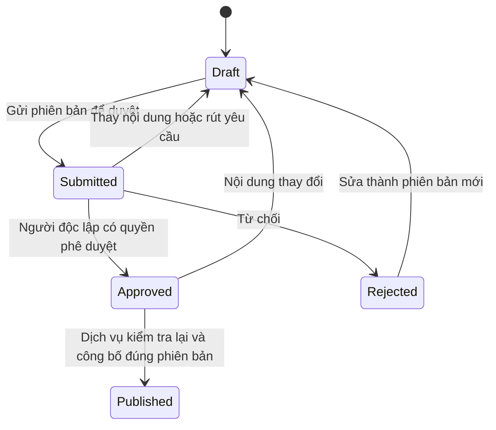

# Separation of duties

## 1. Mục tiêu và phạm vi bài học

**Separation of duties — SoD**, hay **phân tách nhiệm vụ**, là nguyên tắc phân chia các trách nhiệm hoặc quyền có xung đột để một chủ thể không thể tự mình hoàn tất toàn bộ chuỗi hành động có hậu quả cần kiểm soát.

Ví dụ, một người lập bảng kết quả có thể được sửa bản nháp, nhưng không được tự phê duyệt chính bảng đó để công bố. Một dịch vụ công bố chỉ được thực hiện trên phiên bản đã qua quyết định hợp lệ.

Trong chương **Security architecture** của module yêu cầu bảo mật, SoD cần được chuyển từ khẩu hiệu “có người kiểm tra chéo” thành:

- Các nhiệm vụ và tổ hợp quyền xung đột.
- Phạm vi tài nguyên, giao dịch và thời gian.
- Quy tắc về danh tính và tính độc lập.
- Cơ chế thực thi ở nơi cấp quyền và nơi thực hiện hành động.
- Audit, xử lý ngoại lệ, phục hồi và bằng chứng kiểm thử.

Sau bài học, bạn có thể chọn cách phân tách phù hợp, mô tả luồng phê duyệt, viết yêu cầu đo được và xác định các đường có thể vượt cơ chế.

Các vai trò, thời gian và số lượng trong ví dụ là **quy ước minh họa**, cần được xác nhận theo hậu quả nghiệp vụ và mô hình đe dọa.

## 2. SoD giải quyết vấn đề gì?

### 2.1. Không để một quyền trở thành toàn bộ chuỗi quyết định

Một hành động có hậu quả lớn thường gồm nhiều nhiệm vụ:

1. Tạo hoặc sửa nội dung.
2. Đề nghị thực hiện.
3. Xem xét và quyết định.
4. Thực thi.
5. Ghi nhận và kiểm tra sau thực hiện.

Nếu cùng một chủ thể có thể tạo nội dung, tự duyệt, thực thi và xóa dấu vết, một lỗi hoặc một lần chiếm quyền có thể đi qua toàn bộ chuỗi mà không có ranh giới độc lập.

SoD có thể giảm:

- Lạm dụng quyền của người dùng hợp lệ.
- Thao tác nhầm không được phát hiện trước khi có hậu quả.
- Phạm vi ảnh hưởng của một danh tính bị chiếm.
- Khả năng tự cấp quyền rồi tự thực hiện.
- Khả năng can thiệp cả dữ liệu và bằng chứng điều tra.

SoD không bảo đảm người phê duyệt luôn phát hiện sai sót và không loại bỏ thông đồng. Những giới hạn đó phải được đánh giá riêng.

### 2.2. Phân biệt với các nguyên tắc gần nhau

| Khái niệm | Trọng tâm | Quan hệ với SoD |
| --- | --- | --- |
| Least privilege — quyền tối thiểu | Một chủ thể chỉ có quyền cần cho nhiệm vụ | Có thể vẫn cho một người toàn bộ chuỗi nếu nhiệm vụ được gộp quá rộng |
| Kiểm soát theo vai trò | Cấp quyền qua các nhóm trách nhiệm | Cần thêm quy tắc ngăn một người giữ hoặc dùng các vai trò xung đột |
| Maker–checker | Một bên chuẩn bị, bên khác kiểm tra và quyết định | Là một cách áp dụng SoD |
| Dual control | Một hành động cần sự tham gia độc lập theo quy tắc đã định | Phải nêu rõ cần bao nhiêu chủ thể và họ làm gì |
| Split knowledge | Phân chia hiểu biết hoặc thành phần bí mật | Không tự thay thế việc phân chia quyền trong luồng nghiệp vụ |
| MFA | Kiểm chứng danh tính bằng nhiều yếu tố | Một người dùng nhiều yếu tố vẫn chỉ là một người |

Hai bước đăng nhập, hai mật khẩu hoặc hai nút bấm không tự tạo thành hai bên độc lập.

Cũng cần phân biệt “một người lập và một người duyệt” với “một người lập và hai người duyệt độc lập”. Hai chính sách này cần tổng số chủ thể khác nhau; yêu cầu phải nói rõ người lập có được tính trong số đó hay không.

## 3. Phân tách tĩnh và phân tách động

### 3.1. Phân tách tĩnh theo quyền được cấp

**Phân tách tĩnh** ngăn một chủ thể đồng thời được cấp các vai trò hoặc quyền xung đột trong phạm vi đã xác định.

Ví dụ:

> Người quản trị chính sách quyền không được đồng thời giữ vai trò phê duyệt kết quả trong cùng môi trường sản xuất.

Nơi thực thi có thể là hệ thống cấp quyền, quản lý nhóm hoặc quy trình phê duyệt vai trò.

Ưu điểm là ngăn tổ hợp quyền sớm. Hạn chế là có thể giảm tính linh hoạt nếu phạm vi xung đột được định nghĩa quá rộng.

Không chỉ kiểm tra tên vai trò được gán trực tiếp. Quyền hiệu lực có thể đến từ nhóm lồng nhau, kế thừa, ủy quyền, tài khoản khác hoặc một hệ thống tích hợp.

### 3.2. Phân tách động theo hành động thực tế

**Phân tách động** kiểm soát việc sử dụng các nhiệm vụ xung đột theo ngữ cảnh, chẳng hạn phiên hoặc giao dịch. Trong ví dụ của bài, trọng tâm là giao dịch và phiên bản nội dung.

Ví dụ:

> Một người có thể giữ quyền biên tập và phê duyệt, nhưng không được phê duyệt lô kết quả mà chính người đó đã tạo hoặc sửa nội dung.

Người đó có thể phê duyệt lô khác nếu đáp ứng quyền và điều kiện. Cơ chế cần theo dõi ai thực sự tham gia từng nhiệm vụ, không chỉ vai trò đang được chọn ở giao diện.

Đổi phiên, đổi vai trò đang kích hoạt hoặc dùng tài khoản thứ hai không được làm mất liên kết tới cùng một người nếu chính sách yêu cầu độc lập về con người.

### 3.3. Có thể kết hợp hai cách

| Ràng buộc | Cách áp dụng minh họa |
| --- | --- |
| Không đồng thời quản trị chính sách và phê duyệt nghiệp vụ | Kiểm tra khi cấp quyền và rà soát quyền hiệu lực |
| Không tự duyệt lô mình đã sửa | Kiểm tra theo lịch sử người tham gia giao dịch |
| Chỉ dịch vụ công bố được ghi sang vùng đã phát hành | Giới hạn danh tính thực thi |
| Người vận hành ứng dụng không xóa được audit đã thu thập | Tách miền quyền và kiểm tra thao tác thực tế |

Cách kết hợp cần dựa trên rủi ro, số người, quy mô và khả năng vận hành. Không mặc định mọi nhiệm vụ đều phải tách thành một người riêng.

## 4. Định nghĩa xung đột đủ chính xác

### 4.1. Xung đột phải có phạm vi

Câu “người tạo không được duyệt” cần được làm rõ:

- Người tạo đối tượng nào?
- Có bao gồm người sửa nội dung không?
- Tính theo tài khoản hay cùng một người?
- Áp dụng cho lớp, tổ chức, môi trường hoặc toàn hệ thống?
- Áp dụng cho toàn bộ vòng đời hay chỉ một giao dịch?
- Khi tạo phiên bản mới, lịch sử tham gia được giữ thế nào?
- Ủy quyền có thay đổi tính xung đột không?
- Thay đổi nội dung sau phê duyệt có làm quyết định cũ mất hiệu lực không?

Quy tắc mơ hồ có thể dẫn đến hai cách triển khai đều cho rằng mình đúng nhưng có hậu quả khác nhau.

### 4.2. Một số tổ hợp cần xem xét

| Chuỗi nhiệm vụ | Tổ hợp có thể xung đột | Hậu quả cần quan tâm |
| --- | --- | --- |
| Công bố kết quả | Sửa nội dung và duyệt cùng lô | Tự thông qua thay đổi trái phép |
| Cấp quyền | Đề nghị và tự duyệt quyền của mình | Tự mở rộng khả năng truy cập |
| Triển khai | Sửa hiện vật và tự cho phép phát hành phần quan trọng | Đưa thay đổi chưa được xem xét vào môi trường |
| Audit | Thay đổi dữ liệu và sửa hoặc xóa bằng chứng liên quan | Che giấu thao tác |
| Phục hồi | Thực hiện phục hồi và tự xác nhận mọi trạng thái quyền | Mở lại quyền cũ mà thiếu kiểm tra phù hợp |
| Khóa và dữ liệu | Một chủ thể kiểm soát cả chính sách khóa và toàn bộ dữ liệu liên quan | Tăng phạm vi ảnh hưởng khi danh tính đó bị chiếm |

Đây là các điểm cần phân tích, không phải danh sách cấm dùng chung mọi quyền trong mọi hệ thống. Mức phân tách cần có lý do nghiệp vụ và kỹ thuật.

### 4.3. Tính độc lập dựa trên danh tính thực

Nếu chính sách yêu cầu hai người, phải có cách liên kết tài khoản với người tương ứng từ nguồn có thẩm quyền. Hai tài khoản của một người không được tính thành hai người.

Đối với:

- **Tài khoản dịch vụ:** cần biết ứng dụng nào điều khiển và quyền nào được dùng.
- **Ủy quyền:** cần lưu người được ủy quyền, người ủy quyền, phạm vi và thời hạn.
- **Tài khoản khẩn cấp:** cần biết ai sử dụng trong khoảng thời gian nào.
- **Nhóm quyền:** cần tính cả quyền kế thừa và hiệu lực thực tế.

Không tin mã người phê duyệt hoặc vai trò do máy khách gửi lên để quyết định tính độc lập.

Một dịch vụ thực thi không mặc nhiên là “người duyệt thứ hai”. Nếu chính sách cần kiểm tra của con người, việc gọi thêm một dịch vụ không đáp ứng chính sách đó.

## 5. Ví dụ: công bố một lô kết quả học tập

### 5.1. Mục tiêu nghiệp vụ

Một nền tảng cho phép chuẩn bị và công bố lô kết quả cho một kỳ đánh giá. Kết quả đã công bố có ảnh hưởng đến học viên, nên tổ chức giả định yêu cầu:

- Có người chuẩn bị nội dung.
- Có người khác có thẩm quyền kiểm tra và duyệt.
- Dịch vụ chỉ công bố đúng phiên bản đã duyệt.
- Mọi thay đổi và quyết định được truy vết.
- Phục hồi không làm sống lại quyết định cũ không còn hợp lệ.

Trong ví dụ, người đã tạo hoặc sửa nội dung của lô được coi là người tham gia chuẩn bị. Họ không được phê duyệt cùng lô. Việc sửa nội dung sau khi gửi duyệt tạo phiên bản mới và làm mất hiệu lực của quyết định dành cho nội dung cũ.

### 5.2. Các vai trò minh họa

| Vai trò | Được làm | Giới hạn chính |
| --- | --- | --- |
| EDITOR | Tạo, sửa và gửi lô trong phạm vi được giao | Không duyệt lô mình đã tham gia chuẩn bị |
| APPROVER | Xem và quyết định trong phạm vi có thẩm quyền | Không tự duyệt, không sửa nội dung như một phần của quyết định |
| PUBLISHER_SERVICE | Công bố phiên bản đủ điều kiện | Không tạo phê duyệt hoặc thay nội dung |
| POLICY_ADMIN | Đề xuất, quản trị chính sách theo quy trình riêng | Không đồng thời là APPROVER trong phạm vi sản xuất của ví dụ |
| PLATFORM_OPERATOR | Vận hành, khắc phục và phục hồi theo quyền | Không mặc nhiên có thẩm quyền duyệt nghiệp vụ |
| AUDITOR | Đọc bằng chứng trong phạm vi được cấp | Không sửa dữ liệu nghiệp vụ hoặc xóa bằng chứng ngoài quyền |

EDITOR và APPROVER có thể cùng được gán cho một người trong ví dụ này, nhưng ràng buộc động cấm tự duyệt cùng lô. Ràng buộc tĩnh giữa POLICY_ADMIN và APPROVER được áp dụng riêng.

Bảng vai trò không phải toàn bộ chính sách. Cần thêm phạm vi lớp, kỳ đánh giá, trạng thái, danh tính và các đường thực hiện.

## 6. Thiết kế luồng và ràng buộc phiên bản

### 6.1. Trạng thái minh họa



Sơ đồ thể hiện điều kiện nghiệp vụ mong muốn. Mỗi chuyển trạng thái phải có kiểm tra phía máy chủ, không chỉ dựa vào nút đang được hiển thị.

Trong ví dụ:

- Một phiên bản đang chờ duyệt không được âm thầm thay nội dung.
- Một quyết định chỉ áp dụng cho phiên bản và phạm vi đã được xem xét.
- Người chuẩn bị không thể trở thành người độc lập bằng cách tạo phiên bản tiếp theo của cùng lô.
- Nếu người có cả EDITOR và APPROVER sửa nội dung qua quyền EDITOR, họ được ghi nhận là người chuẩn bị và không được duyệt cùng lô.
- Nội dung đã công bố muốn thay đổi phải đi qua quy trình hiệu chỉnh đã xác định, không sửa trực tiếp như bản nháp.

Quy tắc giữ lịch sử người tham gia qua các phiên bản là lựa chọn của tình huống này. Một tổ chức dùng quy tắc khác phải mô tả rõ điều kiện và rủi ro tương ứng.

### 6.2. Quyết định phải gắn với nội dung được duyệt

Nếu chỉ lưu “lô này đã được duyệt”, người sửa có thể thay nội dung sau đó và tận dụng quyết định cũ.

Hồ sơ quyết định cần xác định ít nhất:

- Mã lô và phạm vi nghiệp vụ.
- Phiên bản nội dung.
- Danh tính thực hiện và người tương ứng.
- Quyết định, thời điểm và điều kiện quyền.
- Phiên bản chính sách có liên quan.
- Tham chiếu nội dung hoặc cách kiểm tra nội dung không bị thay.

Ví dụ dữ liệu minh họa, không chứa thông tin xác thực:

```json
{
  "decisionId": "DEC-DEMO-017",
  "batchId": "RESULT-BATCH-042",
  "contentVersion": 7,
  "contentDigest": "DIGEST_OF_REVIEWED_CONTENT",
  "approverPersonId": "PERSON-B",
  "scope": "COURSE-A-ASSESSMENT-2",
  "policyVersion": "SOD-POLICY-3",
  "decision": "APPROVE"
}
```

Một giá trị digest hỗ trợ phát hiện thay đổi nội dung nếu được dùng đúng, nhưng không tự chứng minh ai duyệt hoặc hồ sơ quyết định chưa bị sửa. Cần bảo vệ tính toàn vẹn, quyền ghi và nguồn danh tính của chính hồ sơ.

Nếu tên học viên, kỳ đánh giá hoặc tập bản ghi là phần quyết định nghiệp vụ, chúng phải nằm trong phạm vi được ràng buộc, không chỉ ràng buộc một danh sách điểm tách rời ngữ cảnh.

### 6.3. Kiểm tra lại trước thực thi

Trong tình huống này, dịch vụ công bố cần xác nhận:

1. Lô ở trạng thái phù hợp.
2. Nội dung và phiên bản đúng với quyết định.
3. Người duyệt không thuộc nhóm người chuẩn bị theo chính sách.
4. Người duyệt có thẩm quyền tương ứng tại mốc công bố theo nguồn quyền được chỉ định.
5. Quyết định chưa bị rút hoặc vô hiệu.
6. Không có thay đổi chính sách làm điều kiện không còn hợp lệ.
7. Tác vụ chưa được thực thi theo cách tạo hậu quả trùng lặp.

Nếu quyền bị thu hồi trước khi công bố, hệ thống phải xử lý theo quy tắc hiệu lực đã xác định, thay vì chỉ nhìn trạng thái APPROVED.

Quyền thay đổi sau khi công bố không có nghĩa phải xóa lịch sử quyết định. Cần giữ bằng chứng về điều kiện ở thời điểm thực hiện và dùng quy trình hiệu chỉnh nếu phát hiện vấn đề.

### 6.4. Tính nhất quán khi có thao tác đồng thời

Hai yêu cầu cùng lúc có thể làm một quy tắc đúng ở từng bước trở nên sai ở toàn bộ chuỗi:

- Người duyệt xem phiên bản 7.
- Một người khác tạo phiên bản 8.
- Hệ thống dùng quyết định cho phiên bản 7 nhưng công bố dữ liệu hiện tại là phiên bản 8.

Thiết kế phải ràng buộc kiểm tra với chuyển trạng thái và dữ liệu thực sự được ghi. Có thể dùng cơ chế giao dịch, kiểm tra phiên bản hoặc phương án tương đương phù hợp với kiến trúc.

Một phép kiểm tra trước rồi ghi sau, không phát hiện dữ liệu đã đổi, chưa đủ bảo đảm điều kiện này.

Tương tự, hai tác vụ công bố lặp không nên tạo hai hậu quả ngoài thiết kế. Cần có quy tắc xử lý lại và nhận diện cùng một hành động.

## 7. Các đường đe dọa cần xem xét

| Mã | Kịch bản | Điểm yếu hoặc điều kiện cần xác minh | Hậu quả |
| --- | --- | --- | --- |
| T-SOD-01 | Một người dùng hai tài khoản để lập và duyệt | So sánh tên tài khoản mà không đối chiếu người tương ứng | Tự duyệt dưới hai danh tính kỹ thuật |
| T-SOD-02 | Nội dung được sửa sau phê duyệt | Quyết định không ràng buộc phiên bản hoặc phạm vi | Công bố dữ liệu chưa được xem xét |
| T-SOD-03 | Gọi API, nhập tệp hoặc worker để bỏ qua bước duyệt | Kiểm soát chỉ có ở giao diện hoặc một đường xử lý | Tự hoàn tất chuỗi ngoài quy trình |
| T-SOD-04 | Dùng nhóm kế thừa hoặc ủy quyền để có quyền xung đột | Không tính quyền hiệu lực và người thực hiện thực tế | Vượt ràng buộc vai trò hoặc giao dịch |
| T-SOD-05 | Tự đổi chính sách, cấp quyền rồi duyệt | Quản trị chính sách và quyết định nghiệp vụ không được phân tách phù hợp | Tự tạo điều kiện cho hành vi của mình |
| T-SOD-06 | Đổi nội dung hoặc quyền trong lúc công bố | Kiểm tra và thực hiện không ràng buộc nhất quán | Quyết định cũ được dùng cho trạng thái mới |
| T-SOD-07 | Can thiệp audit sau thay đổi | Người tác động dữ liệu cũng sửa hoặc xóa được bằng chứng | Che giấu hành động và khó khôi phục đúng |
| T-SOD-08 | Phục hồi trạng thái APPROVED cũ | Chỉ khôi phục dữ liệu mà không đối chiếu quyền, chính sách và quyết định | Tái kích hoạt việc công bố không còn hợp lệ |

Đây là kịch bản cần phân tích, không phải kết luận rằng một hệ thống cụ thể đã có lỗ hổng.

### 7.1. Đường quản trị có thể mạnh hơn đường nghiệp vụ

Một quy trình duyệt chặt vẫn có thể bị vượt nếu một tài khoản thường dùng có thể:

- Ghi trực tiếp vào vùng kết quả đã công bố.
- Sửa danh tính người chuẩn bị hoặc người duyệt trong cơ sở dữ liệu.
- Thay mã thực thi mà không có kiểm soát thay đổi phù hợp.
- Tắt chính sách quyền và sửa audit.
- Khôi phục bản sao cũ rồi tự mở lại dịch vụ.

Cần xem cả mặt phẳng quản trị, triển khai và phục hồi. Không chỉ phân vai trong màn hình nghiệp vụ.

Nếu một danh tính có quyền kiểm soát toàn bộ các cơ chế thực thi và bằng chứng, không nên tuyên bố SoD kỹ thuật đã ngăn được mọi hành vi của danh tính đó. Cần giới hạn quyền thường ngày, kiểm soát quyền khẩn cấp, tạo kiểm tra độc lập và ghi rủi ro còn lại.

### 7.2. Ủy quyền không được xóa lịch sử nguồn

Khi một người thực hiện thay người khác, hồ sơ cần giữ người thao tác thực tế và quan hệ đại diện. Chính sách phải xác định cách xét xung đột với cả hai.

Không cho phép dùng ủy quyền để làm người đề nghị biến mất khỏi lịch sử hoặc biến một lần tự duyệt thành quyết định độc lập.

## 8. Đặt kiểm soát ở đúng điểm kiến trúc

### 8.1. Các điểm thực thi cần có

| Điểm | Trách nhiệm |
| --- | --- |
| Quản lý danh tính | Liên kết tài khoản với người hoặc workload từ nguồn có thẩm quyền |
| Cấp quyền | Kiểm tra tổ hợp tĩnh, phạm vi, thời hạn và quyền hiệu lực |
| API nghiệp vụ | Kiểm tra vai trò, phạm vi, trạng thái và người đã tham gia |
| Kho phiên bản, quyết định | Bảo vệ nội dung và liên kết của phê duyệt |
| Worker công bố | Chỉ thực thi đúng hành động và phiên bản đủ điều kiện |
| Kho đã công bố | Chặn ghi ngoài danh tính, giao diện và phạm vi được phép |
| Thay đổi chính sách | Không cho một người tự đề nghị và tự duyệt thay đổi mở đường cho mình |
| Audit | Thu thập đủ bằng chứng, tách quyền sửa hoặc xóa |
| Phục hồi | Không khôi phục nguyên trạng quyền và quyết định cũ như thể chúng còn hiệu lực |

Cơ chế có thể là một ứng dụng nguyên khối hoặc nhiều dịch vụ. Tách thành microservice không tự tạo SoD nếu mọi dịch vụ dùng chung một danh tính có toàn quyền.

### 8.2. Ràng buộc không chỉ nằm ở giao diện

API, nhập tệp, công cụ quản trị, tác vụ định kỳ và thông điệp hàng đợi cần dùng cùng ý nghĩa của quy tắc. Có thể dùng chính sách dùng chung hoặc cách thực thi tương đương, nhưng cần kiểm chứng từng đường.

Thông điệp “đã duyệt” do máy khách hoặc tác vụ không có thẩm quyền gửi không được coi là quyết định. Worker phải kiểm tra nguồn và hồ sơ quyết định có thẩm quyền.

Danh tính dịch vụ phải đủ để thực thi nhiệm vụ, nhưng không được tự ghi một hồ sơ duyệt để làm hợp lệ công việc của chính mình.

### 8.3. Khi nguồn quyền hoặc chính sách không sẵn sàng

Đối với công bố kết quả có hậu quả quan trọng, tình huống minh họa chọn giữ yêu cầu ở trạng thái chưa công bố khi không xác minh được điều kiện bắt buộc.

Cần đặc tả thêm:

- Loại lỗi nào tạo trạng thái chờ.
- Điều kiện thử lại và cách tránh lặp vô hạn.
- Ai nhận cảnh báo.
- Cách bảo toàn nội dung và audit.
- Phương án vận hành khi kéo dài.
- Ngoại lệ khẩn cấp có được phép hay không.

Không để lỗi kỹ thuật tự biến thành một nhánh “bỏ qua phê duyệt”.

## 9. Đặc tả yêu cầu bảo mật có thể kiểm chứng

### 9.1. Mẫu yêu cầu

Có thể viết:

> Với [phạm vi], [chủ thể hoặc thành phần] phải [hành vi hoặc giới hạn] khi [điều kiện], đạt [kết quả]. Kiểm chứng bằng [phương pháp] và lưu [bằng chứng].

Mỗi yêu cầu nên có mã, rủi ro liên quan, nơi thực hiện và người xác nhận. Không chỉ ghi “cần người duyệt khác” mà bỏ cách xác định khác người, khác phạm vi và đúng phiên bản.

### 9.2. SEC-SOD-01 — Danh tính và tính độc lập

Các thao tác chuẩn bị, phê duyệt, cấp quyền và sử dụng quyền khẩn cấp phải ghi nhận danh tính đã được kiểm chứng. Với chính sách cần hai người, hệ thống phải đối chiếu định danh người từ nguồn có thẩm quyền, không chỉ so sánh tài khoản.

Truy cập tương tác để duyệt hoặc quản trị phải tuân theo điều kiện xác thực được phê duyệt cho vai trò. Danh tính dịch vụ phải được phân biệt với người và không được tính như một người duyệt độc lập trong chính sách của ví dụ.

- Liên quan: T-SOD-01, T-SOD-04.
- Kiểm chứng: một người có hai tài khoản, đổi phiên, đổi vai trò và gửi mã người duyệt giả.
- Kết quả đạt: không tạo được quyết định tự duyệt; chủ thể thật và quan hệ đại diện được ghi đúng.
- Bằng chứng: nguồn liên kết danh tính, chính sách và kết quả thử.

MFA tăng độ tin cậy xác thực nhưng không biến hai tài khoản cùng người thành hai bên độc lập.

### 9.3. SEC-SOD-02 — Ngăn tổ hợp quyền tĩnh xung đột

Trong phạm vi sản xuất của ví dụ, thao tác cấp hoặc thay đổi quyền không được làm một người có đồng thời quyền POLICY_ADMIN và APPROVER.

Kiểm tra phải tính quyền trực tiếp, nhóm lồng nhau, kế thừa và ủy quyền theo chính sách. Việc đổi thành viên nhóm cũng phải được xem là thay đổi có thể phát sinh xung đột.

- Liên quan: T-SOD-04, T-SOD-05.
- Điểm thực hiện: cấp quyền, quản lý nhóm và đối chiếu quyền hiệu lực.
- Kiểm chứng: cấp trực tiếp, thêm qua nhóm, thay nhóm cha và ủy quyền tạo cùng tổ hợp.
- Kết quả đạt: thay đổi gây xung đột không được có hiệu lực.
- Bằng chứng: cấu hình xung đột, quyền hiệu lực trước–sau và sự kiện từ chối.

Những xung đột đã tồn tại khi chuyển đổi chính sách cần kế hoạch xử lý riêng. Không xóa quyền một cách tùy tiện mà thiếu đánh giá vận hành, nhưng cũng không bỏ qua chúng trong báo cáo.

### 9.4. SEC-SOD-03 — Không tự phê duyệt theo giao dịch

Đối với một lô kết quả, người có quyền phê duyệt phải không thuộc tập người đã tạo hoặc sửa nội dung của cùng lô theo lịch sử có thẩm quyền.

Lịch sử phải được hệ thống ghi nhận và bảo vệ, không lấy từ danh sách người chuẩn bị do máy khách gửi. Chuyển tài khoản, vai trò hoặc tạo phiên bản mới của cùng lô không được xóa xung đột.

- Liên quan: T-SOD-01, T-SOD-03, T-SOD-04.
- Điểm thực hiện: API duyệt và mọi đường tạo quyết định tương đương.
- Kiểm chứng: người chuẩn bị tự duyệt, dùng tài khoản thứ hai, dùng quyền được ủy quyền và sửa danh sách người tham gia.
- Kết quả đạt: không có quyết định hợp lệ được tạo từ chủ thể xung đột.
- Bằng chứng: lịch sử người tham gia, nguồn danh tính và kết quả.

Người độc lập vẫn phải có quyền với đúng lớp và kỳ đánh giá. “Khác người chuẩn bị” là điều kiện cần, không phải toàn bộ điều kiện cấp quyền.

### 9.5. SEC-SOD-04 — Ràng buộc quyết định với nội dung và trạng thái

Quyết định phải gắn với mã lô, phiên bản nội dung, phạm vi và chính sách liên quan. Thay đổi nội dung được duyệt phải làm quyết định cũ không còn đủ điều kiện cho phiên bản mới.

Kiểm tra quyền, xung đột, phiên bản và chuyển trạng thái phải có cơ chế nhất quán để không dùng dữ liệu cũ cho thao tác mới.

- Liên quan: T-SOD-02, T-SOD-06.
- Kiểm chứng: sửa nội dung sau duyệt; thay phạm vi; gửi hai yêu cầu đồng thời; gửi quyết định cho phiên bản cũ; phát lại tác vụ.
- Kết quả đạt: chỉ đúng phiên bản đủ điều kiện được công bố; không có thay đổi chưa duyệt hoặc hậu quả lặp ngoài chính sách.
- Bằng chứng: quyết định, phiên bản, trạng thái và kết quả thử đồng thời.

Phê duyệt cho “bất kỳ nội dung hiện tại nào của lô” không đáp ứng ràng buộc này.

### 9.6. SEC-SOD-05 — Thực thi qua danh tính và giao diện được giới hạn

Chỉ PUBLISHER_SERVICE được ghi vào vùng kết quả đã công bố qua giao diện đã thiết kế. Dịch vụ phải kiểm tra đủ điều kiện của quyết định và không có quyền tạo phê duyệt cho công việc của mình.

Tài khoản biên tập, phê duyệt và vận hành thông thường không được ghi trực tiếp để vượt quy trình. Các đường nhập tệp, công cụ quản trị và tác vụ nền phải thực thi cùng quy tắc.

- Liên quan: T-SOD-03, T-SOD-05.
- Kiểm chứng: gọi API nội bộ trái quyền, ghi qua giao diện lưu trữ, dùng công cụ nhập và đưa thông điệp giả đã duyệt.
- Kết quả đạt: không có đường ghi ngoài thẩm quyền; luồng hợp lệ công bố đúng nội dung.
- Bằng chứng: ma trận danh tính–quyền, chính sách lưu trữ và kết quả thử.

Quyền đặc biệt có thể vượt một số ranh giới phải được nhận diện, quản trị riêng và đưa vào đánh giá rủi ro. Không giấu chúng bằng một sơ đồ chỉ có đường nghiệp vụ.

### 9.7. SEC-SOD-06 — Audit và tách quyền bằng chứng

Các sự kiện cấp quyền, thay chính sách, tạo hoặc sửa lô, duyệt, từ chối, công bố, dùng quyền khẩn cấp và phục hồi phải ghi chủ thể, người tương ứng hoặc quan hệ đại diện, tài nguyên, phiên bản, hành động, thời điểm và kết quả.

Trong ví dụ, sự kiện phải có tại kho audit trung tâm trong tối đa 5 phút. Người vận hành ứng dụng thông thường không được sửa hoặc xóa sự kiện đã thu thập. Không ghi token, mật khẩu hoặc toàn bộ dữ liệu học viên vượt nhu cầu điều tra.

- Liên quan: T-SOD-05, T-SOD-07.
- Kiểm chứng: thao tác hợp lệ và bị từ chối, thử sửa hoặc xóa audit, kiểm tra dữ liệu log và đo độ trễ.
- Kết quả đạt: có sự kiện liên kết đúng phiên bản và chủ thể; thao tác ngoài quyền bị từ chối.
- Bằng chứng: hợp đồng sự kiện, chính sách kho audit và kết quả.

Phải đặc tả cảnh báo khi mất luồng hoặc không chuyển được sự kiện nếu đó là điều kiện của lập luận an toàn. Audit không thay thế việc ngăn tự duyệt.

### 9.8. SEC-SOD-07 — Phục hồi không tái kích hoạt quyết định cũ

Sau phục hồi, một lô có trạng thái APPROVED trong backup không được tự công bố nếu chưa xác minh nội dung, quyền, tính độc lập và hiệu lực quyết định theo nguồn hiện hành.

Trong kịch bản minh họa đã thống nhất, mục tiêu là RPO không quá 15 phút và RTO không quá 60 phút. RPO là khoảng dữ liệu có thể mất trước sự cố; RTO được đo từ lúc công bố sự cố đến khi luồng hợp lệ hoạt động với dữ liệu và quyền đã kiểm tra.

- Liên quan: T-SOD-08.
- Kiểm chứng: tạo backup, thu hồi quyền hoặc quyết định, thay chính sách rồi phục hồi bản sao cũ.
- Kết quả đạt: quyết định không còn hợp lệ không được sử dụng; quyền chưa xác minh không được tự kích hoạt; mục tiêu được đáp ứng trong kịch bản.
- Bằng chứng: nguồn trạng thái, biên bản, mốc thời gian và kết quả kiểm tra lô.

Nếu không xác minh được lịch sử cần thiết, phải giữ hành động có hậu quả ở trạng thái chưa được phép và dùng phương án xác nhận lại đã định. Không đánh đổi điều kiện SoD để đạt thời gian phục hồi.

## 10. Biểu diễn các bất biến cần giữ

Các điều kiện có thể được mô tả ngắn để cùng hiểu:

```text
Người duyệt không thuộc tập người chuẩn bị của cùng lô.
Quyết định tham chiếu đúng mã lô, phiên bản và phạm vi được công bố.
Người duyệt đáp ứng thẩm quyền tại mốc mà chính sách yêu cầu.
Quyết định chưa bị vô hiệu.
Danh tính công bố không tự tạo quyết định duyệt.
Chuyển trạng thái không sử dụng một phiên bản đã thay đổi.
Quyền khẩn cấp và phục hồi không âm thầm bỏ qua các điều kiện.
```

Đây là bất biến thiết kế, không phải mã chạy sẵn. Việc thực hiện cần nguồn danh tính đúng, dữ liệu lịch sử được bảo vệ và cơ chế nhất quán phù hợp.

Một phép so sánh hai trường mã người không đủ nếu cả hai đều do máy khách kiểm soát. Tương tự, một cờ APPROVED không đủ nếu người sửa có thể thay cờ hoặc thay nội dung sau đó.

## 11. Truy vết yêu cầu với rủi ro và bằng chứng

| Đường đe dọa | Yêu cầu | Điểm kiến trúc | Bằng chứng chấp nhận |
| --- | --- | --- | --- |
| Tự duyệt qua nhiều tài khoản hoặc ủy quyền | SEC-SOD-01, SEC-SOD-03 | Nguồn danh tính, API duyệt, lịch sử | Thử cùng người dưới nhiều tài khoản và vai trò |
| Cấp tổ hợp quyền xung đột | SEC-SOD-02 | Cấp quyền và quản lý nhóm | Quyền hiệu lực không phát sinh xung đột |
| Dùng phê duyệt cho nội dung khác | SEC-SOD-04 | Kho phiên bản, quyết định, chuyển trạng thái | Thử đổi nội dung, phạm vi và xử lý đồng thời |
| Vượt quy trình qua đường khác | SEC-SOD-05 | API, worker, nhập dữ liệu, kho đã công bố | Thử mọi đường ghi và danh tính ngoài quyền |
| Che giấu dấu vết | SEC-SOD-06 | Nguồn và kho audit | Thử sửa, xóa, kiểm tra độ trễ và nội dung |
| Khôi phục quyết định đã mất hiệu lực | SEC-SOD-07 | Backup, nguồn quyền và phục hồi | Diễn tập với thay đổi sau điểm backup |

Bảng là kế hoạch kiểm chứng, không phải báo cáo rằng các phép thử đã được thực hiện.

## 12. Thiết kế kiểm thử có ý nghĩa

### 12.1. Ma trận tối thiểu

| Tình huống | Kết quả mong đợi |
| --- | --- |
| Người đúng quyền và không tham gia chuẩn bị duyệt đúng phiên bản | Cho phép theo chính sách |
| Người tạo hoặc sửa tự duyệt | Từ chối |
| Hai tài khoản cùng người lập và duyệt | Từ chối |
| Người khác nhưng ngoài phạm vi lớp hoặc kỳ đánh giá | Từ chối |
| Người duyệt thay nội dung rồi dùng quyết định cũ | Không công bố phiên bản mới |
| Quyền xung đột phát sinh qua nhóm lồng nhau | Không cho thay đổi có hiệu lực |
| Hai yêu cầu đổi nội dung và công bố đồng thời | Không công bố nội dung chưa được duyệt |
| Worker nhận thông điệp tự khai đã duyệt | Không thực thi nếu thiếu hồ sơ có thẩm quyền |
| Danh tính vận hành thường ngày ghi trực tiếp vùng đã công bố | Từ chối |
| Phục hồi lô đã bị rút phê duyệt | Không tự công bố |
| Dịch vụ công bố chạy lại cùng công việc | Không tạo hậu quả lặp ngoài thiết kế |
| Tài khoản ứng dụng thử xóa audit | Từ chối |

Phải thử qua giao diện, API, nhập tệp và tác vụ nền nếu chúng tồn tại. Không chỉ kiểm tra nút duyệt đã bị ẩn.

### 12.2. Ví dụ đặc tả hành vi

```gherkin
Given một lô thử do người A tạo và sửa nội dung
And người A có hai tài khoản đều liên kết tới cùng định danh người
And tài khoản thứ hai có quyền APPROVER trong phạm vi
When người A dùng tài khoản thứ hai để duyệt lô
Then hệ thống từ chối tạo quyết định hợp lệ
And trạng thái cùng nội dung của lô không bị thay đổi ngoài chính sách
And audit ghi nhận chủ thể cùng kết quả nhưng không chứa bí mật
```

Đối với ràng buộc phiên bản:

```gherkin
Given phiên bản 7 đã được người độc lập có quyền phê duyệt
When nội dung được sửa thành phiên bản 8
And một tác vụ cũ yêu cầu công bố bằng quyết định của phiên bản 7
Then phiên bản 8 không được công bố bằng quyết định đó
And hệ thống giữ được tham chiếu lịch sử và kết quả từ chối
```

Dùng dữ liệu tổng hợp và kiểm tra cả trạng thái sau thao tác. Một phản hồi lỗi chưa đủ nếu dữ liệu đã được công bố trước khi trả lỗi.

### 12.3. Phạm vi và giới hạn của kết quả

Kết quả đạt ở một đường không chứng minh đường khác dùng cùng kiểm soát. Cần ghi phiên bản, môi trường, nguồn danh tính và điều kiện thử.

Kiểm tra hai người khác nhau không chứng minh họ không thông đồng. SoD làm một số hành vi khó thực hiện một mình hơn, nhưng cần đánh giá riêng hành vi phối hợp hoặc việc chiếm nhiều danh tính.

## 13. Vận hành SoD mà không biến thành thủ tục hình thức

### 13.1. Người duyệt phải có thông tin để quyết định

Tính độc lập về danh tính chưa đủ nếu người duyệt không biết đang duyệt điều gì.

Giao diện và quy trình nên cung cấp đúng phiên bản, phạm vi, thay đổi quan trọng, cảnh báo và căn cứ cần thiết. Kết quả hiển thị phải tương ứng với nội dung sẽ được công bố.

Hệ thống có thể chứng minh người nào đã tạo quyết định cho phiên bản nào. Nó không tự chứng minh người đó đã hiểu đầy đủ hoặc đánh giá đúng. Chất lượng kiểm tra nghiệp vụ cần quy trình, năng lực và đánh giá phù hợp.

Không dùng một dấu xác nhận “đã mở màn hình” làm bằng chứng duy nhất về chất lượng xem xét.

### 13.2. Khi thiếu người duyệt

Cần có phương án:

- Phân công người thay thế có thẩm quyền và không xung đột.
- Ủy quyền có phạm vi, thời hạn và audit.
- Xử lý yêu cầu tồn đọng theo mức ưu tiên.
- Thông báo cho chủ sở hữu khi không đáp ứng được thời hạn nghiệp vụ.
- Dùng đường khẩn cấp chỉ khi cơ chế quản trị cho phép.

Không tự động chuyển về tự duyệt khi hàng đợi quá lâu. Nếu không thể bảo đảm người độc lập, cần thay đổi phạm vi hoặc quyết định theo thẩm quyền, thay vì để hệ thống âm thầm bỏ điều kiện.

Đối với nhóm nhỏ, có thể cần người kiểm tra từ nhóm khác hoặc giảm số hành động phải qua quy trình, dựa trên hậu quả. Đây là lựa chọn kiến trúc và vận hành cần được xác nhận, không phải lý do mặc định bỏ SoD.

### 13.3. Quyền khẩn cấp và ngoại lệ

Một đường khẩn cấp cần nêu:

- Loại sự kiện cho phép dùng.
- Ai có thẩm quyền kích hoạt và ai chịu trách nhiệm.
- Hành động, dữ liệu, môi trường và thời gian.
- Điều kiện xác thực, ghi nhận và thông báo.
- Thời điểm thu hồi cùng kiểm tra sau sử dụng.
- Cách xử lý phần rủi ro và trạng thái yêu cầu chưa đáp ứng.

Nếu ngoại lệ cho phép một sai lệch so với quy tắc thường, hồ sơ phải ghi đúng sai lệch. Không đánh dấu rằng quy tắc độc lập thông thường đã đạt chỉ vì có ngoại lệ.

Quyền khẩn cấp không nên trở thành quyền mặc định tồn tại vô thời hạn. Việc kiểm tra sau sử dụng không thay thế cho thẩm quyền phải có trước hoặc cơ chế khẩn cấp đã được định nghĩa.

### 13.4. Những giới hạn cần giữ trong đánh giá rủi ro

SoD vẫn có thể bị suy yếu bởi:

- Hai người thông đồng.
- Một tác nhân chiếm nhiều danh tính độc lập.
- Nguồn liên kết tài khoản–người không chính xác.
- Người duyệt chỉ xác nhận hình thức.
- Quyền quản trị vượt mọi điểm thực thi.
- Mã hoặc chính sách bị thay trái phép.
- Nguồn audit và dữ liệu bị cùng một chủ thể kiểm soát.
- Phụ thuộc phục hồi không hoạt động như giả định.

Cần mô tả rủi ro còn lại theo đường gây hại và hậu quả, không chỉ ghi “có SoD nên thấp”.

## 14. Duy trì trong vòng đời phát triển

### 14.1. Khi thiết kế

Xác định hành động có hậu quả, nhiệm vụ cần tách và phạm vi xung đột trước khi chọn vai trò.

Quyết định sớm đâu là ràng buộc tĩnh, đâu là ràng buộc động và dữ liệu nào cần để thực thi. Kiểm tra cả quyền thường ngày lẫn quản trị, triển khai và phục hồi.

### 14.2. Khi xây dựng và triển khai

Gắn yêu cầu với API, tác vụ nền và kho dữ liệu. Bảo vệ các trường người tham gia, quyết định, phiên bản và trạng thái.

Nếu dùng nhiều bản sao dịch vụ hoặc nhiều hệ thống cấp quyền, cần xác định tính nhất quán và thời điểm hiệu lực. Kiểm soát chỉ ở một bản sao hoặc một giao diện có thể để lại đường vượt.

Thay đổi kiểm soát SoD cũng là thay đổi có ảnh hưởng bảo mật, cần được xem xét trong luồng quản lý thay đổi đã xác định.

### 14.3. Khi vận hành

Rà soát khi có:

- Thêm vai trò, nhóm, kế thừa hoặc cơ chế ủy quyền.
- Thay nguồn danh tính và liên kết người–tài khoản.
- Mở rộng phạm vi lớp, tổ chức hoặc môi trường.
- Thêm nhập tệp, API, công cụ quản trị hoặc worker.
- Thay đổi chính sách phê duyệt và phiên bản nội dung.
- Thay quy trình khẩn cấp hoặc phục hồi.
- Sự cố hoặc thử nghiệm cho thấy một đường vượt chưa được mô tả.

Các chỉ báo hữu ích có thể gồm tổ hợp quyền xung đột, lần tự duyệt bị từ chối, quyền tạm quá hạn, thay đổi chính sách và công bố không có liên kết quyết định đầy đủ.

Một lần bị từ chối không tự chứng minh ý đồ xấu. Chỉ báo cần dẫn đến xác minh theo bối cảnh, tránh kết luận vượt bằng chứng.

### 14.4. Khi ngừng sử dụng

Thu hồi quyền, ủy quyền, danh tính dịch vụ và tác vụ chờ. Giữ lịch sử quyết định theo chính sách tài liệu, đồng thời bảo đảm dữ liệu lưu trữ không còn đường công bố ngoài quy trình.

Không đóng phạm vi chỉ vì giao diện cũ đã bị gỡ nếu API, worker hoặc quyền ghi vẫn còn.

## 15. Những sai lầm thường gặp

| Sai lầm | Vấn đề | Cách cải thiện |
| --- | --- | --- |
| Hai tài khoản được coi là hai người | Một người vẫn tự hoàn tất chuỗi | Đối chiếu định danh người từ nguồn có thẩm quyền |
| Có hai vai trò là coi đã có SoD | Cùng người có thể dùng cả hai trên cùng lô | Thêm ràng buộc cấp quyền hoặc giao dịch |
| Chỉ ẩn nút tự duyệt | API và tác vụ khác có thể bỏ qua | Thực thi phía máy chủ trên mọi đường |
| Duyệt không gắn phiên bản | Nội dung sau đó có thể khác nội dung đã xem | Ràng buộc quyết định với nội dung và phạm vi |
| Tạo phiên bản mới để xóa lịch sử người chuẩn bị | Lách ràng buộc động | Giữ lịch sử theo quy tắc của cùng lô |
| Dùng dịch vụ công bố như người duyệt thứ hai | Tự động hóa bị nhầm với kiểm tra độc lập | Phân biệt người quyết định và danh tính thực thi |
| Không tính nhóm kế thừa và ủy quyền | Quyền hiệu lực vượt bảng vai trò | Kiểm tra tổ hợp thực tế và nguồn đại diện |
| Kiểm tra trước rồi ghi sau không ràng buộc | Trạng thái có thể đổi giữa hai bước | Dùng cơ chế nhất quán phù hợp và thử đồng thời |
| Quản trị viên thường ngày sửa được mọi dữ liệu và audit | Ranh giới nghiệp vụ có thể bị vượt | Giới hạn quyền, tách miền và quản trị quyền đặc biệt |
| Khẩn cấp được hiểu là bỏ kiểm soát không thời hạn | Tạo đường vượt lâu dài | Định nghĩa thẩm quyền, phạm vi, hết hạn và kiểm tra |
| Phục hồi nguyên trạng APPROVED | Quyết định cũ bị dùng khi đã mất hiệu lực | Xác minh lại quyền, phiên bản và chính sách |
| Cho rằng hai người không thể thông đồng | Kết luận vượt khả năng của kiểm soát | Ghi giới hạn và biện pháp phát hiện phù hợp |

## 16. Bài tập tự thực hành

Một cổng quản lý tài liệu có luồng soạn, duyệt và phát hành. Một người có thể có nhiều tài khoản; quyền đến từ nhóm lồng nhau. Dịch vụ phát hành đọc cờ APPROVED từ cơ sở dữ liệu và có thể phát lại công việc khi lỗi.

Hãy thực hiện:

1. Chọn tài sản và hậu quả cần bảo vệ.
2. Xác định nhiệm vụ nào cần độc lập và phạm vi áp dụng.
3. Đề xuất một ràng buộc tĩnh và một ràng buộc động.
4. Giải thích cách xử lý hai tài khoản cùng người.
5. Thiết kế dữ liệu ràng buộc quyết định với phiên bản tài liệu.
6. Mô tả việc sửa nội dung sau khi duyệt.
7. Viết yêu cầu ngăn dịch vụ tự tạo quyết định cho mình.
8. Thiết kế phép thử nhóm kế thừa, thao tác đồng thời và phát lại.
9. Viết yêu cầu audit không chứa bí mật.
10. Mô tả phục hồi khi một quyết định hoặc quyền đã bị thu hồi sau điểm backup.

Tự kiểm tra:

- Chính sách đã nói rõ độc lập giữa tài khoản, người hay tổ chức chưa?
- Người sửa nội dung có thuộc phạm vi xung đột không?
- Phiên bản mới có làm mất lịch sử cần giữ không?
- Ai có thể sửa chính sách, danh tính và bằng chứng?
- Các đường nhập, API và worker có cùng quy tắc không?
- Người phê duyệt có đủ thông tin và thẩm quyền không?
- Hệ thống xử lý thế nào nếu không xác minh được điều kiện?
- Ngoại lệ có được ghi đúng là sai lệch có giới hạn không?
- Bằng chứng thử có kiểm tra cả trạng thái dữ liệu sau thao tác không?

## 17. Những điểm cần ghi nhớ

Separation of duties phân chia các nhiệm vụ hoặc quyền xung đột để một chủ thể không tự hoàn tất chuỗi hành động cần kiểm soát. Ràng buộc có thể được áp dụng khi cấp quyền, khi dùng quyền theo giao dịch hoặc kết hợp cả hai.

Thiết kế cần gắn tính độc lập với danh tính đáng tin cậy, nội dung và phiên bản cụ thể, đồng thời thực thi qua mọi đường nghiệp vụ, quản trị và phục hồi. Bằng chứng kiểm thử phải kiểm tra quyền hiệu lực, tự duyệt, thay đổi đồng thời và đường vượt; giới hạn như thông đồng hoặc quyền quản trị toàn phần vẫn cần được ghi trong rủi ro còn lại.
