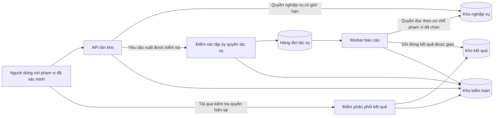

# Least privilege architecture

## 1. Kiến trúc đặc quyền tối thiểu là gì?

**Least privilege architecture — kiến trúc đặc quyền tối thiểu** là cách tổ chức danh tính, quyền và ranh giới thực thi để mỗi chủ thể chỉ có những khả năng cần thiết cho nhiệm vụ được giao, trên đúng tài nguyên, trong đúng phạm vi và thời gian cần dùng.

Chủ thể không chỉ là người dùng. API, worker, tác vụ sao lưu, công cụ triển khai, tài khoản hỗ trợ và bên tích hợp đều có thể đọc dữ liệu hoặc thay đổi hệ thống. Nếu một chủ thể bị chiếm quyền hoặc thao tác sai, quyền thực tế của nó quyết định phạm vi ảnh hưởng.

Ví dụ, worker xuất báo cáo kho cần đọc một tập dữ liệu đã được phép và ghi tệp kết quả. Nó không tự cần quyền đổi vai trò người dùng, xóa bản sao, sửa chính sách khóa hoặc truy cập môi trường khác. Tách các khả năng này giúp hạn chế tác động nếu thông tin xác thực của worker bị lộ.

Nguyên tắc này phải được thể hiện trong kiến trúc, chính sách và vòng đời vận hành. Một câu “các dịch vụ dùng quyền tối thiểu” không đủ nếu mọi dịch vụ vẫn dùng chung tài khoản toàn quyền hoặc một đường quản trị cho phép tự cấp lại quyền đó.

Trong xây dựng yêu cầu bảo mật, mục tiêu là trả lời được:

- Chủ thể nào cần làm hành động gì để hoàn thành nhiệm vụ?
- Quyền áp dụng trên tài nguyên, khách thuê, môi trường và khoảng thời gian nào?
- Điểm nào thực thi giới hạn, có đường nào bỏ qua không?
- Ai được cấp, mở rộng, chuyển giao và thu hồi quyền?
- Bằng chứng nào cho thấy chủ thể làm được việc cần thiết nhưng không làm được việc ngoài nhiệm vụ?

## 2. Phân biệt danh tính, vai trò và quyền hiệu lực

### 2.1. Những khái niệm cơ bản

| Khái niệm | Ý nghĩa trong kiến trúc |
|---|---|
| Chủ thể hoặc principal | Danh tính mà hệ thống xác thực và đánh giá quyền, như người dùng hoặc danh tính dịch vụ |
| Thông tin xác thực | Bằng chứng hoặc phương tiện để sử dụng danh tính, như khóa, chứng thư hoặc token theo thiết kế |
| Hành động | Phép toán có tác động, như đọc, sửa, xuất, cấp quyền, giải mã hoặc xóa |
| Tài nguyên | Đối tượng chịu tác động, như bản ghi, kho, hàng đợi, khóa hoặc chính sách |
| Phạm vi | Giới hạn như khách thuê, dự án, môi trường, tập đối tượng hoặc mục đích |
| Điều kiện | Yếu tố bổ sung để cho phép, như trạng thái, thời hạn, mức xác minh hoặc phê duyệt |
| Vai trò | Nhóm quyền phục vụ một chức năng, không tự bảo đảm mọi quyền trong đó đều cần thiết |
| Quyền hiệu lực | Khả năng chủ thể thực sự sử dụng được sau khi xét các cơ chế cấp quyền và đường chuyển quyền |

Xác thực cho biết danh tính nào đang được chấp nhận. Phân quyền quyết định danh tính đó được làm gì. Việc có danh tính riêng không tự làm quyền hẹp hơn; một tài khoản riêng vẫn có thể được cấp toàn quyền.

### 2.2. Quyền hiệu lực có thể lớn hơn một tệp chính sách

Khi đánh giá, cần xem quyền trực tiếp, nhóm, vai trò kế thừa, quyền tài nguyên, quyền nhận vai trò khác, thông tin xác thực có thể truy cập và khả năng thay đổi chính sách. Cách kết hợp cho phép, từ chối và điều kiện phụ thuộc cơ chế thực thi cụ thể; không nên mặc định mọi nền tảng có cùng quy tắc.

Một chủ thể không được đọc dữ liệu trực tiếp vẫn có thể đọc gián tiếp nếu được tự cấp quyền, đổi chính sách, nhận một vai trò rộng hoặc triển khai mã dưới danh tính có quyền đọc. Vì vậy, phải xét **khả năng mở quyền** cùng **quyền sử dụng tài nguyên**.

Ví dụ:

```text
Tài khoản triển khai
    → có thể thay mã của dịch vụ
    → dịch vụ chạy với danh tính đọc dữ liệu sản xuất
    → tài khoản triển khai có một đường ảnh hưởng tới dữ liệu đó
```

Chuỗi này không có nghĩa mọi tài khoản triển khai đều trực tiếp lấy được mọi dữ liệu trong mọi thiết kế. Nó chỉ ra quan hệ tin cậy cần phân tích và kiểm soát bằng quyền, phê duyệt, ranh giới môi trường và bằng chứng phù hợp.

### 2.3. Quyền chỉ đọc vẫn có thể có tác động lớn

Đọc toàn bộ dữ liệu khách hàng là một khả năng nhạy cảm dù không sửa được gì. Một vai trò chỉ đọc có thể làm lộ dữ liệu hàng loạt, đọc thông tin xác thực hoặc lấy cấu hình dùng để mở đường khác.

Do đó, tối thiểu không chỉ nghĩa là bỏ quyền ghi. Cần giới hạn cả tập dữ liệu, trường, quy mô, mục đích và đường xuất khi những chiều đó liên quan tới rủi ro.

## 3. Xác định quyền cần thiết theo nhiệm vụ

### 3.1. Mô tả nhu cầu trước khi chọn vai trò

Nên bắt đầu bằng nhiệm vụ và điều kiện hoàn thành. Ví dụ: “tạo báo cáo tồn kho cho khách thuê đã ủy quyền trong tác vụ này”, thay vì “worker cần quyền đọc cơ sở dữ liệu”.

Từ nhiệm vụ, xác định tập hành động và tài nguyên thực sự cần. Không nên chọn vai trò rộng có sẵn rồi coi mọi quyền trong đó là nhu cầu nghiệp vụ.

| Chiều giới hạn | Câu hỏi cần trả lời | Ví dụ |
|---|---|---|
| Chủ thể | Ai thực sự thực hiện và ai khởi tạo? | Worker có danh tính riêng; người yêu cầu có ngữ cảnh ủy quyền riêng |
| Hành động | Cần đọc, sửa, tạo hay xóa gì? | Đọc dữ liệu báo cáo và ghi kết quả, không quản trị vai trò |
| Tài nguyên | Đúng kho, bảng, khóa, hàng đợi hoặc đối tượng nào? | Chỉ kho kết quả của luồng báo cáo |
| Phạm vi dữ liệu | Khách thuê, dự án và tập trường nào? | Chỉ dữ liệu của tác vụ đã được duyệt |
| Môi trường | Quyền có được dùng ở nơi nào khác không? | Danh tính thử nghiệm không truy cập tài nguyên sản xuất |
| Thời gian | Khi nào bắt đầu, hết hạn hoặc phải thu hồi? | Quyền vận hành tạm thời kết thúc sau phiên bảo trì |
| Điều kiện | Cần trạng thái, mức xác minh hoặc phê duyệt gì? | Cấp quyền cao cần xác minh tăng cường và quyết định đúng thẩm quyền |
| Quy mô | Một đối tượng hay hàng loạt; có giới hạn tài nguyên không? | Xuất có phạm vi và ngân sách xử lý được xác định |

Không phải cơ chế nào cũng thực thi được mọi chiều trong một chính sách duy nhất. Kiến trúc phải chỉ rõ phần nào do ứng dụng, kho dữ liệu, dịch vụ quyền hoặc ranh giới khác thực thi, cùng giới hạn khi một thành phần bị chiếm quyền.

### 3.2. Tránh cấp quyền theo sự thuận tiện

Các lý do như “dễ triển khai”, “đỡ lỗi quyền” hoặc “sau này có thể cần” có thể dẫn tới quyền tồn tại lâu hơn nhiệm vụ. Khi chưa biết nhu cầu, nên làm rõ thao tác, tài nguyên và đường lỗi thay vì cấp rộng để bỏ qua bước phân tích.

Tuy nhiên, chia quyền quá chi tiết mà không quản lý được cũng có thể gây lỗi và tạo đường cấp lại quyền thiếu kiểm soát. Mức phân tách cần đủ để giảm tác động, có thể vận hành và có bằng chứng nhất quán.

### 3.3. Tách quyền thiết kế khỏi quyền đang có

Ma trận quyền mục tiêu phải được đối chiếu với cấu hình và quyền thực tế. Một vai trò trên sơ đồ là “đọc báo cáo” nhưng tài khoản đang chạy còn thuộc nhóm quản trị thì giới hạn thực tế khác với ý định.

Phải phân biệt quyền đã có bằng chứng, quyền dự kiến sau thay đổi và ngoại lệ tạm thời. Không dùng một kế hoạch thu hẹp quyền để trình bày rủi ro hiện tại như đã được giảm.

## 4. Đặt ranh giới thực thi trong kiến trúc

### 4.1. Tách danh tính theo nhiệm vụ và môi trường

Tách danh tính của API nghiệp vụ, worker báo cáo, gửi thông báo, triển khai, sao lưu và hỗ trợ giúp giới hạn đường sử dụng quyền. Danh tính sản xuất và thử nghiệm cũng cần ranh giới rõ.

Việc tách chỉ có ý nghĩa khi thông tin xác thực, quyền truy cập và điều khiển thực thi được bảo vệ tương ứng. Nếu mọi tiến trình cùng đọc được toàn bộ bí mật hoặc cùng có quyền điều khiển tiến trình khác, phạm vi ảnh hưởng có thể vẫn rộng.

Không nên dùng tài khoản cá nhân dùng chung để đại diện cho nhiều dịch vụ. Nó làm khó phân biệt chủ thể, thu hồi riêng và điều tra. Ngược lại, danh tính dịch vụ cũng không được trở thành đường đăng nhập quản trị tùy tiện của người vận hành.

### 4.2. Thực thi ở lớp giữ được giới hạn đang cam kết

Kiểm tra tại API bảo vệ được nhiều tình huống người dùng sửa tham số. Nhưng nếu kịch bản bao gồm chiếm toàn bộ tiến trình API, những kiểm tra trong chính tiến trình đó có thể bị bỏ qua.

Nếu cần giới hạn cả trường hợp này, phải xem quyền ở kho, ranh giới dữ liệu, dịch vụ trung gian hoặc cơ chế ủy quyền ngoài miền bị chiếm. Tách kho theo miền, quyền theo tập dữ liệu hoặc quyền ngắn hạn gắn với nhiệm vụ là các lựa chọn có thể cân nhắc theo rủi ro.

Ví dụ, một ứng dụng dùng cùng quyền đọc toàn bộ khách thuê rồi tự thêm điều kiện lọc có thể đáp ứng yêu cầu chống tráo tham số khi mã đúng. Nó không tự chứng minh cô lập khách thuê vẫn giữ nguyên khi toàn bộ ứng dụng bị kiểm soát. Mô hình đe dọa và yêu cầu phải nói rõ giới hạn này.

### 4.3. Kết hợp phân quyền mạng, dịch vụ và dữ liệu

Giới hạn đường mạng giúp thu hẹp nơi một chủ thể có thể tiếp cận. Xác thực dịch vụ xác minh danh tính ở kết nối hoặc yêu cầu. Phân quyền dữ liệu quyết định đối tượng và hành động được phép.

Các lớp này bổ sung cho nhau. Đi được tới cổng cơ sở dữ liệu không đồng nghĩa được đọc dữ liệu; không đi trực tiếp tới cơ sở dữ liệu cũng chưa loại bỏ khả năng khiến một dịch vụ có quyền đọc làm thay ngoài phạm vi.

Mã hóa dữ liệu khi lưu hoặc truyền không tự thu hẹp quyền của thành phần được phép giải mã. Cần kiểm soát cả quyền sử dụng phép toán và quyền tiếp cận bản rõ, không chỉ nơi giữ vật liệu khóa.

## 5. Ví dụ kiến trúc cho nền tảng quản lý kho

### 5.1. Phân tách các nhiệm vụ có tác động khác nhau

Giả sử hệ thống phục vụ nhiều khách thuê, gồm quản lý tồn kho, báo cáo, thông báo, hỗ trợ, triển khai và phục hồi. Một ma trận mục tiêu có thể như sau:

| Chủ thể | Quyền cần cho nhiệm vụ | Quyền không thuộc nhiệm vụ đó |
|---|---|---|
| API tồn kho | Đọc và thay đổi dữ liệu nghiệp vụ theo quyền người dùng và phạm vi khách thuê | Cấp vai trò quản trị nền tảng, xóa bản sao, đổi chính sách khóa |
| Worker báo cáo | Đọc tập dữ liệu được ủy quyền và ghi kết quả đúng tác vụ | Sửa tồn kho, thay vai trò, đọc dữ liệu ngoài tác vụ hoặc môi trường khác |
| Dịch vụ thông báo | Nhận nội dung thông báo tối thiểu và gửi theo kênh được cấu hình | Truy vấn toàn bộ kho nghiệp vụ hoặc tự xuất dữ liệu khách hàng |
| Người hỗ trợ | Tra cứu trường được phép trong phạm vi và thời hạn đã duyệt | Tự mở quyền, đọc toàn bộ dữ liệu hoặc sửa bằng chứng điều tra |
| Tác vụ di chuyển cấu trúc dữ liệu | Thực hiện thay đổi cấu trúc trong môi trường và thời gian được cấp | Dùng cùng quyền đó làm danh tính chạy thường xuyên của API |
| Thành phần ghi kiểm toán | Ghi sự kiện từ nguồn được phép vào phạm vi chỉ định | Cho ứng dụng tự sửa hoặc xóa lịch sử đã ghi |
| Thành phần sao lưu/phục hồi | Các phép tạo hoặc phục hồi bản sao theo quy trình được cấp | Tự đồng thời mở quyền đọc mọi bản sao, xóa lịch sử và thay chính sách bảo vệ |

Ma trận này là mục tiêu minh họa. Quyền cần cho sao lưu hoặc thay cấu trúc phụ thuộc nền tảng thực tế; phải kiểm tra khả năng hiệu lực thay vì suy rằng tên vai trò đã tạo ra đúng giới hạn.

### 5.2. Sơ đồ các điểm kiểm tra chính



Sơ đồ không tự chứng minh worker đã bị giới hạn theo tác vụ. Cần chỉ rõ cơ chế ở điểm xác lập ủy quyền, quyền dữ liệu và cách bảo vệ thông điệp. Nếu mọi quyền chỉ nằm trong chính worker đang được giả định có thể bị chiếm, mức bảo vệ thực tế khác với lời cam kết.

Mỗi mũi tên cũng cần danh tính và quyền riêng. Quyền gửi một loại thông điệp không tự bao gồm quyền nhận mọi thông điệp, sửa quyền hàng đợi hoặc thay danh tính worker.

### 5.3. Giảm dữ liệu được cấp, không chỉ giảm thao tác

Báo cáo có thể chỉ cần mã hàng, số lượng và trạng thái kho. Nếu không cần giá vốn hoặc ghi chú thương lượng, không nên mang những trường đó tới worker chỉ để xóa ở bước cuối.

Giới hạn đầu ra vẫn cần thiết, nhưng thu hẹp dữ liệu ở nguồn hoặc ranh giới có thể thực thi phù hợp giúp giảm dữ liệu mà thành phần phải giữ. Cần đánh giá xem việc thu hẹp có còn hiệu lực khi thành phần yêu cầu dữ liệu bị chiếm quyền không.

## 6. Ủy quyền và công việc bất đồng bộ

### 6.1. Quyền của dịch vụ và quyền được giao là hai lớp

Một tác vụ xuất thường có ít nhất ba câu hỏi:

1. Người khởi tạo có được yêu cầu hành động này trên tập dữ liệu này không?
2. Dịch vụ thực thi có được dùng các tài nguyên cần cho hành động không?
3. Tác vụ cụ thể đang giữ phạm vi, thời hạn và trạng thái ủy quyền nào?

Chỉ kiểm tra một lớp có thể để lại khoảng trống. Worker có danh tính hợp lệ nhưng nhận khách thuê tùy ý vẫn có thể làm thay ngoài quyền. Người tạo đúng quyền nhưng dịch vụ dùng tài khoản toàn quyền vẫn để lại rủi ro khi dịch vụ bị chiếm.

Cần xác lập phạm vi từ nguồn tin cậy, bảo vệ nguồn gốc và toàn vẹn thông điệp, xác minh quan hệ đối tượng và xử lý quyền thay đổi. Không nên sao chép thông tin xác thực rộng của người dùng vào mọi hàng đợi như một cách mặc định để truyền quyền.

### 6.2. Mẫu mô tả quyền ở mức khái niệm

Ví dụ sau mô tả ý định thiết kế, không phải cú pháp chính sách của một sản phẩm:

```yaml
principal: report-worker-production
task: generate_scoped_inventory_report
allowed_actions:
  - read_approved_inventory_projection
  - create_assigned_report_result
resource_scope:
  tenant: from_validated_delegation
  dataset: from_authorized_job
  output: assigned_result_location
conditions:
  delegation_is_authentic: required
  delegation_is_current: required
  job_state_allows_execution: required
administrative_capabilities:
  role_management: excluded_from_this_grant
  key_policy_change: excluded_from_this_grant
  backup_deletion: excluded_from_this_grant
```

Không có quyền trong mẫu cấp này chưa chứng minh chủ thể bị cấm bởi toàn bộ hệ thống. Phải kiểm tra chủ thể có nhận những khả năng đó từ nhóm, chính sách tài nguyên, vai trò khác hoặc thông tin xác thực khác không.

Quyền theo tác vụ cũng có giới hạn. Một worker xử lý nhiều tác vụ hợp lệ có thể tiếp cận dữ liệu của các tác vụ đó. Nếu cần giảm tác động hơn nữa, có thể phải tách miền thực thi hoặc thu hẹp quyền được cấp theo từng thời điểm, với chi phí và phương án phục hồi tương ứng.

### 6.3. Trạng thái quyền thay đổi trong thời gian chờ

Quyền lúc tạo tác vụ không nhất thiết còn hiệu lực khi worker chạy hoặc người dùng tải kết quả. Đặc tả phải nêu các thời điểm kiểm tra và cách xử lý tác vụ đang chờ, đang chạy, đã hoàn tất khi quyền thay đổi.

Ví dụ, dự án có thể yêu cầu kiểm tra lại trước chạy và mỗi lần tải, đồng thời chặn phân phối khi quyền đã bị thu hồi. Nếu còn cho phép hoàn tất xử lý nội bộ, phải xác định quyền giữ dữ liệu và thời hạn kết quả theo chính sách.

Tham chiếu khó đoán hoặc liên kết tải có thời hạn không tự thay thế phân quyền. Nếu liên kết tự mang quyền độc lập, cần đánh giá người cầm liên kết có thể làm gì và khả năng thu hồi có đáp ứng yêu cầu không.

## 7. Vòng đời đặc quyền của con người và công cụ

### 7.1. Hạn chế đặc quyền thường trực

Quyền dùng thường xuyên có thể tồn tại theo quan hệ công việc nếu phạm vi đủ hẹp và được rà soát. Không phải mọi quyền đều cần cấp lại cho từng yêu cầu.

Với quyền tác động lớn, có thể áp dụng **just-in-time** — cấp khi cần trong thời hạn xác định, và **just-enough access** — chỉ cấp đúng khả năng cần cho nhiệm vụ. Ví dụ, một phiên hỗ trợ được phép xem một tập trường của một khách thuê thay vì mở quyền đọc mọi dữ liệu sản xuất.

Yêu cầu cần ghi người đề nghị, mục đích, tài nguyên, hành động, người phê duyệt nếu cần, thời điểm hết hạn và cơ chế thu hồi. Ghi một ngày hết hạn trong hồ sơ nhưng quyền thực tế còn vô thời hạn chưa đáp ứng điều kiện.

### 7.2. Bảo vệ khả năng cấp quyền

Quyền sửa vai trò, thêm thành viên, tạo thông tin xác thực, nhận danh tính khác, đổi chính sách và triển khai mã đều có thể tạo tác động gián tiếp. Những khả năng này phải nằm trong mô hình đặc quyền, không chỉ những hành động đọc hoặc ghi dữ liệu cuối cùng.

Đối với quyết định lớn, có thể cần phê duyệt độc lập và ràng buộc phê duyệt với nội dung cụ thể. Hai tài khoản khác nhau không tự chứng minh hai người độc lập nếu cùng một bên kiểm soát cả hai. Phải nêu giả định và rủi ro liên quan.

Người có quyền tạo bản sao không nhất thiết cần tự mở quyền đọc bản sao, đổi chính sách giữ hoặc xóa các bằng chứng cùng lúc. Phân tách nhiệm vụ giúp hạn chế một chủ thể tự hoàn tất toàn bộ chuỗi gây hại.

### 7.3. Khởi tạo, khẩn cấp và phục hồi

Kiến trúc cần tính cả cách cấp quyền đầu tiên, đổi danh tính dịch vụ, thay thông tin xác thực và xử lý khi hệ thống quản lý quyền gián đoạn. Các luồng này dễ trở thành đường bỏ qua giới hạn ở luồng thường ngày.

Cơ chế khẩn cấp có thể cần quyền rộng hơn, nhưng phải có căn cứ, chủ thể được phép, phạm vi, thời hạn, bảo vệ thông tin xác thực và bằng chứng sử dụng. Sau phiên phải thu hồi, đối soát và xử lý những thay đổi đã thực hiện theo kế hoạch.

Không nên giải quyết sự cố phân quyền bằng một tài khoản dùng chung luôn có toàn quyền mà không có quản lý riêng. Nếu một khả năng đặc biệt cần tồn tại để phục hồi, nó phải được đưa vào mô hình rủi ro và kiểm chứng như một phần của kiến trúc.

## 8. Chuyển nguyên tắc thành yêu cầu kiểm chứng được

Các thời hạn sau là **giá trị minh họa của một dự án giả định**, cần được lựa chọn theo tác động, cơ chế thực thi và năng lực vận hành.

| Mã | Yêu cầu | Tiêu chí chấp nhận |
|---|---|---|
| LP-01 | API nghiệp vụ, worker, triển khai và sao lưu phải có danh tính tách theo nhiệm vụ và môi trường; quyền của danh tính thử nghiệm không được truy cập tài nguyên sản xuất. | Kiểm tra gán quyền và đường lấy thông tin xác thực; dùng từng danh tính để thử hành động ở nhiệm vụ hoặc môi trường khác. |
| LP-02 | Mọi hành động nghiệp vụ phải kiểm tra quyền theo chủ thể, hành động, đối tượng và khách thuê tại điểm máy chủ được thiết kế; giá trị từ bên gọi không tự cấp quyền. | Thử tài khoản đúng danh tính nhưng sai hành động, tài nguyên hoặc khách thuê qua API và các đường thay thế. |
| LP-03 | Tác vụ báo cáo phải giữ phạm vi ủy quyền tin cậy; quyền đọc dữ liệu và ghi kết quả được giới hạn theo cơ chế ranh giới đã chọn, không chỉ dựa vào tham số do worker hoặc khách tự khai. | Tráo tác vụ, tham chiếu và phạm vi; kiểm tra cả quyền thực tế và khả năng truy cập ngoài phạm vi trong mô hình chiếm quyền đã xác định. |
| LP-04 | Danh tính chạy thường xuyên của API và worker không được có khả năng quản trị vai trò, tự mở rộng quyền, đổi chính sách khóa hoặc xóa bản sao nếu nhiệm vụ không yêu cầu. | Kiểm tra quyền trực tiếp, kế thừa, nhận vai trò, tạo thông tin xác thực và đường triển khai; thử thao tác ngoài nhiệm vụ. |
| LP-05 | Dữ liệu cấp cho báo cáo phải giới hạn ở tập trường và tập đối tượng đã duyệt; không mang dữ liệu nội bộ khác tới thành phần chỉ vì thuận tiện xử lý. | Thêm trường nội bộ vào nguồn, thử nhiều phạm vi và đường xuất; thành phần nhận không lấy được dữ liệu ngoài quyết định cấp. |
| LP-06 | Thông tin xác thực phải được cấp và truy cập theo danh tính, nhiệm vụ, môi trường; không lưu toàn bộ bí mật trong một vùng đọc chung cho mọi tiến trình. | Kiểm tra cấu hình và quyền đọc kho bí mật; từng tiến trình không lấy được thông tin của chủ thể khác ngoài ủy quyền đã duyệt. |
| LP-07 | Quyền vận hành đặc biệt trong luồng minh họa chỉ được cấp tối đa 30 phút; hết hạn không được mở hành động mới bằng quyền đó. Hành động cấp quyền cao yêu cầu mức xác minh tăng cường đã duyệt có độ mới tối đa 5 phút. | Thử trước, tại và sau mốc hết hạn, phiên chưa đủ mức và quá hạn xác minh; quyền thực tế không tồn tại ngoài điều kiện. |
| LP-08 | Cấp, thay đổi, nhận và thu hồi đặc quyền phải có sự kiện kiểm toán gồm danh tính, phạm vi, hành động, kết quả, thời gian và tham chiếu quyết định; sự kiện tới kho kiểm toán trong 5 phút. | Đối chiếu thao tác với sự kiện, thử đường từ chối và gián đoạn thu thập; kiểm tra người thực hiện không tự sửa/xóa bằng chứng ngoài quyền. |
| LP-09 | Nếu không xác định được quyền hợp lệ hoặc điều kiện cấp, hành động phải bị từ chối hoặc chờ theo hợp đồng lỗi; dữ liệu cache chỉ được dùng trong điều kiện hiệu lực đã duyệt. | Gây lỗi phụ thuộc, thiếu ngữ cảnh, dữ liệu cũ và hết hạn cache; không có cơ chế mặc định mở quyền. |
| LP-10 | Thu hồi sớm quyền hoặc thông tin xác thực thuộc phạm vi quản lý phải có hiệu lực tại các điểm phụ thuộc trong 60 giây, gồm bộ nhớ đệm và tác vụ liên quan theo chính sách. | Dùng quyền cũ qua nhiều phiên, dịch vụ và worker; đo hiệu lực thực tế, không chỉ trạng thái trên màn hình. |
| LP-11 | Phục hồi phải giữ đúng ranh giới môi trường và áp dụng lại thu hồi, hết hạn đặc quyền, chấm dứt ủy quyền có hiệu lực sau bản sao trước khi phục vụ tài nguyên liên quan. | Khôi phục bản sao cũ có quyền từng hợp lệ; không mở lại quyền đã thu hồi hoặc đưa dữ liệu sản xuất tới chủ thể thử nghiệm ngoài quyết định được phép. |
| LP-12 | Mọi đường cấp quyền mới hoặc mở rộng tài nguyên phải được đánh giá quyền hiệu lực, rủi ro và bằng chứng trước khi mở phạm vi liên quan; ngoại lệ có chủ sở hữu, thẩm quyền và ngày hết hạn. | Kiểm tra hồ sơ thay đổi, quyền triển khai và ngoại lệ hết hạn; không dùng cấu hình mục tiêu hoặc phê duyệt cũ để hợp thức hóa phạm vi mới. |

LP-03 phải phù hợp với lời cam kết kiến trúc. Nếu chỉ chứng minh được chống người dùng tráo tham số, không được kết luận đã giới hạn mọi khả năng của một worker bị kiểm soát toàn bộ.

LP-06 yêu cầu cô lập quyền tiếp cận, không chỉ đặt tên bí mật khác nhau. Nếu cùng danh tính có quyền đọc mọi tên hoặc cùng môi trường thực thi làm lộ mọi thông tin, phạm vi vẫn chưa hẹp như mô tả.

LP-10 cần liệt kê quyền và thông tin nào được thu hồi. Kết thúc phiên người dùng không tự vô hiệu hóa mọi khóa tích hợp, tác vụ hoặc liên kết đã phát hành. Những cơ chế này cần đường thực thi và kiểm chứng riêng.

## 9. Liên kết kiến trúc với mô hình đe dọa

### 9.1. Chọn giới hạn theo kịch bản bị chiếm quyền

| Kịch bản | Phạm vi quyền cần xem | Kiểm soát trọng tâm | Giới hạn của kết luận |
|---|---|---|---|
| Người dùng A biết mã tài nguyên B | Quyền ứng dụng và quan hệ khách thuê | Kiểm tra chủ thể, hành động, đối tượng tại máy chủ | Không tự chứng minh an toàn khi toàn bộ máy chủ bị chiếm |
| Lộ thông tin xác thực worker | Mọi giao diện và tài nguyên chấp nhận danh tính đó | Quyền hẹp, phạm vi tác vụ, thời hạn và thu hồi | Hoạt động vẫn trong quyền đã cấp có thể còn bị lạm dụng |
| Kiểm soát tiến trình worker | Quyền dữ liệu, thông tin trong bộ nhớ, bí mật và đường gọi của tiến trình | Ranh giới ngoài miền bị chiếm, cô lập và giảm dữ liệu | Kiểm tra chỉ trong chính tiến trình không đủ làm ranh giới độc lập |
| Lạm dụng tài khoản triển khai | Khả năng sửa mã, cấu hình và danh tính chạy mã | Giới hạn môi trường, quy trình thay đổi, phê duyệt và bằng chứng | Không thể chỉ nhìn quyền đọc dữ liệu trực tiếp của tài khoản |
| Lạm dụng tài khoản hỗ trợ | Truy vấn, xuất, nhận vai trò và công cụ bỏ qua luồng chính | Quyền theo nhiệm vụ, thời hạn, dữ liệu tối thiểu và audit | Che ở giao diện chưa ngăn được đường truy vấn hoặc xuất khác |
| Xóa hoặc phục hồi sai bản sao | Quyền tạo, đọc, xóa, thay chính sách và quyền dùng khóa | Phân tách nhiệm vụ, bảo vệ lịch sử và diễn tập | Có bản sao không tự bảo đảm đọc lại được đúng quyền |

Không nên giả định mọi tác nhân đồng thời kiểm soát mọi tầng, nhưng cũng không được giới hạn tác nhân quá yếu chỉ để chứng minh thiết kế đúng. Cần ghi khả năng, quyền ban đầu và phạm vi của từng kết luận.

### 9.2. Ví dụ chuỗi truy vết

```text
Tài sản: dữ liệu tồn kho theo khách thuê và quyền quản trị người dùng.
Tác nhân: bên lấy được thông tin xác thực của worker báo cáo.
Điều kiện yếu: worker có quyền đọc rộng và có đường tự nhận vai trò quản trị.
Hậu quả: từ một nhiệm vụ báo cáo mở rộng sang dữ liệu và quyền của miền khác.
Yêu cầu: LP-03, LP-04, LP-06, LP-08, LP-10.
Thiết kế: ràng buộc tác vụ, quyền dữ liệu phù hợp, bỏ đường tự mở quyền,
          tách bí mật, ghi sự kiện và có cơ chế thu hồi.
Bằng chứng: kiểm tra quyền hiệu lực, thử ngoài phạm vi, thử mở quyền,
            kiểm tra đường lấy bí mật và thời gian thu hồi.
Phần còn lại: các tài sản và hành động vẫn được cấp hợp lệ cho nhiệm vụ.
```

Giảm quyền không đồng nghĩa mất mọi rủi ro. Một danh tính chỉ đọc đúng dữ liệu cần cho công việc vẫn có thể bị dùng để đọc trái mục đích. Nếu tác động còn vượt giới hạn, cần giảm dữ liệu hoặc quy mô, thêm điều kiện thực hiện, phát hiện và khoanh vùng theo rủi ro.

## 10. Kiểm chứng quyền được phép và quyền phải bị từ chối

### 10.1. Ma trận kiểm thử theo nhiệm vụ

Một cơ chế từ chối mọi thứ không đáp ứng mục tiêu nghiệp vụ. Cần kiểm tra cả hoạt động hợp lệ và khả năng ngoài nhiệm vụ.

| Chủ thể thử | Trường hợp được phép | Trường hợp phải bị từ chối theo thiết kế ví dụ |
|---|---|---|
| Người dùng kho A | Thao tác đúng quyền trên dữ liệu A | Tráo tài nguyên sang B, sửa trường vai trò hoặc khách thuê |
| Worker báo cáo | Đọc tập dữ liệu và ghi đúng kết quả được giao | Sửa tồn kho, cấp vai trò, đọc tác vụ ngoài phạm vi, đổi chính sách khóa |
| Dịch vụ thông báo | Nhận thông điệp và gửi theo nhiệm vụ | Truy vấn toàn bộ dữ liệu nghiệp vụ hoặc đọc bí mật worker |
| Người hỗ trợ có phiên tạm | Tra cứu đúng trường và phạm vi đã duyệt | Truy vấn khách thuê khác, xuất toàn bộ, tiếp tục sau hết hạn |
| Tác vụ thay cấu trúc | Thực hiện thay đổi đúng cửa sổ và môi trường | Dùng quyền đó qua danh tính runtime hoặc thao tác môi trường ngoài phạm vi |
| Ứng dụng ghi kiểm toán | Ghi sự kiện đúng nguồn và phạm vi | Sửa hoặc xóa lịch sử ngoài quyền được duyệt |
| Danh tính thử nghiệm | Sử dụng dữ liệu và tài nguyên thử | Lấy bí mật, đọc dữ liệu hoặc gọi vai trò sản xuất |

Kỳ vọng phải khớp ranh giới đã cam kết. Nếu một lớp chỉ lọc trường đầu ra, việc trả đúng tập trường không chứng minh tài khoản cơ sở dữ liệu không đọc được trường khác. Cần kiểm tra quyền ở đúng lớp nếu tuyên bố bao gồm lớp đó.

### 10.2. Kiểm tra các đường tạo quyền gián tiếp

Ngoài ma trận hành động cuối cùng, cần xem khả năng:

- Thêm mình vào nhóm hoặc sửa ánh xạ vai trò.
- Tạo, thay hoặc đọc thông tin xác thực của chủ thể khác.
- Nhận danh tính khác hoặc truyền một danh tính nhiều quyền cho công việc mới.
- Thay chính sách của tài nguyên, khóa, kho, hàng đợi hoặc bản sao.
- Sửa mã hoặc cấu hình của thành phần có quyền rộng hơn.
- Tắt, sửa hoặc xóa bằng chứng theo dõi việc sử dụng quyền.

Danh sách này được dùng để rà soát và kiểm thử trong phạm vi được xác định. Không nên chỉ tìm quyền có tên “admin”, vì nhiều khả năng kết hợp có thể tạo tác động quản trị mà không mang nhãn đó.

### 10.3. Kiểm tra trạng thái, lỗi và cấu hình thật

Cần thử quyền mới cấp, quyền hết hạn, thu hồi giữa lúc chờ hoặc đang xử lý, trạng thái phê duyệt thay đổi và yêu cầu đồng thời. Khi kho quyền hoặc dịch vụ xác minh lỗi, hành vi phải đúng hợp đồng, không tự mở một quyền mặc định.

Kiểm chứng nên bao gồm quyền trên môi trường phục vụ hoặc môi trường đại diện đủ căn cứ, cách cấp thông tin xác thực, cache, API cũ, công cụ hỗ trợ và phục hồi. Bằng chứng phải ghi rõ phiên bản, cấu hình và giới hạn.

Một yêu cầu trả lỗi vẫn có thể đã tạo tệp, sửa dữ liệu hoặc mở quyền trước đó. Vì vậy, cần đối chiếu cả nội dung trả về, trạng thái lưu và sự kiện, không chỉ mã phản hồi.

## 11. Thu hẹp quyền trong hệ thống đang tồn tại

### 11.1. Kiểm kê và đối chiếu nhiệm vụ

Bắt đầu từ danh tính, thông tin xác thực, quyền trực tiếp và gián tiếp, tài nguyên, nơi sử dụng và chủ sở hữu. So sánh với nhiệm vụ để tìm quyền không có căn cứ hoặc được giữ lại sau thay đổi.

Log sử dụng giúp phát hiện quyền đang được dùng, nhưng không phải tập đầy đủ quyền cần thiết. Hoạt động theo kỳ, đường lỗi và phục hồi có thể chưa xuất hiện trong khoảng quan sát. Cần kết hợp hiểu biết thiết kế, người vận hành và thử nghiệm những luồng đó.

Một quyền lâu không dùng có thể là ứng viên để thu hồi, không tự là bằng chứng rằng việc thu hồi không có tác động. Ngược lại, việc một quyền thường được dùng không chứng minh nó cần giữ rộng nếu thiết kế có thể thu hẹp tài nguyên hoặc dữ liệu.

### 11.2. Triển khai thay đổi có kiểm soát

Có thể tách danh tính theo nhiệm vụ, cấp tập quyền mục tiêu, thử các luồng hợp lệ và phủ định, rồi loại bỏ những đường cấp rộng còn lại theo kế hoạch. Trong giai đoạn phiên bản cũ và mới cùng chạy, quyền hiệu lực có thể vẫn là quyền rộng nếu đường cũ còn tồn tại.

Cần xác định thời điểm thu hồi thông tin cũ, xử lý worker đang chạy, cache và công cụ hỗ trợ. Đánh dấu một vai trò mới là “least privilege” chưa hoàn tất nếu chủ thể vẫn nhận vai trò quản trị qua nhóm khác.

Nếu xảy ra lỗi do thiếu quyền, cần xác định thao tác và phạm vi còn thiếu. Không nên mặc định khôi phục toàn quyền. Có thể sửa quyền hẹp, dừng một phần chức năng hoặc dùng phương án tạm thời đúng thẩm quyền, có thời hạn và bằng chứng.

### 11.3. Phục hồi và rollback giữ đúng giới hạn

Kế hoạch rollback phải xét mã, cấu hình, quyền và thông tin xác thực còn hợp lệ. Quay lại phiên bản cũ có thể yêu cầu quyền rộng hơn hoặc không hiểu phạm vi mới; điều đó phải được đánh giá trước.

Phục hồi bản sao có thể đưa lại thành viên nhóm, chính sách hoặc token từng hợp lệ. Cần áp dụng lại quyết định thu hồi và hết hạn trước khi cho thực hiện hành động liên quan. Danh tính phục hồi cũng phải có phạm vi và nguồn cấp quyền được bảo vệ.

Thành công không chỉ là dịch vụ khởi động lại. Cần xác nhận chức năng đúng, dữ liệu ở đúng môi trường, quyền hiện hành đúng và không có đường cũ tự mở lại.

## 12. Chi phí, đánh đổi và rủi ro còn lại

Tách nhiều danh tính và phạm vi có thể tăng công việc cấp phát, quan sát và phục hồi. Kiểm tra quyền tập trung có thể tạo phụ thuộc về độ trễ hoặc sự sẵn sàng. Quyền ngắn hạn cần cơ chế cấp lại và nguồn thời gian đáng tin cậy theo thiết kế.

Các đánh đổi cần được xử lý bằng kiến trúc và yêu cầu, chẳng hạn quản lý vòng đời nhất quán, mẫu quyền theo nhiệm vụ, cache có giới hạn hiệu lực, kiểm soát thay đổi và diễn tập. Không nên chỉ thêm quyền rộng để giảm độ phức tạp rồi vẫn tuyên bố phạm vi đã được giới hạn.

Không nhất thiết mọi khách thuê phải có một hạ tầng riêng. Có thể dùng ranh giới logic hoặc vật lý khác nhau tùy tác động, khả năng thực thi và nguồn lực. Quyết định phải nói rõ mô hình bị chiếm quyền nào được giới hạn, bằng chứng và phần còn lại.

Least privilege cũng không tự ngăn lỗi trong hành động đã được phép, dữ liệu đã bị đọc hoặc thông đồng giữa các chủ thể. Nó thu hẹp khả năng và phạm vi ảnh hưởng; các yêu cầu về toàn vẹn nghiệp vụ, logging, phát hiện, ứng phó và phục hồi vẫn cần được lựa chọn theo kịch bản.

## 13. Những sai lầm thường gặp

| Sai lầm | Vì sao chưa đủ | Cách làm rõ |
|---|---|---|
| Ít vai trò hơn là ít đặc quyền hơn | Một vai trò chung có thể chứa mọi khả năng | Đánh giá hành động, tài nguyên và quyền hiệu lực |
| Có tài khoản riêng là đã cô lập | Tài khoản có thể cùng đọc mọi bí mật hoặc có toàn quyền | Kiểm tra quyền và ranh giới thực thi thực tế |
| Chỉ đọc thì tác động thấp | Có thể đọc dữ liệu hàng loạt hoặc thông tin mở đường khác | Giới hạn tập dữ liệu, trường, quy mô và mục đích |
| API đã lọc khách thuê nên mọi tầng an toàn | Tiến trình bị chiếm có thể dùng quyền rộng ở tầng dưới | Nêu mô hình đe dọa và điểm thực thi giữ được giới hạn |
| Không có quyền trực tiếp thì không có khả năng | Có thể nhận vai trò, đổi chính sách hoặc sửa mã có quyền | Xem chuỗi quyền và đường chuyển quyền |
| Bỏ quyền khỏi một chính sách là đã thu hồi | Nhóm, chính sách tài nguyên hoặc thông tin khác có thể còn cấp | Kiểm tra lại quyền hiệu lực và các điểm phụ thuộc |
| Quyền khẩn cấp không cần ràng buộc | Đường phục hồi có thể thành đường quản trị thường trực | Xác định người dùng, phạm vi, thời hạn, bảo vệ và đối soát |
| Kiểm thử từ chối là đủ | Có thể chặn cả nghiệp vụ hoặc còn tác dụng phụ | Kiểm tra dương, phủ định, trạng thái và dữ liệu thực tế |
| Log chưa thấy dùng nên chắc chắn bỏ được | Chưa bao phủ tác vụ theo kỳ, lỗi hoặc phục hồi | Kết hợp nhiệm vụ, quan sát và thử các luồng ít gặp |

## 14. Đầu ra cần có của một thiết kế đặc quyền tối thiểu

Nhóm cần chuyển giao được:

1. **Danh sách chủ thể và nhiệm vụ:** người dùng, dịch vụ, triển khai, vận hành, tích hợp và phục hồi.
2. **Ma trận quyền:** hành động, tài nguyên, dữ liệu, khách thuê, môi trường, thời gian và điều kiện.
3. **Ranh giới thực thi:** lớp giữ từng giới hạn, nguồn ngữ cảnh tin cậy và đường có thể bỏ qua.
4. **Phân tích quyền hiệu lực:** cấp trực tiếp, kế thừa, nhận vai trò, khả năng tạo thông tin và mở quyền gián tiếp.
5. **Yêu cầu vòng đời:** cấp, sử dụng, thay đổi, thu hồi, đặc quyền tạm thời và trường hợp khẩn cấp.
6. **Bằng chứng kiểm chứng:** hành động đúng nhiệm vụ, ngoài nhiệm vụ, trạng thái thay đổi, lỗi và phục hồi.
7. **Quyết định rủi ro còn lại:** phạm vi đã bảo vệ, giả định, ngoại lệ, chủ sở hữu và điều kiện cần rà soát.

Kiến trúc đặc quyền tối thiểu có giá trị khi quyền thực tế phù hợp với nhiệm vụ và ranh giới đã cam kết. Khi mỗi quyền được nối với tài sản, kịch bản rủi ro, yêu cầu và bằng chứng, nhóm có thể giải thích quyền đó cần để làm gì, giới hạn ở đâu và cách thu hồi khi điều kiện sử dụng không còn đúng.
