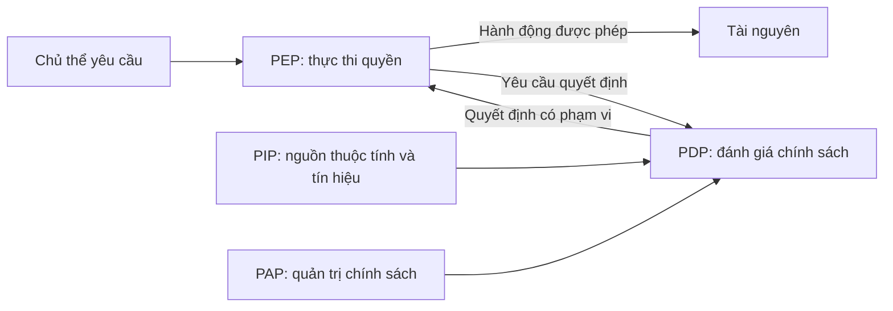
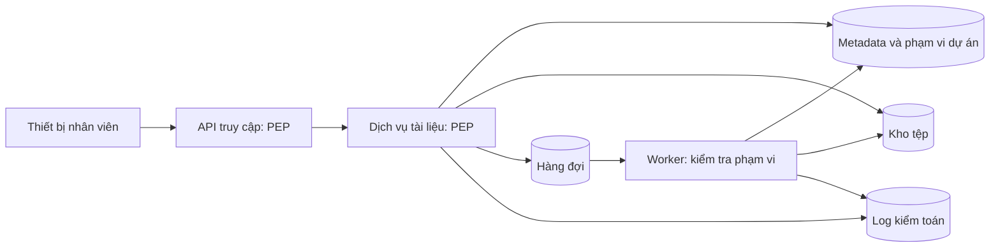

# Zero trust boundary

## 1. Hiểu đúng zero trust boundary

**Zero trust** là cách tiếp cận thiết kế bảo mật trong đó quyền truy cập không được cấp mặc định chỉ vì chủ thể ở trong một mạng nội bộ, đã kết nối VPN hoặc đã vượt qua một cổng truy cập. Quyết định phải dựa trên danh tính, tài nguyên, hành động, chính sách và ngữ cảnh phù hợp.

Trong bài, **zero trust boundary** chỉ ranh giới logic nơi một yêu cầu phải được đánh giá và thực thi quyền trước khi tác động đến tài nguyên. Đây không phải tên một thiết bị, một loại firewall hay một mức chứng nhận.

Ví dụ, một nhân viên đã đăng nhập từ văn phòng vẫn không tự có quyền đọc mọi hồ sơ dự án. Một worker có danh tính dịch vụ hợp lệ vẫn không tự có quyền xử lý mọi tài liệu được nhắc đến trong tác vụ.

Câu hỏi thiết kế là:

> Chủ thể nào được làm hành động gì trên tài nguyên nào, trong điều kiện nào, trong bao lâu và dựa vào bằng chứng nào?

Đối với thiết kế yêu cầu bảo mật, cần nối được:

**Tài sản và đe dọa → ranh giới cấp quyền → nguồn thông tin có thẩm quyền → quyết định có giới hạn → điểm thực thi → bằng chứng kiểm chứng.**

Bài học giúp bạn nhận diện ranh giới đó, đặc tả hành vi bảo vệ và kiểm tra cả đường thông thường, thay đổi quyền, lỗi phụ thuộc và phục hồi. Các hệ thống, tên vai trò và thời hạn trong bài là giả định.

## 2. Ranh giới tin cậy thay đổi thế nào?

### 2.1. Vị trí mạng không phải toàn bộ căn cứ cấp quyền

Mạng nội bộ, VPN, phân đoạn mạng và kênh mã hóa vẫn có ích. Chúng giới hạn đường tiếp cận hoặc bảo vệ giao tiếp. Tuy nhiên, các thuộc tính đó chưa tự trả lời:

- Người hoặc dịch vụ đang yêu cầu là ai?
- Có quyền trên đối tượng cụ thể không?
- Có được thực hiện hành động này không?
- Quyền và trạng thái hiện tại còn hợp lệ không?
- Dữ liệu trả về có nằm trong phạm vi được phép không?

Một cấu hình cho phép “mọi địa chỉ thuộc dải mạng nội bộ đọc kho” có thể cấp quyền cho cả tài khoản hoặc tiến trình không có nhu cầu nghiệp vụ. Cần xem xét danh tính và hành động, ngoài điều kiện kết nối.

### 2.2. Tin cậy có phạm vi và thời hạn

Zero trust không có nghĩa không bao giờ tin bất kỳ thuộc tính nào. Hệ thống vẫn cần nguồn có thẩm quyền để xác nhận danh tính, quyền và dữ liệu. Điểm quan trọng là sự tin cậy phải có căn cứ, phạm vi và điều kiện.

Ví dụ:

- Có thể tin một nguồn định danh đã được kiểm chứng để biết người gọi là ai.
- Vẫn cần nguồn quyền để biết người đó được đọc dự án nào.
- Có thể tin nguồn đánh giá thiết bị cho một thời điểm.
- Vẫn phải kiểm tra độ mới của tín hiệu và chính sách áp dụng.
- Có thể tin danh tính worker.
- Vẫn cần xác định tác vụ cụ thể có nằm trong phạm vi được ủy quyền không.

Không gắn nhãn “trusted” cho cả một đối tượng rồi suy ra mọi thuộc tính của nó đều được phép.

### 2.3. Boundary là quan hệ truy cập, không chỉ đường bao mạng

Một ranh giới có thể xuất hiện ở:

| Quan hệ | Điều phải đánh giá |
|---|---|
| Thiết bị người dùng → API | Danh tính, phiên, điều kiện thiết bị và quyền nghiệp vụ |
| API → dịch vụ dữ liệu | Danh tính dịch vụ, ngữ cảnh người dùng, tài nguyên và hành động |
| API → worker | Phạm vi ủy quyền, thời hạn và trạng thái tác vụ |
| Dịch vụ → kho dữ liệu | Quyền thao tác, phạm vi dữ liệu và đường truy cập |
| Người quản trị → nguồn chính sách | Thẩm quyền thay đổi, xác thực tăng cường và dấu vết |
| Hệ thống → nhà cung cấp | Trách nhiệm, nguồn danh tính, dữ liệu và quyền được chia sẻ |
| Phục hồi → mở lại dịch vụ | Tính hợp lệ của quyền, cấu hình và trạng thái hiện hành |

Trong hệ thống nhiều tenant, ranh giới tenant tồn tại dù dữ liệu ở cùng máy hoặc cùng cơ sở dữ liệu. Trong một ứng dụng nội bộ, ranh giới dự án hoặc phạm vi công việc cũng có thể là ranh giới logic.

### 2.4. Bảo vệ theo tài nguyên và hành động

Được vào ứng dụng không có nghĩa được đọc mọi dữ liệu. Được đọc không có nghĩa được sửa, xuất hoặc quản trị.

Cần phân biệt tối thiểu:

- Chủ thể: người dùng, dịch vụ, tác vụ hoặc vai trò được ủy quyền.
- Tài nguyên: hồ sơ, tệp, tập dữ liệu, chức năng hoặc cấu hình.
- Hành động: đọc, sửa, tải, xuất, phê duyệt hoặc thay quyền.
- Phạm vi: dự án, tenant, nhóm đối tượng và tập trường.
- Điều kiện: thời điểm, trạng thái quyền, điều kiện thiết bị và phê duyệt liên quan.

Nội dung công khai đã được phê duyệt có thể cho phép đọc không cần danh tính. Quyền sửa và quản trị nội dung đó vẫn cần chính sách riêng. Không biến zero trust thành yêu cầu đăng nhập cho mọi nội dung bất kể mục đích.

## 3. Mô hình quyết định và thực thi quyền

### 3.1. Các vai trò logic

Có thể tách các chức năng sau để phân tích. Chúng có thể được triển khai chung hoặc riêng, tùy kiến trúc.

| Chức năng | Trách nhiệm |
|---|---|
| Policy Enforcement Point — PEP | Chặn, cho phép hoặc giới hạn hành động theo quyết định |
| Policy Decision Point — PDP | Đánh giá yêu cầu với chính sách và ngữ cảnh |
| Policy Information Point — PIP | Cung cấp thuộc tính hoặc tín hiệu từ nguồn có thẩm quyền |
| Policy Administration Point — PAP | Quản lý việc tạo, phê duyệt và phát hành chính sách |

Tên gọi giúp phân công trách nhiệm; không bắt buộc mỗi chức năng là một sản phẩm hoặc một dịch vụ mạng riêng.

Yêu cầu quan trọng là PEP nằm trên đường thực sự có thể tác động đến tài nguyên. Nếu có đường đến kho không qua kiểm soát tương đương, sơ đồ chưa chứng minh thuộc tính bảo vệ đầu cuối.

### 3.2. Đầu vào của một quyết định

Một quyết định có thể cần:

| Nhóm đầu vào | Ví dụ | Nguồn cần xác minh |
|---|---|---|
| Chủ thể | Danh tính, trạng thái phiên, phương thức xác thực | Nguồn định danh và quản lý phiên |
| Phạm vi nghiệp vụ | Dự án, tenant, vai trò và nhiệm vụ được giao | Nguồn quyền có thẩm quyền |
| Tài nguyên | Chủ sở hữu, mức phân loại, quan hệ với dự án | Hệ thống quản lý tài nguyên |
| Hành động | Đọc, sửa, xuất hoặc quản trị | Giao diện và ngữ nghĩa phía máy chủ |
| Thiết bị | Trạng thái quản lý, tín hiệu bảo vệ và thời điểm đánh giá | Nguồn đánh giá thiết bị được chấp thuận |
| Ngữ cảnh | Thời gian, phê duyệt, trạng thái sự cố hoặc tín hiệu bất thường | Nguồn được xác định trong chính sách |
| Chính sách | Phiên bản, phạm vi và thời điểm hiệu lực | Cơ chế quản trị, phát hành chính sách |

Không phải mọi hành động đều dùng mọi tín hiệu. Tổ chức cần xác định tín hiệu nào thực sự cần cho quyết định và cách xử lý khi thiếu hoặc quá cũ.

Địa chỉ IP có thể là một tín hiệu ngữ cảnh nhưng không tự là danh tính hay vai trò. Header từ máy khách cũng không tự chứng minh thiết bị được quản lý hoặc người dùng thuộc một nhóm.

### 3.3. Đầu ra phải có giới hạn

Một quyết định không nên chỉ là “cho phép toàn bộ phiên” nếu yêu cầu thực tế hẹp hơn. Cần biết:

- Chủ thể và tài nguyên áp dụng.
- Hành động, tập đối tượng và tập trường được phép.
- Điều kiện còn phải duy trì.
- Thời hạn hoặc thời điểm cần đánh giá lại.
- Phiên bản chính sách và nguồn căn cứ liên quan.
- Nghĩa vụ bổ sung, như ghi sự kiện hoặc che trường.

Ví dụ, cho phép xem trạng thái tài liệu không tự cho phép tải bản gốc hoặc xuất toàn bộ thư mục.

### 3.4. Đánh giá lại theo sự kiện và hành động

Zero trust không tự yêu cầu xác thực đa yếu tố lại cho mỗi gói tin. Cần chọn thời điểm đánh giá phù hợp với tài nguyên, hành động và rủi ro.

Các thời điểm có thể gồm:

- Bắt đầu phiên hoặc yêu cầu.
- Thực hiện hành động nhạy cảm.
- Tác vụ nền bắt đầu xử lý.
- Quyền, thiết bị hoặc chính sách thay đổi.
- Đến hạn của quyết định hoặc thông tin lưu đệm.
- Trước khi mở lại dữ liệu sau phục hồi.

Thiết kế phải nêu rõ việc gì được kiểm tra lại và giới hạn thời gian quyền cũ còn dùng được.

## 4. Những thuộc tính cần bảo đảm tại boundary

### 4.1. Danh tính không thay cho quyền

Một token hợp lệ hoặc một kênh đã xác thực chỉ hỗ trợ nhận diện bên gọi theo phạm vi giao thức. Hệ thống vẫn cần quyền trên tài nguyên và hành động cụ thể.

Tương tự, xác thực dịch vụ không tự cho phép dịch vụ đọc mọi dữ liệu có thể tiếp cận về mặt kỹ thuật.

### 4.2. Quyền tối thiểu và ngữ cảnh ủy quyền

Khi dịch vụ thực hiện thay người dùng, cần phân biệt:

- Dịch vụ nào đang thực hiện?
- Người dùng hoặc quy trình nào khởi tạo?
- Được làm gì trên dữ liệu nào?
- Căn cứ và thời hạn còn hợp lệ không?

Worker không nên dùng quyền kỹ thuật rộng để biến mọi tham chiếu trong thông điệp thành quyền nghiệp vụ.

### 4.3. Không có đường đi vòng

Cần kiểm tra API, đường tải, truy vấn trực tiếp, công cụ quản trị, bản sao đọc, tác vụ nền và phục hồi. Các đường có thể dùng cơ chế khác nhau nhưng phải giữ thuộc tính bảo vệ tương ứng.

Một gateway được cấu hình tốt chưa đủ nếu kho dữ liệu vẫn cho người dùng đọc trực tiếp ngoài phạm vi.

### 4.4. Quan sát được quyết định và sai lệch

Cần biết ai yêu cầu, tài nguyên nào, hành động gì, kết quả và chính sách nào đã được dùng. Log không được trở thành bản sao đầy đủ của dữ liệu nhạy cảm.

Quan sát hỗ trợ điều tra và điều chỉnh chính sách, nhưng không thay cho kiểm soát phòng ngừa. “Không có cảnh báo” cũng chưa chứng minh không có vi phạm nếu cơ chế phát hiện chưa được xác minh.

## 5. Tình huống minh họa: cổng tài liệu nội bộ

### 5.1. Bối cảnh và phân loại

Một tổ chức quản lý tài liệu theo dự án. Nhân viên làm việc tại văn phòng hoặc từ xa. Dịch vụ có API đọc, tải, xuất và worker xử lý nền.

Tài liệu được chia theo quy ước minh họa:

- **Công khai:** chỉ phiên bản đã được duyệt công bố.
- **Nội bộ:** người có danh tính hợp lệ và quyền trên dự án mới được đọc.
- **Hạn chế:** ngoài quyền dự án, cần đáp ứng điều kiện bổ sung được xác định trong chính sách.

Chủ sở hữu dữ liệu phê duyệt mục đích, tập trường, vai trò và nhóm người được sử dụng. Nhóm nền tảng và ứng dụng chịu trách nhiệm kỹ thuật theo phân công.

Các nhãn này là quy ước của tình huống, không tự mang ý nghĩa của một hệ thống phân loại pháp lý.

### 5.2. Kiến trúc và các boundary

Sơ đồ mô tả quan hệ sử dụng chính. Nguồn danh tính, chính sách, tín hiệu thiết bị và đường quản trị được phân tích riêng theo mô hình quyết định ở phần trước. Kiến trúc thực tế cần thể hiện cả các đường phản hồi, cấu hình, sao lưu và phục hồi liên quan.

| Boundary | Quyết định cần thực hiện |
|---|---|
| Thiết bị → API | Danh tính, phiên, hành động, điều kiện thiết bị và quyền ban đầu |
| API → dịch vụ tài liệu | Danh tính dịch vụ và quyền nghiệp vụ trên tài nguyên cụ thể |
| Dịch vụ → worker | Người khởi tạo, phạm vi ủy quyền, thời hạn và trạng thái tác vụ |
| Dịch vụ hoặc worker → kho | Danh tính được phép, thao tác và phạm vi dữ liệu |
| Quản trị → chính sách | Thẩm quyền thay đổi, xác thực tăng cường và bằng chứng |
| Phục hồi → mở dữ liệu | Chính sách hợp lệ và quyền hiện hành trước khi phục vụ |

### 5.3. Chính sách truy cập minh họa

| Hành động | Điều kiện được chọn trong tình huống |
|---|---|
| Đọc phiên bản tài liệu công khai | Đúng phiên bản đã duyệt; quyền sửa và quản trị vẫn tách riêng |
| Đọc tài liệu nội bộ | Danh tính hợp lệ, có quyền đọc trong dự án và tài liệu thuộc phạm vi đó |
| Đọc tài liệu Hạn chế | Các điều kiện đọc nội bộ cùng tín hiệu thiết bị được quản lý, được nguồn có thẩm quyền xác nhận không quá 15 phút |
| Xuất tài liệu Hạn chế | Có quyền xuất riêng, đủ điều kiện thiết bị và bằng chứng xác thực đa yếu tố trong 10 phút gần nhất |
| Thay đổi chính sách quyền | Vai trò quản trị được cấp, xác thực tăng cường, phê duyệt theo phạm vi và dấu vết |
| Worker xử lý thay người dùng | Danh tính dịch vụ hợp lệ và quyết định ủy quyền cho đúng người khởi tạo, tài nguyên, hành động, thời hạn |

Các mốc 15 phút và 10 phút là giả định. Chúng không phải quy tắc mặc định của zero trust.

Nếu tín hiệu bắt buộc đã hết hiệu lực khi worker chạy, worker không được tái sử dụng nó vô thời hạn. Tác vụ phải lấy căn cứ mới hoặc chuyển sang trạng thái chờ, từ chối theo chính sách đã định nghĩa. Việc này có thể ảnh hưởng trải nghiệm và thời gian xử lý, nên cần được thiết kế từ đầu.

### 5.4. Những kịch bản đe dọa chính

1. Nhân viên thuộc dự án A đổi mã tài liệu để đọc dự án B.
2. Tài khoản ở trong VPN được cấp quyền rộng mà thiếu kiểm tra đối tượng.
3. Máy khách tự khai trạng thái thiết bị tốt hoặc vai trò xuất.
4. Worker dùng quyền lưu trữ để xử lý tham chiếu ngoài quyền người khởi tạo.
5. Quyết định lưu đệm vẫn cho phép sau khi quyền hoặc trạng thái thiết bị đổi.
6. Người dùng đọc kho trực tiếp, bỏ qua PEP.
7. Phục hồi cấu hình cũ làm sống lại quyền hoặc tác vụ đã bị thu hồi.

Mô hình cần xác định điều kiện và bằng chứng cho từng kịch bản; không mặc định chúng đã xảy ra.

## 6. Yêu cầu bảo mật có thể kiểm chứng

Có thể đặc tả theo khuôn:

> Với [boundary, tài nguyên và hành động], khi [điều kiện], [thành phần] phải [hành vi]. Giới hạn là [phạm vi hoặc thời gian]. Khi thiếu căn cứ, phải [phản ứng]. Bằng chứng gồm [đầu ra], đạt khi [kết quả].

### 6.1. Danh tính và nguồn ngữ cảnh

**ZT-ID-01 — Kiểm chứng danh tính.** API và dịch vụ phải kiểm chứng phiên hoặc thông tin xác thực theo giao thức được chọn, gồm nguồn có thẩm quyền, đối tượng nhận, hiệu lực và tính xác thực phù hợp. Danh tính dịch vụ phải được xác minh riêng với danh tính người dùng được ủy quyền.

**Kiểm chứng:** thử phiên hết hiệu lực, sai nguồn hoặc sai đối tượng nhận, danh tính dịch vụ không được phép và trường vai trò tự khai. Không được cấp quyền chỉ vì kết nối đến từ mạng nội bộ.

**ZT-CONTEXT-01 — Tín hiệu có nguồn và độ mới.** Quyền dự án, phân loại tài liệu và tín hiệu thiết bị phải lấy từ nguồn được chỉ định. Với tài liệu Hạn chế, tín hiệu thiết bị quá 15 phút hoặc không xác minh được nguồn không đáp ứng điều kiện. Trường từ máy khách không được tự thay thế nguồn đó.

**Kiểm chứng:** giả lập tín hiệu thiếu, cũ, không hợp lệ và giá trị do máy khách sửa. Đối chiếu phản ứng với chính sách từng hành động.

Tín hiệu thiết bị là một căn cứ quyết định có giới hạn. Một báo cáo tốt chưa chứng minh thiết bị không thể bị xâm phạm.

### 6.2. Quyền theo tài nguyên và chống đường đi vòng

**ZT-AUTHZ-01 — Kiểm tra hành động và phạm vi.** Mỗi thao tác đọc, sửa, tải, xuất hoặc quản trị phải kiểm tra chủ thể, hành động, dự án, đối tượng và tập dữ liệu liên quan. Quyền đọc không bao gồm xuất hoặc sửa. Trường mới không tự xuất hiện trong đầu ra.

**Kiểm chứng:** dùng dự án A và B với dữ liệu giả định; thử đổi mã, yêu cầu theo lô, quan hệ mở rộng, quyền chỉ đọc và tập trường ngoài phép. Kiểm tra nội dung phản hồi, không chỉ trạng thái trên giao diện.

**ZT-ENFORCE-01 — Mọi đường tác động đều có kiểm soát tương ứng.** Kho tệp và metadata chỉ nhận thao tác từ danh tính, đường kết nối được phép. Người dùng không có đường trực tiếp bỏ qua chính sách của thiết kế. Đường quản trị, bản sao đọc và công cụ hỗ trợ phải có phạm vi quyền riêng.

**Kiểm chứng:** thử các danh tính người dùng, API, worker và quản trị trên từng đường đã kiểm kê. Một kết quả đúng tại gateway không đủ kết luận kho đã được bảo vệ.

### 6.3. Ủy quyền cho dịch vụ và tác vụ nền

**ZT-DELEGATE-01 — Không thay quyền người dùng bằng quyền dịch vụ.** Tác vụ phải ràng buộc người khởi tạo, dự án, tài nguyên, hành động, phiên bản dữ liệu cần thiết, mã tác vụ và thời hạn. Worker xác minh nguồn và ngữ cảnh trước khi thực hiện; quyết định hết hạn hoặc thiếu tín hiệu bắt buộc không được mặc định cho phép.

**Kiểm chứng:** thử tham chiếu ngoài dự án, sửa phạm vi sau khi xếp hàng, nguồn tác vụ không hợp lệ, nhận lặp và tín hiệu đã quá hạn. Kiểm tra dữ liệu thực sự được đọc, tạo và trả về.

Quyền lưu trữ rộng của worker không làm mọi thông điệp trong hàng đợi trở thành yêu cầu hợp lệ.

### 6.4. Thời hạn quyết định, lưu đệm và thu hồi

**ZT-POLICY-01 — Quyết định có phiên bản và giới hạn.** PEP phải biết phạm vi và phiên bản chính sách của quyết định đang dùng. Trong tình huống, quyết định lưu đệm có thời hạn tối đa 60 giây và không được vượt quá hạn còn lại của phiên, phê duyệt hoặc tín hiệu bắt buộc.

Khóa lưu đệm phải phân biệt các thuộc tính ảnh hưởng quyết định, gồm chủ thể, hành động, tài nguyên, phạm vi và ngữ cảnh liên quan. Quyết định cho một tài liệu không được tự dùng cho tài liệu khác.

**Kiểm chứng:** thử thay tài nguyên, hành động, dự án, phiên bản chính sách và độ mới tín hiệu trong khi còn bản lưu đệm. Bản quá hạn không được tự gia hạn bằng nguồn cũ.

**ZT-REVOKE-01 — Giới hạn quyền cũ cho hành động mới.** Trong tối đa 5 phút từ khi hệ thống quản lý quyền tiếp nhận quyết định thu hồi hợp lệ, các yêu cầu mới và tác vụ mới bắt đầu không được cấp theo quyền cũ, kể cả dùng phiên hoặc token đã tồn tại.

Tình huống chọn cho phép lần tải đã được chấp nhận hoàn tất trong phạm vi ban đầu. Phần rủi ro của dữ liệu đang truyền hoặc đã nhận được ghi riêng; yêu cầu này không được diễn giải thành khả năng thu hồi mọi bản đã tải.

**Kiểm chứng:** thu hồi khi tác vụ chờ và sau khi tệp đã tạo; thử yêu cầu mới bằng phiên cũ, kiểm tra mọi PEP cùng các mốc cập nhật. Đo đầu cuối, không chỉ nhìn thời hạn bộ nhớ đệm.

### 6.5. Quan sát và quản trị chính sách

**ZT-AUDIT-01 — Truy vết quyết định quan trọng.** Đọc tài liệu Hạn chế, xuất, thay quyền, tạo hoặc từ chối tác vụ phải có sự kiện với mã liên kết, danh tính, tài nguyên phù hợp, hành động, thời điểm, kết quả và phiên bản chính sách khi liên quan. Không ghi token, toàn bộ tài liệu hoặc dữ liệu thiết bị không cần thiết.

Quyền sửa hoặc xóa log phải được phân công riêng. Nguồn gửi không được tự giả danh chủ thể bằng dữ liệu chưa xác minh.

**Kiểm chứng:** sinh chuỗi sự kiện hợp lệ, từ chối và lỗi; đối chiếu dữ liệu được ghi, khả năng liên kết và quyền kho log.

**ZT-ADMIN-01 — Bảo vệ nguồn quyết định.** Chỉ vai trò được cấp mới được thay nguồn danh tính, chính sách, khóa kiểm chứng hoặc quyền quản trị. Thay đổi phải có lý do, phiên bản, phê duyệt phù hợp và dấu vết. Không dùng tài khoản quản trị chung để thay cho danh tính có thể truy vết.

**Kiểm chứng:** thử vai trò không được phép, thay chính sách ngoài phạm vi và phát hành phiên bản không hợp lệ. Kiểm tra cả đường quản trị trực tiếp và cơ chế hoàn tác.

### 6.6. Phục hồi không khôi phục quyền mặc định

**ZT-RECOVER-01 — Xác minh trạng thái trước mở dịch vụ.** Sau phục hồi, phải đối chiếu nguồn chính sách hợp lệ về quyền hiện hành, trạng thái thu hồi, hủy và hết hạn trước khi mở tài liệu hoặc chạy lại tác vụ. Nếu chưa đủ căn cứ, không tự cấp theo cấu hình cũ.

**Kiểm chứng:** phục hồi bản sao trước thời điểm thu hồi, hủy hoặc đổi dự án; thử phiên, tác vụ và đường tải cũ. Ghi rõ nguồn trạng thái hiện hành và điều kiện mở lại dịch vụ.

## 7. Phân bổ kiểm soát xuyên suốt luồng

Một thuộc tính đầu cuối thường cần nhiều nơi cùng thực hiện:

| Thuộc tính | Phần việc cần phối hợp |
|---|---|
| Chỉ đọc đúng phạm vi | Nguồn danh tính, nguồn quyền, metadata tài nguyên, PEP tại API và đường dữ liệu |
| Tín hiệu còn hợp lệ | Nguồn cung cấp, mốc thời gian, bộ nhớ đệm, quyết định và điểm sử dụng |
| Worker không vượt quyền | Nguồn tạo tác vụ, ràng buộc phạm vi, chính sách lúc chạy và quyền lưu trữ |
| Thu hồi đúng hạn | Tiếp nhận quyết định, phân phối, hết hạn quyết định cũ và thực thi trên mọi đường |
| Có bằng chứng | Sự kiện tại thành phần, liên kết yêu cầu và bảo vệ kho log |
| Phục hồi giữ chính sách | Khôi phục phụ thuộc, đối chiếu quyền và kiểm tra trước khi mở dữ liệu |

Không nhất thiết gọi một PDP từ xa ở mọi bước. Có thể dùng logic cục bộ hoặc quyết định có thời hạn, nhưng phải chứng minh tính xác thực, phạm vi, độ mới và khả năng đáp ứng thu hồi.

Các lớp kiểm soát cùng dựa trên một thuộc tính chưa xác minh không tự tạo nhiều lớp bảo vệ độc lập.

## 8. Xử lý lỗi và cân bằng với sẵn sàng

### 8.1. Không dùng “cho phép khi lỗi” làm phương án mặc định

Nếu hệ thống không lấy được chính sách rồi cho phép mọi yêu cầu nội bộ, boundary đã mất tác dụng đúng lúc phụ thuộc gặp vấn đề.

Cần đặc tả hành vi theo từng tình huống:

| Tình huống | Phản ứng cần xác định |
|---|---|
| Nguồn danh tính không sẵn sàng | Phiên nào còn đủ căn cứ để dùng, khi nào phải dừng; không tự tạo danh tính hoặc bỏ xác minh |
| PDP không sẵn sàng | Chỉ dùng quyết định lưu đệm còn hợp lệ trong phạm vi được phép; hết hạn thì không cấp quyền mới theo quyết định đó |
| Tín hiệu thiết bị thiếu hoặc cũ | Không coi là tín hiệu tốt; thực hiện chính sách của hành động, gồm chờ, từ chối hoặc quy trình bổ sung đã duyệt |
| Cập nhật thu hồi bị gián đoạn | Không tiếp tục cấp nếu không còn bảo đảm giới hạn thu hồi đã cam kết |
| Metadata tài nguyên không xác minh được | Không tự coi tài nguyên là công khai hoặc thuộc phạm vi người gọi |
| Đích log từ xa gặp lỗi | Áp dụng phương án ghi bền vững hoặc hạn chế thao tác theo chính sách; không âm thầm mất dấu vết bắt buộc |
| Phiên bản chính sách không hợp lệ | Từ chối áp dụng và xử lý sai lệch; không tự chọn một bản tùy ý |

Một quyết định lưu đệm “mới” vẫn có thể sai nếu nguồn phía sau đã quá cũ. Cần xem tính phù hợp của cả chuỗi nguồn, không chỉ thời gian lưu tại PEP.

### 8.2. Thiết kế để giảm gián đoạn

Có thể sử dụng dự phòng, phân phối chính sách, kiểm chứng cục bộ, lưu đệm có thời hạn và phục hồi phụ thuộc. Mỗi phương án cần được đánh giá về:

- Tính xác thực và phiên bản của chính sách.
- Độ mới của các thuộc tính bắt buộc.
- Thời gian thu hồi đầu cuối.
- Hành vi khi mạng bị phân tách.
- Khả năng quan sát trạng thái không nhất quán.
- Phạm vi chức năng còn được phép phục vụ.

Không cần làm mọi chức năng dừng cùng nhau. Ví dụ, bản tài liệu công khai đã duyệt có thể có chính sách phục vụ riêng, trong khi hành động đọc tài liệu Hạn chế không đủ tín hiệu phải bị chặn.

### 8.3. Truy cập khẩn cấp có boundary riêng

Một quy trình khẩn cấp có thể cần thiết để khôi phục hệ thống. Nó phải được thiết kế trước, thay vì trở thành cách tắt mọi PEP.

Một đặc tả minh họa:

> Chỉ vai trò xử lý sự cố được chỉ định mới được kích hoạt quyền khẩn cấp qua cơ chế xác minh đã duyệt. Mỗi lần phải gắn với mã sự cố, danh tính, lý do, tập tài nguyên và thời điểm hết hiệu lực. Quyền tối đa 30 phút, có dấu vết và thông báo; một người có thẩm quyền độc lập với người sử dụng phải hoàn tất rà soát trong 24 giờ từ lúc kích hoạt.

Cần kiểm chứng nguồn xác minh, tự hết hạn, phạm vi và khả năng quan sát cả khi phụ thuộc chính không sẵn sàng. Quyền khẩn cấp không tự cho phép vượt mọi giới hạn dữ liệu hoặc nghĩa vụ bắt buộc.

### 8.4. Bảo vệ đường quản trị và nguồn ngữ cảnh

Một nguồn chính sách hoặc đánh giá thiết bị bị thay trái phép có thể làm nhiều quyết định cùng sai. Vì vậy, cần xét:

- Ai được thay nguồn thẩm quyền và cấu hình kiểm chứng.
- Ai được phát hành, hoàn tác hoặc xóa chính sách.
- Cách phát hiện cấu hình khác với bản đã duyệt.
- Khả năng một quản trị viên tự mở quyền cho mình.
- Tính toàn vẹn, độ mới và trách nhiệm của nguồn tín hiệu.

Hoàn tác chính sách không được tự phục hồi tư cách thành viên hoặc quyền đã bị thu hồi chỉ vì chúng có trong trạng thái cũ. Cần phân biệt cấu hình được hoàn tác và trạng thái quyền hiện hành.

### 8.5. Giới hạn thu thập ngữ cảnh

Tín hiệu thiết bị, vị trí và hành vi có thể là dữ liệu nhạy cảm. Chỉ thu thập những thuộc tính cần cho chính sách, xác định người quản lý, người được đọc và thời hạn lưu.

Không cần đưa toàn bộ dữ liệu thiết bị vào mỗi yêu cầu hoặc mọi log. Có thể dùng tham chiếu, kết quả thuộc tính và mốc thời gian phù hợp, miễn là vẫn đủ căn cứ kiểm chứng quyết định.

Một nhãn “rủi ro thấp” hoặc một điểm số tự động cũng cần nguồn, ý nghĩa và giới hạn. Không dùng nó như một lời bảo đảm chung cho mọi hành động.

## 9. Kiểm chứng zero trust boundary

### 9.1. Ma trận yêu cầu và bằng chứng

| Kịch bản | Yêu cầu chính | Bằng chứng cần có |
|---|---|---|
| Người ở VPN đọc tài liệu ngoài dự án | ZT-ID-01, ZT-AUTHZ-01 | Kết quả kiểm tra danh tính và quyền theo đối tượng, không cấp do vị trí mạng |
| Máy khách tự khai thiết bị tốt hoặc vai trò xuất | ZT-CONTEXT-01, ZT-AUTHZ-01 | Nguồn thuộc tính được kiểm chứng và thử giá trị tự khai |
| Tín hiệu bắt buộc hết hạn | ZT-CONTEXT-01, ZT-POLICY-01 | Mốc nguồn, thời hạn quyết định và hành vi từ chối hoặc chờ |
| Quyết định cho tài liệu A bị dùng cho B | ZT-POLICY-01 | Kiểm thử khóa lưu đệm và ràng buộc tài nguyên, hành động |
| Worker nhận tham chiếu ngoài quyền | ZT-DELEGATE-01 | Hợp đồng tác vụ, quyền dịch vụ, kiểm tra ngữ cảnh lúc thực hiện |
| Quyền đã thu hồi nhưng phiên cũ còn dùng | ZT-REVOKE-01 | Đo thời gian trên mọi PEP và tác vụ mới bắt đầu |
| Người dùng vào kho bằng đường khác | ZT-ENFORCE-01 | Cấu hình kho, danh tính và kiểm thử đường trực tiếp |
| Thay nguồn chính sách trái phép | ZT-ADMIN-01 | Phê duyệt, phiên bản, log và thử vai trò không được phép |
| Phục hồi làm xuất hiện quyền cũ | ZT-RECOVER-01 | Diễn tập, nguồn quyền hiện hành và thử phiên, tác vụ cũ |
| Không nối được quyết định với hành động | ZT-AUDIT-01 | Chuỗi sự kiện có mã liên kết và thông tin chính sách phù hợp |

Bảng là kế hoạch minh họa, không phải báo cáo rằng các yêu cầu đã đạt.

### 9.2. Kiểm tra cả cho phép và từ chối

Chặn mọi yêu cầu không chứng minh hệ thống đáp ứng nghiệp vụ. Kế hoạch cần có:

1. Người có quyền nhận đúng tài liệu và tập trường.
2. Người không đủ quyền bị chặn.
3. Quyền đọc không tự thành quyền xuất hoặc quản trị.
4. Thiếu hoặc quá hạn tín hiệu bắt buộc dẫn đến phản ứng đúng chính sách.
5. Thay đổi quyền không bị phiên, token hay bản lưu đệm cũ vô hiệu hóa.
6. Đường quản trị, kho và tác vụ nền không tạo ngoại lệ không được nêu.
7. Log không sao chép nội dung nhạy cảm không cần thiết.
8. Phục hồi giữ được giới hạn quyền hiện hành.

Dữ liệu và tài khoản thử cần có kết quả mong đợi rõ ràng. Nên dùng dữ liệu giả định và kiểm tra nội dung thực tế nhận được, thay vì chỉ nhìn thông báo trên giao diện.

### 9.3. Xem xét môi trường và phạm vi

Bằng chứng phải ghi:

- Boundary, hành động và tài nguyên được kiểm chứng.
- Nguồn danh tính, thuộc tính và chính sách sử dụng.
- Phiên bản, cấu hình, thời hạn và mốc thời gian.
- Môi trường, danh tính, dữ liệu thử và khác biệt so với sản xuất.
- Kết quả, sai lệch, giả định và phần chưa kiểm tra.
- Người thực hiện, người xem xét và quyết định tiếp theo.

Một thử nghiệm tại API không tự bao phủ worker hoặc công cụ quản trị. Một báo cáo về dịch vụ danh tính không tự chứng minh chính sách tài liệu được cấu hình đúng.

Với tài nguyên có hậu quả lớn, cần cân nhắc xem xét độc lập và kiểm thử sâu hơn theo đe dọa. Mức đảm bảo đến từ lập luận và bằng chứng, không từ nhãn “zero trust”.

### 9.4. Điều kiện để kết luận

Có thể kết luận theo từng yêu cầu và phạm vi:

- Có căn cứ đáp ứng với các giả định đã nêu.
- Chưa đủ bằng chứng.
- Không đáp ứng.
- Cần kiểm chứng lại do thay đổi.

Nếu một đường vẫn cho phép ngoài quyền nhưng được cấp có thẩm quyền chấp nhận tạm thời, cần giữ nguyên kết quả kỹ thuật. Chấp nhận rủi ro không biến đường đó thành boundary đã được chứng minh đáp ứng.

## 10. Áp dụng và duy trì trong vòng đời hệ thống

### 10.1. Triển khai theo phạm vi rõ ràng

Một trình tự thực hành:

1. Chọn tài nguyên và hành động có mục tiêu cụ thể.
2. Kiểm kê chủ thể, danh tính, nguồn thuộc tính và các đường truy cập.
3. Ghi chính sách hiện tại, quyền thực tế và các giả định dựa vào mạng.
4. Mô tả boundary, PEP, quyết định và trách nhiệm.
5. Đặc tả trường hợp hợp lệ, từ chối, lỗi, thay quyền và phục hồi.
6. Chọn cơ chế, chuẩn bị bằng chứng và kiểm chứng trong phạm vi.
7. Theo dõi sai lệch, tác động nghiệp vụ và rủi ro còn lại.
8. Mở rộng khi đã hiểu phụ thuộc và khả năng vận hành.

Việc đặt một PEP mới nhưng vẫn giữ đường cũ rộng quyền cần được ghi là trạng thái chuyển tiếp có rủi ro, người chịu trách nhiệm và thời hạn. Không tuyên bố hoàn tất chỉ vì đã lắp thêm một cổng.

### 10.2. Phân công trách nhiệm

| Vai trò | Trách nhiệm điển hình |
|---|---|
| Chủ sở hữu tài nguyên | Xác nhận mục đích, phân loại, người nhận và yêu cầu bảo vệ |
| Chủ sở hữu chính sách | Phê duyệt quy tắc, nguồn thuộc tính và điều kiện thay đổi |
| Nhóm định danh hoặc nguồn tín hiệu | Duy trì tính xác thực, độ mới và giao diện cung cấp |
| Nhóm ứng dụng và nền tảng | Thực thi, quản lý danh tính dịch vụ, cấu hình và hành vi lỗi |
| Nhóm vận hành | Theo dõi, xử lý sai lệch, phục hồi và quyền khẩn cấp |
| Người kiểm chứng | Đánh giá hành vi, bằng chứng và giới hạn |
| Người có thẩm quyền rủi ro | Quyết định phần tồn dư trong phạm vi được giao |

Vai trò có thể được kết hợp trong tổ chức nhỏ, nhưng xung đột như tự mở đặc quyền hoặc tự phê duyệt phần mình thay đổi cần được xử lý.

### 10.3. Sự kiện cần đánh giá lại

- Có API, đường tải, tích hợp hoặc bản sao mới.
- Thay nguồn danh tính, quyền, thiết bị hoặc chính sách.
- Đổi mô hình dự án, tenant hoặc mức phân loại.
- Thay thời hạn token, tín hiệu, quyết định hoặc bộ nhớ đệm.
- Thêm worker, quyền dịch vụ hoặc tác vụ bất đồng bộ.
- Thay nguồn log, cấu hình quản trị hoặc phục hồi.
- Có sự cố hoặc bằng chứng làm sai một giả định.

Cần xác định bằng chứng nào còn phù hợp và phần nào phải làm lại. Không giữ kết luận cho đường mới chỉ vì nó nằm trong cùng mạng hoặc cùng nhóm phát triển.

### 10.4. Chỉ số theo dõi

Có thể theo dõi:

| Chỉ số | Điều cần ghi kèm |
|---|---|
| Đường truy cập chưa có điểm thực thi phù hợp | Tài nguyên, chủ sở hữu và kế hoạch xử lý |
| Quyết định dùng nguồn hoặc tín hiệu quá hạn | Nguồn thời gian, phạm vi ảnh hưởng và hành động |
| Thời gian thu hồi thực tế | Mốc bắt đầu, các PEP và điều kiện lỗi |
| Sai lệch quyền dịch vụ | Quyền thiết kế, quyền thực tế và phê duyệt |
| Quyền khẩn cấp, ngoại lệ hết hạn | Người dùng, tài nguyên, thời hạn và kết quả rà soát |
| Bằng chứng mất tính phù hợp sau thay đổi | Phiên bản, nguyên nhân và kế hoạch kiểm chứng lại |

Số lượng PEP hoặc tỷ lệ tài khoản bật xác thực đa yếu tố chỉ phản ánh một phần. Chúng không tự chứng minh mọi boundary đã đáp ứng.

## 11. Những sai lầm thường gặp

| Sai lầm | Hậu quả | Cách điều chỉnh |
|---|---|---|
| Trong VPN thì được tin mọi hành động | Người hợp lệ hoặc tiến trình bị xâm phạm có phạm vi quá rộng | Kiểm tra quyền theo chủ thể, tài nguyên và hành động |
| Zero trust nghĩa là bỏ kiểm soát mạng | Mở rộng đường tiếp cận không cần thiết | Giữ giới hạn kết nối như một lớp bổ sung |
| Bắt xác thực lại mọi gói tin | Thiết kế khó vận hành mà không rõ mục tiêu | Chọn sự kiện, thời hạn và hành động cần đánh giá |
| Token hợp lệ là đủ quyền | Đọc hoặc thao tác ngoài phạm vi | Tách xác thực khỏi phân quyền |
| Chỉ có một gateway là đủ | Kho, worker hoặc quản trị tạo đường đi vòng | Kiểm kê mọi đường tác động và kiểm soát tương ứng |
| Máy khách tự khai trạng thái thiết bị | Tín hiệu dễ bị giả | Xác minh nguồn và độ mới |
| Một quyết định dùng cho mọi tài nguyên | Lưu đệm làm lan quyền | Ràng buộc khóa quyết định với các đầu vào ảnh hưởng |
| Worker nội bộ được tin toàn bộ | Quyền dịch vụ thay quyền người khởi tạo | Ràng buộc phạm vi và hiệu lực ủy quyền |
| Mất PDP thì mặc định cho phép | Mất boundary trong sự cố | Quy định lưu đệm, hết hạn và suy giảm theo chính sách |
| Thu thập càng nhiều ngữ cảnh càng tốt | Tăng dữ liệu nhạy cảm và khó quản lý | Chỉ thu tín hiệu cần thiết, có quyền và thời hạn |
| Hoàn tác hoặc phục hồi là giữ nguyên quyền cũ | Quyền đã thu hồi quay lại | Đối chiếu trạng thái hiện hành trước mở truy cập |
| Có nhãn zero trust là đạt mức đảm bảo cao | Không có căn cứ cho từng yêu cầu | Lập luận và kiểm chứng theo phạm vi, phiên bản |
| Log là đã chặn được vi phạm | Nhầm phát hiện với phòng ngừa | Giữ riêng tác dụng và kiểm chứng từng lớp |

## 12. Bài tập thực hành

Một cổng nội bộ có tài liệu công khai, tài liệu dự án và tài liệu Hạn chế. Nhân viên có thể truy cập từ văn phòng hoặc từ xa. Worker tạo bản xuất, còn nhóm hỗ trợ có quyền quản trị tạm thời.

Thực hiện:

1. Xác định chủ thể, tài nguyên, hành động và nguồn thuộc tính cho từng luồng.
2. Vẽ PEP cùng nơi quyết định và quản trị chính sách.
3. Giải thích vì sao vị trí văn phòng hoặc VPN chưa đủ làm căn cứ quyền.
4. Viết chính sách cho đọc, xuất, quản trị và xử lý nền.
5. Ghi độ mới cần thiết của tín hiệu, thời hạn quyết định và mục tiêu thu hồi.
6. Đặc tả hành vi khi nguồn danh tính, chính sách hoặc thiết bị không sẵn sàng.
7. Viết kiểm thử cho khác dự án, tín hiệu cũ, phiên sau thu hồi và đường kho trực tiếp.
8. Bổ sung tình huống quyền khẩn cấp và phục hồi từ bản sao cũ.
9. Lập bảng truy vết từ đe dọa đến boundary, yêu cầu, điểm thực thi và bằng chứng.

Tự đối chiếu:

- Có quyền nào được cấp chỉ vì “nội bộ” không?
- Có thuộc tính nào được tin chỉ do máy khách gửi không?
- Có quyết định nào sống lâu hơn nguồn căn cứ bắt buộc không?
- Worker có sử dụng quyền rộng để thực hiện yêu cầu ngoài phạm vi không?
- Có đường nào không nằm dưới kiểm soát tương ứng?
- Kết luận có nói rõ phần đã kiểm chứng và giới hạn còn lại không?

Zero trust boundary có giá trị khi quyền được cấp rõ ràng, có giới hạn và được thực thi trên đường thực sự đến tài nguyên. Thiết kế cần giữ được các thuộc tính đó cả khi quyền thay đổi, phụ thuộc gặp lỗi và hệ thống được phục hồi.
