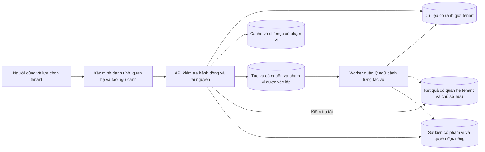

# Isolation giữa tenant

## 1. Tenant isolation là gì?

**Tenant** là một miền sở hữu và quản trị logic trong hệ thống nhiều khách thuê, thường tương ứng với một tổ chức, khách hàng hoặc không gian làm việc. **Tenant isolation — cô lập giữa các tenant** là tập điều kiện kiến trúc bảo đảm hoạt động trong một miền không vượt sang dữ liệu, quyền hoặc tài nguyên của miền khác ngoài cơ chế chia sẻ và quản trị được cho phép.

Ví dụ, một nền tảng quản lý dự án phục vụ tổ chức A và B. Người dùng A có thể đã đăng nhập hợp lệ, biết mã tài liệu B và gọi đúng API, nhưng vẫn không được đọc tài liệu B khi không có quyền. Đây là yêu cầu cô lập, không chỉ là yêu cầu đăng nhập.

Một người có thể thuộc nhiều tenant với vai trò khác nhau. Người đó có quyền ở A không tự có quyền tương tự ở B. Việc chuyển tenant trên giao diện là thao tác chọn ngữ cảnh; quyền của người dùng trong ngữ cảnh được chọn vẫn phải được kiểm tra.

Cô lập cũng không chỉ liên quan tới cơ sở dữ liệu. Báo cáo xuất, cache, chỉ mục tìm kiếm, thông điệp, kho tệp, log, công cụ hỗ trợ và bản sao phục hồi đều có thể tạo đường vượt ranh giới.

Trong xây dựng yêu cầu bảo mật, mục tiêu là xác định ranh giới tenant được thực thi ở đâu, chống được kịch bản nào và cần bằng chứng gì để tin ranh giới đó hoạt động trên toàn luồng.

## 2. Những thuộc tính cần cô lập

| Thuộc tính | Điều cần giữ đúng | Ví dụ vi phạm |
|---|---|---|
| Bí mật | Dữ liệu chỉ đến đúng chủ thể và phạm vi được phép | API trả hồ sơ B cho A, cache dùng chung làm lộ phản hồi riêng |
| Toàn vẹn | Chủ thể không sửa hoặc tạo quan hệ ngoài miền được cấp | Gắn tài liệu A vào dự án B, cập nhật bản ghi khác tenant |
| Quyền và quản trị | Vai trò, ủy quyền và cấu hình không tự lan sang tenant khác | Quản trị viên A cấp quyền trên B hoặc thay chính sách toàn nền tảng |
| Sẵn sàng | Mức dùng tài nguyên của một tenant được kiểm soát theo mục tiêu phục vụ | Một tenant chiếm toàn bộ worker khiến tenant khác không thực hiện được tác vụ |
| Vận hành và vòng đời | Cấp phát, hỗ trợ, di chuyển, xóa và phục hồi giữ đúng phạm vi | Xuất nhầm toàn bộ kho hoặc phục hồi quyền đã thu hồi |

Các thuộc tính có mức bảo vệ khác nhau tùy kiến trúc và rủi ro. Dùng chung tài nguyên không tự đồng nghĩa không thể cô lập, nhưng cần xác định những sai hỏng hoặc mức chiếm quyền nào vẫn còn gây ảnh hưởng chung.

Phải làm rõ phạm vi chia sẻ hợp lệ. Nếu có dự án cộng tác giữa tổ chức, cần mô hình quan hệ và quyền chia sẻ riêng. Không nên dùng một ngoại lệ chung kiểu “được phép đọc tenant khác” để giải quyết mọi tình huống cộng tác.

## 3. Xác lập ngữ cảnh tenant đáng tin cậy

### 3.1. Phân biệt chọn tenant với chứng minh quyền

Một yêu cầu có thể chứa tenant trong đường dẫn, header, tên miền hoặc tham số. Các giá trị này có thể dùng để chọn miền cần thao tác, nhưng không tự chứng minh người gửi là thành viên hoặc có quyền trong miền đó.

Ví dụ, `X-Tenant-ID: tenant-B` là một lựa chọn do bên gọi gửi. Máy chủ cần xác thực chủ thể, kiểm tra quan hệ và quyền đối với B, rồi xác lập ngữ cảnh chuẩn cho các bước sau.

Nếu dùng thông tin tenant trong bằng chứng danh tính, cần xác minh nguồn, thời hạn và ngữ cảnh sử dụng theo cơ chế đã chọn. Đồng thời phải xác định quyền thay đổi hoặc thành viên bị thu hồi được phản ánh thế nào; một thông tin từng hợp lệ không tự có hiệu lực vô thời hạn.

### 3.2. Một ngữ cảnh chuẩn cho toàn yêu cầu

Luồng khái niệm có thể như sau:

```text
Nhận bằng chứng danh tính và lựa chọn tenant từ yêu cầu
→ xác minh danh tính
→ xác định tenant theo quy tắc chọn miền
→ kiểm tra tư cách thành viên, hành động và điều kiện liên quan
→ tạo ngữ cảnh tenant chuẩn ở máy chủ
→ dùng ngữ cảnh đó tại các điểm truy cập tài nguyên
```

Không nên để mỗi thành phần lấy tenant từ một nguồn khác nhau mà không đối chiếu. API có thể dùng header A trong khi truy vấn dùng trường body B và đường ghi tệp dùng một tên miền C. Sự không nhất quán này tạo điều kiện tráo phạm vi.

Các giá trị mâu thuẫn phải bị từ chối hoặc xử lý theo hợp đồng đã xác định. Không dùng tenant mặc định để tiếp tục khi thiếu ngữ cảnh đối với hoạt động cần cô lập.

### 3.3. Tenant không thay thế quyền theo đối tượng

Thuộc đúng tenant chưa chắc được đọc mọi tài liệu của tenant đó. Có thể còn vai trò, dự án, quan hệ sở hữu, trạng thái hoặc điều kiện chia sẻ.

Một quyết định truy cập thường cần xét:

```text
Chủ thể + hành động + tenant + đối tượng + quan hệ + điều kiện hiện tại
```

Tương tự, một mã đối tượng duy nhất toàn hệ thống không tự là cơ chế phân quyền. Biết hoặc đoán được mã vẫn không được mở quyền. Mã khó đoán có thể giảm một số cách dò tìm nhưng không thay điều kiện cô lập.

## 4. Các mô hình cô lập và giới hạn của chúng

### 4.1. So sánh các lựa chọn phổ biến

| Mô hình | Ranh giới chính | Điểm cần chứng minh | Đánh đổi cần xem |
|---|---|---|---|
| Bảng dùng chung có trường tenant | Chính sách và điều kiện truy cập trên từng bản ghi hoặc tập dữ liệu | Mọi đường đọc/ghi, quan hệ, công cụ và tác vụ giữ đúng phạm vi | Hiệu quả dùng chung cao, sai điều kiện có thể ảnh hưởng rộng |
| Cùng hệ quản trị, tách schema hoặc không gian tên | Cấu trúc và quyền truy cập theo miền | Kết nối, quyền và định tuyến không mở sang miền khác | Quản lý nhiều cấu trúc và thay đổi đồng bộ phức tạp hơn |
| Tách cơ sở dữ liệu theo tenant | Quyền và kết nối tới kho riêng | Cấp phát, chọn kho, thông tin xác thực, sao lưu và phục hồi đúng tenant | Tăng số tài nguyên và công việc vận hành |
| Tách thêm thành phần xử lý theo tenant hoặc nhóm tenant | Ranh giới thực thi và tài nguyên riêng hơn | Danh tính, dữ liệu, mạng và quản trị không có đường dùng chung vượt cam kết | Tăng chi phí và yêu cầu quản lý vòng đời |
| Kết hợp nhiều mức | Chọn ranh giới theo dữ liệu, chức năng hoặc loại khách hàng | Hợp đồng giữa các mức rõ, các đường chung vẫn được kiểm soát | Linh hoạt nhưng dễ có nhiều quy tắc và trạng thái chuyển đổi |

Các mức trên không tạo một thang bảo đảm tự động. Cơ sở dữ liệu tách riêng vẫn có thể bị truy cập nhầm nếu một dịch vụ có thông tin xác thực đọc mọi kho và chọn kho từ dữ liệu tự khai.

Một môi trường xử lý riêng cũng có thể dùng chung mặt phẳng quản trị, công cụ triển khai hoặc sao lưu có quyền rộng. Những phụ thuộc đó phải nằm trong mô hình đe dọa.

### 4.2. Chọn theo mô hình bị chiếm quyền

Cần nêu rõ kiến trúc đang bảo vệ trước người dùng sửa tham số, tài khoản đối tác bị chiếm, lộ thông tin xác thực dịch vụ hay kiểm soát toàn bộ tiến trình ứng dụng.

Lọc tenant trong mã có thể ngăn một số yêu cầu tráo tham số khi mã đúng. Nếu tiến trình có quyền đọc mọi tenant bị điều khiển, kiểm tra trong chính tiến trình đó có thể không còn là ranh giới độc lập.

Nếu cần giới hạn cả trường hợp này, phải xem quyền ở kho, dịch vụ cấp quyền theo phạm vi, ranh giới thực thi hoặc tách miền phù hợp. Lựa chọn phải có bằng chứng tương ứng; không được suy rộng từ một kiểm thử API sang mọi tình huống chiếm quyền.

### 4.3. Khóa mã hóa riêng không tự tạo cô lập hoàn chỉnh

Khóa theo tenant có thể giúp quản lý phạm vi giải mã và vòng đời dữ liệu trong thiết kế phù hợp. Tuy nhiên, nếu cùng một ứng dụng được phép giải mã bằng mọi khóa rồi trả bản rõ sai người, cô lập vẫn thất bại.

Phải kiểm soát ánh xạ tenant–khóa, quyền sử dụng, nguồn ngữ cảnh và các bản sao. Nếu dùng một khóa chung cho dữ liệu của nhiều tenant, việc hủy khóa để xóa riêng một tenant có thể ảnh hưởng những bên khác; mức chi tiết của khóa cần phù hợp mục tiêu vòng đời.

## 5. Cô lập tại lớp dữ liệu

### 5.1. Điều kiện tenant phải hiện diện ở thao tác liên quan

Với dữ liệu dùng chung, cần kiểm soát truy vấn danh sách, chi tiết, cập nhật, xóa, tìm kiếm, xuất và tác vụ nền. Kiểm tra ở một đường đọc không tự bao phủ các đường còn lại.

SQL minh họa sau diễn tả quan hệ và tham số ở mức khái niệm, không gắn với thư viện hoặc sản phẩm cụ thể:

```sql
SELECT d.document_id, d.title, p.project_name
FROM project_document AS d
JOIN project AS p
  ON p.tenant_id = d.tenant_id
 AND p.project_id = d.project_id
WHERE d.tenant_id = :resolved_tenant_id
  AND d.document_id = :requested_document_id;
```

`:resolved_tenant_id` phải đến từ ngữ cảnh máy chủ đã xác minh, không lấy nguyên giá trị tự khai để coi là quyền. Việc tham số hóa bảo vệ một số đường chèn lệnh, nhưng không sửa được việc chọn sai tenant.

Điều kiện cùng tenant trong phép nối ngăn ghép quan hệ sai miền theo thiết kế dữ liệu. Với cập nhật hoặc xóa, điều kiện phạm vi cũng phải có hiệu lực; không chỉ đọc trước bằng quyền đúng rồi sửa một tham chiếu khác ở bước sau.

### 5.2. Bảo vệ quan hệ, duy nhất và thao tác hàng loạt

Một tài liệu cần gắn với dự án thuộc đúng tenant. Ràng buộc quan hệ ở kho có thể hỗ trợ thực thi điều này nếu lược đồ và quyền được thiết kế đúng. Với mã chỉ duy nhất trong tenant, khóa quan hệ và điều kiện duy nhất phải phản ánh phạm vi tương ứng.

Cần kiểm tra cả thông báo lỗi và hành vi xung đột. Một ràng buộc duy nhất toàn hệ thống có thể làm lộ sự tồn tại của giá trị thuộc tenant khác nếu hợp đồng phản hồi không được đánh giá.

Thao tác hàng loạt phải xác minh từng đối tượng hoặc áp dụng một truy vấn có phạm vi đủ căn cứ. Nếu yêu cầu trộn mã A và B, phải có quy tắc rõ: từ chối toàn bộ hay chỉ xử lý phần hợp lệ theo hợp đồng. Không được âm thầm sửa một phần ngoài quyền rồi trả lỗi.

### 5.3. Chính sách ở kho và ngữ cảnh kết nối

Cơ chế phân quyền ở mức dòng hoặc không gian dữ liệu có thể bổ sung ranh giới. Cần kiểm chứng vai trò kết nối có thể bỏ qua, sửa hoặc tự đặt ngữ cảnh không đúng hay không.

Với kết nối dùng lại, ngữ cảnh tenant phải được thiết lập và kết thúc đúng vòng đời. Một kết nối còn trạng thái của A có thể bị tái sử dụng cho B nếu quy trình không kiểm soát. Cần thử cả lỗi, hủy giao dịch và nhiều yêu cầu đồng thời.

Không nên kết luận rằng chỉ bật một tính năng ở cơ sở dữ liệu là đủ. Nguồn ngữ cảnh, quyền hiệu lực, luồng quản trị và mô hình tiến trình bị chiếm vẫn quyết định giới hạn thực tế.

## 6. Giữ ranh giới tại các thành phần dùng chung

### 6.1. Cache và phản hồi cá nhân hóa

Khóa cache phải phân biệt đủ ngữ cảnh quyết định nội dung: tenant, tài nguyên, truy vấn và phạm vi quyền khi cần. Chỉ thêm mã người dùng có thể chưa đủ nếu cùng người thuộc nhiều tenant hoặc quyền đã thay đổi.

Ví dụ minh họa ở mức khái niệm:

```text
cacheKey = encode(
    responseType,
    validatedTenantId,
    authorizedVisibilityScope,
    normalizedQuery,
    relevantPolicyOrDataVersion
)
```

`encode` cần tạo biểu diễn không nhập nhằng. Các thành phần đưa vào khóa phải theo quy tắc chuẩn và nguồn tin cậy, không chỉ là chuỗi nối từ đầu vào tùy ý.

Nội dung cá nhân hóa không được tự chuyển sang cache công khai dùng chung. Với dữ liệu thực sự công khai cho mọi người, có thể dùng chung theo chính sách tương ứng; không được gộp nó với giá, ghi chú hoặc trạng thái riêng của tenant.

Hết hạn và vô hiệu hóa cache phải phù hợp yêu cầu thay đổi quyền. Đặt đúng tenant trong khóa không tự xử lý việc một thành viên vừa bị thu hồi quyền nhưng còn phản hồi cũ được phục vụ ngoài thời hạn cho phép.

### 6.2. Chỉ mục tìm kiếm và các kết quả phụ

Chỉ mục cần giữ quan hệ tenant từ nguồn được kiểm chứng. Phạm vi truy vấn phải do máy chủ thực thi, không phụ thuộc riêng bộ lọc mà người gọi có thể bỏ hoặc sửa.

Cần kiểm tra cả nội dung kết quả, đoạn trích, số lượng, gợi ý, tổng hợp và phân trang. Danh sách tài liệu có thể đã lọc đúng nhưng số lượng hoặc gợi ý vẫn tiết lộ dữ liệu ngoài quyền.

Con trỏ phân trang hoặc trạng thái tiếp tục truy vấn phải được ràng buộc với phạm vi phù hợp. Không nên dùng con trỏ tạo cho A để tiếp tục đọc B hoặc dùng lại sau khi điều kiện quyền đã đổi mà không kiểm tra.

### 6.3. Kho tệp và đường phân phối

Tiền tố tên đối tượng như `tenant-A/...` giúp tổ chức dữ liệu nhưng không tự là chính sách quyền. Cần kiểm soát ai được đọc, ghi, liệt kê và thay metadata của đối tượng đó.

Đường tải cần xác minh quan hệ tệp–tài nguyên–tenant và quyền người tải theo chính sách. URL trực tiếp, API cũ hoặc kết quả xuất không được trở thành đường bỏ qua ranh giới đã chọn.

Nếu dùng liên kết tự mang quyền tải, phải mô tả rõ người giữ liên kết được làm gì, thời hạn, khả năng chia sẻ và thu hồi. Một liên kết ngắn hạn không tự đồng nghĩa luôn kiểm tra được quyền hiện tại của người dùng. Thiết kế phải phù hợp mục tiêu cô lập và vòng đời quyền đã cam kết.

### 6.4. Hàng đợi, worker và sự kiện

Thông điệp cần mang phạm vi từ ngữ cảnh máy chủ đã được kiểm chứng, có nguồn gốc và tính toàn vẹn được bảo vệ theo thiết kế. Worker phải kiểm tra phạm vi tài nguyên, không coi mọi trường trong hàng đợi là sự thật chỉ vì hàng đợi nằm nội bộ.

Ngữ cảnh phải có vòng đời rõ cho mỗi tác vụ. Không dùng một biến chia sẻ hoặc trạng thái còn sót của tác vụ A cho tác vụ B. Cần xét xử lý song song, thử lại, tác vụ thiếu trường, thông điệp cũ và hàng đợi lỗi.

Khóa chống xử lý lặp cũng cần phản ánh phạm vi. Một mã yêu cầu giống nhau ở hai tenant không được làm hệ thống trả lại kết quả của tenant khác hoặc coi nhầm thao tác của bên kia là thao tác đã hoàn tất.

Quyền lúc tạo có thể thay đổi trước lúc chạy hoặc tải. Chính sách phải xác định thời điểm kiểm tra lại và hành vi đối với tác vụ đang chờ, đang chạy hay đã hoàn tất. Không gán tenant mặc định để tiếp tục khi thiếu căn cứ.

### 6.5. Log, thông báo và công cụ hỗ trợ

Sự kiện cần đủ thông tin tenant từ nguồn tin cậy để truy vết, nhưng không chứa thông tin xác thực hoặc bản rõ dữ liệu ngoài mục đích. Kho log tập trung có thể được quản lý toàn nền tảng, song quyền đọc của từng vai trò phải tách khỏi quyền dữ liệu của tenant.

Thông báo cần gắn đúng tài nguyên và người nhận theo quy tắc chia sẻ. Không lấy địa chỉ nhận hoặc tập dữ liệu từ một ngữ cảnh tenant rồi ghép với nội dung của tenant khác.

Công cụ hỗ trợ, xuất dữ liệu và trang quản trị cũng phải nằm trong phạm vi kiến trúc. Nếu có quyền quản trị toàn nền tảng, cần danh tính, mục đích, điều kiện và bằng chứng riêng; không giả lập quyền này bằng cách sửa một header tenant ở luồng người dùng thông thường.

## 7. Mô hình luồng có ngữ cảnh tenant xuyên suốt



Mỗi điểm trong sơ đồ phải có cơ chế và bằng chứng tương ứng. Dòng chữ “có phạm vi” chỉ là ý định nếu chính sách, quyền dịch vụ hoặc mã triển khai vẫn cho phép bỏ qua.

Các điều kiện cần giữ xuyên luồng gồm:

1. Một ngữ cảnh đã được xác lập không bị thay bằng dữ liệu tự khai ở bước sau.
2. Mọi tài nguyên được tham chiếu có quan hệ phù hợp với ngữ cảnh và quyền hiện tại theo chính sách.
3. Dữ liệu ra, cache, kết quả và sự kiện không làm mất thông tin phạm vi cần để thực thi.
4. Lỗi hoặc thiếu ngữ cảnh không tạo quyền truy cập mặc định rộng hơn.
5. Danh tính dịch vụ có quyền tương xứng với lời cam kết cô lập trong mô hình bị chiếm quyền đã xét.

## 8. Chuyển mục tiêu cô lập thành yêu cầu kiểm chứng được

Các thời hạn và hạn mức dưới đây thuộc **dự án giả định**, dùng để minh họa cách đặc tả. Chúng phải được chọn theo tác động, năng lực và chính sách áp dụng khi triển khai thật.

| Mã | Yêu cầu | Tiêu chí chấp nhận |
|---|---|---|
| TI-01 | Với hoạt động cần tenant, máy chủ phải xác minh danh tính và quyền trong tenant được chọn, tạo ngữ cảnh chuẩn; yêu cầu thiếu hoặc mâu thuẫn ngữ cảnh không được tiếp tục với tenant mặc định. | Thử giá trị trong đường dẫn, header, body và ngữ cảnh danh tính mâu thuẫn; không đọc, ghi hoặc tạo tác vụ sai phạm vi. |
| TI-02 | Mọi thao tác đọc, sửa, xóa, gắn quan hệ và xuất phải kiểm tra tenant cùng quyền trên đối tượng; các quan hệ dự án–tài liệu phải thuộc phạm vi được phép. | Tráo từng tham chiếu và tạo quan hệ chéo; kiểm tra cả thao tác hàng loạt, nội dung trả và trạng thái lưu. |
| TI-03 | Cache, tìm kiếm, tổng hợp và phân trang phải giữ phạm vi tenant cùng mức nhìn thấy phù hợp; người gọi không được bỏ bộ lọc để mở phạm vi. | Luân phiên tenant, người dùng, vai trò và truy vấn; thử con trỏ chéo và kết quả phụ; không có nội dung ngoài quyền. |
| TI-04 | Kho và đường phân phối tệp phải thực thi mô hình quyền đã duyệt; biết mã hoặc tiền tố đối tượng không đủ để đọc, ghi hay liệt kê ngoài phạm vi. | Thử URL trực tiếp, API cũ, metadata, tệp cùng tên và liên kết được tạo ở tenant khác; không vượt chính sách đã chọn. |
| TI-05 | Worker phải xác minh nguồn và phạm vi tác vụ, thiết lập ngữ cảnh riêng cho từng lần xử lý và loại bỏ trạng thái còn sót; thông điệp thiếu căn cứ không được chạy với quyền rộng. | Gửi xen kẽ A/B, xử lý đồng thời, thử lại, thông điệp thiếu trường và mã chống lặp giống nhau; không trộn dữ liệu hoặc kết quả. |
| TI-06 | Quyền dịch vụ, kho và điểm cấp ngữ cảnh phải phù hợp mô hình cô lập đã cam kết; các quyền quản trị hoặc truy cập nhiều tenant phải được kiểm kê và cấp riêng theo nhiệm vụ. | Kiểm tra quyền hiệu lực và thử dưới danh tính dịch vụ; kết luận giới hạn rõ trường hợp người dùng, lộ thông tin xác thực hoặc tiến trình bị chiếm. |
| TI-07 | Truy cập hỗ trợ đặc biệt phải giới hạn tenant, hành động, mục đích và tối đa 30 phút trong luồng minh họa; quyền quản trị A không tự có hiệu lực trên B. | Thử sai tenant, sai hành động, hết hạn và tự mở rộng phạm vi; có sự kiện gắn với quyết định được phép. |
| TI-08 | Sau thu hồi tư cách thành viên hoặc quyền, các lần truy cập dựa vào quyền đó tại điểm quản lý phải ngừng được chấp nhận trong 60 giây, gồm các đường cache, tệp và tác vụ liên quan theo chính sách. | Thử trước và sau mốc, qua nhiều điểm thực thi và tham chiếu cũ; đo hiệu lực thực tế, không chỉ trạng thái giao diện. |
| TI-09 | Luồng xuất minh họa tối đa 2 tác vụ đang chạy mỗi tenant, 20 tác vụ toàn hệ thống và 60 giây xử lý mỗi lần; tiếp nhận, xếp hàng và giảm tải phải theo quy tắc đã định. | Thử tải từ một và nhiều tenant, tác vụ quá hạn và lỗi lặp; giới hạn có hiệu lực, không bỏ phân quyền, kiểm tra mục tiêu phục vụ bên khác. |
| TI-10 | Log, trace, thông báo và công cụ hỗ trợ phải giữ quan hệ phạm vi tin cậy; không đưa thông tin xác thực hoặc bản rõ ngoài mục đích vào đầu ra vận hành. | Dùng dữ liệu thử có dấu nhận diện, kiểm tra người nhận, trường sự kiện, quyền đọc và các đường lỗi; không trộn nội dung giữa tenant. |
| TI-11 | Chỉ kích hoạt tenant mới sau khi ánh xạ, danh tính, kho và chính sách cần thiết đã được xác nhận; di chuyển hoặc chấm dứt không được tái sử dụng quan hệ cũ để mở dữ liệu khác chủ. | Thử cấp phát thiếu, mã bị nhầm, thao tác lặp và trạng thái chuyển đổi; không có đường tạm thời mở rộng quyền. |
| TI-12 | Xuất hoặc phục hồi riêng một tenant phải giữ đúng phạm vi dữ liệu, quyền và quan hệ; áp dụng lại thu hồi, hết hạn và xóa có hiệu lực sau bản sao trước khi phục vụ tài nguyên liên quan. | Phục hồi bản sao cũ hoặc trích xuất từ kho dùng chung; không có dữ liệu tenant khác, không làm sống lại truy cập đã thu hồi. |

TI-08 phải xét đúng quyền năng của liên kết tải và các cơ chế nhận quyền. Không được cam kết thu hồi trong 60 giây nếu một đường độc lập vẫn tiếp tục chấp nhận trong thời hạn dài hơn mà không có cách thu hồi tương ứng.

TI-09 là giới hạn tài nguyên, chưa tự là cam kết sẵn sàng đầy đủ. Mục tiêu phục vụ cần xác định điều kiện tải, điểm đo, ngưỡng độ trễ/lỗi và chính sách phân bổ khi nhiều tenant cùng tranh chấp tài nguyên.

TI-12 không có nghĩa mọi bản sao lưu đều tách riêng theo tenant. Nếu sao lưu dùng chung, quy trình trích xuất và phục hồi phải chứng minh chỉ đưa đúng dữ liệu vào phạm vi phục vụ được phép, với quyền tạm thời được kiểm soát.

## 9. Ví dụ: truy vấn đúng nhưng cache làm lộ dữ liệu

Giả sử API danh sách dự án luôn truy vấn với tenant đã được xác minh. Để tăng tốc, nhóm lưu phản hồi theo khóa:

```text
projects:list:page=1
```

Người dùng A gọi trang đầu tiên, hệ thống truy vấn đúng A và đưa danh sách vào cache. Sau đó người dùng B cũng gọi trang đầu tiên; hệ thống lấy cùng khóa và trả danh sách A mà không thực hiện lại đường truy vấn có phạm vi.

Lỗi không nằm ở điều kiện SQL của lần truy vấn đầu tiên. Phạm vi đã bị mất khi dữ liệu chuyển thành phản hồi được lưu và sử dụng lại.

Một chuỗi truy vết cho tình huống này:

| Thành phần | Nội dung |
|---|---|
| Tài sản | Danh sách dự án và các trường dành cho vai trò người đọc |
| Tác nhân | Người dùng hợp lệ thuộc tenant khác hoặc cùng người dùng đổi tenant |
| Điều kiện yếu | Khóa hoặc chính sách cache không phân biệt miền và mức nhìn thấy |
| Kịch bản | Phản hồi của A được trả cho B qua đường cache |
| Hậu quả | Tiết lộ dữ liệu dù truy vấn nguồn đã có điều kiện tenant |
| Yêu cầu | TI-01, TI-03, TI-08 khi quyền thay đổi |
| Thiết kế cần có | Xác lập ngữ cảnh trước sử dụng cache, phân vùng khóa theo phạm vi và quản lý hiệu lực |
| Bằng chứng | Luân phiên A/B, cùng người đổi tenant, vai trò khác và quyền đã bị thu hồi qua cùng lớp phân phối |

Chỉ thêm tenant vào khóa chưa xử lý mọi tình huống. Nếu quản trị viên và người thường trong cùng tenant được thấy tập trường khác nhau, cache cần phản ánh mức nhìn thấy phù hợp hoặc chỉ chứa dữ liệu dùng chung an toàn cho phạm vi đó.

Sau khi sửa, cần xử lý các mục cache cũ và những lớp phân phối còn giữ phản hồi. Sửa cách tạo khóa cho yêu cầu mới không tự loại bỏ mọi bản cũ đang được phục vụ. Dữ liệu đã bị tải ra cũng cần được đưa vào đánh giá tác động, không được coi là đã thu hồi chỉ vì cache đã xóa.

## 10. Thiết kế kiểm chứng chéo tenant

### 10.1. Chuẩn bị dữ liệu và chủ thể có ý nghĩa

Một tập thử nên có ít nhất hai tenant với nội dung tổng hợp dễ phân biệt. Có người dùng chỉ thuộc A, người chỉ thuộc B, người thuộc cả hai nhưng có vai trò khác nhau và một vai trò hỗ trợ có phạm vi hữu hạn.

Cần có tài nguyên liên quan như dự án, tài liệu, tệp, tác vụ và kết quả. Với loại mã chỉ duy nhất trong tenant, có thể tạo cùng giá trị cục bộ ở A và B để phát hiện điều kiện thiếu phạm vi. Với loại mã duy nhất toàn hệ thống, cần giữ đúng ràng buộc đó và thử bằng tham chiếu chéo đã biết.

Không chỉ thử tài khoản chưa đăng nhập. Kịch bản trọng tâm thường là người đã xác thực nhưng không có quyền trong miền hoặc đối tượng được yêu cầu.

### 10.2. Ma trận bề mặt cần kiểm tra

| Bề mặt | Trường hợp cần thử | Kỳ vọng |
|---|---|---|
| Xác lập ngữ cảnh | Header, đường dẫn, body và thông tin danh tính mâu thuẫn | Từ chối hoặc xử lý theo quy tắc chọn đã duyệt, không lấy giá trị tùy ý làm quyền |
| Chi tiết và danh sách | Dùng tham chiếu B trong ngữ cảnh A, đổi người và vai trò | Không có nội dung ngoài quyền; nội dung hợp lệ vẫn sử dụng được |
| Cập nhật và quan hệ | Gắn tài liệu A vào dự án B, sửa trường tenant/chủ sở hữu | Không có trạng thái hoặc quan hệ trái phép |
| Hàng loạt | Trộn tham chiếu hợp lệ và ngoài quyền | Đúng hợp đồng toàn bộ hoặc từng phần; không có thay đổi ngoài quyền |
| Cache và tìm kiếm | Xen kẽ tenant, vai trò, con trỏ và truy vấn tổng hợp | Không lộ nội dung hoặc kết quả phụ ngoài phạm vi |
| Tệp và kết quả | Gọi URL trực tiếp, dùng mã cùng tên hoặc tham chiếu khác miền | Không có đường đọc/ghi/liệt kê ngoài chính sách |
| Worker | Xen kẽ, song song, thử lại và dùng mã chống lặp tương tự | Không rò ngữ cảnh hoặc trả kết quả tenant khác |
| Kết nối dùng lại | Chuyển A sang B sau thành công, lỗi và hủy thao tác | Không giữ trạng thái phạm vi của yêu cầu trước |
| Quản trị và hỗ trợ | Vai trò đúng nhưng sai tenant, hết hạn hoặc tự mở quyền | Chỉ thực hiện phạm vi được cấp và có bằng chứng |
| Phục hồi và vòng đời | Bản sao cũ, tenant đang di chuyển hoặc đã chấm dứt | Không phục vụ dữ liệu nhầm hoặc làm sống lại quyền đã loại bỏ |

Kiểm tra mã phản hồi là chưa đủ. Phải xem nội dung, trường ẩn, metadata, số lượng, trạng thái lưu và sự kiện. Một yêu cầu trả lỗi sau khi đã ghi dữ liệu B vẫn vi phạm cô lập.

### 10.3. Thử lỗi và giới hạn tài nguyên

Thử thiếu ngữ cảnh, nguồn quyền không sẵn sàng, metadata không khớp và thông điệp cũ. Hành vi không được chuyển sang tenant mặc định, bỏ lọc hoặc dùng tài khoản rộng để tiếp tục.

Đối với sẵn sàng, thử các điều kiện tải đã định: một tenant chạm hạn mức, nhiều tenant cùng hoạt động, tác vụ xử lý lâu và thử lại. Đo mục tiêu phục vụ của tenant khác theo hợp đồng, không chỉ kiểm tra tenant gây tải nhận lỗi.

Cần kiểm chứng ở môi trường và cấu hình có căn cứ. Kiểm thử ứng dụng với tài khoản hẹp chưa chứng minh môi trường đang chạy không dùng một tài khoản quản trị rộng hơn. Bằng chứng phải ghi rõ phiên bản, quyền, cấu hình và phạm vi.

## 11. Cô lập trong vòng đời tenant

### 11.1. Cấp phát và thay đổi thành viên

Tenant mới cần định danh, ánh xạ, chính sách, danh tính dịch vụ hoặc cấu hình dùng chung tương ứng. Chỉ mở các đường cần thiết khi điều kiện cấp phát đã hoàn tất. Trạng thái tạo dở không được mở một kho hoặc miền mặc định để phục vụ tạm.

Mời thành viên, chuyển vai trò và rời tổ chức đều là thay đổi quyền. Cần xác minh đúng chủ thể, tenant, vai trò được cấp và thời hạn. Một người thuộc cả A và B phải nhận quyết định riêng theo từng miền.

Không nên tái sử dụng một quan hệ định danh cũ theo cách khiến liên kết, thông điệp hoặc dữ liệu lưu đệm của chủ cũ trỏ vào tài nguyên của chủ mới. Nếu có cơ chế tái sử dụng trong thiết kế, phải có phân biệt thế hệ hoặc vòng đời và kiểm chứng tương ứng.

### 11.2. Di chuyển và triển khai song song

Khi chuyển tenant sang kho hoặc nhóm xử lý khác, có thể có giai đoạn dữ liệu và cấu hình tồn tại ở hai nơi. Cần xác định nguồn chính, định tuyến, quyền đọc/ghi, cách đồng bộ và điều kiện ngừng đường cũ.

Đường quay lại cũng phải giữ đúng phạm vi. Tắt cờ định tuyến không tự hủy tác vụ, xóa bản sao hoặc thu hồi liên kết đã phát hành. Cần kiểm tra cả trạng thái đang chạy và dữ liệu đã tạo.

Mô hình đe dọa cần được cập nhật khi thay cách cô lập, tăng quyền dịch vụ dùng chung hoặc thêm bên nhận dữ liệu. Không nên giữ nguyên kết luận chỉ vì tenant vẫn mang cùng mã.

### 11.3. Chấm dứt, xuất và xóa

Xuất dữ liệu cho một tenant phải bao phủ đúng tập dữ liệu và quan hệ được phép, không vô tình đóng gói bảng hoặc tệp của những bên khác. Đường hỗ trợ xuất cũng phải được cấp quyền và kiểm toán.

Khi chấm dứt, cần xử lý truy cập, thành viên, ủy quyền, tác vụ, tệp, cache, chỉ mục và những bản sao thuộc phạm vi quản lý. Các thời hạn giữ và ngoại lệ cần được xác định theo mục đích và chính sách áp dụng.

Không được dùng một thao tác xóa theo mã tenant thiếu kiểm tra rồi coi mọi dữ liệu đã xử lý đúng. Phải xác minh không ảnh hưởng tenant khác và không để đường phục hồi tự đưa dữ liệu đã hết điều kiện trở lại phục vụ.

### 11.4. Sao lưu và phục hồi riêng tenant

Trong kho dùng chung, bản sao có thể chứa nhiều tenant. Phục hồi hoặc trích xuất riêng cần một quy trình tin cậy để giữ quan hệ và chỉ đưa dữ liệu đúng phạm vi ra nơi phục vụ.

Cần khôi phục hoặc đối soát dữ liệu, cấu hình, quyền, khóa và quyết định thu hồi. Quyền sau thời điểm tạo bản sao có thể đã thay đổi; phục hồi nguyên trạng cũ có thể tái cấp quyền ngoài ý muốn.

Danh tính phục hồi có thể cần khả năng đặc biệt. Nó phải có mục đích, phạm vi, thời gian và bằng chứng riêng; không trở thành đường đọc toàn bộ dữ liệu thường trực cho mọi người hỗ trợ.

## 12. Đánh giá mức bảo vệ và rủi ro còn lại

Cần nêu rõ kiến trúc bảo vệ trước mô hình nào: người dùng có tài khoản hợp lệ sửa tham số, bên giữ thông tin xác thực worker hay bên kiểm soát toàn bộ thành phần dùng chung. Mỗi mô hình có ranh giới và bằng chứng khác nhau.

Tách thêm kho hoặc thành phần xử lý có thể thu hẹp tác động nhưng tăng công việc cấp phát, cập nhật và phục hồi. Dùng chung có thể phù hợp nếu giới hạn được thực thi và kiểm chứng cho các rủi ro liên quan. Quyết định không nên dựa chỉ vào tên mô hình hoặc một khẩu hiệu.

Một quyền quản trị toàn nền tảng có thể được cho phép theo nhiệm vụ, nhưng là khả năng có tác động rộng cần quản lý riêng. Nó không làm mọi truy cập chéo trở thành hợp lệ và không được che khỏi đánh giá rủi ro bằng cách gọi đó là “nội bộ”.

Giới hạn tài nguyên cũng có mức bảo vệ cụ thể. Hạn mức theo tenant không tự loại bỏ mọi sự cố của thành phần dùng chung. Cần xét phụ thuộc chung, chính sách phân bổ, khả năng giảm tải và phục hồi theo mục tiêu đã cam kết.

Phần còn lại phải có chủ sở hữu và quyết định đúng thẩm quyền. Một kịch bản chưa được kiểm tra hoặc một quyền dịch vụ chưa rõ phải được ghi là khoảng trống, không mặc định an toàn.

## 13. Những sai lầm thường gặp

| Sai lầm | Vấn đề | Cách làm rõ |
|---|---|---|
| Tenant ID do bên gọi gửi là đủ | Lựa chọn miền bị coi như bằng chứng quyền | Xác minh chủ thể, quan hệ và hành động trước tạo ngữ cảnh chuẩn |
| Đúng tenant thì được đọc mọi đối tượng | Bỏ vai trò, dự án, chủ sở hữu và chia sẻ | Kiểm tra quyền trên từng hành động và tài nguyên |
| Chỉ thêm `tenant_id` ở truy vấn chính | Cache, tìm kiếm, tệp và tác vụ nền vẫn có thể làm lộ dữ liệu | Giữ phạm vi qua toàn luồng và các kho phụ |
| Tiền tố tệp là chính sách quyền | Tên không tự chặn đọc, ghi hoặc liệt kê | Kiểm tra quyền kho và đường phân phối |
| Mã khó đoán là cô lập | Tham chiếu có thể được biết hoặc chia sẻ | Kiểm thử khi tham chiếu ngoài quyền đã được biết |
| Kho riêng hoặc khóa riêng bảo đảm mọi tình huống | Dịch vụ hay quản trị có thể vẫn truy cập rộng | Đánh giá quyền hiệu lực và mô hình chiếm quyền |
| Thiếu ngữ cảnh thì dùng tenant mặc định | Lỗi hoặc tương thích mở phạm vi ngoài ý muốn | Từ chối, cách ly hoặc chuyển đổi bằng nguồn tin cậy |
| Chỉ thử hai yêu cầu tuần tự | Bỏ ngữ cảnh còn sót trong pool, worker và xử lý đồng thời | Thử xen kẽ, song song, lỗi, hủy và thử lại |
| Phục hồi dữ liệu xong là cô lập đã đúng | Có thể làm sống lại quyền và dữ liệu đã hết hạn | Áp dụng quyết định hiện hành trước phục vụ |

## 14. Đầu ra cần có của thiết kế cô lập tenant

Nhóm cần chuyển giao được:

1. **Định nghĩa miền:** tenant đại diện cho gì, ai là thành viên, cơ chế chia sẻ và quản trị đặc biệt nào tồn tại.
2. **Nguồn ngữ cảnh:** cách chọn, xác minh, chuẩn hóa và truyền phạm vi qua các bước.
3. **Mô hình cô lập:** ranh giới dữ liệu, xử lý, quyền, tài nguyên và phụ thuộc dùng chung.
4. **Ma trận tài nguyên và đường truy cập:** cơ sở dữ liệu, cache, tìm kiếm, tệp, tác vụ, log, hỗ trợ và bản sao.
5. **Yêu cầu có thể kiểm chứng:** quyền đối tượng, toàn vẹn quan hệ, thu hồi, giới hạn tài nguyên và vòng đời.
6. **Bằng chứng:** trường hợp hợp lệ, chéo tenant, trạng thái, đồng thời, lỗi, di chuyển và phục hồi.
7. **Quyết định rủi ro:** mô hình bị chiếm quyền đã xét, giới hạn kết luận, khoảng trống, chủ sở hữu và tác nhân cần rà soát lại.

Isolation giữa tenant có hiệu lực khi ranh giới được giữ ở mọi đường dữ liệu và quyền liên quan, trong những trạng thái mà hệ thống thực sự vận hành. Khi kiến trúc được nối với kịch bản rủi ro, yêu cầu và bằng chứng, nhóm có thể kiểm chứng phạm vi cô lập đã cam kết thay vì chỉ tin vào một trường tenant hoặc một sơ đồ phân tách.
