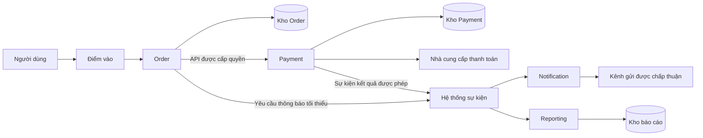

# Isolation giữa service

## 1. Mục tiêu bài học

**Isolation giữa service** là việc thiết kế và thực thi các ranh giới để một service chỉ có quyền, dữ liệu, tài nguyên và đường giao tiếp cần thiết cho nhiệm vụ của nó. Khi một service gặp lỗi hoặc bị chiếm quyền trong phạm vi đã xét, hậu quả cần được giới hạn thay vì tự động lan sang toàn hệ thống.

Trong kiến trúc bảo mật, tách mã thành nhiều service mới tạo ra cấu trúc triển khai. Muốn có cách ly thực sự, phải đặc tả danh tính, quyền, kết nối, dữ liệu, bí mật, tài nguyên và quyền vận hành.

Bài học này giúp người học:

- Xác định ranh giới tin cậy giữa các service.
- Phân biệt cách ly logic, dữ liệu, thực thi, tài nguyên và quản trị.
- Thiết kế giao tiếp chỉ được phép theo danh tính và mục đích.
- Chuyển kịch bản lan truyền sự cố thành yêu cầu có thể kiểm chứng.
- Kiểm tra cả đường hợp lệ, đường bị cấm, lỗi phụ thuộc và phục hồi.
- Ghi rõ giả định, quyền cấp cao và rủi ro còn lại.

Các tên service, giới hạn và thời hạn trong bài thuộc hệ thống giả định. Chúng không phải cấu hình bắt buộc hoặc mức đảm bảo dùng chung cho mọi hệ thống.

## 2. Isolation bảo vệ điều gì?

Một ranh giới cách ly có thể hạn chế:

- **Quyền:** service không làm được hành động của service khác.
- **Dữ liệu:** service không đọc hoặc sửa tùy ý kho do bên khác quản lý.
- **Bí mật:** chiếm một tiến trình không tự lấy được thông tin xác thực của toàn hệ thống.
- **Thực thi:** hành vi trong một tiến trình không tự có quyền quản trị máy chủ.
- **Tài nguyên:** một nguồn sử dụng không làm cạn toàn bộ năng lực dùng chung.
- **Vận hành:** danh tính triển khai một service không mặc nhiên sửa mọi service.
- **Phục hồi:** khôi phục một phần không đưa toàn hệ thống về trạng thái quyền hoặc dữ liệu sai.

Phạm vi ảnh hưởng thường được gọi là **blast radius**: tập tài sản và hành động mà một sự cố có thể tác động trong điều kiện đã nêu. Cần mô tả phạm vi này bằng quyền và đường truy cập cụ thể.

Ví dụ:

> Khi tiến trình Notification bị điều khiển, chủ thể có thể tiếp cận dữ liệu của các tác vụ được giao theo phạm vi thiết kế, nhưng không được lấy khóa thanh toán, sửa bảng giao dịch hoặc tự cấp danh tính Payment.

Đây là một tuyên bố cần bằng chứng. Chỉ đặt Notification và Payment trong hai container chưa chứng minh tuyên bố đó.

### 2.1. Các kiểu cách ly bổ trợ nhau

| Kiểu cách ly | Câu hỏi chính | Ví dụ |
| --- | --- | --- |
| Danh tính | Thành phần gọi thực sự là ai? | Order và Notification có danh tính khác nhau |
| Quyền giao tiếp | Danh tính đó được gọi chức năng nào? | Order được đề nghị tạo thanh toán; Notification không được |
| Mạng | Thành phần có thể mở đường kết nối tới đâu? | Chặn Notification kết nối trực tiếp kho Payment |
| Dữ liệu | Thành phần đọc, sửa và xuất dữ liệu nào? | Payment sở hữu bản ghi giao dịch |
| Thực thi | Tiến trình có thể tác động tới môi trường nào? | Không cấp quyền quản trị hoặc gắn tài nguyên máy chủ không cần thiết |
| Tài nguyên | Thành phần sử dụng tối đa bao nhiêu năng lực? | Giới hạn CPU, bộ nhớ, số tác vụ và hàng đợi |
| Quản trị | Ai có thể sửa ranh giới hoặc bỏ qua nó? | Tách quyền phát hành và quản lý bí mật theo phạm vi |
| Phục hồi | Sau sự cố, dữ liệu và quyền được tái lập thế nào? | Đối chiếu giao dịch trước khi mở lại đường tạo thanh toán |

Không kiểu nào tự thay thế tất cả kiểu còn lại. Kết nối được bảo vệ không tự chứng minh người gọi được phép sửa một giao dịch.

### 2.2. Ranh giới triển khai khác với ranh giới bảo mật

Những tình huống sau vẫn có thể để lại quyền lan rộng:

- Nhiều service dùng cùng tài khoản cơ sở dữ liệu có toàn quyền.
- Mỗi service có tên riêng nhưng cùng đọc một tệp chứa mọi bí mật.
- Các service ở các vùng mạng khác nhau nhưng đều được kết nối tùy ý.
- Nhiều tiến trình dùng chung quyền đặc biệt trên máy chủ.
- Một pipeline có thể thay mã, cấu hình và danh tính của tất cả service.
- Bản backup của mọi dữ liệu được đọc bằng cùng quyền runtime.

Tên, thư mục hoặc đơn vị triển khai giúp tổ chức hệ thống. Ranh giới bảo mật chỉ có khi quyền và hành vi được thực thi, kể cả với đường gọi trực tiếp.

### 2.3. Chọn mô hình sự cố trước khi tuyên bố cách ly

Cần phân biệt:

1. Một yêu cầu đầu vào sai.
2. Một service có lỗi nghiệp vụ.
3. Chủ thể điều khiển hành vi tiến trình với quyền runtime hiện có.
4. Chủ thể điều khiển môi trường thực thi hoặc máy chủ.
5. Chủ thể có quyền quản trị nền tảng hoặc cơ chế cấp danh tính.

Cách ly ở mức tiến trình không tự chứng minh chống được quyền quản trị máy chủ. Các tiến trình cùng nền tảng có thể có điểm phụ thuộc chung.

Cơ chế thực thi cần được lựa chọn theo mô hình sự cố. Những ranh giới mạnh hơn vẫn có phụ thuộc và chi phí, nên phải có căn cứ rủi ro và phép thử tương ứng.

## 3. Ví dụ kiến trúc và quyền sở hữu

Xét một nền tảng bán hàng gồm bốn service:

| Service | Nhiệm vụ | Dữ liệu hoặc quyền cần thiết |
| --- | --- | --- |
| Order | Quản lý đơn hàng và đề nghị xử lý thanh toán | Kho đơn hàng; quyền gọi các hành động Payment đã được cấp |
| Payment | Quản lý giao dịch và tích hợp thanh toán | Kho giao dịch; thông tin xác thực tới nhà cung cấp |
| Notification | Gửi thông báo được yêu cầu | Thông điệp tối thiểu phục vụ gửi; quyền tới kênh gửi đã chấp thuận |
| Reporting | Tạo báo cáo theo dữ liệu được công bố | Dữ liệu chiếu phục vụ báo cáo và phạm vi người đọc |

**Dữ liệu chiếu** là bản dữ liệu được tạo cho một mục đích đọc cụ thể, có thể chỉ chứa các trường cần thiết. Nó không mặc nhiên cần toàn bộ dữ liệu gốc.

### 3.1. Luồng nghiệp vụ được phép



Sơ đồ thể hiện luồng dự kiến, chưa tự chứng minh kết nối và quyền đang được giới hạn. Các luồng danh tính, bí mật, giám sát, sao lưu và quản trị phải được khai báo thêm như phụ thuộc vận hành.

### 3.2. Ma trận giao tiếp nghiệp vụ

| Nguồn | Đích | Hành động được phép | Điều phải từ chối |
| --- | --- | --- | --- |
| Order | Payment | Tạo hoặc tra cứu thanh toán theo hợp đồng API và phạm vi được cấp | Sửa trực tiếp trạng thái đã hoàn tất hoặc gọi chức năng quản trị |
| Payment | Nhà cung cấp | Các thao tác tích hợp được giao | Dùng thông tin xác thực cho chức năng không được cấp |
| Order, Payment | Hệ thống sự kiện | Công bố loại sự kiện được liệt kê | Công bố vào mọi kênh hoặc giả danh nguồn khác |
| Notification | Kênh nhận thông báo | Nhận tác vụ tối thiểu thuộc phạm vi | Đọc toàn bộ sự kiện nghiệp vụ hoặc phát lệnh thanh toán |
| Notification | Kênh gửi | Gửi nội dung theo chính sách tác vụ | Kết nối tùy ý tới kho giao dịch hoặc đích ngoài phạm vi |
| Reporting | Kênh dữ liệu báo cáo | Nhận dữ liệu đã chọn để dựng bản đọc | Sửa dữ liệu nguồn hoặc dùng bản báo cáo để cấp quyền nghiệp vụ |

Bảng này không tự cho phép các kết nối chưa nêu. Những phụ thuộc như phân giải tên, cấp danh tính, lấy khóa, ghi log và đồng bộ thời gian cần được xác định riêng theo kiến trúc.

### 3.3. Ma trận quyền dữ liệu

| Danh tính | Kho Order | Kho Payment | Kênh thông báo | Kho báo cáo |
| --- | --- | --- | --- | --- |
| Order runtime | Quyền nghiệp vụ được giao | Không truy cập trực tiếp | Chỉ công bố loại được phép | Không mặc định có quyền |
| Payment runtime | Không sửa trực tiếp | Quyền nghiệp vụ được giao | Chỉ công bố loại được phép | Không mặc định có quyền |
| Notification runtime | Không truy cập trực tiếp | Không truy cập trực tiếp | Chỉ nhận và xử lý tác vụ được giao | Không mặc định có quyền |
| Reporting runtime | Không sửa trực tiếp | Không sửa trực tiếp | Không tự nhận quyền đọc mọi thông báo | Chỉ quyền xây dựng, đọc hoặc phục vụ theo hợp đồng |

“Không sửa trực tiếp” không phải cấp quyền đọc toàn bộ. Quyền đọc cũng cần mục đích, trường dữ liệu, tổ chức và đường truy cập rõ.

Nếu cần chia sẻ dữ liệu, ưu tiên biểu diễn bằng một hợp đồng API, sự kiện hoặc bản đọc có phạm vi được chấp thuận. Điều quan trọng là quyền và bằng chứng, không phải bắt mọi hệ thống dùng cùng một kiểu lưu trữ.

## 4. Danh tính và phân quyền giữa service

### 4.1. Tên tự khai không phải danh tính

Một header chứa `serviceName: Payment` hoặc một trường trong thông điệp không chứng minh người gửi là Payment.

Danh tính phải được xác minh qua cơ chế được kiến trúc chấp thuận, có nguồn cấp tin cậy, vòng đời và giới hạn sử dụng. Mỗi service cần được phân biệt để thu hồi, kiểm toán và giới hạn quyền.

Thông tin xác thực phải được kiểm tra theo đích nhận và mục đích phù hợp. Một thông tin xác thực dùng cho kênh thông báo không tự cho phép gọi API thanh toán.

Nếu kết nối đi qua proxy, cần xác định ai xác thực ở mỗi chặng và bằng cách nào thông tin nguồn được chuyển tiếp đáng tin cậy. Không tin header nhận dạng chỉ vì nó đã có mặt.

### 4.2. Xác thực kênh không thay thế quyền hành động

Xác thực hai đầu kết nối, chẳng hạn qua mTLS khi được chọn, có thể giúp xác minh danh tính workload theo cơ chế cấp phát. Payment vẫn phải kiểm tra Order có được gọi hành động cụ thể không.

Một quyết định cho phép có thể cần:

> **Danh tính service hợp lệ + quyền gọi hành động + ủy quyền người dùng khi cần + điều kiện đối tượng và nghiệp vụ.**

Không coi việc đi từ mạng nội bộ hoặc từ một service đã xác thực là đủ để bỏ qua các điều kiện còn lại.

### 4.3. Phân biệt người gọi kỹ thuật và người dùng được đại diện

Order là người gọi kỹ thuật. Một người dùng có thể là chủ thể mà Order đang đại diện.

Payment cần biết khi nào:

- Hành động được thực hiện bằng quyền nội bộ của Order.
- Hành động phải gắn với người dùng và phạm vi được ủy quyền.
- Một tác vụ tự động được phép chạy mà không có phiên người dùng.
- Quyền phải được kiểm tra lại trước khi thực hiện.

Nếu Payment nhận một mã người dùng do Order tự đặt mà không có cơ chế xác minh phù hợp, hệ thống có thể dùng quyền rộng của Payment để làm việc ngoài quyền của chủ thể ban đầu.

Ngược lại, không nên chuyển tiếp tùy ý thông tin xác thực người dùng tới mọi service. Cần giới hạn đích, mục đích, thời hạn và dữ liệu thực sự cần cho ủy quyền.

### 4.4. Quyền hợp lệ vẫn là phạm vi rủi ro

Nếu Order được phép đề nghị thanh toán, việc Order bị chiếm vẫn có thể gây hại trong phần quyền đó.

Payment cần tự kiểm tra các điều kiện nghiệp vụ thuộc trách nhiệm của mình, như trạng thái giao dịch và giới hạn được xác định. Tuy nhiên, nếu một dữ kiện được ủy quyền cho Order quyết định, Payment vẫn phụ thuộc vào độ đúng của nguồn đó.

Muốn hạn chế thêm phải thiết kế kiểm soát phù hợp với dữ kiện và mục tiêu, không chỉ thêm một kết nối hoặc một lần xác thực service.

## 5. Cách ly dữ liệu, thông điệp và bí mật

### 5.1. Quyền sở hữu dữ liệu phải được thực thi

Một service sở hữu dữ liệu khi nó chịu trách nhiệm về quy tắc cập nhật và cung cấp các đường truy cập được chấp thuận. Điều này cần được phản ánh bằng quyền thực tế.

Ví dụ:

- Order không tự sửa trạng thái giao dịch trong bảng Payment.
- Notification không truy vấn trực tiếp hồ sơ thanh toán để lấy nội dung gửi.
- Reporting chỉ nhận các trường cần cho báo cáo, theo phạm vi người đọc.
- Runtime không dùng quyền quản trị lược đồ nếu nhiệm vụ không cần.

Tài khoản “chỉ đọc” vẫn có thể làm lộ dữ liệu nếu được đọc quá rộng. Quyền phải xét cả hành động, tài nguyên, trường và phạm vi dữ liệu.

### 5.2. Có thể chia sẻ hạ tầng mà vẫn cần ranh giới logic

Một máy chủ cơ sở dữ liệu có thể phục vụ nhiều service với danh tính và quyền khác nhau. Khi đó cần kiểm tra:

- Quyền đọc, ghi và thay đổi lược đồ của từng danh tính.
- Khả năng chuyển vai trò hoặc bỏ qua chính sách.
- Quyền sao lưu, phục hồi và truy cập bản sao.
- Người có thể sửa phân quyền.
- Tài nguyên và sự cố dùng chung.

Tách thành nhiều kho có thể thay đổi miền sự cố hoặc quyền quản trị, nhưng vẫn cần cấu hình đúng. Nếu mọi kho cùng dùng một danh tính quản trị không được kiểm soát, một số rủi ro vẫn còn.

Không mặc định một tên schema hoặc một tiền tố bảng là ranh giới bảo mật. Nó chỉ trở thành ranh giới khi quyền được thực thi.

### 5.3. Service isolation và tenant isolation là hai chiều

Cách ly service trả lời Notification có được đọc dữ liệu Payment không. Cách ly tổ chức khách hàng trả lời một hành động Payment có được tác động tới giao dịch của tổ chức khác không.

Cần cả hai nếu hệ thống phục vụ nhiều tổ chức.

Một danh tính Payment hợp lệ vẫn phải kiểm tra phạm vi giao dịch. Không được lấy mã tổ chức từ tham số không được xác minh rồi coi là đủ để cấp quyền.

### 5.4. Sự kiện cũng là đường cấp quyền và chia sẻ dữ liệu

Cần xác định:

- Ai được công bố loại sự kiện nào.
- Ai được nhận kênh nào.
- Nguồn được xác minh bằng danh tính nào.
- Payload gồm những trường gì.
- Sự kiện có thể lặp hoặc đến sai thứ tự không.
- Việc xử lý có tạo hiệu ứng nghiệp vụ nào.

Ví dụ một yêu cầu thông báo có thể chứa mã sự kiện, loại thông báo, tham chiếu đơn, người nhận và các giá trị mẫu đã được chọn. Nó không cần khóa thanh toán hoặc toàn bộ hồ sơ khách hàng.

Trường `source: Payment` trong payload không tự chứng minh nguồn. Hệ thống cần kết hợp quyền công bố, danh tính được xác minh và quy tắc tiếp nhận.

Nếu Notification bị chiếm, quyền nhận thông báo không được biến thành quyền công bố lệnh thanh toán. Những kênh có mục đích khác nhau phải có quyền tương ứng.

### 5.5. Bí mật và môi trường thực thi

Danh tính runtime chỉ được lấy bí mật phục vụ chính nhiệm vụ. Cần xét cả:

- Biến môi trường.
- Tệp cấu hình và vùng gắn dữ liệu.
- API cấp bí mật hoặc danh tính.
- Dữ liệu chẩn đoán, log và bản kết xuất.
- Quyền truy cập tài nguyên máy chủ.
- Công cụ hỗ trợ và pipeline.

Một thư mục bí mật có tên theo service chưa đủ nếu mọi tiến trình đều đọc được. Cơ chế cấp bí mật phải xác minh chủ thể, không chỉ tin tên service do phía yêu cầu tự khai.

Không cấp đặc quyền hoặc tài nguyên máy chủ vượt nhu cầu rồi kỳ vọng quyền ở API sẽ hạn chế được mọi hậu quả của một tiến trình bị chiếm.

## 6. Cách ly tài nguyên và lỗi phụ thuộc

### 6.1. Một service chậm không nên chiếm toàn bộ năng lực gọi

Cần đặc tả:

- Giới hạn số yêu cầu đang chờ.
- Số kết nối và tác vụ đồng thời.
- Thời hạn chờ.
- Chính sách thử lại.
- Cách báo quá tải hoặc kết quả chưa rõ.
- Phạm vi tài nguyên có thể bị ảnh hưởng.

Nếu Order chờ Payment vô hạn, lỗi của Payment có thể làm cạn luồng hoặc kết nối tại Order. Nếu mọi luồng dùng chung một bộ tài nguyên, sự cố có thể lan tới chức năng ít liên quan.

Giới hạn mạng không tự xử lý vấn đề này. Cần giới hạn ở các điểm thực thi và tài nguyên liên quan.

### 6.2. Timeout không chứng minh nghiệp vụ chưa xảy ra

Giả sử Payment đã gửi giao dịch tới nhà cung cấp nhưng phản hồi tới Order bị mất. Order không được tự tạo một giao dịch logic mới chỉ vì đã hết thời gian chờ.

Cần có:

- Định danh yêu cầu nghiệp vụ ổn định.
- Nội dung gắn với định danh đó.
- Trạng thái chưa rõ và đường tra cứu hoặc đối soát.
- Quy tắc xử lý gửi lại.
- Cách ngăn hiệu ứng nghiệp vụ lặp.

Cơ chế vận chuyển thông điệp hoặc retry không thay thế các quy tắc này.

### 6.3. Tài nguyên dùng chung là một ranh giới cần kiểm chứng

Giới hạn CPU, bộ nhớ và dung lượng tạm giúp hạn chế một service gây cạn tài nguyên. Cần xét cả tổng tài nguyên của các bản chạy, không chỉ giới hạn một tiến trình rồi cho tăng số lượng không kiểm soát.

Hàng đợi cũng có thể chiếm dung lượng và làm tăng thời gian xử lý. Phải có giới hạn, hành vi khi đầy và chủ thể chịu trách nhiệm xử lý tồn đọng.

Cần kiểm thử với service gây tải và service cần được bảo vệ cùng hoạt động. Chỉ thấy tiến trình gây tải bị giới hạn chưa chứng minh chức năng khác vẫn đáp ứng mục tiêu.

### 6.4. Phục hồi giữa các service

Khôi phục từng kho từ các thời điểm khác nhau có thể làm:

- Order nghĩ chưa thanh toán nhưng Payment đã thực hiện.
- Reporting nhận lại sự kiện cũ và cộng số liệu hai lần.
- Notification gửi lại nội dung đã gửi.
- Quyền đã thu hồi được khôi phục từ cấu hình cũ.

Cần thiết kế điểm dữ liệu, trạng thái xử lý sự kiện, định danh nghiệp vụ và đối soát. Không mặc định có một bản snapshot đồng thời của toàn hệ thống nếu kiến trúc không cung cấp điều đó.

Trước mở đường có thể tạo tác động tài chính mới, phải xử lý trạng thái giao dịch chưa rõ theo quy tắc đã được chấp thuận.

## 7. Bộ yêu cầu bảo mật minh họa

Các giá trị thời gian và tài nguyên trong phần này thuộc hồ sơ giả định. Chúng cần được xác nhận theo rủi ro, năng lực và nhu cầu của hệ thống thực tế.

### 7.1. Danh tính, quyền và dữ liệu

| Mã | Yêu cầu | Tiêu chí chấp nhận |
| --- | --- | --- |
| ISO-01 | Mọi luồng liên service phải có nguồn, đích, hành động, mục đích và chủ sở hữu trong ma trận được phê duyệt; luồng không được cấp không được tự cho phép | Thử Notification gọi Payment, kết nối kho Payment hoặc dùng đường quản trị; bị chặn ở các ranh giới được thiết kế |
| ISO-02 | Mỗi service có danh tính phân biệt; thông tin xác thực phải được xác minh theo nguồn cấp, đích nhận, thời hạn và mục đích | Tự khai tên, dùng thông tin xác thực của Notification cho Payment, dùng bản hết hiệu lực hoặc sai đích không tạo quyền |
| ISO-03 | Service đích phải kiểm tra quyền hành động và đối tượng; khi cần đại diện người dùng, phải xác minh phạm vi ủy quyền phù hợp | Order đã xác thực vẫn không thực hiện được hành động quản trị hoặc giao dịch ngoài phạm vi; sửa mã người dùng hay tổ chức không vượt quyền |
| ISO-04 | Runtime chỉ có quyền trên dữ liệu thuộc nhiệm vụ; không dùng chung danh tính toàn quyền giữa các service | Notification không đọc hoặc sửa kho Payment; Order không sửa trực tiếp giao dịch; thử chuyển vai trò hoặc đổi lược đồ trái quyền bị từ chối |
| ISO-05 | Quyền công bố và nhận sự kiện phải theo kênh, loại và mục đích; payload chỉ có trường được chấp thuận | Notification không nhận mọi sự kiện, không phát lệnh thanh toán và không giả danh nguồn chỉ bằng trường payload |
| ISO-06 | Bí mật, tệp và quyền thực thi phải theo phạm vi service; runtime không tự cấp danh tính hoặc bí mật của service khác | Bằng quyền Notification, không lấy khóa thanh toán, đọc vùng cấu hình Payment hoặc tự xin quyền Payment qua tên tự khai |
| ISO-07 | Dữ liệu truyền giữa service và các bản lưu liên quan phải được bảo vệ theo chính sách; quyền giải mã phải theo tài nguyên được cấp | Kết nối không đạt điều kiện bị từ chối; cùng cụm không tự tạo quyền đọc hoặc giải mã dữ liệu service khác |

Ở ISO-03, “đã xác thực Order” và “đã được phép thao tác lên giao dịch này” là hai kết luận khác nhau. Service đích phải có căn cứ cho cả hai khi yêu cầu cần chúng.

Ở ISO-04, nếu dùng hạ tầng lưu trữ chung, phải kiểm tra quyền thật của danh tính, không chỉ cấu trúc tên hoặc thói quen nhóm phát triển.

### 7.2. Tài nguyên, vận hành và phục hồi

| Mã | Yêu cầu | Tiêu chí chấp nhận |
| --- | --- | --- |
| ISO-08 | Tổng runtime Notification trong hồ sơ thử bị giới hạn tối đa 2 vCPU và 1 GiB bộ nhớ; khi đầy hàng đợi phải có hành vi quá tải rõ, không báo đã nhận thành công cho dữ liệu bị bỏ | Gây tải, kiểm tra tổng tài nguyên và trạng thái; đánh giá Payment đồng thời theo hồ sơ tải được mô tả bên dưới |
| ISO-09 | Lời gọi đồng bộ Order tới Payment chờ tối đa 2 giây; thử lại tối đa hai lần theo cùng định danh nghiệp vụ, không tự tạo giao dịch mới khi kết quả chưa rõ | Mô phỏng phản hồi trễ, mất phản hồi sau tiếp nhận và gửi lại; trạng thái được tra cứu hoặc đối soát, không tạo hiệu ứng lặp |
| ISO-10 | Danh tính triển khai, cấu hình và bí mật phải có phạm vi riêng; quyền triển khai Notification không tự sửa Payment hoặc chính sách cấp danh tính | Dùng quyền pipeline Notification sửa cấu hình Payment, đổi quyền hoặc đọc bí mật bị từ chối trong phạm vi đã xác định |
| ISO-11 | Thu hồi danh tính hoặc quyền service phải có hiệu lực trên thao tác mới trong tối đa 60 giây, gồm API, kết nối dữ liệu và nhận thông điệp liên quan | Thử qua kết nối đang mở, bộ kết nối dùng lại và phiên nhận thông điệp; sau giới hạn không tiếp tục nhận quyền cũ |
| ISO-12 | Trong kịch bản mất kho chính đã xác định, phục hồi trong 4 giờ; nhóm dữ liệu được thỏa thuận có mức mất tối đa 15 phút; giao dịch đã thực hiện và quyền truy cập phải được đối chiếu trước mở đường tạo tác động mới | Diễn tập với các điểm dữ liệu khác nhau và sự kiện cũ; không thanh toán lặp hoặc mở lại quyền đã thu hồi |
| ISO-13 | Sự kiện bảo mật phải có danh tính service được xác minh, hành động, tài nguyên, kết quả và mã liên kết; service không sửa được bằng chứng của service khác | Gửi trường tên nguồn giả không thay được danh tính nguồn do nơi tiếp nhận ghi nhận; thử đọc, sửa, xóa ngoài phạm vi bị chặn; không ghi bí mật thô |
| ISO-14 | Nếu không xác minh được danh tính, quyền hoặc phạm vi bắt buộc, service đích không mặc định cho phép; mọi cách dùng quyết định cache phải có điều kiện và tuổi tối đa phù hợp yêu cầu thu hồi | Mô phỏng lỗi phụ thuộc, cache quá hạn và dữ liệu thiếu; không có thao tác ngoài quyền, có lỗi và tín hiệu vận hành đúng |

Hồ sơ đo đi kèm ISO-08 trong ví dụ: 15 phút, Payment nhận 20 yêu cầu mỗi giây, nhà cung cấp được mô phỏng phản hồi 100 mili giây, Notification có 1.000 tác vụ chờ. Mục tiêu của phép thử là 95% phản hồi Payment không quá 1 giây trong điều kiện đó. Cần ghi phiên bản, môi trường và sai số đo; không suy ra mục tiêu này cho mọi tải production.

Ở ISO-09, số lần thử lại được tính là tối đa hai lần sau lần gọi ban đầu. Phải có khoảng chờ và điều kiện được thử lại theo thiết kế; không retry mọi lỗi quyền hoặc mọi kết quả nghiệp vụ.

Ở ISO-11, đổi mật khẩu của tài khoản kết nối chưa chắc kết thúc quyền của kết nối đã mở. Cần cơ chế hiệu lực thu hồi phù hợp và kiểm thử thao tác mới trên chính các kết nối đó.

Một thông tin xác thực tự hết hạn sau 5 phút không tự chứng minh yêu cầu thu hồi 60 giây đã đạt. Cần cơ chế bổ sung hoặc thay yêu cầu theo quyết định đúng thẩm quyền.

ISO-12 không dùng giới hạn mất dữ liệu nghiệp vụ làm lý do bỏ qua giao dịch đã xảy ra hoặc mở lại quyền cũ. Nếu chưa đủ nguồn đối chiếu, phải giữ các đường liên quan ở trạng thái không tạo tác động mới, theo kế hoạch được chấp thuận.

### 7.3. Hành vi lỗi và quyền khẩn cấp

Cần xác định trước:

- Đích gọi không sẵn sàng thì nguồn giữ, từ chối hay đưa tác vụ vào trạng thái nào.
- Hàng đợi đầy thì có được nhận thêm không.
- Thông tin xác thực hết hạn thì cấp lại qua cơ chế nào.
- Không đủ bằng chứng quyền thì từ chối ra sao.
- Ai có thể dùng quyền khẩn cấp, trong bao lâu và cần bằng chứng gì.
- Khi tạm thời mở luồng, điều kiện tự hết hiệu lực hoặc thu hồi là gì.

Không đổi từ API sang truy cập trực tiếp kho Payment chỉ vì API đang lỗi, nếu đường đó không được thiết kế và phê duyệt. Làm như vậy có thể bỏ qua chính ranh giới cách ly cần bảo vệ.

## 8. Giả định độc lập và nguyên nhân thất bại chung

Cần nhận diện các quyền có thể vượt nhiều ranh giới:

| Phụ thuộc hoặc quyền chung | Rủi ro còn lại cần xét |
| --- | --- |
| Nguồn cấp danh tính | Cấp sai hoặc bị chiếm có thể làm nhiều service giả danh hợp lệ |
| Pipeline toàn hệ thống | Một thay đổi có thể sửa nhiều mã, cấu hình và chính sách |
| Quản trị hạ tầng | Có thể tác động môi trường chạy, mạng, kho và bí mật |
| Hệ điều hành hoặc nền tảng thực thi chung | Một lỗi vượt phạm vi tiến trình có thể ảnh hưởng service khác |
| Cơ sở dữ liệu dùng chung | Quyền quản trị, tài nguyên hoặc sự cố có thể tác động nhiều tập dữ liệu |
| Kho khóa, backup và log chung | Một quyền rộng có thể đọc hoặc phá nhiều nguồn bảo vệ |

Không thể kết luận độc lập chỉ vì các service có tên, bản phát hành hoặc kho mã riêng. Cần xem ai thực sự có quyền sửa các ranh giới và với điều kiện nào.

Mỗi quyết định cách ly phải ghi loại sự cố đang xử lý và phần rủi ro phải được quản lý ở cấp khác.

## 9. Kiểm chứng ranh giới cách ly

### 9.1. Thử bằng đúng quyền của service

Một phép thử quan trọng là thực hiện các hành động ngoài nhiệm vụ bằng quyền runtime thực tế trong môi trường kiểm soát.

Không dùng một tài khoản thử nghiệm yếu hơn runtime rồi kết luận runtime bị giới hạn. Cũng không dùng quyền quản trị toàn hệ thống để thay thế mô hình sự cố ở mức tiến trình.

Ví dụ với Notification:

- Đọc bí mật Payment.
- Yêu cầu cấp danh tính Payment.
- Gọi API tạo hoặc quản trị thanh toán.
- Kết nối trực tiếp kho giao dịch.
- Nhận kênh sự kiện ngoài phạm vi.
- Công bố một lệnh tự nhận nguồn Payment.
- Sửa log của service khác.
- Dùng quyền runtime để thay cấu hình hoặc bản phát hành.

Mỗi hành động phải bị từ chối ở ranh giới được thiết kế, với bằng chứng không chứa bí mật. Hành động gửi thông báo đúng nhiệm vụ vẫn cần hoạt động.

### 9.2. Ma trận phép thử

| Phép thử | Ranh giới đang kiểm chứng | Kết quả mong đợi |
| --- | --- | --- |
| Notification gọi Payment bằng danh tính của chính nó | Danh tính và quyền API | Không được thực hiện hành động thanh toán |
| Notification tự khai tên Payment trong header hoặc payload | Nguồn nhận dạng | Tên tự khai không tạo quyền hoặc thay danh tính ghi nhận |
| Dùng thông tin xác thực dành cho sự kiện để gọi Payment | Đích nhận và mục đích | Bị từ chối |
| Order gọi hành động được cấp trên giao dịch đúng phạm vi | Đường hợp lệ | Thành công theo quy tắc nghiệp vụ |
| Order gọi hành động quản trị hoặc đổi đối tượng ngoài quyền | Quyền đích và ủy quyền | Bị từ chối dù danh tính Order hợp lệ |
| Runtime Notification đọc bảng hoặc vùng dữ liệu Payment | Quyền dữ liệu | Không đọc, sửa hoặc chuyển sang vai trò đủ quyền |
| Reporting dùng bản đọc để sửa dữ liệu nguồn | Quyền sở hữu dữ liệu | Không được phép |
| Notification nhận kênh ngoài danh sách hoặc công bố lệnh thanh toán | Quyền sự kiện | Bị chặn theo danh tính và kênh |
| Truy cập vùng bí mật hoặc tài nguyên máy chủ ngoài nhiệm vụ | Thực thi và bí mật | Không có quyền truy cập trong mô hình đã xác định |
| Thu hồi quyền khi kết nối dữ liệu và kênh nhận đang mở | Vòng đời quyền | Thao tác mới không tiếp tục dùng quyền cũ sau 60 giây |
| Payment trễ hoặc phản hồi bị mất sau tiếp nhận | Lỗi phụ thuộc | Order không chờ vô hạn hoặc tạo giao dịch logic mới tùy tiện |
| Notification chịu tải lớn trong khi Payment phục vụ tải tham chiếu | Tài nguyên và lỗi lan truyền | Đạt giới hạn Notification và mục tiêu Payment của hồ sơ thử |
| Pipeline Notification sửa Payment hoặc chính sách danh tính | Quản trị và phát hành | Bị từ chối trong phạm vi quyền đã nêu |
| Phục hồi các kho từ thời điểm khác nhau rồi phát lại sự kiện | Phục hồi và hiệu ứng nghiệp vụ | Không tạo giao dịch hoặc kết quả tổng hợp lặp trái quy tắc |
| Phụ thuộc quyền không khả dụng hoặc cache quá hạn | Hành vi lỗi | Không mặc định cho phép; có trạng thái và cảnh báo đúng |

Đường mạng bị chặn là một bằng chứng, nhưng chưa đủ để bỏ kiểm tra quyền ở service đích. Cần kiểm chứng lớp quyền trong điều kiện kết nối đã tới đích bằng một đường thử được phép.

Ngược lại, API từ chối không chứng minh đã cách ly được đường truy cập kho trực tiếp. Ma trận phải bao phủ các đường độc lập đó.

### 9.3. Thử kết nối đang sống và tác vụ đang chạy

Thu hồi quyền cần xét:

- Một lời gọi API mới trên kết nối dùng lại.
- Một truy vấn mới trong bộ kết nối dữ liệu.
- Một lần nhận thông điệp tiếp theo.
- Tác vụ nền đã vào hàng đợi trước khi thu hồi.
- Quyền được cache ở proxy, service hoặc thư viện hỗ trợ.

Thao tác đã tạo tác động bên ngoài trước khi thu hồi không tự bị hoàn tác. Cần quy tắc riêng về dừng, đối soát hoặc xử lý tiếp cho công việc đang chạy.

Không tuyên bố đã thu hồi toàn bộ chỉ vì thông tin xác thực mới không đăng nhập được, trong khi kết nối cũ vẫn thực hiện thao tác mới.

### 9.4. Thử tài nguyên và thời gian đúng điều kiện

Với hồ sơ ISO-08, cần ghi:

- Tổng tài nguyên của mọi bản Notification thuộc phạm vi.
- Cách duy trì tải và độ sâu hàng đợi trong pha đo.
- Tải Payment, độ trễ nhà cung cấp mô phỏng và thời gian thử.
- Phân bố độ trễ, lỗi và yêu cầu bị từ chối.
- Trạng thái khi hàng đợi đầy.
- Sự kiện vượt giới hạn và hành vi phục hồi sau tải.

Trong pha đo giả định, duy trì hàng đợi Notification ở mức mục tiêu để quan sát cạnh tranh tài nguyên, không chỉ tạo một lượng công việc rồi để hàng đợi hết trước khi đo.

Kết quả cần phân biệt tác động trong phạm vi service với tác động tới nền tảng chung. Nếu nền tảng bị cạn tài nguyên ngoài phần đã giới hạn, phải cập nhật giả định và thiết kế.

### 9.5. Bằng chứng phải có giới hạn rõ

Mỗi kết quả cần gắn với:

- Mã yêu cầu, kịch bản và phép thử.
- Phiên bản, môi trường và cấu hình quyền.
- Danh tính và quyền thực tế được sử dụng.
- Dữ liệu giả, điều kiện lỗi và tải.
- Kết quả mong đợi và thực tế.
- Phần chưa thử hoặc cần xác minh độc lập.

Một phép thử kiểm soát tiến trình Notification không chứng minh chống được chủ thể điều khiển máy chủ hoặc nguồn cấp danh tính. Những phạm vi đó phải được đánh giá riêng.

## 10. Hồ sơ quyết định cách ly minh họa

Ví dụ YAML sau mô tả phạm vi Notification đang được thiết kế. Nó không đại diện cho một cấu hình nền tảng cụ thể hoặc kết quả đã kiểm chứng:

```yaml
decisionId: ISO-DEC-NOTIFICATION-001
decisionStatus: selected-for-verification
service: Notification

failureModel:
  assumedCapability: "Chủ thể điều khiển hành vi tiến trình với quyền runtime Notification."
  notClaimed:
    - "Chiếm máy chủ hoặc nền tảng thực thi."
    - "Chiếm nguồn cấp danh tính."
    - "Có quyền quản trị toàn hệ thống."

identity:
  principalReference: notification-runtime
  cannotSelfAssignOtherServiceIdentity: true

allowedBusinessFlows:
  - destination: notification-request-channel
    actions:
      - consume-assigned-message-scope
  - destination: approved-delivery-channel
    actions:
      - send-approved-notification

operationalDependencies:
  - own-identity-lifecycle
  - scoped-secret-delivery
  - approved-name-resolution
  - protected-security-event-collection

forbiddenCapabilities:
  - direct-payment-database-access
  - payment-api-operation
  - payment-secret-access
  - publish-payment-command
  - alter-other-service-deployment
  - alter-other-service-audit-records

dataScope:
  input: approved-notification-fields
  excludes:
    - payment-credentials
    - full-customer-profile
    - unrestricted-payment-events

resourceProfile:
  aggregateMaxVcpu: 2
  aggregateMaxMemoryMiB: 1024

requirements:
  - ISO-01
  - ISO-02
  - ISO-04
  - ISO-05
  - ISO-06
  - ISO-08
  - ISO-10
  - ISO-11
  - ISO-13
  - ISO-14

verificationPlan:
  - TC-NOTIFY-PAYMENT-API-DENIAL
  - TC-NOTIFY-PAYMENT-DATA-DENIAL
  - TC-NOTIFY-IDENTITY-SPOOF-DENIAL
  - TC-NOTIFY-TOPIC-SCOPE
  - TC-NOTIFY-RESOURCE-CONTAINMENT
  - TC-NOTIFY-LIVE-CONNECTION-REVOCATION

commonDependencies:
  - identity-authority
  - runtime-platform
  - deployment-governance
  - event-platform

residualConcerns:
  - "Dữ liệu thực sự cần cho thông báo vẫn nằm trong quyền runtime."
  - "Lạm dụng quyền gửi hợp lệ cần kiểm soát nghiệp vụ và vận hành riêng."

responsibility:
  riskOwnerRole: customer-notification-business-owner
  controlOwnerRole: notification-platform-owner
```

Hồ sơ cho biết Notification được phép làm gì, không được làm gì và giả định nào giới hạn kết luận. Một nhãn “đã tách service” không chứa đủ các thông tin đó.

Mỗi quyền hoặc phụ thuộc phải được ánh xạ sang cấu hình thực thi và bằng chứng. Kế hoạch kiểm thử trong YAML không phải kết quả đạt.

### 10.1. Liên kết với tài sản, rủi ro và yêu cầu

Ví dụ chuỗi truy vết:

> **Tài sản:** thông tin xác thực thanh toán.  
> **Đe dọa:** tiến trình Notification bị điều khiển và cố lấy khóa Payment.  
> **Rủi ro:** quyền gửi thông báo bị biến thành khả năng thao tác tài chính.  
> **Quyết định:** tách danh tính, phạm vi bí mật, quyền mạng và cơ chế cấp danh tính.  
> **Yêu cầu:** ISO-01, ISO-02, ISO-06.  
> **Bằng chứng:** thử lấy bí mật, tự khai Payment và gọi đích bị cấm bằng đúng quyền Notification.  
> **Giới hạn:** chưa tuyên bố bảo vệ trước người có quyền quản trị nguồn cấp bí mật.

Truy vết phải đọc được cả từ kịch bản tới yêu cầu và từ yêu cầu trở lại mục tiêu bảo vệ.

## 11. Đánh đổi và quản lý trong vòng đời phát triển

### 11.1. Quyết định cách ly theo hậu quả

Tăng mức tách biệt có thể thêm chi phí:

- Nhiều danh tính và vòng đời thông tin xác thực.
- Nhiều chính sách quyền và đường cần vận hành.
- Dữ liệu chiếu hoặc sự kiện cần đối chiếu.
- Chậm trễ, lỗi phụ thuộc và cơ chế phục hồi phức tạp hơn.
- Nhu cầu kiểm thử và giám sát lớn hơn.

Cần hỏi lớp cách ly mới giảm đường tác động nào, có kiểm chứng được không và ai duy trì nó.

Không cần tách mọi hàm thành service để đạt bảo mật. Cũng không thể bỏ ranh giới quyền chỉ vì các thành phần cùng do một nhóm phát triển.

### 11.2. Phân biệt mức bảo vệ và mức bằng chứng

Tách danh tính và quyền là thay đổi thiết kế bảo vệ. Thử gọi trái quyền và rà soát cấu hình là thu thập bằng chứng.

Cả hai cần phù hợp:

- Thiết kế nhiều ranh giới nhưng chưa thử không tạo kết luận chắc chắn.
- Báo cáo kiểm thử tốt không tạo ra quyền tối thiểu mà hệ thống chưa có.
- Rà soát độc lập có thể cần thiết khi hậu quả hoặc chính sách yêu cầu, nhưng vẫn phải có phạm vi rõ.

Rủi ro mục tiêu sau thiết kế khác với rủi ro còn lại đã đánh giá từ bằng chứng. Không dùng trạng thái “đã triển khai” làm đồng nghĩa với “đã đạt yêu cầu”.

### 11.3. Những thay đổi phải rà soát

| Thay đổi | Nội dung cần xem xét |
| --- | --- |
| Thêm service hoặc đường gọi | Ma trận nguồn, đích, quyền và phụ thuộc |
| Thêm tác vụ nền hoặc kênh sự kiện | Nguồn, người nhận, dữ liệu, lặp và thứ tự |
| Thêm dữ liệu vào payload | Phạm vi tiết lộ và nhu cầu thực sự của bên nhận |
| Dùng danh tính hoặc thư viện kết nối chung | Quyền tích lũy và hiệu lực thu hồi |
| Thay hạ tầng lưu trữ | Quyền, dữ liệu dùng chung, backup và tài nguyên |
| Thay cách ủy quyền người dùng | Đích nhận, phạm vi và quyền tại thời điểm thực hiện |
| Thay nền tảng thực thi hoặc pipeline | Ranh giới quản trị và nguyên nhân thất bại chung |
| Thay timeout, retry hoặc cơ chế phục hồi | Hiệu ứng nghiệp vụ lặp và trạng thái chưa rõ |
| Sự cố hoặc kiểm thử trái giả định | Phạm vi ảnh hưởng và rủi ro còn lại |

Khi ngừng một service, cần thu hồi danh tính, bí mật, quyền dữ liệu, kênh sự kiện và cấu hình còn tồn tại. Dừng tiến trình không tự xóa mọi quyền đã cấp.

### 11.4. Quyết định và ngoại lệ

Nếu một luồng tạm thời cần quyền vượt ma trận, hồ sơ ngoại lệ phải có:

- Nguồn, đích, hành động và dữ liệu.
- Lý do, rủi ro và người chịu trách nhiệm.
- Người phê duyệt đủ quyền.
- Thời hạn, biện pháp bù và cách thu hồi.
- Bằng chứng hoặc điều kiện kết thúc.

Không đổi một quyền tạm thời thành mặc định lâu dài do không có người theo dõi. Với nguồn yêu cầu không cho phép miễn trừ, cần đáp ứng hoặc thay phạm vi đúng thẩm quyền.

Risk owner quản lý quyết định về hậu quả và rủi ro còn lại. Các control owner duy trì từng ranh giới, còn quyền quản trị chung cần được quản lý ở cấp phù hợp.

### 11.5. Chỉ số hỗ trợ tìm khoảng trống

Có thể theo dõi:

- Luồng thực tế chưa có trong ma trận được phê duyệt.
- Danh tính được nhiều service dùng chung.
- Quyền dữ liệu hoặc bí mật vượt nhiệm vụ.
- Kênh sự kiện chưa có chủ sở hữu hoặc phạm vi payload.
- Kết nối còn dùng quyền cũ quá giới hạn.
- Bằng chứng bị ảnh hưởng bởi thay đổi.
- Ngoại lệ quá hạn và quyền của service đã ngừng.

Ví dụ:

> Tỷ lệ luồng liên service có quyết định quyền hợp lệ = số luồng thực tế trong phạm vi có nguồn, đích, quyền và chủ sở hữu đã xác nhận / tổng số luồng phát hiện trong cùng phạm vi và thời điểm.

Mẫu số phải dựa trên các luồng được phát hiện phù hợp, không chỉ những luồng đã có trong tài liệu. Chỉ số phản ánh phạm vi đã quan sát, không chứng minh mọi đường đi đều đã được tìm ra.

## 12. Những sai lầm thường gặp

| Sai lầm | Hệ quả | Cách sửa |
| --- | --- | --- |
| Tách tiến trình nhưng giữ chung quyền toàn hệ thống | Chiếm một service vẫn tác động rộng | Tách danh tính, quyền và bí mật theo nhiệm vụ |
| Tin tên service trong header | Có thể giả nguồn gọi | Xác minh danh tính qua cơ chế tin cậy |
| Có mTLS thì bỏ phân quyền | Người gọi hợp lệ vẫn làm ngoài quyền | Kiểm tra hành động, đối tượng và ủy quyền tại đích |
| Cho service gọi trực tiếp kho của nhau | Bỏ qua quy tắc và khó giới hạn thay đổi | Chọn hợp đồng chia sẻ và quyền dữ liệu rõ |
| Chỉ cấp quyền đọc nhưng cho đọc mọi dữ liệu | Vẫn có nguy cơ tiết lộ lớn | Giới hạn cả tài nguyên, trường và mục đích |
| Giới hạn mạng nhưng dùng chung mọi bí mật | Danh tính bị lộ có thể mở đường khác | Kết hợp quyền mạng với phạm vi bí mật và cấp danh tính |
| Nhận mọi sự kiện để tiện phát triển | Service nhận dữ liệu và quyền ngoài nhu cầu | Tách kênh, loại và payload |
| Timeout thì tạo giao dịch mới | Có thể lặp tác động đã xảy ra | Dùng định danh ổn định và đối soát |
| Giới hạn từng tiến trình nhưng tăng số lượng không kiểm soát | Tổng tài nguyên vẫn làm cạn nền tảng | Đặt và đo phạm vi tài nguyên tổng |
| Đổi thông tin xác thực nhưng không xét kết nối cũ | Quyền cũ tiếp tục có hiệu lực | Thử thao tác mới trên kênh đang mở |
| Phục hồi các kho rồi mở ngay | Trạng thái hoặc sự kiện lệch gây lặp | Đối chiếu trước khi tạo tác động mới |
| Gọi nhiều service là độc lập tuyệt đối | Bỏ sót quyền quản trị và nền tảng chung | Ghi nguyên nhân thất bại chung và giới hạn bằng chứng |

## 13. Bài tập vận dụng

Một hệ thống gồm Order, Payment và Notification. Cả ba dùng chung tài khoản cơ sở dữ liệu có quyền đọc, ghi mọi bảng. Mọi bí mật được đưa vào cùng vùng cấu hình.

Payment tin trường tên service và mã người dùng trong yêu cầu. Notification nhận mọi kênh sự kiện. Khi Payment chậm, Order chờ không giới hạn rồi tạo giao dịch mới. Một pipeline có thể sửa mọi service. Nhóm cho rằng cách ly đã đạt vì mỗi service chạy trong một đơn vị triển khai riêng.

Hãy thực hiện:

1. Chọn mô hình sự cố cho Notification và nêu phạm vi cần giới hạn.
2. Lập ba dòng ma trận giao tiếp được phép và ba hành động phải từ chối.
3. Viết yêu cầu về danh tính, quyền dữ liệu và bí mật.
4. Thiết kế một phép thử danh tính giả và một phép thử truy cập kho Payment.
5. Viết yêu cầu về timeout, gửi lại và trạng thái chưa rõ.
6. Nêu một phụ thuộc chung còn lại sau khi đã tách quyền runtime.

### Gợi ý tự đối chiếu

- Có thể giả định chủ thể điều khiển tiến trình Notification với quyền runtime, chưa bao gồm quyền quản trị máy chủ.
- Notification cần nhận tác vụ và dùng kênh gửi được chấp thuận. Nó không cần đọc kho Payment, lấy khóa thanh toán hoặc phát lệnh tài chính.
- Tên service và mã người dùng tự khai không đủ xác minh nguồn hoặc ủy quyền.
- Cần dùng danh tính phân biệt và kiểm tra quyền tại Payment, cùng quyền dữ liệu và cấp bí mật theo phạm vi.
- Phép thử phải sử dụng đúng quyền Notification, bao gồm thử tự xin danh tính khác, gọi Payment và đọc dữ liệu.
- Order cần thời hạn chờ, giới hạn thử lại và định danh nghiệp vụ ổn định. Kết quả chưa rõ phải được tra cứu hoặc đối soát, không tự biến thành giao dịch khác.
- Pipeline hoặc quyền quản trị nền tảng vẫn có thể là điểm tác động chung, cần được quản lý riêng.
- Tách đơn vị triển khai chỉ là một phần thiết kế; phải có bằng chứng cho các ranh giới được tuyên bố.

## 14. Sản phẩm đầu ra của bài học

Với một tập service cụ thể, người học cần tạo được:

1. Danh sách nhiệm vụ, tài sản và mô hình sự cố.
2. Ma trận nguồn, đích, hành động và quyền được phép.
3. Quyền dữ liệu, sự kiện, bí mật và quản trị theo service.
4. Yêu cầu về tài nguyên, lỗi phụ thuộc, thu hồi và phục hồi.
5. Phép thử đường hợp lệ và thao tác ngoài nhiệm vụ bằng đúng quyền runtime.
6. Hồ sơ giới hạn bảo vệ, phụ thuộc chung, bằng chứng và rủi ro còn lại.
7. Quy tắc cập nhật và thu hồi khi service thay đổi hoặc ngừng dùng.

Kết quả phải trả lời được: **service nào được làm gì với tài sản nào, ranh giới nào thực thi giới hạn đó, điều gì còn có thể bị ảnh hưởng khi một service bị chiếm và bằng chứng nào xác nhận phạm vi cách ly đã được tuyên bố**.
