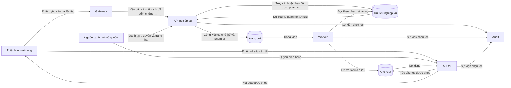

# Security boundary của API

## 1. Mục tiêu và phạm vi bài học

**Security boundary của API** là ranh giới tại đó hệ thống phải kiểm chứng dữ liệu, danh tính, quyền và điều kiện sử dụng trước khi cho một yêu cầu tác động đến tài nguyên hoặc nhận kết quả.

API không chỉ là một địa chỉ mạng. Nó là giao diện trao khả năng: đọc dữ liệu, thay đổi trạng thái, tạo công việc, sử dụng dịch vụ khác hoặc kích hoạt thao tác quản trị. Mỗi khả năng cần có điều kiện được thực thi rõ ràng.

Trong chương **Security architecture** của module yêu cầu bảo mật, mục tiêu là chuyển các ranh giới này thành yêu cầu cụ thể về xác thực, phân quyền, dữ liệu, logging và phục hồi, đồng thời liên kết chúng với mô hình đe dọa, kiến trúc và tiêu chí kiểm thử.

Sau bài học, bạn có thể:

- Xác định dữ liệu và quyền thay đổi mức tin cậy ở đâu.
- Phân chia trách nhiệm giữa gateway, API nghiệp vụ, dịch vụ nội bộ và kho dữ liệu.
- Ngăn việc biến đầu vào của bên gọi thành danh tính hoặc thẩm quyền.
- Giữ giới hạn quyền qua hàng đợi, worker, bản xuất và đường tải.
- Viết yêu cầu đo được và thử các đường vượt ranh giới.

Ví dụ trong bài là thiết kế giả định. Các giới hạn dung lượng, thời gian và số lượng là **giá trị minh họa**, cần được xác nhận theo bối cảnh hệ thống.

## 2. Ranh giới bảo mật không chỉ là ranh giới mạng

### 2.1. Mỗi lần chuyển giả định tin cậy là một điểm cần xem xét

Một yêu cầu có thể đi qua:

> Thiết bị người dùng → gateway → API nghiệp vụ → dịch vụ dữ liệu → worker → kho xuất → người nhận.

Ở từng bước, câu hỏi không chỉ là “kết nối có được phép không” mà còn là:

- Ai đang gọi và bằng chứng đến từ đâu?
- Người hoặc dịch vụ đó được làm gì?
- Đầu vào nào do họ kiểm soát?
- Tài nguyên đích thuộc ai?
- Dữ liệu nào được phép chuyển tiếp?
- Quyền có còn hiệu lực khi công việc thực sự chạy hoặc giao kết quả không?

Một thành phần có thể được tin để vận chuyển yêu cầu nhưng không được tin để tự quyết định chủ sở hữu tài nguyên. Một danh tính dịch vụ có thể được phép truy vấn dữ liệu nhưng không được phép mở rộng phạm vi mà người khởi tạo yêu cầu.

### 2.2. Cùng mạng không đồng nghĩa cùng thẩm quyền

API nội bộ có thể bị gọi bởi:

- Một dịch vụ khác bị chiếm.
- Danh tính máy được cấp quyền quá rộng.
- Một công cụ vận hành.
- Đường tích hợp hoặc tác vụ nền ngoài dự kiến.
- Người dùng đi qua một giao diện khác nhưng tới cùng backend.

Mạng riêng và danh sách cho phép có thể giới hạn đường tiếp cận. Chúng chưa quyết định quyền đối với từng tài nguyên hoặc trường dữ liệu.

Ngược lại, một API công khai không tự chứng minh có lỗ hổng. Cần phân tích chức năng, đầu vào, quyền và các kiểm soát cụ thể.

### 2.3. Một số cơ chế không thay thế cho nhau

| Cơ chế | Tác dụng chính | Chưa tự bảo đảm |
| --- | --- | --- |
| Bảo vệ đường truyền | Hạn chế đọc hoặc sửa dữ liệu trên đường truyền theo cơ chế đã chọn | Người gọi có quyền với tài nguyên đích |
| Gateway | Kiểm soát điểm vào, định tuyến và một số chính sách chung | Mọi quy tắc theo bài, lớp, người dùng hoặc trạng thái |
| Xác thực | Kiểm chứng danh tính và điều kiện của thông tin xác thực | Quyền thực hiện mọi hành động |
| Kiểm tra đầu vào | Giới hạn cấu trúc, kiểu, kích thước và giá trị | Người dùng được phép chọn bản ghi đó |
| Phân quyền | Quyết định chủ thể được làm gì trên tài nguyên | Đầu vào không gây cạn tài nguyên hoặc lỗi xử lý khác |
| CORS | Điều khiển một số hành vi truy cập phản hồi từ trình duyệt | Chặn mọi máy khách hoặc thay thế xác thực, phân quyền |
| Audit | Hỗ trợ phát hiện, điều tra và trách nhiệm giải trình | Ngăn lần hành động trái phép đầu tiên |

Nếu trình duyệt tự gửi cookie xác thực, cần xem xét cả hành vi yêu cầu giả mạo theo ngữ cảnh ứng dụng. Chính sách origin hoặc thuộc tính cookie phải được đặt đúng vai trò, không được coi là quyền đối với tài nguyên.

## 3. Xác định tài sản, nguồn danh tính và nguồn quyền

### 3.1. Những tài sản cần bảo vệ

Không chỉ có cơ sở dữ liệu chính:

- Nội dung bài nộp, kết quả và dữ liệu cá nhân.
- Thông tin phiên, token và bí mật của dịch vụ.
- Quan hệ người sở hữu, lớp, nhóm và phân công.
- Trạng thái công việc, tệp xuất, liên kết tải và cache.
- Cấu hình định tuyến và chính sách quyền.
- Audit, trace và dữ liệu phục vụ hỗ trợ.
- Backup, khóa và nguồn quyền sau phục hồi.

Một trường mã đối tượng có thể không phải bí mật, nhưng việc dùng nó để lấy dữ liệu vẫn phải được kiểm tra quyền.

### 3.2. Tách các nguồn có thẩm quyền

| Thông tin | Nguồn cần xác định | Không nên mặc định tin |
| --- | --- | --- |
| Danh tính người dùng | Cơ chế xác thực đã phê duyệt | Mã người dùng tự gửi trong body hoặc header |
| Danh tính dịch vụ | Cơ chế định danh workload hoặc ứng dụng | Địa chỉ IP nội bộ đơn thuần |
| Thành viên nhóm, vai trò | Nguồn quản trị quyền có thẩm quyền | Danh sách vai trò từ trình duyệt |
| Chủ sở hữu tài nguyên | Kho dữ liệu hoặc dịch vụ quản lý tài nguyên | Trường ownerId do bên gọi khai |
| Phạm vi tổ chức hoặc tenant | Liên kết danh tính, tài nguyên và chính sách | Chỉ một tenantId từ tham số yêu cầu |
| Trạng thái quyền hiện hành | Nguồn quyền và quy tắc hiệu lực | Bản sao cũ trong cache hoặc công việc |
| Quyền phục hồi | Nguồn quản trị và quyết định hiện hành | Trạng thái có sẵn trong backup |

Bên gọi có thể gửi mã tổ chức hoặc tài nguyên để **chọn đối tượng yêu cầu**. Điều đó khác với việc dữ liệu đó trở thành **bằng chứng được phép truy cập**.

### 3.3. Header do gateway chuyển tiếp cũng cần hợp đồng tin cậy

Một backend có thể nhận danh tính đã được gateway kiểm chứng, nhưng cần xác định:

- Backend nhận biết gateway hoặc bên phát hành ngữ cảnh bằng cách nào.
- Header hoặc dữ liệu nào gateway được phép đặt.
- Dữ liệu cùng tên từ bên ngoài có bị loại bỏ hoặc thay thế không.
- Có đường nào gọi backend trực tiếp để tự khai danh tính không.
- Ngữ cảnh có bị dùng ngoài mục đích hoặc ngoài dịch vụ nhận không.

Không nhất thiết mọi tầng phải lặp lại nguyên cơ chế xác thực. Tuy nhiên, mỗi tầng chỉ được tin dữ liệu đã được kiểm chứng qua một quan hệ tin cậy được thiết kế.

Các header về địa chỉ nguồn hoặc đường đi không tự tạo thành danh tính nghiệp vụ. Chúng cần quy tắc riêng cho chuỗi proxy đáng tin cậy và mục đích sử dụng.

## 4. Ví dụ kiến trúc: API bài nộp và xuất báo cáo

### 4.1. Phạm vi và quy tắc

Một nền tảng học tập cung cấp API để đọc bài, cập nhật thông tin được phép và tạo báo cáo qua worker.

Quy tắc giả định:

- Học viên chỉ đọc được bài của mình.
- Người chấm chỉ dùng dữ liệu trong phân công.
- Nhân viên đào tạo xuất được phạm vi đã cấp.
- Worker thực hiện công việc hợp lệ, không tự mở rộng quyền.
- Tệp xuất không công khai và phải kiểm tra quyền khi cung cấp.
- Phục hồi không làm sống lại phiên hoặc quyền đã thu hồi.

### 4.2. Các ranh giới chính



Sơ đồ mô tả trách nhiệm logic, không chứng minh các kiểm soát đã có hiệu lực. Đường cập nhật quyền, quản trị, backup và phục hồi cần được phân tích bổ sung khi nằm trong phạm vi.

Tên “ngữ cảnh đã kiểm chứng” là hợp đồng mong muốn. Phải có cơ chế và bằng chứng rằng dữ liệu đó thật sự được tạo bởi bên có thẩm quyền, không phải do người gọi tự điền.

### 4.3. Bảng ranh giới

| Mã | Điểm chuyển | Điều cần bảo đảm |
| --- | --- | --- |
| B1 | Người dùng → gateway | Đầu vào vẫn là dữ liệu không tin cậy; kiểm tra điểm vào và thông tin xác thực |
| B2 | Gateway → API | Xác định đúng nguồn ngữ cảnh, ngăn giả header và đường gọi trực tiếp |
| B3 | API → dữ liệu nghiệp vụ | Phân quyền theo hành động, đối tượng, trường và phạm vi |
| B4 | API → hàng đợi → worker | Giữ nguồn chủ thể và phạm vi; không dùng quyền dịch vụ để mở rộng yêu cầu |
| B5 | Worker → kho xuất → API tải | Bảo vệ bản sao, người nhận, thời hạn và quyền hiện hành |
| B6 | Các thành phần → audit | Không sao chép bí mật; sự kiện đủ và được bảo vệ |
| B7 | Backup → môi trường phục hồi | Dữ liệu, quyền và chính sách cũ không tự trở thành hiện hành |
| B8 | Tích hợp ra ngoài | Không gửi dữ liệu hoặc dùng thông tin xác thực cho đầu nhận ngoài phạm vi |

B8 cần được mô tả khi có API gọi nhà cung cấp, tải URL hoặc chuyển dữ liệu cho hệ thống khác. Không phải mọi hệ thống đều có cùng đường tích hợp.

## 5. Xử lý một yêu cầu theo các quyết định tin cậy

Một trình tự logic để phân tích:

1. Xác định endpoint, hành động và hợp đồng dữ liệu.
2. Áp dụng giới hạn tiếp nhận phù hợp trước khi tiêu thụ tài nguyên quá mức.
3. Kiểm chứng danh tính hoặc xác nhận đây là chức năng công khai theo chính sách.
4. Lấy ngữ cảnh có thẩm quyền; không nâng dữ liệu tự khai thành vai trò.
5. Xác định tài nguyên thật và quan hệ sở hữu.
6. Kiểm tra quyền theo hành động, phạm vi, trường và trạng thái.
7. Kiểm tra điều kiện nghiệp vụ, phiên bản và tính hợp lệ đầu vào.
8. Thực hiện với quyền kỹ thuật giới hạn và cơ chế nhất quán.
9. Tạo đầu ra theo dữ liệu được phép, áp dụng chính sách cache.
10. Ghi audit chọn lọc, xử lý lỗi và phụ thuộc theo yêu cầu.

Đây là trình tự để lập luận, không phải quy định mọi kiểm tra phải nằm trong một hàm hoặc một thứ tự cố định duy nhất. Một số giới hạn phải thực hiện sớm; một số quyết định phải gắn với thao tác ghi hoặc thời điểm giao dữ liệu.

### 5.1. Kiểm tra cấu trúc không thay thế kiểm tra quyền

Một yêu cầu có thể đúng JSON, đúng kiểu và đúng mã định danh nhưng trỏ đến bài của người khác.

Ví dụ dữ liệu minh họa:

```json
{
  "submissionId": "SUBMISSION-B",
  "comment": "Nội dung nhận xét",
  "ownerId": "PERSON-A",
  "role": "ADMIN"
}
```

Nếu hợp đồng cập nhật chỉ cho phép nhận xét, hệ thống phải có chính sách rõ cho trường ngoài hợp đồng; trong ví dụ, chúng bị từ chối. ownerId và role không được dùng để tạo quyền.

Ngay cả khi bỏ các trường này, submissionId vẫn phải được đối chiếu với tài nguyên thật và quyền người gọi. Đầu vào sạch về định dạng chưa chứng minh hành động hợp lệ.

### 5.2. Kiểm tra quyền phải đi cùng đối tượng được sử dụng

Không nên kiểm tra quyền với bài A rồi đọc mã tệp B do bên gọi tự khai. Quan hệ bài–tệp phải lấy từ nguồn có thẩm quyền.

Khi dữ liệu hoặc quyền có thể thay đổi đồng thời, cần nêu cách ràng buộc quyết định với phiên bản và thao tác thực tế. Kiểm tra trước rồi sử dụng một đối tượng đã thay đổi có thể tạo khoảng vượt ranh giới.

## 6. Giữ ranh giới khi gọi dịch vụ và chạy công việc nền

### 6.1. Danh tính dịch vụ không thay thế quyền người khởi tạo

Một worker có thể cần quyền kỹ thuật đọc nhiều nhóm dữ liệu để phục vụ nhiều người. Điều đó không có nghĩa mọi công việc mà nó nhận đều được phép đọc toàn bộ.

Công việc cần có tham chiếu đáng tin cậy tới:

- Người hoặc dịch vụ khởi tạo.
- Hành động và mục đích.
- Tập dữ liệu, tài nguyên hoặc điều kiện phạm vi.
- Quyết định quyền hoặc nguồn để kiểm tra lại.
- Mã tác vụ và thông tin cần chống xử lý nhầm hoặc lặp.

Ngữ cảnh do API tạo cũng cần được bảo vệ trong hàng đợi. Worker phải kiểm tra đúng nguồn, hợp đồng dữ liệu và phạm vi, không tin một thông điệp tự khai “đã được duyệt”.

Không nên sao chép token đầy đủ vào công việc chỉ để có sẵn cho mọi bước nếu không có nhu cầu và cơ chế bảo vệ phù hợp.

### 6.2. Kiểm tra quyền tại thời điểm phù hợp

Giả sử người dùng tạo báo cáo lúc còn quyền, rồi mất quyền trong khi tác vụ chờ.

Cần xác định:

- Worker có còn được đọc dữ liệu không?
- Kết quả tạo dở được giữ, bỏ hay giới hạn thế nào?
- API tải có kiểm tra quyền hiện hành không?
- Liên kết cũ và cache có tiếp tục cung cấp dữ liệu không?
- Trong bao lâu quyết định thu hồi tới mọi điểm tiếp nhận?

Kiểm tra lúc tạo công việc chưa đủ để trả lời các câu hỏi sau. Một cơ chế đúng cần đạt mục tiêu đầu cuối, không chỉ có một cột trạng thái thu hồi trong cơ sở dữ liệu.

### 6.3. Ngăn dùng quyền của dịch vụ làm quyền của mọi người gọi

Một dịch vụ có đặc quyền có thể bị biến thành bên thực hiện thay cho yêu cầu ngoài thẩm quyền nếu nó chỉ nhìn “yêu cầu tới từ hệ thống nội bộ”.

Ví dụ, API nhận mã nhóm tùy ý, worker đọc nhóm đó bằng quyền rộng của mình rồi tạo báo cáo. Nếu không đối chiếu quyền người khởi tạo với nhóm đích, ranh giới nghiệp vụ đã bị vượt dù mọi kết nối nội bộ đều được xác thực.

Biện pháp cần giới hạn cả:

- Ai được gọi dịch vụ.
- Dịch vụ được thực hiện hành động nào.
- Người hoặc công việc đằng sau yêu cầu được tác động dữ liệu nào.
- Kết quả được chuyển cho ai.

Không chuyển thông tin xác thực dành cho một dịch vụ sang dịch vụ khác như thể chúng dùng chung mục đích. Kiến trúc cần cơ chế ủy nhiệm hoặc ngữ cảnh có thẩm quyền phù hợp, với đối tượng nhận và phạm vi rõ ràng.

## 7. Ranh giới khi API gọi ra ngoài

Một API có thể gọi nhà cung cấp, lấy nội dung từ URL hoặc gửi thông báo. Khi đó, nó đưa dữ liệu hoặc sử dụng quyền mạng của máy chủ ở một ranh giới mới.

Cần đặc tả:

- Đầu nhận nào được phép và vì sao.
- Dữ liệu nào được gửi, có cần giảm trường không.
- Thông tin xác thực nào được sử dụng cho đầu nhận đó.
- Cách xử lý chuyển hướng, phân giải tên và đích cuối nếu cho phép URL.
- Giới hạn thời gian, kích thước và tài nguyên của phản hồi.
- Nội dung phản hồi được kiểm tra trước khi dùng ở đâu.

Một URL do người dùng cung cấp không tự được phép tiếp cận mọi địa chỉ mà máy chủ nhìn thấy. Nếu chỉ kiểm tra chuỗi ban đầu nhưng không xử lý chuyển hướng hoặc thay đổi đích, chính sách có thể không phản ánh nơi thật sự kết nối.

Tương tự, phản hồi từ đối tác không tự trở thành dữ liệu có thẩm quyền để đổi chủ sở hữu, cấp quyền hoặc xác nhận một giao dịch. Cần kiểm tra nguồn, mối liên hệ với yêu cầu và điều kiện nghiệp vụ tương ứng.

Việc chấp nhận callback hoặc sự kiện từ ngoài cũng cần xác định tính xác thực, phạm vi, quan hệ với tài nguyên và cách xử lý sự kiện lặp hoặc không còn phù hợp.

## 8. Bảo vệ đầu ra, lỗi và cache

### 8.1. Chỉ trả dữ liệu cần và được phép

Không nên trả nguyên đối tượng lưu trữ rồi trông đợi giao diện ẩn trường nhạy cảm. Đầu ra cần được tạo theo hợp đồng và quyền của người nhận.

Có thể cần kiểm tra riêng:

- Tập bản ghi được phép.
- Trường dữ liệu được phép.
- Tiêu đề, tên tệp, đoạn trích và bản xem trước.
- Quan hệ giữa dữ liệu nhiều nguồn khi tổng hợp.
- Quyền xuất hàng loạt khác với đọc từng bản ghi.

Một người được xem một kết quả không mặc nhiên được nhận toàn bộ thông tin học viên có liên quan.

### 8.2. Cache là một điểm cung cấp dữ liệu

Cache có thể nằm ở gateway, API, dịch vụ tệp hoặc thành phần trung gian. Nếu nhiều người có quyền khác nhau, chỉ dùng URL làm khóa cache có thể trả nhầm phản hồi.

Cần xác định:

- Loại dữ liệu nào được cache.
- Cache dùng chung hay riêng theo ngữ cảnh.
- Cách ràng buộc với danh tính, phạm vi và phiên bản quyền nếu cần.
- Cách hết hạn hoặc vô hiệu khi quyền thay đổi.
- Có đáp ứng mục tiêu thu hồi không.

Trong ví dụ, phản hồi và tệp chứa dữ liệu học tập riêng tư không được cung cấp qua cache dùng chung ngoài chính sách. Một header ở máy chủ chưa đủ nếu cấu hình trung gian thực tế không thực thi đúng.

### 8.3. Phản hồi lỗi không được vượt ranh giới dữ liệu

Lỗi nên cung cấp thông tin cần cho người gọi hợp lệ mà không trả token, nội dung ngoài quyền, câu truy vấn, khóa hoặc dữ liệu cấu hình nhạy cảm.

Có thể dùng mã tương quan để tra cứu bằng chứng trong phạm vi có quyền. Nhưng dữ liệu trong hệ thống hỗ trợ cũng phải được quản lý, không chuyển toàn bộ yêu cầu vào phiếu lỗi theo mặc định.

Việc chọn mã phản hồi phải theo hợp đồng API. Chỉ nhìn mã lỗi không đủ chứng minh dữ liệu không bị tiết lộ hoặc tác vụ gây hại chưa chạy.

## 9. Hành vi khi lỗi và các phụ thuộc bảo mật

### 9.1. Không xác minh được không đồng nghĩa được phép

Với hành động được bảo vệ, hệ thống phải phân biệt:

- Đã xác minh và có quyền.
- Đã xác minh nhưng không có quyền.
- Không đủ thông tin để quyết định.
- Phụ thuộc không sẵn sàng.
- Ngữ cảnh hoặc chính sách không còn hợp lệ.

Trong tình huống minh họa, API không thực hiện thay đổi hoặc giao báo cáo khi không xác minh được điều kiện bắt buộc. Hệ thống có thể từ chối hoặc giữ tác vụ chờ theo chính sách đã định.

Nếu cho phép dùng quyết định lưu tạm cho một số hành động, phải nêu phạm vi, thời gian và rủi ro. Không có nhánh ngầm “dịch vụ quyền lỗi thì cho qua”.

### 9.2. Tác động có thể xảy ra trước khi trả lỗi

Một yêu cầu có thể đã ghi dữ liệu hoặc tạo công việc rồi mới trả lỗi do mất kết nối. Khi người dùng thử lại, có thể tạo thay đổi lặp.

Cần xem xét:

- Cách ràng buộc kiểm tra với thao tác.
- Chính sách phiên bản và xử lý đồng thời.
- Cách nhận biết cùng một yêu cầu được gửi lại.
- Trạng thái khi ghi một phần hoặc công việc bị gián đoạn.
- Bằng chứng và thông báo kết quả.

Mục tiêu là không để lỗi kỹ thuật làm xuất hiện quyền mới, dữ liệu dở dang có thể đọc ngoài chính sách hoặc công việc lặp gây hại.

### 9.3. Phục hồi là một lần đưa dữ liệu qua ranh giới

Backup mang trạng thái cũ trở lại. Cần kiểm tra quyền, phiên, cấu hình cache, tệp xuất và chính sách trước khi mở API.

Nếu cùng một tài khoản có thể phá dữ liệu chính, backup và khóa cần để khôi phục, ranh giới phục hồi có thể không đủ độc lập.

Không xem “API đã trả thành công sau phục hồi” là bằng chứng duy nhất. Người đúng quyền phải dùng được, người ngoài quyền vẫn phải bị từ chối và dữ liệu phải đúng phiên bản, phạm vi.

## 10. Liên kết ranh giới với kịch bản đe dọa

| Mã | Ranh giới | Kịch bản cần đánh giá | Hậu quả |
| --- | --- | --- | --- |
| T-API-01 | B1, B2 | Người gọi tự khai header danh tính hoặc gọi thẳng backend | Giả mạo chủ thể hoặc vai trò |
| T-API-02 | B3 | Người có phiên hợp lệ thay mã bài, tổ chức hoặc trường không được sửa | Đọc, sửa dữ liệu ngoài quyền |
| T-API-03 | B3 | Quyết định quyền áp dụng cho một đối tượng nhưng thao tác dùng đối tượng khác hoặc phiên bản mới | Vượt kiểm tra hoặc ghi sai dữ liệu |
| T-API-04 | B4 | Worker dùng quyền rộng để thực hiện phạm vi do người gọi tự khai | Mở rộng quyền qua dịch vụ |
| T-API-05 | B5 | Người mất quyền dùng phiên, liên kết hoặc cache cũ tải báo cáo | Tiếp tục tiếp cận dữ liệu sau thu hồi |
| T-API-06 | B1, B4 | Dữ liệu lớn hoặc nhiều công việc làm cạn tài nguyên | Gián đoạn chức năng hợp lệ |
| T-API-07 | B6 | Token hoặc nội dung bài bị ghi vào log, hoặc audit bị mất | Rò rỉ qua quan sát và thiếu bằng chứng |
| T-API-08 | B7 | Phục hồi quyền, phiên hoặc bản xuất cũ như trạng thái hiện hành | Tái mở truy cập ngoài chính sách |
| T-API-09 | B8 | API dùng quyền mạng hoặc bí mật để gọi đích ngoài phạm vi | Lộ dữ liệu hoặc tiếp cận tài nguyên ngoài chủ đích |

Đây là danh sách kịch bản của thiết kế giả định, không phải khẳng định một ứng dụng cụ thể đã có lỗ hổng.

Với mỗi kịch bản, cần ghi điều kiện tiếp cận, kiểm soát hiện hành, bằng chứng và điều chưa biết. Không gán mức rủi ro chỉ từ tên kỹ thuật mà bỏ tài sản và hậu quả nghiệp vụ.

## 11. Đặc tả yêu cầu bảo mật có thể kiểm chứng

### 11.1. Mẫu yêu cầu

Có thể dùng cấu trúc:

> Với [endpoint, dữ liệu và môi trường], [thành phần] phải [hành vi hoặc giới hạn] khi [điều kiện], đạt [kết quả]. Kiểm chứng bằng [phép thử] và lưu [bằng chứng].

Mỗi yêu cầu cần gắn với ranh giới, kịch bản đe dọa, nơi thực hiện và người chịu trách nhiệm. Các ngưỡng dưới đây thuộc tình huống minh họa, không phải giá trị mặc định cho mọi API.

### 11.2. SEC-API-01 — Nguồn danh tính và ngữ cảnh đáng tin cậy

API và API tải phải xác định chủ thể qua cơ chế được phê duyệt. Thông tin xác thực hoặc ngữ cảnh chuyển tiếp phải được kiểm chứng đúng nguồn, mục đích, đối tượng nhận và điều kiện hiệu lực.

Dữ liệu như mã người dùng, vai trò hoặc tổ chức do bên ngoài tự khai không được tạo quyền. Nếu gateway đặt ngữ cảnh, phải có cơ chế ngăn giả mạo từ đầu vào và kiểm tra nguồn khi backend tiếp nhận.

- Liên quan: B1, B2; T-API-01.
- Kiểm chứng: giả header, dùng thông tin sai nguồn hoặc mục đích, gọi backend qua đường không có ngữ cảnh hợp lệ.
- Kết quả đạt: yêu cầu không được cấp danh tính hoặc quyền từ dữ liệu tự khai; đường gọi hợp lệ vẫn phải đáp ứng cơ chế kiểm chứng tương ứng.
- Bằng chứng: hợp đồng ngữ cảnh, cấu hình nguồn tin cậy và kết quả thử.
- Bên thực hiện: nhóm gateway, danh tính và API.

Nếu kiểm chứng token, không chỉ đọc nội dung rồi tin các trường. Một token có chữ ký không đồng nghĩa nội dung đã được mã hóa; thông tin nào đưa vào token vẫn cần được giới hạn theo mục đích.

### 11.3. SEC-API-02 — Phân quyền theo đối tượng, trường và phiên bản

Mọi thao tác phải kiểm tra quyền của chủ thể đối với hành động và tài nguyên thật, gồm phạm vi lớp hoặc tổ chức phù hợp. Trường dữ liệu được đọc, ghi phải tuân theo hợp đồng và quyền tương ứng.

API phải lấy quan hệ sở hữu, phân công và ánh xạ bài–tệp từ nguồn có thẩm quyền. Quyết định phải ràng buộc với đối tượng, phạm vi và phiên bản thực sự được sử dụng.

- Liên quan: B3; T-API-02, T-API-03.
- Kiểm chứng: thay mã bài, mã tổ chức, mã tệp, trường ngoài hợp đồng; gửi bản cũ hoặc thay đổi đồng thời.
- Kết quả đạt: không có dữ liệu ngoài quyền bị cung cấp hoặc thay đổi; hành vi hợp lệ theo chính sách vẫn hoạt động.
- Bằng chứng: ma trận quyền, trạng thái trước–sau, phiên bản và kết quả.
- Bên thực hiện: nhóm nghiệp vụ và dữ liệu.

Giới hạn định dạng của mã không thay thế kiểm tra quyền. Giới hạn quyền trong giao diện cũng không thay thế cơ chế phía máy chủ.

### 11.4. SEC-API-03 — Hợp đồng đầu vào và giới hạn tài nguyên

Đối với API tạo công việc xuất của ví dụ, dữ liệu yêu cầu không được vượt 64 KiB. Mỗi người dùng chỉ có tối đa một công việc đang chờ hoặc đang chạy; toàn dịch vụ chỉ chạy tối đa bốn công việc xuất đồng thời.

Hệ thống phải áp dụng giới hạn theo chủ thể đáng tin cậy và trạng thái công việc thực tế, nhất quán qua nhiều phiên hoặc bản sao API. Yêu cầu vượt giới hạn không được âm thầm tạo thêm công việc tốn kém.

- Liên quan: B1, B4; T-API-06.
- Kiểm chứng: dữ liệu ngay dưới, đúng và trên giới hạn; gửi đồng thời qua nhiều phiên và nhiều bản sao dịch vụ.
- Kết quả đạt: giới hạn được giữ; trường hợp bị từ chối không để lại công việc chạy ngoài chính sách.
- Bằng chứng: kích thước thực nhận, số công việc, số worker và phản hồi.
- Bên thực hiện: nhóm tiếp nhận, hàng đợi và worker.

Các trường được phép và giới hạn giá trị phải được mô tả trong hợp đồng. Giới hạn thân yêu cầu chưa đủ giới hạn độ phức tạp truy vấn, thời gian chạy hoặc tổng dung lượng lưu; các mục này cần đặc tả thêm nếu kịch bản đòi hỏi.

### 11.5. SEC-API-04 — Giới hạn quyền qua worker và thu hồi

Công việc phải giữ nguồn chủ thể, hành động và phạm vi từ API có thẩm quyền. Worker phải dùng quyền kỹ thuật để thực hiện đúng công việc hợp lệ, không tự mở rộng dữ liệu từ yêu cầu của người dùng.

Trong ví dụ, sau khi quyền hoặc phiên liên quan bị thu hồi tại nguồn có thẩm quyền, mọi điểm giao kết quả phải ngừng cung cấp dữ liệu trái quyết định thu hồi trong tối đa 5 phút.

- Liên quan: B4, B5; T-API-04, T-API-05.
- Kiểm chứng: sửa ngữ cảnh công việc, yêu cầu vượt phạm vi; thu hồi khi chờ, đang chạy và sau khi có tệp; thử phiên, liên kết và cache cũ.
- Kết quả đạt: không cung cấp dữ liệu ngoài quyền; giới hạn 5 phút đạt trên mọi đường giao kết quả.
- Bằng chứng: nguồn công việc, quyết định quyền, mốc thời gian và kết quả tải.
- Bên thực hiện: nhóm API, hàng đợi, worker và tải tệp.

Thời gian phát hiện một vụ chiếm phiên không tự nằm trong giới hạn trên. Phải đánh giá riêng khoảng trước khi nguồn có thẩm quyền ghi nhận thu hồi.

### 11.6. SEC-API-05 — Đầu ra và bản sao có kiểm soát

API chỉ được trả tập bản ghi, trường và nội dung phù hợp với quyền người nhận. Bản xem trước, tệp xuất, cache và đường tải phải tuân theo cùng phạm vi.

Dữ liệu trong ví dụ phải được bảo vệ khi truyền, khi lưu theo chính sách đã xác nhận. Không cho phép cache dùng chung cung cấp dữ liệu riêng tư cho người ngoài quyền. Thời hạn giữ và cách xử lý bản tạm phải được nêu theo mục đích.

- Liên quan: B3, B5; T-API-02, T-API-05.
- Kiểm chứng: dùng các danh tính có quyền khác nhau trên cùng URL, yêu cầu trường không được phép, truy cập kho hoặc tệp tạm trực tiếp.
- Kết quả đạt: không lẫn dữ liệu, không trả trường ngoài quyền và không có đường tải vượt chính sách.
- Bằng chứng: hợp đồng đầu ra, cấu hình cache, nơi lưu và kết quả thử.
- Bên thực hiện: nhóm API, lưu trữ và thành phần trung gian.

Xóa quyền trên máy chủ không bảo đảm xóa được bản người dùng đã tải trước đó. Rủi ro của bản sao ngoài phạm vi kiểm soát phải được nêu riêng.

### 11.7. SEC-API-06 — Audit đủ dùng và hạn chế dữ liệu ghi nhận

Các sự kiện truy cập bị từ chối, thay đổi dữ liệu quan trọng, tạo hoặc tải bản xuất, thu hồi quyền và phục hồi phải ghi chủ thể tham chiếu, hành động, tài nguyên hoặc công việc, thời điểm và kết quả.

Trong ví dụ, sự kiện phải có ở kho audit trung tâm trong tối đa 5 phút. Mất luồng phải được cảnh báo trong 10 phút từ mốc tín hiệu kiểm tra dự kiến đầu tiên bị thiếu. Người vận hành ứng dụng thông thường không được sửa hoặc xóa sự kiện đã thu thập.

- Liên quan: B6; T-API-07.
- Kiểm chứng: hành vi thành công và bị từ chối, lỗi ở gateway hoặc ứng dụng, ngừng chuyển tiếp và thử can thiệp audit.
- Kết quả đạt: sự kiện đủ, đúng giới hạn, không chứa token, mật khẩu hoặc nội dung ngoài phạm vi cho phép.
- Bằng chứng: danh sách trường, kết quả đo, cảnh báo và thử quyền.
- Bên thực hiện: nhóm gateway, ứng dụng, audit và vận hành.

Cần kiểm tra proxy, trace và báo cáo lỗi. Lọc token ở API chưa đủ nếu tầng trước đã ghi toàn bộ header.

### 11.8. SEC-API-07 — Lỗi và phục hồi không mở rộng quyền

Khi không xác minh được điều kiện bắt buộc, hành động được bảo vệ phải bị từ chối hoặc giữ chờ theo chính sách đã xác định. Lỗi kết nối, thử lại hoặc ghi dở không được tự tạo quyền, giao dữ liệu ngoài phạm vi hay tạo hậu quả lặp ngoài thiết kế.

Trong kịch bản mất dữ liệu chính của ví dụ, mục tiêu phục hồi là RPO không quá 15 phút và RTO không quá 60 phút. Trước khi mở lại API phải xác minh nội dung, phiên, quyền và trạng thái bản xuất.

- Liên quan: B3, B4, B7; T-API-03, T-API-08.
- Kiểm chứng: mất nguồn quyền, lỗi giữa thao tác, gửi lại yêu cầu và phục hồi từ bản sao trước một lần thu hồi.
- Kết quả đạt: trạng thái không vượt chính sách; quyền cũ không tự hoạt động lại; mục tiêu phục hồi đạt trong kịch bản.
- Bằng chứng: chính sách lỗi, trạng thái trước–sau, biên bản và mốc thời gian.
- Bên thực hiện: nhóm ứng dụng, dữ liệu, danh tính và phục hồi.

RPO là mục tiêu về khoảng dữ liệu có thể mất trước sự cố. RTO trong ví dụ được đo từ lúc công bố sự cố đến khi luồng hợp lệ hoạt động với dữ liệu và quyền đã kiểm tra. Không mở rộng quyền để làm kết quả phục hồi có vẻ đạt.

### 11.9. SEC-API-08 — Giới hạn đầu nhận khi có tích hợp ra ngoài

Nếu API có chức năng gọi URL hoặc hệ thống khác, đích cuối, hành động, dữ liệu và thông tin xác thực phải nằm trong phạm vi đã phê duyệt.

Chính sách phải xử lý cả chuyển hướng và các thay đổi đích liên quan. Phản hồi phải có giới hạn tài nguyên và được kiểm tra trước khi dùng. Trong một chức năng lấy nội dung minh họa, có thể đặt giới hạn xử lý 10 giây và dữ liệu phản hồi tối đa 2 MiB, nếu phù hợp nhu cầu đã xác nhận.

- Liên quan: B8; T-API-09.
- Kiểm chứng: đích ngoài danh sách, chuyển hướng ngoài phạm vi, phản hồi quá giới hạn và việc dùng sai thông tin xác thực.
- Kết quả đạt: không dùng quyền mạng hoặc bí mật để gọi ngoài thẩm quyền; không tiêu thụ phản hồi quá điều kiện.
- Bằng chứng: danh sách đích được duyệt, cấu hình, kết quả kết nối và thử giới hạn.
- Bên thực hiện: nhóm tích hợp và nền tảng.

Yêu cầu này chỉ áp dụng khi có đường gọi tương ứng. Khi thêm đường mới, phải cập nhật mô hình và không suy ra nó đã được bảo vệ từ các endpoint cũ.

## 12. Truy vết yêu cầu và bằng chứng

| Kịch bản | Yêu cầu | Điểm cần kiểm chứng | Bằng chứng chính |
| --- | --- | --- | --- |
| T-API-01 | SEC-API-01 | Gateway, backend và API tải | Thử giả ngữ cảnh và các đường vào |
| T-API-02, T-API-03 | SEC-API-02, SEC-API-05 | Đối tượng, trường, quan hệ và phiên bản | Ma trận quyền cùng trạng thái trước–sau |
| T-API-04, T-API-05 | SEC-API-04, SEC-API-05 | Công việc, worker, kho xuất và tải | Thay quyền theo các giai đoạn và thử đường cũ |
| T-API-06 | SEC-API-03 | Tiếp nhận, hàng đợi, điều phối | Thử ranh giới kích thước và đồng thời |
| T-API-07 | SEC-API-06 | Mọi tầng thu thập audit và lỗi | Kiểm tra trường, độ trễ, cảnh báo và quyền |
| T-API-08 | SEC-API-07 | Nguồn quyền, dữ liệu và môi trường phục hồi | Diễn tập với thay đổi sau điểm backup |
| T-API-09 | SEC-API-08 | Đầu nhận thật và dữ liệu gửi ra | Thử đích, chuyển hướng và giới hạn |

Bảng là kế hoạch kiểm chứng, không phải báo cáo đã chạy kiểm thử. Khi thực hiện, phải ghi phiên bản, môi trường, dữ liệu tổng hợp, điều kiện và kết quả thật.

Không dùng kết quả của gateway để kết luận mọi backend đã được bảo vệ. Cũng không dùng một phép thử API đồng bộ để kết luận worker và đường tải có cùng hành vi.

## 13. Thiết kế kiểm thử theo ranh giới

### 13.1. Các chiều cần kết hợp

Không chỉ kiểm tra một tài khoản đúng quyền gọi một endpoint. Cần kết hợp có chủ đích:

- Chủ thể: chưa xác thực, đúng quyền, sai phạm vi, đã thu hồi, danh tính dịch vụ.
- Đường vào: gateway, backend, phiên bản API cũ, API tải và công cụ quản trị.
- Tài nguyên: của mình, người khác, lớp hoặc tổ chức khác.
- Hành động: đọc, sửa, xóa, xuất và cung cấp tệp.
- Thời điểm: trước, trong, sau công việc; sau thay quyền; sau phục hồi.
- Trạng thái: dữ liệu hoặc chính sách đổi, phụ thuộc lỗi, thao tác lặp.
- Đầu ra: nội dung chính, trường phụ, lỗi, cache, bản tạm và audit.

Không cần tạo mọi tổ hợp máy móc. Chọn theo đường đe dọa và phần kiểm soát có thể khác nhau.

### 13.2. Ma trận minh họa

| Trường hợp | Điều cần quan sát | Kết quả mong đợi |
| --- | --- | --- |
| Người chưa xác thực tự khai vai trò | Danh tính và quyết định tại backend | Không được cấp quyền từ trường tự khai |
| Người đúng phiên nhưng sai chủ sở hữu | Đối tượng thật và nội dung trả | Không nhận dữ liệu ngoài quyền |
| Mã bài đúng quyền nhưng mã tệp ngoài quyền | Ánh xạ tài nguyên | Không đọc nhầm tệp |
| Trường cập nhật ngoài hợp đồng | Dữ liệu trước–sau | Không thay owner, vai trò hoặc trạng thái trái chính sách |
| Nhiều phiên cùng tạo công việc | Số công việc và nguồn chủ thể | Không vượt giới hạn theo người |
| Quyền đổi khi công việc chờ hoặc chạy | Worker, tệp và API tải | Không giao kết quả ngoài quyền hiện hành |
| Người khác dùng cùng URL sau một phản hồi đã cache | Nội dung và khóa ngữ cảnh | Không lẫn dữ liệu |
| Nguồn quyền không sẵn sàng | Hành vi thay đổi hoặc giao dữ liệu | Không tự cho qua điều kiện bắt buộc |
| Lỗi sau khi đã tạo trạng thái một phần | Dữ liệu, tác vụ và lần thử lại | Không tạo hậu quả ngoài thiết kế |
| Phục hồi bản sao cũ | Phiên, quyền, bản xuất và cache | Không tái mở truy cập đã thu hồi |

Khi yêu cầu bị từ chối, kiểm tra cả trạng thái sau thao tác. Không chỉ xem mã phản hồi mà bỏ công việc đang chạy hoặc tệp đã được tạo.

### 13.3. Ví dụ đặc tả hành vi

```gherkin
Given học viên A có phiên hợp lệ và chỉ có quyền với bài của mình
And gateway là nguồn ngữ cảnh danh tính được backend công nhận
When học viên A gửi yêu cầu đọc bài B cùng header tự khai danh tính B
Then header tự khai không làm thay đổi chủ thể có thẩm quyền
And bài B không được cung cấp cho A
And các trường phụ và audit không làm lộ nội dung hoặc token
```

Đối với thu hồi qua tác vụ:

```gherkin
Given một báo cáo được yêu cầu khi người dùng còn quyền
And công việc chưa giao kết quả
When quyền liên quan bị thu hồi tại nguồn có thẩm quyền
And người dùng thử tải qua phiên, tham chiếu và đường cũ
Then mọi điểm giao kết quả ngừng cung cấp trái quyền trong 5 phút
And worker không dùng quyền kỹ thuật để tự mở rộng phạm vi
And dữ liệu đã tạo được xử lý theo vòng đời đã xác định
```

Các ví dụ là mô tả phép thử, không phải kết quả thực hiện. Dữ liệu và danh tính dùng để thử phải là dữ liệu tổng hợp hoặc được phép dùng trong phạm vi tương ứng.

### 13.4. Bằng chứng cần đủ cho kết luận

Một bộ bằng chứng có thể gồm:

- Mô hình ranh giới và hợp đồng ngữ cảnh.
- Ma trận quyền theo vai trò, tài nguyên và hành động.
- Cấu hình hiệu lực của gateway, API, kho và cache.
- Trạng thái dữ liệu trước–sau.
- Mốc thu hồi, xử lý công việc và tải.
- Sự kiện audit đã loại dữ liệu không cần thiết.
- Kết quả diễn tập phục hồi.

Kiểm tra thiết kế, cấu hình và hành vi trả lời các câu hỏi khác nhau. Một loại bằng chứng không tự thay thế mọi loại khác.

## 14. Duy trì ranh giới trong vòng đời phát triển

### 14.1. Khi thiết kế

Đặt câu hỏi về nguồn danh tính, nguồn quyền và đầu ra trước khi chọn vị trí gateway hoặc cách chia dịch vụ.

Với mỗi API, xác định khả năng nó trao và nơi có đủ dữ liệu để quyết định. Một gateway biết route và vai trò chung có thể chưa biết quan hệ học viên–bài nộp; dịch vụ nghiệp vụ phải có trách nhiệm phù hợp.

Nếu dùng nhiều tầng, ghi hợp đồng tin cậy giữa chúng. Không dùng cụm “nội bộ đã an toàn” thay cho cơ chế.

### 14.2. Khi xây dựng và triển khai

Gắn mã yêu cầu với endpoint, tác vụ và điểm cung cấp dữ liệu. Bảo đảm các đường cùng chức năng không khác chính sách ngoài chủ đích.

Cần xem xét lại khi:

- Thêm phiên bản API hoặc công cụ nhập dữ liệu.
- Đưa backend ra một đường truy cập mới.
- Thay header, token hoặc nguồn danh tính.
- Bổ sung cache, bản xem trước hoặc tải trực tiếp.
- Chuyển xử lý đồng bộ sang hàng đợi.
- Mở thêm quyền của danh tính dịch vụ.
- Thêm lời gọi ra ngoài hoặc callback.
- Thay mô hình nhiều tổ chức dùng chung.

Một thay đổi hiệu năng có thể thay đổi ranh giới quyền. Ví dụ, cache hoặc tải trực tiếp có thể đưa quyết định cung cấp dữ liệu ra ngoài nơi trước đây kiểm tra quyền.

### 14.3. Khi vận hành

Theo dõi các điều kiện mà thiết kế dựa vào:

- Quyền hiệu lực và thay đổi chính sách.
- Điểm vào và đường đi thực tế.
- Độ trễ đồng bộ quyền, cache và thu hồi.
- Trạng thái công việc, lỗi và tài nguyên.
- Độ đầy đủ của audit.
- Quyền và khả năng sử dụng nguồn phục hồi.
- Sai lệch giữa cấu hình khai báo và đang chạy.

Tần suất sự kiện ít không tự chứng minh ranh giới đúng. Có thể chưa có hành vi hoặc khả năng quan sát chưa đủ.

Đối với kết nối dài, đăng ký sự kiện hoặc truyền dữ liệu nhiều phần, cần đặc tả lúc kiểm tra lại và cách dừng sau thu hồi. Quyết định lúc mở kết nối không tự có hiệu lực vô thời hạn.

### 14.4. Khi ngừng sử dụng

Gỡ quyền, phiên bản endpoint, khóa hoặc bí mật không còn cần. Xử lý công việc chờ, liên kết tải, bản xuất, cache và bản sao theo chính sách.

Đóng route trên gateway chưa đủ nếu backend, API tải hoặc dịch vụ lưu trữ vẫn tiếp nhận qua đường khác. Cần kiểm tra đúng phạm vi kỹ thuật và dữ liệu còn lại.

## 15. Rủi ro còn lại và giới hạn lập luận

Một ranh giới được thiết kế và kiểm chứng vẫn có điều kiện:

- Nguồn danh tính hoặc quyền có thể bị chiếm.
- Một người có quyền có thể sử dụng dữ liệu sai mục đích.
- Các dịch vụ có đặc quyền có thể bị can thiệp.
- Dữ liệu đã tải có thể bị chia sẻ ngoài hệ thống.
- Một số trường hợp hoặc phụ thuộc chưa được kiểm tra.
- Độ trễ phát hiện và thu hồi vẫn tạo cửa sổ tác động.
- Một lỗi chung có thể ảnh hưởng cả ứng dụng lẫn audit hoặc phục hồi.

Cần mô tả phần còn lại theo kịch bản và hậu quả, không chỉ kết luận “có gateway” hoặc “đã dùng token”.

Nếu một yêu cầu chưa đạt, giữ đúng trạng thái và công việc xử lý. Quyết định chấp nhận rủi ro hoặc ngoại lệ, khi có cơ chế phù hợp, phải được liên kết riêng với phạm vi, thời hạn và thẩm quyền; không làm kết quả kiểm thử tự thành đạt.

## 16. Những sai lầm thường gặp

| Sai lầm | Vấn đề | Cách cải thiện |
| --- | --- | --- |
| Gateway xác thực rồi backend tin mọi header | Dữ liệu giả hoặc đường gọi trực tiếp có thể tạo danh tính | Định nghĩa nguồn ngữ cảnh và kiểm chứng tại ranh giới |
| Có token hợp lệ là được dùng mọi tài nguyên | Nhầm xác thực với phân quyền | Kiểm tra hành động, đối tượng, trường và phạm vi |
| Cùng mạng nên không cần quyền dịch vụ | Một thành phần bị chiếm có thể đi ngang | Định danh và giới hạn từng bên gọi |
| tenantId hoặc ownerId trong yêu cầu là bằng chứng quyền | Người gọi tự chọn phạm vi | Đối chiếu với nguồn danh tính và tài nguyên thật |
| Đầu vào đúng schema là an toàn | Chưa kiểm tra chủ sở hữu hoặc hành vi gây hại | Tách kiểm tra dữ liệu và quyền |
| Worker có quyền nên mọi công việc đều hợp lệ | Quyền kỹ thuật mở rộng yêu cầu người dùng | Giữ nguồn chủ thể và giới hạn công việc |
| Chỉ kiểm tra quyền lúc tạo bản xuất | Quyền có thể mất trước khi giao kết quả | Đặt mục tiêu thu hồi đầu cuối và kiểm tra theo giai đoạn |
| Cache dùng URL mà bỏ ngữ cảnh quyền | Có thể trả nhầm người hoặc quyền cũ | Định nghĩa khóa, phạm vi và vô hiệu hóa phù hợp |
| CORS được dùng như phân quyền | Máy khách khác không chịu cùng giới hạn trình duyệt | Thực thi xác thực, quyền ở máy chủ |
| Log toàn bộ để dễ gỡ lỗi | Token và dữ liệu riêng tư lan sang hệ thống quan sát | Chọn trường theo mục đích và kiểm tra mọi tầng |
| Nguồn quyền lỗi thì cho qua | Lỗi kỹ thuật biến thành quyền mới | Đặc tả từ chối hoặc giữ chờ theo phạm vi |
| Phục hồi xong chỉ thử một yêu cầu thành công | Có thể mở lại phiên, quyền hoặc liên kết cũ | Kiểm tra cả đúng quyền và ngoài quyền |

## 17. Bài tập thực hành

Một cổng tài liệu có gateway, API, kho tệp, worker xuất và cache. Gateway chuyển mã người dùng bằng header. Worker có quyền đọc toàn bộ kho. Tệp xuất được tải qua một liên kết cũ. Tổ chức muốn thu hồi quyền có hiệu lực trong 5 phút.

Hãy thực hiện:

1. Xác định các ranh giới và nguồn có thẩm quyền.
2. Nêu thông tin nào bên gọi có thể tự khai.
3. Viết kịch bản giả header qua gateway và đường backend.
4. Viết kịch bản thay mã tài liệu hoặc nhóm.
5. Mô tả ngữ cảnh worker cần và cách tránh mở rộng quyền.
6. Phân tích thu hồi ở lúc chờ, chạy, đã tạo tệp và đang tải.
7. Viết yêu cầu cho đầu ra, cache và audit.
8. Đề xuất hành vi khi không xác minh được quyền.
9. Thiết kế phép thử phục hồi mà quyền cũ không sống lại.
10. Nêu giới hạn kiểm soát đối với tệp đã tải.

Một yêu cầu mẫu:

> Mọi đường cung cấp tệp xuất phải xác định người nhận từ cơ chế danh tính có thẩm quyền và kiểm tra quyền với dữ liệu tương ứng. Sau thu hồi tại nguồn quyền, các đường đó phải ngừng cung cấp trái quyền trong tối đa 5 phút, gồm phiên, liên kết và cache cũ. Kiểm chứng bằng thay quyền ở các giai đoạn công việc và thử từng điểm cung cấp dữ liệu.

Tự kiểm tra:

- Mỗi ranh giới đã có nguồn danh tính, nguồn quyền và nơi thực thi chưa?
- Tôi có biến một trường đầu vào thành thẩm quyền không?
- Kiểm tra có gắn với đúng đối tượng và phiên bản thực tế không?
- Quyền dịch vụ có đang thay thế quyền người khởi tạo không?
- Có đường tải hoặc cache nào không nằm trong mô hình không?
- Lỗi và thử lại có tạo tác động ngoài thiết kế không?
- Bằng chứng có đúng môi trường và phạm vi không?
- Kết luận có phân biệt thiết kế, cấu hình và hành vi đã thử không?

## 18. Những điểm cần ghi nhớ

Security boundary của API là nơi hệ thống phải kiểm chứng dữ liệu, danh tính, quyền và điều kiện trước khi trao khả năng hoặc trả kết quả. Ranh giới tồn tại ở điểm vào, giữa dịch vụ, tại dữ liệu, qua công việc nền, bản xuất, audit và phục hồi.

Thiết kế tốt giữ rõ nguồn có thẩm quyền, giới hạn từng chủ thể, ràng buộc quyền với đối tượng và thời điểm, đồng thời kiểm chứng mọi đường cung cấp dữ liệu. Gateway, mạng riêng, token, mã hóa và logging chỉ có giá trị đúng trong phạm vi tác dụng của chúng; chúng cần được nối thành yêu cầu và bằng chứng đầu cuối.
