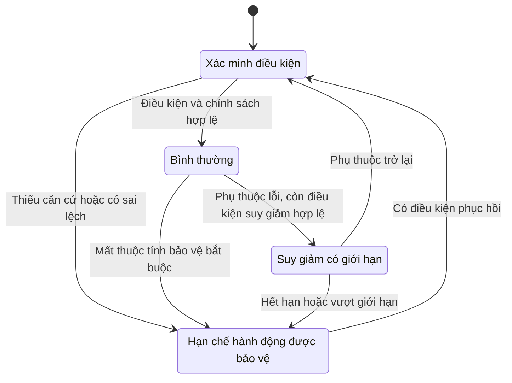

# Secure failure mode

## 1. Khi có lỗi, hệ thống phải giữ điều gì?

**Secure failure mode — chế độ lỗi bảo vệ an toàn thông tin** là cách hệ thống phản ứng khi một thành phần, dữ liệu hoặc phụ thuộc không hoạt động đúng, sao cho các thuộc tính bảo mật đã xác định vẫn được duy trì trong phạm vi cam kết.

Ví dụ, nếu API không lấy được quyết định phân quyền, nó không được mặc định trả tài liệu cho mọi người dùng đã đăng nhập. Nếu thao tác thay quyền gặp timeout, hệ thống không được báo thành công khi chưa có căn cứ về trạng thái thực tế.

Mục tiêu không chỉ là trả một thông báo lỗi. Cần quyết định:

- Hành động nào phải bị chặn?
- Chức năng nào có thể tiếp tục trong giới hạn?
- Trạng thái nào được giữ lại?
- Dữ liệu, quyền và dấu vết nào phải bảo toàn?
- Khi phụ thuộc trở lại, điều kiện nào cho phép mở lại dịch vụ?

Trong thiết kế yêu cầu bảo mật, chuỗi cần có là:

**Kịch bản lỗi → thuộc tính phải giữ → trạng thái được phép → hành vi phản ứng → điều kiện phục hồi → bằng chứng kiểm chứng.**

Bài học tập trung vào xác thực, phân quyền, dữ liệu, logging, tác vụ nền và phục hồi. Các hệ thống, mã và mốc thời gian trong bài là giả định để minh họa cách đặc tả.

## 2. Phân biệt các cách phản ứng khi lỗi

### 2.1. Fail-closed

**Fail-closed** là từ chối hoặc ngừng hành động được bảo vệ khi thiếu điều kiện cho phép cần thiết.

Ví dụ:

> Không xác minh được quyền đọc tài liệu thì không trả nội dung tài liệu đó.

Fail-closed không tự có nghĩa phải tắt toàn bộ hệ thống. API có thể từ chối đọc dữ liệu Hạn chế nhưng vẫn phục vụ nội dung công khai đã được duyệt hoặc cho người dùng kiểm tra trạng thái một yêu cầu.

Phạm vi bị đóng cần trùng với thuộc tính không còn đủ căn cứ, tránh làm gián đoạn những chức năng không liên quan một cách tùy ý.

### 2.2. Fail-open

**Fail-open** là tiếp tục cho phép một hành động khi điều kiện hoặc cơ chế kiểm soát bình thường không hoạt động.

Ví dụ nguy hiểm:

> Nếu dịch vụ phân quyền timeout, coi mọi người dùng nội bộ là có quyền.

Cách này có thể làm lỗi phụ thuộc trở thành đường vượt quyền. Nếu tổ chức có trường hợp đặc biệt cần cho phép một hành động trong điều kiện lỗi, phải đặc tả phạm vi, hậu quả, thẩm quyền và kiểm soát tương ứng; không dùng nó làm hành vi mặc định.

Một quyết định lưu đệm còn hợp lệ, có phạm vi và thời hạn được chính sách cho phép không đồng nghĩa với việc bỏ kiểm tra để fail-open. Hệ thống vẫn phải có căn cứ cấp quyền.

### 2.3. Giữ trạng thái hiện có trong giới hạn

Một số thiết kế cho phép tiếp tục sử dụng trạng thái đã xác minh trong thời gian ngắn. Ví dụ, một quyết định đọc có thể còn hiệu lực tối đa 60 giây nếu các nguồn căn cứ vẫn đáp ứng điều kiện đã định nghĩa.

Cần nêu rõ:

- Trạng thái nào được giữ.
- Hiệu lực đến khi nào.
- Có áp dụng cho hành động mới hay không.
- Thay đổi quyền được phản ánh trong giới hạn nào.
- Điều gì xảy ra khi không còn xác minh được độ mới.

Không giữ quyền cũ vô thời hạn chỉ vì phụ thuộc chưa trở lại.

### 2.4. Suy giảm chức năng có giới hạn

**Chế độ suy giảm** cho phép một phần chức năng tiếp tục theo chính sách bảo vệ riêng.

Ví dụ:

- Chỉ đọc bản nội dung công khai đã được phê duyệt.
- Tạm ngừng xuất dữ liệu, vẫn cho phép đọc những đối tượng có quyết định hợp lệ.
- Nhận yêu cầu vào trạng thái chờ, chưa thực hiện thay đổi.
- Ngừng tạo tệp mới khi thiếu khả năng ghi dấu vết bắt buộc.

Chế độ suy giảm cần có điều kiện vào, điều kiện ra, giới hạn và quan sát được. Nó không phải một nhánh xử lý bỏ qua các bước bảo vệ.

### 2.5. Fail-secure và trạng thái an toàn tổng thể

Một phản ứng bảo vệ bí mật hoặc toàn vẹn chưa chắc đáp ứng mọi mục tiêu của hệ thống. Từ chối quá rộng có thể gây gián đoạn nghiêm trọng; tiếp tục quá rộng có thể làm mất kiểm soát dữ liệu.

Cần đánh giá đồng thời bí mật, toàn vẹn, sẵn sàng và bối cảnh nghiệp vụ. Không dùng một khẩu hiệu “luôn đóng” hoặc “luôn duy trì hoạt động” thay cho phân tích kịch bản cụ thể.

## 3. Định nghĩa các thuộc tính không được phá vỡ

Một **bất biến bảo mật** là thuộc tính phải giữ trong các trạng thái và chuyển tiếp thuộc phạm vi thiết kế.

Có thể bắt đầu từ các câu sau:

| Mã | Bất biến minh họa |
|---|---|
| INV-01 | Không trả dữ liệu được bảo vệ khi không có căn cứ quyền phù hợp |
| INV-02 | Lỗi không tự làm tăng quyền hoặc mở rộng phạm vi dữ liệu |
| INV-03 | Không xác nhận thay đổi đã hoàn tất nếu chưa có căn cứ về kết quả được cam kết |
| INV-04 | Thử lại hoặc nhận lặp không được tạo thêm hiệu ứng nghiệp vụ trái phép |
| INV-05 | Thao tác mở rộng đặc quyền phải có dấu vết bền vững theo yêu cầu |
| INV-06 | Phục hồi hoặc hoàn tác không tự tái kích hoạt quyền, tác vụ hoặc dữ liệu đã bị vô hiệu theo chính sách hiện hành |
| INV-07 | Thông báo lỗi và log không làm lộ bí mật hoặc dữ liệu ngoài quyền |

Các bất biến phải được điều chỉnh theo hệ thống. Nếu chúng có xung đột, cần phân tích và chọn hành vi rõ ràng trước khi triển khai.

### 3.1. Tách sự thật đã biết khỏi giả định

Khi có timeout, hệ thống có thể biết “không nhận được phản hồi” nhưng chưa biết “thao tác chưa xảy ra”.

Ví dụ:

1. Dịch vụ gửi yêu cầu thay đổi.
2. Bên nhận hoàn tất thay đổi.
3. Phản hồi bị mất.
4. Bên gửi thấy timeout.

Nếu bên gửi báo thất bại chắc chắn rồi tạo một yêu cầu mới không có cơ chế chống lặp, có thể gây hiệu ứng trùng hoặc trạng thái sai.

Chế độ lỗi phải biểu đạt được kết quả chưa xác định và cách tra cứu hoặc đối chiếu an toàn.

### 3.2. Phân biệt lỗi nghiệp vụ và lỗi hạ tầng

- Không có quyền là một quyết định nghiệp vụ bảo mật.
- Không lấy được chính sách là tình trạng thiếu căn cứ do phụ thuộc.
- Dữ liệu đầu vào không hợp lệ là điều kiện phải xử lý theo hợp đồng.
- Kho dữ liệu không sẵn sàng là lỗi hạ tầng.

Các trường hợp có thể cùng dẫn đến không trả dữ liệu, nhưng cần được ghi nhận và xử lý vận hành phù hợp. Không chuyển lỗi hạ tầng thành quyền mặc định để làm cho luồng tiếp tục.

### 3.3. Quy định theo hành động và loại dữ liệu

Một chế độ lỗi không nhất thiết áp dụng như nhau cho:

- Đọc tài liệu công khai.
- Đọc dữ liệu nhạy cảm.
- Xuất hàng loạt.
- Mở rộng quyền quản trị.
- Thu hồi quyền khẩn cấp.
- Tiếp nhận hoặc thực hiện tác vụ nền.

Ví dụ, thiếu log bắt buộc có thể phải chặn mở rộng đặc quyền, trong khi đường thu hồi khẩn cấp cần được thiết kế để giảm quyền mà không phụ thuộc hoàn toàn vào một đích log từ xa.

Sự khác biệt cần được đặc tả và kiểm chứng; không để từng nhóm tự chọn trong lúc sự cố diễn ra.

## 4. Phân tích lỗi trước khi viết yêu cầu

### 4.1. Các dạng lỗi cần xét

| Dạng lỗi | Câu hỏi bảo mật |
|---|---|
| Không sẵn sàng | Thành phần nào thiếu và hành động nào mất căn cứ? |
| Phản hồi chậm hoặc timeout | Kết quả đã xảy ra chưa, có an toàn để thử lại không? |
| Dữ liệu thiếu, sai hoặc hỏng | Có đang coi giá trị rỗng là quyền rộng hoặc dữ liệu công khai không? |
| Trạng thái quá cũ | Phiên, quyền, cấu hình hoặc khóa có còn phù hợp không? |
| Thành công một phần | Phần nào đã cam kết, phần nào chưa, có thể đối chiếu thế nào? |
| Nhận lặp hoặc sai thứ tự | Có ghi đè trạng thái mới hoặc thực hiện trùng không? |
| Cạn tài nguyên | Có bỏ qua kiểm tra, mất dấu vết hoặc ảnh hưởng tenant khác không? |
| Khởi động thiếu cấu hình | Có tự dùng cấu hình phát triển hoặc mặc định cho phép không? |
| Phục hồi từ bản cũ | Quyền hoặc tác vụ đã thu hồi có trở lại không? |
| Lỗi bị tác nhân cố ý kích hoạt | Việc gây gián đoạn có mở một đường vượt kiểm soát không? |

Lỗi không chỉ là tiến trình dừng. Một thành phần vẫn trả phản hồi nhưng dùng dữ liệu hoặc chính sách cũ cũng có thể tạo trạng thái không an toàn.

### 4.2. Khuôn phân tích

Với mỗi kịch bản, ghi:

1. Hành động và tài sản đang được bảo vệ.
2. Điểm lỗi cùng điều kiện kích hoạt.
3. Điều đã biết và chưa biết.
4. Bất biến phải giữ.
5. Hành động được phép tiếp tục, phải chờ hoặc phải chặn.
6. Trạng thái, log và thông báo phải tạo.
7. Cách hạn chế phạm vi ảnh hưởng.
8. Điều kiện phục hồi.
9. Phương pháp kiểm chứng.

Không dừng ở câu “bắt exception và trả lỗi”. Cần xem quyền, dữ liệu và trạng thái sau khi exception được xử lý.

## 5. Tình huống minh họa: cổng tài liệu có nguồn quyền riêng

### 5.1. Bối cảnh

Hệ thống có API tài liệu, nguồn danh tính và quyền, kho tệp, worker, kho log kiểm toán và sao lưu. Người dùng được cấp quyền theo dự án. Một số tài liệu đã được duyệt công khai; số khác là dữ liệu Hạn chế.

Các hành động cần xét:

- Đọc hoặc tải tài liệu.
- Tạo và thực hiện tác vụ xuất.
- Cấp, mở rộng hoặc thu hồi quyền.
- Phục hồi dữ liệu và chính sách.

Đường tải trong thiết kế này đi qua API có kiểm tra quyền. Mọi đường thay thế đến kho phải được kiểm kê riêng.

### 5.2. Chính sách khi phụ thuộc lỗi

| Hành động | Điều kiện lỗi | Phản ứng được chọn |
|---|---|---|
| Đọc tài liệu công khai | Nguồn quyền không sẵn sàng | Có thể phục vụ đúng phiên bản công khai đã được xác nhận, nếu không cần quyết định quyền động |
| Đọc tài liệu được bảo vệ | Không lấy được quyết định mới | Chỉ dùng quyết định lưu đệm còn hợp lệ, tối đa 60 giây và không vượt hiệu lực của căn cứ bắt buộc |
| Xuất dữ liệu Hạn chế | Không xác minh được quyền hiện hành cho hành động xuất | Không tạo đầu ra mới; yêu cầu chuyển sang chờ hoặc từ chối theo hợp đồng |
| Mở rộng quyền | Thiếu quyết định hợp lệ hoặc không ghi được dấu vết bền vững bắt buộc | Không kích hoạt và không báo thành công |
| Thu hồi quyền | Đích log từ xa lỗi | Dùng phương án ghi và thực thi đã duyệt; không để một đích thu thập từ xa đơn lẻ làm mất đường giảm quyền |
| Thay đổi có timeout | Chưa biết kết quả cam kết | Trả trạng thái chưa xác định phù hợp và cho phép tra cứu có kiểm soát |
| Chạy tác vụ cũ sau phục hồi | Chưa đối chiếu quyền, hủy hoặc hết hạn hiện hành | Không tự thực hiện |

Nếu metadata phân loại không xác minh được, không được coi tài liệu là công khai. Bản lưu đệm cũng phải ràng buộc đúng người, hành động và đối tượng.

Các con số là lựa chọn minh họa, không phải giá trị mặc định cho mọi hệ thống.

### 5.3. Mô hình trạng thái



Mô hình áp dụng cho hành động hoặc miền bảo vệ liên quan. Không nên dùng một cờ chung để chuyển toàn bộ ứng dụng sang “cho phép khi suy giảm”.

Dịch vụ phụ thuộc trả lời trở lại chưa đủ để chuyển thẳng sang bình thường. Cần xác minh phiên bản, độ mới, quyền và dữ liệu còn tồn tại trước khi mở hành động được bảo vệ.

## 6. Yêu cầu bảo mật cho chế độ lỗi

Một khuôn đặc tả:

> Khi [lỗi] xảy ra trong [hành động và phạm vi], [thành phần] phải [phản ứng], giữ [bất biến]. Giới hạn là [thời gian, dữ liệu hoặc tài nguyên]. Chỉ phục hồi khi [điều kiện]. Kiểm chứng bằng [phương pháp và kết quả].

### 6.1. Xác thực và phân quyền

**FM-AUTH-01 — Không biến lỗi xác thực thành danh tính mặc định.** Nếu không kiểm chứng được phiên hoặc thông tin xác thực theo giao thức, API không được tự gán người dùng nội bộ, vai trò đặc quyền hoặc danh tính dịch vụ thay thế. Việc sử dụng phiên đã xác minh phải tuân theo hiệu lực và chính sách hiện hành.

**Kiểm chứng:** thử dữ liệu xác thực thiếu, không hợp lệ, hết hạn và nguồn kiểm chứng không sẵn sàng. Không có trường hợp lỗi nào được nâng thành danh tính có quyền.

**FM-AUTHZ-01 — Không cấp quyền khi thiếu căn cứ.** Yêu cầu đọc được bảo vệ phải có quyết định đúng chủ thể, hành động và tài nguyên. Nếu nguồn quyền không sẵn sàng, chỉ quyết định lưu đệm hợp lệ mới được dùng, tối đa 60 giây từ lần xác nhận hợp lệ của nguồn có thẩm quyền và không vượt hạn còn lại của căn cứ bắt buộc.

**Kiểm chứng:** làm gián đoạn nguồn trong môi trường thử, dùng quyết định quá hạn, sai đối tượng hoặc sai hành động. Hết điều kiện phải từ chối, không tự coi tập quyền rỗng hoặc lỗi phân tích là quyền toàn bộ.

**FM-REVOKE-01 — Giữ giới hạn thu hồi khi suy giảm.** Trong tối đa 5 phút từ khi hệ thống quản lý quyền tiếp nhận quyết định thu hồi hợp lệ, các yêu cầu mới và tác vụ mới bắt đầu không được dùng quyền đã thu hồi. Nếu hệ thống không còn đủ căn cứ để bảo đảm giới hạn, phải hạn chế các hành động chịu ảnh hưởng.

**Kiểm chứng:** thu hồi trong lúc mất kết nối hoặc còn quyền lưu đệm; đo đầu cuối tại các điểm thực thi và dùng phiên cũ. Mốc thời gian cùng phạm vi hành động phải được ghi rõ.

Quy tắc cho lần tải hoặc tác vụ đã bắt đầu cần được đặc tả riêng. Yêu cầu trên không có nghĩa có thể thu hồi dữ liệu đã đến người nhận.

### 6.2. Cấu hình, dữ liệu và trạng thái

**FM-CONFIG-01 — Không phục vụ dữ liệu bảo vệ bằng cấu hình thiếu.** Khi khởi động thiếu nguồn danh tính, chính sách, khóa hoặc cấu hình bắt buộc, thành phần không được tự dùng chế độ phát triển, khóa dùng chung hoặc quy tắc cho phép toàn bộ. Trạng thái sẵn sàng cho hành động được bảo vệ chỉ được xác nhận sau kiểm tra điều kiện.

**Kiểm chứng:** bỏ hoặc làm sai từng cấu hình bắt buộc trong môi trường thử; xác nhận không mở đường truy cập và có sự kiện đủ để vận hành xử lý.

**FM-STATE-01 — Không xác nhận một kết quả chưa có căn cứ.** Thao tác thay đổi phải phân biệt chưa bắt đầu, đang xử lý, đã cam kết, bị từ chối và chưa xác định kết quả. Timeout không được tự suy ra đã thất bại hoặc đã thành công. Tra cứu trạng thái phải kiểm tra quyền của người gọi.

**Kiểm chứng:** gây mất phản hồi trước và sau điểm cam kết; đối chiếu trạng thái lưu, phản hồi và hành vi thử lại. Người khác không được dùng mã thao tác để đọc trạng thái ngoài quyền.

### 6.3. Dấu vết và mở rộng đặc quyền

**FM-AUDIT-01 — Bảo toàn dấu vết bắt buộc.** Không kích hoạt hoặc xác nhận mở rộng đặc quyền trước khi có bản ghi bền vững gắn với quyết định. Nếu kho thu thập từ xa lỗi, có thể dùng cơ chế ghi bền vững được duyệt tại chỗ; khi không còn khả năng ghi theo yêu cầu thì chặn mở rộng quyền.

Luồng thu hồi phải có phương án giảm quyền và đối chiếu riêng. Nếu không lưu hoặc xác minh được quyết định thu hồi, hệ thống không được báo đã hoàn tất; phải chuyển trạng thái phù hợp và hạn chế hành động chịu ảnh hưởng theo chính sách.

**Kiểm chứng:** làm lỗi đích log từ xa, lỗi bộ đệm và lỗi lưu quyết định; thử mở rộng, thu hồi và tra cứu trạng thái. Xác nhận không có quyền được mở mà thiếu căn cứ, và không báo sai việc thu hồi.

Không xóa các sự kiện chưa chuyển chỉ để làm trống hàng đợi mà không có quyết định xử lý. Bộ đệm cần giới hạn, kiểm soát truy cập và hành vi khi đầy.

### 6.4. Thử lại và tác vụ nền

**FM-RETRY-01 — Không tạo hiệu ứng lặp ngoài ý muốn.** Thao tác thay đổi phải có định danh logic và cơ chế xử lý lặp theo hợp đồng. Cùng một định danh trong cùng phạm vi chủ thể, hành động và dữ liệu tương ứng không được tạo thêm hiệu ứng. Tái sử dụng định danh cho nội dung khác phải bị xử lý rõ ràng.

**Kiểm chứng:** gửi lặp, gửi đồng thời và thử lại sau timeout; đối chiếu hiệu ứng thực tế và trạng thái. Cần kiểm tra cả xử lý phía sau, không chỉ phản hồi API.

**FM-JOB-01 — Lỗi tác vụ không mở quyền hoặc mất kiểm soát.** Worker phải phân biệt lỗi có thể thử lại với dữ liệu hoặc quyền không hợp lệ. Số lần thử và thời gian chờ phải hữu hạn theo chính sách; tác vụ không hợp lệ hoặc vượt ngưỡng được chuyển sang trạng thái thất bại hoặc cách ly có bảo vệ.

Trước mỗi lần thực hiện lại phải giữ điều kiện quyền, hiệu lực và phiên bản cần thiết. Không dùng danh tính quản trị rộng hơn để “cứu” tác vụ.

**Kiểm chứng:** thử lỗi tạm thời, lỗi dữ liệu, quyền đã thu hồi, nhận lặp và quá ngưỡng. Kiểm tra nội dung trong hàng đợi cách ly vẫn được bảo vệ như dữ liệu liên quan.

### 6.5. Thông báo lỗi và phục hồi

**FM-ERROR-01 — Lỗi không làm lộ dữ liệu hoặc bí mật.** Phản hồi cho người gọi không chứa token, chuỗi kết nối, nội dung tài liệu, dấu vết ngăn xếp hoặc chi tiết hạ tầng không cần thiết. Có mã tham chiếu an toàn để điều tra; log nội bộ cũng chỉ ghi dữ liệu được phép.

**Kiểm chứng:** gây lỗi ở xác thực, truy vấn, parser, kho và worker với dữ liệu đánh dấu giả định. Đối chiếu phản hồi cùng log, trace và công cụ theo dõi.

**FM-RECOVER-01 — Kiểm tra trước khi mở lại.** Khi phụ thuộc hoặc hệ thống được phục hồi, phải xác minh cấu hình, chính sách hợp lệ, quyền hiện hành, quyết định thu hồi, trạng thái hủy, hết hạn và các kết quả chưa xác định liên quan. Không tự chạy lại mọi tác vụ hoặc cấp quyền từ bản sao cũ.

**Kiểm chứng:** phục hồi trạng thái trước thu hồi, hủy hoặc cam kết thao tác; kiểm tra quyền, dữ liệu, tác vụ lặp và khả năng đối chiếu trước khi xác nhận phục vụ bình thường.

## 7. Timeout, giao dịch và hiệu ứng lặp

### 7.1. Một timeout có thể có nhiều kết quả thực tế

Xét yêu cầu cấp quyền có mã thao tác giả định `op_demo_009`:

| Điểm xảy ra lỗi | Trạng thái có thể có | Phản ứng phù hợp |
|---|---|---|
| Trước khi bên nhận xử lý | Chưa có thay đổi | Có thể thử lại theo hợp đồng |
| Trong lúc lưu | Chưa biết đã cam kết hay chưa | Tra cứu hoặc đối chiếu bằng cùng định danh |
| Sau cam kết nhưng trước phản hồi | Quyền có thể đã thay đổi | Không tạo một yêu cầu mới như thể chưa xảy ra |
| Sau phản hồi, trước khi chuyển sự kiện | Thay đổi đã có, chuyển sự kiện còn chờ | Dùng bản ghi bền vững và chuyển tiếp có kiểm soát |

Không thể suy ra trạng thái cam kết chỉ từ việc mất kết nối.

### 7.2. Thiết kế định danh và đối chiếu

Một phương án có thể dùng:

- Mã thao tác ổn định trong phạm vi chủ thể và hành động.
- Ràng buộc mã với nội dung yêu cầu.
- Bản ghi trạng thái và kết quả được bảo vệ.
- Kiểm soát đồng thời để hai lần gửi không tạo hai hiệu ứng.
- Giao diện tra cứu có kiểm tra quyền.
- Chính sách thử lại có giới hạn.

Mã thao tác không tự là quyền. Người có mã vẫn phải có quyền tra cứu hoặc nhận kết quả.

Đối với hệ thống phân tán, không nên hứa “mọi thông điệp chỉ đến đúng một lần”. Cần đặc tả hiệu ứng nghiệp vụ quan sát được và cách xử lý thông điệp có thể đến lặp.

### 7.3. Phối hợp dữ liệu và sự kiện

Nếu thay đổi quyền và tạo sự kiện được làm thành hai bước rời rạc, có thể xuất hiện khoảng quyền đã mở nhưng sự kiện chưa được lưu.

Một phương án là lưu thay đổi và bản ghi sự kiện trong cùng ranh giới giao dịch phù hợp, rồi chuyển sự kiện ra ngoài sau. Phương án khác cần lập luận tương đương về trạng thái chờ, kích hoạt và đối chiếu.

Không bắt buộc mọi hệ thống dùng cùng một mẫu triển khai. Yêu cầu cần giữ là không có trạng thái mở quyền hoặc báo hoàn tất trái với các bất biến đã chọn.

### 7.4. Hoàn tác không phải lúc nào cũng đơn giản

Với nhiều bước, có thể cần hành động bù đắp thay vì một thao tác rollback toàn bộ. Hành động bù đắp cũng phải có quyền, tính lặp an toàn và dấu vết.

Đặc biệt, không tự hoàn tác một quyết định thu hồi hợp lệ chỉ vì một bước thông báo phía sau bị lỗi. Cần xem kết quả bảo mật nào đã được cam kết và phần nào chỉ là chuyển tiếp hoặc quan sát.

## 8. Phản hồi, quan sát và giới hạn ảnh hưởng

### 8.1. Trả lỗi đủ dùng, không lộ chi tiết

Một phản hồi minh họa cho lần đọc chưa được thực hiện:

```json
{
  "code": "TEMPORARILY_UNAVAILABLE",
  "request_id": "req_demo_009"
}
```

Mã tham chiếu giúp liên kết với sự kiện nội bộ. Nó không được chứa token, quyền hoặc dữ liệu nhạy cảm.

Với thay đổi đã được tiếp nhận nhưng chưa biết kết quả:

```json
{
  "code": "OPERATION_STATUS_UNKNOWN",
  "operation_id": "op_demo_009",
  "next_action": "CHECK_STATUS"
}
```

Đây là ví dụ hợp đồng phản hồi, không phải khuôn bắt buộc. Chỉ được cung cấp trạng thái cho chủ thể có quyền. Không làm lộ sự tồn tại của tài liệu hoặc thao tác ngoài quyền qua thông báo lỗi không cần thiết.

Không gắn “có thể thử lại” cho mọi lỗi. Với thao tác có hiệu ứng, người gọi cần biết phải dùng lại cùng định danh hay phải tra cứu trước.

### 8.2. Log phải phản ánh sự thật quan sát được

Cần phân biệt:

- Yêu cầu được tiếp nhận.
- Quyết định quyền được cho phép.
- Thay đổi được cam kết phía máy chủ.
- Phản hồi đã được gửi.
- Người nhận thực sự đã nhận hoặc sử dụng kết quả.

Không phải bước nào cũng có bằng chứng cho bước sau. Ví dụ, ghi “đã cam kết” không đồng nghĩa đã chứng minh người gọi nhận được phản hồi.

Sự kiện nên có danh tính, hành động, đối tượng phù hợp, mã thao tác, thời điểm, trạng thái và mã lỗi đã chuẩn hóa. Dữ liệu do người dùng gửi phải được xử lý để không giả cấu trúc hoặc danh tính của log.

Log lỗi, trace và hệ thống theo dõi cũng là đích dữ liệu cần phân loại, giới hạn quyền và lưu giữ phù hợp.

### 8.3. Đường xử lý lỗi cũng cần giới hạn tài nguyên

Một lỗi lặp lại có thể tạo quá nhiều log, tác vụ thử lại hoặc yêu cầu đến phụ thuộc. Cần xét:

- Hàng đợi và bộ đệm có giới hạn.
- Số lần thử cùng khoảng chờ.
- Phân biệt lỗi tạm thời với lỗi cố định.
- Giới hạn theo người dùng, tenant hoặc tác vụ khi phù hợp.
- Khả năng dành tài nguyên cho kiểm soát và phục hồi.
- Cảnh báo trước khi chạm ngưỡng không còn giữ được bất biến.

Không giải phóng tài nguyên bằng cách bỏ kiểm tra quyền hoặc âm thầm xóa dấu vết bắt buộc.

Một cơ chế ngắt mạch có thể ngừng gọi phụ thuộc đang lỗi. Trạng thái “mạch mở” trong cơ chế đó không có nghĩa hành động được phép vượt kiểm soát; quyền vẫn phải theo chế độ lỗi đã chọn.

### 8.4. Fail-closed có thể bị dùng để gây gián đoạn

Tác nhân có thể cố làm nguồn quyền, log hoặc tài nguyên quá tải. Nếu mọi chức năng phụ thuộc một điểm duy nhất, từ chối khi thiếu căn cứ có thể tạo gián đoạn lớn.

Cách xử lý kiến trúc cần xem xét:

- Dự phòng và phân tách phạm vi lỗi.
- Năng lực xử lý và điều tiết tải.
- Quyết định lưu đệm có giới hạn rõ.
- Chức năng công khai hoặc không liên quan có chính sách riêng.
- Đường vận hành, khẩn cấp và phục hồi đã kiểm chứng.
- Quan sát để nhận biết chế độ lỗi bị kích hoạt bất thường.

Mục tiêu là tăng khả năng duy trì dịch vụ trong giới hạn bảo vệ, không đổi lỗi phụ thuộc thành quyền rộng hơn.

## 9. Kế hoạch kiểm chứng secure failure mode

### 9.1. Ma trận tình huống

| Tình huống cần tạo trong môi trường thử | Kết quả mong đợi | Yêu cầu liên quan |
|---|---|---|
| Không kiểm chứng được phiên | Không gán danh tính hoặc vai trò mặc định | FM-AUTH-01 |
| Nguồn quyền lỗi, còn quyết định hợp lệ | Chỉ hành động và đối tượng thuộc quyết định được phục vụ trong hạn | FM-AUTHZ-01 |
| Quyết định quá hạn hoặc sai đối tượng | Không trả dữ liệu được bảo vệ | FM-AUTHZ-01 |
| Thu hồi trong lúc còn quyền lưu đệm | Yêu cầu mới và tác vụ mới bị chặn trong mốc đã nêu | FM-REVOKE-01 |
| Thiếu cấu hình bắt buộc khi khởi động | Không mở hành động được bảo vệ bằng mặc định rộng quyền | FM-CONFIG-01 |
| Timeout sau điểm cam kết | Không báo sai trạng thái; tra cứu phản ánh kết quả thực tế | FM-STATE-01 |
| Gửi cùng thao tác đồng thời nhiều lần | Không có hiệu ứng bổ sung ngoài hợp đồng | FM-RETRY-01 |
| Đích log từ xa lỗi, nơi ghi bền vững còn hoạt động | Xử lý theo chính sách và giữ được sự kiện | FM-AUDIT-01 |
| Không còn nơi ghi dấu vết bắt buộc | Không kích hoạt mở rộng đặc quyền | FM-AUDIT-01 |
| Tác vụ nhận lặp hoặc quyền đã đổi | Không tạo kết quả trùng hoặc ngoài quyền | FM-JOB-01 |
| Parser hoặc truy vấn phát sinh lỗi | Không lộ nội dung, bí mật hay chi tiết không cần thiết | FM-ERROR-01 |
| Phục hồi bản sao trước thu hồi hoặc hủy | Không tái kích hoạt quyền hoặc tác vụ trái trạng thái hiện hành | FM-RECOVER-01 |

Đây là kế hoạch minh họa, không phải báo cáo rằng kiểm thử đã được chạy hoặc đã đạt.

### 9.2. Kiểm tra tại các điểm chuyển tiếp

Lỗi thường đáng chú ý ở khoảng giữa hai bước:

- Sau kiểm tra quyền nhưng trước khi đọc hoặc ghi.
- Sau cam kết dữ liệu nhưng trước phản hồi.
- Sau nhận tác vụ nhưng trước xác nhận xử lý.
- Sau lưu sự kiện nhưng trước chuyển đến kho tập trung.
- Trong lúc quyền hoặc chính sách thay đổi.
- Khi bản lưu đệm vừa hết hạn.
- Khi phụ thuộc trở lại nhưng trạng thái chưa đồng nhất.
- Khi mở dịch vụ sau phục hồi.

Kế hoạch cần nêu điểm lỗi, điều đã biết, hiệu ứng mong đợi và bằng chứng thu được. Không chỉ thử một lần tắt hoàn toàn tiến trình rồi suy ra mọi kiểu lỗi đã được bao phủ.

### 9.3. Kiểm chứng cả hành vi hợp lệ

Một cơ chế từ chối tất cả có thể giữ một số bất biến nhưng không đáp ứng nghiệp vụ. Cần xác nhận:

- Hành động hợp lệ hoạt động ở trạng thái bình thường.
- Chức năng được phép suy giảm tiếp tục đúng phạm vi.
- Chức năng phải chặn không tạo hiệu ứng.
- Hệ thống trở lại hoạt động sau khi đủ điều kiện.
- Không có quyền hoặc dữ liệu bị mở rộng trong quá trình chuyển trạng thái.

Với từng trường hợp, đối chiếu dữ liệu, quyền, trạng thái, log và hiệu ứng phía sau. Mã phản hồi riêng lẻ thường chưa đủ.

### 9.4. Đo lường và bằng chứng

Hồ sơ kiểm chứng nên ghi:

| Nội dung | Mục đích |
|---|---|
| Yêu cầu, bất biến và kịch bản | Biết kết quả hỗ trợ thuộc tính nào |
| Phiên bản, cấu hình và môi trường | Giới hạn phạm vi kết luận |
| Dữ liệu, danh tính và trạng thái ban đầu | Có kết quả mong đợi rõ |
| Điểm lỗi, thứ tự và thời gian | Tái hiện đúng chuyển tiếp cần kiểm tra |
| Hiệu ứng dữ liệu và quyền | Phát hiện thay đổi ngoài ý muốn |
| Log, trạng thái thao tác và mã liên kết | Đối chiếu giữa các thành phần |
| Thời gian hạn chế và phục hồi | Kiểm tra giới hạn đã cam kết |
| Sai lệch, giới hạn và người xử lý | Hỗ trợ quyết định tiếp theo |

Dùng dữ liệu giả định hoặc được kiểm soát phù hợp. Báo cáo không được chứa bí mật hoạt động chỉ để chứng minh chúng không bị lộ.

### 9.5. Mức đảm bảo

Với hành động có hậu quả lớn, cần tăng chiều sâu của bằng chứng: xem xét thiết kế, cấu hình, lỗi tích hợp, đồng thời, trạng thái cũ và xem xét độc lập khi phù hợp.

Một lần thử không quan sát thấy vi phạm chưa chứng minh mọi chế độ lỗi đều an toàn. Kết luận phải ghi đúng phạm vi, giả định và phần chưa được kiểm chứng.

Nếu có sai lệch được chấp nhận theo thẩm quyền, giữ riêng quyết định đó với kết quả đáp ứng yêu cầu. Phê duyệt không làm một hành vi sai trở thành đúng.

## 10. Duy trì chế độ lỗi trong vận hành và thay đổi

### 10.1. Phân công trách nhiệm

| Vai trò | Trách nhiệm |
|---|---|
| Chủ sở hữu nghiệp vụ hoặc dữ liệu | Xác nhận hậu quả và phần chức năng có thể suy giảm |
| Nhóm kiến trúc | Xác định bất biến, phụ thuộc và cách phân tách phạm vi lỗi |
| Nhóm ứng dụng | Thực thi trạng thái, phản hồi, thử lại và đối chiếu |
| Nhóm nền tảng | Cấu hình quyền, năng lực, quan sát và phục hồi phụ thuộc |
| Nhóm vận hành | Theo dõi, xử lý cảnh báo, kích hoạt và kết thúc chế độ |
| Người kiểm chứng | Đánh giá hành vi và bằng chứng theo yêu cầu |
| Người có thẩm quyền rủi ro | Quyết định phần tồn dư, ngoại lệ và thời hạn |

Mỗi trạng thái cần đầu mối rõ. Không để một nhánh “tạm thời cho phép” tồn tại mà không có chủ sở hữu hoặc ngày xem lại.

### 10.2. Điều kiện phục hồi phải được chuẩn bị trước

Một quy trình phục hồi có thể yêu cầu:

1. Xác nhận nguyên nhân đã được xử lý trong phạm vi liên quan.
2. Xác minh cấu hình, khóa và chính sách phù hợp.
3. Đối chiếu trạng thái thao tác chưa xác định.
4. Áp dụng quyền, thu hồi, hủy và hết hạn hiện hành.
5. Xử lý tác vụ, sự kiện hoặc dữ liệu đang chờ theo thứ tự hợp lệ.
6. Kiểm tra hành động hợp lệ và hành động phải bị từ chối.
7. Mở lại phạm vi đã đủ căn cứ, đồng thời theo dõi sai lệch.

Một điểm kiểm tra tiến trình còn sống không tự chứng minh ứng dụng đã sẵn sàng phục vụ dữ liệu được bảo vệ.

### 10.3. Khi nào cần kiểm chứng lại?

Cần phân tích tác động khi:

- Thay nguồn danh tính, chính sách hoặc mô hình quyền.
- Đổi thời hạn token, quyết định hoặc bộ nhớ đệm.
- Thay giao dịch, định danh thao tác hoặc logic thử lại.
- Thêm hàng đợi, worker hoặc đường truy cập mới.
- Thay log, bộ đệm, lưu giữ hoặc giới hạn tài nguyên.
- Đổi quy trình triển khai, hoàn tác hoặc phục hồi.
- Có sự cố cho thấy giả định không đúng.

Bằng chứng cũ chỉ được tái sử dụng khi phạm vi, phiên bản và điều kiện vẫn phù hợp. Một thay đổi nhỏ ở nhánh exception có thể làm mất thuộc tính bảo vệ quan trọng.

### 10.4. Chỉ số hữu ích

Có thể theo dõi:

- Số lần chuyển sang suy giảm hoặc hạn chế.
- Hành động bị chặn do thiếu căn cứ.
- Quyết định hoặc tín hiệu quá hạn vẫn được sử dụng.
- Thời gian áp dụng thu hồi.
- Thao tác còn kết quả chưa xác định quá giới hạn xử lý.
- Tác vụ thử lại, nhận lặp và bị cách ly.
- Dung lượng cùng tuổi sự kiện chưa chuyển.
- Thời gian phục hồi và sai lệch sau mở lại.

Mỗi chỉ số cần nguồn, phạm vi, ngưỡng và người xử lý. Không coi số lỗi thấp là tốt nếu hệ thống đang che lỗi hoặc mất quan sát.

## 11. Những sai lầm thường gặp

| Sai lầm | Hậu quả | Cách điều chỉnh |
|---|---|---|
| Timeout phân quyền thì cho người nội bộ truy cập | Lỗi trở thành đường vượt quyền | Chỉ dùng căn cứ hợp lệ trong phạm vi, thời hạn đã nêu |
| Fail-closed nghĩa là tắt mọi chức năng | Gián đoạn rộng hơn cần thiết | Xác định hành động và miền bảo vệ chịu ảnh hưởng |
| Bản lưu đệm được dùng đến khi phụ thuộc trở lại | Quyền cũ sống vô hạn | Giới hạn hiệu lực và kiểm chứng thu hồi đầu cuối |
| Giá trị rỗng nghĩa là không có hạn chế | Lỗi dữ liệu thành quyền rộng | Định nghĩa rõ thiếu, rỗng và không hợp lệ |
| Timeout chắc chắn là chưa thực hiện | Thử lại tạo hiệu ứng trùng | Dùng trạng thái chưa xác định và đối chiếu |
| Mỗi lần thử lại dùng định danh mới | Không nhận ra cùng thao tác logic | Giữ định danh theo hợp đồng và ràng buộc nội dung |
| Có mã thao tác là được xem kết quả | Mã tham chiếu trở thành quyền | Kiểm tra chủ thể và phạm vi khi tra cứu |
| Mất log thì vẫn mở rộng quyền rồi bổ sung sau | Có đặc quyền không có dấu vết bắt buộc | Ghi bền vững trước kích hoạt hoặc chặn |
| Chặn thu hồi chỉ vì đích log từ xa lỗi | Quyền nguy hiểm tiếp tục tồn tại | Thiết kế đường giảm quyền và đối chiếu riêng |
| Thử lại mọi lỗi vô hạn | Cạn tài nguyên và giữ tác vụ trái quyền | Phân loại lỗi, giới hạn và cách ly có bảo vệ |
| Trả nguyên exception để dễ hỗ trợ | Lộ dữ liệu, bí mật hoặc hạ tầng | Dùng mã lỗi, tham chiếu và log đã giới hạn |
| Phụ thuộc trả lời là mở dịch vụ ngay | Chính sách và trạng thái chưa đồng nhất | Xác minh điều kiện trước chuyển bình thường |
| Phục hồi bản sao là phục hồi toàn bộ quyền cũ | Quyền hoặc tác vụ đã hủy quay lại | Đối chiếu nguồn trạng thái hiện hành |
| Chỉ kiểm thử lỗi hoàn toàn | Bỏ sót thành công một phần và mất phản hồi | Kiểm tra điểm chuyển tiếp, đồng thời và trạng thái cũ |

## 12. Bài tập thực hành

Một hệ thống cho nhân viên đọc tài liệu, xuất báo cáo và quản trị quyền. Quyết định quyền được lấy từ dịch vụ riêng; log chuyển đến một kho tập trung; worker xử lý báo cáo bất đồng bộ.

Thực hiện:

1. Viết các bất biến về dữ liệu, quyền, trạng thái thao tác và dấu vết.
2. Chọn một lỗi nguồn quyền, một lỗi log và một timeout sau thay đổi.
3. Với từng lỗi, ghi điều đã biết và điều chưa biết.
4. Đề xuất hành động được tiếp tục, phải chờ và phải chặn.
5. Đặc tả thời hạn quyết định lưu đệm và giới hạn thu hồi.
6. Thiết kế hợp đồng định danh thao tác, tra cứu và thử lại.
7. Vẽ trạng thái bình thường, suy giảm, hạn chế và xác minh phục hồi.
8. Lập ma trận kiểm thử trước cam kết, sau cam kết, nhận lặp và phục hồi bản cũ.
9. Ghi phần rủi ro còn lại, người quyết định và tín hiệu đánh giá lại.

Tự đối chiếu:

- Có nhánh lỗi nào tự làm tăng quyền không?
- Có đang báo chắc chắn điều mà hệ thống chưa biết không?
- Có thao tác nào bị lặp hiệu ứng khi mất phản hồi không?
- Có thể phục hồi mà không tái kích hoạt quyền đã thu hồi không?
- Thông báo và log có làm lộ dữ liệu không?
- Kết luận có dựa trên hành vi, trạng thái và bằng chứng đầy đủ trong phạm vi không?

Secure failure mode cần được thiết kế như một phần của kiến trúc. Khi bất biến, trạng thái, phản ứng và điều kiện phục hồi được đặc tả rõ, lỗi có thể được xử lý mà không âm thầm trở thành quyền truy cập hoặc hiệu ứng nghiệp vụ ngoài ý muốn.
