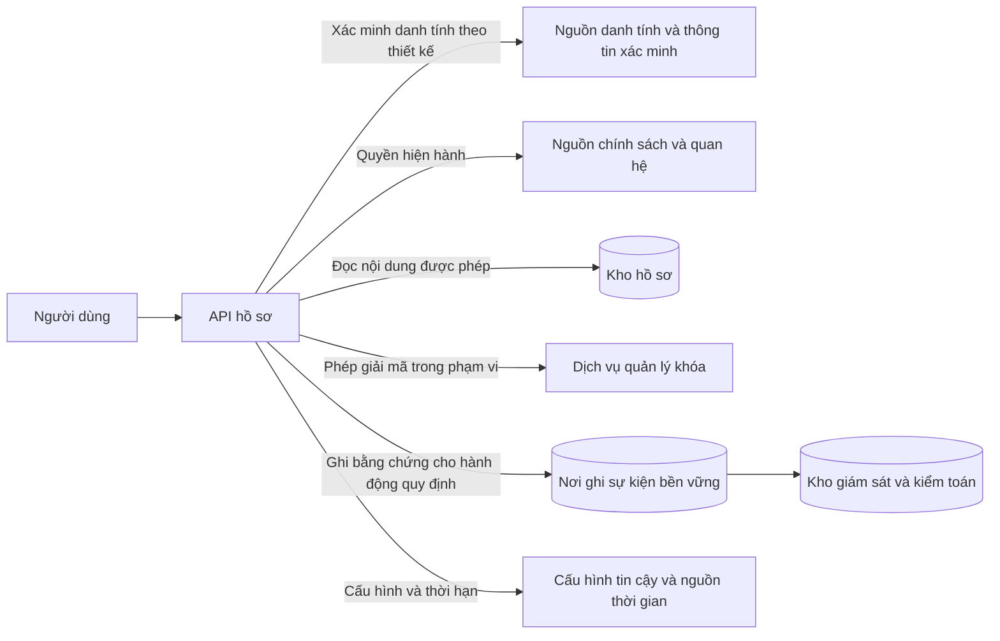

# Security dependency

## 1. Security dependency là gì?

**Security dependency — phụ thuộc bảo mật** là quan hệ trong đó việc một thành phần đáp ứng mục tiêu an toàn dựa vào tính đúng đắn, tính tin cậy, cấu hình hoặc khả năng phục vụ của một thành phần, dịch vụ hay quy trình khác.

Ví dụ, API chỉ cho người đúng quyền tải hồ sơ có thể dựa vào cơ chế xác minh danh tính, nguồn quyền hiện hành, ánh xạ hồ sơ–khách thuê, kho tệp và quyền dùng khóa giải mã. Nếu một phụ thuộc bị lỗi hoặc bị điều khiển, việc API hoạt động bình thường về mặt kỹ thuật chưa chứng minh dữ liệu được bảo vệ.

Phụ thuộc bảo mật cũng tồn tại ngoài luồng yêu cầu. Hệ thống có thể dựa vào kho bí mật khi khởi động, pipeline khi triển khai, nguồn cấu hình khi thay quyền, nhật ký khi điều tra và tài khoản đặc biệt khi phục hồi.

Vì vậy, bài học này dùng khái niệm rộng hơn thư viện phần mềm. Thư viện và gói là một nhóm phụ thuộc cần quản lý, nhưng không bao phủ hết những điều kiện mà kiến trúc phải tin để giữ bí mật, toàn vẹn và sẵn sàng.

Mục tiêu của việc phân tích phụ thuộc là xác định:

- Thành phần đang dựa vào ai, để bảo vệ thuộc tính nào?
- Điều gì xảy ra nếu phụ thuộc không sẵn sàng, chậm, trả sai hoặc bị chiếm quyền?
- Có đường thay thế nào và đường đó giữ được điều kiện an toàn gì?
- Ai quản lý quyền, cấu hình, phiên bản và vòng đời của phụ thuộc?
- Bằng chứng nào kiểm chứng được yêu cầu, cả khi hoạt động bình thường và khi thất bại?

## 2. Phân biệt phụ thuộc chức năng và phụ thuộc về niềm tin

### 2.1. Một phụ thuộc có thể ảnh hưởng nhiều thuộc tính

| Quan hệ | Câu hỏi cần đặt | Ví dụ |
|---|---|---|
| Phụ thuộc chức năng | Không có thành phần đó thì thao tác có thực hiện được không? | Không có kho tệp thì không đọc được nội dung |
| Phụ thuộc về niềm tin | Nếu thành phần đó trả sai hoặc bị điều khiển thì mục tiêu an toàn có mất không? | Nguồn quyền cấp sai làm người dùng được đọc ngoài phạm vi |
| Phụ thuộc quản trị | Ai có thể thay danh tính, mã, chính sách hoặc dữ liệu được tin? | Tài khoản triển khai sửa mã chạy với quyền đọc sản xuất |
| Phụ thuộc phục hồi | Khi hệ thống chính mất, cần những gì để khôi phục đúng quyền và dữ liệu? | Khóa giải mã bản sao, danh tính phục hồi và cấu hình liên quan |

Ví dụ, dịch vụ phân quyền bị ngừng có thể làm giảm khả năng phục vụ. Cùng dịch vụ đó nếu trả quyết định cho phép sai có thể gây tiết lộ hoặc thay đổi trái phép. Chỉ đặt mục tiêu thời gian hoạt động cho dịch vụ chưa bao phủ rủi ro tính đúng đắn.

Tương tự, kho kiểm toán có thể không nằm trên mọi đường đọc thông thường nhưng là phụ thuộc của khả năng điều tra. Nếu chính sách yêu cầu lưu bằng chứng trước một hành động trọng yếu, nó còn trở thành phụ thuộc của hành động đó.

### 2.2. Danh tính được xác minh không có nghĩa mọi kết quả đều đúng mục đích

Xác minh đúng nguồn giúp biết kết quả đến từ phụ thuộc nào theo cơ chế đã chọn. Nó không tự chứng minh phụ thuộc được cấu hình đúng hoặc chưa bị chiếm quyền.

Ví dụ, worker nhận được thông điệp có nguồn hợp lệ nhưng phạm vi dữ liệu trong thông điệp sai. Nếu worker chỉ kiểm tra nguồn mà không kiểm tra hợp đồng và quan hệ tài nguyên cần thiết, hệ thống vẫn có thể xử lý ngoài quyền.

Yêu cầu cần phân biệt xác thực nguồn, tính toàn vẹn, nội dung hợp lệ và quyền nghiệp vụ. Không nên gộp tất cả thành một câu “dịch vụ nội bộ đáng tin”.

## 3. Những nhóm phụ thuộc cần đưa vào kiến trúc

| Nhóm | Ví dụ | Mục tiêu hoặc giả định chịu ảnh hưởng |
|---|---|---|
| Danh tính và thông tin xác thực | Nguồn danh tính, khóa xác minh, chứng thư, cấp lại phiên | Tính xác thực, vòng đời tài khoản và khả năng thu hồi |
| Phân quyền và chính sách | Dịch vụ quyền, vai trò, quan hệ khách thuê, metadata sở hữu | Đúng chủ thể, hành động, đối tượng và phạm vi |
| Khóa và bí mật | Dịch vụ khóa, kho bí mật, dữ liệu phục hồi | Bí mật, toàn vẹn, quyền dùng phép toán và khả năng giải mã |
| Dữ liệu và xử lý | Cơ sở dữ liệu, kho tệp, cache, tìm kiếm, hàng đợi, worker | Quan hệ đúng, cô lập dữ liệu, trạng thái và chi phí tài nguyên |
| Cấu hình và hạ tầng nền | Khám phá dịch vụ, phân giải tên, nguồn cấu hình và thời gian | Kết nối đúng nơi, kiểm tra thời hạn và quyết định chính sách |
| Quan sát và bằng chứng | Nhật ký, nơi nhận sự kiện, cảnh báo, đối soát | Phát hiện, điều tra và quy trách nhiệm trong phạm vi bằng chứng |
| Mã, gói và chuỗi triển khai | Mã nguồn, thư viện, công cụ build, kho artifact, ký và phát hành | Tính toàn vẹn và nguồn gốc của phần mềm được chạy |
| Quản trị và vận hành | Tài khoản đặc quyền, quy trình phê duyệt, công cụ hỗ trợ | Khả năng mở quyền, thay cấu hình và bỏ qua luồng chính |
| Phục hồi và bên thứ ba | Sao lưu, nguồn khóa dự phòng, danh tính phục hồi, dịch vụ thuê ngoài | Khôi phục đúng trạng thái, giới hạn phụ thuộc và trách nhiệm |

Không phải mỗi nhóm đều cần một sản phẩm riêng. Điểm quan trọng là nhận diện quan hệ và người kiểm soát, kể cả khi nhiều vai trò được cùng một thành phần đảm nhiệm.

Một thành phần dùng chung có thể giúp quản lý nhất quán nhưng tăng phạm vi ảnh hưởng khi hỏng hoặc bị chiếm quyền. Sự tập trung đó cần được đánh giá, không chỉ ghi như chi tiết triển khai.

## 4. Mô hình hóa quan hệ phụ thuộc

### 4.1. Ghi rõ ý nghĩa của cạnh trong sơ đồ

Trong sơ đồ sau, mũi tên từ A tới B nghĩa là A sử dụng hoặc cần B để thực hiện một điều kiện đã nêu. Đây không phải sơ đồ chỉ hướng tấn công.



Mũi tên tới nguồn danh tính không nhất thiết có nghĩa mọi yêu cầu đều phải gọi trực tuyến nguồn đó. Có thiết kế xác minh cục bộ bằng thông tin được tin và còn hiệu lực; có thiết kế cần truy vấn trực tuyến. Phải ghi chính xác đường đi, cache và thời hạn của kiến trúc đang xét.

Phụ thuộc về quản trị cần được thể hiện riêng hoặc có chú thích. Ví dụ, pipeline có thể thay mã API và tài khoản vận hành có thể thay chính sách khóa. Những quan hệ này có tác động dù không xuất hiện trên đường tải hồ sơ.

### 4.2. Xem cả trực tiếp, gián tiếp và điều kiện kích hoạt

API có thể trực tiếp dùng dịch vụ quyền. Dịch vụ quyền lại dựa vào cơ sở dữ liệu, danh tính dịch vụ, cấu hình và nguồn thời gian. Nếu các phụ thuộc gián tiếp có thể làm sai quyết định, chúng cần nằm trong phạm vi phân tích ở mức phù hợp.

Không cần mở rộng sơ đồ tới mọi chi tiết của mọi nhà cung cấp. Có thể dùng ranh giới và hợp đồng phụ thuộc, kèm giả định, bằng chứng và phần không kiểm soát được. Tuy nhiên, không nên bỏ một quan hệ có tác động lớn chỉ vì nó nằm sau giao diện bên thứ ba.

Một số phụ thuộc chỉ phát sinh khi đăng nhập mới, thay khóa, cấp quyền, khởi động, triển khai hoặc phục hồi. Những tình huống này phải được kiểm tra riêng; luồng đang chạy bình thường có thể che phụ thuộc chưa được thử khi khởi động lại.

### 4.3. Nhận diện điểm hỏng chung

Hai bản sao dịch vụ có thể cùng dùng một tài khoản quản trị, một nguồn cấu hình hoặc cùng kho khóa. Chúng giúp xử lý một số lỗi riêng lẻ nhưng có thể cùng thất bại khi phụ thuộc chung bị ảnh hưởng.

Đối với toàn vẹn, nhiều bản sao cùng đọc chính sách sai không tự tạo ra quyết định đúng. Đối với phục hồi, bản sao và hệ thống chính cùng có thể bị xóa bởi một danh tính thì mức độc lập khác với ý định ban đầu.

Vì vậy, cần phân biệt số lượng bản sao với mức độc lập của miền lỗi và miền quản trị. Bằng chứng phải bám vào kịch bản cụ thể đang cần bảo vệ.

## 5. Lập hồ sơ hợp đồng phụ thuộc

Một danh sách tên dịch vụ chưa đủ để đặc tả hành vi. Mỗi phụ thuộc quan trọng nên có hợp đồng bảo mật và vận hành rõ.

| Trường cần ghi | Câu hỏi cần trả lời |
|---|---|
| Thành phần tiêu thụ và chủ sở hữu | Ai sử dụng, ai vận hành và ai chịu trách nhiệm quyết định rủi ro? |
| Mục đích và thuộc tính | Phụ thuộc này phục vụ xác thực, quyền, bí mật, bằng chứng hay khả năng phục hồi? |
| Nguồn và giao diện tin cậy | Endpoint, danh tính, cấu hình hoặc vật liệu xác minh nào được chấp nhận? |
| Quyền và dữ liệu | Danh tính gọi có quyền gì; thông tin nào đi qua hoặc được lưu? |
| Hợp đồng kết quả | Trường bắt buộc, phạm vi, trạng thái, phiên bản và thời hạn là gì? |
| Hành vi lỗi | Timeout, thiếu dữ liệu, trả sai hoặc không xác minh được dẫn tới hành vi nào? |
| Cache và độ cũ | Có thể dùng lại điều gì, trong bao lâu, theo nguồn thời gian nào? |
| Ngân sách tài nguyên | Độ trễ, số lần thực hiện, đồng thời và dung lượng được giới hạn thế nào? |
| Thay đổi và thu hồi | Ai đổi khóa, quyền, cấu hình, phiên bản; khi nào hiệu lực tới bên dùng? |
| Khởi động và phục hồi | Cần gì để lấy phụ thuộc khi môi trường sạch hoặc hệ thống chính mất? |
| Bằng chứng và khoảng trống | Kiểm thử, cấu hình, diễn tập và điều gì chưa được xác minh? |

Không đưa bí mật thực vào hồ sơ. Định danh và thông tin kiến trúc cũng có thể nhạy cảm, nên quyền đọc hồ sơ cần phù hợp.

Ví dụ khái niệm, không phải cấu hình cho sản phẩm cụ thể:

```yaml
dependency_id: DEP-AUTHORIZATION
consumer: project_record_api
purpose: authorize_current_subject_action_resource_scope
owner: authorization_service_owner
trust:
  source_identity: verified_service_identity
  response_scope_binding: required
  response_schema_validation: required
failure_policy:
  missing_or_invalid_decision: deny_or_wait
  stale_decision: follow_approved_freshness_limit
  default_allow: prohibited
security_change:
  revocation_behavior: end_to_end_verification_required
recovery:
  bootstrap_dependencies: explicitly_documented
evidence:
  - wrong_scope_response_tests
  - timeout_and_stale_decision_tests
  - effective_service_permissions_review
```

Hồ sơ chỉ mô tả ý định. Việc có các trường `verified` hoặc `required` không tự chứng minh kiểm soát đã được thực hiện; cần nối tới bằng chứng của phiên bản và cấu hình liên quan.

## 6. Thiết kế hành vi khi phụ thuộc thất bại

### 6.1. Không chỉ có trạng thái hoạt động hoặc ngừng

| Tình huống | Nguy cơ nếu xử lý thiếu điều kiện |
|---|---|
| Không kết nối được hoặc timeout | Tự cho phép thao tác, dùng dữ liệu mặc định hoặc giữ tài nguyên quá lâu |
| Trả kết quả thiếu, sai kiểu hoặc không khớp yêu cầu | Diễn giải nhầm thành quyết định có quyền |
| Trả dữ liệu cũ | Tiếp tục cho dùng quyền đã thu hồi hoặc khóa đã thay |
| Nguồn hoặc danh tính không xác minh được | Tin kết quả của bên khác hoặc endpoint bị chuyển hướng |
| Phụ thuộc bị chiếm quyền hoặc cấu hình sai | Nhận kết quả có vẻ hợp lệ nhưng gây quyết định ngoài mục tiêu |
| Quá tải, hết hạn mức hoặc thử lại nhiều | Tăng gián đoạn, chi phí và lan truyền tải sang thành phần khác |
| Một phần thao tác đã có tác dụng trước lỗi | Thực hiện trùng, mất bằng chứng hoặc báo kết quả không đúng trạng thái |

Phân loại lỗi giúp đặt hành vi cụ thể. Một phản hồi sai phạm vi không nên bị coi đơn giản như lỗi mạng rồi thử vô hạn hoặc chuyển sang quyền rộng hơn.

### 6.2. Từ chối an toàn và giảm chức năng có điều kiện

**Fail closed** trong một quyết định quyền nghĩa là không thực hiện hành động được bảo vệ khi chưa đáp ứng điều kiện cho phép. **Fail open** là tiếp tục cho phép dù điều kiện bắt buộc chưa được xác minh theo thiết kế.

Không cần biến mọi lỗi thành dừng toàn bộ sản phẩm. Có thể giữ chức năng công khai hoặc hoạt động độc lập còn đủ điều kiện, trong khi trì hoãn hành động cần nguồn quyền đang mất. Đây là giảm chức năng có điều kiện, cần được mô tả theo từng luồng.

Việc dùng thông tin xác minh hoặc quyết định đã được lưu còn hiệu lực không tự là fail open. Nếu hợp đồng cho phép, nguồn và tính toàn vẹn được xác nhận, phạm vi đúng và thời hạn chưa hết, hệ thống vẫn có căn cứ cho quyết định. Khi các điều kiện đó không còn, không được tự kéo dài hiệu lực chỉ để duy trì phục vụ.

### 6.3. Cache là một quyết định về độ cũ

Với cache quyền, phải biết quyết định dành cho chủ thể, hành động, đối tượng, tenant và điều kiện nào. Mốc tính độ mới cần có nguồn tin cậy; lần thử lại hoặc đọc cache không được tự đặt lại tuổi của quyết định cũ.

Nếu yêu cầu thu hồi có hiệu lực trong một thời gian xác định, phải tính cả phát tán thay đổi, thời hạn cache, sai lệch thời gian được chấp nhận và những điểm thực thi còn dùng dữ liệu cũ. Chỉ đặt một TTL không tự chứng minh đáp ứng toàn luồng.

Với khóa, bí mật hoặc dữ liệu giải mã giữ trong bộ nhớ, còn cần xem phạm vi, khả năng đọc bộ nhớ, thời gian tồn tại và tác động tới thu hồi. Không nên dùng một chính sách cache giống nhau cho mọi loại phụ thuộc.

### 6.4. Timeout, thử lại và kết quả chưa rõ

Cần đặt ngân sách đầu cuối, thời gian cho từng lời gọi, số lần thực hiện và giới hạn đồng thời. Thử lại ở nhiều tầng có thể nhân số lời gọi nếu không có phối hợp.

Timeout không chứng minh bên nhận chưa thực hiện thao tác. Với hành động có tác dụng phụ, cần cơ chế chống thực hiện trùng hoặc đối soát phù hợp. Mã tương quan giúp truy vết nhưng không tự tạo tính dùng một lần hay chống trùng.

Cơ chế ngắt gọi khi phụ thuộc liên tục lỗi có thể bảo vệ tài nguyên. Tuy nhiên, đường thay thế sau khi ngắt vẫn phải giữ điều kiện quyền; không được đổi từ “không gọi được dịch vụ quyền” sang “cho phép mọi người”.

## 7. Ví dụ hành vi phụ thuộc của API hồ sơ

Trong ví dụ, API phục vụ dữ liệu theo khách thuê, cần quyền đúng và có luồng xuất được kiểm toán. Các lựa chọn sau chỉ minh họa cách đặt hợp đồng, không phải cấu hình bắt buộc cho mọi hệ thống.

| Phụ thuộc hoặc tình huống | Hành vi cần đặc tả | Điều phải kiểm chứng |
|---|---|---|
| Nguồn danh tính không truy cập được | Đăng nhập mới và yêu cầu đang có bằng chứng hợp lệ có thể có hành vi khác theo cơ chế xác minh đã chọn | Không cấp danh tính mới thiếu bằng chứng; thông tin lưu chỉ dùng trong phạm vi còn hiệu lực |
| Nguồn quyền chậm hoặc lỗi | Dùng quyết định còn hiệu lực nếu chính sách cho phép; ngoài điều kiện phải từ chối hoặc chờ | Không mượn quyết định của chủ thể/tài nguyên khác hoặc gia hạn vô hạn |
| Dịch vụ khóa không giải mã được | Không trả nội dung được bảo vệ hoặc chuyển sang lưu bản rõ hay khóa mặc định dùng chung | Đường lỗi không mở dữ liệu; thao tác có tác dụng phụ được xử lý nhất quán |
| Kho kiểm toán tập trung gián đoạn | Nếu có nơi ghi bền vững được duyệt, giữ sự kiện trong giới hạn rồi chuyển tiếp | Bảo vệ nguồn, dung lượng, độ trễ và điều kiện dừng khi không còn bảo đảm |
| Nơi ghi bền vững bắt buộc không ghi được | Hành động phải ghi trước, như bắt đầu xuất, không được trả nội dung khi chưa ghi được | Không báo thành công giả hoặc mất sự kiện mà không phát hiện |
| Cấu hình nguồn hoặc thông tin xác minh sai | Từ chối cấu hình/kết quả không đủ điều kiện; chỉ dùng bản trước nếu chính sách còn cho phép | Không bỏ xác minh nguồn hoặc kiểm tra kết nối để né lỗi |
| Nguồn thời gian không đáp ứng điều kiện | Xử lý quyết định phụ thuộc thời hạn theo thiết kế độ tin cậy và sai lệch đã duyệt | Không vô tình kéo dài phiên, quyền hoặc quyết định do thời gian sai |
| Kho bí mật không sẵn sàng khi khởi động | Dùng phương án khởi tạo hoặc phục hồi được thiết kế, không tự tạo bí mật chung | Khởi động trong môi trường sạch vẫn giữ đúng danh tính và quyền |

Khi nơi kiểm toán tập trung gián đoạn nhưng sự kiện vẫn được ghi bền vững ở nguồn được bảo vệ, trạng thái bằng chứng khác với việc mất hoàn toàn sự kiện. Hợp đồng cần phân biệt hai tình huống thay vì gộp thành “logging hoạt động” hoặc “logging hỏng”.

Nếu nơi ghi tạm nằm trong miền mà tác nhân được giả định kiểm soát toàn bộ, cần xem mức tin cậy của bằng chứng còn lại. Ghi bền vững giải quyết một số lỗi mất dữ liệu, không tự giải quyết mọi khả năng sửa bằng chứng.

## 8. Chuyển phân tích thành yêu cầu bảo mật

Các ngưỡng dưới đây là **giá trị minh họa của một dự án giả định**, cần được lựa chọn theo tác động, khả năng thực thi và chính sách áp dụng.

| Mã | Yêu cầu | Tiêu chí chấp nhận |
|---|---|---|
| SD-01 | Mỗi phụ thuộc bảo mật trọng yếu phải có chủ sở hữu, mục đích, quyền, dữ liệu, hợp đồng kết quả, hành vi lỗi, cache và phương án phục hồi trước khi mở luồng liên quan. | Đối chiếu luồng và cấu hình thực tế với hồ sơ; phụ thuộc thiếu điều kiện không được coi là đã được đánh giá. |
| SD-02 | Bên dùng phải xác minh đúng nguồn và danh tính phụ thuộc theo chính sách; quyền gọi và dữ liệu gửi phải giới hạn theo nhiệm vụ và môi trường. | Thử sai nguồn, sai danh tính, môi trường khác và hành động ngoài nhiệm vụ; không nhận kết quả hoặc mở quyền trái điều kiện. |
| SD-03 | Kết quả quyền phải khớp chủ thể, hành động, đối tượng và tenant của yêu cầu, đủ trường bắt buộc và trong hiệu lực; thiếu, sai hoặc không xác minh được không được mặc định cho phép. | Thử tráo phạm vi, kết quả cũ, thiếu trường, phiên bản không hỗ trợ và phản hồi không hợp lệ; không có dữ liệu hoặc tác dụng phụ ngoài quyền. |
| SD-04 | Quyết định quyền được cache tối đa 30 giây theo mốc phát hành đáng tin; quyền bị thu hồi phải ngừng được chấp nhận trong 60 giây trên các điểm thực thi thuộc phạm vi quản lý. | Thử trước/sau mốc, nhiều điểm cache, lỗi nguồn và thay đổi quyền; không đặt lại tuổi quyết định chỉ vì đọc hoặc thử lại. |
| SD-05 | Trong luồng minh họa, mỗi lần gọi nguồn quyền tối đa 200 mili giây, tối đa 2 lần thực hiện cho một yêu cầu; API có hạn xử lý đầu cuối 800 mili giây với hành vi kết thúc đã định. | Gây chậm, timeout và lỗi lặp; đo số lần và điểm thời gian, không tiếp tục tạo tải mất kiểm soát hoặc mở quyền sau hết hạn xử lý. |
| SD-06 | Khi không dùng được phép giải mã hoặc không xác định đúng khóa/phiên bản trong phạm vi, hệ thống không được trả bản rõ, chuyển sang lưu bản rõ hoặc dùng một khóa mặc định rộng hơn. | Thử thiếu quyền khóa, sai phiên bản và gián đoạn dịch vụ; không có đường giảm bảo vệ để tiếp tục thao tác. |
| SD-07 | Trước bắt đầu trả nội dung xuất, phải ghi được sự kiện bắt buộc vào nơi bền vững được duyệt; nếu nơi tập trung gián đoạn, hàng chuyển tiếp chỉ được duy trì theo ngân sách dung lượng và tối đa 15 phút trễ đã chọn. | Gây lỗi nơi ghi và nơi nhận, làm đầy vùng đệm, thử đối soát kết quả; không trả nội dung khi thiếu ghi bắt buộc, không mất sự kiện âm thầm. |
| SD-08 | Kho bí mật, quyền dịch vụ và vật liệu phục hồi phải phân tách theo nhiệm vụ; không phát tán thông tin xác thực rộng vào mọi thành phần hoặc lưu trong log, trace và lỗi. | Kiểm tra quyền hiệu lực, đường cấp thông tin và đầu ra vận hành bằng dữ liệu thử; chủ thể không lấy được bí mật ngoài ủy quyền. |
| SD-09 | Lỗi phân giải, kết nối hoặc cấu hình không được dẫn tới bỏ kiểm tra nguồn, bỏ xác minh thông tin kết nối hoặc chấp nhận endpoint tùy ý để duy trì chức năng. | Chuyển hướng tới nguồn không được phép, làm sai cấu hình và gây lỗi kết nối; luồng giữ đúng hợp đồng tin cậy. |
| SD-10 | Giám sát phải phân biệt không sẵn sàng, chậm, kết quả sai/không khớp, dữ liệu cũ và mất thu thập; sự kiện không được chứa bí mật hoặc bản rõ ngoài mục đích. | Tạo từng loại lỗi trong phạm vi thử, kiểm tra số liệu, cảnh báo, liên kết điều tra và dữ liệu được ghi. |
| SD-11 | Phương án khởi tạo và phục hồi phải xác định thứ tự danh tính, cấu hình, bí mật, khóa, dữ liệu và quyền; áp dụng lại thu hồi có hiệu lực trước phục vụ tài nguyên liên quan. | Diễn tập từ môi trường sạch và bản sao cũ; không phụ thuộc vòng vào thành phần đang mất, không khôi phục quyền đã bị loại bỏ. |
| SD-12 | Thay phiên bản, nguồn tin cậy, quyền, nhà cung cấp hoặc hợp đồng lỗi của phụ thuộc phải được phân tích tác động tới bên dùng và kiểm chứng lại phần bằng chứng bị ảnh hưởng. | Hồ sơ thay đổi nối với luồng, yêu cầu, kiểm thử và cấu hình; không dùng kết quả cũ cho giả định đã thay đổi. |

SD-05 là một ngân sách của luồng minh họa, không phải cam kết rằng mọi yêu cầu nghiệp vụ sẽ thành công trong 800 mili giây. Cần xác định thời điểm bắt đầu/kết thúc, cách hủy hoặc kết thúc chờ và cách đối soát thao tác có thể đã thực hiện ở phía phụ thuộc.

SD-07 cần chính sách cụ thể khi chạm dung lượng hoặc độ trễ, chẳng hạn ngừng nhận hành động cần bằng chứng trước khi vượt giới hạn. Không nên tiếp tục xuất rồi bỏ sự kiện cũ để làm trống hàng đợi mà vẫn coi yêu cầu kiểm toán được đáp ứng.

SD-09 bảo vệ căn cứ tin cậy khi có lỗi, nhưng không chứng minh một nguồn hợp lệ chưa bị chiếm quyền. Các rủi ro tại chính nguồn còn cần quyền hẹp, quản lý thay đổi, quan sát và quyết định phù hợp.

## 9. Phụ thuộc và khả năng phục vụ đầu cuối

### 9.1. Nhiều thành phần tốt chưa chắc tạo thành luồng tốt

Giả sử một luồng luôn cần ba phụ thuộc trực tuyến, mỗi phụ thuộc có mức sẵn sàng giả định 99,9% trong cùng khoảng đo. Nếu các sự kiện sẵn sàng độc lập và tất cả đều bắt buộc, mô hình đơn giản cho kết quả:

```text
0,999 × 0,999 × 0,999 = 0,997002999
Tương đương khoảng 99,7003% cho riêng tổ hợp ba phụ thuộc.
```

Đây chỉ là ví dụ tính toán, chưa gồm chính API hoặc thành phần khác. Không được áp dụng máy móc nếu có cache, đường thay thế, quan hệ phụ thuộc chung, tập yêu cầu khác nhau hoặc định nghĩa thành công không giống nhau.

Điểm cần rút ra là mục tiêu đầu cuối phải được đánh giá theo luồng và điều kiện thực tế. Không thể chỉ lấy mức cao nhất trong các cam kết của từng phụ thuộc để tuyên bố cho toàn hệ thống.

### 9.2. Dự phòng phải độc lập đối với kịch bản đang xét

Hai vùng xử lý có thể vẫn dùng cùng một nguồn quyền, tài khoản quản trị hoặc cấu hình. Hai kho có thể cùng dựa vào một khóa không còn sử dụng được. Nhiều bản sao không tự loại bỏ điểm hỏng chung đó.

Cần nêu loại sai hỏng cần chống: mất máy, mất vùng, lỗi cấu hình, thao tác xóa nhầm, chiếm tài khoản hay nguồn quyết định bị sửa. Một phương án dự phòng có hiệu lực cho loại này có thể không đủ cho loại khác.

Đường thay thế cũng phải giữ ngữ nghĩa bảo mật. Không nên chuyển từ dịch vụ kiểm tra quyền hiện hành sang một nguồn chỉ biết vai trò mặc định mà không đánh giá phạm vi, độ cũ và điều kiện cho phép.

### 9.3. Quyền hẹp giúp giảm lan truyền

Danh tính gọi phụ thuộc chỉ nên có quyền cần cho luồng, trên đúng tài nguyên và môi trường. Một dịch vụ giải mã dữ liệu không tự cần quyền đổi chính sách khóa, xóa lịch sử hoặc mở quyền người dùng.

Nếu một phụ thuộc bị chiếm, phạm vi dữ liệu, quyền và mạng mà nó có quyết định khả năng lan truyền. Phân tách nhiệm vụ, kiểm soát đường quản trị và giảm dữ liệu trao đổi có thể thu hẹp tác động, dù không làm biến mất mọi rủi ro của nguồn được tin.

## 10. Khởi tạo và phục hồi: nơi dễ lộ vòng phụ thuộc

### 10.1. Nhận diện vòng khởi động

Ví dụ, dịch vụ danh tính cần lấy khóa khởi động từ kho bí mật, trong khi kho bí mật yêu cầu một danh tính được cấp bởi chính dịch vụ đó. Khi hệ thống đang chạy, dữ liệu lưu trong bộ nhớ có thể che vấn đề. Khi khôi phục từ môi trường sạch, cả hai có thể không khởi động được.


Không phải mọi vòng trên sơ đồ đều là bế tắc. Cần xem thứ tự, vật liệu đã có, điều kiện được dùng và cách khởi tạo thực tế. Nhưng một vòng quan trọng chưa có phương án là khoảng trống cần xử lý.

### 10.2. Đặt căn cứ khởi tạo và đường phục hồi rõ

Thiết kế có thể cần một căn cứ tin cậy ban đầu, danh tính phục hồi hoặc vật liệu khởi tạo được bảo vệ ngoài đường đang mất. Phải quy định ai sử dụng, nguồn kiểm soát, phạm vi, thời hạn và cách đối soát.

Điều này không có nghĩa tạo một bí mật toàn quyền dùng chung rồi lưu ở nơi ai cũng đọc được. Khả năng khẩn cấp vẫn là phụ thuộc bảo mật có tác động lớn, cần quản lý và kiểm chứng.

Thứ tự phục hồi cần xét cấu hình, nguồn danh tính, quyền, kho bí mật, khóa, dữ liệu, hàng đợi và bằng chứng. Một số phần có thể khôi phục song song; những phần có điều kiện trước phải được xử lý đúng thứ tự.

### 10.3. Khôi phục dữ liệu không được khôi phục quyền cũ ngoài ý muốn

Bản sao có thể chứa quan hệ vai trò, thông tin xác thực, tác vụ và kết quả từng hợp lệ nhưng đã bị thu hồi hoặc hết hạn. Cần nguồn đáng tin để áp dụng lại các quyết định hiện hành trước khi cho phục vụ tài nguyên liên quan.

Mục tiêu điểm phục hồi dữ liệu không tự là quyền cho phép tái cấp một đặc quyền đã bị loại bỏ. Nếu yêu cầu an toàn đòi giữ hiệu lực thu hồi, kiến trúc phải có nguồn và quy trình đáp ứng ngay cả khi dữ liệu nghiệp vụ được phục hồi về mốc trước.

**RTO** là mục tiêu thời gian phục hồi chức năng theo kịch bản; **RPO** là mục tiêu điểm dữ liệu phục hồi. Khi đo, cần tính lúc chức năng sử dụng được với dữ liệu và quyền đúng, không chỉ thời điểm máy chủ hoặc cơ sở dữ liệu khởi động xong.

Diễn tập từ môi trường sạch có giá trị khác với khởi động lại một thành phần còn giữ cache và thông tin xác thực. Kế hoạch bằng chứng nên phân biệt hai trường hợp.

## 11. Mã, chuỗi triển khai và bên cung cấp

### 11.1. Phụ thuộc phần mềm là một phần của kiến trúc tin cậy

Thư viện, công cụ build, nguồn gói, hình ảnh chạy, kho artifact và pipeline đều có thể ảnh hưởng tới mã được thực thi. Một thành phần không có quyền đọc dữ liệu trực tiếp vẫn có thể tác động lớn nếu nó thay được mã chạy với quyền đó.

Yêu cầu nên xác định nguồn được chấp nhận, phiên bản hoặc định danh artifact, cách kiểm tra nguồn gốc/toàn vẹn, quyền của công cụ build và cách đưa thay đổi tới môi trường. Một bảng kê thành phần phần mềm, thường gọi là SBOM, giúp nhận diện thành phần nhưng không tự chứng minh artifact đang chạy khớp bảng kê hoặc không có vấn đề.

Cố định phiên bản giúp kiểm soát thay đổi, không chứng minh phiên bản đã chọn là an toàn. Chữ ký giúp xác minh nguồn theo cơ chế giữ khóa, không tự chứng minh nội dung ký đúng mục đích hoặc bên ký chưa bị chiếm quyền.

Phát hiện điểm yếu cần được đánh giá theo đường sử dụng, mức tiếp cận và tác động, rồi gắn với xử lý, bằng chứng và thời hạn phù hợp. Không nên chỉ dùng việc công cụ không báo lỗi làm kết luận cho mọi phụ thuộc bảo mật.

### 11.2. Đánh giá hợp đồng bên thứ ba

Với một dịch vụ ngoài tổ chức, cần biết họ thực hiện phần nào, giữ dữ liệu gì, có quyền gì, hỗ trợ vòng đời và thu hồi thế nào, hành vi lỗi ra sao và có bằng chứng nào kiểm tra được.

Cam kết mức phục vụ chỉ giải quyết một phần. Cần xem cả tính đúng đắn của kết quả, cô lập dữ liệu, quản trị thay đổi, quyền hỗ trợ, khả năng xuất hoặc phục hồi dữ liệu và đường thay thế khi cần.

Thuê bên khác không làm biến mất rủi ro đối với sản phẩm. Có thể giảm một loại công việc nhưng thêm phụ thuộc tập trung hoặc bên nhận dữ liệu. Phần không có khả năng quan sát trực tiếp cần được ghi thành giả định và rủi ro còn lại, không tự coi là đã được kiểm chứng.

## 12. Kiểm chứng phụ thuộc theo hợp đồng

### 12.1. Ma trận tình huống thử

| Tình huống | Điều cần quan sát |
|---|---|
| Kết quả hợp lệ, đúng phạm vi | Chủ thể đủ điều kiện hoàn thành chức năng đúng |
| Sai chủ thể, hành động, tenant hoặc tài nguyên | Bên dùng không áp dụng quyết định sang yêu cầu khác |
| Timeout hoặc không kết nối được | Ngân sách và số lần thực hiện được giữ; không tự mở quyền |
| Kết quả thiếu, sai phiên bản hoặc không hợp lệ | Không diễn giải dữ liệu chưa đủ căn cứ thành cho phép |
| Dữ liệu cũ và quyền vừa bị thu hồi | Cache và các điểm thực thi giữ giới hạn độ cũ, hiệu lực thu hồi |
| Sai nguồn hoặc cấu hình kết nối | Không bỏ xác minh hoặc chấp nhận nguồn tùy ý |
| Bên nhận đã thực hiện nhưng bên gọi mất phản hồi | Không lặp tác dụng ngoài quy tắc; có đối soát trạng thái chưa rõ |
| Nơi ghi hoặc nơi nhận kiểm toán lỗi | Phân biệt ghi bền vững, chuyển tiếp chậm và mất bằng chứng; đúng điều kiện dừng |
| Cạn bộ đệm hoặc nhiều lần thử lại | Giới hạn tài nguyên và cơ chế giảm tải không phá điều kiện bảo mật |
| Môi trường sạch, thiếu hệ thống chính | Có thứ tự khởi tạo và nguồn phục hồi khả thi, đúng quyền |
| Bản sao cũ trước thu hồi | Không tái kích hoạt danh tính hoặc quyền đã bị loại bỏ |

Thử lỗi nên được thực hiện trong phạm vi và môi trường được kiểm soát. Dữ liệu thử cần đủ để nhận biết tiết lộ hoặc tráo phạm vi mà không mang bí mật thật vào công cụ kiểm thử.

### 12.2. Kiểm tra cả nguồn và bên dùng

Kiểm thử một dịch vụ quyền trả đúng chưa chứng minh API sử dụng đúng. API có thể bỏ trường, lấy quyết định của yêu cầu khác hoặc dùng cache sai phạm vi.

Ngược lại, kiểm thử API với một dịch vụ giả lập đúng chưa chứng minh nguồn thực tế có quyền, cấu hình và vòng đời phù hợp. Cần nối bằng chứng ở các ranh giới và ghi rõ mức độ đại diện của môi trường.

Với nguồn đã bị chiếm quyền hoàn toàn, bên dùng có thể không phân biệt được một kết quả sai nhưng vẫn thỏa mọi điều kiện hình thức từ nguồn được tin. Cần nêu giới hạn này trong mô hình, giảm quyền và tác động, theo dõi thay đổi hoặc bổ sung ranh giới có căn cứ khi rủi ro yêu cầu.

Kiểm thử phải xem trạng thái lưu, nội dung và bằng chứng, không chỉ mã phản hồi. Lỗi trả về sau khi dữ liệu đã được gửi hoặc thay đổi đã xảy ra không tự là hành vi an toàn.

## 13. Quản lý thay đổi và những sai lầm thường gặp

Thay đổi endpoint, khóa xác minh, quyền, định dạng kết quả, thời hạn cache, vị trí dữ liệu, nhà cung cấp hoặc cách phục hồi đều có thể làm giả định cũ mất hiệu lực. Cần cập nhật mô hình, yêu cầu và phần bằng chứng bị ảnh hưởng.

Phải tách thiết kế hiện tại, mục tiêu và giai đoạn chuyển đổi. Khi hai phiên bản cùng chạy, cần xem khả năng kết hợp, dữ liệu cũ và đường quay lại. Tắt một cờ hoặc đổi một cấu hình không tự thu hồi mọi kết quả, phiên hay tác vụ đã tạo.

| Sai lầm | Vấn đề | Cách làm rõ |
|---|---|---|
| Chỉ lập danh sách thư viện | Bỏ danh tính, quyền, khóa, cấu hình và phục hồi | Kiểm kê theo thuộc tính bảo mật và vòng đời |
| Có phản hồi là phụ thuộc hoạt động đúng | Kết quả có thể sai phạm vi, cũ hoặc do nguồn bị chiếm | Kiểm tra nguồn, hợp đồng, thời hạn và giới hạn niềm tin |
| Timeout thì cho phép để tránh gián đoạn | Mất điều kiện an toàn của hành động | Đặt hành vi từng luồng và đường giảm chức năng có căn cứ |
| Cache đọc lại là dữ liệu mới | Có thể kéo dài quyền đã thu hồi | Giữ mốc độ mới tin cậy và kiểm chứng đầu cuối |
| Thử lại nhiều lần sẽ tăng độ tin cậy | Có thể khuếch đại tải hoặc lặp tác dụng phụ | Đặt ngân sách, số lần, chống trùng và đối soát |
| Nhiều bản sao là độc lập | Cùng quản trị, khóa hoặc cấu hình vẫn là điểm hỏng chung | Xem miền lỗi và miền quản trị theo kịch bản |
| Ghi bền vững là không thể sửa | Bền vững và toàn vẹn trước tác nhân là hai thuộc tính khác | Kiểm tra quyền và ranh giới bảo vệ bằng chứng |
| Phục hồi dùng lại toàn bộ quyền cũ | Có thể hồi sinh thông tin xác thực đã bị loại bỏ | Áp dụng lại quyết định hiện hành trước phục vụ |
| Có chữ ký hoặc bảng kê là đủ tin phần mềm | Không chứng minh nội dung đúng hoặc pipeline chưa bị chiếm | Nối nguồn gốc, quyền triển khai, đánh giá và bằng chứng chạy thực tế |

Chủ sở hữu nghiệp vụ xác định tác động và giới hạn. Kiến trúc, phát triển, vận hành và bảo mật cùng xác định hợp đồng và phương án. Người kiểm thử chuyển điều kiện lỗi thành bằng chứng; người có thẩm quyền quyết định phần rủi ro còn lại.

## 14. Đầu ra cần có của phân tích phụ thuộc bảo mật

Nhóm cần chuyển giao được:

1. **Mô hình phụ thuộc:** trực tiếp, gián tiếp, quản trị và phục hồi, với ý nghĩa rõ cho từng quan hệ.
2. **Hợp đồng:** danh tính, quyền, dữ liệu, nguồn tin cậy, kết quả, độ cũ và hành vi lỗi.
3. **Kịch bản rủi ro:** không sẵn sàng, chậm, sai, cũ, bị chiếm, quá tải và mất bằng chứng.
4. **Yêu cầu thực thi:** điều kiện cho phép, giới hạn thời gian/tài nguyên, đường thay thế và điểm dừng.
5. **Phương án vòng đời:** khởi tạo, thay đổi, thu hồi, chuyển đổi, rollback và phục hồi.
6. **Bằng chứng:** trường hợp hợp lệ, sai phạm vi, lỗi, kết quả chưa rõ, điểm hỏng chung và môi trường sạch.
7. **Quyết định:** chủ sở hữu, trách nhiệm với bên cung cấp, khoảng trống và phần rủi ro được chấp nhận đúng thẩm quyền.

Security dependency giúp làm rõ những điều kiến trúc đang dựa vào để giữ mục tiêu an toàn. Khi mỗi quan hệ được nối với rủi ro, yêu cầu và bằng chứng, nhóm có thể xác định cách hệ thống tiếp tục hoặc dừng đúng điều kiện, thay vì để lỗi của một phụ thuộc âm thầm làm mất bảo vệ của toàn luồng.
