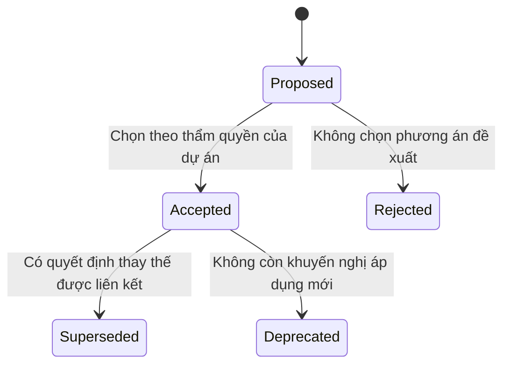

# Architecture decision record

## 1. Mục tiêu và phạm vi bài học

**Architecture decision record**, viết tắt **ADR**, là bản ghi một quyết định kiến trúc quan trọng cùng bối cảnh, các phương án đã cân nhắc, lý do lựa chọn và hệ quả.

Đối với bảo mật, ADR giúp trả lời:

- Vì sao đặt kiểm tra quyền ở thành phần này?
- Vì sao chọn nguồn danh tính hoặc cách quản lý bí mật này?
- Phương án nào đã bị loại và do ràng buộc nào?
- Quyết định giảm rủi ro nào, tạo thêm phụ thuộc nào?
- Dựa vào yêu cầu và bằng chứng nào để xác nhận cách triển khai phù hợp?
- Khi điều kiện thay đổi, cần xem lại quyết định ở đâu?

Trong chương **Security architecture** của module yêu cầu bảo mật, ADR là cầu nối giữa mục tiêu an toàn thông tin, mô hình đe dọa, yêu cầu đo được và cách tổ chức hệ thống.

Sau bài học, bạn có thể viết một ADR tự chứa, so sánh phương án có căn cứ, quản lý trạng thái và liên kết quyết định với xác thực, phân quyền, dữ liệu, logging cùng phục hồi.

Các mã, vai trò, ngày và ngưỡng trong ví dụ là **dữ liệu minh họa**, không phải quyết định hoặc kết quả kiểm thử của một hệ thống thực tế.

## 2. ADR ghi lại điều gì?

### 2.1. Quyết định và lý do, không chỉ tên giải pháp

Một câu như:

> Dùng dịch vụ kiểm tra quyền tập trung.

chưa đủ làm một ADR có ích. Người đọc còn cần biết:

- Chức năng và dữ liệu nào đang được bảo vệ.
- Quy tắc quyền và điều kiện thay đổi quyền.
- Vì sao cơ chế hiện tại chưa đủ.
- Các cách khác có thể đáp ứng mục tiêu.
- Giới hạn độ trễ, tính sẵn sàng và khả năng vận hành.
- Điều gì xảy ra khi dịch vụ kiểm tra quyền không hoạt động.
- Cần kiểm chứng và theo dõi phần nào.

ADR không cần chứa mọi chi tiết của hệ thống, nhưng cần đủ bối cảnh để người không tham gia cuộc thảo luận hiểu lựa chọn.

### 2.2. Phân biệt với các tài liệu khác

| Tài liệu | Câu hỏi chính | Quan hệ với ADR |
| --- | --- | --- |
| Yêu cầu bảo mật | Hệ thống phải bảo đảm điều gì, trong điều kiện nào? | Là căn cứ và điều kiện mà quyết định phải đáp ứng |
| Threat model | Điều gì có thể gây hại, qua đường nào, hậu quả gì? | Giải thích rủi ro và mục tiêu xử lý |
| Sơ đồ kiến trúc | Thành phần và quan hệ được tổ chức ra sao? | Minh họa kết quả hoặc phạm vi của quyết định |
| Đặc tả giao diện | Dữ liệu, hành động và lỗi được trao đổi thế nào? | Triển khai hợp đồng liên quan |
| Runbook | Người vận hành thực hiện việc gì khi có tình huống? | Hiện thực hóa hệ quả vận hành |
| Báo cáo kiểm thử | Đã kiểm tra gì và kết quả ra sao? | Cung cấp bằng chứng, không thay lý do lựa chọn |
| Hồ sơ chấp nhận rủi ro hoặc ngoại lệ | Ai cho phép tiếp tục với phần chưa xử lý, trong điều kiện nào? | Liên kết với giới hạn của quyết định khi cần |

ADR không tự sửa một yêu cầu hoặc tạo quyền miễn yêu cầu. Nếu phương án cần sai lệch, phải ghi rõ và liên kết với quyết định đúng thẩm quyền theo cơ chế của dự án.

### 2.3. Quyết định được chấp nhận khác với triển khai đã được xác minh

Có thể có trạng thái:

- Quyết định: đã được chấp nhận.
- Triển khai: chưa hoàn tất.
- Kiểm chứng: chưa có bằng chứng.
- Rủi ro hiện tại: chưa được giảm bởi phần còn ở kế hoạch.

Không được dùng trạng thái “Accepted” của ADR như bằng chứng một cơ chế đã được triển khai hoặc yêu cầu đã đạt.

Tương tự, một cấu hình đã chạy chưa chứng minh nó đáp ứng đúng mục tiêu của quyết định. Cần liên kết cả trạng thái thiết kế, thực hiện và xác minh.

## 3. Khi nào nên lập ADR?

### 3.1. Những quyết định đáng ghi nhận

Một quyết định thường đáng có ADR khi:

- Tạo hoặc thay đổi ranh giới tin cậy.
- Xác định nguồn danh tính, quyền hoặc bí mật.
- Có nhiều phương án với hệ quả khác nhau.
- Khó thay đổi hoặc ảnh hưởng nhiều thành phần.
- Có tác động đáng kể đến bí mật, toàn vẹn, sẵn sàng.
- Tạo phụ thuộc mới cho phát hiện, ứng phó hoặc phục hồi.
- Cần lưu lý do để tránh lặp lại tranh luận hoặc vô tình đảo ngược lựa chọn.

Ví dụ:

- Quyền theo tài nguyên được kiểm tra tại gateway hay dịch vụ nghiệp vụ.
- Tác vụ nền giữ ngữ cảnh người khởi tạo bằng cách nào.
- Kho nào giữ khóa và ai được dùng hoặc xuất khóa.
- Dữ liệu audit nào được ghi, qua luồng nào và được bảo vệ ra sao.
- Backup được tách khỏi quyền vận hành thường ngày ở mức nào.
- Cơ chế nào bảo đảm quyết định phê duyệt gắn với đúng phiên bản.

### 3.2. Không ghi mọi thao tác thành một quyết định kiến trúc

Đổi tên biến hoặc thực hiện cấu hình đã được quy định rõ có thể không cần ADR riêng. Nếu thao tác đó làm thay đổi giả định, quyền hoặc phạm vi, cần đánh giá lại.

Độ dài ADR nên theo độ phức tạp. Một quyết định nhỏ có thể ngắn, nhưng không nên thiếu lý do hoặc hệ quả chỉ để đủ một trang.

Một ADR nên tập trung vào một quyết định đủ thống nhất. Nếu trộn danh tính, logging, backup và giao diện thành nhiều lựa chọn không cùng lý do, nên tách hoặc tạo quan hệ giữa các bản ghi.

## 4. Các phần của một ADR hữu ích

| Phần | Nội dung cần có | Câu hỏi kiểm tra |
| --- | --- | --- |
| Định danh và tiêu đề | Mã ổn định, tên nêu quyết định | Có biết đang quyết định điều gì không? |
| Trạng thái và phiên bản | Đề xuất, chấp nhận, bị thay thế hoặc trạng thái do nhóm quy định | Trạng thái quyết định có bị nhầm với trạng thái triển khai không? |
| Phạm vi | Chức năng, dữ liệu, môi trường và phần không áp dụng | Kết luận được dùng tới đâu? |
| Bối cảnh | Vấn đề, hiện trạng, tác nhân, ràng buộc và thay đổi | Vì sao phải quyết định? |
| Động lực và yêu cầu | Mục tiêu, rủi ro, tiêu chí bắt buộc | Lựa chọn phải bảo đảm điều gì? |
| Phương án | Các lựa chọn khả thi và điều kiện của chúng | Có so sánh công bằng theo cùng giả định không? |
| Quyết định | Lựa chọn, phạm vi và điều kiện cụ thể | Nhóm triển khai hiểu phải làm gì không? |
| Lý do | Vì sao lựa chọn phù hợp hơn trong bối cảnh này | Có dựa vào bằng chứng hoặc lập luận kiểm tra được không? |
| Hệ quả | Lợi ích, chi phí vận hành, phụ thuộc và rủi ro mới | Điều gì trở nên khó hơn hoặc phải làm thêm? |
| Kiểm chứng | Yêu cầu, phép thử, bằng chứng và người chịu trách nhiệm | Làm sao biết triển khai đã đạt? |
| Rủi ro còn lại | Phần chưa xử lý, điều chưa biết và nơi quyết định | Có che giấu giới hạn không? |
| Điều kiện xem lại | Thay đổi hoặc ngưỡng làm quyết định không còn phù hợp | Khi nào phải đánh giá lại? |
| Liên kết | Threat model, yêu cầu, bản ghi liên quan, bằng chứng | Truy ngược và truy xuôi được không? |

Cần ghi người đề xuất, các vai trò tham gia và người quyết định theo cơ chế dự án. Không mặc định một cá nhân có thẩm quyền cho mọi hậu quả nghiệp vụ.

### 4.1. Mẫu Markdown tối giản

Mẫu sau là nội dung minh họa trong bài:

```markdown
# ADR-XXX: Quyết định cụ thể

- Ngày và phiên bản:
- Trạng thái quyết định:
- Phạm vi:
- Người hoặc vai trò quyết định:

## Bối cảnh
Vấn đề, tài sản, rủi ro, giả định và ràng buộc.

## Yêu cầu và tiêu chí
Mã yêu cầu, điều kiện bắt buộc, mục tiêu có thể kiểm chứng.

## Phương án
Các lựa chọn, ưu điểm, giới hạn và điều kiện.

## Quyết định và lý do
Chọn gì, áp dụng ở đâu, vì sao phù hợp.

## Hệ quả
Việc phải làm thêm, phụ thuộc, rủi ro và tác động vận hành.

## Kiểm chứng
Nơi thực hiện, phép thử, bằng chứng và trách nhiệm.

## Điều kiện xem lại
Thay đổi hoặc tín hiệu cần rà soát.

## Liên kết
Mô hình đe dọa, yêu cầu, bằng chứng và quyết định liên quan.
```

Có thể thêm phần triển khai và xác minh, nhưng nên giữ chúng tách khỏi trạng thái của quyết định.

### 4.2. Ghi điều chưa biết một cách rõ ràng

Nếu chưa đo tải hoặc chưa diễn tập phục hồi, ghi đó là việc cần xác minh. Không biến “dự kiến đáp ứng” thành “đã đáp ứng”.

Một giả định nên có nguồn, mức ảnh hưởng và người xử lý. Ví dụ:

> Giả định dịch vụ quyền có thể cung cấp trạng thái đủ mới để đạt giới hạn thu hồi. Cần kiểm chứng toàn chuỗi trước khi coi yêu cầu đạt.

## 5. Từ rủi ro và yêu cầu đến phương án

### 5.1. Bắt đầu bằng vấn đề, không bắt đầu bằng sản phẩm

Một bối cảnh hữu ích:

> Người dùng có thể mất quyền trong khi tác vụ xuất đang chờ hoặc chạy. Chỉ kiểm tra lúc tạo công việc chưa bảo đảm người nhận còn quyền khi tải tệp.

Bối cảnh này dẫn tới yêu cầu và phương án. Câu “cần dùng một công nghệ mới” chưa giải thích mục tiêu cần bảo vệ.

### 5.2. Phân biệt ràng buộc bắt buộc và tiêu chí lựa chọn

**Ràng buộc bắt buộc** là điều phương án phải đáp ứng trong phạm vi quyết định, chẳng hạn:

- Không cung cấp dữ liệu ngoài phân công.
- Thu hồi có hiệu lực ở mọi đường giao kết quả trong giới hạn xác nhận.
- Không đưa token hoặc toàn bộ dữ liệu cá nhân vào log.
- Không khôi phục lại quyền đã bị thu hồi.

**Tiêu chí lựa chọn** giúp so sánh các phương án đáp ứng ràng buộc: độ phức tạp, hiệu năng, khả năng quan sát, phục hồi, vận hành và thay đổi.

Không để điểm tiện lợi hoặc chi phí thấp làm một phương án vi phạm ràng buộc tự trở thành đạt. Nếu cần đổi ràng buộc, đó là quyết định riêng theo thẩm quyền, không phải một phép cộng điểm.

### 5.3. So sánh theo cùng giả định

Cần dùng cùng phạm vi dữ liệu, tải, thời hạn, nguồn quyền và điều kiện lỗi khi so sánh.

Không nên mô tả phương án được chọn ở trạng thái hoàn hảo, còn phương án khác ở một cấu hình yếu không cần thiết. Nếu một phương án chỉ đáp ứng khi có thêm cơ chế thu hồi, phải ghi cơ chế đó và hệ quả.

Nếu dùng bảng điểm, giải thích tiêu chí và ý nghĩa. Điểm thứ bậc không phải xác suất hoặc mức giảm rủi ro chính xác.

## 6. Quản lý trạng thái và lịch sử quyết định

### 6.1. Một vòng đời minh họa



Tên trạng thái có thể khác giữa các nhóm. Cần giải thích quy ước, đặc biệt sự khác nhau giữa:

- **Proposed:** đang xem xét.
- **Accepted:** quyết định đã được chọn cho phạm vi.
- **Rejected:** đề xuất không được chọn.
- **Superseded:** có quyết định khác thay thế.
- **Deprecated:** không còn được khuyến nghị dùng mới theo điều kiện đã nêu, nhưng có thể còn triển khai cần xử lý.

Vòng đời triển khai và kiểm chứng cần được theo dõi riêng. Một ADR Accepted có thể còn công việc chưa hoàn thành.

### 6.2. Giữ lý do lịch sử khi thay quyết định

Không sửa lý do của quyết định cũ như thể nhóm luôn chọn phương án mới. Khi thay đổi đáng kể, tạo quyết định thay thế và liên kết hai chiều:

- Quyết định mới thay thế quyết định nào.
- Vì sao điều kiện đã đổi hoặc giả định cũ sai.
- Phạm vi chuyển đổi.
- Trạng thái của các triển khai còn dùng phương án cũ.
- Điều kiện và bằng chứng kết thúc chuyển đổi.

Sửa lỗi chính tả, bổ sung liên kết hoặc ghi bằng chứng mới có thể được thực hiện theo quản lý phiên bản của nhóm. Không phải mọi chỉnh sửa đều cần một ADR mới, nhưng phải giữ tính trung thực của lịch sử.

### 6.3. ADR được ghi sau khi quyết định đã xảy ra

Có thể cần ghi nhận lại một quyết định chưa có tài liệu. Khi đó, nêu đây là bản ghi hồi cứu, căn cứ hiện có và điều chưa xác định được.

Không tạo ngày phê duyệt hoặc người quyết định giả để làm hồ sơ có vẻ đầy đủ. Nếu chưa rõ thẩm quyền hoặc lý do, ghi câu hỏi cần xác minh.

## 7. Ví dụ: quyền của tác vụ xuất báo cáo

### 7.1. Bối cảnh

Một nền tảng học tập xuất báo cáo có kết quả và dữ liệu nhận diện học viên. Trước đây API tạo báo cáo trực tiếp. Thiết kế mới dùng hàng đợi và worker để xử lý công việc dài.

Người dùng chỉ được xuất dữ liệu trong phân công. Quyền có thể thay đổi khi:

- Công việc đang chờ.
- Worker đang đọc dữ liệu.
- Tệp đã tạo nhưng chưa tải.
- Người dùng vẫn giữ phiên hoặc tham chiếu tải cũ.

Một kiểm tra duy nhất lúc tạo công việc không giải thích được quyền ở các thời điểm sau.

### 7.2. Các tài sản và đường đe dọa

| Mã | Kịch bản | Hậu quả |
| --- | --- | --- |
| R-ADR-01 | Người khởi tạo hoặc phạm vi trong công việc bị tin từ dữ liệu tự khai | Worker đọc dữ liệu ngoài quyền người yêu cầu |
| R-ADR-02 | Người mất quyền vẫn tải được kết quả tạo trước đó | Lộ dữ liệu sau thu hồi |
| R-ADR-03 | Token hoặc nội dung báo cáo bị sao chép vào hàng đợi, log hoặc công cụ lỗi ngoài nhu cầu | Mở thêm nơi rò rỉ |
| R-ADR-04 | Nguồn quyền không sẵn sàng nhưng hệ thống tự cho qua | Lỗi phụ thuộc biến thành quyền truy cập |
| R-ADR-05 | Phục hồi bản sao cũ làm sống lại phiên hoặc quyền | Mở lại truy cập đã bị đóng |

Đây là kịch bản của ví dụ, không phải phát hiện đã xác nhận trong một hệ thống thật.

### 7.3. Phạm vi quyết định

Quyết định cần giải thích:

> Ngữ cảnh người khởi tạo và quyền được duy trì, kiểm tra qua API, hàng đợi, worker và API tải như thế nào?

Nó không chọn toàn bộ giao thức đăng nhập, thuật toán mã hóa hay mọi chính sách lưu giữ. Những phần đó có thể là yêu cầu nền hoặc quyết định liên quan.

Tuy nhiên, ADR phải nêu phụ thuộc quan trọng. Không thể bỏ nguồn quyền, cache hoặc đường tải nếu chúng quyết định khả năng đáp ứng mục tiêu thu hồi.

## 8. Yêu cầu và tiêu chí cho ví dụ

Các yêu cầu được đặt mã để liên kết; đây là phạm vi minh họa, chưa phải đặc tả đầy đủ cho mọi chức năng.

| Mã | Yêu cầu quan trọng | Tiêu chí kiểm chứng |
| --- | --- | --- |
| REQ-ADR-01 | Chủ thể của công việc phải lấy từ danh tính đã kiểm chứng; không tin mã người dùng tự khai | Sửa trường người khởi tạo không tạo được công việc dưới danh tính khác |
| REQ-ADR-02 | Dữ liệu và trường báo cáo phải nằm trong quyền hiện hành của người khởi tạo và người nhận | Yêu cầu ngoài phân công hoặc sau thu hồi không được giao dữ liệu trái quyền |
| REQ-ADR-03 | Sau thu hồi tại nguồn có thẩm quyền, mọi điểm giao kết quả phải thực thi trong tối đa 5 phút | Đo qua phiên, tham chiếu tải và cache tại các thời điểm của công việc |
| REQ-ADR-04 | Bản xuất phải được bảo vệ khi lưu, truyền và truy cập theo chính sách; không công khai | Kiểm tra nơi lưu, đường tải và truy cập trực tiếp ngoài quyền |
| REQ-ADR-05 | Audit tạo, xử lý, tải và thu hồi phải đủ chủ thể, tài nguyên, thời điểm, kết quả; không chứa bí mật hoặc toàn bộ báo cáo | Kiểm tra trường, thử đường lỗi và độ trễ chuyển sự kiện tối đa 5 phút |
| REQ-ADR-06 | Phục hồi không kích hoạt lại quyền hoặc phiên chưa xác minh | Diễn tập với thay đổi sau điểm backup; thử các đường cũ |

Nguồn quyền và mốc thu hồi phải được xác định. Giới hạn 5 phút không bao gồm thời gian trước khi một vụ chiếm tài khoản được phát hiện nếu chưa có yêu cầu riêng cho việc đó.

Mục tiêu phục hồi dữ liệu nghiệp vụ trong ví dụ là RPO không quá 15 phút và RTO không quá 60 phút cho kịch bản mất kho chính đã thống nhất.

- **RPO:** mục tiêu về khoảng dữ liệu có thể mất trước sự cố.
- **RTO:** mục tiêu về thời gian khôi phục; ở đây đo từ lúc công bố sự cố tới khi chức năng hợp lệ hoạt động với dữ liệu và quyền đã kiểm tra.

Các yêu cầu là điều kiện phải kiểm chứng. Chọn một kiến trúc có khả năng đáp ứng chưa phải bằng chứng đã đạt.

## 9. So sánh phương án

### 9.1. PA-1 — Chỉ kiểm tra lúc tạo công việc

API kiểm tra quyền rồi ghi phạm vi vào công việc. Worker xử lý theo thông tin đó; đường tải dùng tham chiếu có thời hạn 30 phút, không kiểm tra lại quyền.

Ưu điểm trong thiết kế giả định:

- Luồng xử lý đơn giản.
- Ít truy vấn quyền ở giai đoạn sau.
- Công việc ít phụ thuộc vào nguồn quyền khi chạy.

Giới hạn:

- Quyền có thể thay đổi sau khi công việc được tạo.
- Tham chiếu còn hiệu lực không phản ánh quyền hiện hành.
- Cấu hình nêu trên không có cơ chế bảo đảm thu hồi trong 5 phút.
- Dữ liệu cũ trong công việc có thể bị nhầm là thẩm quyền hiện tại.

Trong cấu hình này, phương án không đáp ứng REQ-ADR-03 nên không được chọn chỉ vì tiện triển khai.

Nếu bổ sung cơ chế thu hồi và kiểm tra khác, đó là một phương án đã thay đổi, cần được mô tả lại thay vì giữ kết luận cũ.

### 9.2. PA-2 — Giữ ngữ cảnh có thẩm quyền và kiểm tra lại

API lấy chủ thể từ xác thực, tạo công việc có phạm vi được quản lý. Worker đối chiếu quyền theo nguồn có thẩm quyền trước các thao tác cần thiết. API tải kiểm tra người nhận và quyền với kết quả trước khi giao.

Khi không xác minh được điều kiện bắt buộc, giữ chờ hoặc từ chối theo chính sách, không tự cho phép. Cache và độ trễ đồng bộ nếu có phải nằm trong giới hạn thu hồi đầu cuối.

Ưu điểm:

- Quyền tại thời điểm sử dụng được giải thích rõ.
- Đường tải có điểm thực thi thu hồi.
- Không cần mặc định đưa token người dùng đầy đủ vào hàng đợi.
- Có thể truy vết quyết định theo công việc và nguồn quyền.

Hệ quả:

- Tạo phụ thuộc vào nguồn quyền.
- Cần đặc tả hành vi lỗi, thử lại, cache và tính nhất quán.
- Cần đo tải truy vấn và khả năng vận hành.
- Cần kiểm tra nhiều giai đoạn thay vì chỉ điểm tạo.

Khả năng đáp ứng là lập luận thiết kế, vẫn cần bằng chứng.

### 9.3. PA-3 — Quyền ủy nhiệm có phạm vi và thời hạn

Công việc mang một cơ chế quyền ủy nhiệm được giới hạn theo hành động, tài nguyên và đối tượng nhận, có thời hạn cùng cách xử lý thu hồi phù hợp. Đường giao kết quả vẫn phải đáp ứng quyền người nhận và mục tiêu đầu cuối.

Ưu điểm có thể có:

- Phạm vi được biểu diễn rõ trong thông tin ủy nhiệm.
- Một số điểm xử lý có thể kiểm chứng theo cơ chế đã chọn.
- Có khả năng giới hạn tác động nếu được thiết kế đúng.

Hệ quả cần giải quyết:

- Quản lý phát hành, khóa hoặc nguồn kiểm chứng.
- Đúng mục đích và đối tượng nhận.
- Chống dùng lại hoặc mở rộng quyền ngoài thiết kế.
- Hết hạn, thu hồi, độ trễ và vòng đời công việc.
- Bảo vệ dữ liệu nếu thông tin ủy nhiệm là bí mật có thể sử dụng.

Một thông tin có chữ ký không tự bảo đảm thu hồi hoặc bí mật nội dung. Phương án này có thể phù hợp, nhưng cần thêm thiết kế và bằng chứng riêng.

### 9.4. Bảng quyết định định tính

| Tiêu chí | PA-1 như đã mô tả | PA-2 | PA-3 |
| --- | --- | --- | --- |
| Quyền thay đổi trong lúc chờ | Không xử lý đầy đủ | Có điểm kiểm tra lại | Phụ thuộc cơ chế ủy nhiệm và thu hồi |
| Thu hồi tối đa 5 phút | Không có cơ chế đáp ứng | Có thể đáp ứng nếu toàn chuỗi được thiết kế và thử đạt | Có thể đáp ứng nếu vòng đời và thu hồi được thiết kế và thử đạt |
| Phụ thuộc khi thực hiện | Ít hơn ở nguồn quyền | Nguồn quyền và quy tắc cache | Nguồn phát hành, kiểm chứng và trạng thái liên quan |
| Công việc vận hành mới | Ít trong mô tả ban đầu nhưng để lại khoảng trống | Giám sát nguồn quyền, độ trễ và hành vi lỗi | Quản trị quyền ủy nhiệm và các thành phần kiểm chứng |
| Cơ sở chọn trong ví dụ | Loại do không đáp ứng ràng buộc | Chọn để phù hợp cơ chế quyền đã được giả định có trong hệ thống | Chưa chọn; cần thiết kế thêm nếu bối cảnh đòi hỏi |

Bảng không chứa số đo hiệu năng hoặc chi phí thực tế. Không được trình bày lập luận định tính như một benchmark đã thực hiện.

## 10. ADR minh họa hoàn chỉnh

Phần dưới là một bản ghi giả định để minh họa cấu trúc và lập luận. Nó không tạo quyết định cho một hệ thống thực tế.

### 10.1. Định danh và trạng thái

**ADR-014: Kiểm tra quyền theo thời điểm sử dụng cho tác vụ xuất bất đồng bộ**

- Ngày: 2026-01-15, ngày minh họa.
- Trạng thái quyết định: **Accepted**, giả định đã được chọn theo quy chế của tình huống.
- Phạm vi: tạo công việc, worker, kho xuất và mọi đường giao báo cáo của chức năng đang xét.
- Vai trò quyết định: nhóm kiến trúc và chủ sở hữu dữ liệu trong dự án giả định, trong thẩm quyền đã xác định.
- Trạng thái triển khai: chưa được xác nhận trong bản ghi minh họa.
- Trạng thái kiểm chứng: cần bằng chứng cho từng yêu cầu trước khi kết luận đạt.

Việc chấp nhận lựa chọn kiến trúc không thay cho quyết định phát hành hoặc xác minh các yêu cầu.

### 10.2. Bối cảnh

Báo cáo được tạo qua hàng đợi để hỗ trợ công việc dài. Người dùng có thể mất quyền sau khi tạo yêu cầu. Worker có danh tính kỹ thuật để phục vụ nhiều phạm vi, còn dữ liệu báo cáo có thông tin nhận diện học viên.

Các đường gây hại chính là:

- Công việc chứa chủ thể hoặc phạm vi không có thẩm quyền.
- Quyền cũ trong công việc được dùng như quyền hiện hành.
- Đường tải hoặc cache tiếp tục giao dữ liệu sau thu hồi.
- Dữ liệu xác thực và báo cáo bị sao chép vào hệ thống quan sát.
- Phục hồi bản sao cũ tái mở quyền.

Nguồn quản trị quyền đã được giả định là một thành phần có thể dùng trong thiết kế. Khả năng đáp ứng tải, độ mới và phục hồi của nguồn đó vẫn cần kiểm chứng.

### 10.3. Yêu cầu chi phối

REQ-ADR-01 đến REQ-ADR-06 là căn cứ. Các điều kiện đặc biệt quan trọng:

- Chủ thể được lấy từ cơ chế xác thực, không từ trường tự khai.
- Người khởi tạo và người nhận chỉ tiếp cận đúng phạm vi được phép.
- Thu hồi được thực thi ở mọi đường giao kết quả trong tối đa 5 phút.
- Không công khai bản xuất hoặc sao chép bí mật vào audit.
- Không dùng phục hồi để tái kích hoạt quyền chưa xác minh.

Không dùng tiêu chí tiện triển khai để bỏ một điều kiện này.

### 10.4. Quyết định

Chọn PA-2 với các nội dung:

1. **API tạo ngữ cảnh có thẩm quyền.** Chủ thể được lấy từ kết quả xác thực. Hành động và phạm vi được kiểm tra trước khi tạo công việc.
2. **Công việc giữ tham chiếu và dữ liệu cần thiết.** Hàng đợi chỉ nhận từ danh tính được phép. Worker kiểm tra hợp đồng và nguồn công việc; không dùng trường tự khai như bằng chứng quyền.
3. **Worker kiểm tra phạm vi ở thời điểm sử dụng.** Quyền kỹ thuật của worker không mở rộng quyền người yêu cầu. Dữ liệu được truy vấn theo phạm vi đã được xác định hợp lệ.
4. **API tải kiểm tra quyền người nhận.** Có tệp hoặc biết tham chiếu không đồng nghĩa được tải. Mọi đường cũ, mới và cache phải cùng đáp ứng mục tiêu thu hồi.
5. **Lỗi nguồn quyền không tạo quyền mới.** Công việc có thể giữ chờ, thử lại có kiểm soát hoặc bị từ chối theo chính sách cụ thể; không giao dữ liệu khi chưa xác minh điều kiện bắt buộc.
6. **Bảo vệ bản sao và bằng chứng.** Tệp, dữ liệu tạm, sự kiện và tham chiếu có vòng đời, quyền truy cập và chính sách bảo vệ phù hợp.
7. **Phục hồi phải áp dụng trạng thái hiện hành.** Không tự sử dụng quyền hoặc phiên cũ chỉ vì chúng xuất hiện trong backup.
8. **Các giới hạn thời gian phải được kiểm chứng đầu cuối.** Nếu có cache hoặc đồng bộ, phải có ngân sách độ trễ và bằng chứng đáp ứng giới hạn 5 phút.

ADR chọn chiến lược và ranh giới trách nhiệm. Hợp đồng công việc, giao diện quyền, cách xử lý lỗi và cấu hình cụ thể được đặc tả ở tài liệu liên quan, với liên kết đúng phiên bản.

### 10.5. Lý do

PA-1 như mô tả không có cơ chế đáp ứng thu hồi trong 5 phút. PA-3 có thể đáp ứng nhưng cần thêm thiết kế về quyền ủy nhiệm, nguồn kiểm chứng và vòng đời.

PA-2 phù hợp với giả định của tình huống là đã có nguồn quản trị quyền dùng chung và các điểm nghiệp vụ có thể gọi hoặc kiểm tra qua cơ chế đó. Nó làm rõ quyền tại thời điểm xử lý và giao kết quả, đồng thời giảm nhu cầu phân phối token người dùng vào hàng đợi.

Lựa chọn này không dựa trên tuyên bố đã đo hiệu năng tốt hơn. Tải, độ trễ và hành vi lỗi là công việc kiểm chứng.

### 10.6. Hệ quả tích cực

- Có nơi thực thi quyền rõ ở các giai đoạn.
- Có thể kiểm tra thu hồi theo toàn chuỗi.
- Dễ liên kết chủ thể, phạm vi và kết quả với audit.
- Quyền dịch vụ được phân biệt với quyền nghiệp vụ.
- Các đường dữ liệu cũ cần được kiểm kê rõ thay vì tồn tại ngoài mô hình.

### 10.7. Hệ quả và công việc phát sinh

- Tăng phụ thuộc vào tính đúng đắn và sẵn sàng của nguồn quyền.
- Cần xử lý lỗi, timeout, thử lại và trạng thái công việc chờ.
- Cần đo tải và độ trễ truy vấn theo mức sử dụng được duyệt.
- Cần cấu hình cache cùng độ trễ đồng bộ trong ngân sách đầu cuối.
- Cần kiểm soát người nhận và vòng đời tệp xuất.
- Cần nguồn trạng thái hoặc phương án xác nhận lại sau phục hồi.
- Cần kiểm tra nguồn công việc để worker không tin dữ liệu ngoài thẩm quyền.

Nếu nguồn quyền không hoạt động, một số thao tác được bảo vệ có thể không tiếp tục. Đây là hệ quả sẵn sàng phải được nghiệp vụ và vận hành xem xét, không che giấu bằng nhánh cho phép truy cập.

### 10.8. Chuyển đổi và quay lui

Kế hoạch cần bao gồm:

1. Xác định hợp đồng chủ thể, phạm vi và trạng thái.
2. Thực hiện kiểm tra ở API, worker và điểm tải.
3. Kiểm kê đường tải, liên kết và cache còn dùng cơ chế cũ.
4. Xác minh thu hồi trên mọi đường trước khi kết luận phạm vi đạt.
5. Chuyển đổi với phạm vi được quản lý và theo dõi điều kiện.
6. Loại bỏ đường cũ khi không còn cần, giữ bằng chứng và dữ liệu theo chính sách.

Quay lui về một đường không đáp ứng giới hạn thu hồi không tự là phương án hợp lệ. Phương án quay lui phải giữ ràng buộc bảo mật, chẳng hạn giữ công việc chờ hoặc tạm không giao kết quả chưa xác minh, theo kế hoạch được xác nhận.

Không chỉ ghi “rollback về bản trước” mà bỏ qua việc bản trước có đường tải 30 phút không kiểm tra lại.

### 10.9. Kiểm chứng và theo dõi

Bằng chứng cần có:

- Kiểm thử chủ thể không bị giả mạo trong công việc.
- Ma trận phạm vi và trường dữ liệu theo vai trò.
- Thu hồi khi công việc chờ, chạy và sau khi tạo tệp.
- Thử các đường tải, tham chiếu và cache cũ.
- Mất nguồn quyền và hành vi giữ chờ, từ chối hoặc thử lại.
- Kiểm tra bản xuất không công khai, dữ liệu được bảo vệ theo chính sách.
- Kiểm tra audit đủ trường, đúng độ trễ, không chứa bí mật.
- Diễn tập phục hồi với quyền đã thay sau điểm backup.

Chỉ báo vận hành cần gắn với điều kiện: lỗi nguồn quyền, độ trễ thực thi thu hồi, công việc tồn đọng, sai phạm vi, lỗi chuyển audit và sai lệch cấu hình. Mỗi chỉ báo dùng để hành động phải có nguồn đo, người nhận và cách xử lý.

### 10.10. Rủi ro còn lại và điều kiện xem lại

Rủi ro còn lại gồm:

- Phiên bị sử dụng trước khi sự kiện thu hồi được ghi nhận.
- Dữ liệu đã tải hợp lệ bị chia sẻ ngoài hệ thống.
- Nguồn quyền hoặc danh tính dịch vụ bị chiếm.
- Lỗi ở trường hợp chưa nằm trong kiểm thử.
- Phụ thuộc chung ảnh hưởng đồng thời ứng dụng và phục hồi.

Cần xem lại quyết định khi:

- Không thể chứng minh giới hạn 5 phút ở tải hoặc kiến trúc thực tế.
- Nguồn quyền không đáp ứng nhu cầu sẵn sàng đã xác nhận.
- Thêm đường tải, cơ chế cache hoặc nhà cung cấp mới.
- Mở rộng dữ liệu, nhóm người dùng hoặc phạm vi tổ chức.
- Cần xử lý công việc trong điều kiện không tiếp cận được nguồn quyền.
- Có sự cố hoặc bằng chứng làm giả định quan trọng không còn đúng.

Việc xem lại có thể dẫn tới điều chỉnh triển khai trong cùng quyết định hoặc một ADR thay thế, tùy mức thay đổi.

## 11. Truy vết quyết định tới bằng chứng

### 11.1. Chuỗi liên kết


Chuỗi giúp tìm lý do và trạng thái. Nó không có nghĩa một tài liệu ở sau tự chứng minh mọi phần ở trước đã đầy đủ.

### 11.2. Bảng liên kết minh họa

| Rủi ro | Yêu cầu | Nội dung quyết định | Bằng chứng cần |
| --- | --- | --- | --- |
| R-ADR-01 | REQ-ADR-01, REQ-ADR-02 | API tạo chủ thể, worker kiểm tra nguồn và phạm vi | Thử giả chủ thể, phạm vi và quyền dịch vụ |
| R-ADR-02 | REQ-ADR-03, REQ-ADR-04 | Kiểm tra người nhận và quyền ở điểm giao kết quả | Đo thu hồi trên mọi đường tải, liên kết, cache |
| R-ADR-03 | REQ-ADR-04, REQ-ADR-05 | Giới hạn dữ liệu trong công việc, tệp và audit | Kiểm tra lưu trữ, trường sự kiện và đường lỗi |
| R-ADR-04 | REQ-ADR-02, REQ-ADR-03 | Lỗi không tự cho phép, thử lại có kiểm soát | Thử mất nguồn quyền và trạng thái công việc |
| R-ADR-05 | REQ-ADR-06 | Xác minh quyền hiện hành sau phục hồi | Diễn tập từ bản sao cũ và thử quyền đã thu hồi |

Mã yêu cầu và bằng chứng cần gắn đúng phiên bản. Không dùng một liên kết chung “đã kiểm thử bảo mật” thay cho kết quả ở phạm vi liên quan.

## 12. Đọc trạng thái triển khai và kiểm chứng

### 12.1. Một bộ kết quả giả định

Các kết quả dưới đây chỉ để học cách diễn giải:

| Mã | Quan sát giả định | Kết luận đúng phạm vi |
| --- | --- | --- |
| E-ADR-01 | Sửa trường người khởi tạo không làm đổi chủ thể; phạm vi ngoài quyền bị từ chối trong trường hợp thử | Hỗ trợ một phần REQ-ADR-01 và REQ-ADR-02 |
| E-ADR-02 | API tải mới thực thi thu hồi sau 3 phút | Đường mới đạt giới hạn trong điều kiện thử |
| E-ADR-03 | Một đường tải cũ còn cung cấp tới phút thứ 8 | REQ-ADR-03 chưa đạt cho toàn phạm vi |
| E-ADR-04 | Audit tới trung tâm trong 3 phút và không chứa chuỗi bí mật thử | Hỗ trợ phần đã thử của REQ-ADR-05 |
| E-ADR-05 | Chưa có diễn tập phục hồi quyền | Chưa đủ bằng chứng cho REQ-ADR-06 |

ADR có thể vẫn là Accepted vì chiến lược chưa bị thay thế. Nhưng triển khai chưa đáp ứng đầy đủ và không thể tuyên bố mọi yêu cầu đạt.

### 12.2. Không dùng nhãn tài liệu để đóng khoảng trống

Cách kết luận phù hợp:

> Quyết định chọn kiểm tra quyền theo thời điểm sử dụng còn có hiệu lực. Tuy nhiên, một đường tải cũ chưa đáp ứng thu hồi và phục hồi quyền chưa được xác minh. Cần xử lý các mục đó trước khi kết luận phạm vi triển khai đáp ứng điều kiện liên quan.

Cách kết luận không đủ:

> ADR đã Accepted nên thiết kế bảo mật đã hoàn tất và có thể phát hành.

Nếu kết quả mới cho thấy chính chiến lược không đáp ứng được yêu cầu trong bối cảnh thực tế, cần xem lại ADR, không chỉ tiếp tục sửa nhỏ vô thời hạn.

### 12.3. Độ tin cậy và giới hạn

Bằng chứng phải nêu:

- Phiên bản và môi trường.
- Đường, dữ liệu và nhóm quyền đã thử.
- Tải, thời gian và phụ thuộc.
- Phần chưa thử hoặc chưa quan sát được.
- Cách kết quả liên quan đến yêu cầu.

Một lần đạt không chứng minh mọi điều kiện đều đạt. Một lần không đạt cũng cần được phân tích đúng nguyên nhân: triển khai thiếu, cấu hình sai, giả định sai hoặc chiến lược chưa phù hợp.

## 13. Duy trì ADR khi hệ thống thay đổi

### 13.1. Xác định thay đổi thuộc loại nào

| Tình huống | Cách xử lý phù hợp |
| --- | --- |
| Sửa cách diễn đạt mà không đổi quyết định | Cập nhật có lịch sử theo quy ước nhóm |
| Thêm kết quả kiểm chứng | Liên kết bằng chứng và trạng thái, giữ rõ phạm vi |
| Triển khai khác quyết định ngoài chủ đích | Ghi sai lệch, đánh giá rủi ro và xử lý |
| Một giả định quan trọng không còn đúng | Rà soát lại lựa chọn và điều kiện |
| Chọn chiến lược khác | Lập ADR thay thế và liên kết quyết định cũ |
| Phương án cũ còn ở một số môi trường | Theo dõi chuyển đổi theo phạm vi, không coi tất cả đã đổi |
| Không còn chức năng hoặc tài sản liên quan | Ghi việc kết thúc và xử lý phần còn lại |

Một đề xuất thay thế chưa được chấp nhận không tự làm quyết định đang có hiệu lực thành Superseded.

Khi quyết định mới được chấp nhận, việc thay thế về mặt hồ sơ vẫn cần đi cùng kế hoạch triển khai. Trạng thái ADR không tự di chuyển dữ liệu, đổi quyền hoặc gỡ đường truy cập cũ.

### 13.2. Liên kết với thay đổi mã và cấu hình

Một thay đổi nên dẫn người đọc đến:

- ADR nào giải thích lựa chọn.
- Yêu cầu nào cần được giữ.
- Luồng và thành phần nào bị tác động.
- Bằng chứng nào cần cập nhật.
- Rủi ro hoặc giả định nào cần xem lại.

Không cần chép toàn bộ nội dung ADR vào từng thay đổi. Cũng không cần viết lại ADR cho mọi chỉnh sửa nếu quyết định, phạm vi và giả định vẫn đúng.

Nếu thay một tham số cache làm giới hạn thu hồi không còn có căn cứ, đó không còn là chi tiết vô hại. Nó cần được đánh giá theo yêu cầu và lập luận của quyết định.

### 13.3. Duy trì điều kiện xem lại

Điều kiện xem lại nên đủ cụ thể để có người nhận biết:

- Phạm vi dữ liệu hoặc người dùng vượt giả định.
- Thêm đường giao dữ liệu.
- Độ trễ hoặc lỗi phụ thuộc vượt điều kiện đã xác nhận.
- Kết quả diễn tập không còn đáp ứng mục tiêu.
- Bằng chứng mới cho thấy kiểm soát không có tác dụng như mong đợi.
- Nhà cung cấp hoặc mô hình quản trị thay đổi.

Chỉ báo cần có chủ sở hữu. Một mục “xem lại khi cần” không cho biết ai hoặc điều gì kích hoạt công việc.

## 14. Bảo vệ và đánh giá chất lượng bản ghi

### 14.1. ADR có thể chứa thông tin nhạy cảm

Các nội dung như ranh giới quyền, đường phục hồi, giới hạn kiểm soát và giả định chưa xác minh có giá trị đối với người không có quyền.

Cần xác định:

- Ai được đọc, sửa và quyết định.
- Cách giữ lịch sử và phát hiện thay đổi ngoài quy trình.
- Thông tin nào được chia sẻ cho bên khác.
- Cách tạo bản đã giảm thông tin nhạy cảm nếu cần công bố.
- Vòng đời của bản ghi và bằng chứng liên quan.

Không đưa mật khẩu, token, khóa riêng hoặc dữ liệu người thật không cần thiết vào ADR. Một tham chiếu tới nguồn được quản lý thường phù hợp hơn giá trị bí mật.

Nếu người sửa cơ chế bảo mật cũng có thể sửa lịch sử quyết định và bằng chứng mà không để lại dấu vết, chất lượng trách nhiệm giải trình bị suy yếu. Cần quản lý quyền và lịch sử phù hợp với hậu quả.

### 14.2. Câu hỏi đánh giá chất lượng

- Tiêu đề có nói rõ quyết định thay vì chỉ tên công nghệ?
- Người đọc có hiểu vì sao cần quyết định không?
- Phạm vi và phần không được kết luận đã rõ chưa?
- Yêu cầu bắt buộc có mã hoặc nội dung đủ để kiểm tra không?
- Các phương án có được so sánh trên cùng điều kiện không?
- Lý do có tách số đo, giả định và ý kiến không?
- Hệ quả có bao gồm lỗi, vận hành, phục hồi và rủi ro mới không?
- Có đường kiểm chứng và người chịu trách nhiệm không?
- Điều kiện xem lại có thể được nhận biết không?
- Trạng thái quyết định có tách khỏi triển khai và kiểm thử không?

Chất lượng không nằm ở độ dài hoặc số phương án. Một bản ghi ngắn có căn cứ tốt có thể hữu ích hơn bản dài nhưng không giải thích được lựa chọn.

## 15. Những sai lầm thường gặp

| Sai lầm | Hậu quả | Cách cải thiện |
| --- | --- | --- |
| ADR chỉ ghi tên giải pháp | Không biết vì sao chọn hoặc khi nào cần đổi | Ghi vấn đề, yêu cầu, lựa chọn và hệ quả |
| Không có phạm vi | Quyết định bị áp dụng rộng hơn căn cứ | Nêu chức năng, dữ liệu, môi trường |
| Phương án được chọn luôn được mô tả lý tưởng | So sánh thiếu công bằng | Dùng cùng giả định và điều kiện |
| Điểm tiện lợi lấn ràng buộc bảo mật | Phương án không đáp ứng vẫn được coi là đạt | Kiểm tra điều kiện bắt buộc trước khi so sánh |
| Dùng dự kiến như bằng chứng | Hạ rủi ro khi chưa triển khai hoặc kiểm tra | Tách kế hoạch, thực hiện và xác minh |
| Accepted được coi là mọi yêu cầu đạt | Che khoảng trống kỹ thuật | Theo dõi trạng thái riêng và liên kết kết quả |
| Chỉ ghi lợi ích | Người vận hành không biết phụ thuộc hoặc lỗi mới | Ghi hệ quả, hành vi lỗi và phục hồi |
| Không mô tả quay lui | Quay về đường cũ làm mất bảo vệ | Giữ ràng buộc bảo mật trong phương án chuyển tiếp |
| Sửa lý do cũ thành lựa chọn mới | Mất lịch sử và căn cứ của triển khai còn tồn tại | Tạo quyết định thay thế có liên kết |
| Mọi thay đổi nhỏ đều sinh ADR mới | Nhiễu, khó thấy quyết định quan trọng | Phân biệt chi tiết thực hiện và thay đổi chiến lược |
| Không ai theo dõi giả định | Quyết định tiếp tục dựa trên điều đã sai | Giao trách nhiệm và tín hiệu xem lại |
| Đưa bí mật vào hồ sơ | Tạo thêm nơi rò rỉ | Dùng dữ liệu tổng hợp và tham chiếu |

## 16. Bài tập thực hành

Một cổng tài liệu có gateway và API nghiệp vụ. Gateway biết danh tính và vai trò chung. API biết tài liệu thuộc nhóm nào. Người dùng có thể chuyển nhóm, và quyền cần được thu hồi trong tối đa 5 phút.

Nhóm đang cân nhắc:

- Chỉ kiểm tra vai trò ở gateway.
- Kiểm tra danh tính ở điểm vào và quyền tài liệu ở API.
- Phát quyền truy cập có phạm vi để các điểm cung cấp tài liệu kiểm chứng.

Hãy thực hiện:

1. Viết vấn đề và phạm vi quyết định.
2. Nêu tài sản, quy tắc và hai kịch bản đe dọa.
3. Tách ràng buộc bắt buộc khỏi tiêu chí so sánh.
4. Mô tả ba phương án theo cùng giả định.
5. Chọn một phương án và giải thích bằng lý do có thể kiểm tra.
6. Ghi ít nhất một hệ quả sẵn sàng và một hệ quả vận hành.
7. Viết yêu cầu về nguồn quyền, dữ liệu đầu ra và audit.
8. Xác định phép thử thu hồi qua cache hoặc đường tải.
9. Đặt điều kiện xem lại và người theo dõi.
10. Mô tả cách thay thế ADR nếu phương án không đáp ứng tải thực tế.

Sau đó, giả định có kết quả:

- API chính thực thi thu hồi trong 3 phút.
- Một đường tải phụ còn chấp nhận sau 12 phút.
- Chưa có kết quả phục hồi quyền.

Hãy ghi riêng trạng thái quyết định, trạng thái triển khai và kết luận kiểm chứng. Giải thích vì sao không được dùng trạng thái Accepted để bỏ kết quả chưa đạt.

Một đoạn bối cảnh phù hợp có thể là:

> Vai trò chung tại gateway không chứa đầy đủ quan hệ tài liệu–nhóm. Hệ thống cần quyết định nơi kiểm tra quyền tài nguyên, cách giữ độ mới của quyền và hành vi khi nguồn quyền không hoạt động. Mọi phương án phải đáp ứng mục tiêu thu hồi ở toàn bộ đường cung cấp dữ liệu.

Tự kiểm tra:

- Người khác có hiểu lựa chọn mà không cần nghe lại cuộc họp không?
- Có phương án nào bị loại do cấu hình yếu mà chưa được đánh giá công bằng không?
- Có số đo nào thực chất chỉ là giả định không?
- Kế hoạch quay lui có giữ yêu cầu bảo mật không?
- Bằng chứng có đúng phiên bản và đường truy cập không?
- Phần rủi ro còn lại có trách nhiệm theo dõi không?
- Quyết định mới có giữ được lịch sử và phạm vi chuyển đổi không?

## 17. Những điểm cần ghi nhớ

ADR ghi lại quyết định kiến trúc cùng bối cảnh, phương án, lý do và hệ quả. Trong thiết kế bảo mật, nó phải liên kết với tài sản, đe dọa, yêu cầu đo được và bằng chứng phù hợp.

Trạng thái quyết định không thay cho trạng thái triển khai hoặc kiểm chứng. Một ADR có ích giúp nhóm giữ rõ giới hạn, phụ thuộc, rủi ro còn lại và điều kiện xem lại, đồng thời bảo toàn lý do lịch sử khi hệ thống thay đổi.
