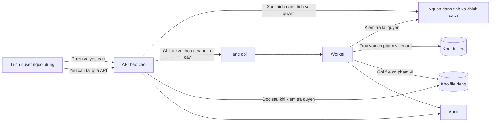

# Security design review

## 1. Mục tiêu và phạm vi của bài học

**Security design review** là hoạt động rà soát một thiết kế dưới góc nhìn an toàn thông tin để trả lời ba câu hỏi:

1. Hệ thống đang bảo vệ tài sản nào, trước những hành vi hoặc sự cố nào?
2. Những quyết định kiến trúc nào thực thi các yêu cầu bảo mật, và các quyết định đó dựa vào giả định gì?
3. Cần bằng chứng nào để xác nhận rằng thiết kế và phần triển khai đáp ứng các yêu cầu đã nêu?

Trong chương **Security architecture**, trọng tâm của hoạt động này là mối liên kết giữa rủi ro, kiến trúc và yêu cầu. Với phạm vi học về yêu cầu bảo mật, kết quả cần đạt không dừng ở nhận xét “thiết kế có vẻ an toàn”. Người thực hiện phải chuyển nhận xét thành yêu cầu cụ thể, có điều kiện áp dụng, có tiêu chí chấp nhận và có cách kiểm chứng trong vòng đời phát triển.

Sau bài học, người học có thể:

- Xác định phạm vi và các đầu vào tối thiểu cho một cuộc rà soát.
- Đọc luồng dữ liệu, ranh giới tin cậy và mô hình đe dọa để tìm yêu cầu còn thiếu.
- Đặc tả yêu cầu về xác thực, phân quyền, bảo vệ dữ liệu, logging và phục hồi.
- Ghi nhận phát hiện theo rủi ro, phân công xử lý và quản lý ngoại lệ.
- Theo dõi một phát hiện từ lúc nhận diện đến khi có bằng chứng đóng việc.

Các con số trong ví dụ của bài là **giả định cho một hệ thống minh họa**, không phải ngưỡng mặc định áp dụng cho mọi sản phẩm. Nhóm dự án phải lựa chọn và xác nhận các ngưỡng theo tài sản, tác động, tải thực tế và khả năng vận hành.

## 2. Rà soát thiết kế nằm ở đâu trong vòng đời phát triển?

Rà soát thiết kế có giá trị khi nhóm vẫn có thể thay đổi cách phân chia thành phần, luồng dữ liệu và cơ chế bảo vệ với chi phí hợp lý. Có thể thực hiện lần đầu khi yêu cầu và phương án kiến trúc đã đủ rõ, rồi rà soát lại khi có thay đổi đáng kể.

Một chuỗi hoạt động điển hình:

```text
Mục tiêu bảo vệ và yêu cầu nghiệp vụ
    → Nhận diện tài sản, rủi ro và kịch bản đe dọa
    → Đề xuất kiến trúc và yêu cầu bảo mật
    → Security design review
    → Điều chỉnh thiết kế, yêu cầu và tiêu chí kiểm thử
    → Triển khai, kiểm thử và xác minh vận hành
    → Rà soát lại khi giả định hoặc thiết kế thay đổi
```

Không cần đợi một tài liệu hoàn hảo mới tổ chức review. Nếu luồng xử lý quan trọng chưa được mô tả, kết quả hợp lý có thể là “chưa đủ cơ sở đánh giá”, kèm danh sách thông tin phải bổ sung. Không được diễn giải sự thiếu thông tin thành bằng chứng rằng không có rủi ro.

### 2.1. Phân biệt với các hoạt động liên quan

| Hoạt động | Câu hỏi chính | Đầu ra điển hình |
|---|---|---|
| Mô hình hóa đe dọa | Điều gì có thể xảy ra, ở đâu và gây tác động gì? | Kịch bản đe dọa, giả định, biện pháp xử lý rủi ro |
| Security design review | Thiết kế và yêu cầu hiện tại có xử lý các rủi ro liên quan không? | Phát hiện, quyết định, yêu cầu cập nhật, kế hoạch xác minh |
| Rà soát mã nguồn | Mã có triển khai đúng các cơ chế và quy tắc đã chọn không? | Lỗi triển khai, đề xuất sửa mã |
| Kiểm thử bảo mật | Khi chạy trong điều kiện kiểm thử, hệ thống có vi phạm thuộc tính bảo mật không? | Kết quả thử nghiệm, lỗi có thể tái hiện |
| Rà soát vận hành | Cấu hình, giám sát và quy trình thực tế có duy trì yêu cầu không? | Sai lệch cấu hình, lỗ hổng vận hành, bằng chứng phục hồi |

Các hoạt động bổ sung cho nhau. Một thiết kế tốt vẫn có thể bị triển khai sai. Ngược lại, mã được viết cẩn thận vẫn có thể thực hiện một thiết kế phân quyền sai ngay từ đầu.

### 2.2. Những thay đổi nên kích hoạt review

- Thêm giao diện truy cập từ Internet hoặc thêm loại người dùng có quyền cao.
- Thêm dịch vụ, kho dữ liệu, hàng đợi hoặc tích hợp với bên thứ ba.
- Thay đổi nhà cung cấp danh tính, cách tạo phiên hoặc chính sách phân quyền.
- Thay đổi mô hình nhiều khách hàng dùng chung hạ tầng, còn gọi là nhiều tenant.
- Bắt đầu lưu, xuất hoặc chia sẻ một loại dữ liệu nhạy cảm mới.
- Đổi cách quản lý khóa, bí mật, bản sao lưu hoặc vùng triển khai.
- Có sự cố, kết quả kiểm thử hoặc thay đổi nghiệp vụ làm mất hiệu lực giả định cũ.

Độ sâu của review nên tương ứng với mức thay đổi và rủi ro. Một sửa đổi nhỏ không nhất thiết cần họp lại toàn bộ kiến trúc, nhưng vẫn phải xem nó có chạm vào giả định bảo mật đã được chấp nhận hay không.

## 3. Chuẩn bị đầu vào đủ để đưa ra quyết định

Đầu vào quan trọng nhất là một phiên bản thiết kế có thể xác định rõ. Nếu mỗi người review một bản khác nhau, kết luận sẽ khó sử dụng và khó đối chiếu với triển khai.

| Đầu vào | Nội dung tối thiểu cần thấy | Ý nghĩa đối với yêu cầu bảo mật |
|---|---|---|
| Phạm vi và phiên bản thiết kế | Thành phần được xem xét, phần loại trừ, phiên bản tài liệu | Giới hạn nơi kết luận có hiệu lực |
| Tài sản và dữ liệu | Loại dữ liệu, độ nhạy cảm, chủ sở hữu, vòng đời | Xác định mục tiêu bảo mật và tác động |
| Chủ thể và quyền | Người dùng, quản trị viên, dịch vụ, bên thứ ba | Tạo cơ sở cho xác thực và phân quyền |
| Luồng dữ liệu | Nguồn, đích, giao thức, lưu trữ tạm, hàng đợi | Tìm điểm dữ liệu vượt ranh giới tin cậy |
| Mô hình đe dọa | Kịch bản lạm dụng, điều kiện, hậu quả, giả định | Liên kết yêu cầu với rủi ro cụ thể |
| Yêu cầu bảo mật hiện có | Mã yêu cầu, nội dung, tiêu chí chấp nhận | Kiểm tra khoảng trống và tính kiểm chứng |
| Phương án vận hành | Triển khai, giám sát, quản lý bí mật, phục hồi | Xem cơ chế có duy trì được khi lỗi hoặc bị tấn công |
| Quyết định trước đó | Lý do lựa chọn, đánh đổi, ngoại lệ còn hạn | Tránh bỏ qua rủi ro đã biết hoặc lặp lại quyết định |

**Ranh giới tin cậy** là nơi dữ liệu, danh tính hoặc hành động chuyển giữa các miền có mức tin cậy khác nhau. Ví dụ: trình duyệt vào API, dịch vụ gọi nhà cung cấp danh tính, worker đọc thông điệp từ hàng đợi, người vận hành truy cập kho bí mật.

Nằm trong cùng mạng nội bộ không tự động tạo ra cùng mức tin cậy. Một dịch vụ bị chiếm quyền hoặc một thông điệp bị tạo sai vẫn có thể gây tác hại ở phía bên kia ranh giới.

### 3.1. Phân biệt dữ kiện, giả định và câu hỏi mở

Một bản thiết kế có thể chứa phát biểu: “Worker chỉ nhận yêu cầu hợp lệ từ API”. Cần tách phát biểu đó thành:

- **Dữ kiện cần kiểm chứng:** quyền gửi thông điệp vào hàng đợi được cấp cho thành phần nào?
- **Giả định:** danh tính của bên gửi không bị giả mạo và cấu hình quyền không bị mở rộng ngoài dự kiến.
- **Câu hỏi mở:** khi thông điệp được xử lý trễ, quyền của người yêu cầu có còn hiệu lực không?
- **Yêu cầu có thể phát sinh:** worker phải xác nhận phạm vi tenant và quyền hiện hành trước thao tác xuất dữ liệu.

Mỗi giả định quan trọng nên có chủ sở hữu và cách xác nhận. Nếu giả định sai có thể dẫn đến sự cố nghiêm trọng, nhóm cần biến nó thành yêu cầu có biện pháp thực thi hoặc ghi nhận rõ rủi ro còn lại.

## 4. Ai tham gia và ai chịu trách nhiệm?

Một cuộc review hiệu quả cần đủ góc nhìn để đánh giá cả nghiệp vụ lẫn khả năng vận hành:

| Vai trò | Trách nhiệm trong review |
|---|---|
| Chủ thiết kế hoặc kiến trúc sư | Giải thích luồng xử lý, lựa chọn kiến trúc và cập nhật thiết kế |
| Đại diện nghiệp vụ hoặc chủ dữ liệu | Xác nhận đối tượng được truy cập, giá trị tài sản và tác động nếu bị lạm dụng |
| Người phụ trách bảo mật | Chất vấn giả định, phân tích kịch bản đe dọa, đề xuất yêu cầu và cách xác minh |
| Kỹ sư phát triển | Đánh giá khả năng thực thi và các đường xử lý thực tế |
| Kỹ sư kiểm thử | Chuyển tiêu chí chấp nhận thành kiểm thử và xác định bằng chứng cần thu |
| Đại diện vận hành | Xác nhận quản lý khóa, log, cảnh báo, xử lý sự cố và phục hồi |
| Người có thẩm quyền chấp nhận rủi ro | Quyết định về rủi ro còn lại trong phạm vi được giao |

Một người có thể giữ nhiều vai trò trong nhóm nhỏ. Tuy vậy, phải làm rõ ai đề xuất xử lý, ai xác minh và ai có quyền chấp nhận rủi ro. Không mặc định giao mọi rủi ro cho người làm bảo mật hoặc coi việc trưởng nhóm phát triển đồng ý là đủ trong mọi trường hợp.

## 5. Quy trình thực hiện một security design review

### Bước 1: Chốt câu hỏi và phạm vi

Ghi rõ chức năng, dữ liệu, chủ thể và môi trường đang được xem xét. Liệt kê phần phụ thuộc nằm ngoài phạm vi nhưng vẫn ảnh hưởng đến kết luận.

Ví dụ: review chức năng xuất báo cáo tài chính bao gồm API tạo yêu cầu, worker tạo file, kho lưu file và API tải file. Hệ thống gửi email nằm ngoài phạm vi chi tiết, nhưng nội dung email và quyền truy cập qua liên kết vẫn phải được xem xét vì ảnh hưởng đến bảo mật của chức năng.

### Bước 2: Đi theo luồng xử lý và ranh giới tin cậy

Chọn các luồng quan trọng: thành công, bị từ chối, lỗi phụ thuộc, xử lý lại và khôi phục. Tại mỗi bước, hỏi:

- Danh tính nào đang thực hiện hành động?
- Bước này tin vào dữ liệu hoặc kết quả xác minh nào từ bước trước?
- Tài sản nào được đọc, thay đổi hoặc phát tán?
- Quyền được kiểm tra ở đâu và có còn hiệu lực tại thời điểm sử dụng không?
- Nếu bước này lỗi, hệ thống cho phép, từ chối, chờ hay xử lý một phần?
- Ai biết chuyện gì đã xảy ra và bằng chứng nằm ở đâu?

Cách đi theo luồng giúp tìm khoảng trống giữa các thành phần. Review từng hộp kiến trúc riêng rẽ dễ bỏ sót việc API đã kiểm tra quyền nhưng worker hoặc đường tải file lại không kiểm tra.

### Bước 3: Đối chiếu kịch bản đe dọa với yêu cầu

Với từng kịch bản, xác nhận:

1. Thiết kế có xử lý kịch bản đó không?
2. Yêu cầu nào buộc cơ chế phải tồn tại?
3. Thành phần nào chịu trách nhiệm thực thi?
4. Có đường truy cập nào bỏ qua cơ chế không?
5. Cơ chế phụ thuộc vào điều kiện nào?
6. Kiểm thử hoặc bằng chứng vận hành nào sẽ xác nhận hiệu quả?

Một mã yêu cầu trong bảng chưa đủ chứng minh rằng yêu cầu đã được thiết kế và triển khai đúng.

### Bước 4: Ghi phát hiện và quyết định xử lý

Mỗi phát hiện phải mô tả được khoảng trống, điều kiện khai thác hoặc lỗi, tác động và hành động tiếp theo. Tránh nhận xét chung như “cần tăng bảo mật cho API”.

Phân biệt:

- **Thiếu yêu cầu:** nhóm chưa xác định hành vi bắt buộc.
- **Thiếu cơ chế trong thiết kế:** yêu cầu đã có nhưng chưa có nơi thực thi.
- **Yêu cầu mơ hồ:** có câu chữ nhưng không xác định được đạt hay không đạt.
- **Thiếu bằng chứng:** thiết kế có cơ chế nhưng chưa có cách xác nhận.
- **Giả định chưa được xác nhận:** kết luận đang phụ thuộc vào điều chưa biết.

### Bước 5: Chốt kết quả, chủ sở hữu và thời điểm xác minh

Review cần tạo ra quyết định có thể hành động: tiếp tục, tiếp tục với điều kiện cụ thể, hoặc cần sửa trước một mốc xác định. Mỗi việc phải có người phụ trách, hạn xử lý và bằng chứng đóng việc.

### Bước 6: Theo dõi đến khi có bằng chứng phù hợp

Đóng cuộc họp không đồng nghĩa đóng phát hiện. Có thể xác nhận “đã sửa thiết kế” trước khi xác nhận “đã triển khai và kiểm thử”. Hồ sơ cần phân biệt hai mốc để tránh tuyên bố quá mức.

## 6. Từ nhận xét thành yêu cầu có thể kiểm chứng

Một yêu cầu bảo mật tốt thường xác định:

> Trong **điều kiện áp dụng**, **thành phần chịu trách nhiệm** phải thực hiện **hành vi bắt buộc** trên **đối tượng và phạm vi cụ thể**; nếu điều kiện bảo mật không thỏa thì phải có **hành vi từ chối hoặc xử lý lỗi xác định**. Việc đáp ứng được xác nhận bằng **tiêu chí chấp nhận và bằng chứng**.

Ví dụ nhận xét chưa đủ rõ:

> Cần kiểm tra quyền chặt chẽ khi xuất báo cáo.

Một yêu cầu cụ thể hơn:

> API tạo tác vụ xuất báo cáo phải lấy danh tính và tenant từ ngữ cảnh đã xác thực, kiểm tra quyền `report.export` trên tập dữ liệu được yêu cầu trước khi tạo tác vụ, và từ chối nếu không xác nhận được quyền. Thay đổi `tenantId` trong đầu vào không được làm thay đổi tenant mà người gọi có quyền truy cập.

Yêu cầu này vẫn cần được bổ sung cho worker và thao tác tải file. Tính nguyên tử của yêu cầu giúp chỉ rõ nơi còn thiếu, thay vì gom toàn bộ chức năng vào một câu dài.

### 6.1. Các thành phần nên có trong hồ sơ yêu cầu

| Trường | Ví dụ |
|---|---|
| Mã | SR-AUTHZ-01 |
| Nguồn rủi ro | R-01: truy cập báo cáo của tenant khác |
| Phát biểu bắt buộc | Mọi truy vấn báo cáo phải áp dụng tenant từ ngữ cảnh tin cậy |
| Điểm thực thi | API báo cáo và lớp truy xuất dữ liệu |
| Điều kiện và ngoại lệ | Áp dụng cho mọi người dùng sản phẩm; đường quản trị có chính sách riêng được review |
| Tiêu chí chấp nhận | Ma trận kiểm thử tenant × quyền × đối tượng cho kết quả đúng |
| Cách xác minh | Kiểm thử tích hợp, kiểm tra truy vấn và cấu hình quyền kho dữ liệu |
| Chủ sở hữu | Nhóm phát triển dịch vụ báo cáo |
| Trạng thái bằng chứng | Chưa triển khai / đã kiểm thử trên phiên bản xác định |

**Đo được** không chỉ có nghĩa là có số phần trăm hay số giây. “Tất cả đường truy cập file đều phải kiểm tra quyền” có thể kiểm chứng nếu nhóm liệt kê đầy đủ các đường truy cập và kiểm thử từng đường. Ngược lại, “bảo mật 100%” không xác định được phạm vi hay phép đo nên không phải tiêu chí hữu ích.

### 6.2. Tránh khóa giải pháp khi chưa cần thiết

Yêu cầu nên diễn tả thuộc tính cần bảo vệ và ràng buộc cần thiết. Một sản phẩm hoặc thư viện cụ thể có thể được chọn trong quyết định kiến trúc khi phù hợp.

Ví dụ, “dịch vụ chỉ chấp nhận lời gọi từ danh tính workload được cấp quyền” mô tả kết quả cần đạt. Quyết định dùng cơ chế xác thực nào phải giải thích cách nó đáp ứng yêu cầu, bao gồm cấp phát, xoay vòng và thu hồi danh tính. Nếu môi trường bắt buộc một cơ chế cụ thể, ghi rõ đó là ràng buộc và nguồn của ràng buộc.

## 7. Nội dung cần rà soát theo từng nhóm yêu cầu

Các nhóm dưới đây là góc nhìn để phân tích thiết kế. Danh sách chỉ có ích khi gắn với luồng xử lý và tài sản cụ thể; đánh dấu “có” cho từng mục không thay thế việc chứng minh các cơ chế phối hợp đúng.

### 7.1. Xác thực, phiên và danh tính dịch vụ

Xác thực trả lời “chủ thể là ai?”. Review phải đi qua toàn bộ vòng đời danh tính, bao gồm cấp mới, sử dụng, gia hạn, thay đổi đặc quyền, thu hồi và khôi phục truy cập.

Cần làm rõ:

- Hệ thống nào là nguồn danh tính đáng tin cậy? Thành phần nào xác minh bằng chứng xác thực?
- Việc xác minh có ràng buộc bằng chứng với đúng bên phát hành, bên nhận, thời hạn và mục đích sử dụng không?
- Tác vụ nhạy cảm nào cần xác thực bổ sung hoặc xác nhận lại danh tính?
- Phiên bị vô hiệu hóa thế nào khi tài khoản bị khóa, nghi ngờ bị chiếm quyền hoặc người dùng đăng xuất?
- Dịch vụ xác thực với nhau bằng danh tính riêng hay dùng chung một bí mật?
- Khi hệ thống danh tính hoặc cơ chế kiểm tra thu hồi không hoạt động, hành vi nào được phép?

Nếu thiết kế dùng token tự chứa, “đã đăng xuất ở giao diện” không chứng minh token mất hiệu lực ngay. Nhóm phải đặc tả thời gian token có thể tiếp tục được chấp nhận và cơ chế đáp ứng yêu cầu thu hồi.

**Ví dụ yêu cầu SR-SESSION-01:**

> Khi tài khoản bị quản trị viên khóa, các yêu cầu truy cập báo cáo được bảo vệ phải bị từ chối chậm nhất sau 60 giây kể từ lúc trạng thái khóa được ghi nhận thành công. Cơ chế cache hoặc token phải đáp ứng cùng giới hạn này; nếu không xác định được trạng thái tài khoản, thao tác xuất và tải báo cáo phải bị từ chối.

Cách kiểm chứng: tạo phiên trên nhiều instance, khóa tài khoản, tiếp tục gọi các đường được bảo vệ và đo từ mốc ghi nhận khóa. Kiểm thử thêm trường hợp instance còn cache cũ và phụ thuộc kiểm tra trạng thái bị lỗi. Giới hạn 60 giây là lựa chọn minh họa cần được đánh giá cùng yêu cầu khả dụng.

Không nên ghi “hỗ trợ MFA” rồi coi mọi luồng đã được bảo vệ. Cần xác định chủ thể, thao tác, phương thức, đường khôi phục tài khoản và khả năng bỏ qua qua giao diện hoặc giao thức khác.

### 7.2. Phân quyền và cô lập tenant

Phân quyền trả lời “chủ thể được làm gì trên tài nguyên nào trong ngữ cảnh nào?”. Một thiết kế phân quyền phải mô tả đủ chủ thể, hành động, tài nguyên và thuộc tính ngữ cảnh.

Các điểm cần rà soát:

- Quyền được kiểm tra trên từng tài nguyên hay chỉ trên một chức năng chung?
- Tenant và danh tính được lấy từ nguồn tin cậy nào?
- Quyền được áp dụng cho API, worker, tác vụ theo lịch và công cụ hỗ trợ khách hàng ra sao?
- Cache quyết định phân quyền có khóa gồm tenant, chủ thể và các yếu tố chính sách liên quan không?
- Quyền thay đổi giữa lúc yêu cầu được tiếp nhận và lúc sử dụng tài nguyên thì xử lý thế nào?
- Công cụ quản trị có đường đi riêng, phạm vi quyền, phê duyệt và audit phù hợp không?
- Quy tắc mặc định khi không có chính sách phù hợp là gì?

**Ví dụ yêu cầu SR-AUTHZ-02:**

> Worker phải kiểm tra quyền xuất dữ liệu của người yêu cầu và tenant của tác vụ ngay trước khi bắt đầu truy vấn dữ liệu. Nếu quyền không còn hợp lệ hoặc không xác nhận được ngữ cảnh, worker phải kết thúc tác vụ mà không tạo file chứa dữ liệu.

**Ví dụ yêu cầu SR-AUTHZ-03:**

> Mỗi lần bắt đầu tải báo cáo, API phải xác minh người gọi có quyền hiện hành đối với báo cáo và tenant tương ứng. Mã tác vụ hoặc mã file do người gọi cung cấp chỉ là định danh tài nguyên, không phải bằng chứng được phép truy cập.

Kiểm tra ở đầu một tác vụ dài không tự động giải quyết thay đổi quyền giữa chừng. Nhóm phải quyết định liệu tác vụ được tiếp tục theo một ảnh chụp quyền tại thời điểm bắt đầu hay phải kiểm tra lại tại các mốc bổ sung. Quyết định đó cần đi kèm tác động và giới hạn rõ ràng.

### 7.3. Dữ liệu, mật mã và vòng đời bản sao

Review phải theo dữ liệu qua toàn bộ vòng đời: thu thập, truyền, xử lý, lưu trữ, xuất, chia sẻ, hết hạn và xóa. Dữ liệu còn có thể nằm trong file tạm, cache, hàng đợi, log, bản sao lưu và công cụ quan sát hệ thống.

Cần trả lời:

- Có thật sự cần thu thập và lưu từng trường dữ liệu không?
- Dữ liệu nào cần che, giảm độ chi tiết hoặc loại khỏi báo cáo?
- Mỗi đường truyền được bảo vệ và xác thực đầu bên kia như thế nào?
- Khóa mã hóa nằm ở đâu, ai có quyền sử dụng và ai có quyền quản lý?
- Khi đổi khóa hoặc mất khóa, hệ thống xử lý dữ liệu cũ và bản sao lưu ra sao?
- File tạm có kế thừa đúng quyền truy cập và thời hạn lưu không?
- Quy định hết hạn hoặc xóa dữ liệu áp dụng cho những bản sao nào?

**Ví dụ yêu cầu SR-DATA-01:**

> Kho file báo cáo phải từ chối truy cập công khai. API tải báo cáo là đường cung cấp dữ liệu cho người dùng sản phẩm; danh tính worker chỉ có quyền ghi và xử lý các đối tượng thuộc phạm vi công việc được cấp. Quyền quản trị khẩn cấp phải có quy trình và audit riêng.

Mã hóa dữ liệu lưu trữ không thay thế phân quyền. Nếu ứng dụng hoặc danh tính dịch vụ có quyền giải mã và đọc toàn bộ dữ liệu, một lỗi phân quyền trong ứng dụng vẫn có thể làm lộ dữ liệu.

**Ví dụ yêu cầu SR-DATA-02:**

> File xuất phải ngừng được cung cấp cho người dùng sau 24 giờ kể từ lúc tạo thành công. Đối tượng lưu trữ hoạt động phải được xóa trong vòng một giờ tiếp theo; tác vụ xóa thất bại phải có cảnh báo và được xử lý lại.

Yêu cầu này phân biệt **hết quyền truy cập** với **xóa đối tượng**. Việc xóa trên bản sao lưu cần một chính sách riêng, gồm thời gian tồn tại, quyền truy cập và xử lý khi phục hồi. Không tuyên bố xóa hoàn toàn nếu bản sao phục hồi vẫn giữ dữ liệu mà chưa có cơ chế xử lý tương ứng.

### 7.4. Logging, audit và phát hiện sự cố

Log giúp điều tra và phát hiện sự cố, nhưng bản thân log có thể chứa dữ liệu nhạy cảm. Review cần cân bằng khả năng truy vết, tính toàn vẹn, giới hạn truy cập và tối thiểu hóa dữ liệu.

Các câu hỏi nên đặt ra:

- Sự kiện bảo mật nào bắt buộc phải ghi nhận?
- Có thể nối hành động của người dùng với tác vụ bất đồng bộ và thao tác đọc kho dữ liệu không?
- Sự kiện có chủ thể, tenant, hành động, đối tượng, kết quả và thời điểm không?
- Ai được đọc, sửa, xóa và cấu hình thời gian lưu?
- Log có loại bỏ token, mật khẩu, khóa và nội dung báo cáo không?
- Đầu vào do người dùng điều khiển có thể chèn dòng hoặc làm sai cấu trúc log không?
- Nếu bộ thu log không hoạt động, sự kiện được lưu tạm, mất hay thao tác bị từ chối?

**Ví dụ yêu cầu SR-AUDIT-01:**

> Hệ thống phải tạo sự kiện audit khi yêu cầu xuất được chấp nhận, bị từ chối hoặc kết thúc; khi yêu cầu tải được chấp nhận hoặc bị từ chối; và khi kết quả truyền file được xác định. Sự kiện phải có thời điểm, mã tương quan, chủ thể, tenant, hành động, định danh tác vụ hoặc báo cáo, kết quả và mã lý do. Không ghi token, liên kết chứa bí mật truy cập hoặc nội dung báo cáo.

“Cho phép bắt đầu tải” khác với “đã truyền xong file”. Phải đặt tên sự kiện chính xác để người điều tra không hiểu nhầm một quyết định phân quyền thành bằng chứng rằng người nhận đã nhận đủ dữ liệu.

Một thiết kế không nên mặc định rằng audit luôn hoạt động. Ví dụ, có thể yêu cầu ghi bền vững sự kiện chấp nhận tác vụ trước khi đưa tác vụ vào hàng đợi; khi kho audit tạm ngừng, hệ thống dùng vùng đệm bền vững có giới hạn. Nếu vùng đệm đầy, thao tác nhạy cảm bị từ chối và có cảnh báo. Đây là quyết định cần đánh giá cùng tải, độ trễ và yêu cầu khả dụng.

Chỉ ghi log chưa đủ cho mục tiêu phát hiện. Nếu có yêu cầu phát hiện truy cập chéo tenant, phải xác định điều kiện cảnh báo, độ trễ dự kiến, người nhận và cách xác minh tuyến cảnh báo thực sự hoạt động.

### 7.5. Khả dụng, hành vi khi lỗi và lạm dụng tài nguyên

Các thao tác hợp lệ về quyền vẫn có thể bị lạm dụng để làm cạn tài nguyên. Review cần xem giới hạn tải và cơ chế lỗi ở cả đầu vào lẫn xử lý nền.

Ví dụ:

- Một tenant có thể tạo bao nhiêu tác vụ đang chờ và đang chạy?
- Một báo cáo có giới hạn số dòng, kích thước hoặc thời gian tạo không?
- Việc thử lại có tạo thêm file hoặc nhân đôi tác vụ không?
- Phụ thuộc không phản hồi thì có timeout, giới hạn số lần thử và cơ chế cách ly không?
- Tenant có nhiều tác vụ có thể chiếm hết worker của tenant khác không?
- Khi hệ thống phân quyền lỗi, luồng có vô tình chuyển sang cho phép không?

**Ví dụ yêu cầu SR-AVAIL-01:**

> Một tenant chỉ được có tối đa 2 tác vụ xuất đang chạy và 20 tác vụ đang chờ. Việc kiểm tra giới hạn phải có hiệu lực khi nhiều yêu cầu tới đồng thời; yêu cầu vượt giới hạn phải nhận kết quả từ chối rõ ràng và không tạo tác vụ ẩn.

Giới hạn này là ví dụ của chính sách cấp tenant. Tùy rủi ro, nhóm có thể cần thêm giới hạn theo người dùng, loại báo cáo hoặc tài nguyên dùng chung. Chỉ giới hạn trên giao diện không đủ nếu API vẫn tiếp nhận không giới hạn.

**Fail closed** nghĩa là không cấp quyền cho hành động được bảo vệ khi không xác nhận được điều kiện bảo mật cần thiết. Điều đó không nhất thiết yêu cầu dừng toàn bộ hệ thống. Ví dụ, xuất báo cáo có thể bị từ chối trong khi các trang thông tin công khai vẫn hoạt động.

### 7.6. Sao lưu, phục hồi và duy trì chính sách bảo mật

Khôi phục được dữ liệu chưa đủ chứng minh rằng hệ thống đã phục hồi an toàn. Bản khôi phục có thể mang theo quyền cũ, tài khoản đã khóa, đối tượng đã hết hạn hoặc cấu hình truy cập đã được sửa sau thời điểm sao lưu.

Review cần xác định:

- Dữ liệu, cấu hình, khóa và chính sách nào nằm trong phạm vi phục hồi?
- Bản sao lưu có quyền truy cập và cơ chế bảo vệ riêng không?
- Tài khoản vận hành thông thường có thể sửa hoặc xóa mọi bản sao lưu không?
- Có phụ thuộc khóa hoặc danh tính nào khiến bản sao lưu không sử dụng được không?
- Sau phục hồi, làm sao áp dụng lại việc thu hồi quyền, khóa tài khoản và hết hạn dữ liệu?
- Ai có quyền ra quyết định đưa hệ thống phục hồi trở lại phục vụ?

Hai đại lượng thường dùng:

- **RPO (Recovery Point Objective):** mục tiêu giới hạn mức mất dữ liệu, thường biểu diễn bằng khoảng thời gian giữa điểm dữ liệu có thể phục hồi và sự cố.
- **RTO (Recovery Time Objective):** mục tiêu giới hạn thời gian khôi phục dịch vụ đến mức hoạt động đã thỏa thuận, tính theo mốc bắt đầu được định nghĩa trong kế hoạch.

RPO và RTO là mục tiêu phải được kiểm chứng bằng diễn tập có phạm vi rõ ràng. Lịch sao lưu định kỳ hoặc việc có bản snapshot không tự chứng minh đã đạt chúng.

**Ví dụ yêu cầu SR-REC-01:**

> Trong kịch bản mất kho metadata tác vụ báo cáo đã xác định, hệ thống phải phục hồi với RPO không quá 15 phút và RTO không quá 2 giờ kể từ thời điểm bắt đầu gián đoạn. Trước khi mở lại truy cập, quy trình phải áp dụng chính sách phân quyền hiện hành và ngăn cung cấp file đã hết hạn theo thời điểm thực tế.

Ví dụ này còn cần xác định nguồn quyền hiện hành có sẵn trong kịch bản sự cố hay không. Nếu nguồn đó cũng bị mất, phải có phương án phục hồi riêng hoặc giữ chức năng được bảo vệ ở trạng thái từ chối cho tới khi có nguồn đáng tin cậy.

## 8. Ví dụ xuyên suốt: rà soát chức năng xuất báo cáo nhiều tenant

### 8.1. Bối cảnh và thiết kế ban đầu

Một nền tảng doanh nghiệp cho nhiều tổ chức dùng chung hạ tầng. Mỗi tổ chức là một tenant. Người dùng có quyền `report.export` có thể yêu cầu tạo file báo cáo chứa dữ liệu của tenant mình.

Thiết kế ban đầu:

1. Trình duyệt gửi `tenantId`, bộ lọc và loại báo cáo tới API.
2. API xác thực phiên, kiểm tra vai trò và ghi một tác vụ vào hàng đợi.
3. Worker lấy tác vụ, truy vấn dữ liệu và ghi file vào kho đối tượng.
4. API gửi thông báo có liên kết tải.
5. Người dùng mở liên kết để lấy file.

Tài sản cần bảo vệ gồm dữ liệu tài chính, danh tính người dùng, file xuất, quyết định phân quyền và bằng chứng audit. Các rủi ro chính là đọc chéo tenant, tiếp tục truy cập sau khi bị thu hồi quyền, lộ liên kết, thiếu dấu vết điều tra và phát tán lại dữ liệu hết hạn sau phục hồi.

### 8.2. Luồng dự kiến sau khi review



Sơ đồ là bản tóm tắt hướng dữ liệu, chưa mô tả mọi cơ chế xác thực hoặc triển khai. Nhóm phải chú thích các ranh giới: trình duyệt không tin cậy vào API, API và worker dùng các danh tính workload riêng, kho dữ liệu và kho file có chính sách truy cập cụ thể, hệ thống audit có quyền quản trị tách biệt phù hợp.

Thiết kế minh họa chọn cung cấp file qua API có kiểm tra quyền tại mỗi lần bắt đầu tải. Nếu thay bằng liên kết ký sẵn truy cập trực tiếp kho file, liên kết thường trao quyền cho người giữ nó trong khoảng hiệu lực đã cấp. Khi đó phải review riêng thời hạn, khả năng rò rỉ, cơ chế thu hồi và mức độ phù hợp với yêu cầu kiểm tra quyền hiện hành.

### 8.3. Bảng truy vết từ rủi ro đến bằng chứng

| Rủi ro hoặc kịch bản | Khoảng trống của thiết kế ban đầu | Yêu cầu hoặc quyết định cần có | Bằng chứng dự kiến |
|---|---|---|---|
| R-01: người dùng tenant A đổi đầu vào để đọc dữ liệu tenant B | Chưa rõ nguồn `tenantId` được tin và nơi lọc dữ liệu | SR-AUTHZ-01: ràng buộc tenant từ ngữ cảnh tin cậy tại các điểm truy cập | Kiểm thử chéo tenant ở API, worker, cache và tải file |
| R-02: người bị thu hồi quyền vẫn xuất hoặc tải được | Quyền chỉ được kiểm tra khi nhận yêu cầu | SR-AUTHZ-02, SR-AUTHZ-03 và giới hạn hiệu lực cache được xác nhận | Thử thu hồi quyền trước khi worker chạy và trước khi tải |
| R-03: người nhận chuyển tiếp liên kết cho người khác | Chưa rõ liên kết có tự mang quyền truy cập hay không | File chỉ được cung cấp qua đường xác thực và phân quyền đã review | Người không có quyền giữ URL vẫn bị từ chối; kho file từ chối truy cập công khai |
| R-04: không xác định được ai đã xuất dữ liệu | Chưa có sự kiện audit xuyên qua tác vụ nền | SR-AUDIT-01 và quy tắc truyền mã tương quan | Chuỗi sự kiện có thể nối từ yêu cầu tới kết quả xử lý |
| R-05: một tenant làm cạn worker | Chưa có hạn mức hoặc tính công bằng | SR-AVAIL-01 và cơ chế cấp tài nguyên tương ứng | Kiểm thử đồng thời vượt ngưỡng, theo dõi ảnh hưởng tenant khác |
| R-06: phục hồi đưa file hết hạn trở lại phục vụ | Chính sách hết hạn chỉ chạy trên hệ thống hoạt động | SR-DATA-02, SR-REC-01 và bước kiểm tra trước khi mở dịch vụ | Diễn tập phục hồi có file hết hạn và quyền đã bị thu hồi |

Bảng truy vết không thay thế nội dung đầy đủ của yêu cầu. Nó giúp phát hiện một rủi ro chưa có yêu cầu, một yêu cầu chưa có nơi thực thi, hoặc một cơ chế chưa có kế hoạch xác minh.

### 8.4. Ví dụ một phát hiện được ghi đủ thông tin

```yaml
findingId: SDR-012-F01
title: Worker tin tenantId trong thong diep ma khong rang buoc voi nguoi yeu cau
designRevision: report-export-v1
riskId: R-01
affectedFlow: Tao file bao cao bat dong bo
condition: Thong diep co tenantId khong thuoc pham vi cua nguoi yeu cau
impact: Du lieu tai chinh cua tenant khac co the bi dua vao file xuat
requirementIds:
  - SR-AUTHZ-01
  - SR-AUTHZ-02
proposedTreatment: Rang buoc ngu canh tenant va kiem tra quyen truoc truy van
owner: Nhom dich vu bao cao
verification:
  - Kiem thu thong diep sai tenant
  - Kiem thu quyen bi thu hoi truoc khi worker chay
  - Xac minh pham vi truy van va danh tinh truy cap kho du lieu
closureCriterion: Thiet ke cap nhat va bang chung kiem thu cua ban trien khai
state: OPEN
```

Đây là hồ sơ minh họa trong nội dung bài học. Mức ưu tiên phải được xác định theo tác động và điều kiện thực tế, gồm khả năng đưa thông điệp vào hàng đợi, mức quyền của worker và các kiểm soát độc lập. Không gán xác suất hay điểm rủi ro chỉ để điền đủ biểu mẫu.

## 9. Thiết kế tiêu chí kiểm chứng ngay trong review

Tiêu chí chấp nhận phải nói rõ đầu vào, trạng thái ban đầu, hành động và kết quả quan sát được. Một câu “đã có kiểm thử bảo mật” không cho biết yêu cầu nào được xác minh hoặc còn thiếu trường hợp nào.

### 9.1. Kết hợp nhiều loại bằng chứng

| Loại bằng chứng | Xác nhận được điều gì? | Giới hạn cần hiểu |
|---|---|---|
| Thiết kế và bản ghi quyết định | Cơ chế dự kiến, điểm thực thi, lý do lựa chọn | Chưa chứng minh mã hoặc cấu hình thực tế đúng |
| Kiểm tra mã và cấu hình | Điểm kiểm tra quyền, phạm vi truy vấn, quyền kho dữ liệu | Chưa phản ánh đầy đủ hành vi khi chạy và khi lỗi |
| Kiểm thử tích hợp | Hành vi của các thành phần trên luồng cụ thể | Phụ thuộc chất lượng dữ liệu thử và phạm vi tình huống |
| Kiểm thử đồng thời hoặc gây lỗi có kiểm soát | Hạn mức, tranh chấp, cache cũ, lỗi phụ thuộc | Cần môi trường đại diện và cách đo rõ ràng |
| Diễn tập phục hồi | Khả năng lấy lại dữ liệu và duy trì chính sách sau phục hồi | Chỉ có giá trị trong phạm vi kịch bản và phiên bản đã thử |
| Bằng chứng vận hành | Sự kiện, cảnh báo, kiểm soát truy cập thực tế | Không tự chứng minh mọi kịch bản đều được bao phủ |

Bằng chứng nên ghi phiên bản ứng dụng, cấu hình liên quan, môi trường, dữ liệu thử, thời gian thực hiện, kết quả mong đợi và kết quả thực tế. Không đưa dữ liệu nhạy cảm thật vào hồ sơ chỉ để làm minh họa.

### 9.2. Ma trận tình huống cho chức năng xuất báo cáo

| Tình huống | Kết quả phải quan sát được |
|---|---|
| Người có quyền tạo và tải báo cáo thuộc tenant mình | Tạo được báo cáo đúng phạm vi; audit liên kết được các bước |
| Người dùng sửa `tenantId` sang tenant khác | Không đọc hoặc tạo file chứa dữ liệu tenant kia; hành vi xử lý đầu vào đúng hợp đồng API |
| Người không có quyền đoán được mã báo cáo | Không được cung cấp nội dung; phản hồi không tiết lộ thông tin ngoài chính sách |
| Thông điệp thiếu hoặc sai ngữ cảnh tenant | Worker từ chối trước truy vấn dữ liệu; có sự kiện phù hợp |
| Quyền bị thu hồi khi tác vụ còn trong hàng đợi | Worker từ chối khi kiểm tra trước truy vấn |
| Quyền bị thu hồi sau khi file đã tạo | Lần bắt đầu tải tiếp theo bị từ chối theo giới hạn hiệu lực đã đặc tả |
| Kho kiểm tra quyền không phản hồi | Không cấp phép dựa trên kết quả mặc định cho phép; có hành vi lỗi đã định |
| Nhiều yêu cầu đồng thời vượt hạn mức | Số tác vụ được nhận và chạy không vượt quy tắc đã công bố |
| Bộ thu audit ngừng, vùng đệm sau đó đầy | Hành vi lưu tạm và từ chối thao tác nhạy cảm đúng thiết kế |
| File đã hết hạn nhưng chưa xóa vật lý | API không cung cấp file; tác vụ xóa và cảnh báo hoạt động theo hạn đã chọn |
| Khôi phục bản sao lưu có file hết hạn và quyền cũ | File hết hạn không được mở lại; quyền hiện hành được áp dụng trước phục vụ |

Với tình huống từ chối, chỉ kiểm tra mã HTTP chưa đủ. Cần kiểm tra tác dụng phụ: worker có truy vấn dữ liệu hay không, có file được tạo ngoài dự kiến không, dữ liệu có vào cache hoặc log không.

### 9.3. Một tiêu chí chấp nhận dạng kịch bản

```gherkin
Feature: Kiem tra quyen truoc khi xu ly tac vu xuat bao cao

  Scenario: Quyen bi thu hoi khi tac vu dang cho
    Given nguoi dung U thuoc tenant A da duoc tao tac vu J
    And worker chua bat dau xu ly J
    And quyen report.export cua U da bi thu hoi va co hieu luc
    When worker bat dau xu ly J
    Then worker tu choi J truoc khi truy van du lieu bao cao
    And khong tao file bao cao cho J
    And co su kien audit gan voi U, A va J
    And su kien khong chua token hoac noi dung bao cao
```

Kịch bản cần được hỗ trợ bằng cách điều khiển trạng thái hàng đợi và quan sát truy vấn hoặc tác dụng phụ trong môi trường kiểm thử. Không thay bước thu hồi quyền bằng một mock luôn trả về “từ chối” rồi coi đó là bằng chứng rằng cơ chế thu hồi thật đã hoạt động.

Review cũng phải làm rõ phạm vi thu hồi: từ chối một lần tải mới không thể lấy lại dữ liệu mà người dùng đã tải về trước đó. Nếu cần dừng luồng tải đang mở hoặc kiểm soát dữ liệu sau khi xuất, đó là yêu cầu riêng với cơ chế và giới hạn riêng.

## 10. Đánh giá mức ưu tiên và đưa ra kết luận

### 10.1. Ưu tiên dựa trên rủi ro có giải thích

Một phát hiện cần được đánh giá bằng ít nhất hai nhóm yếu tố:

- **Tác động:** tài sản nào bị ảnh hưởng, số tenant hoặc người dùng có thể chịu tác động, khả năng khôi phục và hậu quả nghiệp vụ.
- **Điều kiện xảy ra:** mức quyền cần có, độ phơi lộ của đường truy cập, tính khả thi của kịch bản và các kiểm soát độc lập đang tồn tại.

Không nên giảm ưu tiên chỉ vì “chưa có ai khai thác”. Cũng không nên coi mọi thiếu sót tài liệu là rủi ro cao như nhau. Một khoảng trống mô tả cần được làm rõ để biết đó chỉ là thiếu bằng chứng hay thực sự là thiếu kiểm soát.

Nếu chưa đủ dữ kiện để đánh giá, ghi rõ điều chưa biết, người xác minh và mốc cần có câu trả lời. Các mốc phát hành phải phản ánh mức bất định còn lại.

### 10.2. Kết luận review phải có điều kiện rõ ràng

| Kết luận | Khi nào phù hợp? | Cần ghi kèm |
|---|---|---|
| Có thể tiếp tục ở mốc đang xét | Các yêu cầu cần thiết cho mốc đó đã rõ và rủi ro còn lại đã được xử lý phù hợp | Phạm vi, phiên bản, giả định, việc còn phải xác minh ở mốc sau |
| Tiếp tục có điều kiện | Có việc chưa hoàn tất nhưng có thể ràng buộc trước một mốc xác định | Điều kiện, chủ sở hữu, thời hạn và bằng chứng bắt buộc |
| Cần sửa thiết kế trước khi tiếp tục | Có khoảng trống vượt mức rủi ro cho phép hoặc phá vỡ mục tiêu bảo vệ | Phát hiện chặn, thay đổi cần thiết và cách review lại |
| Chưa đủ cơ sở kết luận | Thiếu đầu vào hoặc giả định quyết định chưa được xác nhận | Danh sách thông tin cần bổ sung và người chịu trách nhiệm |

Ví dụ: “Có thể triển khai môi trường kiểm thử nội bộ sau khi cập nhật ràng buộc tenant; chưa được mở chức năng xuất cho khách hàng trước khi hoàn tất kiểm thử chéo tenant và kiểm tra quyền tải file” là một kết luận có thể thực hiện.

“Đã review, được phép phát hành” quá rộng nếu cuộc review mới đánh giá tài liệu và chưa có bằng chứng về triển khai. Kết luận phải nêu đúng mốc và mức bằng chứng hiện có.

### 10.3. Quản lý ngoại lệ và rủi ro còn lại

Có trường hợp nhóm chưa thể đáp ứng đầy đủ yêu cầu trong thời hạn mong muốn. Ngoại lệ phải được quyết định bởi người có thẩm quyền với rủi ro tương ứng, dựa trên hồ sơ cụ thể.

Hồ sơ ngoại lệ nên có:

- Yêu cầu chưa đáp ứng và lý do.
- Tài sản, đối tượng và môi trường bị ảnh hưởng.
- Kịch bản rủi ro còn lại và tác động có thể xảy ra.
- Biện pháp tạm thời, giới hạn và cách giám sát.
- Người chấp nhận rủi ro, chủ sở hữu xử lý và thời hạn ngoại lệ.
- Điều kiện làm ngoại lệ mất hiệu lực hoặc bắt buộc đánh giá lại.
- Kế hoạch quay về đáp ứng yêu cầu và bằng chứng kết thúc.

Ví dụ, tạm giới hạn chức năng cho một nhóm tenant thử nghiệm làm giảm phạm vi ảnh hưởng, nhưng không tự sửa lỗi đọc chéo tenant. Biện pháp tạm thời phải được đánh giá đúng tác dụng thực tế.

Việc chấp nhận rủi ro không làm yêu cầu trở thành “đã đáp ứng”. Hồ sơ nên giữ rõ trạng thái chưa đáp ứng nhưng có ngoại lệ còn hiệu lực. Hết hạn ngoại lệ phải dẫn tới hành động đã thỏa thuận.

## 11. Theo dõi phát hiện và kiểm soát thay đổi

Một luồng trạng thái tham khảo:

```text
OPEN
  → Có chủ sở hữu và phương án xử lý
  → Thiết kế đã cập nhật
  → Triển khai đã cập nhật
  → Có bằng chứng xác minh
  → CLOSED
```

Nếu dùng ngoại lệ, có thể theo dõi nhánh riêng như `ACCEPTED_RISK` với thời hạn. Tên trạng thái có thể khác giữa các dự án; điều quan trọng là phân biệt sửa thiết kế, hoàn tất triển khai và xác minh hiệu quả.

Điều kiện đóng một phát hiện nên tương ứng với nội dung phát hiện. Nếu phát hiện chỉ yêu cầu bổ sung một quyết định kiến trúc, bản quyết định được thống nhất có thể là bằng chứng phù hợp. Nếu phát hiện liên quan đến khả năng đọc dữ liệu tenant khác, việc sửa tài liệu không đủ để đóng phần xác minh triển khai.

Khi có thay đổi sau review, kiểm tra tác động lên các liên kết:

```text
Thay đổi kiến trúc hoặc giả định
    → Rủi ro bị ảnh hưởng
    → Yêu cầu liên quan
    → Điểm thực thi
    → Kiểm thử và bằng chứng cần cập nhật
```

Ví dụ: đổi từ tải qua API sang tải trực tiếp bằng URL ký sẵn làm thay đổi điểm phân quyền và hiệu lực thu hồi. Cần đánh giá lại SR-AUTHZ-03, kịch bản rò rỉ liên kết, audit lượt tải và tiêu chí hết hạn. Không thể giữ nguyên kết luận cũ chỉ vì nội dung file báo cáo không thay đổi.

## 12. Những sai lầm thường gặp

| Sai lầm | Vì sao kết luận dễ sai? | Cách cải thiện |
|---|---|---|
| Review chỉ có sơ đồ thành phần | Không thấy luồng lỗi, dữ liệu và nơi vượt ranh giới tin cậy | Đi theo từng luồng với chủ thể, tài sản và điều kiện lỗi |
| Mặc định API gateway đã xử lý mọi bảo mật | Worker, truy cập trực tiếp hoặc thao tác theo lịch có thể bỏ qua gateway | Xác định điểm thực thi cho mọi đường truy cập |
| Tin `tenantId` do client gửi | Người gọi có thể điều khiển phạm vi dữ liệu | Ràng buộc tenant với ngữ cảnh được xác minh và kiểm tra quyền trên tài nguyên |
| Chỉ kiểm tra quyền khi nhận tác vụ | Quyền có thể thay đổi trước khi dữ liệu được sử dụng | Đặc tả thời điểm kiểm tra và chính sách thay đổi quyền |
| Dùng mã hóa để kết luận dữ liệu an toàn | Mã hóa không tự ngăn ứng dụng được cấp quyền đọc sai dữ liệu | Review cả phân quyền, quản lý khóa và đường phát tán |
| Ghi log mọi thứ | Log có thể trở thành nguồn rò rỉ và khó điều tra | Định nghĩa sự kiện, trường cho phép, che dữ liệu và quyền đọc |
| Coi có backup là phục hồi được | Có thể thiếu khóa, cấu hình hoặc mang quyền cũ trở lại | Diễn tập phục hồi cả dữ liệu và thuộc tính bảo mật |
| Đóng phát hiện ngay khi tạo ticket | Ticket chỉ ghi công việc dự kiến | Đóng theo bằng chứng và tiêu chí đã thỏa thuận |
| Kết luận bằng số mục checklist đã đạt | Các mục không phản ánh hết tương tác và rủi ro | Dùng checklist để hỗ trợ phân tích luồng và truy vết |

## 13. Mẫu biên bản review có thể áp dụng

Một biên bản ngắn vẫn phải cho người không dự họp hiểu thiết kế nào đã được xem xét, kết luận dựa trên gì và cần làm tiếp những việc nào.

```text
Tên chức năng:
Phiên bản thiết kế:
Ngày review:
Người tham gia và vai trò:

Phạm vi:
Phần loại trừ và phụ thuộc:
Tài sản và mục tiêu bảo vệ:
Giả định đã xác nhận:
Giả định chưa xác nhận:

Các luồng đã xem xét:
Các rủi ro và yêu cầu liên quan:
Phát hiện:
  - Mã phát hiện
  - Điều kiện và tác động
  - Yêu cầu / điểm thiết kế bị ảnh hưởng
  - Quyết định xử lý và lý do
  - Chủ sở hữu, thời hạn
  - Tiêu chí và bằng chứng đóng việc

Ngoại lệ và người chấp nhận rủi ro:
Kết luận tại mốc hiện tại:
Điều kiện bắt buộc trước mốc tiếp theo:
Tác nhân kích hoạt review lại:
Vị trí quản lý bằng chứng:
```

Không cần điền “không có rủi ro” để làm đẹp hồ sơ. Có thể ghi “chưa xác nhận”, nhưng phải có người và thời điểm xử lý câu hỏi đó.

## 14. Bài tập vận dụng

Xét thay đổi sau đối với hệ thống báo cáo:

> Để giảm tải API, nhóm muốn gửi URL ký sẵn có hiệu lực 30 phút trong email. Tác vụ được đưa vào hàng đợi vào buổi sáng nhưng có thể tới buổi chiều mới được xử lý. Báo cáo có dữ liệu tài chính và quyền người dùng có thể bị thu hồi trong ngày.

Hãy thực hiện:

1. Xác định tài sản, chủ thể và các ranh giới tin cậy bị thay đổi.
2. Viết ít nhất ba kịch bản lạm dụng hoặc lỗi, gồm chia sẻ liên kết, thu hồi quyền và xử lý tác vụ trễ.
3. Chuyển mỗi kịch bản thành một yêu cầu có điều kiện áp dụng, điểm thực thi và hành vi khi không xác nhận được quyền.
4. Đề xuất cách kiểm chứng có cả trường hợp được phép và bị từ chối.
5. Ghi một kết luận review với các điều kiện cụ thể trước khi mở chức năng cho khách hàng.

Gợi ý tự đối chiếu:

- Kiểm tra quyền lúc tạo tác vụ không chứng minh quyền còn hiệu lực lúc worker chạy.
- Thời hạn URL phải tính từ mốc được xác định rõ; thời điểm email đến không nhất thiết là thời điểm phát hành liên kết.
- Người giữ liên kết có thể không phải người đã yêu cầu báo cáo; cần đánh giá thuộc tính “ai có URL thì có quyền” có phù hợp với dữ liệu hay không.
- Yêu cầu thu hồi tức thời cần được đối chiếu với khả năng tiếp tục dùng URL đã cấp và các lớp cache.
- Phải xác định người chấp nhận phần rủi ro còn lại nếu giải pháp được lựa chọn không đáp ứng đầy đủ yêu cầu ban đầu.

## 15. Tự kiểm tra mức hoàn chỉnh của đầu ra review

Trước khi kết thúc, người thực hiện nên trả lời được:

- Đã xác định rõ thiết kế, phạm vi, tài sản, chủ thể và ranh giới tin cậy chưa?
- Mỗi rủi ro quan trọng đã có yêu cầu, biện pháp xử lý hoặc ngoại lệ được quản lý chưa?
- Yêu cầu về xác thực, phân quyền, dữ liệu, logging và phục hồi có điều kiện áp dụng rõ không?
- Mỗi yêu cầu đã có nơi thực thi và cách xác minh tương ứng chưa?
- Đã xem các đường bất đồng bộ, lỗi phụ thuộc, thu hồi quyền và phục hồi chưa?
- Phát hiện có chủ sở hữu, thời hạn và tiêu chí đóng việc chưa?
- Kết luận có nêu đúng mốc được phép tiếp tục và các điều kiện còn lại chưa?
- Đã xác định thay đổi nào buộc phải rà soát lại chưa?

Đầu ra có giá trị của security design review là một chuỗi truy vết có thể sử dụng trong công việc: **mục tiêu bảo vệ → rủi ro → yêu cầu → quyết định kiến trúc → điểm thực thi → bằng chứng xác minh**. Chuỗi này giúp nhóm biết vì sao một kiểm soát phải tồn tại, nơi nó có thể bị bỏ qua và điều gì phải được kiểm tra trước khi tin rằng yêu cầu đã được đáp ứng.
