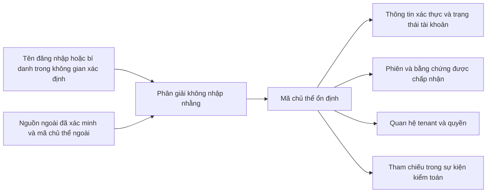

# Định danh duy nhất

## 1. Định danh duy nhất phục vụ mục tiêu gì trong xác thực?

**Định danh duy nhất** giúp hệ thống xác định một cách không nhập nhằng chủ thể mà bằng chứng xác thực, phiên, quyền và sự kiện đang tham chiếu tới trong một miền đã được xác định.

Ví dụ, khi một người đăng nhập bằng tên `minh.nguyen`, hệ thống cần tìm đúng tài khoản để kiểm tra bằng chứng, tạo phiên và đánh giá quyền. Nếu cùng tên trong cùng ngữ cảnh có thể trỏ tới hai tài khoản, hoặc một mã cũ được cấp lại cho người khác, việc xác thực và quy trách nhiệm có thể bị sai dù thao tác kiểm tra mật khẩu hoạt động đúng.

Trong bài học này, **chủ thể** là danh tính mà hệ thống quản lý và gán quyền, thường gọi là principal. Chủ thể có thể là tài khoản người dùng, tài khoản dịch vụ hoặc danh tính tích hợp. Một người thật có thể có nhiều chủ thể cho những mục đích khác nhau; yêu cầu duy nhất của mã không tự chứng minh “mỗi người chỉ có một tài khoản”.

Đặc tả cần trả lời được:

- Mã nào dùng để tham chiếu ổn định tới chủ thể?
- Tên nào chỉ dùng để tìm tài khoản hoặc hiển thị?
- Duy nhất trong hệ thống, tổ chức, thư mục hay nguồn danh tính nào?
- Quy tắc chuẩn hóa và xử lý trùng là gì?
- Điều gì xảy ra khi đổi tên, liên kết tài khoản, xóa hoặc phục hồi?
- Bằng chứng nào chứng minh một định danh không bị gắn nhầm sang chủ thể khác?

Mục tiêu là nối rủi ro nhầm hoặc chiếm danh tính với yêu cầu cụ thể về xác thực, phân quyền, dữ liệu, logging và phục hồi trong vòng đời phát triển.

## 2. Tách những loại giá trị thường bị gọi chung là ID

| Giá trị | Vai trò | Có nên dùng như tham chiếu chủ thể lâu dài không? |
|---|---|---|
| Mã chủ thể nội bộ | Tham chiếu chuẩn tới một danh tính do hệ thống quản lý | Có, nếu ổn định, có phạm vi rõ và không bị tái gán trái quy tắc |
| Tên đăng nhập | Giá trị để người dùng chọn tài khoản trong một không gian đăng nhập | Không nên mặc định; có thể đổi hoặc được cấp lại theo chính sách |
| Email hoặc số điện thoại | Địa chỉ liên hệ, có thể là bí danh đăng nhập hay kênh xác minh | Không nên mặc định; có thể thay chủ, dùng chung hoặc có nhiều cách biểu diễn |
| Tên hiển thị | Giúp con người nhận biết trong giao diện | Không; nhiều chủ thể có thể dùng cùng tên |
| Mã chủ thể từ nguồn ngoài | Tham chiếu mà một nguồn danh tính phát hành | Chỉ dùng cùng định danh nguồn và hợp đồng vòng đời đã xác minh |
| Mã phiên | Tham chiếu tới một lần hoặc trạng thái đăng nhập | Không; phiên có vòng đời khác tài khoản |
| Vai trò và tenant | Ngữ cảnh phân quyền, sở hữu hoặc quản trị | Không thay cho mã chủ thể; một chủ thể có thể có nhiều quan hệ |
| Bí mật xác thực | Bằng chứng hoặc phương tiện sử dụng danh tính | Không; phải có cơ chế quản lý, thay và thu hồi riêng |

Biết mã chủ thể không có nghĩa đã xác thực chủ thể. Một mã có thể xuất hiện trong URL, log hoặc giao diện. Nếu chỉ cần biết mã là được truy cập dữ liệu, mã đã mang thêm quyền mà thiết kế phải nhận diện và bảo vệ riêng.

Mã khó đoán có thể giảm một số khả năng dò tìm, nhưng không thay kiểm tra bằng chứng xác thực hoặc quyền theo đối tượng. Mã có thứ tự cũng không tự làm xác thực sai nếu hệ thống không dựa vào việc giấu mã để cấp quyền.

## 3. Xác định phạm vi duy nhất

### 3.1. Duy nhất luôn cần một không gian định danh

Một chuỗi có thể duy nhất trong một miền mà trùng ở miền khác. `admin` trong tổ chức A không tự là `admin` của B. Mã `subject-17` từ nguồn danh tính X không tự đại diện cho cùng chủ thể với `subject-17` từ Y.

**Không gian định danh** là miền mà quy tắc duy nhất và cách tìm chủ thể được áp dụng. Đặc tả nên ghi rõ thay vì dùng một từ “global” không có ranh giới.

| Mô hình | Khóa tra cứu có ý nghĩa | Điều phải kiểm soát |
|---|---|---|
| Một thư mục tài khoản chung | Không gian đăng nhập và giá trị đã chuẩn hóa | Trùng bí danh trong cùng không gian, thay đổi tên và vòng đời |
| Tài khoản tách theo tổ chức | Định danh tổ chức/thư mục và bí danh trong miền đó | Xác định miền trước tra cứu, không tự chọn một tài khoản trùng tên |
| Nguồn danh tính ngoài | Cấu hình nguồn đã được tin và mã chủ thể của nguồn | Không nhận nguồn tùy ý, không gộp các mã giống nhau từ nguồn khác |
| Một tài khoản thuộc nhiều tenant | Mã chủ thể ổn định và quan hệ thành viên riêng | Không biến vai trò ở một tenant thành vai trò ở tenant khác |

Thiết kế có thể dùng mã nội bộ duy nhất trong toàn hệ thống danh tính, trong khi bí danh chỉ duy nhất theo thư mục. Hai quyết định này khác nhau và cần được đặc tả riêng.

### 3.2. Chọn ngữ cảnh trước khi phân giải tài khoản

Nếu cho phép cùng tên đăng nhập ở nhiều tổ chức, hệ thống phải biết sẽ tìm trong tổ chức nào theo quy tắc được xác định. Tên miền, lựa chọn tổ chức hoặc gợi ý từ yêu cầu có thể dùng để chọn không gian, nhưng không tự chứng minh người dùng có quyền trong miền đó.

Không nên tra trên mọi miền rồi lấy bản ghi đầu tiên. Kết quả phân giải phải có đúng một chủ thể theo hợp đồng, hoặc thất bại/đòi hỏi làm rõ ngữ cảnh mà không tự gắn nhầm tài khoản.

Sau xác thực, quyền và tư cách thành viên vẫn cần được kiểm tra. Tìm được một tài khoản trong thư mục không có nghĩa được truy cập mọi tenant mà người gọi nêu.

### 3.3. Duy nhất theo giá trị không phải duy nhất theo con người

Một người có tài khoản cá nhân, tài khoản quản trị và tài khoản ở tổ chức khác có thể là thiết kế hợp lệ. Ngược lại, một tài khoản dùng chung cho nhiều người làm giảm khả năng phân biệt và quy trách nhiệm dù mã tài khoản là duy nhất.

Nếu nghiệp vụ yêu cầu hạn chế nhiều tài khoản cho cùng một người, cần yêu cầu và cơ chế xác minh riêng. Không thể suy điều đó từ email, số điện thoại hoặc một mã được tạo ngẫu nhiên.

## 4. Mã chủ thể ổn định và bí danh có thể thay đổi

### 4.1. Dùng tham chiếu chuẩn cho phiên, quyền và dữ liệu

Mã chủ thể nội bộ nên được dùng để gắn thông tin xác thực, quan hệ thành viên, quyền, phiên và sự kiện theo thiết kế. Tên đăng nhập hoặc địa chỉ liên hệ là thuộc tính hay ánh xạ tới mã đó.

Sơ đồ không chứng minh các ánh xạ đã được bảo vệ. Việc thay ánh xạ là hành động có thể ảnh hưởng tới xác thực và phải có quyền, quy tắc và bằng chứng tương ứng.

### 4.2. Đổi tên không được đổi chủ thể

Nếu tài khoản có mã `user-demo-017` đổi tên đăng nhập, các quyền và dữ liệu của tài khoản phải tiếp tục tham chiếu đúng mã đó. Không tạo một chủ thể mới chỉ vì tên thay đổi, trừ khi đó là quy trình nghiệp vụ rõ ràng với cách chuyển quan hệ được kiểm soát.

Ngược lại, nếu bí danh cũ được cấp lại cho một tài khoản mới theo chính sách, tài khoản mới không được kế thừa quyền, dữ liệu, phiên hoặc thông tin xác thực của chủ cũ.

Ví dụ, lưu quyền bằng email rồi cấp lại cùng email cho nhân viên mới có thể khiến người mới nhận quyền của người cũ. Dùng mã ổn định cho quan hệ quyền và xử lý ánh xạ theo vòng đời giúp tránh kiểu nhầm này.

### 4.3. Không tự tái gán mã đã cấp

Quy tắc phải ngăn một mã chủ thể cũ bị gắn sang chủ thể khác trong miền và vòng đời quản lý đã cam kết, kể cả sau khóa, xóa hoặc phục hồi. Ràng buộc chỉ ngăn trùng trong bảng đang hoạt động có thể chưa đủ cho lịch sử đã bị xóa khỏi bảng.

Có thể cần cơ chế cấp mã không tái sử dụng, thông tin tối thiểu đánh dấu mã đã cấp hoặc một phương án không gian/thế hệ phù hợp. Việc giữ thông tin này phải có mục đích, quyền và chính sách lưu riêng; không phải lý do giữ vô hạn toàn bộ dữ liệu cá nhân.

Các bản sao, phiên, token và hệ thống ngoài có thể còn tham chiếu mã cũ. Vì vậy, cần đánh giá tác động lịch sử, không chỉ kiểm tra hiện tại có hai hàng cùng mã hay không.

## 5. Chuẩn hóa bí danh và phân giải không nhập nhằng

### 5.1. Quy tắc biểu diễn là một phần của hợp đồng

Đặc tả phải xác định độ dài, tập ký tự, xử lý khoảng trắng, phân biệt hoa–thường, biểu diễn Unicode và cách báo lỗi cho từng loại bí danh. Quy tắc được chọn cần nhất quán ở đăng ký, đăng nhập, đổi tên, khôi phục và công cụ quản trị.

Ví dụ, nếu dự án quy định tên đăng nhập không phân biệt hoa–thường, `Minh` và `minh` phải được xử lý như cùng một giá trị theo quy tắc đã chọn. Không thể để giao diện coi là trùng nhưng kho cho hai tài khoản, hoặc ngược lại.

Không áp dụng một phép biến đổi cho mọi loại mã. Mã chủ thể bên ngoài có thể là chuỗi opaque cần giữ đúng giá trị; tự chuyển chữ thường, bỏ dấu hoặc cắt ký tự có thể gộp hai chủ thể vốn khác nhau.

Địa chỉ email cũng cần hợp đồng xử lý phù hợp. Không nên tự áp dụng các quy tắc đặc thù của một bên cung cấp, như bỏ một số dấu trong địa chỉ, cho mọi địa chỉ và coi chúng là cùng người.

### 5.2. Phân biệt trùng theo chính sách với giống về hiển thị

Hai chuỗi nhìn giống nhau có thể là giá trị khác; hai biểu diễn khác nhau có thể được chính sách coi là tương đương. Chuẩn hóa không tự giải quyết mọi vấn đề tên gây nhầm lẫn.

Nếu cần hạn chế tên dễ nhầm, ký tự điều khiển hoặc cách hiển thị gây giả mạo, phải có quy tắc riêng và tiêu chí kiểm thử. Không nên tùy tiện biến mọi tên giống nhau thành một tài khoản.

### 5.3. Tránh nhập nhằng giữa các loại bí danh

Một ô đăng nhập có thể chấp nhận tên đăng nhập hoặc email. Nếu tra bằng điều kiện “tên bằng X hoặc email bằng X” rồi lấy bản ghi đầu tiên, X có thể là tên của tài khoản A và email của B.

Thiết kế cần ngăn xung đột trong không gian phân giải chung, hoặc chọn loại/miền theo quy tắc không nhập nhằng rồi bảo đảm duy nhất trong miền đó. Khi phát hiện nhiều ứng viên, phải thất bại theo hợp đồng thay vì tự chọn một chủ thể.

Thay quy tắc chuẩn hóa cũng là thay đổi bảo mật. Cần kiểm tra xung đột của dữ liệu hiện có, kế hoạch chuyển đổi và cách xử lý phiên hoặc bí danh cũ; không tự gộp tài khoản khi quy tắc mới khiến hai giá trị trùng nhau.
