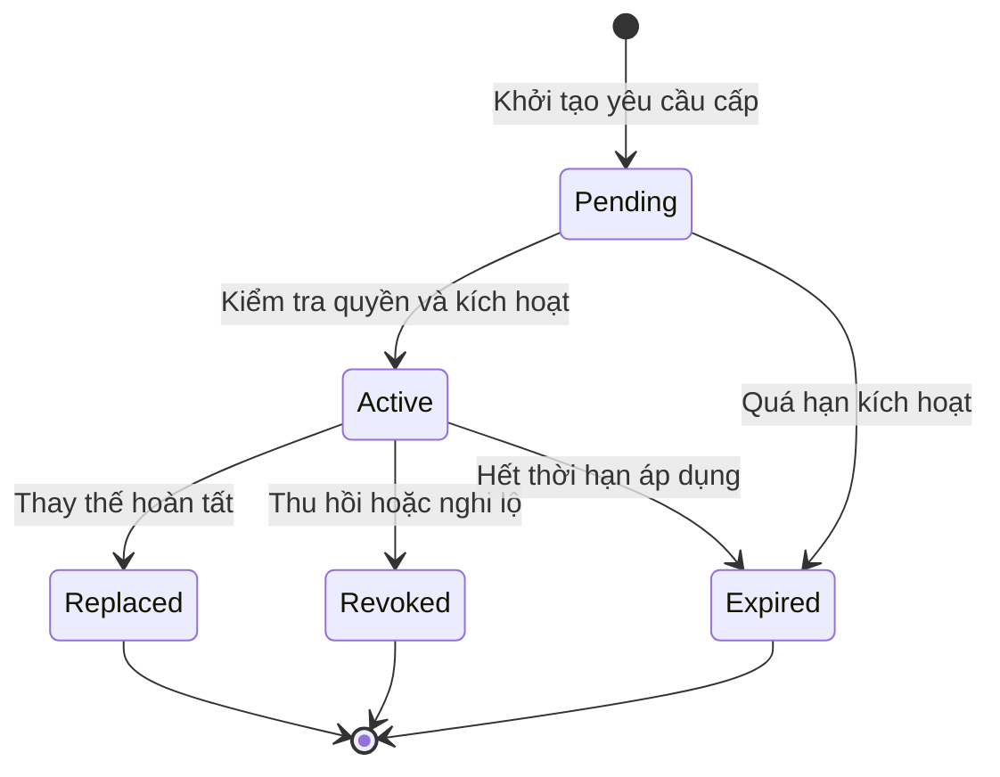

# Credential policy — Chính sách thông tin xác thực

## 1. Chính sách credential cần giải quyết điều gì?

Trong chương **Yêu cầu xác thực**, credential policy là tập yêu cầu quy định hệ thống được phép dùng loại thông tin xác thực nào, cách cấp phát, bảo vệ, sử dụng, thay thế và thu hồi chúng. Chính sách phải trả lời được hai câu hỏi: bằng chứng nào đủ để xác thực một chủ thể trong một tình huống cụ thể, và làm thế nào bảo vệ bằng chứng đó trong suốt vòng đời của nó?

Một câu như “người dùng phải đặt mật khẩu mạnh” chưa phải đặc tả có thể kiểm chứng. Nhóm phát triển chưa biết mạnh nghĩa là gì, chặn mật khẩu phổ biến ở đâu, lưu trữ thế nào, xử lý khi bị lộ ra sao hoặc dùng bằng chứng nào để nghiệm thu. Credential policy chuyển mục tiêu an toàn và mô hình đe dọa thành các điều kiện cụ thể cho sản phẩm, kiến trúc và kiểm thử.

Trong phạm vi bài học này, credential được hiểu theo nghĩa thực hành là bí mật hoặc bằng chứng gắn với một chủ thể để hệ thống kiểm tra khi xác thực. Ví dụ gồm mật khẩu, khóa dùng cho passkey, khóa API và khóa riêng của danh tính dịch vụ. Cần phân biệt các thành phần liên quan:

| Thành phần | Vai trò | Ví dụ và hệ quả đối với yêu cầu |
|---|---|---|
| Định danh | Chỉ ra chủ thể đang khai báo mình là ai | Email, tên đăng nhập, `client_id`; thông thường không phải bí mật |
| Bí mật hoặc vật liệu khóa | Cho phép chứng minh quyền kiểm soát yếu tố xác thực | Mật khẩu, seed TOTP, khóa riêng; phải có quy tắc bảo vệ riêng |
| Authenticator | Phương tiện tạo hoặc giữ bằng chứng xác thực | Ứng dụng TOTP, khóa bảo mật, thiết bị giữ passkey |
| Verifier | Thành phần kiểm tra bằng chứng | Dịch vụ kiểm tra password hash hoặc chữ ký |
| Bearer token | Ai nắm token hợp lệ có thể sử dụng quyền tương ứng | API key dạng bearer, access token; rò rỉ token có thể dẫn đến sử dụng trái phép |
| Dữ liệu phiên | Duy trì trạng thái sau lần xác thực | Cookie phiên; có vòng đời liên quan nhưng cần chính sách phiên riêng |

Mật khẩu đăng nhập, token đặt lại mật khẩu và khóa API không nên dùng chung một quy tắc chỉ vì đều là chuỗi ký tự. Chúng khác nhau về nguồn sinh, khả năng bị đoán, nơi lưu, thời gian sống và tác động khi bị lộ.

## 2. Bắt đầu từ rủi ro và phạm vi sử dụng

Trước khi chọn độ dài mật khẩu hoặc chu kỳ thay khóa, cần xác định chủ thể, tài sản, đường xác thực và giả định tin cậy. Một ứng dụng quản lý công việc nội bộ có thể có ít nhất bốn nhóm: người dùng thường, quản trị viên, dịch vụ nền và công cụ tích hợp bên ngoài.

| Tình huống đe dọa | Mục tiêu bảo vệ | Hướng yêu cầu credential |
|---|---|---|
| Kẻ tấn công thử cặp tài khoản và mật khẩu bị lộ từ hệ thống khác | Hạn chế credential stuffing và chiếm tài khoản | Chặn mật khẩu dễ đoán hoặc đã lộ trong danh sách kiểm tra; hạn chế thử; yêu cầu yếu tố bổ sung theo rủi ro |
| Cơ sở dữ liệu xác thực bị sao chép | Giảm khả năng lấy được bí mật dùng lại | Password hash có salt và hàm dẫn xuất phù hợp; bảo vệ seed và khóa cần giải mã |
| Trang giả mạo thu thập mã đăng nhập | Hạn chế phishing | Yêu cầu phương thức chống phishing cho nhóm hoặc thao tác có rủi ro cao |
| Nhân viên nghỉ việc nhưng khóa API vẫn hoạt động | Chặn truy cập bằng credential tồn dư | Gắn credential với chủ sở hữu; thu hồi theo sự kiện; kiểm kê định kỳ |
| Kẻ tấn công chiếm email rồi đặt lại mật khẩu | Bảo vệ đường phục hồi | Đặt mức bảo đảm phục hồi tương xứng; bảo vệ thay đổi yếu tố xác thực |
| Secret lọt vào log, mã nguồn hoặc công cụ phân tích | Hạn chế lan truyền bí mật | Không ghi secret; che dữ liệu tại nguồn; quy trình thay thế khi bị lộ |

Một yếu tố thứ hai có thể giảm rủi ro từ mật khẩu bị lộ, nhưng không làm mất yêu cầu bảo vệ mật khẩu. Hai bước nhập hai bí mật cùng loại cũng không tự tạo thành xác thực đa yếu tố. Chính sách phải nêu loại yếu tố và mức bảo đảm mong đợi, thay vì chỉ ghi “bật MFA”.

### Phạm vi phải được ghi rõ

Mỗi chính sách cần nêu:

- Áp dụng cho người dùng, quản trị viên, máy, môi trường production hay cả môi trường thử nghiệm nào.
- Những kênh có thể cấp hoặc thay đổi credential: giao diện web, ứng dụng di động, API, công cụ quản trị và hệ thống danh tính liên kết.
- Hệ thống nào là nơi có thẩm quyền quản lý từng credential; thành phần nào chỉ nhận kết quả xác thực.
- Giới hạn trách nhiệm giữa ứng dụng, nhà cung cấp danh tính và hệ thống quản lý bí mật.
- Những đường khẩn cấp hoặc ngoại lệ nào được phép tồn tại và thời hạn của chúng.

Nếu ứng dụng dùng đăng nhập liên kết, chính sách mật khẩu thường được thực thi ở nhà cung cấp danh tính. Ứng dụng vẫn cần yêu cầu về mức bảo đảm, ràng buộc danh tính, các đường đăng nhập dự phòng và phản ứng khi tài khoản nguồn bị vô hiệu hóa. Chỉ ẩn ô mật khẩu trên giao diện không chứng minh rằng một API cũ đã ngừng chấp nhận mật khẩu cục bộ.

## 3. Cấu trúc của một yêu cầu kiểm chứng được

Một yêu cầu tốt xác định **đối tượng, điều kiện kích hoạt, hành vi bắt buộc, ngưỡng đo, điểm thực thi và bằng chứng nghiệm thu**. Cần thêm mã yêu cầu, rủi ro nguồn và chủ sở hữu để theo dõi trong vòng đời phát triển.

Ví dụ chưa đủ rõ:

> Khóa API phải được thu hồi nhanh khi bị lộ.

Ví dụ có thể đưa vào đặc tả:

> **CR-REV-01:** Với credential đang hoạt động và bị đánh dấu nghi lộ, dịch vụ quản lý credential phải từ chối các lần xác thực mới bằng credential đó trên mọi vùng production trong tối đa 60 giây kể từ khi ghi nhận thành công thao tác thu hồi. Bài kiểm thử phải gửi yêu cầu tới từng vùng, bao gồm vùng đang sử dụng bộ nhớ đệm xác thực.

Con số 60 giây là quyết định thiết kế trong ví dụ, không phải ngưỡng áp dụng cho mọi hệ thống. Nếu hệ thống còn phát token từ credential đó, cần một yêu cầu riêng cho các token và phiên đã cấp. Thu hồi khóa gốc không mặc nhiên làm mọi token độc lập hết hiệu lực.

Với mỗi con số trong chính sách, nên ghi lý do chọn và cách đo. “Thông báo trong 5 phút” cần xác định là thời gian đưa vào hàng đợi hay thời gian người nhận nhận được thư. “Khóa sau 10 lần sai” cần chỉ rõ phạm vi đếm, cửa sổ thời gian, cách mở khóa và tác động tới khả năng bị gây từ chối dịch vụ.

## 4. Chính sách mật khẩu cho người dùng

Mật khẩu do con người chọn có phân bố rất khác chuỗi ngẫu nhiên do máy sinh. Độ dài là một điều kiện cần xem xét, nhưng việc thêm nhiều quy tắc ký tự không bảo đảm người dùng tạo được bí mật khó đoán. Cần kết hợp chính sách tạo mật khẩu, bảo vệ verifier và kiểm soát thử xác thực.

### 4.1. Ví dụ về chính sách đầu vào

Giả sử hệ thống chấp nhận mật khẩu người dùng và chọn các yêu cầu sau cho toàn bộ đường tạo, đổi và đặt lại mật khẩu:

| Mã | Yêu cầu mẫu | Cách nghiệm thu |
|---|---|---|
| CR-PW-01 | Mật khẩu có từ 15 đến 128 Unicode code point sau chuẩn hóa NFC | Kiểm tra biên 14, 15, 128, 129; kiểm tra ký tự có dấu và ký tự ngoài BMP |
| CR-PW-02 | Giữ nguyên khoảng trắng đầu, cuối và bên trong; không đổi chữ hoa thành chữ thường | Hai mật khẩu chỉ khác khoảng trắng hoặc hoa/thường phải được phân biệt sau quy trình chuẩn hóa đã chọn |
| CR-PW-03 | Cho phép dán và sử dụng trình quản lý mật khẩu trên các giao diện hỗ trợ nhập mật khẩu | Kiểm tra thao tác dán, autofill và không có JavaScript chủ động vô hiệu hóa chúng |
| CR-PW-04 | Từ chối giá trị khớp danh sách mật khẩu không được phép theo quy tắc so khớp đã công bố nội bộ | Dữ liệu thử chứa mật khẩu phổ biến và mật khẩu đã biết bị lộ phải bị từ chối trên mọi endpoint thay mật khẩu |
| CR-PW-05 | Không ép thay định kỳ chỉ vì mật khẩu đã tồn tại đủ lâu; yêu cầu thay khi có bằng chứng lộ, phục hồi tài khoản hoặc sự kiện đã định nghĩa | Mật khẩu không bị hết hạn chỉ do tuổi; các sự kiện bắt buộc thay được kiểm tra riêng |
| CR-PW-06 | Không cắt ngắn âm thầm; kiểm tra độ dài ở phía server trước thao tác dẫn xuất tốn tài nguyên | Giá trị vượt giới hạn bị từ chối rõ ràng; toàn bộ mật khẩu hợp lệ tham gia xác minh |

Đây là một cấu hình minh họa do nhóm thiết kế lựa chọn, không phải tuyên bố đáp ứng một tiêu chuẩn cụ thể. Nếu có nghĩa vụ khác về độ dài, lịch thay hoặc tập ký tự, cần ghi rõ phạm vi và căn cứ áp dụng.

Chuẩn hóa Unicode là một lựa chọn phải nhất quán giữa đăng ký, đăng nhập, đổi và phục hồi mật khẩu. Trong ví dụ trên, hệ thống dùng NFC ở tất cả các đường này. Không được tự đổi thuật toán chuẩn hóa cho mật khẩu đang tồn tại mà không đánh giá ảnh hưởng và có cách chuyển tiếp. Quy tắc so khớp blocklist cũng cần được định nghĩa độc lập; không biến việc kiểm tra blocklist thành thao tác thay đổi mật khẩu trước khi lưu.

Giới hạn ký tự không thay thế giới hạn kích thước yêu cầu HTTP. Hệ thống vẫn cần chặn đầu vào quá lớn trước khi giải mã, chuẩn hóa hoặc tính hash để tránh tiêu tốn tài nguyên không cần thiết.

### 4.2. Danh sách mật khẩu không được phép

Danh sách kiểm tra có thể bao gồm mật khẩu phổ biến, chuỗi liên quan trực tiếp đến tên dịch vụ và mật khẩu có bằng chứng đã lộ. Chính sách cần nêu nguồn dữ liệu, tần suất cập nhật, cách phân phối phiên bản và người chịu trách nhiệm.

Không gửi mật khẩu nguyên văn tới dịch vụ bên ngoài để hỏi xem mật khẩu đã bị lộ hay chưa. Có thể dùng dữ liệu nội bộ hoặc một cơ chế truy vấn giảm tiết lộ đã được đánh giá. Ngay cả phần hash hoặc dữ liệu dẫn xuất được gửi đi cũng cần xem xét về quyền riêng tư và khả năng liên kết.

Nếu nguồn kiểm tra không khả dụng, cần định nghĩa hành vi cụ thể. Ví dụ: dùng bản dữ liệu nội bộ gần nhất trong tối đa 24 giờ cho đường tạo mật khẩu mới; khi bản đó quá hạn thì tạm từ chối thao tác tạo hoặc thay mật khẩu với thông báo có thể thử lại. Không tự động chặn mọi đăng nhập đang hợp lệ chỉ vì dịch vụ blocklist bị lỗi.

### 4.3. Lưu và xác minh mật khẩu

Verifier không cần biết lại mật khẩu gốc. Vì vậy, yêu cầu lưu trữ phải là lưu giá trị dẫn xuất từ mật khẩu bằng hàm phù hợp, có salt riêng cho mỗi bản ghi và thông tin thuật toán/tham số để phục vụ nâng cấp. Mã hóa có thể giải ngược không nên được dùng làm cơ chế lưu mật khẩu đăng nhập thông thường.

Một yêu cầu triển khai có thể viết:

> **CR-PW-STORE-01:** Dịch vụ xác thực phải lưu password verifier bằng hàm dẫn xuất chuyên dụng, chẳng hạn Argon2id với cấu hình được phê duyệt qua đo hiệu năng và phân tích chi phí tấn công. Mỗi lần đặt mật khẩu phải dùng salt ngẫu nhiên riêng. Không lưu mật khẩu nguyên văn trong cơ sở dữ liệu, log, trace, sự kiện hay bản sao phục vụ hỗ trợ.

Không đặt ra một bộ tham số hash rồi xem đó là bất biến. Hồ sơ triển khai phải ghi thuật toán, phiên bản, chi phí CPU/bộ nhớ, độ trễ trên phần cứng thực tế và khả năng chịu tải khi bị thử đăng nhập hàng loạt. Khi thay đổi cấu hình, có thể nâng cấp verifier sau một lần xác thực hợp lệ; không thể tái tạo mật khẩu của mọi người dùng chỉ từ hash cũ để băm lại hàng loạt.

Pepper, nếu sử dụng, là bí mật bổ sung được giữ tách khỏi cơ sở dữ liệu verifier. Nó không thay thế salt. Thiết kế phải chỉ ra nơi giữ pepper, quyền truy cập, phiên bản và cách xử lý khi pepper bị lộ hoặc mất. Đổi pepper cho password hash có thể cần người dùng xác thực lại hoặc đặt lại mật khẩu; không nên hứa có thể thay toàn bộ pepper ngay lập tức mà không cần mật khẩu gốc.

### 4.4. Hạn chế thử xác thực

Chính sách mật khẩu phải liên kết tới yêu cầu chống đoán trực tuyến. Cần giới hạn theo tài khoản, nguồn yêu cầu và tín hiệu tổng hợp để tránh việc kẻ tấn công vượt giới hạn bằng nhiều địa chỉ IP hoặc gây khóa tài khoản hàng loạt.

Một cấu hình minh họa là: sau 5 lần sai trong 10 phút với một tài khoản, trì hoãn tăng dần các lần thử tiếp theo, tối đa 30 giây mỗi lần; đồng thời áp dụng hạn mức theo nguồn và phát hiện password spraying trên nhiều tài khoản. Giá trị thực tế phải được kiểm tra với tải dự kiến và rủi ro từ chối dịch vụ. Không dùng việc ngủ giữ một luồng xử lý cho mỗi yêu cầu làm cách triển khai mặc định của trì hoãn.

Thông báo công khai cho lần đăng nhập thất bại cần tránh tiết lộ tài khoản tồn tại hay không. Nội bộ vẫn cần phân biệt nguyên nhân để điều tra, với dữ liệu truy cập được kiểm soát. Khi xử lý tài khoản không tồn tại, cần thiết kế đường phản hồi tránh tạo chênh lệch rõ rệt về nội dung, mã trạng thái hoặc thời gian xử lý.

## 5. Yêu cầu theo từng loại credential

### 5.1. Passkey và khóa bảo mật

Với passkey dựa trên WebAuthn, máy chủ lưu khóa công khai và dữ liệu đăng ký cần thiết; khóa riêng do authenticator quản lý. Việc dùng phương thức này cần các yêu cầu xác minh đầy đủ, không chỉ kiểm tra rằng có chữ ký hợp lệ.

- Challenge phải được sinh ngẫu nhiên, gắn với giao dịch, có thời hạn và chỉ được chấp nhận một lần.
- Verifier phải kiểm tra challenge, origin, RP ID và dữ liệu xác thực theo ngữ cảnh đã cấu hình.
- Nếu chính sách yêu cầu xác minh người dùng, verifier phải kiểm tra kết quả user verification. Không đồng nhất việc chạm thiết bị với việc đã xác minh người dùng.
- Đăng ký thêm hoặc xóa authenticator phải yêu cầu xác thực lại ở mức phù hợp và tạo sự kiện kiểm toán.
- Khóa đồng bộ qua hệ sinh thái và khóa ràng buộc với thiết bị cần được phân loại theo nhu cầu bảo đảm của hệ thống; không mặc định chúng có cùng đặc tính.

Sinh trắc học có thể là cách thiết bị xác minh người dùng tại chỗ; ứng dụng không mặc nhiên nhận hoặc cần lưu mẫu sinh trắc học. Nếu một sản phẩm thu thập dữ liệu sinh trắc học riêng, đó là luồng dữ liệu khác và phải có yêu cầu bảo vệ tương ứng.

### 5.2. Mã OTP và recovery code

Seed TOTP phải được giữ bí mật vì verifier cần dùng nó để kiểm tra mã. Khác với mật khẩu, chỉ lưu một hash của seed thường không đủ cho phép xác minh TOTP. Yêu cầu nên quy định mã hóa seed, quản lý khóa giải mã và giới hạn quyền của thành phần được phép sử dụng seed.

Đối với TOTP, phải giới hạn số lần thử, quy định cửa sổ thời gian chấp nhận và ngăn dùng lại một mã đã xác thực thành công trong phạm vi hợp lệ. OTP nhập thủ công có thể bị chuyển tiếp qua trang giả mạo; không xem nó là phương thức chống phishing chỉ vì mã thay đổi nhanh.

Recovery code phải được sinh ngẫu nhiên, có đủ độ khó đoán cho mô hình sử dụng, chỉ hiển thị qua luồng cấp phát được bảo vệ và được lưu dạng verifier phù hợp. Mỗi mã chỉ dùng một lần; cấp lại một bộ mã phải vô hiệu hóa bộ cũ. Việc tiêu thụ mã cần nguyên tử để hai yêu cầu đồng thời không cùng sử dụng thành công một mã.

### 5.3. Khóa API và secret của dịch vụ

Credential của máy không có lý do phải dễ nhớ. Ví dụ, hệ thống có thể sinh secret khóa API từ 32 byte ngẫu nhiên bằng bộ sinh ngẫu nhiên mật mã, tương ứng 256 bit trước khi mã hóa biểu diễn. Tiền tố nhận diện môi trường hoặc mã khóa công khai không được tính vào lượng ngẫu nhiên đó.

Yêu cầu tối thiểu nên gồm:

- Mỗi tích hợp có danh tính hoặc credential riêng, có chủ sở hữu chịu trách nhiệm và mục đích sử dụng.
- Secret không xuất hiện trong URL, mã nguồn, tệp cấu hình công khai hoặc log; ứng dụng lấy secret qua kênh quản lý bí mật phù hợp.
- Khóa được giới hạn môi trường, phạm vi quyền và tài nguyên cần thiết. Xác thực thành công không tự cấp mọi quyền truy cập.
- Ghi nhận thời điểm tạo, lần sử dụng gần nhất, hạn sử dụng nếu có và trạng thái thu hồi.
- Nếu chỉ cần kiểm tra secret ngẫu nhiên có đúng hay không, lưu digest hoặc HMAC phù hợp thay vì secret có thể đọc lại; so sánh giá trị verifier theo cách tránh rò rỉ thời gian có thể khai thác.
- Nếu hệ thống phải dùng secret để đăng nhập sang bên thứ ba, cần kho lưu có thể giải mã với quyền truy cập hẹp; không áp dụng yêu cầu “chỉ lưu hash” cho một trường hợp cần lấy lại secret.

Khóa API tĩnh thường là bearer credential. Một khóa riêng dùng để ký challenge hoặc chứng minh quyền sở hữu có mô hình khác; cần quy định thuật toán, giao thức chứng minh, quản lý khóa và chống phát lại tương ứng.

Đối với dịch vụ có thể dùng danh tính workload và credential ngắn hạn được cấp tự động, chính sách nên nêu rõ thời hạn, đối tượng nhận, điều kiện cấp và cách ngừng cấp khi workload mất quyền. Credential ngắn hạn vẫn cần kiểm tra audience, quyền sử dụng và xử lý rò rỉ.

## 6. Quản lý trọn vòng đời credential

Một chính sách chỉ kiểm tra lúc tạo sẽ bỏ sót nhiều thời điểm dễ bị khai thác. Các trạng thái dưới đây là mô hình minh họa; nhóm phát triển có thể biểu diễn khác nhưng phải giữ được các điều kiện chuyển trạng thái.



Trạng thái hết hạn không có nghĩa mọi credential đều phải có lịch hết hạn giống nhau. Ví dụ mật khẩu trong chính sách minh họa không hết hạn chỉ vì tuổi; khóa tích hợp có thể có hạn sử dụng. Một credential đã thu hồi không được bật lại chỉ để hỗ trợ quay lui. Cần cấp credential mới sau khi xác minh điều kiện cho phép.

| Giai đoạn | Điều kiện và hành vi cần đặc tả | Bằng chứng có thể kiểm tra |
|---|---|---|
| Cấp phát | Ai có quyền cấp, chứng minh danh tính nào, gửi qua kênh nào | Yêu cầu không đủ quyền bị từ chối; sự kiện có người khởi tạo |
| Kích hoạt | Token kích hoạt có hạn, đúng mục đích và dùng một lần | Token hết hạn, sai mục đích hoặc đã dùng không kích hoạt được |
| Sử dụng | Chỉ xác thực credential hoạt động, đúng môi trường và ngữ cảnh | Khóa thử nghiệm không được dùng tại production |
| Thay thế | Xác thực lại, xác minh credential mới và quyết định thời gian chồng lấp | Có thể thay khóa mà không làm mất khả năng thu hồi khóa cũ |
| Thu hồi | Ngừng chấp nhận theo SLA, phát tán tới cache và vùng triển khai | Kiểm thử xuyên vùng đo từ thời điểm ghi nhận thu hồi |
| Phục hồi | Xác minh lại, không tiết lộ bí mật cũ, áp dụng mức bảo đảm phù hợp | Người không đủ bằng chứng không thể đặt credential mới |
| Kết thúc lưu giữ | Loại bỏ vật liệu bí mật theo chính sách dữ liệu và sao lưu | Dữ liệu kiểm toán không giữ secret; quy trình khôi phục vẫn tôn trọng thu hồi |

### 6.1. Thay khóa có chồng lấp

Với tích hợp dịch vụ, có thể cho phép tối đa hai khóa hoạt động trong giai đoạn thay thế, với cửa sổ chồng lấp chẳng hạn 24 giờ. Chủ sở hữu tạo khóa mới, triển khai bên gọi, kiểm tra lưu lượng bằng mã khóa mới rồi thu hồi khóa cũ. Hết cửa sổ, khóa cũ phải bị từ chối theo quy tắc đã đặc tả.

Nếu khóa cũ nghi bị lộ, không duy trì cửa sổ chồng lấp thông thường chỉ để thuận tiện vận hành. Quy trình ứng cứu phải cho phép thu hồi ngay và phối hợp khôi phục dịch vụ. Chính sách cần phân biệt thay định kỳ theo kế hoạch với thay do sự cố.

### 6.2. Thu hồi trong hệ thống phân tán

Yêu cầu thu hồi phải chỉ ra đơn vị thực thi: credential gốc, token đã phát, phiên trình duyệt và quyền cấp tiếp có thể cần các hành động khác nhau. Một access token tự chứa vẫn có thể được chấp nhận đến khi hết hạn nếu verifier chỉ kiểm tra chữ ký và thời hạn.

Nếu đặt mục tiêu dừng mọi truy cập trong 60 giây nhưng access token sống 30 phút, kiến trúc phải bổ sung cơ chế đáp ứng mục tiêu, ví dụ kiểm tra trạng thái, danh sách thu hồi hoặc một cách vô hiệu hóa phù hợp. Cần kiểm thử khi mất kết nối tới kho trạng thái; không mặc định việc phát sự kiện thu hồi đồng nghĩa mọi nơi đã áp dụng.

## 7. Phục hồi và thay đổi yếu tố xác thực

Phục hồi tài khoản là một đường xác thực có quyền đặt credential mới. Nếu đường này chỉ cần trả lời câu hỏi dễ đoán, toàn bộ yêu cầu mạnh của đường đăng nhập có thể bị vượt qua.

Một tập yêu cầu minh họa:

| Mã | Yêu cầu |
|---|---|
| CR-REC-01 | Token đặt lại mật khẩu được sinh bằng bộ sinh ngẫu nhiên mật mã, gắn với tài khoản và mục đích, có hạn 15 phút và chỉ dùng thành công một lần |
| CR-REC-02 | Việc sử dụng token và cập nhật trạng thái dùng rồi phải nguyên tử; hai yêu cầu đồng thời chỉ được tối đa một lần thành công |
| CR-REC-03 | API yêu cầu phục hồi trả thông báo công khai không tiết lộ tài khoản tồn tại; áp dụng hạn mức cho cả yêu cầu gửi và kiểm tra token |
| CR-REC-04 | Đặt lại mật khẩu không tự tắt MFA; phục hồi yếu tố MFA có quy trình và bằng chứng riêng |
| CR-REC-05 | Sau khi đổi mật khẩu thành công, vô hiệu hóa các token đặt lại mật khẩu còn tồn tại của tài khoản; áp dụng chính sách phiên theo nguyên nhân thay đổi |
| CR-REC-06 | Gửi thông báo thay đổi credential tới kênh đã được xác minh trước đó; sự kiện không chứa secret mới hoặc token phục hồi |
| CR-REC-07 | Thay hoặc thêm yếu tố cho tài khoản đặc quyền cần xác thực lại bằng phương thức được phê duyệt; phiên đang mở đơn thuần không đủ |

Hạn 15 phút là giá trị minh họa. Đặc tả phải nêu thời điểm bắt đầu tính hạn, cách xử lý gửi lại yêu cầu và phạm vi các token bị vô hiệu hóa. Ví dụ: yêu cầu phục hồi mới có thể thay token cũ, nhưng chưa được làm mật khẩu hiện tại mất hiệu lực chỉ vì một người bất kỳ yêu cầu gửi email.

Nếu token đi trong liên kết, không nạp tài nguyên bên thứ ba có thể nhận liên kết qua referrer; phải lọc token khỏi access log, analytics và trace. Hệ thống cũng cần quyết định cách xử lý trình quét liên kết email: mở trang bằng GET không nên tự tiêu thụ token hoặc đổi credential; việc hoàn tất phải gắn với thao tác xác nhận được bảo vệ.

Quy trình hỗ trợ thủ công phải ghi rõ bằng chứng danh tính, vai trò phê duyệt, nhật ký và trường hợp cần hai người kiểm soát. Nhân viên hỗ trợ không được yêu cầu người dùng đọc mật khẩu, mã OTP đang dùng hoặc cung cấp seed TOTP. Tài khoản khẩn cấp phải có chủ sở hữu, cách giữ credential, cảnh báo khi sử dụng và quy trình kiểm tra sau mỗi lần dùng.

## 8. Ràng buộc kiến trúc, dữ liệu và logging

Chính sách phải được thực thi ở thành phần server có thẩm quyền. Kiểm tra trên giao diện giúp phản hồi sớm nhưng không thay thế kiểm tra tại API. Cần liệt kê mọi đường ghi credential để tránh đăng ký kiểm tra rất kỹ trong khi API quản trị hoặc nhập dữ liệu lại bỏ qua quy tắc.

Một luồng đổi mật khẩu có thể được đặc tả ở mức trách nhiệm như sau:

```text
Người dùng gửi yêu cầu đổi mật khẩu
  -> Kiểm tra phiên, xác thực lại và quyền thay đổi
  -> Áp dụng giới hạn kích thước, chuẩn hóa và kiểm tra chính sách
  -> Tạo verifier mới với salt và cấu hình đang được phê duyệt
  -> Cập nhật verifier cùng phiên bản credential một cách nhất quán
  -> Áp dụng quy tắc với token phục hồi và phiên đã cấp
  -> Ghi sự kiện đã lọc bí mật và gửi thông báo thay đổi
```

Nếu cập nhật thành công ở cơ sở dữ liệu nhưng gửi thông báo thất bại, cần cơ chế thử lại có trạng thái rõ ràng; không vì lỗi gửi thư mà khiến giao diện báo mật khẩu chưa đổi trong khi hệ thống đã đổi. Mục tiêu nhất quán và thời gian phản ứng phải được chuyển thành yêu cầu cho giao dịch, hàng đợi hoặc cơ chế sự kiện phù hợp.

### Dữ liệu có thể lưu và dữ liệu cần loại khỏi log

| Dữ liệu | Cách xử lý minh họa |
|---|---|
| Mã credential, loại, chủ sở hữu, trạng thái, thời điểm tạo và dùng gần nhất | Dùng cho kiểm kê; giới hạn quyền xem và thời hạn giữ |
| Password verifier, salt và tham số | Lưu trong kho xác thực; không đưa vào log ứng dụng |
| Khóa công khai passkey và dữ liệu đăng ký cần thiết | Lưu để xác minh; không suy diễn rằng đây là khóa riêng |
| Seed TOTP, private key hoặc secret cần lấy lại | Mã hóa và kiểm soát quyền dùng theo thiết kế quản lý khóa |
| Mật khẩu, OTP, recovery code, token đặt lại, header Authorization | Loại khỏi log, trace, dữ liệu phân tích và thông báo lỗi |
| Sự kiện tạo, thay, sử dụng thất bại bất thường và thu hồi | Ghi chủ thể, đối tượng, kết quả, thời gian, mã tương quan và nguyên nhân đã phân loại |

Không chỉ kiểm tra log do ứng dụng tự viết. Reverse proxy, gateway, công cụ quan sát, trang lỗi và hệ thống hỗ trợ đều có thể sao chép request. Việc che secret phải thực hiện trước khi dữ liệu đi vào các hệ thống này.

Bản sao lưu chứa dữ liệu xác thực cũng thuộc phạm vi bảo vệ. Nếu khôi phục một bản sao cũ, những credential đã thu hồi sau thời điểm sao lưu không được tự hoạt động lại. Thiết kế có thể dùng lịch sử thu hồi độc lập hoặc quy trình đối soát bắt buộc trước khi mở lại dịch vụ. Cần kiểm thử tình huống này như một yêu cầu phục hồi, không chỉ kiểm tra rằng cơ sở dữ liệu khôi phục thành công.

## 9. Hồ sơ chính sách minh họa cho một sản phẩm

Giả sử sản phẩm có người dùng doanh nghiệp, quản trị viên và các tích hợp API. Một hồ sơ chính sách có thể gồm các quyết định sau. Mọi giá trị trong bảng là giả định thiết kế để minh họa cách đặc tả và cần được điều chỉnh theo mô hình đe dọa thực tế.

| Nhóm | Phương thức và điều kiện | Vòng đời và phản ứng |
|---|---|---|
| Người dùng thông thường | Mật khẩu theo CR-PW hoặc passkey; thay thông tin nhạy cảm yêu cầu xác thực lại | Không đổi mật khẩu chỉ do tuổi; thu hồi và phục hồi khi có bằng chứng chiếm quyền |
| Quản trị viên production | Dùng phương thức chống phishing đã được phê duyệt; mọi đường dự phòng được kiểm soát tương xứng | Thu hồi quyền truy cập khi rời vai trò; cảnh báo khi đăng ký thêm authenticator |
| Tích hợp bên ngoài | Mỗi tích hợp có khóa riêng, secret sinh từ 32 byte ngẫu nhiên, giới hạn quyền và môi trường | Khóa có hạn 90 ngày; cảnh báo trước 14 ngày; chồng lấp tối đa 24 giờ khi thay theo kế hoạch |
| Workload nội bộ | Danh tính workload và credential tự động có hạn tối đa 15 phút | Ngừng cấp khi workload mất quyền; xử lý credential đã cấp theo giới hạn thời gian và cơ chế thu hồi |
| Tài khoản khẩn cấp | Credential được giữ trong kho được kiểm soát, có quy trình lấy ra và phương thức xác thực được phê duyệt | Cảnh báo mỗi lần sử dụng; thay credential và rà soát hoạt động sau lần dùng |

Nếu khóa tích hợp có hạn 90 ngày, tài liệu phải xác định thành phần cưỡng chế hết hạn và cách xử lý tích hợp không thay kịp. Nhắc lịch mà vẫn chấp nhận khóa quá hạn không đáp ứng yêu cầu hết hạn.

Ngoại lệ cần mã định danh, chủ sở hữu, lý do, rủi ro chấp nhận, biện pháp bù, người phê duyệt và ngày kết thúc. Ví dụ một tích hợp cũ được thêm 14 ngày để chuyển khóa phải có phạm vi giới hạn, giám sát bổ sung và thời điểm bắt buộc thu hồi. Không biến ngoại lệ thành một cờ vô thời hạn trong cơ sở dữ liệu.

## 10. Liên kết yêu cầu với rủi ro và tiêu chí kiểm thử

Một danh sách quy tắc chỉ hữu ích trong phát triển khi biết ai thực thi và chứng minh bằng cách nào. Ma trận dưới đây minh họa đường nối từ rủi ro tới kiến trúc và nghiệm thu.

| Rủi ro | Yêu cầu | Điểm thực thi | Bằng chứng nghiệm thu |
|---|---|---|---|
| R-01: dùng mật khẩu phổ biến | CR-PW-01, CR-PW-04 | Dịch vụ quản lý mật khẩu | Kiểm thử đăng ký, đổi, đặt lại và API quản trị bằng cùng tập dữ liệu biên |
| R-02: lộ cơ sở dữ liệu verifier | CR-PW-STORE-01 | Kho xác thực và dịch vụ dẫn xuất | Kiểm tra cấu trúc bản ghi, salt riêng, cấu hình thuật toán và quyền truy cập |
| R-03: phishing tài khoản đặc quyền | Yêu cầu phương thức chống phishing cho quản trị viên | Nhà cung cấp danh tính và verifier | Kiểm thử origin/RP ID sai bị từ chối; kiểm tra đường phục hồi và dự phòng |
| R-04: khóa bị lộ vẫn dùng được | CR-REV-01 | Dịch vụ credential, gateway và cache | Đo yêu cầu mới tại mọi vùng sau thao tác thu hồi, kể cả khi cache đang có bản cũ |
| R-05: chiếm quyền qua phục hồi | CR-REC-01 đến CR-REC-07 | API phục hồi, dịch vụ yếu tố và thông báo | Token sai mục đích/hết hạn bị từ chối; tranh chấp đồng thời chỉ một lần thành công |
| R-06: lộ secret qua quan sát | Quy tắc lọc secret | Ứng dụng, gateway, trace và analytics | Gửi secret giả có dấu nhận diện trong môi trường thử rồi kiểm tra mọi nơi có thể ghi dữ liệu |
| R-07: khôi phục làm sống lại khóa cũ | Yêu cầu đối soát thu hồi khi phục hồi | Quy trình khôi phục và kho trạng thái | Khôi phục bản sao trước thời điểm thu hồi rồi xác minh khóa vẫn bị từ chối |

### Một số kịch bản nghiệm thu theo Given–When–Then

```gherkin
Scenario: Không cắt ngắn mật khẩu
  Given chính sách giới hạn tối đa 128 Unicode code point sau NFC
  When người dùng gửi mật khẩu 129 code point qua API đổi mật khẩu
  Then API từ chối do vượt giới hạn
  And verifier hiện tại không bị thay đổi

Scenario: Recovery code chỉ dùng được một lần khi có tranh chấp
  Given một recovery code còn hiệu lực và chưa sử dụng
  When hai yêu cầu hợp lệ gửi cùng code đồng thời
  Then tối đa một yêu cầu hoàn tất phục hồi thành công
  And code không thể được dùng cho lần phục hồi tiếp theo

Scenario: Thu hồi có tác dụng trên cache xác thực
  Given khóa API đang hoạt động và đã được sử dụng tại mọi vùng
  When thao tác thu hồi được ghi nhận thành công ở thời điểm T0
  Then mọi yêu cầu mới dùng khóa tại hoặc sau T0 cộng 60 giây đều bị từ chối
  And sự kiện kiểm toán ghi mã khóa nhưng không ghi secret

Scenario: Đổi mật khẩu không gỡ yếu tố thứ hai
  Given tài khoản có MFA và một token đặt lại mật khẩu hợp lệ
  When người dùng đặt lại mật khẩu thành công
  Then lần đăng nhập bằng mật khẩu mới vẫn yêu cầu MFA
  And các token đặt lại mật khẩu còn tồn tại không thể tiếp tục sử dụng
```

Ngoài các kịch bản thành công và thất bại trực tiếp, cần kiểm tra biên thời gian, tranh chấp đồng thời, mất kết nối, quyền vận hành và các đường API ít dùng. Với yêu cầu hiệu năng, dùng secret giả và môi trường được phép kiểm thử; không ghi lại credential thật để làm bằng chứng.

## 11. Các lỗi đặc tả thường gặp

| Cách viết hoặc quyết định | Vì sao chưa đủ | Cách làm rõ |
|---|---|---|
| “Mật khẩu phải phức tạp” | Không có ngưỡng và cách xử lý cụ thể | Nêu độ dài, chuẩn hóa, blocklist, giới hạn đầu vào và điểm thực thi |
| “Đổi mọi secret mỗi tháng” | Không phân biệt mật khẩu người dùng và khóa tự động; không nêu lý do | Chọn theo loại credential, rủi ro, khả năng tự động hóa và sự kiện lộ |
| “Mọi bí mật đều lưu hash” | Một số secret phải lấy lại để dùng hoặc xác minh | Phân loại verifier một chiều và dữ liệu cần mã hóa để giải mã |
| “Có MFA là chống phishing” | OTP có thể bị thu thập và chuyển tiếp | Chỉ định phương thức, ràng buộc giao thức và mức bảo đảm cần đạt |
| “Đã thu hồi khóa nên phiên chắc chắn hết hiệu lực” | Token hoặc phiên có thể xác minh độc lập | Có yêu cầu riêng về token đã cấp, phiên và thời gian hội tụ |
| “Đổi mật khẩu là biết người dùng còn kiểm soát tài khoản” | Phiên hoặc email phục hồi có thể đã bị chiếm | Xác thực lại và phục hồi theo mô hình đe dọa, thông báo qua kênh tin cậy |
| “Kiểm tra ở form đăng ký là đủ” | Đường đặt lại, API quản trị hoặc nhập dữ liệu có thể bỏ qua | Tập trung quy tắc tại server và kiểm kê mọi đường ghi credential |
| “Lưu full request để dễ điều tra” | Bí mật lan vào log, trace và hệ thống hỗ trợ | Ghi mã tham chiếu và sự kiện cần thiết; loại secret trước khi xuất dữ liệu |

## 12. Sản phẩm đầu ra của việc đặc tả

Sau khi xây dựng credential policy, nhóm phát triển cần có một tập tài liệu đủ để đưa vào thiết kế và nghiệm thu:

1. Danh mục chủ thể, loại credential, môi trường và nơi có thẩm quyền quản lý.
2. Các yêu cầu có mã, rủi ro nguồn, giá trị đo và lý do lựa chọn.
3. Vòng đời cấp, sử dụng, thay, thu hồi và phục hồi, gồm cả token hoặc phiên liên quan.
4. Quyết định về verifier, kho bí mật, quyền truy cập, lọc log và khôi phục dữ liệu.
5. Ma trận liên kết yêu cầu với thành phần thực thi, chủ sở hữu và tiêu chí kiểm thử.
6. Danh sách ngoại lệ có hạn và sự kiện kích hoạt rà soát chính sách.

Chính sách cần được rà soát khi có phương thức xác thực mới, thay kiến trúc danh tính, thay mô hình đe dọa, phát hiện credential bị lộ hoặc thay đổi nghĩa vụ áp dụng. Mục tiêu của việc đặc tả là khiến mỗi quyết định bảo vệ credential trở thành hành vi quan sát được: hệ thống chấp nhận gì, từ chối gì, trong bao lâu và bằng chứng nào chứng minh điều đó.
